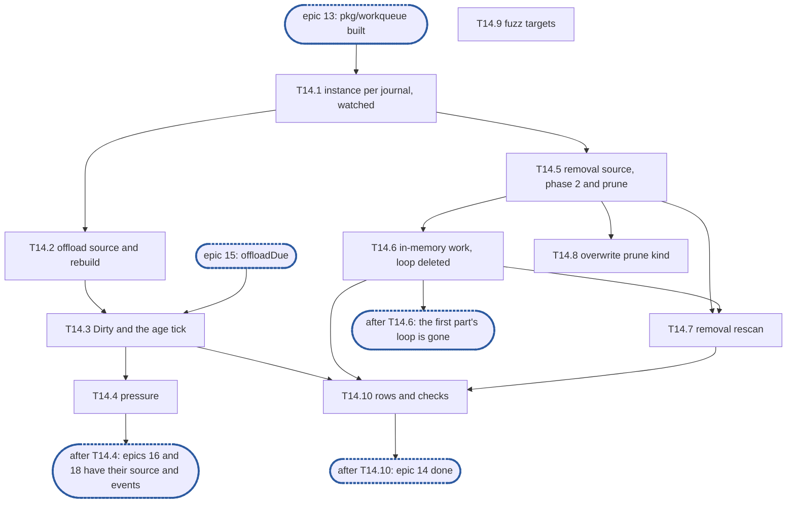

# Epic 14: engine offload work queue

**Sources:** [RFC 8](../docs/internals/rfcs/rfc-8-engine.md) §6 (offload's four MUSTs, as far as the
queue carries them), §6.1 (the work queue whole), §6.1.1 (what a consumer of the scheduler owes it:
its sources, their limits, their tenants, re-deriving dropped work), §4.1 step 4 (`Dirty`), §8.1
(phase 2, the prune of a done removal and the phase-1 retries, run from the scheduler, and
`removal_stalled`), §2.5 start steps 4, 6 and 7 and stop steps 2, 3 and 5 (the queue's part), §2.6
(the watchdog member, as amended here, and the work queue's row), §3.3, §11.2 (the metadata-stall
row's phase-2 and prune backoff, the self-fence's removal owner), §13 E23 and E41, §14 (the queue,
work and removal series, the work-queue lock), §15.2's "§6.1.1 a stuck run" and "§8.1 removal
wedge", §15.3's `ponytail:` on the work queue's pure parts;
[RFC 6](../docs/internals/rfcs/rfc-6-block-metadata.md) §3.3, the prune of superseded overwrite
records; [RFC 13](../docs/internals/rfcs/rfc-13-configuration.md) Appendix B, the rows of
`offload.retry_*`, `removal.rescan`, the age tick and the scheduler's pending entries per instance;
[RFC 25](../docs/internals/rfcs/rfc-25-observability.md) §3.5, the watchdog loop each instance turns;
[RFC 0](../docs/internals/rfcs/rfc-0-data-lifecycle.md) §1.2, which keeps `pkg/health` out of the
engine.
**Track:** A.
**Epic 14 estimate: 10 subtasks, 23.5 man-days.**
**Depends on:** epic 13, `pkg/workqueue` built behind the surface epic 11 froze (S1): every rule of
RFC 8 §6.1.1 holds over a scheduler instance alone, including `Loop.Turn`, `CancelTenant`,
`WaitTenant` and `Stop`; epic 15's `offloadDue`, which the `Dirty` handler and the age tick call
(T14.3 only); epic 12's fixture controls `BlockNextRun` (T14.10) and the two red rows this epic turns
green, and S2.
**Blocks:** epic 16, whose passes are the offload source's `Run` (T14.2) and which posts the prune
kind (T14.8); epic 18, which posts `Pressure` from `admit` and the refusal path's step 3 (T14.4);
epic 19, which adds a late-attached journal's shards as tenants and reads the removal source's
rebuild (T14.1, T14.5); epic 20, which reads the scheduler's figures for `work_queue_stalled` and
the drain (T14.1).

---

## 1. Goal

Epic 14 puts the engine's background work on one shared-scheduler instance per journal, with two
sources, offload and removal, and the events that feed them. The first part's removal loop, a FIFO
with a fixed backoff, is moved onto the removal source and deleted.

**At the end of the epic:**

- each open journal has one `*workqueue.Scheduler`, its watchdog loop taken through `Deps.Watch` and
  closed after `Stop`, every shard bound on the journal one tenant of each source;
- a write posts `Dirty` without waiting; a timer per journal posts every due file oldest first; a
  `Pressure` state lowers the backoff cap of put-healthy shards;
- the offload source rebuilds from the journal's dirty files and hands each batch to its `Run`, whose
  body epic 16's pass replaces;
- every removal obligation the first part's loop ran, durable or in memory, runs as the file's
  removal key on the removal source, backed off between `offload.retry_min` and `offload.retry_max`,
  rebuilt from the unfinished-removal index and re-derived by a rescan from a per-shard cursor;
- the decoders the rebuild and a removal batch read are fuzzed;
- §15.2's "§6.1.1 a stuck run" passes over the engine's instances and "§8.1 removal wedge" is green
  with the undecodable ref.

### 1.1 In scope

The instance per journal, its sources and their limits, its tenants and weights; `Deps.Watch`; the
`Dirty`, `AgeTick`, `Pressure` and `RemovalPending` events; the removal rescan; the prune kind's run;
the first part's removal loop moved and deleted, with its tests; the queue's `Stats` fields; the fuzz
targets; the two red rows and §6.1's checks this epic can run.

### 1.2 Out of scope

- The offload pass, the `Run` body that offers, carves, puts and commits: epics 15 and 16. Until epic
  16 the offload source's `Run` offers nothing (D7).
- `offloadDue` itself, with its block-target, age and pressure triggers and the pass bound: epic 15.
- A put-unhealthy store pausing its shards' tenants and the binding's put health read from the flow:
  epic 16 (D8). With it, the put-unhealthy leg of §6.1's "pressure band" check and the
  "starvation" check's leg of a share whose store throttles to 1 MB/s: epic 16.
- §6.1's "one run per key" check's puts and commits (each block put once, no `ErrInconsistent`):
  epic 16. This epic asserts its dispatch half (T14.3).
- Posting `Pressure`, the band between 0.9 *S* and *S*, and §6.1's "pressure band" check's
  oscillation leg: epic 18, whose `admit` computes *M* against *S*. This epic builds the state the
  posts set (T14.4).
- Posting a prune key, which a pass does, and the in-flight floor the removal prune reads from the
  pass registry: epic 16.
- The reseed, its gate on offer and eviction, `engine_reseed_files_remaining`, a late-attached
  journal's steps 6 and 7 and the takeover's rebuild: epic 19, and the takeover the cluster stage.
- `work_queue_stalled` as an engine condition in `Stats`, and the drain figures: epic 20.
- `Drop`'s and `Unbind`'s join of a pass in flight on the offload source: epic 16.
- The primary-only post filter for replica shards and RFC 8 §6.1's "(cluster) primary only" check:
  the cluster stage, deferred in the offload plan's ledger ("The cluster rules"); on one node every
  shard is primary.
- Per-share budget values: RFC 24, deferred in the offload plan's ledger ("Per-share budget
  values").
- Positive-rate pacing and the pace a `Throttled` result lowers: RFC 9, deferred in the offload
  plan's ledger ("Positive-rate pacing").
- Fuzz or model targets for the queue's keys: unowned, deferred in the offload plan's ledger ("Fuzz
  or model targets for the queue's keys and the pacing law"); RFC 8 §15.3's `ponytail:` is placed by
  T14.3.
- §6.1's "rebuild" check's snapshot-held version: RFC 12, deferred in the offload plan's ledger
  ("Snapshot-hold ordering"); its reseed figure: epic 19.

### 1.3 Names used here

- **S1**, interfaces frozen: the end of epic 11, whose surface this epic fills.
- **S2**, red rows in CI: the end of epic 12; this epic's two rows are among them.
- **E23**, **E41**: RFC 8 §13's invariants of those numbers, not epics.
- **The first part**: the journal-only engine, epics 1 to 10 of RFC 8's first plan, whose removal
  loop this epic replaces.
- **The fixture**: `pkg/engine/enginetest`, the first part's engine fixture with epic 12's controls.

## 2. How the general rules apply

The rules are those of [the offload plan's §1.5](rfc-8-offload-engine-plan.md#15-general-rules-for-each-epic),
cited by number and title and not copied.

| Rule | Subtasks | How |
| --- | --- | --- |
| rule 1, independent unit tests ([`CLAUDE.md`, "Writing tests"](../CLAUDE.md#writing-tests)) | all | over the first part's in-memory journal (`FakeJournal`, gaining `DirtyFiles` after its suite row, T14.2) or the real journal, `kvstore` over the in-memory `kv.KV`, the real scheduler and a real `*health.Watchdog`, both on the fixture's injected clock. No offload component is composed: nothing here carves or puts |
| rule 2, fuzz the key and ref decoders the queue's rebuild reads | T14.9 | the unfinished-removal index key, the removal record and the ref record, each a target in `kvstore`, seeded with the undecodable ref of "§8.1 removal wedge" |
| rule 3, observability follows RFC 25 ([`CLAUDE.md`, "Code comments"](../CLAUDE.md#code-comments) for the markers) | T14.1, T14.3, T14.5, T14.6 | `JournalStats.Work`, `WorkLimits` and `QueueEvents`, `ShareStats.RemovalsPending` and `OldestRemoval`, `Stats.WorkQueueLockWaits`, the first part's `RemovalRuns`; the `engine_queue_*` and `engine_work_*` figures are the scheduler's own `Stats`, which the engine converts by shard and never labels per operation by share |
| rule 4, profiling | T14.1, T14.6, T14.10 | tests run under the fixture's `prof.Watch`, which fails a goroutine left by a stopped instance, an age tick or a rescan timer; no allocation assertion, since neither of the rule's two hot paths is touched |
| rule 5, public interface and internals ([`CLAUDE.md`, "Verifying a change"](../CLAUDE.md#verifying-a-change)) | all | each event is asserted where it is consumed: a dispatched key at the source's `Run`, a removal at the store's records, a backoff at the next run's time, liveness at the watchdog's `Live` |
| rule 6, known failures shrink | T14.10 | `TestRFC8B_AStuckRun` leaves `test/engine/known.yaml`; `TestRFC8B_RemovalWedgeUndecodableRef` leaves it if it is there; a row whose refusal moves has its `message:` rewritten (D10) |
| rule 7, v2 ignores v1, and the engine imports only what RFC 0 §1.2 allows | T14.1 | `Deps.Watch` replaces RFC 8 §2.6's `*health.Watchdog`, so the queue adds no `pkg/health` import (D1); the engine's walk already allows `pkg/workqueue` (epic 11) |
| rule 8, real dependencies for properties of those dependencies | T14.5, T14.10 | the rebuild check crashes the real journal on a real directory beside `kvstore`, since it asserts what a restart re-derives from durable state |
| rule 9, code comment conventions ([`CLAUDE.md`, "Code comments"](../CLAUDE.md#code-comments)) | T14.3, T14.5, T14.8, and as §4 names | RFC 8 §6.1's removal-key `decision:` at the removal source (T14.5) and its prune `ponytail:` at the prune kind (T14.8); §15.3's `ponytail:` at the work queue's keys (T14.3); the first part's loop `ponytail:` deleted with the loop (T14.6); each §4 decision's marker |
| rule 10, a test must be able to fail | all | each test names the break it catches; the moved removal tests keep failing on their own planted breaks, rerun against the source before the loop is deleted |
| rule 11, a symbol is exported only if the RFC's interface uses it | T14.1 | the one exported addition is `Deps.Watch` with the `Loop` it returns, RFC 8 §2.6 as amended; the sources, events and work list are unexported |
| rule 12, each subtask creates only what it declares | all | `Handle.DirtyFiles` joins with its first caller (T14.2), `Existence.PruneOverwrites` with the prune run (T14.8), the start bound of the unfinished-removal listing with the rescan (T14.7); the prune kind's poster is epic 16 (D11) |

## 3. Requirements and invariants

Every obligation the sources place on this epic, numbered so subtasks and tests can cite them.

**The instance per journal**

| # | Requirement | Kind | Source | Subtasks |
| --- | --- | --- | --- | --- |
| R1 | One work queue per device journal, one instance of the shared work scheduler with the engine's two sources, offload and removal, prunes on the removal source; a node holds one instance per journal | invariant | RFC 8 §6.1, §6.1.1, §2.6 | T14.1, T14.2, T14.5 |
| R2 | Each shard bound on the journal is a tenant of both sources, weighted by its share's budget divided among the share's shards on the journal | MUST | RFC 8 §6.1 | T14.1 |
| R3 | A tenant's backoff runs from `offload.retry_min` to `offload.retry_max`, and a change of either reaches every tenant through `SetTenant` without a restart | MUST | RFC 8 §6.1.1, §8.1; RFC 13 Appendix B | T14.1 |
| R4 | The queue is built at start step 6 and its dispatch, the age tick and the removal rescan start at step 7; a share bound to a running engine gains its tenants at once | MUST | RFC 8 §2.5 steps 6 and 7, §2.6, §6.1 | T14.1, T14.3, T14.7 |
| R5 | `Close` stops the work queue first: `Stop` refuses dispatch, cancels every run in flight and joins them, then the age tick and the rescan are cancelled and joined; a join past its bound leaves what it depends on open and is reported | MUST | RFC 8 §2.5 stop steps 2, 3 and 5 | T14.1, T14.3, T14.7 |
| R6 | Each instance turns the watchdog loop the node gives it, named for its journal, and the engine closes that loop once `Stop` has returned; the engine imports no `pkg/health` for it | MUST | RFC 8 §2.6 (as amended here), §6.1.1; RFC 25 §3.5; RFC 0 §1.2 | T14.1 |
| R7 | The queue holds no state a restart needs: every event is a hint about state the journal, the intents and the records hold durably | MUST NOT | RFC 8 §6.1, §6.1.1, §3.3 | T14.2, T14.5, T14.6 |

**Keys, sources and limits**

| # | Requirement | Kind | Source | Subtasks |
| --- | --- | --- | --- | --- |
| R8 | An entry is keyed by (shard, kind, file), the kind offload, removal or prune, so one file's kinds of work never merge | invariant | RFC 8 §6.1 | T14.1, T14.5, T14.8 |
| R9 | A removal key carries no version: its run resumes every unfinished removal of the file in version order, so any number of removals of one file are one entry | invariant | RFC 8 §6.1 (its `decision:`) | T14.5, T14.6 |
| R10 | Offload is one source and removals with prunes a second, each with its own reservation and slots, so a deletion storm fills only its own | MUST | RFC 8 §6.1, §6.1.1 | T14.1, T14.10 |
| R11 | The engine's sources register `Rate` 0 and `Deadline` 0, and their reservations sum to the instance's fixed total of pending entries | MUST | RFC 8 §6.1.1; RFC 13 Appendix B; RFC 24 §5.1 | T14.1 |
| R12 | Retries are the scheduler's alone: a source's `Run` returns one result per item, no source re-posts at a deadline of its own, and nothing re-runs a step after its run returned | MUST NOT | RFC 8 §6.1, §6.1.1, §6 | T14.2, T14.5, T14.6 |
| R13 | A key is in at most one run: no two runs on this node hold one file's offload key or removal key at once | invariant | RFC 8 §13 E41, §6.1 | T14.3, T14.6 |
| R14 | A source re-derives dropped work from its durable records within its own bound: offload by the age tick, removals by the rescan | MUST | RFC 8 §6.1.1, §6.1 | T14.3, T14.7 |

**Events**

| # | Requirement | Kind | Source | Subtasks |
| --- | --- | --- | --- | --- |
| R15 | A write posts `Dirty` for its file after staging; posting never blocks the write and never grows with bytes | MUST NOT | RFC 8 §4.1 step 4, §6.1 | T14.3 |
| R16 | `Dirty` posts the file's offload key once `offloadDue` finds it due by its bytes; a file below the block target waits for the age tick | invariant | RFC 8 §6.1 | T14.3 |
| R17 | A timer per journal, every quarter of `offload.max_age`, calls `offloadDue` with fresh journal statistics and posts every due file's offload key, oldest first within each shard, until the shard's reservation refuses one | MUST | RFC 8 §6.1; RFC 13 Appendix B (the age tick) | T14.3 |
| R18 | Handlers do no I/O: a handler calls a policy function and posts | invariant | RFC 8 §6.1 | T14.3, T14.4 |
| R19 | `Pressure` is a state: setting the state it has does nothing, and a change runs the age tick at once, at most once per tick period | invariant | RFC 8 §6.1 | T14.4 |
| R20 | While pressure is on, every file with dirty bytes is due, and each shard whose store is put-healthy at that tick has its backoff cap lowered to `offload.retry_max_pressure`, which pulls in its keys backing off; a put-unhealthy shard keeps `offload.retry_max` | MUST | RFC 8 §6.1, §6.2, §6.3 O2 | T14.4 |
| R21 | `RemovalPending` posts the file's removal key: from a removal's first transaction, from the rescan and from the rebuild | MUST | RFC 8 §6.1, §8.1 step 4 | T14.5, T14.7 |
| R22 | Every `removal.rescan`, and at once when the removal source's drop count has risen since the last scan, each served shard's unfinished-removal index is read from a per-shard cursor and a removal key posted per file until the shard's reservation refuses one; the next scan resumes at the cursor and wraps at the end | MUST | RFC 8 §6.1; RFC 13 Appendix B | T14.7 |

**Rebuild**

| # | Requirement | Kind | Source | Subtasks |
| --- | --- | --- | --- | --- |
| R23 | Whenever the node gains a shard, its entries are rebuilt: an offload key for every file the journal holds with a held or retained extent whose offloaded bit is unset | MUST | RFC 8 §6.1, §2.5 step 6, §6.1.1 | T14.2 |
| R24 | and a removal key for every file with a removal not done or not yet pruned, read from the shard's unfinished-removal index, never by a scan of its files | MUST | RFC 8 §6.1, §2.5 steps 4 and 6 | T14.5 |
| R25 | The work queue is rebuilt from durable state for every shard the node gains; a lost event delays an offer by at most the maximum age plus one age tick, and a removal by at most the rescan bound, each plus the time its shard takes to drain the entries ahead of it | invariant | RFC 8 §13 E23, §6.1 | T14.3, T14.7, T14.10 |

**Removals on the scheduler**

| # | Requirement | Kind | Source | Subtasks |
| --- | --- | --- | --- | --- |
| R26 | Phase 2 runs from the work queue: batches within `K` from the removal's cursor until done, each under the metadata deadline | MUST | RFC 8 §8.1 step 5 | T14.5 |
| R27 | A failed phase-2 run, a bounded `Resume` and the prune after it, returns `Retry` and is backed off between `offload.retry_min` and `offload.retry_max` for as long as the node is the shard's primary; a phase-2 batch or a prune failing at the metadata deadline backs off the same way | MUST | RFC 8 §8.1, §11.2 | T14.5 |
| R28 | After five consecutive failed runs the removal is `removal_stalled`, naming the file and the removal's kind, cleared by its next run that advances or finishes; the count is kept by the removal; a clone's is unhealthy | MUST | RFC 8 §8.1 | T14.6 |
| R29 | A pending release, and a truncate or deallocate whose phase 1 its call could not commit, retry phase 1 from the scheduler with no goroutine of their own, keeping the file's guard until phase 1 commits or the retry ends; a failed existence commit after a terminal failure is retried the same way | MUST | RFC 8 §8.1 | T14.6 |
| R30 | A rebuilt clone's batches run only once `Holds.Served` returns for the source's shard, and that wait is itself a scheduled batch, whose context the scheduler's `Stop` cancels | MUST | RFC 8 §2.5 step 4 | T14.6 |
| R31 | A phase-1 retry cancelled by `Close`, a clone's destination included, stays out of the last group commit, its pending operations left for recovery | MUST | RFC 8 §2.5 stop step 2, §8.1 | T14.6 |
| R32 | A removal's retrying owner leaves the self-fence once its item finishes or is ended; a phase-2 run failing on one of its file's own records that does not decode is that file's failure, and any other error of the run the store's | MUST | RFC 8 §11.2 | T14.6 |
| R33 | A prune of a file's superseded overwrite records runs on the removal source; a lost one is redone only by the file's next offload commit | invariant | RFC 8 §6.1 (its `ponytail:`); RFC 6 §3.3 | T14.8 |

**Observability**

| # | Requirement | Kind | Source | Subtasks |
| --- | --- | --- | --- | --- |
| R34 | The queue's entries by journal, source and state and per share, the instance's total, and events posted by `event` (`dirty`, `age_tick`, `pressure`, `removal_pending`) | MUST | RFC 8 §14 | T14.1, T14.3, T14.4, T14.5 |
| R35 | Per journal and source: the oldest pending entry's age, the last run's return, runs in flight and their bound, runs overdue, items dropped and items expired | MUST | RFC 8 §14, §6.1.1 | T14.1 |
| R36 | Per share: removals not done and the oldest one's age; phase-2 runs by `result` (`done`, `advanced`, `conflict`, `error`) | MUST | RFC 8 §14 | T14.5, T14.6 |
| R37 | Time waiting on the work queue's lock, not labelled by share | MUST | RFC 8 §14, §1.1 | T14.6 |
| R38 | A removal batch opens a root span | MUST | RFC 8 §14 | T14.5 |

**Checks**

| # | Requirement | Kind | Source | Subtasks |
| --- | --- | --- | --- | --- |
| R39 | lost events: with events dropped at random and the removal source filled to its reservation, every dirty file is dispatched within the maximum age plus one tick of the last tick that ran, and every removal reaches done within the rescan bound, with no restart | test row | RFC 8 §6.1 Checks | T14.3, T14.7 |
| R40 | growth: with the consumer stalled and more files written than the instance's total, no write waits on the queue, entries never pass the total, posts past a reservation are counted by source, and every file is dispatched within the age bound once the consumer runs | test row | RFC 8 §6.1 Checks | T14.3 |
| R41 | starvation, its legs without puts: one share's single due file beside another's 10⁵ is dispatched within the age bound, and a new file is dispatched within it while 10⁶ released files run with the metadata store slowed and only `source="removal"` counts drops | test row | RFC 8 §6.1 Checks | T14.10 |
| R42 | rebuild, the queue's half: after a crash with dirty files, files in backoff, removals between batches, done removals not pruned and a clone between phase-2 batches, every dirty file is dispatched, every removal resumes, every done one is pruned and the clone is answered | test row | RFC 8 §6.1 Checks | T14.10 |
| R43 | pressure band, the queue's half: pressure set on many times in a row turns it on once, and no tenant's cap falls below `offload.retry_max` while its store is put-unhealthy | test row | RFC 8 §6.1 Checks | T14.4 |
| R44 | §6.1.1 a stuck run, over the engine's instances: with two tenants holding work and a run of one ignoring its ctx in every slot it may hold, `work_queue_stalled` names the source and tenant within twice `RunTimeout`, the overdue count rises, the other tenant's work runs, and with every slot of the source overdue liveness fails within the watchdog's 60 s | test row | RFC 8 §15.2 | T14.10 |
| R45 | §8.1 removal wedge: a truncate over an undecodable ref record and a clone from an undecodable source record retry at the backoff cap, `removal_stalled` names each, other removals complete, and both finish once repaired | test row | RFC 8 §15.2 | T14.6, T14.10 |

## 4. Decisions this epic takes

- **D1, `Deps.Watch` replaces `Deps.Watchdog`.** RFC 8 §2.6 had `Watchdog *health.Watchdog`, an
  implementation RFC 0 §1.2 now forbids the engine. The engine declares
  `type Loop interface { workqueue.Loop; Close() }` and `Watch func(loop string) Loop`, the node's
  content wiring passing `func(n string) engine.Loop { return wd.Loop(n) }`, which `*health.Loop`
  satisfies as it is. Each journal's instance takes `Watch("engine.sched." + dir)`; `Close` closes it
  once that instance's `Stop` has returned, since `workqueue.Loop` has no `Close` (epic 11's D1).
  `Watch` is required, as every `Deps` member is, and `New` refuses a nil one; the fixture passes a real `*health.Watchdog`'s loops
  on its clock. **This pull request amends RFC 8 §2.6's `Deps` sketch** to the declared member.
  Changing it later touches the node's wiring and the fixture only. No marker. Prior art: RFC 20's
  adapters take `Watch func(loop string) Loop` with the same three calls (`pkg/adapter/deps.go`).
- **D2, a file's removal key runs the file's work list.** A scheduler item carries only its key, so
  the removal source keeps, per (shard, file), the work the first part's loop items held as closures
  that no durable record re-derives: phase-1 retries with the guard held, a pending release's retry,
  the existence commit after a terminal failure, a clone's run with its hold and its outcome. A key's
  run takes the file's list under the work-queue lock, runs each obligation in removal-version order,
  then the durable part (a bounded `Resume`, the prune of the newest done removal), and answers one
  `Result` for the key: `Done` once nothing is left, `Done` after re-posting its own key when a
  `Resume` advanced (the scheduler's redo mark, so the run is pending again at once and its backoff
  reset), `Retry` otherwise. The list is created only for an accepted post or for an in-memory
  obligation, so it is bounded by the source's reservation plus the calls in flight; the rescan
  (T14.7) re-posts a key for every list whose post was dropped. A `decision:` at the list says a
  file's obligations run in one run, in version order, overturned if one must run apart from the
  others. Prior art: client-go's workqueue keeps only keys and its informer's store holds the objects
  a worker reads by key (from memory).
- **D3, an unbinding share's removal work is parked, not paused.** `Tenant.Paused` would also stop
  the clone batches `Unbind` waits for. Instead the removal run of a share whose gate is shut answers
  `Done` for every obligation but a clone's, keeping them on the file's list, and the rescan posts
  nothing for a shut share; `Drop` cancels the tenant and ends the lists, as the loop's `dropShare`
  did; `Unbind` joins the share's run in flight with `WaitTenant`. A `decision:` at the run names it,
  withdrawn if a share can be bound again after an unbind. Prior art: the first part's `refused`.
- **D4, one age tick per journal, at a quarter of the smallest `offload.max_age` among its bound
  shares.** RFC 8 §6.1 runs one timer per journal while `offload.max_age` is a share's setting. The
  smallest keeps every share within its own bound, a larger share's files being offered no later.
  The period is recomputed at `Bind`, at `Drop` and at a share's settings change. A `decision:` at the
  tick, overturned if a short-`max_age` share's ticks are shown costing another share's offload.
  Prior art: none found.
- **D5, the engine's limits are constants.** Each source registers `Total` 131 072, half of RFC 13's
  262 144 entries per instance, `Weight` 1, `Rate` 0 and `Deadline` 0; offload `Batch` 64 files,
  `Concurrency` 4; removal `Batch` 16 files, `Concurrency` 4; `RunTimeout` five minutes for offload and
  for removal twice the engine's conflict bound, the longest a bounded run takes. They are not
  persisted, so epic 16 retunes offload's with its pass and epic 22's benchmarks settle them, at no
  migration. A `decision:` at the registration names them proposals. Prior art: none found.
- **D6, the unfinished-removal listing takes a start bound.** The rescan resumes at a per-shard
  cursor, and `kvstore`'s listing starts at the shard's first entry. It gains a file to start after
  (none for the first scan and the rebuild), and the engine's declared `Content` follows, rather than
  each rescan reading and skipping every entry before its cursor. Changing it costs its two callers,
  the rebuild and the rescan. No marker. Prior art: a range read from a begin key, as every ordered
  key-value store offers (from memory).
- **D7, until epic 16 the offload source's `Run` offers nothing.** It answers every item `Done`,
  leaving the file dirty for the next age tick, and calls the per-instance hook tests read. Epic 16
  replaces the body with the pass; the signature, the registration and the rebuild are final. A
  `decision:` at the body names epic 16's pass as what withdraws it. Prior art: none found.
- **D8, a binding with no flow is put-healthy.** Pressure lowers the cap of a shard whose store is
  put-healthy, and no binding opens a flow before epic 16, so every shard's cap is lowered under
  pressure until epic 16 reads the flow's `Health`. No marker: it is the answer the RFC gives a store
  that cannot be unhealthy. Prior art: none found.
- **D9, a lost wakeup is checked over a scheduler instance alone.** RFC 8 §15.2's row also loses one
  dispatch wakeup and asserts liveness fails; no engine input reaches the scheduler's wakeup, so that
  leg is epic 13's, over `pkg/workqueue`'s own seam. The engine's instances run the overdue-slot legs.
  Epic 12's proposed `DropNextWakeup` is not built. No marker. Prior art: none found.
- **D10, `BlockNextRun` holds a store call.** The fixture's control blocks the removal source's next
  run for a shard through a kind-3 hold on the fixture's `kv.KV` over that run's first transaction,
  ignoring its context until released, so the run ignores its own. For `"offload"` it keeps refusing,
  its message rewritten to `fixture: the offload pass is not built`, until epic 16. No marker. Prior
  art: the first part's `refsFault`.
- **D11, the prune kind is built here, posted by epic 16.** The kind's run is one bounded
  `Existence.PruneOverwrites` on the removal source's reservation and slots, which this epic sizes;
  its poster is the pass that commits over overwritten content. Its test posts the key through an
  `export_test.go` accessor, so a `decision:` at the post says it is reachable only from tests until
  epic 16. Prior art: none found.
- **D12, events are dropped through a fault seam.** §6.1's "lost events" check drops posts at random.
  The engine's one post function carries a per-instance fault seam set from `export_test.go` (kind 3),
  drawing from a seeded random source (kind 1). No marker beyond the seam's comment. Prior art: the
  first part's `seams`.
- **D13, every shard weighs 1.** No setting or record carries a share's budget, so each share has the
  same, and on one node a share has one shard per journal, which therefore weighs 1. A `decision:` at
  `SetTenant`'s call cites RFC 24 as what replaces it. Prior art: none found.

## 5. Target tree

On `feat/storage-v2`.

```text
pkg/engine/
  deps.go                 T14.1  Watch, Loop; T14.2 Handle.DirtyFiles; T14.7 the listing's start bound; T14.8 Existence.PruneOverwrites
  queue.go                T14.1  the instance per journal, limits, tenants, the TenantID conversion; T14.2 the offload source; T14.3 Dirty and the age tick; T14.4 pressure
  removals.go             T14.5  the removal source, phase 2 and prune; T14.6 the work list, the loop deleted; T14.7 the rescan; T14.8 the prune kind
  removals_start.go       T14.5  start step 4's listing becomes the removal source's Rebuild; clones still rebuilt at step 4
  groupcommit.go          T14.1  the instance replaces the journal's removal loop field
  close.go                T14.1  Stop, then the loop's Close; T14.6 the lists' ends
  unbind.go               T14.6  WaitTenant and CancelTenant replace joinRunning and dropShare
  remove.go clone.go rebuild.go  T14.6  posts onto the work list
  write.go                T14.3  Dirty after staging
  engine.go health.go     T14.1  Apply's SetTenant, Work, WorkLimits; T14.3 QueueEvents; T14.5 removals pending; T14.6 WorkQueueLockWaits
  export_test.go          T14.1 to T14.8  the loop's accessors rewritten onto the source; the run hook, the drop seam, the prune post
  queue_test.go removals_test.go removals_internal_test.go removals_start_test.go  T14.1 to T14.8
  enginetest/fake.go      T14.2  FakeJournal.DirtyFiles
  enginetest/fixture.go   T14.1  Watch over a real watchdog; T14.10 BlockNextRun
  conformance/            T14.10 the stuck-run and wedge rows green, the rebuild and starvation checks
pkg/journal/conformance/  T14.2  a DirtyFiles row, over the real journal and FakeJournal
pkg/metadata/kvstore/
  removal.go              T14.7  the listing's start bound
  removal_fuzz_test.go    T14.9  the index key, removal record and ref targets, with seeds
internal/node/content/    T14.1  Watch from the node's watchdog
test/engine/known.yaml    T14.10 two entries removed
docs/internals/rfcs/rfc-8-engine.md  this pull request: §2.6's Watch (D1)
```

## 6. Subtasks

### T14.1 Each journal's scheduler instance, watched

**Subtask T14.1 estimate: 2.5 man-days.**

- **Track:** A. **Depends on:** none. Epic 13's `pkg/workqueue` first.
- **Covers:** R1, R2, R3, R4, R5, R6, R8, R10, R11, R34, R35.
- **Deliverables:**
  ```go
  // deps.go
  // Loop is a watched loop as the scheduler turns it, and its close, which the engine
  // calls once the journal's scheduler has stopped; RFC 25's *health.Loop satisfies it.
  type Loop interface {
  	workqueue.Loop
  	Close()
  }
  // Deps gains:
  	Watch func(loop string) Loop // RFC 25 §3.5: each journal's scheduler takes Watch("engine.sched." + dir)
  ```
  In `queue.go`: `journalQueue`, one per open journal, holding its `*workqueue.Scheduler` built
  with `workqueue.New(e.d.Clock, loop)`, the two `SourceID`s, the `Limits` of D5 with their
  `decision:`, and `tenantOf(entity.ShardID) workqueue.TenantID` and its inverse (big-endian in the
  last four bytes, epic 11's D2). Built where the first part built the journal's removal loop, at
  start step 6; `Start` called at step 7; each bound shard added with `SetTenant` (weight 1, D13,
  backoff from `OffloadRetryMin` and `OffloadRetryMax`) at start and at `Bind`; `Apply` re-sends every
  tenant's `Tenant` when a retry setting changes; `Close` calls `Stop` within the stop bound, then the
  loop's `Close`, a failed join reported and the journal left open. `JournalStats.Work` and
  `WorkLimits` filled from `Stats(src)` and the registered limits, tenants converted to shards.
  `internal/node/content` passes `Watch`; the fixture passes a real `*health.Watchdog`'s loops on its
  clock. Consumed by T14.2, T14.5 and epics 19 and 20.
- **Acceptance criteria:**
  - Each journal opened has one instance with two sources registered, every bound shard a tenant of
    both; a `Bind` adds the share's tenants and a `Drop` removes them.
  - The watchdog's `Live` counts the instance's loop while serving and stops counting it after
    `Close`.
  - `JournalStats.Work` reports per source and shard, and `WorkLimits` the totals and concurrency.
- **Tests:** at `Stats()` and the watchdog, over the unit fixture: a journal's `Work` after `Bind`
  names the share's shard under both sources and after `Drop` none (catches a tenant not added or left
  behind, R2); a watchdog `Live` read after `Close` with the injected clock advanced past 60 s answers
  true (catches a loop never closed, R6); a `Close` whose stop bound ends with a run held in flight by
  the source's run hook reports the failed join and leaves the journal open (R5); an `Apply` lowering
  `OffloadRetryMax`, then a key failing twice, re-runs within the new cap on the injected clock
  (catches settings not reaching tenants, R3; written with T14.5's first failing run). No test double
  but the injected clock.
- **Rules:** rule 7: `Deps.Watch` keeps `pkg/health` out (D1).

### T14.2 The offload source and its rebuild

**Subtask T14.2 estimate: 2 man-days.**

- **Track:** A. **Depends on:** T14.1.
- **Covers:** R1, R7, R12, R23.
- **Deliverables:** the offload source in `queue.go`: `Rebuild(ctx, t, post)` posting an offload key
  for every file of the tenant's binding's `Handle.DirtyFiles`, until a post is refused; `Run`
  answering each item `Done` and calling the per-instance run hook (D7, its `decision:`). `Handle`
  in `deps.go` gains `DirtyFiles() iter.Seq2[journal.FileID, time.Time]`, as `*journal.Handle` has it.
  A `DirtyFiles` row in `pkg/journal/conformance` (held or retained extents whose offloaded bit is
  unset listed once, with the oldest dirty write's time, the zero time after a rebuild), passing on the
  real journal; `FakeJournal` gains `DirtyFiles`, passing the same row. Consumed by T14.3 and epic 16,
  whose pass replaces `Run`'s body.
- **Acceptance criteria:**
  - At start and at `Bind`, every dirty file of the shard reaches the offload source's `Run` with no
    event posted.
  - A file whose dirty extents were all offloaded or released is not posted.
- **Tests:** at `Run`, through the run hook set from `export_test.go` that delivers each batch:
  start over a fake journal holding 1 000 dirty files and 10 clean ones, and assert the dirty ones,
  and only they, are delivered (catches a rebuild from the wrong set, R23); the `DirtyFiles` row
  over both journals, which fails on the fake when it lists a file whose bits are all set (keeps the
  fake honest, rule 1). No double but the hook, which delivers what the run reached.
- **Rules:** rule 12: `DirtyFiles` joins `Handle` with this caller.

### T14.3 `Dirty` and the age tick

**Subtask T14.3 estimate: 2.5 man-days.**

- **Track:** A. **Depends on:** T14.2. Epic 15's `offloadDue`.
- **Covers:** R4, R5, R13, R14, R15, R16, R17, R18, R25, R34, R39, R40.
- **Deliverables:** `Write` posts `Dirty(file)` after staging, before acknowledging: the handler
  reads the file's journal statistics, calls `offloadDue` and posts the file's offload key when it is
  due, never waiting. The age tick, one timer per journal on the injected clock at the period of D4
  with its `decision:`, calls `offloadDue` with the journal's fresh statistics (every file's oldest
  dirty write from `DirtyFiles`) and posts the due files oldest first per shard until the shard's
  post is refused; it starts at step 7 and `Close` cancels and joins it. `QueueEvents` counts
  `dirty` and `age_tick`. The engine's one post function, with D12's fault seam. RFC 8 §15.3's
  `ponytail:` at the key's construction. Consumed by T14.4 and epic 16.
- **Acceptance criteria:**
  - A write returns while the offload source holds its whole reservation.
  - A file due by its bytes is dispatched without waiting for a tick; one below the target is
    dispatched by the tick after it reaches the maximum age.
  - A file is never in two offload runs at once, whatever is posted while it runs.
- **Tests:** at `Write` and at the source's `Run` through the run hook, over the unit fixture on the
  injected clock:
  - **growth** (R40): the run hook pausing every run, write to 300 000 files; assert each write
    returns, `Work` never passes the reservation, dropped posts are counted under `offload`, and once
    released every file is dispatched within the age bound (catches a blocking post and an unbounded
    queue, R15);
  - **lost events, the offload half** (R39, R25): writes and ticks with D12's seam dropping each
    `Dirty` and every third tick with probability ½ from a seeded source; assert every dirty file is
    dispatched within the maximum age plus one tick of the last tick that ran (catches a source that
    relies on events, R14);
  - **one run per key, the dispatch half** (R13): a run held by the hook while three ticks re-post
    its file; assert the file is never delivered to a second run before the first returns, and is
    delivered again once it does;
  - a share with `offload.max_age` 4 s beside one with 60 s ticks every second (D4).
  No double but the clock, the seeded source, the seam and the hook.
- **Rules:** rule 9: §15.3's `ponytail:` and D4's `decision:`.

### T14.4 Pressure

**Subtask T14.4 estimate: 1.5 man-days.**

- **Track:** A. **Depends on:** T14.3.
- **Covers:** R18, R19, R20, R34, R43.
- **Deliverables:** `(*journalQueue).pressure(on bool)`, the state `Pressure(on)` and
  `Pressure(off)` set: a call setting the state it has returns; a change runs the age tick at once,
  unless one ran within the tick period, hands the state to `offloadDue`, and sends each tenant whose
  binding is put-healthy (D8) `BackoffMax` = `OffloadRetryMaxPressure`, restoring `OffloadRetryMax`
  when it turns off; each tick while on re-sends it, so a shard turning put-unhealthy keeps
  `offload.retry_max`. `QueueEvents` counts `pressure` changes. Consumed by epic 18's `admit` and the
  refusal path's step 3, and by epic 16, which reads the flow's health in place of D8.
- **Acceptance criteria:**
  - A thousand `pressure(true)` in a row make one change and one immediate tick.
  - Under pressure a key in backoff at the normal cap runs within `offload.retry_max_pressure`.
- **Tests:** through an `export_test.go` accessor of `pressure`, the posts' callers being epic 18's:
  the repeated-on case counts one `pressure` event and one tick (catches a toggle per call, R19); a
  key failed to the 60 s cap re-runs within 5 s of pressure turning on, on the injected clock (catches
  a cap not lowered, R20); off restores the cap. No double but the clock.
- **Rules:** rule 12: `pressure` lands before its posters, which are named; its test calls it from
  `export_test.go`.

### T14.5 The removal source: phase 2 and the prune, rebuilt from the index

**Subtask T14.5 estimate: 3.5 man-days.**

- **Track:** A. **Depends on:** T14.1.
- **Covers:** R1, R7, R8, R9, R12, R21, R24, R26, R27, R34, R36, R38.
- **Deliverables:** the removal source in `removals.go`, keyed (shard, removal, file): `Rebuild`
  lists the shard's unfinished-removal index, as start step 4's `collectRemovals` does now, posting a
  removal key per file and recording on the file's list the newest version and whether a removal is
  not done; clones not done are still rebuilt at step 4, before serving. `Run` runs each key's
  durable part, a bounded `Resume` and the prune of the newest done removal, under the
  `engine.removal_batch` root span, counting `RemovalRuns` by result, and answers `Retry` on failure,
  re-posting and answering `Done` when `Resume` advanced (D2). A removal's phase 1 posts
  `RemovalPending` through the post function. The first part's phase-2 and prune loop items go; the
  loop still runs the in-memory items until T14.6. `ShareStats.RemovalsPending` and `OldestRemoval`
  from the lists. RFC 8 §6.1's removal-key `decision:` at the key. Consumed by T14.6, T14.7, T14.8 and
  epic 19.
- **Acceptance criteria:**
  - A removal posted, or found at start in the index, reaches done and is pruned from the source's
    run, never by a scan of the shard's files.
  - A failed run is retried after the tenant's backoff, doubling from `offload.retry_min` to
    `offload.retry_max`, and a successful one resets it.
  - Ten truncates of one file are one entry.
- **Tests:** over `kvstore` on the in-memory `kv.KV` and the unit fixture, on the injected clock:
  the first part's phase-2 and prune tests in `removals_test.go` and `removals_start_test.go` moved
  onto the source, each still failing on its own planted break (rule 10); a store failing a file's
  `Resume` three times, read back through the retry times, which double and reset on success
  (catches a fixed backoff surviving the move, R27); ten truncates of one file, whose `Work` shows one
  pending key and whose records all reach done (R9); start over 10⁴ unfinished removals with the
  fixture counting the store's reads, none a file record (catches a scan, R24). Doubles: kind 3 on
  the `kv.KV`.
- **Rules:** rule 9: the removal-key `decision:`; rule 3: the span and the run counter keep their
  names.

### T14.6 The removal source's in-memory work, and the loop deleted

**Subtask T14.6 estimate: 4.5 man-days.**

- **Track:** A. **Depends on:** T14.5.
- **Covers:** R7, R12, R13, R28, R29, R30, R31, R32, R37, R45.
- **Deliverables:** the file's work list of D2 with its `decision:`: `retryLater`, the pending
  release's retry, the existence commit's retry and `clonePhase2`'s hold, batches, `settleClone` and
  `Release` become obligations on the list, posted through the post function; the run executes them in
  version order before the durable part, keeps each removal's failure count and raises and clears
  `removal_stalled` as `step` did; the run's ctx carries the retrying owner, and the fence forgets a
  file once its list is empty. `Unbind` joins with `WaitTenant` and `Drop` cancels with
  `CancelTenant` and ends the share's lists (D3, its `decision:`); `Close` ends every list left after
  `Stop`, each end checking the stop bound as `halt` did. `Stats.WorkQueueLockWaits` times the lists'
  lock. `removalLoop`, `loopItem`, `loopBackoff` and the loop's `ponytail:` are deleted, and the
  remaining loop tests and `export_test.go` accessors (`LoopSteps`, `LoopParked`,
  `HoldRemovalLoop`, `StopRemovalLoops`) rewritten onto the source. Consumed by T14.7 and epic 19.
- **Acceptance criteria:**
  - Every first-part test of a removal, a release, a clone, an unbind, a drop and a close passes with
    no removal loop in the tree.
  - A phase-1 retry keeps the file's guard until it commits, and one cancelled by `Close` leaves the
    file's pending operations for recovery.
  - A clone waiting for `Holds.Served` holds no goroutine of its own and is cancelled by `Stop`.
- **Tests:** the first part's tests in `removals_test.go`, `removals_internal_test.go`, the clone,
  close, unbind and drop files moved onto the source, each run once against the source before the
  loop is deleted and each failing on its planted break; a truncate's phase 1 conflicting after its
  journal step, then a synced write above it, asserting the guard is held and no capture takes the
  file until the retry commits (R29, at the guard's consumer, the capture); five failed runs raise
  `removal_stalled` naming the file and kind and an advancing run clears it (R28); `Close` with a
  clone waiting on `Holds.Served` returns within its bound (R30); an `Unbind` with a clone in flight
  waits for it while a truncate of the same share stays parked (D3); a 64-goroutine `-race` post
  storm over one file asserts the file is never in two runs (R13). Doubles: kind 3 on the `kv.KV`
  and on the clone hold.
- **Rules:** rule 10: the move keeps each test's planted break; rule 4: no goroutine survives
  `Close`. Over the ceiling's 5 man-days only if the clone files' tests resist the move; the loop
  cannot be deleted half-way, so the subtask is not split further.

### T14.7 The removal rescan

**Subtask T14.7 estimate: 2 man-days.**

- **Track:** A. **Depends on:** T14.5, T14.6.
- **Covers:** R4, R5, R14, R21, R22, R25, R39.
- **Deliverables:** `kvstore`'s `UnfinishedRemovals` gains a file to start after (D6), the declared
  `Content` and the rebuild following. The rescan per journal on the injected clock every
  `RemovalRescan`, and at once when the removal source's `Dropped` has risen since the last scan,
  reads each served shard's index from its cursor, posting until a post is refused, resuming there
  and wrapping at the end, then re-posts every work list whose key is absent (D2); it starts at step
  7, skips a shut share (D3), and `Close` cancels and joins it. `QueueEvents` counts
  `removal_pending`. Consumed by T14.10.
- **Acceptance criteria:**
  - A removal whose post was dropped is dispatched within ⌈the shard's index entries ÷ its
    reservation⌉ rescans.
  - A scan resumes where the last one stopped, and wraps.
- **Tests:** **lost events, the removal half** (R39): the removal source filled to its reservation
  and every `RemovalPending` dropped by D12's seam; assert every removal reaches done within the
  rescan bound, with no restart (catches a rescan from the start each time and one that never wraps,
  R22); a dropped post triggers a scan before the next period (R14); a `kvstore` test that the start
  bound lists only the entries after it, over the in-memory `kv.KV` and Badger. No double but the
  seam and the clock.

### T14.8 The overwrite prune kind

**Subtask T14.8 estimate: 1 man-days.**

- **Track:** A. **Depends on:** T14.5.
- **Covers:** R8, R33.
- **Deliverables:** the prune kind on the removal source: its key (shard, prune, file), its run one
  bounded `Existence.PruneOverwrites`, posted again when it reports more, `Retry` on failure; the
  post `postPrune(b, file)` with D11's `decision:`; RFC 8 §6.1's prune `ponytail:` at the kind.
  `Existence` in `deps.go` gains `PruneOverwrites`. Consumed by epic 16's pass.
- **Acceptance criteria:**
  - A prune key posted for a file whose overwrite records a newer ref covers deletes them, and one
    a removal key for the same file holds is not merged into it.
- **Tests:** over `kvstore` on the in-memory `kv.KV`: write, commit an overwrite record and a covering
  ref through the store, post the prune through `export_test.go`, and assert the record is gone when
  read back (catches a kind that never runs, R33); a prune and a removal of one file posted together
  both run (catches merged kinds, R8). Doubles: none.

### T14.9 Fuzz targets for the rebuild's decoders

**Subtask T14.9 estimate: 1.5 man-days.**

- **Track:** A. **Depends on:** none.
- **Covers:** none of R1 to R45: plan rule 2 and `CLAUDE.md`'s fuzz rule, consumed by T14.5's and
  T14.7's reads and by "§8.1 removal wedge" (T14.10).
- **Deliverables:** in `pkg/metadata/kvstore/removal_fuzz_test.go`, `FuzzRemovalIndexKey` (the
  index key's file and version after its prefix), `FuzzRemovalRecord` (`decodeRemoval`) and
  `FuzzRef` (`decodeRef`), each asserting no panic, every length read inside the buffer, and decode,
  re-encode, decode equal; seeds: a valid entry of each kind, a truncated one, and the undecodable
  ref "§8.1 removal wedge" plants. They join the nightly `fuzz` suite the RFC 2 plan's epic 2
  registers; until it does, their seeds run in `unit` as plain tests. Crashers go to
  `testdata/fuzz/<FuzzName>/`.
- **Acceptance criteria:**
  - Each target runs ten minutes clean, and its seeds run in `unit`.
- **Tests:** the three targets; each fails if its decoder's length check is removed (the truncated
  seed panics).

### T14.10 The rows and the checks over both sources

**Subtask T14.10 estimate: 2.5 man-days.**

- **Track:** A. **Depends on:** T14.3, T14.6, T14.7.
- **Covers:** R10, R25, R41, R42, R44, R45.
- **Deliverables:** `BlockNextRun` made real for `"removal"` (D10), its `"offload"` refusal's message
  rewritten; `TestRFC8B_AStuckRun` run over the removal source, its lost-wakeup leg left to epic 13
  (D9), green, and its `known.yaml` entry removed; `TestRFC8B_RemovalWedgeUndecodableRef` green over
  the removal source and its entry removed if epic 12 left one; the first part's
  `TestRFC8B_RemovalWedge` kept green. In `engine-conformance`: the rebuild check, the queue's half,
  over the real journal on a real directory and `kvstore`; the starvation check's legs without puts,
  over the unit fixture.
- **Acceptance criteria:**
  - Both rows pass in `engine-conformance` and neither has an entry.
  - After a crash, every dirty file is dispatched, every removal resumes, every done one is pruned
    and the clone is answered, with nothing posted by an event.
- **Tests:** the two rows; **rebuild** (R42): crash with 10⁵ dirty files, files in backoff, removals
  between batches, done removals not pruned and a clone between phase-2 batches, restart, and assert
  each at its consumer (the run hook, the store's records, the clone's answer); **starvation** (R41):
  a share with one due file beside one with 10⁵, and a new file written while 10⁶ released files run
  with the store slowed tenfold by a kind-3 delay, asserting dispatch within the age bound and drops
  counted only under `removal` (R10). Doubles: kind 3 on the `kv.KV`; the real watchdog.
- **Rules:** rule 6: entries removed and messages rewritten in the same change; rule 8: the rebuild
  check crashes the real journal.

## 7. Order of work



T14.1 is the blocker; T14.2 to T14.4 come next because epic 16 waits on them, then the removal path.
T14.9 touches only `kvstore` and can run at any point.

## 8. Suggested pull requests

| PR | Subtasks | Man-days | After | Why together |
| --- | --- | --- | --- | --- |
| 1 | T14.1, T14.2, T14.3, T14.4 | 8.5 | — | the instance and the offload side: what epics 16 and 18 build on |
| 2 | T14.5, T14.6 | 8 | PR 1 | the removal source whole, so the loop is deleted in the change that replaces it |
| 3 | T14.7, T14.8, T14.9, T14.10 | 7 | PR 2 | the rescan, the prune kind, the fuzz targets and the rows that need both sources |

A suggestion only: one pull request per subtask works as well. T14.9 can also ship on its own beside
any of them.

## 9. Open points

- **Epic 15 places `offloadDue` early.** T14.3 calls it; if epic 15's document schedules it late, T14.3
  waits, and track A's path to epic 16 with it. `offloadDue` takes each file's oldest dirty write from
  `DirtyFiles`, whose zero time after a rebuild should count as due at once, and `Dirty` asks it about
  one file's dirty bytes, which `DirtyFiles` does not carry: the journal's per-file figures or a
  staged-bytes count on the file's entry. Epic 15 decides both with `offloadDue`'s inputs.
- **The plan's "Done when" names checks this epic runs only in part.** "pressure band" needs `admit`'s
  *M* and *S* (epic 18) and a put-unhealthy store (epic 16); "starvation" has a leg over a throttling
  store (epic 16); "one run per key" asserts puts (epic 16). This epic runs their queue halves (§1.2).
- **The stuck-run row's lost-wakeup leg** runs over a scheduler instance alone (D9); if epic 12's
  `TestRFC8B_AStuckRun` carries that leg over the fixture, T14.10 moves it to epic 13's test and says
  so in its pull request.
- **Estimate.** 23.5 man-days in 10 subtasks against the plan's 15 in 6: the first part's removal loop
  runs six kinds of item, five held in memory and the clones stateful, and its tests (32 in the three
  removal files, and accessors used by nine more) all move (T14.6); the rescan needs a store change
  (D6); the prune kind (T14.8) was in no expected item. T14.6 is the least certain figure.
