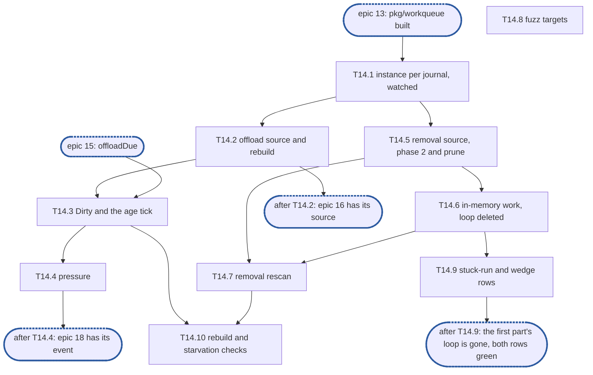

# Epic 14: engine offload work queue

**Sources:** [RFC 8](../docs/internals/rfcs/rfc-8-engine.md) §6 (its first MUST, the queue's half),
§6.1 (the work queue whole), §6.1.1 (what a consumer of the scheduler owes it: its sources, their
limits, their tenants, re-deriving dropped work), §4.1 step 4 (`Dirty`), §8.1 (phase 2, the prune
of a done removal and the phase-1 retries, run from the scheduler, and `removal_stalled`), §2.5 start
steps 4, 6 and 7 and stop steps 2, 3 and 5 (the queue's part), §2.6 (the watchdog member, as amended
here, and the work queue's row), §3.3, §11.2 (the metadata-stall row's phase-2 and prune backoff, the
self-fence's removal owner and its per-file decode failure), §13 E23 and E41, §14 (the queue, work
and removal series, the work-queue lock, the removal batch's span), §15.2's "§6.1.1 a stuck run" and
"§8.1 removal wedge"; [RFC 13](../docs/internals/rfcs/rfc-13-configuration.md) Appendix B, the rows of
`offload.retry_*`, `removal.rescan`, the age tick and the scheduler's pending entries per instance;
[RFC 25](../docs/internals/rfcs/rfc-25-observability.md) §3.5, the watchdog loop each instance turns;
[RFC 0](../docs/internals/rfcs/rfc-0-data-lifecycle.md) §1.2, which keeps `pkg/health` out of what
the queue adds.
**Track:** A.
**Epic 14 estimate: 10 subtasks, 21.75 man-days.**
**Depends on:** epic 13, `pkg/workqueue` built behind the surface epic 11 froze (S1): every rule of
RFC 8 §6.1.1 holds over a scheduler instance alone, its single run per key, its backoff and the
lost-wakeup leg of "§6.1.1 a stuck run" among them; epic 11's `Settings` retry and rescan keys,
`ShareSettings.MaxAge` and the `Stats` fields this epic fills; epic 15's `offloadDue`, which the
`Dirty` handler and the age tick call (T14.3 only); epic 12's fixture control `BlockNextRun` and the
two red rows this epic turns green, at S2.
**Blocks:** epic 16, whose passes are the offload source's `Run` (T14.2) and which builds the prune
kind on the removal source (D9); epic 18, which posts `Pressure` from `admit` and the refusal path's
step 3 (T14.4); epic 19, which adds a late-attached journal's shards as tenants and reads the removal
source's rebuild (T14.1, T14.5); epic 20, which reads the scheduler's figures for `work_queue_stalled`
and the drain (T14.1).

---

## 1. Goal

Epic 14 puts the engine's background work on one shared-scheduler instance per journal, with two
sources, offload and removal, and the events that feed them. The first part's removal loop, a FIFO
with a fixed backoff, is moved onto the removal source and deleted.

**At the end of the epic:**

- each open journal has one `*workqueue.Scheduler`, its watchdog loop taken through `Deps.Watch` and
  closed once `Stop` has returned, every shard bound on the journal one tenant of each source;
- a write posts `Dirty` without waiting; a timer per journal posts every due file oldest first; a
  `Pressure` state lowers the offload backoff cap of put-healthy shards;
- the offload source rebuilds from the journal's dirty files and hands each batch to its `Run`, whose
  body epic 16's pass replaces;
- every removal obligation the first part's loop ran, durable or in memory, runs as the file's
  removal key on the removal source, backed off between `offload.retry_min` and `offload.retry_max`,
  rebuilt from the unfinished-removal index and re-derived by a rescan from a per-shard cursor, an
  undecodable entry stalling only its own file;
- the decoders the rebuild and a removal batch read are fuzzed;
- §15.2's "§6.1.1 a stuck run" passes over the engine's instances and "§8.1 removal wedge" is green
  with the undecodable ref.

### 1.1 In scope

The instance per journal, its sources and their limits, its tenants and weights; `Deps.Watch`; the
`Dirty`, `AgeTick`, `Pressure` and `RemovalPending` events; the removal rescan; the unfinished-removal
listing's start bound and per-entry errors; the first part's removal loop moved and deleted, with its
tests; the queue's `Stats` fields; the fuzz targets; the two red rows and the queue's halves of §6.1's
checks.

### 1.2 Out of scope

- The offload pass, the `Run` body that offers, carves, puts and commits: epics 15 and 16. Until epic
  16 the offload source's `Run` offers nothing (D7). With it, "passes in flight" in §6.1's "rebuild"
  check, and the puts and commits of its "one run per key" check (each block put once, no
  `ErrInconsistent`): epic 16.
- `offloadDue` itself, with its block-target, age and pressure triggers, each file's dirty bytes it
  reads, and the pass bound: epic 15.
- A put-unhealthy store pausing its shards' tenants and the binding's put health read from the flow:
  epic 16 (D8). With it, the put-unhealthy leg of §6.1's "pressure band" check and the "starvation"
  check's leg of a share whose store throttles to 1 MB/s: epic 16.
- Posting `Pressure`, the band between 0.9 *S* and *S*, §6.1's "pressure band" check's oscillation
  leg, the dropped `Pressure` events of its "lost events" check, and "writes are slowed only by
  capacity pacing" in its "growth" check: epic 18, whose `admit` computes *M* against *S*. This epic
  builds the state the posts set (T14.4).
- The prune of a file's superseded overwrite records, its kind on the removal source, its poster and
  RFC 8 §6.1's prune `ponytail:`: epic 16, the pass that commits over overwritten content (D9). So is
  the in-flight floor the removal prune reads from the pass registry.
- The lost-wakeup leg of "§6.1.1 a stuck run": epic 13, over a scheduler instance alone (D13).
- The reseed, its gate on offer and eviction, `engine_reseed_files_remaining`, a late-attached
  journal's steps 6 and 7 and the takeover's rebuild: epic 19, and the takeover the cluster stage.
- `work_queue_stalled` as an engine condition in `Stats`, and the drain figures: epic 20.
- `Drop`'s and `Unbind`'s join of a pass in flight on the offload source: epic 16.
- The primary-only post filter for replica shards and RFC 8 §6.1's "(cluster) primary only" check:
  the cluster stage, deferred in the offload plan's ledger ("The cluster rules"); on one node every
  shard is primary.
- Per-share budget values: RFC 24, deferred in the offload plan's ledger ("Per-share budget
  values").
- Positive-rate pacing and the pace a `Throttled` result lowers: RFC 9, deferred in the offload
  plan's ledger ("Positive-rate pacing").
- Fuzz or model targets for the queue's keys: unowned, deferred in the offload plan's ledger ("Fuzz
  or model targets for the queue's keys and the pacing law"); RFC 8 §15.3's `ponytail:` is placed by
  T14.3.
- §6.1's "rebuild" check's snapshot-held version: RFC 12, deferred in the offload plan's ledger
  ("Snapshot-hold ordering"); its reseed figure: epic 19.
- Cutting the engine's existing `pkg/health` import (`health.go`'s conditions): #5775.

### 1.3 Names used here

- **S1**, interfaces frozen: the end of epic 11, whose surface this epic fills.
- **S2**, red rows in CI: the end of epic 12; this epic's two rows are among them.
- **E23**, **E41**: RFC 8 §13's invariants of those numbers, not epics.
- **The first part**: the journal-only engine, epics 1 to 10 of RFC 8's first plan, whose removal
  loop this epic replaces.
- **The fixture**: `pkg/engine/enginetest`, the first part's engine fixture with epic 12's controls.

## 2. How the general rules apply

The rules are those of [the offload plan's §1.5](rfc-8-offload-engine-plan.md#15-general-rules-for-each-epic),
cited by number and title and not copied.

| Rule | Subtasks | How |
| --- | --- | --- |
| rule 1, independent unit tests ([`CLAUDE.md`, "Writing tests"](../CLAUDE.md#writing-tests)) | all | over the first part's in-memory journal (`FakeJournal`, whose handle gains `DirtyFiles` with an "agrees with the journal" test, T14.2) or the real journal, `kvstore` over the in-memory `kv.KV`, the real scheduler and a real `*health.Watchdog`, both on the fixture's injected clock. No offload component is composed: nothing here carves or puts |
| rule 2, fuzz the key and ref decoders the queue's rebuild reads | T14.8 | the unfinished-removal index key, the removal record and the ref record, each a target in `kvstore`, seeded with the undecodable ref of "§8.1 removal wedge" |
| rule 3, observability follows RFC 25 | T14.1, T14.3, T14.5, T14.6 | `JournalStats.Work`, `WorkLimits` and `QueueEvents`, `ShareStats.RemovalsPending` and `OldestRemoval`, `Stats.WorkQueueLockWaits`, the first part's `RemovalRuns` and its `engine.removal_batch` span; the `engine_queue_*` and `engine_work_*` figures are the scheduler's own `Stats`, which the engine converts by shard and never labels per operation by share |
| rule 4, profiling | T14.1, T14.6, T14.7, T14.10 | tests run under the fixture's `prof.Watch`, which fails a goroutine left by a stopped instance, an age tick or a rescan timer; no allocation assertion, since neither of the rule's two hot paths is touched |
| rule 5, public interface and internals ([`CLAUDE.md`, "Verifying a change"](../CLAUDE.md#verifying-a-change)) | all | each event is asserted where it is consumed: a dispatched key at the source's `Run`, a removal at the store's records, a guard at the capture it holds off, liveness at the watchdog's `Live`, the fence at the node's fenced answer |
| rule 6, known failures shrink | T14.9 | `TestRFC8B_AStuckRun` leaves `test/engine/known.yaml`; `TestRFC8B_RemovalWedgeUndecodableRef` leaves it if epic 12 left it there |
| rule 7, v2 ignores v1, and the engine imports only what RFC 0 §1.2 allows | T14.1 | `Deps.Watch` replaces RFC 8 §2.6's `*health.Watchdog`, so the queue adds no `pkg/health` import (D1); the engine's existing one is #5775's; the walk already allows `pkg/workqueue` (epic 11) |
| rule 8, real dependencies for properties of those dependencies | T14.10 | the rebuild check crashes the real journal on a real directory beside `kvstore`, since it asserts what a restart re-derives from durable state |
| rule 9, code comment conventions ([`CLAUDE.md`, "Code comments"](../CLAUDE.md#code-comments)) | T14.3, T14.5, T14.6, and as §4 names | RFC 8 §6.1's removal-key `decision:` at the removal source (T14.5); §15.3's `ponytail:` at the work queue's keys (T14.3); the first part's loop `ponytail:` deleted with the loop, and its `decision:`s kept at the sites they move to (T14.6); each §4 decision's marker. The prune `ponytail:` is epic 16's (D9) |
| rule 10, a test must be able to fail | all | each test names the break it catches; the moved removal tests keep failing on their own planted breaks, each run against the source before the loop is deleted |
| rule 11, a symbol is exported only if the RFC's interface uses it | T14.1 | the one exported addition is `Deps.Watch` with the `Loop` it returns, RFC 8 §2.6 as amended; the sources, events and work list are unexported |
| rule 12, each subtask creates only what it declares | all | `Handle.DirtyFiles` joins with its first caller (T14.2); the listing's start bound with the rescan that reads it (T14.7); `Existence.PruneOverwrites` is not declared here, since its caller is epic 16's (D9) |

## 3. Requirements and invariants

Every obligation the sources place on this epic, numbered so subtasks and tests can cite them. What
the scheduler itself guarantees is epic 13's, held by its tests; a row here states the engine's part.

**The instance per journal**

| # | Requirement | Kind | Source | Subtasks |
| --- | --- | --- | --- | --- |
| R1 | One work queue per device journal, one instance of the shared work scheduler with the engine's two sources, offload and removal; a node holds one instance per journal | invariant | RFC 8 §6.1, §6.1.1, §2.6 | T14.1, T14.2, T14.5 |
| R2 | Each shard bound on the journal is a tenant of both sources, weighted by its share's budget divided among the share's shards on the journal | invariant | RFC 8 §6.1, §2.5 step 6 | T14.1 |
| R3 | A tenant's backoff runs from `offload.retry_min` to `offload.retry_max`, and a change of either reaches every tenant through `SetTenant` without a restart | MUST | RFC 8 §6.1.1, §8.1; RFC 13 Appendix B | T14.1, T14.5 |
| R4 | The queue's tenants are rebuilt at start step 6, and its dispatch, the age tick and the removal rescan start at step 7; a share bound to a running engine gains its tenants at once | MUST | RFC 8 §2.5 steps 6 and 7, §2.6, §6.1 | T14.1, T14.3, T14.7 |
| R5 | `Close` stops the work queue first, with the scheduler's `Stop`, then cancels and joins the age tick and the rescan; a join past its bound leaves what it depends on open and is reported | MUST | RFC 8 §2.5 stop steps 2, 3 and 5 | T14.1, T14.3, T14.7 |
| R6 | Each instance turns the watchdog loop the node gives it, named for its journal, and the engine closes that loop only once the instance's `Stop` has returned with every run joined | MUST | RFC 8 §2.6 (as amended here), §6.1.1; RFC 25 §3.5 | T14.1 |
| R7 | The queue holds no state a restart needs: every event is a hint about state the journal, the intents and the records hold durably | MUST NOT | RFC 8 §6.1, §6.1.1, §3.3 | T14.2, T14.5, T14.10 |

**Keys, sources and limits**

| # | Requirement | Kind | Source | Subtasks |
| --- | --- | --- | --- | --- |
| R8 | An entry is keyed by (shard, kind, file), the kind offload, removal or prune, so one file's kinds of work never merge | invariant | RFC 8 §6.1 | T14.1, T14.5 |
| R9 | A removal key carries no version: its run resumes every unfinished removal of the file in version order, so any number of removals of one file are one entry | invariant | RFC 8 §6.1 (its `decision:`) | T14.5, T14.6 |
| R10 | Offload is one source and removals a second, each with its own reservation and slots, so a deletion storm fills only its own | invariant | RFC 8 §6.1, §6.1.1 | T14.1, T14.10 |
| R11 | The engine's sources register `Rate` 0 and `Deadline` 0, and their reservations sum to the instance's fixed total of pending entries | MUST | RFC 8 §6.1.1; RFC 13 Appendix B; RFC 24 §5.1 | T14.1 |
| R12 | No engine source re-posts at a deadline of its own, and a source's `Run` answers one result per item; nothing re-runs a step after its run returned | MUST NOT | RFC 8 §6.1, §6.1.1 | T14.2, T14.5, T14.6 |
| R13 | One file's work of one kind is one key, carrying no version and no attempt, so E41's single run per key and its never-shortened backoff, which the scheduler holds, hold for the file | invariant | RFC 8 §13 E41, §6.1 | T14.3, T14.5 |
| R14 | A source re-derives dropped work from its durable records within its own bound: offload by the age tick, removals by the rescan | MUST | RFC 8 §6.1.1, §6.1 | T14.3, T14.7 |

**Events**

| # | Requirement | Kind | Source | Subtasks |
| --- | --- | --- | --- | --- |
| R15 | A write posts `Dirty` for its file after staging; posting never blocks the write and never grows with bytes | MUST NOT | RFC 8 §4.1 step 4, §6.1 | T14.3 |
| R16 | `Dirty` posts the file's offload key once `offloadDue` finds it due by its bytes; a file below the block target waits for the age tick | invariant | RFC 8 §6.1 | T14.3 |
| R17 | A timer per journal, every quarter of `offload.max_age`, calls `offloadDue` with fresh journal statistics and posts every due file's offload key, oldest first within each shard, until the shard's reservation refuses one | MUST | RFC 8 §6.1; RFC 13 Appendix B (the age tick) | T14.3 |
| R18 | A dirty file is offered again until it is reported offloaded, for as long as this node is its shard's primary: the age tick posts it again at every tick it is due | MUST | RFC 8 §6, §6.1 | T14.3 |
| R19 | Handlers do no I/O: a handler calls a policy function and posts | invariant | RFC 8 §6.1 | T14.3, T14.4 |
| R20 | `Pressure` is a state: setting the state it has does nothing, and a change runs the age tick at once, at most once per tick period | invariant | RFC 8 §6.1 | T14.4 |
| R21 | While pressure is on, every file with dirty bytes is due, and each shard whose store is put-healthy at that tick has its offload backoff cap lowered to `offload.retry_max_pressure`, which pulls in its keys backing off; a put-unhealthy shard keeps `offload.retry_max` | MUST | RFC 8 §6.1, §6.2, §6.3 O2 | T14.4 |
| R22 | `RemovalPending` posts the file's removal key: from a removal's first transaction, from the rescan and from the rebuild | MUST | RFC 8 §6.1, §8.1 step 4 | T14.5, T14.7 |
| R23 | Every `removal.rescan`, and at once when the removal source's drop count has risen since the last scan, each served shard's unfinished-removal index is read from a per-shard cursor and a removal key posted per file until the shard's reservation refuses one; the next scan resumes at the cursor and wraps at the end | MUST | RFC 8 §6.1 | T14.7 |
| R24 | `removal.rescan` is live: a changed value reaches the next scan without a restart | MUST | RFC 13 Appendix B; RFC 8 §6.1 | T14.7 |

**Rebuild**

| # | Requirement | Kind | Source | Subtasks |
| --- | --- | --- | --- | --- |
| R25 | Whenever the node gains a shard, its entries are rebuilt: an offload key for every file the journal holds with a held or retained extent whose offloaded bit is unset | MUST | RFC 8 §6.1, §2.5 step 6, §6.1.1 | T14.2 |
| R26 | and a removal key for every file with a removal not done or not yet pruned, read from the shard's unfinished-removal index, never by a scan of its files | MUST | RFC 8 §6.1, §2.5 steps 4 and 6 | T14.5 |
| R27 | A removal whose own record does not decode is its file's failure: the rebuild and the rescan post its file and go on past it, and its runs retry and stall it, while the shard's other removals complete | MUST | RFC 8 §11.2, §8.1; §15.2 "§8.1 removal wedge" | T14.5, T14.7 |
| R28 | The work queue is rebuilt from durable state for every shard the node gains; a lost event delays an offer by at most the maximum age plus one age tick, and a removal by at most the rescan bound, each plus the time its shard takes to drain the entries ahead of it | invariant | RFC 8 §13 E23, §6.1 | T14.3, T14.7, T14.10 |

**Removals on the scheduler**

| # | Requirement | Kind | Source | Subtasks |
| --- | --- | --- | --- | --- |
| R29 | Phase 2 runs from the work queue: batches within `K` from the removal's cursor until done, each under the metadata deadline | MUST | RFC 8 §8.1 step 5 | T14.5 |
| R30 | A failed phase-2 run, a bounded `Resume` and the prune after it, returns `Retry` and is backed off between `offload.retry_min` and `offload.retry_max` for as long as the node is the shard's primary; a phase-2 batch or a prune failing at the metadata deadline backs off the same way | MUST | RFC 8 §8.1, §11.2 | T14.5, T14.6 |
| R31 | After five consecutive failed runs the removal is `removal_stalled`, naming the file and the removal's kind, cleared by its next run that advances or finishes; the count is kept by the removal; a clone's is unhealthy | MUST | RFC 8 §8.1 | T14.6 |
| R32 | A pending release, and a truncate or deallocate whose phase 1 its call could not commit, retry phase 1 from the scheduler with no goroutine of their own, keeping the file's guard until phase 1 commits or the retry ends; a failed existence commit after a terminal failure is retried the same way | MUST | RFC 8 §8.1 | T14.6 |
| R33 | A rebuilt clone's batches run only once `Holds.Served` returns for the source's shard, and that wait is itself a scheduled batch, whose context the scheduler's `Stop` cancels | MUST | RFC 8 §2.5 step 4 | T14.6 |
| R34 | A phase-1 retry cancelled by `Close`, a clone's destination included, stays out of the last group commit, its pending operations left for recovery | MUST | RFC 8 §2.5 stop step 2, §8.1 | T14.6 |
| R35 | A removal's retrying owner leaves the self-fence once its item finishes or is ended; a phase-2 run failing on one of its file's own records that does not decode is that file's failure, and any other error of the run the store's | MUST | RFC 8 §11.2 | T14.6 |
| R36 | A removal batch opens a root span | MUST | RFC 8 §14 | T14.5 |

**Observability**

| # | Requirement | Kind | Source | Subtasks |
| --- | --- | --- | --- | --- |
| R37 | The queue's entries by journal, source and state and per share, the instance's total, and events posted by `event` (`dirty`, `age_tick`, `pressure`, `removal_pending`) | MUST | RFC 8 §14 | T14.1, T14.3, T14.4, T14.7 |
| R38 | Per journal and source, the scheduler's own figures, reported by shard: the oldest pending entry's age, the last run's return, runs in flight and their bound, runs overdue, items dropped and items expired | MUST | RFC 8 §14, §6.1.1 | T14.1 |
| R39 | Per share: removals not done and the oldest one's age; phase-2 runs by `result` (`done`, `advanced`, `conflict`, `error`) | MUST | RFC 8 §14 | T14.5, T14.6 |
| R40 | Time waiting on the work queue's lock, not labelled by share | MUST | RFC 8 §14, §1.1 | T14.6 |

**Checks**

| # | Requirement | Kind | Source | Subtasks |
| --- | --- | --- | --- | --- |
| R41 | lost events, the queue's half: with `Dirty` and `RemovalPending` events and every third age tick dropped at random and the removal source filled to its reservation, every dirty file is dispatched within the maximum age plus one tick of the last tick that ran, and every removal reaches done within the rescan bound, with no restart | test row | RFC 8 §6.1 Checks | T14.3, T14.7 |
| R42 | growth, the queue's half: with the consumer stalled and more files written than the instance's total, no write waits on the queue, and every file is dispatched within the age bound once the consumer runs | test row | RFC 8 §6.1 Checks | T14.3 |
| R43 | starvation, its legs without puts: one share's single due file beside another's many is dispatched within the age bound, and a new file is dispatched within it while many released files run with the metadata store slowed and only `source="removal"` counts drops | test row | RFC 8 §6.1 Checks | T14.10 |
| R44 | rebuild, the queue's half: after a crash with dirty files, files in backoff, removals between batches, done removals not pruned and a clone between phase-2 batches, every dirty file is dispatched, every removal resumes, every done one is pruned and the clone is answered | test row | RFC 8 §6.1 Checks | T14.10 |
| R45 | pressure band, the queue's half: pressure set on many times in a row turns it on once | test row | RFC 8 §6.1 Checks | T14.4 |
| R46 | §6.1.1 a stuck run, over the engine's instances: with two tenants holding work and a run of one ignoring its ctx in every slot it may hold, `work_queue_stalled` names the source and tenant within twice `RunTimeout`, the overdue count rises, the other tenant's work runs, and with every slot of the source overdue liveness fails within the watchdog's 60 s | test row | RFC 8 §15.2 | T14.9 |
| R47 | §8.1 removal wedge: a truncate over an undecodable ref record and a clone from an undecodable source record retry at the backoff cap, `removal_stalled` names each, other removals complete, and both finish once repaired | test row | RFC 8 §15.2 | T14.6, T14.9 |

## 4. Decisions this epic takes

- **D1, `Deps.Watch` replaces `Deps.Watchdog`.** RFC 8 §2.6 had `Watchdog *health.Watchdog`, an
  implementation RFC 0 §1.2 now forbids the engine. The engine declares
  `type Loop interface { workqueue.Loop; Close() }` and `Watch func(loop string) Loop`; the node's
  content wiring passes `func(n string) engine.Loop { return wd.Loop(n) }`, which `*health.Loop`
  satisfies as it is. Each journal's instance takes `Watch("engine.sched." + dir)`, `dir` the
  journal's directory, and `Close` closes it once that instance's `Stop` has returned with every run
  joined; a `Stop` that timed out leaves it open, since the overdue runs still report through it.
  `New` refuses a nil `Watch`, as it does `Clock` and `Tracer`. **This pull request amends RFC 8
  §2.6's `Deps` sketch** to the declared member. Changing it later touches the node's wiring and the
  fixture only. No marker. Prior art: RFC 20's adapters take `Watch func(loop string) Loop` with the
  same three calls (`pkg/adapter/deps.go`).
- **D2, a file's removal key runs the file's work list.** A scheduler item carries only its key, so
  the removal source keeps, per (shard, file), the work the first part's loop items held as closures
  that no durable record re-derives: the phase-1 retry with the guard held, the release behind a clone
  and the pending release's retry, the existence commit after a terminal failure, a clone's run with
  its hold, its wait for the source's shard, its batches, its outcome and its `Release`. Each
  obligation keeps its first-part answer, counted or not: a wait the removal does not own (a shard not
  yet served, space for a clone, a clone it is held behind) retries uncounted, as the first part's
  `decision:`s at those sites say, and those markers move with the code. A key's run takes the file's
  list under the work-queue lock, runs each obligation in removal-version order, each one attempt
  under the engine's conflict bound, then the durable part (a bounded `Resume`, the prune of the newest
  done removal). It answers one `Result` for the key: `Retry` when a counted obligation or the durable
  part failed, `Retry` too when only uncounted ones remain, and otherwise `Done`, after re-posting its
  own key when a `Resume` advanced or obligations remain (the scheduler's redo mark, so it is pending
  again at once). The list is created for an accepted post or an in-memory obligation, so it holds at
  most one entry per file that has a removal call, a pending release or a clone in flight, as the
  first part's loop items did; the rescan re-posts every list whose key is absent before it reads the
  index (T14.7). Once `Close` has begun the lists are closed: a new obligation is ended at once, as an
  enqueue on the stopped loop was. A `decision:` at the list says a file's obligations run in one run,
  in version order, overturned if one must run apart from the others. Prior art: client-go's
  workqueue keeps only keys and its informer's store holds the objects a worker reads by key (from
  memory).
- **D3, an unbinding share's removal work is parked, not paused.** `Tenant.Paused` would also stop
  the clone batches `Unbind` waits for. Instead the removal run of a share whose gate is shut runs only
  a clone's obligations and answers the rest uncounted, keeping them on the file's list, and the rescan
  posts nothing for a shut share; `Drop` cancels the tenant with `CancelTenant`, ends the share's
  lists and returns their files, the running clone's destination included, to the discard that frees
  their guards, as the loop's `dropShare` did; the dropped set `isDropped` reads stays. `Unbind` joins
  the share's run in flight with `WaitTenant`. A `decision:` at the run names it, withdrawn if a share
  can be bound again after an unbind. Prior art: the first part's `refused`.
- **D4, one age tick per journal, at a quarter of the smallest `offload.max_age` among its bound
  shares.** RFC 8 §6.1 runs one timer per journal while `offload.max_age` is a share's setting
  (`ShareSettings.MaxAge`). The smallest keeps every share within its own bound, a larger share's
  files being offered no later. The tick reads the bound shares' values each time it re-arms, so no
  `Bind`, `Drop` or settings change has to reach it. A `decision:` at the tick, overturned if a
  short-`max_age` share's ticks are shown costing another share's offload. Prior art: none found.
- **D5, the engine's limits are constants.** Each source registers `Total` 131 072, half of RFC 13's
  262 144 entries per instance, `Weight` 1, `Rate` 0 and `Deadline` 0, and each tenant weighs 1, since
  no setting or record carries a share's budget and on one node a share has one shard per journal.
  Offload: `Batch` 64 files, `Concurrency` 4, `RunTimeout` five minutes. Removal: `Batch` 1, so one
  file's run never waits behind another's, `Concurrency` 4, and a run that stops starting obligations
  once 10 s of its own have passed, the rest answered uncounted, under a `RunTimeout` of 60 s, so a run
  is overdue only when a store call ignores its bound. They are not persisted, so epic 16 retunes
  offload's with its pass and epic 22's benchmarks settle them, at no migration. A test sizes an
  instance's totals down from `export_test.go` before `Start`, so a check that fills the instance
  writes hundreds of files, not 10⁵. A `decision:` at the registration names them proposals and cites
  RFC 24 for the weights. Prior art: none found.
- **D6, the unfinished-removal listing takes a start bound and reports a bad entry and goes on.** The
  rescan resumes at a per-shard cursor, and `kvstore`'s listing starts at the shard's first entry. It
  gains a (file, version) to start after, through the `after` key `pages` already takes, and the
  engine's declared `Content` follows. And an entry whose record is missing or does not decode no
  longer ends the listing: it is yielded with its error and the listing goes on, so the rebuild and the
  rescan post that file, whose run then fails on the record and stalls it (R27), while start step 4
  and every later entry go on. The offload plan keeps this call "as it is"; this decision is the one
  change, which its two callers, the rebuild and the rescan, absorb. No marker. Prior art: a range read
  from a begin key, as every ordered key-value store offers (from memory).
- **D7, until epic 16 the offload source's `Run` offers nothing.** It answers every item `Done`,
  leaving the file dirty for the next age tick, and calls the per-instance run hook tests set from
  `export_test.go`, which delivers each batch and may return a scripted `Result` in its place (a fault,
  kind 3). Epic 16 replaces the body with the pass; the signature, the registration and the rebuild are
  final. A `decision:` at the body names epic 16's pass as what withdraws it. Prior art: none found.
- **D8, a binding with no flow is put-healthy.** Pressure lowers the cap of a shard whose store is
  put-healthy, and no binding opens a flow before epic 16, so every shard's offload cap is lowered
  under pressure until epic 16 reads the flow's `Health`. No marker: it is the answer the RFC gives a
  store that cannot be unhealthy. Prior art: none found.
- **D9, the overwrite prune is epic 16's.** RFC 8 §6.1 puts prunes of superseded overwrite records on
  the removal source, and a pass posts them. Building the kind here would declare
  `Existence.PruneOverwrites` with no production caller, which §15.3's "§2.1 declared interfaces"
  check fails, and a post reachable only from tests. Epic 16 adds the kind (a third key kind on the
  removal source, one bounded `PruneOverwrites` per run), its post and RFC 8 §6.1's prune `ponytail:`
  with the pass; the removal source's limits are sized for it now. No marker. Prior art: none found.
- **D10, `BlockNextRun` holds a store call.** Epic 12's fixture control, in `enginetest/work.go`,
  blocks the removal source's next run for a shard through a kind-3 hold on the fixture's `kv.KV` over
  that run's first transaction, ignoring its context until released, so the run ignores its own. For
  `"offload"` it keeps refusing as epic 12 wrote it until epic 16 runs a pass. No marker. Prior art:
  the first part's `refsFault`.
- **D11, dropped events come through the engine's existing seams.** §6.1's "lost events" check drops
  posts at random. The engine's one post function reads one more hook in `e.seams`, beside `joining`
  and `refused`, set per instance from `export_test.go` and answering from a seeded random source
  (kind 1) whether to drop the post (kind 3). The removal half needs none: the check fills the removal
  source to its reservation, so its drops are real. No marker beyond the seam's comment. Prior art:
  the first part's `seams`.
- **D12, one retrying owner per instance.** The self-fence counts a retrying owner's failing items
  (RFC 8 §11.2). The first part had one owner per loop, released when the loop's goroutine ended. Each
  `journalQueue` now makes one at build, carries it on every removal `Run`'s context and on the
  context the removal's existence commit and the clone's wait read in place of the loop's, forgets a
  file once its list is empty, and releases the owner after `Stop`. Store calls stay under the
  engine's conflict bound, so a bound cut counts as a failure and a run's deadline never hides one. No
  marker. Prior art: the first part's `withRetryingOwner`.
- **D13, the lost-wakeup leg is epic 13's.** RFC 8 §15.2's "§6.1.1 a stuck run" also loses one
  dispatch wakeup and asserts liveness fails. No engine input reaches the scheduler's wakeup, so that
  leg runs over a scheduler instance alone in epic 13's test of the row. Epic 12 writes the leg into
  `TestRFC8B_AStuckRun` through a proposed `DropNextWakeup`; T14.9 removes the leg there, naming epic
  13's test in its place, and `DropNextWakeup` is not built. No marker. Prior art: none found.

## 5. Target tree

On `feat/storage-v2`.

```text
pkg/engine/
  deps.go                 T14.1  Watch, Loop; T14.2 Handle.DirtyFiles; T14.7 the listing's start bound
  engine.go               T14.1  New refuses a nil Watch; Apply's SetTenant; T14.3 the post seam
  queue.go                T14.1  the instance per journal, limits, tenants, the TenantID conversion, the owner; T14.2 the offload source; T14.3 Dirty and the age tick; T14.4 pressure
  removals.go             T14.5  the removal source, phase 2 and prune; T14.6 the work list, the loop deleted; T14.7 the rescan
  removals_start.go       T14.5  start step 4's listing becomes the removal source's Rebuild; clones still rebuilt at step 4
  groupcommit.go          T14.1  the instance replaces the journal's removal loop field
  close.go                T14.1  Stop, then the loop's Close; T14.6 the lists closed and ended
  unbind.go               T14.6  WaitTenant and CancelTenant replace joinRunning and dropShare
  remove.go clone.go rebuild.go recover.go loss.go  T14.6  obligations posted onto the work list
  write.go                T14.3  Dirty after staging
  health.go               T14.1  Work, WorkLimits; T14.3 QueueEvents; T14.5 removals pending; T14.6 WorkQueueLockWaits
  export_test.go          T14.1 to T14.7  the loop's accessors rewritten onto the source; the run hook, the drop seam, the totals
  queue_test.go removals_test.go removals_internal_test.go removals_start_test.go  T14.1 to T14.7
  start_test.go close_bubble_test.go  T14.1  their Deps literals gain Watch
  enginetest/fake.go      T14.2  FakeHandle.DirtyFiles
  enginetest/journal_test.go  T14.2  DirtyFiles agrees with the journal
  enginetest/fixture.go enginetest/unit.go  T14.1  Watch over a real watchdog
  enginetest/work.go      T14.9  BlockNextRun for "removal"
  conformance/            T14.9  the stuck-run and wedge rows green; T14.10 the rebuild check
pkg/metadata/kvstore/
  removal.go              T14.5  per-entry errors; T14.7 the start bound
  removal_fuzz_test.go    T14.8  the index key, removal record and ref targets, with seeds
internal/node/
  node.go                 T14.1  the watchdog built before content.Compose
  content/content.go      T14.1  Params gains the watchdog; Deps.Watch from it
test/engine/known.yaml    T14.9  two entries removed
docs/internals/rfcs/rfc-8-engine.md  this pull request: §2.6's Watch and Loop (D1)
```

## 6. Subtasks

### T14.1 Each journal's scheduler instance, watched

**Subtask T14.1 estimate: 2.5 man-days.**

- **Track:** A. **Depends on:** none. Epic 13's `pkg/workqueue` first.
- **Covers:** R1, R2, R3, R4, R5, R6, R8, R10, R11, R37, R38.
- **Deliverables:**
  ```go
  // deps.go
  // Loop is a watched loop as the scheduler turns it, and its close, which the engine
  // calls once the journal's scheduler has stopped; RFC 25's *health.Loop satisfies it.
  type Loop interface {
  	workqueue.Loop
  	Close()
  }
  // Deps gains:
  	Watch func(loop string) Loop // RFC 25 §3.5: each journal's scheduler takes Watch("engine.sched." + dir)
  ```
  In `queue.go`: `journalQueue`, one per open journal, holding its `*workqueue.Scheduler` built with
  `workqueue.New(e.d.Clock, loop)`, the two `SourceID`s, the `Limits` of D5 with their `decision:`,
  the retrying owner of D12, and `tenantOf(entity.ShardID) workqueue.TenantID` and its inverse
  (big-endian in the last four bytes, epic 11's D2). It is built where `groupCommitFor` builds the
  journal's removal loop today, so `Start`, `Bind` and the reopens in `recover.go` and `loss.go` reach
  it as they do now; each bound shard is added with `SetTenant` (weight 1, backoff from
  `OffloadRetryMin` and `OffloadRetryMax`) at start step 6 and at `Bind`, and `Start` is called at
  step 7, so nothing is dispatched before it. `Apply` re-sends every tenant's `Tenant` when a retry
  setting changes. `Close` calls `Stop` within the stop bound, then the loop's `Close` and the owner's
  release, a failed join reported and the journal and loop left open. `JournalStats.Work` and
  `WorkLimits` filled from `Stats(src)` and the registered limits, tenants converted to shards.
  `internal/node/node.go` builds its watchdog before `content.Compose`, and `content.Params` carries
  it into `Deps.Watch`; the fixture, `enginetest/unit.go` and the `Deps` literals of `start_test.go`
  and `close_bubble_test.go` pass a real `*health.Watchdog`'s loops on the injected clock. Consumed by
  T14.2, T14.5 and epics 19 and 20.
- **Acceptance criteria:**
  - Each journal opened has one instance with two sources registered, every bound shard a tenant of
    both; a `Bind` adds the share's tenants and a `Drop` removes them.
  - The watchdog's `Live` counts the instance's loop while serving and stops counting it after a
    clean `Close`, and still counts it after one whose `Stop` timed out.
  - `JournalStats.Work` reports per source and shard, and `WorkLimits` the totals and concurrency.
- **Tests:** at `Stats()` and the watchdog, over the unit fixture: a journal's `Work` after `Bind`
  names the share's shard under both sources and after `Drop` none (catches a tenant not added or left
  behind, R2); `Live` after a clean `Close` with the injected clock advanced past 60 s answers true
  (catches a loop never closed, R6), and after a `Close` whose stop bound ends with a run held by the
  run hook answers false, the failed join reported and the journal left open (catches a loop closed
  under a live run, R5, R6); `New` with a nil `Watch` is refused. No test double but the injected
  clock and the hook.
- **Rules:** rule 7: `Deps.Watch` keeps `pkg/health` out of what the queue adds (D1).

### T14.2 The offload source and its rebuild

**Subtask T14.2 estimate: 1.75 man-days.**

- **Track:** A. **Depends on:** T14.1.
- **Covers:** R1, R7, R12, R25.
- **Deliverables:** the offload source in `queue.go`: `Rebuild(ctx, t, post)` posting an offload key
  for every file of the tenant's binding's `Handle.DirtyFiles`, until a post is refused; `Run`
  answering each item `Done` through the per-instance run hook (D7, its `decision:`). `Handle` in
  `deps.go` gains `DirtyFiles() iter.Seq2[journal.FileID, time.Time]`, as `*journal.Handle` has it;
  `FakeHandle` gains it, and `enginetest/journal_test.go` a `DirtyFiles` test over the fake and the
  real journal, in the file's "agrees with the journal" form (held or retained extents whose offloaded
  bit is unset listed once, with the oldest dirty write's time, the zero time after a rebuild).
  Consumed by T14.3 and epic 16, whose pass replaces `Run`'s body.
- **Acceptance criteria:**
  - At start and at `Bind`, every dirty file of the shard reaches the offload source's `Run` with no
    event posted.
  - A file whose dirty extents were all offloaded or released is not posted.
- **Tests:** at `Run`, through the run hook that delivers each batch: start over a fake journal
  holding 1 000 dirty files and 10 clean ones, and assert the dirty ones, and only they, are delivered
  (catches a rebuild from the wrong set, R25); the `DirtyFiles` agreement test, which fails on the
  fake when it lists a file whose bits are all set (keeps the fake honest, rule 1). No double but the
  hook, which delivers what the run reached.
- **Rules:** rule 12: `DirtyFiles` joins `Handle` with this caller.

### T14.3 `Dirty` and the age tick

**Subtask T14.3 estimate: 2.5 man-days.**

- **Track:** A. **Depends on:** T14.2. Epic 15's `offloadDue`.
- **Covers:** R4, R5, R13, R14, R15, R16, R17, R18, R19, R28, R37, R41, R42.
- **Deliverables:** `Write` posts `Dirty(file)` after staging, before acknowledging: the handler
  calls `offloadDue` over the file's journal statistics and posts the file's offload key when it is
  due, never waiting. The age tick, one timer per journal on the injected clock at the period of D4
  with its `decision:`, calls `offloadDue` with the journal's fresh statistics (every file's oldest
  dirty write from `DirtyFiles`) and posts the due files oldest first per shard until the shard's post
  is refused; it starts at step 7 and `Close` cancels and joins it. `QueueEvents` counts `dirty` and
  `age_tick`. The engine's one post function, with D11's seam. The key's construction, (shard, kind,
  file) with nothing else, with RFC 8 §15.3's `ponytail:` there. Consumed by T14.4 and epic 16.
- **Acceptance criteria:**
  - A write returns while the offload source holds its whole reservation.
  - A file due by its bytes is dispatched without waiting for a tick; one below the target is
    dispatched by the tick after it reaches the maximum age, and again at each later tick until it is
    no longer dirty.
- **Tests:** at `Write` and at the source's `Run` through the run hook, over the unit fixture on the
  injected clock, with the instance's totals sized down (D5):
  - **growth** (R42): the run hook pausing every run, write to twice the offload reservation's files;
    assert each write returns, and once released every file is dispatched within the age bound
    (catches a blocking post, R15);
  - **lost events, the offload half** (R41, R28): writes and ticks with D11's seam dropping each
    `Dirty` and every third tick with probability ½ from a seeded source; assert every dirty file is
    dispatched within the maximum age plus one tick of the last tick that ran (catches a source that
    relies on events, R14, R18);
  - a table over the key's construction: one file's offload posts from `Dirty`, the tick and the
    rebuild give one key, and its offload and removal keys differ (catches a version or attempt in the
    key, which would defeat E41, R13);
  - a share with `MaxAge` 4 s beside one with 60 s ticks every second, and every 15 s once the first
    is dropped (D4).
  No double but the clock, the seeded source, the seam and the hook.
- **Rules:** rule 9: §15.3's `ponytail:` and D4's `decision:`.

### T14.4 Pressure

**Subtask T14.4 estimate: 1 man-days.**

- **Track:** A. **Depends on:** T14.3.
- **Covers:** R19, R20, R21, R37, R45.
- **Deliverables:** `(*journalQueue).pressure(on bool)`, the state `Pressure(on)` and
  `Pressure(off)` set: a call setting the state it has returns; a change runs the age tick at once,
  unless one ran within the tick period, hands the state to `offloadDue`, and sends each offload
  tenant whose binding is put-healthy (D8) `BackoffMax` = `OffloadRetryMaxPressure`, restoring
  `OffloadRetryMax` when it turns off; each tick while on re-sends it, so a shard turning put-unhealthy
  keeps `offload.retry_max`. Removal tenants keep `offload.retry_max`. `QueueEvents` counts `pressure`
  changes. A `decision:` at `pressure` says it lands before its posters, epic 18's `admit` and refusal
  path, since the offload plan places the state here and epic 18 calls it. Consumed by epic 18, and by
  epic 16, which reads the flow's health in place of D8.
- **Acceptance criteria:**
  - A thousand `pressure(true)` in a row make one change and one immediate tick.
  - Under pressure an offload key in backoff at the normal cap runs within
    `offload.retry_max_pressure`.
- **Tests:** through an `export_test.go` accessor of `pressure`: the repeated-on case counts one
  `pressure` event and one tick (catches a toggle per call, R20, R45); the run hook answering `Retry`
  for one file (a scripted fault, D7) until its backoff reaches the 60 s cap, then pressure on, and the
  file re-runs within 5 s on the injected clock (catches a cap not lowered, R21); off restores the cap.
  No double but the clock and the hook.

### T14.5 The removal source: phase 2 and the prune, rebuilt from the index

**Subtask T14.5 estimate: 3.5 man-days.**

- **Track:** A. **Depends on:** T14.1.
- **Covers:** R1, R3, R7, R8, R9, R12, R13, R22, R26, R27, R29, R30, R36, R39.
- **Deliverables:** the removal source in `removals.go`, keyed (shard, removal, file): `Rebuild`
  lists the shard's unfinished-removal index, as start step 4's `collectRemovals` does now, posting a
  removal key per file and recording on the file's list the newest version and whether a removal is
  not done; clones not done are still rebuilt at step 4, before serving. `kvstore`'s listing yields a
  bad entry with its error and goes on (D6), and the rebuild posts that file. `Run` runs each key's
  durable part, a bounded `Resume` and the prune of the newest done removal, under the
  `engine.removal_batch` root span, counting `RemovalRuns` by result, and answers as D2 says. A
  removal's phase 1 posts `RemovalPending` through the post function. The first part's phase-2 and
  prune loop items go; the loop still runs the in-memory items until T14.6, which ships with this
  subtask (§8). `ShareStats.RemovalsPending` and `OldestRemoval` from the lists. RFC 8 §6.1's
  removal-key `decision:` at the key. Consumed by T14.6, T14.7 and epic 19.
- **Acceptance criteria:**
  - A removal posted, or found at start in the index, reaches done and is pruned from the source's
    run, never by a scan of the shard's files.
  - A failed run answers `Retry` and runs again after the tenant's backoff; ten truncates of one file
    are one entry.
  - An index entry whose record does not decode leaves start and every other removal of the shard
    running.
- **Tests:** over `kvstore` on the in-memory `kv.KV` and the unit fixture, on the injected clock: the
  first part's phase-2 and prune tests in `removals_test.go` and `removals_start_test.go` moved onto
  the source, each still failing on its own planted break (rule 10); a store failing a file's
  `Resume` once, after which it runs again no sooner than `offload.retry_min`, and an `Apply` lowering
  `OffloadRetryMax` reaching a key in backoff (catches a fixed backoff or settings not reaching
  tenants surviving the move, R3, R30); ten truncates of one file, whose `Work` shows one pending key
  and whose records all reach done (R9); start over 10⁴ unfinished removals with the store's reads
  counted through a pass-through recording wrapper on the `kv.KV`, none a file record (catches a scan,
  R26); start with one entry's removal record undecodable, which starts, completes the other removals
  and retries that file (R27). Doubles: kind 3 on the `kv.KV`, and the recording wrapper.
- **Rules:** rule 9: the removal-key `decision:`; rule 3: the span and the run counter keep their
  names.

### T14.6 The removal source's in-memory work, and the loop deleted

**Subtask T14.6 estimate: 5 man-days.**

- **Track:** A. **Depends on:** T14.5.
- **Covers:** R12, R30, R31, R32, R33, R34, R35, R39, R40, R47.
- **Deliverables:** the file's work list of D2 with its `decision:`: `retryLater`, `behindClone` and
  the pending release's retry, the existence commit's retry, and `clonePhase2`'s hold, served wait,
  batches, `settleClone` and `Release` become obligations on the list, each counted or uncounted as
  its first-part answer was, posted through the post function; the wait for `Holds.Served` is one
  bounded round per run, answered uncounted, where `servedRound` waited `loopBackoff`; the run keeps
  each removal's failure count and raises and clears `removal_stalled` as `step` and `waiting` did;
  every run's context carries D12's owner, and the fence forgets a file once its list is empty.
  `Unbind` joins with `WaitTenant` and `Drop` cancels with `CancelTenant` and ends the share's lists
  (D3, its `decision:`); `Close` closes the lists and, after `Stop`, ends every one left, each end
  checking the stop bound as `halt` did. `Stats.WorkQueueLockWaits` times the lists' lock.
  `removalLoop`, `loopItem`, `loopBackoff` and the loop's `ponytail:` are deleted, the first part's
  `decision:`s kept at the sites they move to, and the remaining loop tests and `export_test.go`
  accessors (`LoopSteps`, `LoopParked`, `HoldRemovalLoop`, `StopRemovalLoops`, `RemovalStalled`,
  `RemovalsPending`) rewritten onto the source. Consumed by T14.7 and epic 19.
- **Acceptance criteria:**
  - Every first-part test of a removal, a release, a clone, an unbind, a drop and a close passes with
    no removal loop in the tree.
  - A phase-1 retry keeps the file's guard until it commits, and one cancelled by `Close` leaves the
    file's pending operations for recovery.
  - A clone waiting for `Holds.Served` or for space holds no goroutine and no slot between rounds,
    raises no `removal_stalled`, and is cancelled by `Stop`.
- **Tests:** the first part's tests in `removals_test.go`, `removals_internal_test.go` and the clone,
  close, unbind and drop files moved onto the source, each run once against the source before the
  loop is deleted and each failing on its planted break; then:
  - a truncate's phase 1 conflicting after its journal step, then a synced write above it: the guard
    is held and no capture takes the file until the retry commits (R32, at the guard's consumer);
  - `Close` while that retry waits, then a restart: the file's pending operations are recovered and
    absent from the last group commit (R34);
  - five failed runs raise `removal_stalled` naming the file and kind and an advancing run clears it
    (R31); a clone waiting for space for ten runs raises nothing (catches an uncounted wait counted);
  - five clones waiting on `Holds.Served` with the removal source's `Concurrency` at 4: a truncate of
    another file still completes and the watchdog stays live (catches a wait holding a slot, R33);
    `Close` meanwhile returns within its bound;
  - a `Clone` call in flight across `Close` returns (catches an obligation added after the lists'
    end, D2);
  - an `Unbind` with a clone in flight waits for it while a truncate of the same share stays parked,
    and `Drop` then frees the destination's guard (D3);
  - a removal's prune failing at the store at every retry fences the node after 30 s, and the fence
    lifts once its item ends (R35, at the node's fenced answer);
  - a post held in the lists' lock through an `export_test.go` accessor counts in
    `WorkQueueLockWaits` (R40).
  Doubles: kind 3 on the `kv.KV` and on the clone hold.
- **Rules:** rule 10: the move keeps each test's planted break; rule 4: no goroutine survives
  `Close`. At the ceiling: the loop cannot be deleted half-way, so the subtask is not split further.

### T14.7 The removal rescan

**Subtask T14.7 estimate: 1.5 man-days.**

- **Track:** A. **Depends on:** T14.5, T14.6.
- **Covers:** R4, R5, R14, R22, R23, R24, R27, R28, R37, R41.
- **Deliverables:** `kvstore`'s `UnfinishedRemovals` gains a (file, version) to start after, through
  `pages`' `after` key (D6), the declared `Content` and the rebuild following. The rescan per journal
  on the injected clock, re-armed every `RemovalRescan` as `Settings` holds it at that moment, and at
  once when the removal source's `Dropped` has risen since the last scan: it first re-posts every work
  list whose key is absent (D2), then reads each served shard's index from its cursor, posting until a
  post is refused, a bad entry posted and passed like any other, resuming there and wrapping at the
  end; it starts at step 7, skips a shut share (D3), and `Close` cancels and joins it. `QueueEvents`
  counts `removal_pending`. Consumed by T14.10.
- **Acceptance criteria:**
  - A removal whose post was dropped is dispatched within ⌈the shard's index entries ÷ its
    reservation⌉ rescans, an undecodable entry before it included.
  - A scan resumes where the last one stopped, and wraps; a changed `removal.rescan` sets the next
    period.
- **Tests:** **lost events, the removal half** (R41): the removal source sized down and filled to its
  reservation, so `RemovalPending` posts drop; assert every removal reaches done within the rescan
  bound, with no restart (catches a rescan from the start each time and one that never wraps, R23);
  the same with one undecodable entry early in the index (R27); a dropped post triggers a scan before
  the next period (R14); an `Apply` halving `RemovalRescan` makes the next scan come at the new period
  (R24); a `kvstore` test over the in-memory `kv.KV` that the start bound lists only the entries after
  it. No double but the clock.

### T14.8 Fuzz targets for the rebuild's decoders

**Subtask T14.8 estimate: 1 man-days.**

- **Track:** A. **Depends on:** none.
- **Covers:** none of R1 to R47: plan rule 2 and `CLAUDE.md`'s fuzz rule, consumed by T14.5's and
  T14.7's reads and by "§8.1 removal wedge" (T14.9).
- **Deliverables:** in `pkg/metadata/kvstore/removal_fuzz_test.go`, `FuzzRemovalIndexKey` (the
  index key's file and version after its prefix), `FuzzRemovalRecord` (`decodeRemoval`) and
  `FuzzRef` (`decodeRef`), each asserting no panic, every length read inside the buffer, and decode,
  re-encode, decode equal; seeds: a valid entry of each kind, a truncated one, and the undecodable
  ref "§8.1 removal wedge" plants. They join the nightly `fuzz` suite the RFC 2 plan's epic 2
  registers; their seeds run in `unit` as plain tests from this subtask on. Crashers go to
  `testdata/fuzz/<FuzzName>/`.
- **Acceptance criteria:**
  - The seeds run in `unit` and pass.
- **Tests:** the three targets; the truncated seed fails a target whose decoder ignores the error of
  a short read and returns a value.

### T14.9 The stuck-run and wedge rows

**Subtask T14.9 estimate: 1.5 man-days.**

- **Track:** A. **Depends on:** T14.6.
- **Covers:** R46, R47.
- **Deliverables:** `BlockNextRun` in `enginetest/work.go` made real for `"removal"` (D10);
  `TestRFC8B_AStuckRun` run over the removal source with its lost-wakeup leg removed and epic 13's
  test of that leg named in its place (D13), green, and its `known.yaml` entry removed;
  `TestRFC8B_RemovalWedgeUndecodableRef` green over the removal source, its entry removed if epic 12
  left one; the first part's `TestRFC8B_RemovalWedge` kept green.
- **Acceptance criteria:**
  - Both rows pass in `engine-conformance` and neither has an entry.
- **Tests:** the two rows, each failing first on its own assertion when the change it guards is
  reverted (the run timeout's overdue count, the per-file stall). Doubles: kind 3 on the `kv.KV`; the
  real watchdog.
- **Rules:** rule 6: entries removed in the same change.

### T14.10 The rebuild and starvation checks

**Subtask T14.10 estimate: 1.5 man-days.**

- **Track:** A. **Depends on:** T14.3, T14.7.
- **Covers:** R7, R10, R28, R43, R44.
- **Deliverables:** in `engine-conformance`, the rebuild check, the queue's half, over the real
  journal on a real directory and `kvstore`; in `unit`, the starvation check's legs without puts, with
  the instance's totals sized down (D5).
- **Acceptance criteria:**
  - After a crash, every dirty file is dispatched, every removal resumes, every done one is pruned and
    the clone is answered, with nothing posted by an event.
- **Tests:** **rebuild** (R44, R7): crash with 10⁵ dirty files, files in backoff, removals between
  batches, done removals not pruned and a clone between phase-2 batches, restart, and assert each at
  its consumer (the run hook, the store's records, the clone's answer); **starvation** (R43): a share
  with one due file beside one with a hundred times the offload reservation's, and a new file written
  while as many released files run with the store slowed tenfold by a kind-3 delay, asserting dispatch
  within the age bound and drops counted only under `removal` (R10). Doubles: kind 3 on the `kv.KV`.
- **Rules:** rule 8: the rebuild check crashes the real journal.

## 7. Order of work



T14.1 and T14.2 are the blockers. T14.3 and T14.4 wait on epic 15's `offloadDue`; the removal path,
T14.5 to T14.7 and T14.9, needs nothing of epic 15 and runs meanwhile. T14.8 touches only `kvstore`
and can run at any point.

## 8. Suggested pull requests

| PR | Subtasks | Man-days | After | Why together |
| --- | --- | --- | --- | --- |
| 1 | T14.1, T14.2 | 4.25 | — | the instance and the offload source epic 16 builds on |
| 2 | T14.5, T14.6, T14.9 | 10 | PR 1 | the removal source whole, so the loop is deleted in the change that replaces it, and the rows it turns green |
| 3 | T14.3, T14.4 | 3.5 | PR 1, epic 15's `offloadDue` | the events; can be open beside PR 2 |
| 4 | T14.7, T14.8, T14.10 | 4 | PR 2, PR 3 | the rescan, the fuzz targets and the checks over both sources |

A suggestion only: one pull request per subtask works as well, but T14.5 and T14.6 ship together,
since between them the loop and the source would each run part of one file's removal work. T14.8 can
also ship on its own beside any of them.

## 9. Open points

- **Epic 15 places `offloadDue` early.** T14.3 calls it; if epic 15's document schedules it late, PR 3
  waits, and epic 18's pressure with it, though not epic 16's source. `offloadDue` takes each file's
  oldest dirty write from `DirtyFiles`, whose zero time after a rebuild should count as due at once,
  and `Dirty` asks it about one file's dirty bytes, which `DirtyFiles` does not carry: the journal's
  per-file figures or a staged-bytes count on the file's entry. Epic 15 decides both with
  `offloadDue`'s inputs. The offload plan's dependency graph draws no edge from epic 15 to epic 14.
- **The offload plan's "Done when" names checks this epic runs only in part.** "pressure band" needs
  `admit`'s *M* and *S* (epic 18) and a put-unhealthy store (epic 16); "starvation" has a leg over a
  throttling store (epic 16); "one run per key" asserts puts (epic 16); "lost events" drops `Pressure`
  (epic 18). This epic runs their queue halves (§1.2); those epics' documents take the rest.
- **Hand-offs other documents must take.** Epic 16 takes the overwrite prune kind and RFC 8 §6.1's
  prune `ponytail:` (D9), which the offload plan placed here. Epic 12's document proposes
  `DropNextWakeup`, which is not built, and its `TestRFC8B_AStuckRun` loses the lost-wakeup leg to
  epic 13's test (D13).
- **Estimate.** 21.75 man-days in 10 subtasks against the offload plan's 15 in 6: the first part's
  removal loop runs six kinds of item, five held in memory, the clones stateful and some retrying
  uncounted, and its tests (32 in the three removal files, and accessors used by eight more files)
  all move (T14.6); the listing changes (D6). T14.6 is the least certain figure.
