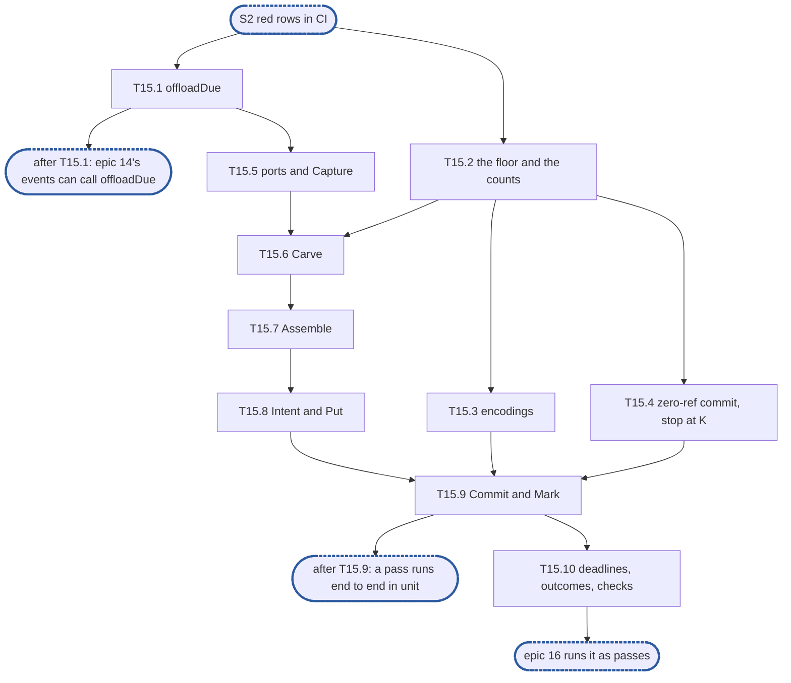

# Epic 15: engine offload pipeline

**Sources:** [RFC 8](../docs/internals/rfcs/rfc-8-engine.md) §2.1 (the declared interfaces, its
carver, handle and block-metadata rows), §2.8 (`offload/` and its imports), §3.1 (`offloadDue`, and
the rules every policy function and module keeps), §6.2, §6.3 (but snapshot-hold ordering, D9),
§6.4 (the guard as a capture and a commit take it), §6.5's V1, §6.6, §6.7, §6.8, §10.4 (the refusal
at Intent under destroyed current material), §13's RFC 8 E4, E7, E8, E18, E20, E22 and E40's offload
commits, §14's pipeline rows and its pass span;
[RFC 6](../docs/internals/rfcs/rfc-6-block-metadata.md) §2.3 (the block record's `encodings`), §4.1
(one commit per block, the zero-ref commit), §5.2 (`K`, its floor at open, an offload commit within
it) and §11.2's "K floor" row; [RFC 2](../docs/internals/rfcs/rfc-2-carver.md) §2.1, §2.3 (the
`carver_` series), §2.4 (the caller's real end at the key budget, and its two exceptions), §4.2 and
§4.3 (the name and its scope, as the minting caller keeps them), §5.1 to §5.4 (the fold as its one
caller drives it, P2's caller half) and §10.1 (the consumer checks);
[RFC 1](../docs/internals/rfcs/rfc-1-journal.md) §3.3 (`OffloadMany`, `report`, `Offered`), for the
calls the pipeline makes; [RFC 3](../docs/internals/rfcs/rfc-3-syncer.md) §1.3 and §3.5 (`Upload`
with its attempt, stable bytes); [RFC 4](../docs/internals/rfcs/rfc-4-remote-tier.md) §4.3 (`NewPut`,
`Attempt`, `Stored`); [RFC 5](../docs/internals/rfcs/rfc-5-transforms.md) §2.7, §3.1 and Appendix B.2
(the pin, its release, a destroyed current material, a plan keyed under another namespace).
**Track:** B.
**Epic 15 estimate: 10 subtasks, 34 man-days.**
**Depends on:** sync point **S2**, red rows in CI (epic 12): the fixture's `WithCarver` and
`WithChain`, refusing by name, and the 41 entries whose message is the carver's refusal; **S5's
first half** for the finish: RFC 2's carver and fold, RFC 3's syncer over RFC 4's in-memory store
through `codec.Store` under RFC 4's fault wrapper, RFC 5's chain over `keystest`'s in-memory
`keys.Provider`; #5775's journal and metadata contract packages, which `offload/` imports instead of
`pkg/journal` and `kvstore`; the RFC 2 to RFC 5 plans' epic 1 contracts landed on
`feat/storage-v2` (`pkg/carver`, `pkg/transform` and `keys`, `pkg/syncer`, `pkg/remote`), which
T15.5's ports are typed over; epic 11's frozen surface (`ShareSettings.MaxAge`, the `Stats` fields
epic 16 fills from this epic's counters); epic 13's scheduler, which T15.10's O6 leg dispatches
through; the RFC 2 plan's epic 2, which registers the `fuzz` suite T15.3's target joins.
**Blocks:** epic 14, whose `Dirty` event, age tick and pressure call T15.1's `offloadDue`; epic 16, which runs this pipeline as the offload source's runs, opens each binding's
flow, and with S5 and S6 reaches S3; epic 18, which adds the commit's tracked read of each key
record to the transaction T15.4 shapes and Mark's destroyed-material check to T15.9's Mark; epic 19,
whose reseed reads the `encodings` T15.3 persists; epic 20, which reads the pipeline's outcomes and
failing-file counts.

---

## 1. Goal

Epic 15 builds the offload pipeline, `pkg/engine/offload`: the state machine that takes one pass's
files from Capture to Mark, over the components' real implementations, and the store's three changes
it needs: the floor `K` must hold, the block's `encodings`, and the zero-ref commit.

**At the end of the epic:**

- a pass over a set of files, driven in `unit` over the in-memory journal, the real carver and fold,
  RFC 5's chain over `keystest`'s provider, RFC 3's syncer over RFC 4's in-memory store and `kvstore`
  over the in-memory `kv.KV`, offloads every byte it was offered, block by block, and reports exactly
  what committed;
- every failure of every state, injected through the components' fault wrappers, ends with each
  extent reported or **Dirty** and one result per file for the scheduler, within each step's bound;
- no transaction the pipeline makes passes `K`, and `kvstore` refuses to open a backend whose `K`
  cannot hold one 1-byte chunk's commit;
- the fixture composes the carver and the chain for real, and every row that waited on them now
  fails at the syncer's refusal, its `known.yaml` message rewritten.

### 1.1 In scope

`offloadDue`; the `offload/` package and the ports it declares; the engine's `Deps.Carver`,
`Deps.Chain` and `Deps.Puts`; the content wiring's carver, fold and chain for the fixture; the
in-memory journal's `OffloadMany`; `kvstore`'s floor check, key-budget accessor, block `encodings`
and zero-ref commit, and its commit's over-`K` path; the pipeline's series, its `carver_` series and
its pass span; the `unit/engine-allocs` option; the block record's fuzz target; O1's crash leg, red;
the RFC 8 §2.1 and §6.7 and RFC 6 §10.1 amendments (D12).

### 1.2 Out of scope

- Running passes from the offload source, the pass registry, a binding's flow, the put-unhealthy
  pause, `Unbind`'s and `Drop`'s joins, the namespace a re-home switches (the current namespace's
  source, E39), and turning the four §15.1 rows of this path green (S3): epic 16. The §6.3 check
  table's "O2 long outage" row needs the pause, so it is epic 16's too (§9).
- The offload commit's tracked read of each key record its block's `encodings` name, its refusal,
  and Mark's check under `Unmark`'s lock (RFC 8 §10.4 as amended): epic 18. This epic counts those
  reads in the floor (T15.2) and leaves their slot in the transaction.
- The reseed's `MarkOffloaded`, and the reseed's read of `encodings`: epic 19. Epic 11's T11.5 lists
  `MarkOffloaded` under this epic; the pipeline marks through `report` alone.
- The health conditions `file_offload_failing` and `offload_stalled`, and the `Warn` log of a
  backed-off file: epic 20, from the counts this epic keeps.
- Snapshot-hold ordering and the run split at a hold mark, `Deps.Gate`: RFC 12, the plan's §6.1
  ledger row "Snapshot-hold ordering in the pipeline" (D9).
- O7, the stale epoch: the cluster stage, the plan's §6.1 row "The cluster rules".
- The dedup oracle, `Offloaded`: deferred by RFC 0 §3.1 and RFC 8 §6.5.
- Composing the provider, the stores and `codec.Store` in the node: the integration epic (but D2).
- The removal path on the scheduler: epic 14. The overwrite-prune kind, the put-unhealthy and
  throttling-store legs of epic 14's rows, and the puts and commits of "one run per key": epic 16.
- The soak over hours with remote faults: epic 22's `engine-soak`. RFC 8 §6.3's "again as
  production composes it" is the four §15.1 rows of this path, which epic 16 turns green at S3.
- Copying `offload.Stats` into the engine's `Stats`: epic 16, with the first binding that runs
  passes (D14).

### 1.3 Names used here

- **E1**, epic 11, interfaces: `Settings`, `ShareSettings`, `Stats` and the declarations recorded in
  its T11.5.
- **E2**, epic 12, red rows and test foundations: the fixture's component options and the rows
  listed in `test/engine/known.yaml`.
- **S1**, interfaces frozen: the end of epic 11.
- **S2**, red rows in CI: the end of epic 12; this epic starts here.
- **S3**, a pass runs end to end: the end of epic 16, over S5 and S6.
- **S5**, offload components built: the RFC 2 to RFC 5 plans' implementation epics; their first
  half gates this epic's finish.
- **S6**, journal offload half built: the journal plan's epics 9b and 7b; the real journal's
  `OffloadMany` and `report` are its.
- **The integration epic**, epic 21: the node composes offload.
- **The first part**: the journal-only engine, epics 1 to 10 of RFC 8's first plan, whose in-memory
  journal, fixture, guard and group commit this epic uses.
- **RFC 8 E4, E7, E8, E18, E20, E22, E39, E40**: invariants of RFC 8 §13, never epics; RFC 8
  E39 is epic 16's, named only to say so.
- **#5775**: the issue that splits a journal contract and a metadata contract out of `pkg/journal`
  and `kvstore`, and moved the content wiring to `internal/node/content`.

## 2. How the general rules apply

The rules are those of [the offload plan's §1.5](rfc-8-offload-engine-plan.md#15-general-rules-for-each-epic),
cited by number and title and not copied.

| Rule | Subtasks | How |
| --- | --- | --- |
| rule 1, **Independent unit tests** ([`CLAUDE.md`, "Writing tests"](../CLAUDE.md#writing-tests)) | T15.1 to T15.10 | the pipeline's tests build each component directly, never through the content wiring: the carver and fold, RFC 5's chain over `keystest`'s provider, RFC 3's syncer over `pkg/remote/memory` through `codec.Store` under RFC 4's fault wrapper (kinds 2 and 3), `kvstore` over the in-memory `kv.KV` and its fault-injecting wrapper (kind 3), the first part's in-memory journal, the test clock (kind 1). The tests sit in `offload_test`, an external package, so they may import `enginetest` without a cycle |
| rule 2, **Fuzz the key and ref decoders the queue's rebuild reads** | T15.3 | the block record's decode with its `encodings`, seeded with a record written without them, in the nightly `fuzz` suite the RFC 2 plan's epic 2 registers |
| rule 3, **Observability follows RFC 25** | T15.6, T15.10 | the pipeline's series of RFC 8 §14 fill epic 11's `Stats` fields; the `carver_` series, derived from what `Cut` hands back, per namespace (D14); a root span per pass; no share label on a per-operation series |
| rule 4, **Profiling** | T15.8, T15.10 | every pipeline test runs under `prof.Watch`; the put source's allocation assertion, one chunk per worker, registers `unit/engine-allocs` at `tier: pr` (T15.8) |
| rule 5, **Public interface and internals** ([`CLAUDE.md`, "Verifying a change"](../CLAUDE.md#verifying-a-change)) | all | assertions sit where the value is consumed: an offloaded bit at the in-memory journal's held extents (what `Release` reads), a ref at `kvstore`'s covering lookup, an object at the remote store's own listing, a key count at `kv.Counting`'s keys written per transaction (`UpdateCounts.MostWrites`), a wrapper that records and passes every call through, a refusal at `Open`'s error |
| rule 6, **Known failures shrink** | T15.5, T15.10 | T15.5 makes the carver and chain options real and rewrites the 41 entries' `message:` to the syncer's refusal in the same change; T15.10 adds O1's crash leg with its entry, red until S6 |
| rule 7, **v2 ignores v1, and the engine imports only what RFC 0 §1.2 allows** | T15.5 | `offload/`'s production files import the standard library, `entity`, the `pkg/carver`, `pkg/transform`, `pkg/remote` and `pkg/syncer` roots, the journal's and metadata's contract packages and `pkg/workqueue`; the engine's transitive walk admits `pkg/carver/internal/params` with the carver root and refuses `carve`, `assembler`, the chain's subpackages and `pkg/remote/codec` in production code |
| rule 8, **Real dependencies for properties of those dependencies** ([`CLAUDE.md`, "Writing tests"](../CLAUDE.md#writing-tests)) | T15.2, T15.4, T15.10 | the floor and the commit's key counts are checked over the memory KV, Badger under `t.TempDir()` and FoundationDB where it runs; O1's crash leg runs over the real journal on a real directory with its crash seam, in `engine-conformance` |
| rule 9, **Code comment conventions** ([`CLAUDE.md`, "Code comments"](../CLAUDE.md#code-comments)) | T15.6, T15.10 | RFC 8 §6.3's five-failures `decision:` at the count (T15.10); the chunk-age `ponytail:` (T15.6); this epic's own markers, each named in §4 |
| rule 10, **A test must be able to fail** ([`CLAUDE.md`, "Writing tests"](../CLAUDE.md#writing-tests)) | all | every test names the planted break it catches; the floor is shown one key below and at the floor; the pipeline's checks run with the fault cleared and set |
| rule 11, **A symbol is exported only if the RFC's interface uses it** | T15.5, T15.6 | `offload`'s states and `offloadDue` are unexported; `offload` exports its entry point and the ports the engine fills (D1); the engine adds three `Deps` members and the `Stats.Carver` field (D14) |
| rule 12, **Each subtask creates only what it declares** | all | each port, `Deps` member and in-memory journal call lands with its first caller; `offloadDue`'s production caller is epic 16's offload source, and `offload.Run`'s too, each named |

## 3. Requirements and invariants

Every obligation the sources place on this epic, numbered so subtasks and tests can cite them.

**Composition and imports**

| # | Requirement | Kind | Source | Subtasks |
| --- | --- | --- | --- | --- |
| R1 | `offload/`'s production code imports only the components' contracts, never an implementation | MUST NOT | RFC 8 §2.8; RFC 0 §1.2 | T15.5 |
| R2 | Each interface the engine declares holds exactly the methods it calls, the pipeline's included; a declared method nothing calls fails the architecture test | test row | RFC 8 §2.1; §15.3 "§2.1 declared interfaces" | T15.5 |
| R3 | The engine calls the carver's `Cut`, `ChunkID` and `BlockName`, reads a namespace's settings' `Max`, and drives the assembler's fold and its constructor; it never builds a namespace's settings and reads no key material, which the content wiring holds and hands it sealed | MUST NOT | RFC 8 §2.1 (as amended here, D12) | T15.5, T15.6 |
| R4 | Every capability the pipeline calls is a method on an interface held by declaration, supplied at construction; an absent one fails construction with an error naming it | MUST | RFC 8 §2.1, §2.2 | T15.5 |
| R5 | The pipeline holds no bytes and persists nothing; its state is rebuilt by re-offering | invariant | RFC 8 §6.3 O8, §3.1, §3.3 | T15.5, T15.10 |

**When a file is offered**

| # | Requirement | Kind | Source | Subtasks |
| --- | --- | --- | --- | --- |
| R6 | `offloadDue` is an unexported function of the journal's statistics, the clock and the shares' views; it does no I/O, holds no component, is not folded with another policy function, and is table-tested alone | MUST NOT | RFC 8 §3.1 | T15.1 |
| R7 | A file is eligible when its dirty bytes reach the block target, its oldest dirty byte reaches the share's `offload.max_age`, or the journal is under capacity pressure, which makes every file with dirty bytes eligible; a client's request for durability is not a trigger | MUST | RFC 8 §6.2 | T15.1 |
| R8 | A pass offers at most `upload_workers` block targets of dirty bytes across its files, through `limit`; small files are gathered into one pass up to that bound | MUST | RFC 8 §6.2 | T15.1 |
| R9 | A file that fails repeatedly is offered in passes of its own, so no block shared with other files carries it; its consecutive failed passes are counted by file in the binding's policy state, and a skipped pass or a `Throttled` refusal never counts | MUST | RFC 8 §6.3 O6 | T15.1, T15.10 |

**Capture**

| # | Requirement | Kind | Source | Subtasks |
| --- | --- | --- | --- | --- |
| R10 | The pass holds each file's guard only while capturing and while committing, never across a put, and takes several files' guards in file-identity order | MUST | RFC 8 §6.4, §6.3 (Capture) | T15.5, T15.9 |
| R11 | Capture syncs the files and commits their pending existence before the offer, then opens it with `OffloadMany`, each file's `Through` the version that commit covered, so nothing is offered whose existence did not commit | MUST | RFC 8 §6.3 (Capture), §6.4; RFC 1 §3.3 | T15.5 |
| R12 | Capture records with the offer the share's write namespace and that namespace's chunking settings, under which every chunk ID of the pass is computed; a plan itself names neither | MUST | RFC 8 §6.3 (Capture), §6.6; RFC 2 §4.3 | T15.5 |
| R13 | A failed Capture offered nothing and ends the pass with `Retry` for each file | MUST | RFC 8 §6.3 (Capture) | T15.5 |

**Carve**

| # | Requirement | Kind | Source | Subtasks |
| --- | --- | --- | --- | --- |
| R14 | Each maximal dirty stretch of the offer is one `Cut` call, and two stretches are never joined | MUST | RFC 8 §6.7; RFC 2 §2.1 | T15.6 |
| R15 | A run is widened only over contiguous offloaded held bytes the offer carries as neighbours, only to re-tile a ref the run partly replaces; no offloaded byte is read outside an offer | MUST NOT | RFC 8 §6.7, RFC 8 E18; RFC 1 §3.3 | T15.6 |
| R16 | `realEnd` is true at a hole, at the file's settled end and at an offloaded neighbour, false where `limit` or the age cut the stretch | MUST | RFC 8 §6.7; RFC 2 §2.4 | T15.6 |
| R17 | On an artificial end nothing past `consumed` is reported and the tail stays **Dirty**; once the tail's oldest byte reaches the maximum age the end is passed as real | MUST | RFC 8 §6.7, RFC 8 E20; RFC 2 §2.4 | T15.6 |
| R18 | The Carve state ends a stretch, as real, before any extent of at most `Max` bytes whose replaced refs' keys, with one chunk's and a commit's per-block and per-file keys, would pass `K`; the end may fall inside an extent, down to one byte past the stretch's start, so no stretch is empty; it counts from the covering lookup it reads first, which Assemble reuses | MUST | RFC 8 §6.7; RFC 2 §2.4, §5.2 (P2) | T15.6 |
| R19 | A failed covering lookup or `Cut` ends the pass; blocks already reported stay reported, the rest stays **Dirty** | MUST | RFC 8 §6.3 (Carve) | T15.6 |
| R20 | Every `carver_` series is observable, derived from what `Cut` hands back, labelled with the namespace | MUST | RFC 2 §2.3; RFC 25 §2.8 | T15.6 |
| R21 | A chunk's all-zero flag is set from the bytes `emit` hands over, never on a chunk holding a non-zero byte; the bytes are not kept past `emit` | MUST | RFC 2 §2.2, §5.1, §10.1 | T15.6 |

**Assemble**

| # | Requirement | Kind | Source | Subtasks |
| --- | --- | --- | --- | --- |
| R22 | Every chunk a pass cuts is carried in its blocks, except an all-zero chunk, which is a zero ref; no pass references a chunk it did not carry | invariant | RFC 8 §6.5 (V1), RFC 8 E7 | T15.7 |
| R23 | The pass hands the fold each chunk's worst-case keys, the refs it replaces counted, each zero ref's keys, and a commit's per-block and per-file keys, each an upper bound of what the commit writes | MUST | RFC 8 §6.3 (Assemble); RFC 2 §5.1 | T15.2, T15.7 |
| R24 | One fold serves one pass of one share, so a block never mixes two flows or two namespaces, and a file's chunks within a block stay contiguous | MUST NOT | RFC 2 §5.3 | T15.7 |
| R25 | A held short last plan is not put and none of its extents is reported, so they stay **Dirty**; the fold is given the maximum age and each chunk's age, so it puts a short last block once its oldest chunk reaches it | MUST | RFC 2 §5.1, §5.4 | T15.7 |
| R26 | A plan's keys are recomputed from its refs before Intent; a plan over `K` is refused there, with its count, and no object is put for it | MUST | RFC 6 §5.2 ("an offload commit **MUST** fit K"); RFC 8 E40 | T15.7 |

**Intent**

| # | Requirement | Kind | Source | Subtasks |
| --- | --- | --- | --- | --- |
| R27 | Intent refuses a plan whose captured namespace is no longer the share's write namespace, before any put; its content is re-offered and carved again | MUST | RFC 8 §6.6, §6.3 (Intent); RFC 2 §4.3; RFC 5 Appendix B.2 | T15.8 |
| R28 | Intent refuses, before any put, a plan whose pin finds the share's current material destroyed; the content stays **Dirty** until new material is current | MUST | RFC 8 §10.4, §6.3 (Intent); RFC 5 §2.7 | T15.8 |
| R29 | The chain is pinned from Mint to Commit or Abandon, and released at either end | MUST | RFC 8 §10.4; RFC 5 §3.1 | T15.8, T15.9 |
| R30 | A block's name is minted once per put attempt, before framing, from the domain, the captured namespace as scope, a fresh 16-byte cryptographic nonce, the pin's chain ID and the plan's chunk IDs in order | MUST | RFC 8 §6.6, RFC 8 E8; RFC 2 §4.2 | T15.8 |
| R31 | A durable put intent carrying the primary epoch and the node epoch is recorded for the name before the put, and nothing else precedes the put; a failed record is retried in place, and past the step's bound the attempt is abandoned | MUST | RFC 8 §6.6, §6.3 (Intent), RFC 8 E8 | T15.8 |

**Put**

| # | Requirement | Kind | Source | Subtasks |
| --- | --- | --- | --- | --- |
| R32 | The put is one `Flow.Upload` whose attempt is the `*Put` `NewPut(name, nonce, pin, src)` builds; a retry within the attempt is the syncer's and reuses the name, the plan and the bytes; the engine adds no retry layer and never calls `Upload` again for a name | MUST NOT | RFC 8 §6.3 (Put, O3); RFC 3 §1.3; RFC 4 §4.3 | T15.8 |
| R33 | Once `Upload` fails the attempt is abandoned and its content re-offered under a new name after the pass's backoff; a new attempt mints a new name even over identical chunks, and no block is skipped as already stored | MUST | RFC 8 §6.3 (Put), §6.6 | T15.8 |
| R34 | The put's source streams each chunk from the offer's `Offered` reader inside the callback that offered it, with one chunk in memory per worker | MUST | RFC 8 §6.3 ("The put streams from the offer"); RFC 3 §3.5 | T15.8 |
| R35 | The source recomputes each chunk's hash as it reads it and fails the put on a mismatch | MUST | RFC 8 §6.3; RFC 3 §3.5 | T15.8 |

**Commit and Mark**

| # | Requirement | Kind | Source | Subtasks |
| --- | --- | --- | --- | --- |
| R36 | Each block commits in one metadata transaction, under the files' guards, recording the block with its `encodings` from the put's census; every block holds at least one chunk | MUST | RFC 8 §6.3 (Commit); RFC 6 §2.3, §4.1; RFC 2 §5.2 (P2) | T15.3, T15.9 |
| R37 | Zero refs with no block to ride commit in one zero-ref commit, with no intent, no put, no block or chunk record, within `K`, also in the middle of a pass | MUST | RFC 8 §6.3 (Commit); RFC 6 §4.1 | T15.4, T15.9 |
| R38 | A commit that meets more than it planned for, because a commit landed since the plan, applies the block with the files that fit `K`, reports only those, and re-offers the rest, which the next pass carves again from a new covering lookup | MUST | RFC 8 §6.3 (Commit); RFC 6 §5.2 | T15.4, T15.9 |
| R39 | No offload commit, block or zero-ref, writes more than `K` keys | invariant | RFC 8 E40; RFC 6 §5.2 | T15.4, T15.9 |
| R40 | A conflict is retried; an absent intent fails the commit, and the attempt is abandoned and its content re-offered | MUST | RFC 8 §6.3 (Commit), §6.6; RFC 6 §4.1 | T15.9 |
| R41 | Each ref the commit writes carries as `born` the cut its extent was offered with | MUST | RFC 8 §6.3 ("Snapshot holds"); RFC 6 §6.5 | T15.9 |
| R42 | The pass reports, through `report`, exactly the extents whose commits succeeded, refs found already committed included, as each block's commit lands, and never any other; a block of several files reports each file's share then | MUST | RFC 8 §6.8, RFC 8 E4; RFC 6 §4.3; RFC 1 §3.3 | T15.9 |
| R43 | A block's report waits for no other block, and a failed block holds back none | MUST NOT | RFC 8 §6.3 (O5), §6.8 | T15.9 |
| R44 | A `report` error leaves the block's extents unmarked and **Dirty** | MUST | RFC 8 §6.3 (Mark) | T15.9 |
| R45 | An attempt the pipeline gives up has its intent abandoned at once through the abandonment transaction | SHOULD | RFC 8 §6.3 (O4); RFC 6 §7.6 | T15.9 |
| R46 | A pass is done when every block is reported or abandoned; a file with anything unreported returns `Retry`, one with all reported `Done` | MUST | RFC 8 §6.3, §6.1.1 (`Outcome`) | T15.9 |

**Deadlines and retries**

| # | Requirement | Kind | Source | Subtasks |
| --- | --- | --- | --- | --- |
| R47 | Every step has a deadline and fails past it: Capture and Commit by the metadata deadline, Put by the offload maximum age for its queue wait plus a transfer bound proportional to the block's size | MUST | RFC 8 §6.3 (O1) | T15.10 |
| R48 | Every offload failure ends with the extent reported offloaded or **Dirty** and its file backed off by the scheduler alone, through the pass's result; the pipeline retries nothing across passes itself | invariant | RFC 8 §6.3 (O2), RFC 8 E22; §6.1.1 | T15.10 |

**The store**

| # | Requirement | Kind | Source | Subtasks |
| --- | --- | --- | --- | --- |
| R49 | The store refuses to open, naming `K` and the floor, when `K` is below the most keys one 1-byte chunk's offload commit in a block of its own can write, its tracked reads (`F_o`, `Intent`, `Node(primary)`, a key record per material its `encodings` name) and their conflict ranges counted | MUST | RFC 6 §5.2 | T15.2 |
| R50 | `K` is derived, never configured | MUST NOT | RFC 6 §5.2 | T15.2 |

**Observability**

| # | Requirement | Kind | Source | Subtasks |
| --- | --- | --- | --- | --- |
| R51 | The pipeline's series are observable: passes by `result`, time in each state and step retries by `state`, attempts and own intents abandoned, files backed off as failing, commits that found their intent gone, and each stage's busy ratio | MUST | RFC 8 §14 | T15.10 |
| R52 | An offload pass opens a root span of its own; an unsampled span allocates nothing | MUST | RFC 8 §14; RFC 25 §6.3 | T15.10 |

**The checks**

| # | Requirement | Kind | Source | Subtasks |
| --- | --- | --- | --- | --- |
| R53 | O1, O2 every step: for each state, one failure, failures past the bound, a hang, and a crash; once cleared, every extent offloaded and evictable within the maximum age plus the backoff cap, none reported without its commit, every orphan named by an intent later abandoned | test row | RFC 8 §6.3 (checks) | T15.10 |
| R54 | O3 unknown outcome: a lost put response is retried under the same name and bytes, and one object results | test row | RFC 8 §6.3 (checks) | T15.8 |
| R55 | No second retry layer: with every put failing past the syncer's bound, `Upload` is called once per attempt, never again with a name, and the content is re-offered under a new name after the backoff | test row | RFC 8 §6.3 (checks) | T15.8 |
| R56 | Commit within `K`: 10⁴ 4 KiB refs under a run with `K` small close blocks early and no commit passes `K`; a commit landing between plan and commit applies what fits and re-offers the rest; a stretch over refs that would pass `K` ends there as real, one transaction a block; the re-offered chunk is carved again within `K`; a zero run's keys count toward its pending block | test row | RFC 8 §6.3 (checks) | T15.6, T15.9 |
| R57 | All-zero stretch: no intent, nothing put, one zero-ref commit within `K`, the extents reported and released | test row | RFC 8 §6.3 (checks) | T15.9 |
| R58 | Namespace captured, the Intent half: a namespace change between capture and intent refuses the plan, puts nothing under the new namespace with chunk IDs keyed by the old, and the content is re-offered and reads back | test row | RFC 8 §6.3 (checks); RFC 5 Appendix B.2 (checks) | T15.8 |
| R59 | O4 own intents: an attempt abandoned past its put bound with the primary live has its intent abandoned and its object deleted without an epoch change | test row | RFC 8 §6.3 (checks) | T15.9 |
| R60 | O6 poison file: one file whose offered reader fails every read among 10³ others, written at 100 writes a second for 10 simulated minutes: the others offload at the unloaded rate, it is backed off alone and counted by name, in at most 10 minutes ÷ `offload.retry_max` + 5 passes | test row | RFC 8 §6.3 (checks) | T15.10 |
| R61 | A commit applied with its reply lost leaves the ref and its object both present, whatever the pass then does | MUST | RFC 16 §4.1 (an unknown outcome); RFC 8 §6.3 (Commit) | T15.9 |
| R62 | K floor: limits giving `K` one below the floor are refused, naming `K` and the floor; one key's cost more opens, and a one-chunk commit with every tracked read, a key record per material included, commits within `T` | test row | RFC 6 §11.2 | T15.2 |
| R63 | O1's crash leg: a process crash in each state, over the real journal on a real directory and `kvstore`, leaves every extent offloaded or **Dirty** and readable after restart | test row | RFC 8 §6.3 (checks); plan rule 8 | T15.10 |

Enforced elsewhere once this epic lands: R3's "never builds settings" by the compiler, since
`carver.Settings` is sealed and the engine's walk refuses `carve` (T15.5's walk names the import);
R5's "persists nothing" by `offload/`'s import row, which also refuses `os`, so its only durable
writes are the store calls of its ports, and its "rebuilt by re-offering" by T15.10's crash legs.
R29's release by nothing here: `Attempt.Release` does nothing in v1.1 (the RFC 5 plan's epic
3, its D6), so no test can see a missed release; the pin's own half is T15.8's name test, and the
release's test goes with `Provider.Remove`'s count of open pins, which that decision names. Every
other row has a test here.

## 4. Decisions this epic takes

- **D1, `offload/` declares the ports it calls; the engine's declared interfaces embed them, and the
  architecture test reads every production package of the engine.** RFC 8 §2.8 has `offload/` import
  only contracts, and the engine imports `offload/`, so the pipeline cannot take the engine's
  `Deps` types. It declares, in contract types, exactly what it calls: `Offers` (`OffloadMany`),
  `Store` (`Covering`, `Intend`, `Commit`, `Abandon`, `Budget`), `Carver`, `Fold`, `Chain`, `Puts`,
  `Put` and `Flow` (`Upload`) (T15.5). The engine's `Handle` and `Content` embed
  `offload.Offers` and `offload.Store`, so one value satisfies both by declaration and no assertion
  converts it (RFC 8 §2.2). §15.3's "§2.1 declared interfaces" type-checks `pkg/engine`'s own files
  only and reads explicit methods only, so an embedded port would escape it: T15.5 runs the same
  check once per production package under `pkg/engine`, `offload/` included: the ports' methods
  are explicit, and called, in `offload/`, and the engine's interfaces keep their own explicit
  methods checked against the engine's calls, so an uncalled port method fails in its package. Rejected: declaring the pipeline's calls on the engine's
  interfaces, which the check would report as uncalled, since the calls are in `offload/`; and
  function fields, which no check holds to their callers. These ports supersede epic 11's T11.5 proposals for the carver, the chain pin and the put
  builder (its engine-level `Chain` and its `Deps.Puts` function field), so neither is built.
  Prior art: the first part's `CloneHold`,
  which the root adapts from open state, an interface the consumer declares (checked).
- **D2, `Deps` gains `Carver`, `Chain` and `Puts`, refused by name at `New`; the content wiring
  builds them; the node supplies them from this epic — pending the user's answer (§9).** RFC 8 §2.1
  makes an absent capability fail construction, and the first engine code that holds them is this
  epic's. The carver's settings need the namespace's chunk-ID key, and the chain a
  `keys.Provider`, which the node builds only in the integration epic, so between this epic and
  that one `node.New` would be refused. Recommended: `content.Params` gains `Keys keys.Provider` and
  the stores (by `syncer.StoreID`), the content wiring builds `Carver`, `Chain` and `Puts` over
  them, and the node passes the provider and the stores the integration epic would, pulled forward
  into this epic (about 1.5 man-days of the integration epic, not counted in this estimate).
  The two other options and their costs are in §9. Prior art: the first part's `Deps`, every member
  refused by name when missing (read the code).
- **D3, the zero-ref commit is a `BlockCommit` with no block.** RFC 6 §4.1 commits zero refs alone
  when no block carries them, and the RFC 2 plan's epic 1 D3 hands such a commit over as a plan with
  no carried chunk. `Content.Commit` takes a `BlockCommit` whose `Name` is zero and whose `Chunks`
  and `Encodings` are empty as that commit: it reads and deletes no intent, writes no block or chunk
  record, and runs every per-file check and count change of §4.1; a zero `Name` with chunks is
  `ErrInconsistent`. One call keeps one path for the per-file checks and one declared method.
  Rejected: a `CommitZero` method, a second copy of those checks. No marker. Prior art: none found.
- **D4, `kvstore` reports the key budget with the per-item counts it writes.** RFC 8 §6.3 has the
  engine count a chunk's worst-case keys, the refs it replaces included, and a commit's per-block
  and per-file keys; RFC 6 §5.2 counts them over `kvstore`'s own records. The counts belong with the
  encoders that write them, so `Content.Budget()` returns them, beside `K`, computed once at open:
  ```go
  type Budget struct {
  	K        int // the most keys one commit may write
  	NewRef   int // a ref the commit writes: the ref, its reverse key, its chunk record
  	Replaced int // each existing ref it replaces, at worst split: the delete, the pieces, their reverse keys, the chunk and block records its count reaches, the block's GC index keys
  	Block    int // a block commit's own: the intent's delete, the block record, its GC index keys
  	File     int // each file in the commit: the offload fence
  }
  ```
  Each is an upper bound, which T15.2's test holds to `kv.Counting`'s keys written, so the
  fold's closes stay within `K` (R23). A zero ref takes `NewRef` as its bound. RFC 6 §10.1's sketch
  of `Content` gains `Budget` and `Abandon` in this pull request (D12). Prior art: none found.
- **D5, the floor counts a fixed most materials per block.** RFC 6 §5.2's floor reads a key record
  per material a block's `encodings` name, and `kvstore` cannot import RFC 5 to ask how many a chain
  pins. `kvstore` holds a constant, `maxBlockMaterials = 4`, counts that many key-record reads in the
  floor, and `Commit` refuses `encodings` naming more as `ErrInconsistent`, so the floor is never
  passed by a commit it did not count. A `decision:` at the constant: RFC 5's chain pins one data
  key per encrypting stage and none for compression, so 4 covers every chain RFC 5 defines with room;
  raise it, and the floor with it, when a transform pins more. Prior art: none found.
- **D6, `encodings` is a plain value type beside `BlockCommit`.** RFC 6 §2.3 records the transform
  IDs, versions and each material's (ID, fingerprint), and RFC 5's `transform.Encoded` carries them,
  and the block record is `entity.Block`, whose package imports no component, so the census
  is restated in `entity`'s own types. So `entity`, beside
  `entity.Block` whose `Carried` it sits next to, declares `Encoding{Transform uint16; Version uint8; Applied bool; Material []MaterialRef}` with
  `MaterialRef{Kind, ID string; Fingerprint [32]byte}`, the namespace being the block's;
  `entity.Block` gains `Encodings []Encoding`, which a block read returns as it returns
  `Carried`, and `BlockCommit` gains `Encodings []entity.Encoding`, and the engine converts each `Encoded` of
  `Put.Stored()`'s census once, in `offload/`. The block record's decode accepts a record written
  without them, as empty. Changing the persisted shape later is a migration of every block record,
  so it is settled here. Prior art: none found.
- **D7, the nonce is read from a source `offload.Deps` takes, `Rand io.Reader`.** RFC 2 §4.2
  requires 16 bytes from a cryptographic source per attempt; the content wiring passes
  `crypto/rand.Reader`, and a test may pass a seeded one (kind 1), so a name's inputs can be
  asserted. A short read fails the Intent step, never a weaker nonce. No marker. Prior art:
  `openstate.Deps.Rand`, which the content wiring fills with `crypto/rand.Reader` (checked).
- **D8, the pass records the namespace and its carver settings, not a key ID.** RFC 2 §4.3 has a
  plan's intent name the namespace and the chunk-ID key ID, and a plan carries neither (the RFC 2
  plan's epic 1 D8). A namespace's chunk-ID key is fixed for its life (RFC 5 Appendix B.2): a new key
  would rename every chunk. So the captured namespace decides the key, and Intent compares the
  namespace alone with the share's current write namespace, which the pass's caller supplies as a
  function (`epic 16` binds it to the share's binding). A `decision:` at the comparison names the
  rule and is withdrawn if RFC 5 ever rotates a chunk-ID key. Prior art: none found.
- **D9, `born` is the offered cut; an unstamped extent's rebuild is RFC 12's.** The plan's D7 leaves
  snapshot-hold ordering to RFC 12, as no hold mark exists before it cuts. RFC 8 §6.3 also has the
  commit rebuild `born` for an extent offered with `Stamped` false; before any snapshot exists every
  stamp is the zero cut, so the rebuilt value would equal the zero this epic writes. The commit
  writes each extent's `Cut`, zero when unstamped, with a `decision:` naming the gap, withdrawn when
  RFC 12 creates the first cut. Adding the rebuild later rewrites no record whose `born` is not zero.
  Prior art: none found.
- **D10, a chunk's age is its file's oldest dirty write, carried by the pass.** RFC 2 §5.4 and the
  fold take each chunk's age; the journal reports a file's oldest dirty write, not a time per
  extent. `offloadDue`'s file views carry it (epic 14 reads `Handle.DirtyFiles` for them), and
  every chunk of a file takes it, with a `ponytail:` at the assignment: a short block may go out
  before it must; upgrade to a time per extent, the RFC 2 plan's §6.1 ledger row "A time per extent
  for each chunk's age", when the journal offers one. Prior art: none found.
- **D11, O6's count lives in a per-file map the pipeline is handed, and counts only failures.** RFC
  8 §6.3 O6 keeps the count in the binding's policy state, off the queue's entry. `offload.Run`
  takes a `Failures` value the binding owns (epic 16 holds one per binding): `Run` increments a
  file's count when its pass returns `Retry` for a cause other than `remote.ErrThrottled`, and resets
  it at `Done`; a `Throttled` outcome leaves it as it is. RFC 8 §6.3's five-failures `decision:` sits
  at the threshold `offloadDue` reads. Prior art: none found.
- **D12, RFC 8 §2.1 and §6.7, and RFC 6 §10.1, are amended in this pull request.** The carver row names "the carver's
  `Cut`, `ChunkID` and `BlockName`, a namespace's settings, which the content wiring builds and the engine holds sealed, reading only their `Max`; the
  assembler's fold and its constructor"; the handle row drops `Offload`, since Capture always calls
  `OffloadMany`, one `Capture` or many, which RFC 1 §3.3 has `Offload` built on; the block-metadata
  row names the content view's `Abandon`, for O4, and its `Budget`, which RFC 6 §10.1's sketch of
  `Content` gains with D4's struct; §3.1's decision table, §6.3's paragraph on the put streaming
  from the offer and §6.7 name `OffloadMany` where they said `Offload`. Each is what §15.3's check enforces once the declarations land, so the RFC matches
  the build. Prior art: none found.
- **D13, the `Throttled` outcome is `Upload`'s `remote.ErrThrottled`.** RFC 8 §6.3 O6 exempts a
  pass a full syncer queue refused, and the RFC 3 plan reuses `remote.ErrThrottled` for that
  refusal. A file whose pass met it returns `Throttled`, its attempt abandoned and its content left
  **Dirty**, as any failed put; every other failure returns `Retry`. Prior art: none found.
- **D15, `Dirty` reads a file's staged bytes from the engine's own file state.** RFC 8 §6.1 has
  `Dirty` post a file's key once `offloadDue` finds its dirty bytes due, and the journal reports
  dirty bytes per journal (`Stats.DirtyBytes`) and each file's oldest dirty write (`DirtyFiles`),
  never one file's bytes. The engine's file state, memory only (RFC 8 §3.3), keeps a staged-bytes
  count: `Write` adds the bytes it staged, a pass's `Done` for the file zeroes it, and a restart
  starts it at zero, when `DirtyFiles`' zero oldest-write time makes every rebuilt file due at once.
  Overwrites count twice, so a file can be offered before its dirty bytes truly reach the target:
  an early offer, never a lost one (RFC 8 §3.2). A `ponytail:` at the count names that ceiling and
  the upgrade, a per-file dirty-bytes figure from the journal, once a measurement shows short
  blocks from early offers. Rejected: a per-file figure the journal does not have, which would be an
  RFC 1 change for a policy input. Prior art: none found.
- **D14, `offload` keeps its own `Stats`; the engine copies them with epic 16.** `offload/` cannot
  import the engine, so its counters, the pipeline's series of RFC 8 §14 and the `carver_` series per
  namespace (RFC 2 §2.3), live in an `offload.Stats` value that `Run` adds to, under one mutex per
  binding, and tests read there. The engine's `Stats` reads them once a binding runs passes: epic
  16 copies them into epic 11's fields and into `Stats.Carver map[entity.NamespaceID]CarverStats`,
  a field epic 11 did not freeze, counters as `int64` and the two histograms as epic 11's `Series`
  (its D6). Adding the field changes no frozen one. Prior art: the first part's `Stats` (its D6).

## 5. Target tree

On `feat/storage-v2`.

```text
pkg/metadata/kvstore/            (its contract types in #5775's metadata contract package)
  budget.go                T15.2  the floor replaces minItemKeys; Budget and Content.Budget; T15.3 maxBlockMaterials
  budget_test.go           T15.2  the floor and the counts, over the memory KV, Badger, FoundationDB where it runs
  offload.go               T15.3  BlockCommit.Encodings written to the block record; T15.4 the zero-ref commit, the over-K stop
  contentcodecs.go         T15.3  Encodings in the block record's codec
  offload_test.go          T15.3, T15.4
  fuzz_test.go             T15.3  the block record's decode
pkg/engine/
  policy.go                T15.1  offloadDue
  policy_test.go           T15.1
  deps.go                  T15.5  Deps.Carver, Chain, Puts; Handle and Content embed offload's ports
  engine.go                T15.5  New refuses each missing one by name
  types.go                 T15.6  Stats.Carver, CarverStats
  imports_test.go          T15.5  offload/'s row; pkg/carver root and internal/params admitted
  conformance/arch_test.go T15.5  the declared-interfaces check over every production package
  conformance/rfc8_offload_test.go  T15.10  O1's crash leg
  offload/
    doc.go                 T15.5  what the package holds and imports
    ports.go               T15.5  Offers, Store, Carver, Fold, Chain, Puts, Put, Flow; Deps
    run.go                 T15.5  Run, Pass, the states' sequence; T15.10 deadlines, the outcome
    capture.go             T15.5
    carve.go               T15.6
    assemble.go            T15.7
    intent.go put.go       T15.8
    commit.go              T15.9
    stats.go               T15.6, T15.10
    *_test.go              T15.5 to T15.10  package offload_test
  enginetest/
    fake.go                T15.5  OffloadMany and report on the in-memory journal
    components.go          T15.5  WithCarver, WithChain composed; their refusals withdrawn
internal/node/content/
  content.go               T15.5  Carver, Chain, Puts in Deps (D2)
  carver.go                T15.5  Settings(ns) over carve.NewSettings, BlockName, the fold's constructor
test/engine/known.yaml     T15.5  41 messages rewritten; T15.10 O1's crash leg
test/suites.yaml           T15.8  unit/engine-allocs; T15.3 the fuzz target's line
docs/internals/rfcs/rfc-8-engine.md  this pull request: §2.1's three rows, §3.1, §6.3, §6.7 (D12)
docs/internals/rfcs/rfc-6-block-metadata.md  this pull request: §10.1's Content gains Budget, Abandon (D12)
```

## 6. Subtasks

### T15.1 `offloadDue`

**Subtask T15.1 estimate: 2.5 man-days.**

- **Track:** B. **Depends on:** S2.
- **Covers:** R6, R7, R8, R9 (pass membership).
- **Deliverables:** a new `policy.go`, with `journalStats`, `shareView` and `offloadPass`, none of
  which exists yet, and `offloadDue(now time.Time, s journalStats, shares []shareView)
  []offloadPass`, RFC 8 §3.1's signature; `shareView` holds each dirty file's dirty bytes, oldest
  dirty write (D10) and failure count (D11), the share's `MaxAge` and block target; `offloadPass`
  names its share, its files with their oldest dirty write, `limit` and `widen`. RFC 8 §6.3's
  five-failures `decision:` at the threshold. The file state's staged-bytes count (D15): `Write`
  adds its length after staging, a pass's `Done` zeroes it. A file whose oldest dirty write is the
  zero time, as `DirtyFiles` answers after a rebuild, is due at once. Consumed by epic 14's `Dirty`
  event, age tick and pressure (its T14.3, T14.4), which is why it comes first, and by epic 16's
  offload source; its fields by T15.5's `Run`.
- **Acceptance criteria:**
  - Each of the three triggers alone makes a file eligible, and nothing else does.
  - No pass offers more than `upload_workers` block targets; small files share passes up to it.
  - A file with five or more consecutive failures is alone in its pass.
  - A file reported with a zero oldest dirty write is due.
- **Tests:** a table at `offloadDue`, the function epic 16 calls: a row per trigger, a row per
  non-trigger (a durability request, a file one byte short of the target, one a second short of
  the age), the pressure row with every dirty file eligible (each catches a missing or extra
  trigger, R7); a thousand small files gathered into passes each within the bound (catches an
  unbounded pass or one pass per file, R8); a failing file beside healthy ones, alone in its pass
  (catches O6's shared block, R9); a zero oldest dirty write, due (catches a rebuilt file waiting
  for the age tick); at the engine, two writes of half a block target to one file, then its staged
  count read through an `export_test.go` accessor equal to the target, and zero after a pass's
  `Done` (catches a count `Write` never feeds). No test double: the inputs are values.
- **Rules:** rule 9, the five-failures `decision:`; rule 11, unexported.

### T15.2 The key budget at open: the floor and the counts

**Subtask T15.2 estimate: 3 man-days.**

- **Track:** B. **Depends on:** S2.
- **Covers:** R23 (the counts), R49, R50, R62.
- **Deliverables:** in `budget.go`, the floor replacing `minItemKeys` (7 today, below what one
  chunk's commit writes): the offload commit's tracked reads, `Intent(name)`, `Node(primary)` and
  `maxBlockMaterials` key records (D5), join `F` with their conflict ranges, beside `F_o` already
  there, and not `e`, since a read writes no entry; the key record's worst-case key is the one RFC 5
  epic 6's key-record view writes in `kvstore`, and if that has not landed, T15.2 adds the key
  function from RFC 16 §4.3's layout, which that epic then uses; `keyBudget` refuses with `ErrLimits` naming `K` and the floor
  when `K` is below the keys of one 1-byte chunk's commit in a block of its own, counted from the
  real encoders as RFC 6 §5.2 lists them. `Budget` and `Content.Budget() Budget` (D4), computed once
  at open. A larger `F` lowers `K` for every batch, removals and existence commits included, by
  the few keys those reads cost; the store's existing `K` tests are updated to the new figure.
  Consumed by T15.6 and T15.7, and by T15.4's over-`K` stop.
- **Acceptance criteria:**
  - Limits giving `K` one below the floor are refused with both figures in the error; one key's
    cost more opens.
  - Each `Budget` count is at least what the commit's encoders write for that item at its worst
    case.
- **Tests:** at `kvstore.Open`, where a node meets the refusal: RFC 6 §11.2's "K floor" row over the
  memory KV, Badger under `t.TempDir()` and FoundationDB where it runs (skipped by name otherwise),
  limits set one key below and at the floor (catches a floor counted without a tracked read: it
  opens one below, R49, R62); the one-chunk commit at the floor with `maxBlockMaterials` key records
  read with conflict tracking, committing within `T` (catches a conflict range left uncounted). At
  `kv.Counting`'s `MostWrites`, wrapped around each backend: commits of one new ref, of one ref
  replacing a ref it splits, of a block and of each extra file, at worst-case encoding, each writing
  at most the `Budget` count (catches an undercount the fold would trust, R23). The limits are
  lowered by a wrapper that reports smaller `TxnLimits` over the real backend and enforces them,
  as the fixture's `limitedKV` does (kind 3); `kv.Counting` records and passes every call through.
- **Rules:** rule 8, the three backends.

### T15.3 The block record's `encodings`

**Subtask T15.3 estimate: 2 man-days.**

- **Track:** B. **Depends on:** T15.2.
- **Covers:** R36 (the record).
- **Deliverables:** `entity.Encoding`, `entity.MaterialRef` and `entity.Block.Encodings` (D6); `BlockCommit.Encodings`;
  the block record's codec writing and reading them, a record without them read as empty; `Commit`
  refusing more than `maxBlockMaterials` materials as `ErrInconsistent` (D5). A fuzz target,
  `FuzzBlockRecord`, decode then re-encode then decode equal, lengths inside the buffer, seeded with
  a record written before the field, and its line in the `fuzz` suite. Consumed by T15.9, which
  fills `Encodings`, and by epics 18 and 19, which read them.
- **Acceptance criteria:**
  - A committed block's record reads back with the `encodings` its commit carried, every field.
  - A record encoded without `encodings` decodes, with none.
- **Tests:** at the block record as RFC 4's census lookup and epic 19's reseed read it: a commit with
  two encodings, read back field by field (catches a dropped fingerprint); the old-record seed
  (catches a decoder that requires the field); a commit naming `maxBlockMaterials + 1` materials,
  refused (catches the floor's bound unenforced, D5). The fuzz target, run as a test over its seeds
  in `unit`.
- **Rules:** rule 2, the fuzz target.

### T15.4 The commit's zero-ref shape and its stop at `K`

**Subtask T15.4 estimate: 3 man-days.**

- **Track:** B. **Depends on:** T15.2.
- **Covers:** R37, R38 (the store half), R39.
- **Deliverables:** in `offload.go`, `Commit` taking a `BlockCommit` with no `Name` as the zero-ref
  commit (D3); and its over-`K` stop: before it writes anything, it reads each file's refs the commit
  replaces and counts, file by file, the keys that file's refs, their reverse keys, the counts and
  block records they reach and the block's own records would write, and applies only the leading
  files whose total fits `K`, since a `kv.Txn` cannot take back a write; it returns a `CommitResult`
  naming only those. A zero-ref commit stops the same way.
  `Content.Abandon(ctx, ns, names)`, RFC 6 §7.6's abandonment through the namespace's `Blocks`, so
  the engine's one content view holds it. Consumed by T15.9.
- **Acceptance criteria:**
  - A zero-ref commit writes the zero refs, their history moves and count changes, and reads and
    writes each file's fence, and writes no block record, chunk record or intent delete.
  - A commit planned within `K` against refs a later commit split applies the files that fit, and
    no transaction writes more than `K` keys.
- **Tests:** at `Commit` and the covering lookup that reads its refs: a zero-ref commit over a file's
  existing data refs, then `Covering` answering zeros and the replaced chunk's count dropped
  (catches a zero ref written without its count change); a commit of three files planned at `K`,
  with refs added under the second between plan and commit, applying the first only, its result
  naming one file, `kv.Counting`'s `MostWrites` at most `K` (catches a commit that applies past
  `K` or reports a file it skipped, R38, R39). With `K` forced small through the backend's limits.
  No test double.
- **Rules:** none beyond §2.

### T15.5 The pipeline's ports and Capture

**Subtask T15.5 estimate: 4.5 man-days.**

- **Track:** B. **Depends on:** T15.1.
- **Covers:** R1, R2, R3 (the declaration), R4, R5, R10 (capture), R11, R12, R13.
- **Deliverables:**
  - `offload/ports.go`, each port holding what `offload/` calls, in contract types (D1). The full
    set is below; each method lands with the subtask that first calls it, so the declared-
    interfaces check stays green on every change: this subtask declares `Offers` and
    `Carver.Settings`; T15.6 `Carver.Cut`, `Store.Covering` and `Store.Budget`; T15.7
    `Carver.NewFold` and `Fold`; T15.8 `Carver.ChunkID`, `Carver.BlockName`, `Chain`, `Puts`,
    `Put`, `Flow` and `Store.Intend`; T15.9 `Store.Commit` and `Store.Abandon`. The engine's
    `Deps` members and embeddings follow the same steps:
    ```go
    type Offers interface {
    	OffloadMany(ctx context.Context, files []journalc.Capture, limit, widen int64,
    		fn func(ctx context.Context, offers []journalc.Offer, report func(id journalc.FileID, offloaded []journalc.Extent) error) error) error
    }
    type Store interface {
    	Covering(ctx context.Context, share entity.ShareID, file entity.FileID, off, n int64) iter.Seq2[entity.Span, error]
    	Intend(ctx context.Context, ns entity.NamespaceID, name entity.BlockName, i metac.Intent) error
    	Commit(ctx context.Context, bc metac.BlockCommit) (metac.CommitResult, error)
    	Abandon(ctx context.Context, ns entity.NamespaceID, names []entity.BlockName) error
    	Budget() metac.Budget
    }
    type Carver interface {
    	Settings(ns entity.NamespaceID) (carver.Settings, error) // the content wiring's, over carve.NewSettings
    	Cut(r io.Reader, base int64, s carver.Settings, buf []byte, realEnd bool,
    		emit func(carver.Chunk, []byte) error) (consumed int64, err error)
    	ChunkID(s carver.Settings, p []byte) entity.ChunkHash // the put source's recompute (R35)
    	BlockName(scope entity.NamespaceID, nonce [16]byte, chain [32]byte, ids []entity.ChunkHash) entity.BlockName
    	NewFold(c carver.AssemblerConfig) (Fold, error)
    }
    type Fold interface {
    	Add(c carver.ChunkInfo) ([]carver.BlockPlan, carver.Disposition)
    	Finish(now time.Time) (last *carver.BlockPlan, held bool)
    }
    type Chain interface {
    	Pin(ctx context.Context, ns entity.NamespaceID) (transform.Attempt, error)
    }
    type Puts interface {
    	NewPut(store syncer.StoreID, name remote.Name, nonce [16]byte, pin transform.Attempt,
    		src iter.Seq2[remote.Chunk, error]) (Put, error)
    }
    type Put interface {
    	Attempt(ctx context.Context, m remote.Meter) error
    	Stored() (ranges []remote.ChunkRange, census []transform.Encoded)
    }
    type Flow interface {
    	Upload(ctx context.Context, name remote.Name, size int64, attempt func(ctx context.Context, m remote.Meter) error) error
    }
    ```
    `journalc` and `metac` stand for #5775's journal and metadata contract packages. `Deps` holds
    the ports with the clock and the logger; `Pass` holds the share, the store's ID, the primary epoch and the node epoch, the files
    with their oldest dirty write, `limit`, `widen`, the captured guard and capture functions (below), the
    share's current write namespace as a function, the flow, and the failure counts (D11); `Run(ctx,
    Deps, Pass) []workqueue.Result`, one per file. Consumed by epic 16's offload source.
  - Capture in `capture.go`: the engine hands it `capture(ctx, files) (throughs []journalc.Capture,
    unlock func(), err error)`, which takes the files' guards in file-identity order, syncs them and
    commits their pending existence through the first part's group commit, and `guard(files) (unlock
    func())` for Commit; Capture calls `OffloadMany` with the throughs, releases the guards once the
    callback starts, and records the namespace and `Carver.Settings(ns)` (D8).
  - The engine: `Deps.Carver offload.Carver`, `Deps.Chain offload.Chain`, `Deps.Puts offload.Puts`,
    refused by name at `New` (D2); `Handle` embeds `offload.Offers`, `Content` embeds
    `offload.Store`; the engine's walk gains
    `offload/`'s row, refusing `os` beside every implementation, and admits the `pkg/carver` root
    with `pkg/carver/internal/params`;
    `TestRFC8C_DeclaredInterfaces` runs its check over every production package under `pkg/engine`.
  - The in-memory journal's `OffloadMany` and `report`, held to the journal conformance suite's
    offload rows as §9 says; the content wiring's `Carver` (`Settings(ns)` over `carve.NewSettings`
    and the provider's two keys, `Cut`, `ChunkID`, `BlockName`, `NewFold` over `assembler.New`), `Chain`
    (`chain.NewChain` over the provider) and, for D2, `Puts`; `enginetest`'s `WithCarver` and
    `WithChain` composed through it, over `keystest`'s provider; every entry of
    `test/engine/known.yaml` whose message is `fixture: the carver is not composed`, 41 of them,
    rewritten to `fixture: the syncer is not composed`, the refusal they now meet.
- **Acceptance criteria:**
  - Two captures over the same files in opposite orders never deadlock; a pass commits their existence, and is
    offered nothing above each file's `Through`.
  - A failed capture offers nothing and returns `Retry` for each file.
  - `New` with any of the three members nil is refused naming it; the fixture composes all
    three through the content wiring whatever options a row passes, and `Puts` resolves a store
    only when a put is built, so a first-part share with no store binds.
  - The engine's walk refuses a planted import of `pkg/carver/carve` in `offload/`; the declared-
    interfaces check reports a planted uncalled method of `offload.Store`.
  - Every first-part row grades as before; the 41 rows grade known at the new message.
- **Tests:** the engine's `capture` and `guard`, built here over the first part's per-file guard
  and group commit and handed to `Run`, are tested in `package engine` over the unit fixture: two
  captures of files {a, b} and {b, a} started together a thousand times under `-race`, none
  deadlocking within the test's backstop (catches guards taken in caller order, R10); a write
  landing after the existence commit and before the offer, not offered (catches a missing
  `Through`, R11); at `Run`, over the in-memory journal and `kvstore`, the namespace and the
  settings the carve used read back from the pass's chunk IDs, each equal to `ChunkID` under the
  namespace captured, after the share's namespace function changed mid-pass (catches settings read
  after Capture, R12);
  an existence commit failed through `FailUpdatesSetting`'s kind 3 wrapper, nothing offered and
  `Retry` returned (R13). The import walk and the declared-interfaces check with their planted
  violations (R1, R2). `New`'s refusal table (R4). The run of `engine-conformance`, every entry
  graded as listed (rule 6).
- **Rules:** rule 6, the 41 messages; rule 7, the walk; rule 12, each port with its first caller.

### T15.6 Carve

**Subtask T15.6 estimate: 4.5 man-days.**

- **Track:** B. **Depends on:** T15.5, T15.2.
- **Covers:** R3 (`Max`), R14 to R21, R56 (the stretch-end case).
- **Deliverables:** `carve.go`: each file's offer split into maximal dirty stretches, holes and
  offloaded neighbours ending them; the covering lookup of each run read once and kept for
  Assemble; per stretch, `realEnd` (R16), the key-budget end (R18) found by summing, per extent of
  at most `Max` bytes, `Replaced` times the refs it lies under plus `NewRef`, `Block` and `File`,
  and ending the stretch as real before the first that would pass `K`, inside the extent if it must,
  never before its first byte; `widen` passed only when a run partly replaces a ref and the
  neighbour re-tiles it (R15); the age's forced final cut; `Cut` called with a buffer of `Max`
  bytes per worker, each emitted chunk turned into a `carver.ChunkInfo` with its file, `Zero` set by
  a scan of the borrowed bytes, `Keys` and `Oldest` (D10, its `ponytail:`); nothing reported past
  `consumed`. The `carver_` series into `offload`'s own `Stats` (D14). Consumed by T15.7.
- **Acceptance criteria:**
  - Every byte offered is in exactly one emitted chunk or in a tail past `consumed`.
  - A stretch over refs dense enough to pass `K` ends before them as real, and one chunk's keys
    never pass `K`.
  - No chunk with a non-zero byte has `Zero` set.
- **Tests:** at the chunks Carve hands Assemble, over the real carver: a file with two holes, three
  calls and no chunk across a hole (catches joined stretches, R14); an offer cut by `limit`, the
  tail reported nowhere and the next pass starting at the boundary, chunking as one pass would
  (catches a tail cut at the limit, R17); the same tail past the maximum age on the test clock, cut
  (catches a tail waiting forever, R17); a table of stretch ends, a hole, the settled end, an
  offloaded neighbour, `limit`, the age before and past the ceiling, each `realEnd` asserted through
  what `Cut` emitted for the tail (catches an end passed the wrong way, R16); 10⁴ 1-byte refs under a stretch with `K` forced small, the
  stretch ended before them and each chunk's keys within `K`, and a stretch whose first byte lies
  under them, ended one byte past its start (catches an empty stretch or a chunk over `K`, R18, R56);
  a chunk of zeros but its last byte, `Zero` false (catches a flag from the length, R21); a failing
  covering lookup through the fault `kv.KV`, the pass ended and nothing reported (R19); the
  `carver_` counters read from `offload`'s own `Stats` after a pass, bytes equal to what was offered less the tail
  (R20). A widened run whose neighbour is released meanwhile reads its offered bytes (R15, through
  the in-memory journal's frozen `Offered`). R21's "not kept past `emit`" is held by RFC 2 epic 1's
  `TestPlanHoldsNoBytes`: `ChunkInfo` can hold no byte slice.
- **Rules:** rule 3, the series; rule 9, the chunk-age `ponytail:`.

### T15.7 Assemble, and the plan's keys

**Subtask T15.7 estimate: 2 man-days.**

- **Track:** B. **Depends on:** T15.6.
- **Covers:** R22, R23, R24, R25, R26.
- **Deliverables:** `assemble.go`: one fold per pass, from `Carver.NewFold` with `AssemblerConfig`
  filled from `Budget` (`KeyBudget`, `BlockKeys`, `FileKeys`), the share's block target, the
  format's cap and `MaxAge`; each chunk added in file order, file after file; each plan's keys
  recomputed from its `Refs`, `Block` and its files' `File`, and a plan over `K` refused before
  Intent with its count, its extents left **Dirty**; `Finish`'s held plan dropped, its extents
  unreported. Consumed by T15.8, and T15.9 for a plan with no carried chunk.
- **Acceptance criteria:**
  - No plan reaches Intent with keys over `K`.
  - A held plan's extents are neither put nor reported.
- **Tests:** at the plans Intent and Commit consume: a stream with all-zero chunks, none in a plan's
  carried chunks (catches a zero chunk carried, R22); in `package offload`, the recompute's table
  over plans whose refs' `Keys`, with the per-block and per-file keys, sum to `K` and to `K + 1`,
  the second refused with its count and no put built (catches a lone over-`K` chunk put and refused
  on every pass, R26). Carve's end makes such a plan unreachable when Carve is right, so the check
  is a guard against a Carve bug, with a `decision:` saying so, withdrawn when the fold's `Add`
  gains the error that would report it (RFC 2 plan's epic 5, its D4); a pass of two
  files, each file's chunks contiguous (R24); a pass finished short with a young oldest chunk, its
  extents still dirty in the in-memory journal, then old, put (R25). The key counts' upper bound is
  T15.2's test at the backend (R23).
- **Rules:** none beyond §2.

### T15.8 Intent and Put

**Subtask T15.8 estimate: 4.5 man-days.**

- **Track:** B. **Depends on:** T15.7.
- **Covers:** R27 to R35, R54, R55, R58.
- **Deliverables:** `intent.go`: the namespace check against the pass's current-namespace function
  (D8, its `decision:`); `Chain.Pin`, a `keys.ErrMaterialDestroyed` from it refusing the plan with
  its extents left **Dirty**; the nonce from `crypto/rand` (D7); the name from `Carver.BlockName`
  over the captured namespace, the nonce, `Attempt.ID()` and the carried chunks' IDs; `Store.Intend`
  with the primary epoch and node epoch, retried in place within the step's bound. `put.go`: the
  source, an `iter.Seq2[remote.Chunk, error]` reading each carried chunk from the offer's `Offered`
  into one buffer per worker, recomputing its ID with `Carver.ChunkID` under the captured settings and
  failing on a mismatch; `Puts.NewPut(store, name, nonce, pin, src)` and one `Flow.Upload(ctx, name, size,
  put.Attempt)`; on failure the attempt abandoned (T15.9) and the file's outcome `Throttled` for
  `remote.ErrThrottled` (D13), `Retry` otherwise. `unit/engine-allocs` registered in
  `test/suites.yaml`, running the source's allocation test. Consumed by T15.9.
- **Acceptance criteria:**
  - No put of a plan precedes its intent, and no intent is recorded for a plan refused for its
    namespace or its material.
  - One attempt is one name and at most one `Upload`; a second attempt over the same chunks has a
    different name.
  - The source holds one chunk per worker however large the block.
- **Tests:** at the remote store and the in-memory journal, through RFC 3's syncer over RFC 4's
  in-memory store under its fault wrapper (kinds 2 and 3): a lost put response, retried by the
  syncer, one object at the store (R54); every put failing past the syncer's bound, the in-memory
  store's own put count by name (`Load().Puts`, which RFC 4's suite covers) one attempt's retries
  only, and the next pass's name different (catches a
  second retry layer, R55, R32, R33); a namespace function changed between Capture and Intent,
  nothing put and the content re-offered and read back (R27, R58); `keystest`'s provider destroying
  the current data key, the pass refused before any intent (R28); the store's intent records read
  back with both epochs before the object exists, and nothing at the store when `Intend` fails
  past its bound, the attempt abandoned (R31); two attempts over one plan's chunks, their names each
  equal to `BlockName` over the captured namespace, its nonce, the pin's chain ID and the carried IDs
  in order, and different from each other (catches a name over the wrong inputs or a reused nonce,
  R30); an offered chunk changed under the source by
  the in-memory journal's corruption control, the put failed (R35). The allocation test: bytes
  allocated per put, read from `testing.Benchmark`'s B/op, flat from 1 MiB to 64 MiB blocks (R34).
- **Rules:** rule 4, `unit/engine-allocs`.

### T15.9 Commit and Mark

**Subtask T15.9 estimate: 3.5 man-days.**

- **Track:** B. **Depends on:** T15.8, T15.3, T15.4.
- **Covers:** R10 (commit), R36 to R46, R56 (the commit cases), R57, R59, R61.
- **Deliverables:** `commit.go`: per plan, under the files' guards, a `BlockCommit` with the block's
  chunks at `Stored()`'s ranges, its `Encodings` converted from the census (D6), each file's refs
  with `born` from the offered cut (D9, its `decision:`), or the zero-ref commit for a plan with no
  carried chunk (D3); the result reported per file through `report` as it lands, refs found already
  committed included; a conflict retried within the step's bound; `ErrNoIntent` abandoning the
  attempt; a partial result's other files left **Dirty** for re-offer; the pin released at Commit or
  Abandon; an abandoned attempt's intent abandoned at once through `Store.Abandon` (O4). The per-file
  outcome (R46). Consumed by epic 16's source, through `Run`'s results.
- **Acceptance criteria:**
  - Every reported extent has a committed ref, and every committed block's extents are reported.
  - A pass of three blocks whose second commit fails reports the first and third.
  - An all-zero stretch puts nothing and records no intent.
- **Tests:** at the in-memory journal's offloaded bits and `kvstore`'s covering lookup: the second
  of three commits failed through the fault `kv.KV`, the first and third reported (catches reports
  held back, R42, R43); a `report` failing, the extents dirty and the next pass's commit finding
  every ref committed (R44); an all-zero stretch, no intent, nothing at the store, one zero-ref
  commit and the extents released (R37, R57); 10⁴ 4 KiB refs with `K` forced small and a second
  pass's commit landed between plan and commit, no transaction over `K`, the rest re-offered and
  carved again within `K` (R38, R39, R56); an intent abandoned before commit, the commit refused and
  the content re-offered under a new name (R40); an attempt abandoned past its put bound with the
  shard's epoch unchanged, its intent abandoned and its object deleted by the store's abandonment
  (R45, R59); a commit applied with its reply dropped by the fault `kv.KV`, the ref and the object
  both present after the pass (R61); a block shared by two files, both reported at its commit (R42).
  The commit's `Encodings` read back from the block record equal the census `Stored()` returned,
  material fingerprints included (catches a census dropped at the conversion, R36); each ref's
  `born` read back equal to its extent's offered cut (R41); each file's result `Done` when all its
  extents reported and `Retry` otherwise (R46).
- **Rules:** rule 9, D9's `decision:`.

### T15.10 Deadlines, outcomes and the checks

**Subtask T15.10 estimate: 4.5 man-days.**

- **Track:** B. **Depends on:** T15.9.
- **Covers:** R5, R9 (the count), R47, R48, R51, R52, R53, R60, R63.
- **Deliverables:** in `run.go`, each state's deadline on the injected clock, Capture's and
  Commit's from the metadata deadline, Put's from `MaxAge` plus a transfer bound proportional to the
  block's size; a state past its deadline failing as one failure; the outcome per file (D11's count
  updated); the pipeline's series into `offload.Stats`, one field for each of epic 11's
  (`OffloadPasses`, `PipelineStateSeconds`, `PipelineRetries`, `AttemptsAbandoned`,
  `IntentsAbandoned`, `FailingFiles`, `IntentMissing`, `StageBusy`), which epic 16 copies (D14); a root span per pass through `Deps.Tracer`. In
  `engine-conformance`, `TestRFC8A_OffloadSurvivesACrashInEachState`, O1's crash leg over the real
  journal on a real directory and `kvstore`, with its `known.yaml` entry (`fix: planned`, its
  message `fixture: the syncer is not composed`, the first refusal it meets, which epic 16 rewrites
  to the real journal's `journal: not implemented`; `issue:` the journal plan's epic 9b issue, which
  turns it green at S6).
- **Acceptance criteria:**
  - No state waits past its deadline: a hang in any state ends the pass within its bound.
  - After any fault clears, every extent is offloaded within the maximum age plus the backoff cap.
- **Tests:** at `Run`'s results and the in-memory journal: RFC 8 §6.3's "O1, O2 every step", per
  state a failure, failures past the bound, a hang (a fault wrapper's delay, advanced on the test
  clock, never slept) and a crash (the pass abandoned mid-state and a fresh `Run` over the same
  state), each asserting every extent offloaded after the fault clears, none reported without its
  commit, every orphaned object named by an intent later abandoned (R47, R48, R53); the O6 poison
  file among 10³ files over 10 simulated minutes, the scheduler of epic 13 dispatching and backing
  off, the other files offloaded, the failing one's passes within the bound, its count at five and
  more (R9, R60); the crash legs above, whose fresh `Run` starts from no state of the first and
  offloads everything (R5); each series read from `offload.Stats`
  after a pass (R51); an unsampled pass's span allocating nothing (R52). O1's crash leg, red (R63).
- **Rules:** rule 6, the new entry; rule 8, the crash leg's real journal.

## 7. Order of work



T15.1 comes first because epic 14 waits on it; T15.2 is the blocker the store's three subtasks and
Carve share. The store path (T15.2 to T15.4) and the ports path (T15.5) can run side by side; Carve
joins them.

## 8. Suggested pull requests

| PR | Subtasks | Man-days | After | Why together |
| --- | --- | --- | --- | --- |
| 1 | T15.1 | 2.5 | — | `offloadDue` and the staged count, which epic 14's events call: ship it first |
| 2 | T15.2, T15.3, T15.4 | 8 | — | `kvstore`'s three changes: the floor, the record's `encodings`, the commit's two shapes; can be open beside PR 1 |
| 3 | T15.5 | 4.5 | PR 1 | the ports, Capture, and the fixture's carver and chain with the 41 messages |
| 4 | T15.6, T15.7 | 6.5 | PR 2, PR 3 | the pass from the offer to its plans |
| 5 | T15.8, T15.9 | 8 | PR 4 | the plan from its intent to its report: a pass end to end in `unit` |
| 6 | T15.10 | 4.5 | PR 5 | the deadlines, the outcomes and the §6.3 check table |

A suggestion only: one pull request per subtask works as well.

## 9. Open points

- **D2 is pending the user's answer: how `node.New` keeps building once `Deps` requires `Carver`,
  `Chain` and `Puts`.** The carver's settings and the chain need RFC 5's `keys.Provider`, which the
  node composes only in the integration epic. The options:
  - **A (recommended):** this epic adds the three members, refused at `New`, and pulls the node's
    composition of the provider and the stores forward from the integration epic, about 1.5
    man-days moved, not added; the node then builds each with what it ships. The fixture composes
    all three whatever a row asks, and `Puts` resolves a store only when a put is built, so the
    first part's rows still bind. Its cost is plan rule 12: nothing in `pkg/engine` calls the
    members before epic 16. It is recommended because the programme asked this epic to add the
    three declarations to `Deps`.
  - **B:** the three members join `Deps` with epic 16, whose offload source is the first engine
    code to hand them to `Run`; this epic tests `offload/` through `offload.Deps` alone, and the
    node's gap moves to epic 16 unchanged. It meets rule 12 exactly and moves T15.5's fixture and
    wiring work, and the 41 messages' rewrite, into epic 16 (about 1.5 man-days out of this epic),
    so the messages are rewritten once. The review passes recommended it.
  - **C:** the members join here, and `New` accepts them nil until the node composes them, a nil
    member running no pass, with a `decision:` at `New`: a departure from RFC 8 §2.1's MUST, which
    makes "no offload" a reachable state of a live share.
- **The in-memory journal's `OffloadMany` and the journal's suite.** §1.4 of the offload plan has the
  in-memory journal pass the journal suite's offload rows, while the suite runs over the real
  journal only (`enginetest.FakeJournal` is held by agreement tests, as #5775 notes). T15.5 runs the
  rows `TestRFC1A_*` names for `OffloadMany` and `report` over the in-memory journal through the
  suite's opener if #5775 or the journal plan has given it one; otherwise T15.5 writes the
  agreement test the fake's other calls have and says so in its pull request.
- **`Stats.Carver` is a field epic 11 did not freeze** (D14). It is additive; the S1 reviewers were
  not asked about it.
- **Departures from epic 11's recorded declarations**, all additive, which the S1 reviewers did not
  see: `Deps.Puts` is the `offload.Puts` interface, not a function field (D1); the `Carver` port
  adds `ChunkID`, which the put source's recompute needs; `Content` adds `Budget` and `Abandon`
  (D4, O4); `Stats.Carver` (D14). Epic 11's `PassesAborted`, a wholly removed pass, is epic 16's,
  with §8.3.
- **Needs on other epics and plans.** Epic 11's T11.5 lists `MarkOffloaded`
  under this epic; its first caller is epic 19's reseed (§1.2), and epic 11's document is not
  revised here. Epic 16's document takes the "O2 long outage" row (below).
- **The "O2 long outage" row** of RFC 8 §6.3's checks asserts the put-unhealthy pause, epic 16's,
  so epic 16 carries it, though the plan's epic 15 lists it.
- **The §6.3 check table's O6 leg "a source with `Deadline` 10 s"** checks the scheduler's
  `Expired` dispatch, epic 13's and epic 14's, not the pipeline's.
- **Estimate.** 34 man-days in 10 subtasks against the plan's 33.5 in 8: `kvstore`'s three changes
  are subtasks of their own (8 man-days), and the long-outage row moved to epic 16. The least
  certain figures are T15.6's key-budget end over dense refs and T15.10's per-state fault table.
