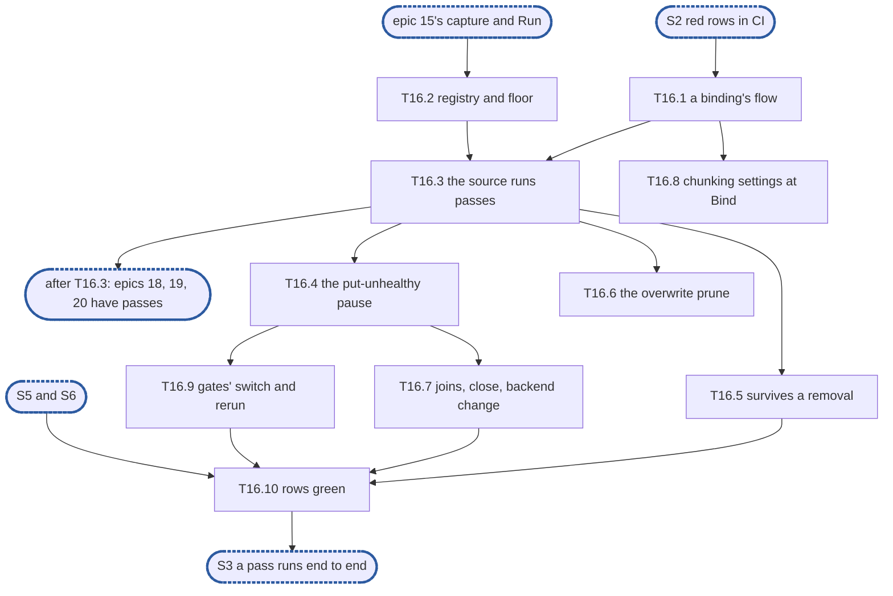

# Epic 16: engine offload passes and the bindings' remote side

**Sources:** [RFC 8](../docs/internals/rfcs/rfc-8-engine.md) §2.1 (every share has a remote block
store, the syncer's row, no setter, a backend change replaces the binding), §2.3 (the binding's
remote side, its flow and key scope, `Unbind`'s and `Drop`'s joins and order), §2.4 (the chunking
half: refused, recorded, a change a migration), §2.5 (`Bind` opens the flow before it publishes, and
Stop's steps 2, 4 and 5), §2.6 (the engine closes only the flows it opened), §3.2 (no gate is
safety), §6.1 (the offload source's runs, the prune key, pressure on put-healthy shards only, and
its checks' pass legs), §6.2 (the pass bound), §6.3 (the put-unhealthy pause, O2, O6's exemptions,
the "O2 long outage" check), §6.4 (the pass registry, the guard rows), §6.6 (the binding's write
namespace), §8.1 (the prune's in-flight floor), §8.3, §11.1 (gating on `Healthy(Put)` alone, no
probe of the store), §13's RFC 8 E6, E13, E16, E17 and E39, §14 (the series a pass reports) and
the §15 rows §9 lists; [RFC 6](../docs/internals/rfcs/rfc-6-block-metadata.md) §4.1 (the commit's
drop of a ref over a removal) and §6.2 (the in-flight floor); [RFC 2](../docs/internals/rfcs/rfc-2-carver.md)
§3.6 and §3.7 (a change is a migration; bad settings refused);
[RFC 13](../docs/internals/rfcs/rfc-13-configuration.md) §5.3 (the recorded `Target`, and its "§5.3
recorded" row); [RFC 3](../docs/internals/rfcs/rfc-3-syncer.md) §1.3 and §2.8 (`OpenFlow`, the
flow's `Healthy`, `Health` and `Close`) and §2.10 (`upload_workers`).
**Track:** B.
**Epic 16 estimate: 10 subtasks, 25.5 man-days.**
**Depends on:** sync point **S2**, red rows in CI (epic 12): the fixture's `WithSyncer`,
`FaultRemote`, `RunPass`, `PrimaryPair` and `WithoutGates`, each refusing by name; **epic 13**'s
`Tenant.Paused`, `CancelTenant` and `WaitTenant`; **epic 14**'s offload source, registered, rebuilt
and posted, whose `Run` answers `Done` and offers nothing (its D7), and the removal source this epic
adds the prune kind to; **epic 15**'s `offload.Run(ctx, offload.Deps, offload.Pass)
[]workqueue.Result`, its ports, its capture and guard functions, `offloadDue`, the `Failures` value
a binding owns and `offload.Stats` (its D1, D11, D14), with `Deps.Carver`, `Deps.Chain` and
`Deps.Puts` added there (its D2, option A; §9 lists what moves here under option B); **S5's first
half** (RFC 3's syncer, `pkg/syncer/pool`, over RFC 4's in-memory store through `codec.Store` under
RFC 4's fault wrapper) for T16.1; **S6** (the journal plan's epic 9b, the real journal's `Offload`,
`OffloadMany`, `MarkOffloaded`, `Unmark` and `Release`) for T16.10, whose rows run over the real
journal.
**Blocks:** epic 17, whose carved row fetches through the flow T16.1 opens at `Bind`; epic 18,
which evicts what passes made offloaded, offloads at once from the refusal path's third step and
reads the put health T16.4 keeps; epic 19, whose reseed gates the re-offer T16.3's passes make;
epic 20, which reads the pass outcomes and put health T16.3 and T16.4 keep; and S3, which this
epic's end is.

---

## 1. Goal

Epic 16 runs epic 15's pipeline as the work queue's offload source and gives each storage binding
its remote side: the flow to its store, its key scope, a pause while the store refuses puts, and
the joins that keep a pass from outliving the flow and the handle it uses. With S5 and S6 met, a
file written through the journal is offered, carved, packed, put through the binding's flow,
committed and reported offloaded, end to end: S3.

**At the end of the epic:**

- every binding holds one flow to its share's store, opened before the binding is published and
  closed last, after every pass that used it has returned; a share naming no store the syncer knows
  is not attached;
- the offload source's `Run` turns each batch into passes, and every file gets one result;
- a removal under a pass in flight never waits for it, and the pass's commit drops what the removal
  removed, a straddling ref whole;
- a put-unhealthy store pauses its shards' offload without growing any file's backoff or counting
  any failure, and the pause lifts at the next tick after the store answers;
- a share whose namespace's chunking settings are invalid or changed is refused at `Bind`, the
  change reported as a migration;
- the fixture's gates' switch reruns every Group A row with every gate this part has built turned
  off;
- every row of §9's list that waited on a pass is green, and no other row's `known.yaml` message is
  stale.

### 1.1 In scope

`Deps.Syncer`; a binding's flow at `Start`, `Bind`, a backend change, `Drop` and `Close`; the
offload source's `Run`; the pass registry and the removal prune's in-flight floor; the commit's drop
of a straddler and the abort of a wholly removed pass; the overwrite prune on the removal source;
the put-unhealthy pause and the put-healthy test under pressure; `Unbind`'s and `Drop`'s joins of the
offload source; the chunking settings at `Bind` and their migration report; the gates' switch and
the §3.2 rerun; copying `offload.Stats` into the engine's `Stats`; the fixture's syncer, remote-store
faults, pass controls and gates' switch made real; the rows of §9's list; the RFC 8 §15.3 amendment
(D12).

### 1.2 Out of scope

- The pipeline's states, Capture to Mark, the Intent step's namespace refusal, `offloadDue`, O6's
  count and the pipeline's own series: epic 15. This epic calls them.
- A re-home: a `Bind` naming a new write namespace joining the old one's passes, `State: Closing`
  and `Fenced` (the offload plan's §6.1 row "A re-home `Bind` joining the old namespace's passes",
  owner RFC 27). Until then `Bind` refuses a new write namespace for a served share (D5).
- `Unbind`'s `keepHolds` offload of hold marks, and the posts a `removing` share keeps for them (the
  offload plan's §6.1 row "Snapshot-hold ordering in the pipeline", owner RFC 12).
- The handover and lease-loss drains, a `StopTenant` result's drain and O7 (the offload plan's §6.1
  row "The cluster rules", owner the cluster stage).
- The share's put and get conditions, `offload_stalled`, `file_offload_failing` and drift's
  condition, which the long-outage and drift checks also assert: epic 20. This epic keeps the put
  health they read and asserts the pause.
- Eviction, fill, the refusal path's steps 2 and 3, pacing and their gates: epics 17 and 18, each of
  which makes its own gate obey the switch T16.9 builds.
- Registering `Target`'s settings section in the node's table and loading `upload_workers` into
  `Settings`: the integration epic, epic 21, once RFC 13 names `Target`'s key (the RFC 2 plan's
  §6.1 row "`Target`'s settings section").
- Positive-rate pacing of the offload source: deferred (the offload plan's §6.1 row "Positive-rate
  pacing in `pkg/workqueue`", owner RFC 9); the engine's sources register `Rate` 0 in any case.
- Collecting the objects a dropped ref leaves in its block: GC (the offload plan's §6.1 row "GC
  composed in the node", owner RFC 9).

### 1.3 Names used here

- **E1**, epic 11, interfaces: `Settings`, `ShareSettings`, `Share.Store`, `Stats` and the
  declarations its T11.5 records.
- **E2**, epic 12, red rows and test foundations: the fixture's component options, its controls and
  the rows listed in `test/engine/known.yaml`.
- **S1**, interfaces frozen: the end of epic 11.
- **S2**, red rows in CI: the end of epic 12.
- **S3**, a pass runs end to end: the end of this epic, over S5 and S6.
- **S5**, offload components built: the RFC 2 to RFC 5 plans' implementation epics.
- **S6**, journal offload half built: the journal plan's epics 9b and 7b.
- **The integration epic**, epic 21: the node composes offload.
- **The first part**: the journal-only engine, epics 1 to 10 of RFC 8's first plan.
- **RFC 8 E6, E13, E16, E17, E39**: invariants of RFC 8 §13, never epics.
- **#5757**: the issue the first part's share-limit and clone entries name; epic 18 closes it.

## 2. How the general rules apply

The rules are those of [the offload plan's §1.5](rfc-8-offload-engine-plan.md#15-general-rules-for-each-epic),
cited by number and title and not copied.

| Rule | Subtasks | How |
| --- | --- | --- |
| rule 1, **Independent unit tests** ([`CLAUDE.md`, "Writing tests"](../CLAUDE.md#writing-tests)) | T16.1 to T16.9 | unit tests run the engine over the first part's in-memory journal (with epic 15's `OffloadMany`), RFC 3's real syncer over RFC 4's in-memory store through `codec.Store` under RFC 4's fault wrapper (kinds 2 and 3), the real carver and chain over `keystest`'s provider, `kvstore` over the in-memory `kv.KV`, and the test clock (kind 1); no engine-side double is written |
| rule 2, **Fuzz the key and ref decoders the queue's rebuild reads** | T16.6, T16.8 | the prune kind's key joins epic 14's queue-key table, which RFC 8 §15.3's `ponytail:` checks by table (T16.6); the recorded chunking settings get their fuzz target: `pkg/settings`' `DecodeBound` target run over a table holding `Target`'s section, seeded with a record written without `Target` (T16.8) |
| rule 3, **Observability follows RFC 25** | T16.1, T16.3, T16.5 | `engine_offload_passes_total` gains `result="skipped"` and `"aborted"`, `engine_passes_aborted_total` is filled, `offload.Stats` is copied into epic 11's fields and `Stats.Carver` (epic 15 D14), `engine_lock_wait_seconds{area="storage binding table"}` is recorded; none share-labelled per operation |
| rule 4, **Profiling** | all | every test runs under the fixture's `prof.Watch`; T16.7's join and close tests fail on a pass goroutine or flow left open |
| rule 5, **Public interface and internals** ([`CLAUDE.md`, "Verifying a change"](../CLAUDE.md#verifying-a-change)) | all | assertions sit where the value is consumed: a flow's `Close` at the in-memory store's open-flow count RFC 3's suite covers, a paused tenant at the scheduler's `Stats`, a dropped ref at `kvstore`'s covering lookup, an offloaded bit at the journal's held extents, a refused share at `Bind`'s error and the binding read back |
| rule 6, **Known failures shrink** | T16.1, T16.3, T16.8, T16.9, T16.10 | each change that moves a red row past a refusal rewrites its `message:` in the same change; each row turned green leaves `known.yaml` there |
| rule 7, **v2 ignores v1, and the engine imports only what RFC 0 §1.2 allows** | T16.1, T16.9 | the `pkg/syncer` root is already allowed (epic 11); `pkg/syncer/pool`, `pkg/remote/codec` and every remote store stay refused in production code; `pkg/engine/internal/policy` (D7) is the engine's own; the wiring alone imports `pool` and `pkg/settings` |
| rule 8, **Real dependencies for properties of those dependencies** ([`CLAUDE.md`, "Writing tests"](../CLAUDE.md#writing-tests)) | T16.5, T16.10 | the straddler's drop is checked over `kvstore` on the memory KV and Badger under `t.TempDir()`; the rows run over the real journal on a real directory |
| rule 9, **Code comment conventions** ([`CLAUDE.md`, "Code comments"](../CLAUDE.md#code-comments)) | T16.3, T16.4, T16.5, T16.6, T16.8, T16.9 | RFC 8 §6.1's prune `ponytail:` at the prune's post (T16.6); this epic's `decision:` markers, each named in §4; epic 14's D7 `decision:` at the source's body deleted with the body (T16.3) |
| rule 10, **A test must be able to fail** ([`CLAUDE.md`, "Writing tests"](../CLAUDE.md#writing-tests)) | all | every test names the planted break it catches |
| rule 11, **A symbol is exported only if the RFC's interface uses it** | T16.1, T16.3, T16.8, T16.9 | the engine exports `Deps.Syncer` (RFC 8 §2.6), `Settings.UploadWorkers` (D9) and `Stats.Carver` (epic 15 D14); `Deps.Gates` names a type of an internal package (D7); `content.ErrMigration` is the wiring's (D8) |
| rule 12, **Each subtask creates only what it declares** | all | `Deps.Syncer` joins with T16.1's `OpenFlow`, the flow's `Healthy` with T16.4, `PruneOverwrites` with T16.6's run; every fixture control lands real with its first green caller |

## 3. Requirements and invariants

Every obligation the sources place on this epic, numbered so subtasks and tests can cite them.

**A binding's flow**

| # | Requirement | Kind | Source | Subtasks |
| --- | --- | --- | --- | --- |
| R1 | A binding holds the syncer flow to its share's remote block store; the engine opens one flow per share, at attach, through `OpenFlow` | MUST | RFC 8 §2.3, §2.1 (the syncer's row), §11.1; RFC 3 §1.3 | T16.1 |
| R2 | `Bind` opens the share's flow before it publishes the binding; a failure publishes nothing and undoes in reverse what it opened | MUST | RFC 8 §2.5 (`Bind` attaches a share above its floor) | T16.1 |
| R3 | Every share has a remote block store: a share whose store the syncer does not know, or none, is not attached, and the error names the share; there is no local-only path | MUST | RFC 8 §2.1; RFC 3 §1.3 (a zero `StoreID` is never minted) | T16.1 |
| R4 | The syncer is a capability held by a declared interface, and an absent one fails construction with an error naming it | MUST | RFC 8 §2.1, §2.6 | T16.1 |
| R5 | `Drop` closes the share's flow after it cancels the share's shards, closes its handle and runs the tag's `Forget`; `Close` closes every share's flow, then the handles, then the journals, in the reverse of their opening, only after every join; the engine closes only the flows it opened | MUST | RFC 8 §2.3, §2.5 (Stop, step 4), §2.6 | T16.1, T16.7 |
| R6 | No background work outlives a component it uses: no pass runs past the close of its flow or its handle | invariant | RFC 8 §13 E13; §2.5 (Stop, step 4) | T16.7 |
| R7 | A join that does not complete within its bound leaves the components it depends on open and reports the failure | MUST | RFC 8 §2.5 (Stop, step 5) | T16.7 |
| R8 | §2.5 join: `Close` with an offload parked in a stalled put closes no component while the pass runs | test row | RFC 8 §15.2 | T16.7, T16.10 |
| R9 | Changing a share's backends replaces its binding, and never through a setter on a serving engine | MUST, MUST NOT | RFC 8 §2.1, §2.3 | T16.7 |

**Passes**

| # | Requirement | Kind | Source | Subtasks |
| --- | --- | --- | --- | --- |
| R10 | The offload source's `Run` runs its batch as passes of the pipeline, and returns one result per file; only the pipeline's steps retry inside a pass, and nothing re-runs a step after its pass returned | MUST | RFC 8 §6.1 (Retries are the scheduler's), §6.3 | T16.3 |
| R11 | A pass offers at most `upload_workers` block targets of dirty bytes; this epic hands the number to epic 15's `offloadDue`, which bounds the pass | bound | RFC 8 §6.2; RFC 3 §2.10 | T16.3 |
| R12 | An upload's outcome stays inside its pass: only the pass's result per file reaches the scheduler | invariant | RFC 8 §6.1 (What does not post here) | T16.3 |
| R13 | A pass refused by a full syncer queue (`Throttled`), or skipped for a put-unhealthy store, is not a failed pass and never counts toward the five | MUST NOT | RFC 8 §6.3 O6 | T16.3, T16.4 |
| R14 | A binding carries its share's write namespace as its key scope; a pass's chunk IDs, names and commits stay in the namespace it captured, which the Intent step compares with the binding's current one | invariant | RFC 8 §2.1, §2.3, §6.6, §13 E39 | T16.3 |
| R15 | one run per key, the pass half: with the store slow but healthy and a file's pass outlasting three age ticks, the file is never in two passes at once, each block is put once, and no commit fails as `ErrInconsistent` | test row | RFC 8 §6.1 (Checks) | T16.3 |
| R16 | rebuild, the pass half: after a crash with passes in flight, every dirty file is offered again | test row | RFC 8 §6.1 (Checks) | T16.3 |

**The pass registry and the guard**

| # | Requirement | Kind | Source | Subtasks |
| --- | --- | --- | --- | --- |
| R17 | At capture, under each file's guard, the engine records the pass's `Newest` and captured write namespace against the file, and clears them when the pass returns; a file has at most one entry | MUST | RFC 8 §6.4 (A pass in flight is registered) | T16.2 |
| R18 | A removal record is pruned only once done and at or below the file's in-flight floor, the lowest `Newest` of the passes in flight, which the prune reads from the registry under the file's guard | MUST | RFC 8 §8.1, §6.4, §8.3 (F3); RFC 6 §6.2 | T16.2 |
| R19 | §6.4 guard across a removal: an offer waits for a truncate stalled between its journal step and its transaction, and no ref lies past `size` after both | test row | RFC 8 §15.1, §6.4, §13 E6 | T16.10 |
| R20 | §6.4 guard is not a fence: two engines each believing it is primary for one file, with separate guards; the store refuses the stale primary's commits on both paths | test row | RFC 8 §15.1, §6.4, §13 E17 | T16.10 |

**A pass in flight survives a removal**

| # | Requirement | Kind | Source | Subtasks |
| --- | --- | --- | --- | --- |
| R21 | A removal that lands while a pass is uploading never waits for the pass and never cancels it | MUST NOT | RFC 8 §8.3 | T16.5 |
| R22 | The pass's commit drops every ref it would write that overlaps a removal of higher version than the ref's `newest`, a straddling ref whole, reports none of their extents, and applies the rest; a straddler's part outside the removal stays **Dirty** and is offered again | MUST | RFC 8 §8.3, §13 E16; RFC 6 §4.1 (the file's removals) | T16.5 |
| R23 | A pass whose offered content was entirely removed aborts before uploading, counted in `engine_passes_aborted_total` (a MAY, adopted by D3) | MUST | RFC 8 §8.3, §14 | T16.5 |
| R24 | §8.3 transfer survives a removal: a stalled upload completes after a truncate below its extent; the commit drops the refs past the new size, drops a straddler whole and re-offers its outside part, applies the rest, and the truncated extent reads past end of file; both commit orders; again with deallocate, release and a clone onto the file | test row | RFC 8 §15.1 | T16.5, T16.10 |

**The overwrite prune**

| # | Requirement | Kind | Source | Subtasks |
| --- | --- | --- | --- | --- |
| R25 | A pass whose commit replaced committed content posts a prune of the file's superseded overwrite records, on the removal source, keyed (shard, prune, file), so it never merges with the file's offload or removal key | MUST | RFC 8 §6.1 (Outputs, Keys) | T16.6 |
| R26 | A prune lost to a crash or a drop costs lookup work, never a wrong read | invariant | RFC 8 §6.1 (its prune `ponytail:`) | T16.6 |

**Put health**

| # | Requirement | Kind | Source | Subtasks |
| --- | --- | --- | --- | --- |
| R27 | The engine reads `Healthy(Put)` on the share's flow at each age tick and before each pass, and never probes the store itself | MUST, MUST NOT | RFC 8 §6.3, §11.1; RFC 3 §2.8 | T16.4 |
| R28 | While the store is put-unhealthy each of its shards is a paused tenant: its entries stay, none is dispatched, no file's backoff grows, and a pass it meets is skipped and its files returned pending, not failed; the pause lifts at the next tick after the flow reports healthy | MUST | RFC 8 §6.3, O2; §6.1.1 (`Paused`) | T16.4 |
| R29 | Offload is gated on `Healthy(Put)` and nothing else: a get-unhealthy store pauses no pass | invariant | RFC 8 §11.1 | T16.4 |
| R30 | Under pressure, only a shard whose store is put-healthy at that tick has its cap lowered to `offload.retry_max_pressure`; one whose store is put-unhealthy keeps `offload.retry_max` | MUST | RFC 8 §6.1, §6.3 O2 | T16.4 |
| R31 | O2 long outage, the pause half: the remote unavailable for 24 simulated hours with 10⁴ dirty files; the share's passes are paused while the store is put-unhealthy, no file's failure count rises, and offload resumes within one age tick of the store reporting healthy | test row | RFC 8 §6.3 (Checks) | T16.4 |
| R32 | pressure band, the put-unhealthy leg: above *S* with the store put-unhealthy with cause `ErrTransient`, no backoff cap falls below `offload.retry_max` | test row | RFC 8 §6.1 (Checks) | T16.4 |
| R33 | starvation, the throttling leg: a share whose store throttles to 1 MB/s while healthy beside a fast one; the fast share's oldest unoffloaded age stays below the maximum age and its pace within 10 % of its baseline | test row | RFC 8 §6.1 (Checks) | T16.4 |

**Unbind and Drop**

| # | Requirement | Kind | Source | Subtasks |
| --- | --- | --- | --- | --- |
| R34 | `Unbind` admits no new offload pass for the share, then joins every pass in flight, through `WaitTenant` on each of the share's shards; from then on the age tick and the rescan post no offload key for the share | MUST | RFC 8 §2.3 | T16.7 |
| R35 | `Drop` cancels the share's shards in the offload source (`CancelTenant`), so no entry for the tag runs against a closed handle | MUST | RFC 8 §2.3 | T16.7 |
| R36 | §2.3 unbind and drop, with a pass in flight: no run for the share starts after `Unbind` is called, `Unbind` returns once the pass has returned, and no entry of the tag remains after `Drop` | test row | RFC 8 §15.2 | T16.7, T16.10 |

**Chunking settings**

| # | Requirement | Kind | Source | Subtasks |
| --- | --- | --- | --- | --- |
| R37 | An invalid chunking setting is refused with an error, never replaced by a default, and the engine keeps the binding it had | MUST, MUST NOT | RFC 8 §2.4; RFC 2 §3.7 | T16.8 |
| R38 | Which chunking settings produced a namespace's content is recorded with the namespace when it is created, and compared at every open; a change is reported as a migration, never applied | MUST | RFC 8 §2.4; RFC 2 §3.6; RFC 13 §5.3 | T16.8 |
| R39 | §2.4 settings, as amended here: a namespace `Target` the carver refuses is refused at `Bind` and the earlier binding kept; a `Target` changed under the namespace's record is refused at `Bind` as a migration | test row | RFC 8 §15.3 (D12) | T16.8 |
| R40 | §5.3 recorded: a namespace whose stored `Target` was edited underneath its record does not open | test row | RFC 13 §5.3, its "§5.3 recorded" row | T16.8 |

**No gate is safety**

| # | Requirement | Kind | Source | Subtasks |
| --- | --- | --- | --- | --- |
| R41 | A policy gate is never the only thing between the system and data loss: the switch that disables every gate this part has built (health gating, and `offloadDue`'s triggers, so offload runs constantly) is honoured by each, and production cannot set it | MUST NOT | RFC 8 §3.2; §2.1 (no setter) | T16.9 |
| R42 | §3.2 no gate is safety: with suspension, pins and health gating disabled and eviction as eager as possible, every other Group A check passes | test row | RFC 8 §15.1 | T16.9 (the rerun); green with the last Group A row, epic 22 at the latest |

**Rows a pass turns green**

| # | Requirement | Kind | Source | Subtasks |
| --- | --- | --- | --- | --- |
| R43 | §6.6 minted names and intents: a retried put keeps its name and bytes, a new pass mints a new name, a removed intent fails the commit and the content is re-offered, a delayed delete touches no committed block | test row | RFC 8 §15.1 | T16.10 |
| R44 | §6.7 widening: a release of an offloaded neighbour waits for the pass widened over it, and the new refs read correctly | test row | RFC 8 §15.1 | T16.10 |
| R45 | §6.7 stretch ends: passes cut by `limit` report no byte past `consumed`, the next starts at a content boundary, the chunking equals one pass over the whole file, and the tail is offloaded within the age ceiling | test row | RFC 8 §15.1 | T16.10 |
| R46 | §6.8 per-block reporting: with the second of three block commits failed, the journal marks exactly the first and third blocks' extents | test row | RFC 8 §15.1 | T16.10 |
| R47 | §5.1 overwrite waits for existence, the offload half: an overwrite inside an offloaded extent answers only after its existence commit wrote the overwrite record, and once the journal's record is dropped the range fails as **Lost**, never the offloaded bytes | test row | RFC 8 §15.1 | T16.10 |

**Observability**

| # | Requirement | Kind | Source | Subtasks |
| --- | --- | --- | --- | --- |
| R48 | `engine_offload_passes_total` by `result`, `engine_passes_aborted_total`, the pipeline's other series and `engine_lock_wait_seconds` for the storage binding table, never labelled by share | MUST | RFC 8 §14; RFC 25 §2.1, §2.5 | T16.1, T16.3, T16.5 |

## 4. Decisions this epic takes

- **D1, a batch's passes are `offloadDue`'s groupings, run side by side.** A batch holds one shard's
  files (epic 13 D1). `Run` hands their dirty figures to epic 15's `offloadDue` with the pass bound
  (D9), which groups them into passes and puts a failing file alone (O6), and runs each pass on its
  own goroutine, joined before `Run` returns, so a failing file's pass delays none of the batch's
  others. Each pass reports its files through `done` as it returns. A `decision:` at the fan-out
  names the bound, at most `Batch` goroutines per run. Prior art: client-go's workqueue hands one key
  to one worker and leaves batching to the caller (from memory); none found for batches.
- **D2, a skipped pass re-posts its files and answers `Done`.** RFC 8 §6.3 returns a skipped pass's
  files "pending, not failed", and the scheduler has no pending outcome: `Retry` grows the backoff
  (R28 forbids it) and a bare `Done` drops the key until the age tick. So the source first sets the
  shard's tenant paused, as the tick would, then posts each file's key while the run holds it, which
  sets the key's redo mark, then answers `Done`, which makes the key pending at once (RFC 8 §6.1.1's
  state table) and leaves it undispatched, since its tenant is paused. Pausing first is what keeps
  the redone key from being dispatched straight back into the same skip. A `decision:` at the skip names it, withdrawn if the scheduler gains an outcome that
  keeps a key pending. Prior art: none found.
- **D3, a wholly removed pass aborts at its next block, checked against the registry.** RFC 8 §8.3
  lets it abort; RFC 8 §14's `engine_passes_aborted_total` (epic 11's `PassesAborted`) counts it. A
  removal's journal step runs under the file's guard (§6.4), so it adds its version and extent to the
  file's registry entry there; before each block's Intent the pass drops the block's chunks whose
  extents a recorded removal of higher version covers, and once no chunk is left in the pass it
  returns `Done` for those files with nothing put. The commit's drop (R22) stays the rule; the abort
  only saves the upload. Prior art: none found.
- **D4, a straddling ref is dropped whole in `kvstore`'s commit.** RFC 8 §8.3 and E16 drop a
  straddler whole; `kvstore`'s `commitFile` today clips each new ref to its parts outside the
  removals (`masks.visible`), which reports and keeps the outside part. The commit is changed to
  drop a new ref with any part masked, as RFC 6 §4.1's "is dropped" reads, so its outside part stays
  **Dirty** and is offered again; refs already stored keep `cutRef`'s clipping, which RFC 6 §6.2
  specifies for them. Following the RFC as written; §9 asks whether to amend it to the clip instead.
  No marker. Prior art: none found.
- **D5, `Bind` refuses a new write namespace for a served share until the re-home lands.** A
  namespace change is a re-home (RFC 27 §2.7), whose join is deferred; the first part's `change`
  today ignores the field. Refused with `vfserr.ErrInvalid` naming the share, so the binding's key
  scope never moves in v1.1 and the Intent step's comparison (epic 15) never fires outside its unit
  tests. A `decision:` at `change`, withdrawn by the re-home. Prior art: the first part's refusal of a
  changed tag or shard in `change`.
- **D6, a backend change opens the new flow before it retires the old one.** RFC 8 §2.1 has a
  backend change replace the binding. `Bind` naming a different `Store` for a served share opens the
  new flow first (refused, the binding unchanged, if it fails), publishes the binding with it, so
  every pass captured from then on puts through it, then joins the share's passes in flight on the
  offload source (`WaitTenant`) and closes the old flow. A pass already running keeps the flow it
  was handed. No marker. Prior art: none found.
- **D7, the gates' switch is a `Deps` field of an internal type, pending the user's answer (§9).**
  RFC 8 §3.2 needs the engine run with its gates off, and §2.1 forbids a setter. `Deps.Gates
  policy.Gates`, with `policy.Gated` its zero value and `policy.Ungated` the switch, declared in
  `pkg/engine/internal/policy`: only code under `pkg/engine` can name it, so the node's content
  wiring can only leave it zero, and `enginetest.WithoutGates` sets it. Each gate reads it: the pause
  (T16.4) and `offloadDue`'s triggers here, which then find every file with dirty bytes due; fill,
  eviction and its suspension and pins in epics 17 and 18. A `decision:` at the field states that
  it is the one `Deps` member that is not a capability, safe in either value by §3.2, and withdrawn
  if anything outside `pkg/engine` needs it. RFC 8 §2.6's `Deps` gains the field in T16.9's pull
  request. Prior art: Go's `internal` package rule; FoundationDB's simulation knobs, which raise
  randomised policy settings only in simulation (from memory).
- **D8, the content wiring compares the recorded `Target`; the engine asks at `Bind`.** The engine
  imports neither `pkg/settings` nor the metadata store's namespace records (RFC 0 §1.2), and RFC 2
  plan's §6.1 row "Recording which settings produced a namespace's content" gives the record to the
  namespace's `Bound`, which the node writes at creation. So the wiring's `Settings(ns)` (epic 15's
  carver port) reads the namespace's `Bound` through the node's settings table (`DecodeBound`),
  compares its `Target` with the namespace's configured one, and answers an error wrapping
  `content.ErrMigration`, naming both values, when they differ, and `carver.ErrInvalidSettings` for
  a `Target` `carve.NewSettings` refuses. `Start` and `Bind` call `Settings(ns)` for the share's
  write namespace before the flow opens and refuse the share with that error. Until the integration
  epic registers `Target`'s section, a namespace's record holds no `Target`, and the wiring builds
  its settings from RFC 2's default: a `decision:` there, withdrawn when the section is registered.
  Prior art: restic's repository config, which records the chunker polynomial at `init` and refuses
  to change it (from memory).
- **D9, the pass bound is `Settings.UploadWorkers`.** `offloadDue` takes `upload_workers` as a
  number (epic 15 T15.4), and the engine reads node-scope keys only through `Apply` (RFC 8 §2.6).
  `Settings` gains `UploadWorkers int`, refused below 1 by `Apply`, and the node and the fixture
  pass RFC 3's proposed 128 until the integration epic loads the key. Additive to epic 11's frozen
  `Settings`. Prior art: the first part's `Settings`, every key required.
- **D10, the fixture composes the syncer for every engine.** `Deps.Syncer` is refused nil at `New`
  (R4), so every engine the fixture, the unit fixture and the in-package tests build has RFC 3's
  syncer over RFC 4's in-memory store, with one store registered and named by every share; the
  syncer option no longer selects anything. `WithSyncer` stays, accepted and composing nothing more,
  because 41 rows call it and the integration epic decides the options' fate (epic 12 §9). The node
  builds the syncer in the content wiring over the stores epic 15's D2 composes (option A). No
  marker. Prior art: the first part's fixture, which composes every member of `Deps`.
- **D11, the engine opens its flows as demand flows.** `OpenFlow(store, false)`: RFC 3 §1.3 runs a
  background flow's fetches in the background class, which is relocation's and copying's, and the
  engine's fetches are demand reads (RFC 8 §6.1); puts are scheduled as background whatever the
  flow. No marker. Prior art: none found.
- **D12, RFC 8 §15.3's "§2.4 settings" row is amended in this pull request.** It configured `Min ≥
  Target` and had `Apply` refuse it, which RFC 2 §3.2 makes unconfigurable (`Min` is `Target / 4`),
  and `Target` reaches the engine with the share at `Bind`, not with `Settings` (epic 12 D7). The row
  now reads: "Configure a namespace `Target` the carver refuses ([RFC 2 §3.7]). Assert the share's
  `Bind` refuses it and the engine keeps its earlier binding. Change the `Target` a namespace's
  record holds underneath it. Assert the share's `Bind` is refused as a migration ([RFC 2 §3.6]), and
  nothing is cut under the new value." RFC 8 is a draft (`rfc-index.md`), so no other RFC cites the
  row. Prior art: none found.

## 5. Target tree

On `feat/storage-v2`.

```text
pkg/engine/
  deps.go                 T16.1  Deps.Syncer (Syncer: OpenFlow); T16.4 the declared Flow's Healthy; T16.6 Existence.PruneOverwrites; T16.9 Deps.Gates
  share.go                T16.1  the flow opened at attach and Bind, closed on a failed Bind; T16.7 a backend change; T16.5 D5's namespace refusal; T16.8 Settings(ns) at Bind
  types.go                T16.3  Settings.UploadWorkers; T16.3 Stats.Carver (epic 15 D14)
  engine.go               T16.3  Apply refuses UploadWorkers below 1; T16.1 New refuses a nil Syncer
  file.go                 T16.2  fileEntry.pass, the pass registry (the first part's file)
  pass.go                 T16.2  the registry's capture wrapper and the in-flight floor; T16.3 the offload source's Run; T16.5 the abort
  pause.go                T16.4  the put-health read, the paused rule, the skip (D2), the pressure cap's health test
  queue.go                T16.4  the age tick reads put health (epic 14's file); T16.6 the prune kind's post
  removals.go             T16.2  the prune reads the floor; T16.6 the prune kind's run (epic 14's file)
  unbind.go               T16.7  Unbind's WaitTenant and Drop's CancelTenant on the offload source, the flow closed last
  close.go                T16.7  stop step 4's flows, after the scheduler's Stop
  health.go               T16.3  offload.Stats copied into Stats; T16.1 the binding table's lock waits
  internal/policy/        T16.9  Gates, Gated, Ungated (D7)
  enginetest/components.go  T16.1  WithSyncer composing nothing more (D10); T16.9 WithoutGates made real
  enginetest/remote.go    T16.1  FaultRemote made real, over RFC 4's fault wrapper
  enginetest/offload.go   T16.3  RunPass made real; T16.10 PrimaryPair made real
  enginetest/work.go      T16.3  BlockNextRun("offload") made real
  enginetest/fixture.go, unit.go  T16.1  the syncer and its store on every engine; T16.3 UploadWorkers default
  conformance/rfc8_*_test.go  T16.9  every TestRFC8A_* row a function of the fixture's options, rerun under the §3.2 row; T16.10 the rows' legs corrected
  pass_test.go, pause_test.go, flow_test.go, prune_test.go  T16.1 to T16.7  the unit tests
  export_test.go          T16.1 to T16.7  the registry's, the pause's and the flows' accessors
pkg/metadata/kvstore/
  offload.go              T16.5  commitFile drops a masked new ref whole (D4)
  offload_removal_test.go T16.5  the straddler over the memory KV and Badger
pkg/settings/
  bound_fuzz_test.go      T16.8  the target's table gains Target's section
internal/node/content/
  content.go              T16.1  the syncer built over the stores (pool.New, Register); T16.8 Settings(ns) compares the recorded Target, ErrMigration
  content_test.go         T16.8  the comparison's table
docs/internals/rfcs/rfc-8-engine.md  T16.9  §2.6's Deps gains Gates (D7); §15.3's "§2.4 settings" row is amended by this document's pull request (D12)
test/engine/known.yaml    T16.1, T16.3, T16.8, T16.9, T16.10  messages rewritten, entries removed and the rerun's entries added
```

## 6. Subtasks

### T16.1 A binding's flow

**Subtask T16.1 estimate: 3 man-days.**

- **Track:** B. **Depends on:** S2. Also S5's first half (RFC 3's syncer and RFC 4's in-memory
  store with `codec.Store`) and epic 15's T15.5 (the wiring's stores, its D2).
- **Covers:** R1, R2, R3, R4, R5 (`Drop`'s and a failed `Bind`'s close), R48 (the lock waits).
- **Deliverables:**
  - In `deps.go`, as epic 11's T11.5 records it (its D7):
    ```go
    type Syncer interface {
    	OpenFlow(store syncer.StoreID, background bool) (syncer.Flow, error)
    }
    // Deps gains:
    	Syncer Syncer // RFC 3 §1.3: OpenFlow, one flow per share at attach
    ```
    `New` refuses a nil `Syncer` naming it. The binding gains `flow syncer.Flow`. `attach` opens
    it with `OpenFlow(s.Store, false)` (D11) before the incarnation raise and the publish, `Start`
    for each share it attaches and `Bind` for a new one; a refused open fails the attach naming the
    share and wrapping the syncer's error (R3), and an attach failing after it closes the flow
    before it returns (R2). `Drop` closes the flow after `Forget` (R5).
  - `ShareTableLockWaits` recorded at the binding table's lock (epic 11's field).
  - In `internal/node/content`: `Compose` builds `pool.New` over `content.Params`' stores, each
    registered with its probe key, and passes it as `Deps.Syncer`; its `Stop` closes the syncer
    after the engine.
  - In `enginetest`: every fixture engine, the unit fixture's included, composes the syncer over RFC
    4's in-memory store under RFC 4's fault wrapper, with one store registered whose `StoreID` every
    fixture share names (D10); `FaultRemote(s sim.Fault)` made real over that wrapper. The
    in-package tests that build `Deps` by hand get one from `export_test.go`. Every `known.yaml`
    entry whose message is `fixture: the syncer is not composed` rewritten to the refusal it meets
    now, the fixture's `fixture: RunPass is not built`, in the same change.
  Consumed by T16.3 (the flow a pass puts through), T16.4 (`Healthy`), T16.7 (the close order), epic
  17 (`Fetch`, `Prefetch`).
- **Acceptance criteria:**
  - `New` with no syncer is refused naming it.
  - A `Bind` of a share whose `Store` is zero or unregistered is refused naming the share, opens no
    handle, and the engine serves what it served.
  - A `Bind` failing after its flow opened (its limit write faulted) leaves no flow open.
  - `Drop` closes the share's flow only after `Forget` returned.
  - Every first-part row and unit test passes with the syncer composed.
- **Tests:** at `Bind` and `Drop`, which the node calls, reading open flows from RFC 3's syncer
  `Stats` (its suite covers the count): a zero and an unknown store refused (catches a share
  attached with no store, R3); a `Bind` whose limit write fails leaving no open flow (catches the
  missing undo, R2); `Drop` with a `Forget` fault leaving the flow open and a retried `Drop`
  closing it once (catches a flow closed before its tag is forgotten, R5); `New` refused naming
  `Syncer` (R4); a share's lock-wait histogram rising under two concurrent `Bind`s held by a hook
  (R48). Doubles: RFC 4's in-memory store (kind 2, RFC 4's suite) under its fault wrapper (kind 3).
- **Rules:** rule 6, the rewrite; rule 7, `pool` imported by the wiring and tests only.

### T16.2 The pass registry and the in-flight floor

**Subtask T16.2 estimate: 1.25 man-days.**

- **Track:** B. **Depends on:** epic 15's T15.5 (its capture and guard functions).
- **Covers:** R17, R18.
- **Deliverables:** in `pass.go`, the registry as one field of the first part's per-file state:
  `fileEntry.pass *passEntry`, `passEntry{newest entity.JournalVersion; ns entity.NamespaceID;
  removed []removalMark}`, set and read under the file's guard, and counted by `fileEntry.idle()`
  so the entry outlives no pass; the capture function epic 15's `Pass` takes, wrapped so it sets
  each file's entry under its guard once `OffloadMany` returns its offers' `Newest`, and a
  `release` the pass calls when it returns, clearing them; `inFlightFloor(file)
  (entity.JournalVersion, bool)`. In `removals.go`, the prune epic 14 runs takes the file's guard,
  reads the floor and passes `PruneRemovals` the lower of the removal's version and the floor.
  `removed` is D3's, filled by T16.5. Consumed by T16.3, T16.5 and epic 19, whose reseed's drain
  clears the entries (RFC 8 §2.5).
- **Acceptance criteria:**
  - While a pass whose `Newest` is below a done removal's version is in flight, the removal is not
    pruned; it is once the pass returns.
  - A second capture of a file already in the registry is a programming error the scheduler's
    one-run-per-key rules out, refused with a panic naming the file.
- **Tests:** at the store's removal records, read through `kvstore`'s unfinished-removal listing,
  which the covering lookup consumes: a pass held between Put and Commit (a fault wrapper's delay on
  the in-memory store, kind 3, advanced on the test clock), a truncate run to done meanwhile, and the
  prune run; the removal is still listed, and gone after the pass returns (catches a prune that reads
  no floor, which F3 forbids, R18); the entry gone after the pass returns, read through an
  `export_test.go` accessor (catches a leaked entry, R17).
- **Rules:** rule 5, asserted at the removal listing the commit reads.

### T16.3 The offload source runs passes

**Subtask T16.3 estimate: 3.5 man-days.**

- **Track:** B. **Depends on:** T16.1, T16.2.
- **Covers:** R10, R11, R12, R13 (`Throttled`), R14, R15, R16, R48 (the passes' series).
- **Deliverables:**
  - In `pass.go`, the offload source's `Run`, replacing epic 14's D7 body and its `decision:`: it
    reads the batch's shard binding, gathers each file's dirty figures, calls `offloadDue` with
    `Settings.UploadWorkers` (D9), and runs each pass `offloadDue` returns through `offload.Run`,
    one goroutine per pass (D1), with the binding's flow, store, failures, the registry's capture
    and release (T16.2), and `func() entity.NamespaceID` reading the binding's current write
    namespace (R14). Each file's result goes to `done` as its pass returns; a file `offloadDue`
    placed in no pass answers `Done`, since the age tick re-posts it when due.
  - `Settings.UploadWorkers int` (D9), refused below 1 by `Apply`; the fixture and the node pass
    128.
  - In `health.go`, `offload.Stats` copied into epic 11's fields and into `Stats.Carver
    map[entity.NamespaceID]CarverStats` (epic 15 D14); `OffloadPasses` gains `result="skipped"`
    (T16.4) and `"aborted"` (T16.5).
  - In `enginetest`: `RunPass(ctx, share)` made real, posting every dirty file of the share and
    waiting until their runs return; `BlockNextRun("offload", shard)` made real, a kind-3 hold on
    the in-memory store's next put for that shard; every `known.yaml` entry whose message is
    `fixture: RunPass is not built` rewritten to the failure it meets now, over the real journal the
    journal's `stub: Offload`; O1's crash test (`TestRFC8A_OffloadSurvivesACrashInEachState`, epic
    15) rewritten to the same.
  Consumed by T16.4 to T16.10, epic 18 (the refusal path's pass), epic 19 (the re-offer) and epic 20
  (the outcomes).
- **Acceptance criteria:**
  - A batch of a share's files ends with every file reported offloaded once its commit lands, and
    one `done` per file.
  - A batch holding a failing file runs it in its own pass, and the others' results arrive before
    the failing one's.
  - A pass that met `remote.ErrThrottled` returns `Throttled` and its file's failure count is
    unchanged.
  - A pass offers no more than `UploadWorkers` block targets.
- **Tests:** at the scheduler's results and the in-memory journal's offloaded bits (what `Release`
  reads): a batch of three files, each offloaded and reported once (catches a lost or doubled
  result, R10); a poison file's pass held by the in-memory store's delay while the other two
  report (catches a batch run as one pass, D1); a store answering `ErrThrottled` once, the file's
  count read through `offload.Stats` (catches a throttled pass counted, R13); `UploadWorkers` 2 with
  four block targets dirty, the pass's offer read from the in-memory journal's offer record (catches
  an unbounded pass, R11); RFC 8 §6.1's "one run per key" with puts, over the in-memory store's
  object listing (each block put once) and the commit results (no `ErrInconsistent`) (R15); its
  "rebuild" pass half, a crash of the engine over the in-memory journal with a pass between Put and
  Commit, every dirty file offered again after the restart (R16); the binding's namespace read by
  the pass at Intent, asserted by a block named under it in the store (R14). Doubles as T16.1.
- **Rules:** rule 3, the series copied; rule 6, the rewrite; rule 9, epic 14's D7 marker deleted.

### T16.4 The put-unhealthy pause

**Subtask T16.4 estimate: 2.75 man-days.**

- **Track:** B. **Depends on:** T16.3.
- **Covers:** R13 (the skip), R27, R28, R29, R30, R31, R32, R33.
- **Deliverables:** the engine's declared flow use gains `Healthy` (§15.3's check now sees it
  called). In `pause.go`: at each age tick, for each binding of the journal, `Healthy(remote.Put)`
  read once and kept on the binding as its put health. One pure rule, `paused(removing,
  putUnhealthy bool, g policy.Gates) bool`, true for a removing share (T16.7) or a put-unhealthy
  store while gated, decides each of the share's shards' `Tenant.Paused`, set through `SetTenant`
  only when the answer changes, the rest of its `Tenant` unchanged. Before each pass the source
  reads `Healthy(Put)` again; a put-unhealthy store skips the pass, pausing the tenant, re-posting
  its files and answering `Done` (D2), counted `result="skipped"`. Epic 14's pressure cap reads the kept put health
  in place of its D8 answer, which is withdrawn. Under the gates' switch (T16.9) nothing pauses.
  Consumed by epic 18 (`Health(Put)`'s cause in the refusal table reads the same flow) and epic 20
  (the put condition).
- **Acceptance criteria:**
  - While the store is put-unhealthy, no pass of its shards is dispatched, their entries stay, and
    no file's backoff or failure count changes.
  - The pause lifts at the first age tick after the flow reports healthy.
  - A get-unhealthy, put-healthy store pauses nothing.
  - Under pressure, a put-unhealthy shard's cap stays `offload.retry_max`.
- **Tests:** at the scheduler's `Stats` per tenant and at `offload.Stats`, on the test clock:
  RFC 8 §6.3's "O2 long outage", the pause half: 10⁴ dirty files, the in-memory store's fault
  wrapper failing every put and probe for 24 simulated hours; the tenant paused, its entries held,
  no dispatch, every failure count zero, and every file offered within one age tick of the faults
  clearing (R28, R31; catches a backoff grown or a failure counted); a pass dispatched just before
  the store turns unhealthy, skipped and its files pending again with their backoff unchanged
  (catches `Retry`, D2); a get-only fault pausing nothing (catches a get gate, R29); the "pressure
  band" put-unhealthy leg with cause `ErrTransient`, every cap at `offload.retry_max` (R30, R32);
  the "starvation" throttling leg, one share's store throttled to 1 MB/s by the fault wrapper's
  delay beside a fast one, the fast share's oldest unoffloaded age below `MaxAge` and its offered
  bytes per simulated second within 10 % of its run alone (R33). The engine probing the store is
  checked by the store's own operation count, which RFC 4's in-memory store exports and its suite
  covers: no probe the syncer did not issue (R27). Doubles as T16.1.
- **Rules:** rule 9, D2's `decision:`; epic 14's D8 withdrawn.

### T16.5 A pass in flight survives a removal

**Subtask T16.5 estimate: 2.75 man-days.**

- **Track:** B. **Depends on:** T16.3.
- **Covers:** R21, R22, R23, R24 (unit legs), R48 (the aborts).
- **Deliverables:** in `kvstore`'s `commitFile`, a new ref with any part masked by a removal of
  higher version than its `newest` is dropped whole and not reported (D4); refs already stored keep
  `cutRef`. In `pass.go`, a removal's journal step adds its version and extent to the file's registry
  entry under the guard; before each block's Intent the pass drops the chunks a recorded removal
  covers, and a pass left with nothing returns with nothing put, counted in `PassesAborted` and
  `result="aborted"` (D3). Removals take no wait on the registry: they record and go on (R21).
  Consumed by T16.10.
- **Acceptance criteria:**
  - A truncate below a stalled pass's extent completes without waiting for it; the pass then
    commits, drops the refs past the new size and a straddler whole, and the straddler's part inside
    the file is offered again and offloaded by the next pass.
  - With the commit first, the removal's phase 2 drops the refs it wrote.
  - A release of a file whose pass is stalled before Intent ends that pass with nothing put.
- **Tests:** in `kvstore`, over the memory KV and Badger under `t.TempDir()`: a commit with refs
  before, across and after a removal's edge, the covering lookup showing only the first, the
  straddler absent whole (catches the clip, R22). In the engine, over the in-memory journal and
  store: RFC 8 §15.1's "§8.3 transfer survives a removal" as a unit table, truncate, deallocate,
  release and a clone onto the file, each in both commit orders (the commit ordered by holding the
  in-memory store's put, kind 3), asserting the truncate returned before the put was released
  (catches a removal waiting on the pass, R21), the covering lookup's refs, the journal's offloaded
  bits and a read past end of file (R22, R24); a released file's stalled pass putting no object,
  read from the store's listing, and `PassesAborted` at one (catches a wasted upload, R23).
- **Rules:** rule 8, the commit over Badger; rule 5, refs asserted at the covering lookup.

### T16.6 The overwrite prune

**Subtask T16.6 estimate: 1.5 man-days.**

- **Track:** B. **Depends on:** T16.3.
- **Covers:** R25, R26.
- **Deliverables:** the removal source's third key kind, prune (epic 14's D9): a pass whose commit
  result says it replaced committed content posts the file's prune key; the removal source's run
  for it calls `Existence.PruneOverwrites(ctx, share, file)` once, declared in `deps.go` with this
  caller, and re-posts on `more`. RFC 8 §6.1's prune `ponytail:` at the post. The key's kind joins
  epic 14's queue-key table check. Consumed by nothing further.
- **Acceptance criteria:**
  - After an offload commit over an overwrite record, the record is pruned once refs at or above its
    version cover it.
  - A file's offload and prune keys are distinct entries.
  - A dropped prune leaves reads correct.
- **Tests:** at the store's overwrite records, through the existence view the covering lookup
  reads: write, offload, overwrite, offload again, and the record gone after the prune (catches a
  prune never posted, R25); the prune's post dropped by a full removal reservation (epic 14's
  totals sized down from `export_test.go`) and every read of the file still correct (R26); the key
  table's row for the prune kind (catches a kind merged with offload, R25).
- **Rules:** rule 9, the prune `ponytail:`; rule 12, `PruneOverwrites` declared with its caller.

### T16.7 Joins, close and a backend change

**Subtask T16.7 estimate: 2.75 man-days.**

- **Track:** B. **Depends on:** T16.4.
- **Covers:** R5 (`Close`'s order), R6, R7, R8 (unit), R9, R34, R35, R36 (unit).
- **Deliverables:** in `unbind.go`, `Unbind` marks the binding removing, which T16.4's `paused`
  rule turns into a paused offload tenant for each of its shards, whatever the store's health or
  the gates' switch, so no pass starts and its entries stay until `Drop`; the age tick posts nothing
  for a removing share. It then calls `WaitTenant` on the offload source for each shard. A paused
  tenant suits offload, unlike the removal source, whose clone batches `Unbind` still waits for
  (epic 14's D3). `Drop`
  calls `CancelTenant` on the offload source before the handle's `Close`, and closes the flow after
  `Forget` (T16.1). In `close.go`, stop step 4 closes each share's flow first, after step 2's
  scheduler `Stop` joined the passes; a join past its bound leaves the flows, handles and journals it
  guards open and reports them in `Close`'s error. In `share.go`, `change` for a different `Store`
  opens the new flow, publishes the binding with it, joins the share's passes in flight through
  `WaitTenant` and closes the old flow (D6). Consumed by T16.10.
- **Acceptance criteria:**
  - `Unbind` returns only after a pass it found in flight has returned, and no run for the share
    starts after it was called.
  - After `Drop`, the scheduler holds no entry of the share's shards.
  - `Close` with a pass parked in a put closes the flow only after the pass returned; past the stop
    bound it closes nothing the pass uses and reports it.
  - A backend change's new flow carries every pass captured after the `Bind` returned, and the old
  flow is closed only once the passes before it returned.
- **Tests:** at the syncer's open-flow count and the scheduler's `Stats`, over the in-memory journal
  and store, a put held by the store's fault wrapper (kind 3): `Unbind` with 10⁴ pending entries and a
  held pass, its return observed only after the hold is released, no new run started (an output
  hook in the code, set from `export_test.go`, delivering each run's start) (catches a missing join,
  R34, R36); `Drop` then the scheduler's `Stats` naming no shard of the share (catches a missing
  `CancelTenant`, R35); `Close` with a held pass, the flow still open while held (catches step 4
  before step 2's join, R5, R6, R8), and with the stop bound past, `Close`'s error naming the flow
  and the flow open (R7); a backend change with a held pass on the old store, the new store's
  listing holding the next pass's block and the old flow closed only after release (R9).
- **Rules:** rule 4, no goroutine or flow left after `Close`.

### T16.8 Chunking settings at `Bind`

**Subtask T16.8 estimate: 2.25 man-days.**

- **Track:** B. **Depends on:** T16.1.
- **Covers:** R37, R38, R39, R40.
- **Deliverables:** `Start` and `Bind` call the carver port's `Settings(ns)` for the share's write
  namespace before the flow opens, and refuse the share with its error, the binding as it was.
  `Bind` of a served share naming a new write namespace refused (D5). In `internal/node/content`,
  `Settings(ns)` reads the namespace record's `Bound` and the namespace's configured `Target` through
  the node's settings table, answers `ErrMigration` (a new `var` there) wrapped with both values when
  they differ, the carver's `ErrInvalidSettings` for a `Target` `carve.NewSettings` refuses, and RFC
  2's default for a record holding no `Target`, with D8's `decision:`. RFC 8 §15.3's row is the
  one this document's pull request amends (D12). `pkg/settings`' `DecodeBound` fuzz target run over a table holding `Target`'s section,
  seeded with a record written without it (rule 2). `TestRFC8C_Settings/the_pool_half` corrected to
  the amended row if it differs, and its `known.yaml` entry removed. Consumed by epic 15's Capture,
  which reads the same settings per pass.
- **Acceptance criteria:**
  - A `Bind` of a share whose namespace's `Target` the carver refuses is refused with
    `carver.ErrInvalidSettings`, and a served share's earlier binding still serves.
  - A `Bind` of a share whose namespace's recorded `Target` differs from its configured one is
    refused with `content.ErrMigration`, naming both, and nothing is offered under either.
  - A served share's `Bind` naming another write namespace is refused, the binding unchanged.
- **Tests:** at `Bind`, through the fixture, which composes the wiring: the two refusals above
  (catches a default substituted, R37, and a change applied, R38, R39); RFC 13's "§5.3 recorded",
  the namespace's stored `Target` edited underneath its record through the fixture's store, the
  share not attached at the next `Start` (R40); the wiring's table test of the comparison, recorded
  and configured equal, different, absent and invalid (catches a swapped comparison); the fuzz
  target (rule 2).
- **Rules:** rule 2, the fuzz target; rule 6, the entry removed; rule 9, D5's and D8's markers.

### T16.9 The gates' switch and the §3.2 rerun

**Subtask T16.9 estimate: 3.25 man-days.**

- **Track:** B. **Depends on:** T16.4.
- **Covers:** R41, R42.
- **Deliverables:** `pkg/engine/internal/policy` with `Gates`, `Gated` and `Ungated`, and
  `Deps.Gates` (D7), with its `decision:`; `offloadDue`'s caller and the pause read it; RFC 8
  §2.6's `Deps` sketch gains the field. `enginetest.WithoutGates()` made real, setting it. Every
  `TestRFC8A_*` test becomes a function of the fixture's options, each `enginetest.New` in it
  appending them, and `TestRFC8A_NoGateIsSafety` runs each as a subtest under `WithoutGates()`; each
  subtest failing then gets its own `known.yaml` entry, the first part's red rows keeping their
  parents' issues (#5757, #5261), and the parent's entry rewritten to the subtests' (epic 12 D4). The
  suite's run time under `-race` measured against the cell's 30-minute timeout, and the cell's
  timeout raised in `test/suites.yaml` if the rerun passes it.
- **Acceptance criteria:**
  - With `Ungated`, a put-unhealthy store's shards are never paused and every file with dirty bytes
    is due at each tick.
  - `internal/node/content` cannot name `policy.Ungated` (Go's `internal` rule), and no production
    file under `pkg/engine` names it outside `policy` (the architecture test).
  - Every Group A row runs twice in `engine-conformance`, and every subtest is either green or graded
    known at its own entry.
- **Tests:** at `offloadDue`'s result and the scheduler's `Stats`: `Ungated` with a put-unhealthy
  store, the tenant not paused and its passes dispatched (catches a gate that ignores the switch,
  R41); an architecture test refusing a planted `policy.Ungated` in a production file of
  `pkg/engine` (catches a production setter, R41); the rerun itself (R42).
- **Rules:** rule 6, the rerun's entries; rule 7, the internal package; rule 9, D7's marker.

### T16.10 S3: the rows a pass turns green

**Subtask T16.10 estimate: 2.5 man-days.**

- **Track:** B. **Depends on:** T16.5, T16.7, T16.9. Also S5 and S6.
- **Covers:** R8, R19, R20, R24, R36, R43, R44, R45, R46, R47.
- **Deliverables:** `PrimaryPair()` made real, a second engine over the fixture's store and journal
  directory with its own guard and a later node epoch; each row below run over the real journal and
  corrected where it meets a detail its RFC row did not foresee, a correction that weakens the RFC
  row being an RFC amendment in the same pull request; each one's `known.yaml` entry removed:
  `TestRFC8A_PerBlockReporting`, `TestRFC8A_GuardAcrossARemoval`, `TestRFC8A_GuardIsNotAFence`,
  `TestRFC8A_MintedNamesAndIntents`, `TestRFC8A_Widening`, `TestRFC8A_StretchEnds`,
  `TestRFC8A_TransferSurvivesARemoval`, `TestRFC8A_OverwriteOfAnOffloadedExtentWaitsForExistence`,
  `TestRFC8B_JoinWaitsForAPassInAStalledPut`, and their §3.2 subtests; `TestRFC8A_UnbindThenDropLeavesNoEntryForTheTag`
  gains §15.2's "§2.3 unbind and drop" leg with a pass in flight, green. Every other row's message
  checked against the failure it meets now.
- **Acceptance criteria:**
  - Each listed row passes in `engine-conformance` and its entry is gone; no remaining entry's
    message is stale.
- **Tests:** the rows. Each one's assertion is broken once by reverting the code it guards (the
  straddler's drop, the registry's floor, the join, the report per block) and seen failing on it
  before the entry is removed (plan rule 10, epic 12 §9).
- **Rules:** rule 6, the entries removed; rule 8, the real journal.

## 7. Order of work



T16.1 and T16.2 can start at once; T16.1 is the blocker epic 17 waits for, T16.3 the one epics 18 to
20 wait for. After T16.3, T16.4, T16.5 and T16.6 are independent of each other, and T16.7 follows T16.4, whose pause rule it uses. T16.8 needs only T16.1. Only
T16.10 waits on S6.

## 8. Suggested pull requests

| PR | Subtasks | Man-days | After | Why together |
| --- | --- | --- | --- | --- |
| 1 | T16.1, T16.2, T16.3 | 7.75 | — | the flow, the registry and the source that uses both: passes run |
| 2 | T16.4, T16.7, T16.9 | 8.75 | PR 1 | the pause rule, the `Unbind` and `Close` joins it serves, and the switch that turns the gate off |
| 3 | T16.5, T16.6 | 4.25 | PR 1 | what a removal and a prune do around a pass in flight; can be open beside PR 2 |
| 4 | T16.8 | 2.25 | PR 1 | the chunking settings; can be open beside PRs 2 and 3 |
| 5 | T16.10 | 2.5 | PRs 2, 3 | the rows over the real journal, once S6 lands |

A suggestion only: one pull request per subtask works as well.

## 9. Open points

- **D7, the gates' switch, is pending the user's answer.** It is a contract epics 17 and 18 build
  on, since their fill and eviction gates read it. The options:
  - **A (recommended, written in place):** `Deps.Gates policy.Gates` of `pkg/engine/internal/policy`,
    zero `Gated`; only code under `pkg/engine` can name `Ungated`, so production leaves it zero. One
    field, no exported switch, and RFC 8 §2.6 gains it.
    ```go
    d := engine.Deps{ /* … */ Gates: policy.Ungated } // compiles only under pkg/engine
    ```
  - **B:** `Deps.Policy`, an exported interface the engine's gates call (`OffloadDue`, `Paused`, then
    `Fill`, `Evict`), its default the engine's own functions; the fixture passes an ungated one. More
    surface, and production could inject any policy.
  - **C:** no switch in the engine: the rerun approximates "gates off" with extreme settings (the
    shortest `MaxAge`, the lowest eviction target), and health gating is left on. Cheapest, but the
    row no longer disables health gating, which RFC 8 §15.1's row names.
- **D4 follows the RFC; the alternative is to amend it.** `kvstore` clips a straddling new ref and
  reports its outside part, which loses nothing and saves a chunk's re-upload per edge. If the clip
  is preferred, RFC 8 §8.3, E16 and the "§8.3 transfer survives a removal" row are amended to it
  instead, and T16.5 loses its `kvstore` change (0.5 man-days).
- **Under epic 15's D2 option B**, `Deps.Carver`, `Deps.Chain` and `Deps.Puts` join `Deps` here,
  with T16.3, their first engine caller, and these move into this epic, about 1.5 man-days: the
  three members and their refusal at `New`; the content wiring's `Carver` (`Settings(ns)` over
  `carve.NewSettings`, `Cut`, `ChunkID`, `BlockName`, `NewFold`), `Chain` (`chain.NewChain` over the
  provider) and `Puts` (the `offload.Puts` interface over `codec.Store.NewPut`); the node's
  composition of the provider and the stores; `enginetest`'s `WithCarver` and `WithChain` made real;
  and the rewrite of the 41 entries whose message is `fixture: the carver is not composed`, which
  T16.1 then rewrites once, straight to `fixture: RunPass is not built`. Under option A, written
  here, none of that is this epic's.
- **"§3.2 no gate is safety" turns green with the last Group A row, not with this epic** (R42). T16.9
  builds the switch and the rerun and gives each failing subtest its entry; the parent passes once
  every row it reruns does, by epic 22 at the latest.
- **The long-outage and drift checks' condition legs are epic 20's.** "O2 long outage" also asserts
  that no `file_offload_failing` and exactly one `store_put_unhealthy` are raised, and that the
  share reports its offload condition; T16.4 asserts the pause and the counts those conditions are
  derived from.
- **`Settings.UploadWorkers` (D9), `Stats.Carver` (epic 15 D14) and `Deps.Gates` (D7)** are additive
  to epic 11's frozen surface, which the S1 reviewers did not see.
- **RFC 2's Target sweep (its epic 6, #5991) counts passes from `Stats`, not the registry.** The pass
  registry holds only the passes in flight and is unexported; the count of passes is
  `engine_offload_passes_total`, `Stats.OffloadPasses` summed over its results, which this epic
  fills from `offload.Stats`. RFC 2's T6.3 names that field.
- **Estimate.** 25.5 man-days in 10 subtasks against the plan's 20.25 in 6. Added: the §3.2 rerun
  and its switch, which epic 12 moved here and the plan did not count (T16.9, 3.25); the overwrite
  prune, moved from epic 14 (T16.6, 1.5); the long-outage, pressure-band and starvation legs, moved
  from epics 14 and 15 (in T16.4); the straddler's change in `kvstore` (D4). The least certain
  figures are T16.9, whose rerun's failures cannot be counted before it runs, and T16.10, which
  meets the real journal's offload half for the first time.
