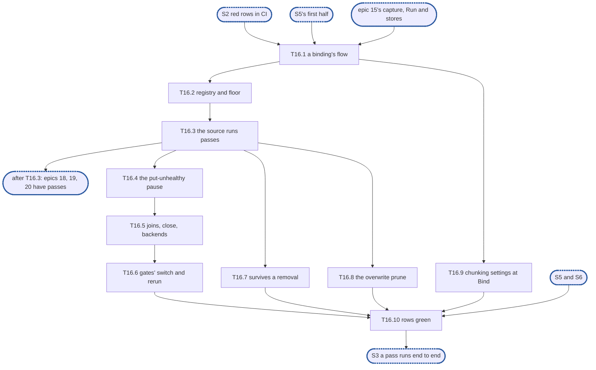

# Epic 16: engine offload passes and the bindings' remote side

**Sources:** [RFC 8](../docs/internals/rfcs/rfc-8-engine.md) §2.1 (every share has a remote block
store, the syncer's row, no setter, a backend change replaces the binding), §2.3 (the binding's
remote side, its flow and key scope, `Unbind`'s and `Drop`'s joins and order), §2.4 (the chunking
half), §2.5 (`Bind` opens the flow before it publishes; Stop's steps 2 to 5), §2.6 (the engine
closes only the flows it opened), §3.1 and §6.2 (`offloadDue`, the pass bound), §3.2 (no gate is
safety), §6.1 (the offload source's runs, the prune key, pressure on put-healthy shards only, and
the pass legs of its checks), §6.1.1 (a paused tenant), §6.3 (the put-unhealthy pause, O2, O6's
exemptions, the "O2 long outage" check), §6.4 (the pass registry), §6.6 (the binding's write
namespace), §8.1 (the prune's in-flight floor), §8.3, §11.1 (gating on `Healthy(Put)` alone),
§12.1 (`Start` all or nothing), §13's RFC 8 E6, E13, E16, E17 and E39, §14 (the series a pass
reports), and the §15.1, §15.2 and §15.3 rows T16.10 and T16.9 list;
[RFC 6](../docs/internals/rfcs/rfc-6-block-metadata.md) §4.1 (the commit's drop of a ref over a
removal) and §6.2 (the in-flight floor); [RFC 2](../docs/internals/rfcs/rfc-2-carver.md) §3.6 and
§3.7; [RFC 13](../docs/internals/rfcs/rfc-13-configuration.md) §5.1 (a bound setting refuses
change), §5.3 (the recorded `Target`) and §9's "§5.3 recorded" row;
[RFC 3](../docs/internals/rfcs/rfc-3-syncer.md) §1.3 and §2.8 (`OpenFlow`, the flow's `Healthy`,
`Health` and `Close`); [RFC 25](../docs/internals/rfcs/rfc-25-observability.md) §2.1 and §2.5 (the
series' names and labels).
**Track:** B.
**Epic 16 estimate: 10 subtasks, 24.5 man-days.**
**Depends on:** sync point **S2**, red rows in CI (epic 12): the fixture's `WithSyncer`,
`FaultRemote`, `RunPass`, `PrimaryPair` and `WithoutGates`, each refusing by name; **epic 13**'s
`Tenant.Paused`, `SetTenant`, `CancelTenant` and `WaitTenant`; **epic 14**'s offload source,
registered, rebuilt and posted, whose `Run` answers `Done` and offers nothing (its D7), and the
removal source this epic adds the prune kind to; **epic 15**'s `offload.Run(ctx, offload.Deps,
offload.Pass) []workqueue.Result`, its ports, its capture and guard functions, `offloadDue`, the
`Failures` value a binding owns and `offload.Stats` (its D1, D11, D14), with `Deps.Carver`,
`Deps.Chain` and `Deps.Puts` and the node's stores added there (its D2, option A; §9 lists what
moves here under option B), and the three changes to its `Pass` §9 asks of it; **S5's first half**
(RFC 3's syncer, `pkg/syncer/pool`, over RFC 4's in-memory store through `codec.Store` under RFC
4's fault wrapper) for T16.1; **S6** (the journal plan's epic 9b) for T16.10, whose rows run over
the real journal.
**Blocks:** epic 17, whose carved row fetches through the flow T16.1 opens at `Bind`; epic 18,
which evicts what passes made offloaded, offloads at once from the refusal path's third step,
reads the put health T16.4 keeps and makes its gates obey T16.6's switch; epic 19, whose reseed
gates the re-offer T16.3's passes make; epic 20, which reads the pass outcomes and put health
T16.3 and T16.4 keep; and S3, which this epic's end is.

---

## 1. Goal

Epic 16 runs epic 15's pipeline as the work queue's offload source and gives each storage binding
its remote side: the flow to its store, its key scope, a pause while the store refuses puts, and
the joins that keep a pass from outliving the flow and the handle it uses. With S5 and S6 met, a
file written through the journal is offered, carved, packed, put through the binding's flow,
committed and reported offloaded, end to end: S3.

**At the end of the epic:**

- every binding holds one flow to its share's store, opened before the binding is published and
  closed after every pass that used it has returned; a share naming no store the syncer knows is
  not attached;
- the offload source's `Run` turns each batch into passes, and every file gets one result;
- a removal under a pass in flight never waits for it, and the pass's commit drops what the removal
  removed, a straddling ref whole;
- a put-unhealthy store pauses its shards' offload without counting any failure, and the pause
  lifts at the next tick after the store answers;
- a share whose namespace's chunking settings are invalid or changed is refused at `Bind`, the
  change reported as a migration;
- the fixture's gates' switch reruns every Group A row with every gate this part has built off;
- every row T16.10 lists is green, and no other row's `known.yaml` message is stale.

### 1.1 In scope

`Deps.Syncer`; a binding's flow at `Start`, `Bind`, `Drop` and `Close`; the node's shares naming
their store; the offload source's `Run`; the pass registry and the removal prune's in-flight floor;
the commit's drop of a straddler and the abort of a wholly removed pass; the overwrite prune on the
removal source; the put-unhealthy pause, the put-healthy test under pressure and the one writer of a
shard's offload tenant; `Unbind`'s and `Drop`'s joins of the offload source; the chunking settings at
`Bind` and their migration report; the gates' switch and the §3.2 rerun; copying `offload.Stats`
into the engine's `Stats`; the fixture's syncer, remote-store faults, pass controls and gates' switch
made real; T16.10's rows; the RFC 8 §2.4 and §15.3 amendments (D11).

### 1.2 Out of scope

- The pipeline's states, Capture to Mark, the Intent step's namespace refusal, `offloadDue`, O6's
  count and the pipeline's own series: epic 15. This epic calls them.
- A re-home: a `Bind` naming a new write namespace joining the old one's passes, `State: Closing`
  and `Fenced` (the offload plan's §6.1 row "A re-home `Bind` joining the old namespace's passes",
  owner RFC 27). Until then `Bind` refuses a new write namespace for a served share (D5).
- `Unbind`'s `keepHolds` offload of hold marks, the posts a `removing` share keeps for them, and the
  "one run per key" check's leg with a superseded version held under a cut (the offload plan's §6.1
  row "Snapshot-hold ordering in the pipeline", owner RFC 12).
- The handover and lease-loss drains, a `StopTenant` result's drain and O7 (the offload plan's §6.1
  row "The cluster rules", owner the cluster stage).
- The share's put and get conditions, `offload_stalled`, `file_offload_failing` and drift's
  condition, which the long-outage and drift checks also assert: epic 20. This epic keeps the put
  health they read and asserts the pause.
- Eviction, fill, the refusal path's steps 2 and 3, pacing, and their gates: epics 17 and 18, each of
  which makes its gate obey the switch T16.6 builds.
- Registering `Target`'s settings section in the node's table and loading `upload_workers`: the
  integration epic, epic 21, once RFC 13 names `Target`'s key (the RFC 2 plan's §6.1 row
  "`Target`'s settings section").
- Positive-rate pacing of the offload source (the offload plan's §6.1 row "Positive-rate pacing in
  `pkg/workqueue`", owner RFC 9); the engine's sources register `Rate` 0 in any case.
- Collecting the objects a dropped ref leaves in its block (the offload plan's §6.1 row "GC composed
  in the node", owner RFC 9).

### 1.3 Names used here

- **E1**, epic 11, interfaces: `Settings`, `ShareSettings`, `Share.Store`, `Stats` and the
  declarations its T11.5 records.
- **E2**, epic 12, red rows and test foundations: the fixture's component options, its controls and
  the rows listed in `test/engine/known.yaml`.
- **S1**, interfaces frozen: the end of epic 11.
- **S2**, red rows in CI: the end of epic 12.
- **S3**, a pass runs end to end: the end of this epic, over S5 and S6.
- **S5**, offload components built: the RFC 2 to RFC 5 plans' implementation epics.
- **S6**, journal offload half built: the journal plan's epics 9b and 7b.
- **The integration epic**, epic 21: the node composes offload.
- **The first part**: the journal-only engine, epics 1 to 10 of RFC 8's first plan.
- **RFC 8 E6, E13, E16, E17, E39**: invariants of RFC 8 §13, never epics.
- **#5757** and **#5261**: the issues the first part's red share-limit, clone and lost-tail entries
  name.

## 2. How the general rules apply

The rules are those of [the offload plan's §1.5](rfc-8-offload-engine-plan.md#15-general-rules-for-each-epic),
cited by number and title and not copied.

| Rule | Subtasks | How |
| --- | --- | --- |
| rule 1, **Independent unit tests** ([`CLAUDE.md`, "Writing tests"](../CLAUDE.md#writing-tests)) | T16.1 to T16.9 | the engine over the first part's in-memory journal (with epic 15's `OffloadMany`), RFC 3's real syncer over RFC 4's in-memory store through `codec.Store` under RFC 4's fault wrapper (kinds 2 and 3), the real carver and chain over `keystest`'s provider, `kvstore` over the in-memory `kv.KV`, and the test clock (kind 1); no engine-side double |
| rule 2, **Fuzz the key and ref decoders the queue's rebuild reads** | T16.8 | the prune kind's key joins epic 14's queue-key table, checked by table under RFC 8 §15.3's `ponytail:`; the recorded chunking settings are decoded by `pkg/settings`' `DecodeBound`, which `FuzzBound` already fuzzes, so no target is added |
| rule 3, **Observability follows RFC 25** | T16.1, T16.3, T16.7 | `engine_offload_passes_total` gains `result="skipped"` and `"aborted"` (D12), `engine_passes_aborted_total` is filled, `offload.Stats` is copied into epic 11's fields and `Stats.Carver` (epic 15 D14), `engine_lock_wait_seconds{area}` records the storage binding table; none share-labelled per operation |
| rule 4, **Profiling** | all | every test runs under the fixture's `prof.Watch`; T16.5's join and close tests fail on a pass goroutine or a flow left open |
| rule 5, **Public interface and internals** ([`CLAUDE.md`, "Verifying a change"](../CLAUDE.md#verifying-a-change)) | all | a flow's close at the syncer's open-flow count, which RFC 3's suite covers; a paused tenant at the scheduler's `Stats`; a dropped ref at `kvstore`'s covering lookup; an offloaded bit at the journal's held extents; a refused share at `Bind`'s error and the binding read back |
| rule 6, **Known failures shrink** | T16.1, T16.3, T16.6, T16.9, T16.10 | each change that moves a red row past a refusal rewrites its `message:` in the same change; each row turned green leaves `known.yaml` there |
| rule 7, **v2 ignores v1, and the engine imports only what RFC 0 §1.2 allows** | T16.1, T16.6 | the `pkg/syncer` root is already allowed (epic 11); `pkg/syncer/pool`, `pkg/remote/codec`, `pkg/settings` and every remote store stay refused in the engine's production code; `pkg/engine/internal/policy` (D6) is the engine's own |
| rule 8, **Real dependencies for properties of those dependencies** ([`CLAUDE.md`, "Writing tests"](../CLAUDE.md#writing-tests)) | T16.7, T16.10 | the straddler's drop over `kvstore` on the memory KV and Badger under `t.TempDir()`; the rows over the real journal on a real directory |
| rule 9, **Code comment conventions** ([`CLAUDE.md`, "Code comments"](../CLAUDE.md#code-comments)) | T16.3 to T16.9 | RFC 8 §6.1's prune `ponytail:` at the prune's post (T16.8); this epic's `decision:` and `ponytail:` markers, each named in §4; epic 14's D7 `decision:` deleted with the body it marks (T16.3) |
| rule 10, **A test must be able to fail** ([`CLAUDE.md`, "Writing tests"](../CLAUDE.md#writing-tests)) | all | every test names the planted break it catches |
| rule 11, **A symbol is exported only if the RFC's interface uses it** | T16.1, T16.3, T16.6 | the engine exports `Deps.Syncer` (RFC 8 §2.6) and `Stats.Carver` (epic 15 D14); `Deps.Gates` names a type of an internal package (D6) |
| rule 12, **Each subtask creates only what it declares** | all | `Deps.Syncer` joins with T16.1's `OpenFlow`, `PruneOverwrites` with T16.8's run; each arm of the pause rule with the subtask that first needs it; every fixture control lands real with its first green caller |

## 3. Requirements and invariants

Every obligation the sources place on this epic, numbered so subtasks and tests can cite them.

**A binding's flow**

| # | Requirement | Kind | Source | Subtasks |
| --- | --- | --- | --- | --- |
| R1 | A binding holds the syncer flow to its share's remote block store; the engine opens one flow per share, at attach, through `OpenFlow` | MUST | RFC 8 §2.3, §2.1 (the syncer's row), §11.1; RFC 3 §1.3 | T16.1 |
| R2 | `Bind` opens the share's flow before it publishes the binding; a failure publishes nothing and undoes in reverse what it opened | MUST | RFC 8 §2.5 (`Bind` attaches a share above its floor) | T16.1 |
| R3 | Every share has a remote block store: the root refuses to add a share whose configuration names none, with an error naming the share, and a share whose store the syncer does not know is refused at `OpenFlow` and not attached; there is no local-only path | MUST | RFC 8 §2.1; RFC 3 §1.3 | T16.1 |
| R4 | The syncer is a capability held by a declared interface, and an absent one fails construction with an error naming it | MUST | RFC 8 §2.1, §2.6 | T16.1 |
| R5 | `Drop` closes the share's flow after it cancels the share's shards, closes its handle and runs the tag's `Forget`; `Close` closes every share's flow, then the handles, then the journals, in the reverse of their opening, only after every join; the engine closes only the flows it opened | MUST | RFC 8 §2.3, §2.5 (Stop, step 4), §2.6 | T16.1, T16.5 |
| R6 | No background work outlives a component it uses: no pass runs past the close of its flow or its handle | invariant | RFC 8 §13 E13; §2.5 (Stop, step 4) | T16.5 |
| R7 | A join that does not complete within its bound leaves the components it depends on open and reports the failure | MUST | RFC 8 §2.5 (Stop, step 5) | T16.5 |
| R8 | §2.5 join: `Close` with an offload parked in a stalled put closes no component while the pass runs | test row | RFC 8 §15.2 | T16.5, T16.10 |
| R9 | Changing a share's backends replaces its binding, never through a setter on a serving engine | MUST, MUST NOT | RFC 8 §2.1, §2.3; RFC 13 §5.1 | T16.5 |

**Passes**

| # | Requirement | Kind | Source | Subtasks |
| --- | --- | --- | --- | --- |
| R10 | The offload source's `Run` runs its batch as passes of the pipeline, and returns one result per file; only the pipeline's steps retry inside a pass | MUST | RFC 8 §6.1 (Retries are the scheduler's), §6.3 | T16.3 |
| R11 | A pass offers at most `upload_workers` block targets of dirty bytes; this epic hands the number to `offloadDue`, which bounds the pass | bound | RFC 8 §6.2 | T16.3 |
| R12 | An upload's outcome stays inside its pass: only the pass's result per file reaches the scheduler | invariant | RFC 8 §6.1 (What does not post here) | T16.3 |
| R13 | A pass refused by a full syncer queue (`Throttled`), or skipped for a put-unhealthy store, is not a failed pass and never counts toward the five | MUST NOT | RFC 8 §6.3 O6 | T16.3, T16.4 |
| R14 | A binding carries its share's write namespace as its key scope, and a pass is handed the binding's current one, which its Intent step compares with the namespace it captured | invariant | RFC 8 §2.1, §2.3, §6.6, §13 E39 | T16.3 |
| R15 | one run per key, the pass half: with the store slow but healthy and a file's pass outlasting three age ticks, the file is never in two passes at once, each block is put once, and no commit fails as `ErrInconsistent` | test row | RFC 8 §6.1 (Checks) | T16.3 |
| R16 | rebuild, the pass half: after a crash with passes in flight, every dirty file is offered again | test row | RFC 8 §6.1 (Checks) | T16.3 |

**The pass registry and the guard**

| # | Requirement | Kind | Source | Subtasks |
| --- | --- | --- | --- | --- |
| R17 | At capture, under each file's guard, the engine records the pass's `Newest` and captured write namespace against the file, and clears them when the pass returns; a file has at most one entry | MUST | RFC 8 §6.4 (A pass in flight is registered) | T16.2 |
| R18 | A removal record is pruned only once done and at or below the file's in-flight floor, the lowest `Newest` of the passes in flight, which the prune reads from the registry under the file's guard | MUST | RFC 8 §8.1, §6.4, §8.3 (F3); RFC 6 §6.2 | T16.2 |
| R19 | §6.4 guard across a removal: an offer waits for a truncate stalled between its journal step and its transaction, and no ref lies past `size` after both | test row | RFC 8 §15.1, §6.4, §13 E6 | T16.10 |
| R20 | §6.4 guard is not a fence: two engines each believing it is primary for one file, with separate guards; the store refuses the stale primary's commits on both paths | test row | RFC 8 §15.1, §6.4, §13 E17 | T16.10 |

**Put health**

| # | Requirement | Kind | Source | Subtasks |
| --- | --- | --- | --- | --- |
| R21 | The engine reads `Healthy(Put)` on the share's flow at each age tick and before each pass, and never probes the store itself | MUST, MUST NOT | RFC 8 §6.3, §11.1; RFC 3 §2.8 | T16.4 |
| R22 | While the store is put-unhealthy each of its shards is a paused tenant: its entries stay, none is dispatched, no file's backoff grows, and a pass it meets is skipped and its files returned, not failed; the pause lifts at the next tick after the flow reports healthy | MUST | RFC 8 §6.3, O2; §6.1.1 (`Paused`) | T16.4 |
| R23 | Offload is gated on `Healthy(Put)` and nothing else: a get-unhealthy store pauses no pass | invariant | RFC 8 §11.1 | T16.4 |
| R24 | Under pressure, only a shard whose store is put-healthy at that tick has its cap lowered to `offload.retry_max_pressure`; one whose store is put-unhealthy keeps `offload.retry_max` | MUST | RFC 8 §6.1, §6.3 O2 | T16.4 |
| R25 | O2 long outage, the pause half: the remote unavailable for 24 simulated hours with 10⁴ dirty files; the share's passes are paused while the store is put-unhealthy, no file reaches five failures, and offload resumes within one age tick of the store reporting healthy | test row | RFC 8 §6.3 (Checks) | T16.4 |
| R26 | pressure band, the put-unhealthy leg: above *S* with the store put-unhealthy with cause `ErrTransient`, no backoff cap falls below `offload.retry_max` | test row | RFC 8 §6.1 (Checks) | T16.4 |
| R27 | starvation, the throttling leg: a share whose store throttles to 1 MB/s while healthy beside a fast one; the fast share's oldest unoffloaded age stays below the maximum age and its pace within 10 % of its baseline | test row | RFC 8 §6.1 (Checks) | T16.4 |

**Unbind, Drop and a backend change**

| # | Requirement | Kind | Source | Subtasks |
| --- | --- | --- | --- | --- |
| R28 | `Unbind` admits no new offload pass for the share but the hold marks' (RFC 12's, §1.2), then joins every pass in flight through `WaitTenant` on each of the share's shards; from then on the age tick and the rescan post no offload key for the share but its hold marks' | MUST | RFC 8 §2.3 | T16.5 |
| R29 | `Drop` cancels the share's shards in the offload source (`CancelTenant`), so no entry for the tag runs against a closed handle, and nothing adds them back | MUST | RFC 8 §2.3 | T16.4, T16.5 |
| R30 | §2.3 unbind and drop, with a pass in flight: no run for the share starts after `Unbind` is called except the hold-mark offloads and clone batches the join waits on, `Unbind` returns once the pass has returned, and no entry of the tag remains after `Drop` | test row | RFC 8 §15.2 | T16.5, T16.10 |

**A pass in flight survives a removal**

| # | Requirement | Kind | Source | Subtasks |
| --- | --- | --- | --- | --- |
| R31 | A removal that lands while a pass is uploading never waits for the pass and never cancels it | MUST NOT | RFC 8 §8.3 | T16.7 |
| R32 | The pass's commit drops every ref it would write that overlaps a removal of higher version than the ref's `newest`, a straddling ref whole, reports none of their extents, and applies the rest; a straddler's part outside the removal stays **Dirty** and is offered again | MUST | RFC 8 §8.3, §13 E16; RFC 6 §4.1 (the file's removals) | T16.7 |
| R33 | A pass whose offered content was entirely removed aborts before uploading, counted in `engine_passes_aborted_total` (§8.3's MAY, adopted by D3) | MUST | RFC 8 §8.3, §14 | T16.7 |
| R34 | §8.3 transfer survives a removal: a stalled upload completes after a truncate below its extent; the commit drops the refs past the new size, drops a straddler whole and re-offers its outside part, applies the rest, and the truncated extent reads past end of file; both commit orders; again with deallocate, release and a clone onto the file | test row | RFC 8 §15.1 | T16.7, T16.10 |

**The overwrite prune**

| # | Requirement | Kind | Source | Subtasks |
| --- | --- | --- | --- | --- |
| R35 | A pass whose commit replaced committed content posts a prune of the file's superseded overwrite records, on the removal source, keyed (shard, prune, file), so it never merges with the file's offload or removal key | MUST | RFC 8 §6.1 (Outputs, Keys) | T16.8 |

**Chunking settings**

| # | Requirement | Kind | Source | Subtasks |
| --- | --- | --- | --- | --- |
| R36 | An invalid chunking setting is refused with an error, never replaced by a default, and the engine keeps the binding it had | MUST, MUST NOT | RFC 8 §2.4; RFC 2 §3.7 | T16.9 |
| R37 | Which chunking settings produced a namespace's content is recorded with the namespace when it is created and compared at every open; a change is reported as a migration, never applied | MUST | RFC 8 §2.4; RFC 2 §3.6; RFC 13 §5.3 | T16.9 |
| R38 | §2.4 settings, as amended here: a namespace `Target` the carver refuses is refused at `Bind` and the earlier binding kept; a `Target` changed under the namespace's record is refused at `Bind` as a migration | test row | RFC 8 §15.3 (D11) | T16.9 |
| R39 | §5.3 recorded: a namespace whose stored `Target` was edited underneath its record does not open | test row | RFC 13 §5.3, §9 ("§5.3 recorded") | T16.9 |
| R40 | `Start` is all or nothing: a share refused for its store or its chunking settings refuses `Start` whole, attaching nothing | MUST | RFC 8 §12.1 | T16.1, T16.9 |

**No gate is safety**

| # | Requirement | Kind | Source | Subtasks |
| --- | --- | --- | --- | --- |
| R41 | A policy gate is never the only thing between the system and data loss: the switch that turns off every gate this part has built (health gating, and `offloadDue`'s triggers, so offload runs constantly) is honoured by each, and production cannot set it | MUST NOT | RFC 8 §3.2, §3.1, §6.2; §2.1 (no setter) | T16.6 |
| R42 | §3.2 no gate is safety, this epic's half: every Group A row runs again under the switch, and each rerun of a row green at this epic's end passes | test row | RFC 8 §15.1 | T16.6, T16.10 |

**Rows a pass turns green**

| # | Requirement | Kind | Source | Subtasks |
| --- | --- | --- | --- | --- |
| R43 | §6.6 minted names and intents: a retried put keeps its name and bytes, a new pass mints a new name, a removed intent fails the commit and the content is re-offered, a delayed delete touches no committed block | test row | RFC 8 §15.1 | T16.10 |
| R44 | §6.7 widening: a release of an offloaded neighbour waits for the pass widened over it, and the new refs read correctly | test row | RFC 8 §15.1 | T16.10 |
| R45 | §6.7 stretch ends: passes cut by `limit` report no byte past `consumed`, the next starts at a content boundary, the chunking equals one pass over the whole file, and the tail is offloaded within the age ceiling | test row | RFC 8 §15.1 | T16.10 |
| R46 | §6.8 per-block reporting: with the second of three block commits failed, the journal marks exactly the first and third blocks' extents | test row | RFC 8 §15.1 | T16.10 |
| R47 | §5.1 overwrite waits for existence, the offload half: an overwrite inside an offloaded extent answers only after its existence commit wrote the overwrite record, and once the journal's record is dropped the range fails as **Lost**, never the offloaded bytes | test row | RFC 8 §15.1 | T16.10 |

**Observability**

| # | Requirement | Kind | Source | Subtasks |
| --- | --- | --- | --- | --- |
| R48 | `engine_offload_passes_total` by `result`, `engine_passes_aborted_total`, the pipeline's other series and `engine_lock_wait_seconds` for the storage binding table, never labelled by share | MUST | RFC 8 §14; RFC 25 §2.1, §2.5 | T16.1, T16.3, T16.7 |

## 4. Decisions this epic takes

- **D1, a batch's passes are `offloadDue`'s groupings, run side by side.** A batch holds one shard's
  files (epic 13 D1). `Run` hands their dirty figures to `offloadDue` with the pass bound (D8), which
  groups them and puts a failing file alone (O6), and runs each pass on its own goroutine, joined
  before `Run` returns, so a failing file's pass delays none of the batch's others. A `decision:` at
  the fan-out names the bound, at most `Batch` goroutines per run. Prior art: client-go's workqueue
  hands one key to one worker and leaves batching to the caller (from memory).
- **D2, a skipped pass pauses its tenant and answers `Done`; the age tick re-posts its files.**
  RFC 8 §6.3 returns a skipped pass's files "pending, not failed", and the scheduler has no pending
  outcome: `Retry` grows the backoff, which R22 forbids. `Done` grows nothing and counts nothing, and
  the age tick posts every due file again (epic 14's R17, R18), so once the store answers the file is
  dispatched within one tick, R25's bound. `Done` also resets the file's backoff (RFC 8 §6.1): a file
  that was backing off for its own failures is retried from `offload.retry_min` once the store
  returns. Before answering, the skip records the put-unhealthy health and pauses the tenant through
  D13's writer, so the next tick compares against what the skip saw. A `decision:` at the skip names
  the reset, withdrawn if the scheduler gains an outcome that keeps a key pending. Prior art: none
  found.
- **D3, a wholly removed pass aborts once, before its first Intent.** RFC 8 §8.3 lets it abort, and
  §14 counts it. A removal's journal step, under the file's guard (§6.4), adds its version and extent
  to the file's registry entry, which has its own mutex, so the pass never takes the guard
  mid-upload (RFC 8 E6). Epic 15's pass calls `Pass.Removed()` (§9) once, before its first block's
  Intent, and returns `Done` with nothing put when every offered extent is covered by a recorded
  removal of higher version. No plan is edited, so no short block is made mid-pass; a partial removal
  is left to the commit's drop (R32), the rule the abort only saves an upload for. No marker: the
  abort is never what keeps content safe. Prior art: none found.
- **D4, a straddling ref is dropped whole in `kvstore`'s commit.** RFC 8 §8.3 and E16 drop a
  straddler whole; `kvstore`'s `commitFile` today clips each new ref to its parts outside the
  removals (`masks.visible`) and reports the outside part. The commit drops a new ref with any part
  masked, as RFC 6 §4.1 reads, so its outside part stays **Dirty** and is offered again; refs already
  stored keep `cutRef`'s clipping, which RFC 6 §6.2 specifies for them. `TestOffloadAfterTruncate`,
  which pins the clip, is rewritten to the drop. Following the RFC as written; §9 asks whether to
  amend it to the clip instead. No marker. Prior art: none found.
- **D5, `Bind` refuses a new write namespace or a new store for a served share.** A namespace change
  is a re-home (RFC 27 §2.7), deferred. A store change is a change of a bound setting, which RFC 13
  §5.1 refuses while the share holds content; a new endpoint or a rotated credential for the same
  store is the store's registration, which keeps its `StoreID` (RFC 13 §5.2). So in v1.1 a share's
  backends change only by replacing its binding, `Unbind` and `Drop` then `Bind`, which is RFC 8
  §2.1's rule with no in-place swap to get wrong. Both refused with `vfserr.ErrInvalid` naming the
  share, as the first part's `change` refuses a changed tag or shard. A `decision:` at `change`,
  withdrawn by the re-home, whose `Bind` joins the old namespace's passes (RFC 8 §2.3). Prior art:
  the first part's `change`.
- **D6, the gates' switch is a `Deps` field of an internal type, pending the user's answer (§9).**
  RFC 8 §3.2 needs the engine run with its gates off, and §2.1 forbids a setter. `Deps.Gates
  policy.Gates`, a struct with one unexported field, declared in `pkg/engine/internal/policy` with
  `policy.Ungated()` its only non-zero constructor: only code under `pkg/engine` can build one, so
  the content wiring can only leave it zero, and `enginetest.WithoutGates` sets it. Each gate reads
  it: the pause and `offloadDue`'s triggers here, which then find every file with dirty bytes due;
  fill, eviction and its suspension and pins in epics 17 and 18. `internal/node`'s import walk refuses
  `enginetest` in production code, the one route the switch would have past Go's `internal` rule. A
  `decision:` at the field: the one `Deps` member that is not a capability, safe in either value by
  §3.2, withdrawn if anything outside `pkg/engine` needs it. RFC 8 §2.6's `Deps` gains the field in
  T16.6's pull request. Prior art: Go's `internal` package rule; FoundationDB's simulation knobs,
  which randomise policy only in simulation (from memory).
- **D7, the content wiring compares the recorded `Target`; the engine asks at `Bind`.** The engine
  imports neither `pkg/settings` nor the namespace records (RFC 0 §1.2), and the RFC 2 plan's §6.1
  row "Recording which settings produced a namespace's content" gives the record to the namespace's
  `Bound`, which the node writes at creation. `content.Params` gains the node's settings table, and
  the wiring's `Settings(ns)` (epic 15's carver port) reads the namespace's `Bound` through it
  (`DecodeBound`), compares its `Target` with the namespace's configured one, and answers
  `settings.ErrBound` wrapped with both values when they differ, and `carver.ErrInvalidSettings` for
  a `Target` `carve.NewSettings` refuses. A namespace whose record holds no `Target`, as every one
  does until the integration epic registers `Target`'s section in the node's table, gets RFC 2's
  default: a `decision:` there, withdrawn when the section is registered. The fixture's table
  registers `pkg/carver/section` now, so the rows have a recorded `Target` to change. Prior art:
  restic's repository config records the chunker polynomial at `init` and never changes it (from
  memory).
- **D8, the pass bound is a constant until the key is loaded.** `offloadDue` takes `upload_workers`
  as a number (epic 15 T15.4), and the key reaches the engine only once the integration epic loads
  it. Until then the bound is an unexported `uploadWorkers = 128`, RFC 3's proposal, which tests set
  from `export_test.go`, with a `ponytail:` naming the integration epic's `Settings` field as the
  upgrade, at no migration since nothing persists it. Prior art: none found.
- **D9, the fixture composes the syncer for every engine, over two stores.** `Deps.Syncer` is
  refused nil at `New` (R4), so every engine the fixture, the unit fixture and the in-package tests
  build has RFC 3's syncer over RFC 4's in-memory stores, two registered so a row can fault one
  store and not the other; every fixture share names the first unless it asks for the second.
  `FaultRemote`'s rules match the store by name in the key RFC 8 §2.1's `Fault` is handed. `WithSyncer`
  stays, accepted and composing nothing more, since 41 rows call it and the integration epic decides
  the options' fate (epic 12 §9). No marker. Prior art: the first part's fixture, which composes every
  member of `Deps`.
- **D10, the engine opens its flows as demand flows.** `OpenFlow(store, false)`: RFC 3 §1.3 runs a
  background flow's fetches in the background class, relocation's and copying's, and the engine's
  fetches are demand reads (RFC 8 §6.1). No marker. Prior art: none found.
- **D11, RFC 8 §2.4 and §15.3's "§2.4 settings" row are amended in this pull request.** The row
  configured `Min ≥ Target` and had `Apply` refuse it, which RFC 2 §3.2 makes unconfigurable (`Min`
  is `Target / 4`), and `Target` reaches the engine with the share at `Bind` (epic 12 D7). The row
  now configures a namespace `Target` the carver refuses and asserts `Bind` refuses it, keeping the
  earlier binding, then changes the `Target` a namespace's record holds and asserts `Bind` refuses it
  as a migration; §2.4 says a share's settings are validated at `Bind` and that the record is the
  namespace's (RFC 13 §5.3). RFC 8 is a draft, and no other RFC cites the row. Prior art: none found.
- **D12, `engine_offload_passes_total` gains `result="skipped"` and `"aborted"`.** RFC 8 §14 names
  the label, not its values; a skipped pass (D2) and an aborted one (D3) are neither a success nor a
  failure, and counting them apart lets epic 20 tell an outage's skips from a wedge. No marker. Prior
  art: none found.
- **D13, one writer per binding sets its shards' offload tenants.** Epic 13's `SetTenant` adds a
  tenant it does not hold and rebuilds it, so a tick racing `Drop`'s `CancelTenant` would bring a
  dropped share's entries back, and the tick, a skip, `Unbind` and the pressure cap each write a whole
  `Tenant`. So one function, `retune(b)`, under the binding's lock, computes each shard's `Tenant`
  from the binding's state (removing, dropped), its kept put health, the journal's pressure and the
  switch, and calls `SetTenant` only when the result differs from the last it applied; it never calls
  it for a dropped binding. Every writer, epic 14's pressure cap included, goes through it. A
  `decision:` at `retune`. Prior art: Kubernetes controllers' single reconcile of desired state
  (from memory).

## 5. Target tree

On `feat/storage-v2`.

```text
pkg/engine/
  deps.go                 T16.1  Deps.Syncer (Syncer: OpenFlow); T16.6 Deps.Gates; T16.8 Existence.PruneOverwrites
  share.go                T16.1  the flow opened at attach, closed on a failed Bind; T16.9 Settings(ns) at Bind and Start, D5's two refusals
  unbind.go               T16.1  the flow carried onto the removed binding and closed after Forget; T16.5 Unbind's removing state and WaitTenant, Drop's CancelTenant
  close.go                T16.1  removed bindings' flows; T16.5 stop step 4's flows after steps 2 and 3
  engine.go               T16.1  New refuses a nil Syncer
  types.go                T16.3  Stats.Carver (epic 15 D14)
  file.go                 T16.2  fileEntry.pass, the registry's entry (the first part's file)
  pass.go                 T16.2  the registry's register and release, the in-flight floor; T16.3 the offload source's Run, uploadWorkers; T16.7 the removal marks and Removed
  pause.go                T16.4  retune (D13), the put-health read, the skip (D2)
  queue.go                T16.4  the age tick calls retune (epic 14's file); T16.8 the prune kind's post
  removals.go             T16.2  the prune reads the floor; T16.8 the prune kind's run (epic 14's files)
  health.go               T16.1  the binding table's lock waits; T16.3 offload.Stats copied into Stats
  internal/policy/        T16.6  Gates, Ungated (D6)
  enginetest/components.go  T16.1  WithSyncer composing nothing more (D9)
  enginetest/material.go  T16.6  WithoutGates made real
  enginetest/remote.go    T16.1  FaultRemote made real, over RFC 4's fault wrapper, two stores
  enginetest/offload.go   T16.3  RunPass made real; T16.10 PrimaryPair made real
  enginetest/work.go      T16.3  BlockNextRun("offload") made real
  enginetest/fixture.go, unit.go  T16.1  the syncer and its stores on every engine; T16.9 the settings table with Target's section
  conformance/rfc8_*_test.go  T16.6  every TestRFC8A_* row a function of the fixture's options, rerun under the §3.2 row; T16.10 the rows' legs corrected
  flow_test.go, pass_test.go, pause_test.go, prune_test.go, settings_test.go  T16.1 to T16.9  the unit tests
  export_test.go          T16.1 to T16.8  the registry's, the tenants' and the flows' accessors, uploadWorkers
pkg/metadata/kvstore/
  offload.go              T16.7  commitFile drops a masked new ref whole (D4)
  removal_internal_test.go  T16.7  TestOffloadAfterTruncate rewritten to the drop
  offload_removal_test.go T16.7  the straddler over the memory KV and Badger
internal/node/
  node.go                 T16.1  every share's Store from the wiring's registration
  arch_test.go            T16.6  enginetest refused in production code
  content/content.go      T16.1  the syncer built over the stores (pool.New, Register); T16.9 Params.Settings, Settings(ns) compares the recorded Target
  content/content_test.go T16.9  the comparison's table
docs/internals/rfcs/rfc-8-engine.md  T16.6  §2.6's Deps gains Gates (D6); §2.4 and §15.3's row are amended by this document's pull request (D11)
test/engine/known.yaml    T16.1, T16.3, T16.6, T16.9, T16.10  messages rewritten, entries removed, the rerun's entries added
```

## 6. Subtasks

### T16.1 A binding's flow

**Subtask T16.1 estimate: 3.25 man-days.**

- **Track:** B. **Depends on:** S2. Also S5's first half and epic 15's T15.5 (the node's stores, its
  D2).
- **Covers:** R1, R2, R3, R4, R5 (`Drop`'s and a failed `Bind`'s close), R40 (the store), R48 (the
  lock waits).
- **Deliverables:**
  - In `deps.go`, as epic 11's T11.5 records it (its D7):
    ```go
    type Syncer interface {
    	OpenFlow(store syncer.StoreID, background bool) (syncer.Flow, error)
    }
    // Deps gains:
    	Syncer Syncer // RFC 3 §1.3: OpenFlow, one flow per share at attach
    ```
    `New` refuses a nil `Syncer` naming it. The binding gains `flow syncer.Flow`. `attach` opens it
    with `OpenFlow(s.Store, false)` (D10) before the incarnation raise and the publish, for each
    share `Start` attaches and for a new one at `Bind`; a refused open fails the attach naming the
    share and wrapping the syncer's error, and refuses `Start` whole (R40); an attach failing after
    the open closes the flow before it returns (R2).
  - `Drop` keeps the flow on the removed binding it swaps in, and closes it after `Forget`; a
    retried `Drop` closes a flow still held, and `Close` closes every removed binding's flow with the
    rest. A flow's `Close` error fails the `Drop` before the `rm` row advances, so it is retried.
  - `ShareTableLockWaits` recorded at the binding table's lock (epic 11's field).
  - In `internal/node`: `content.Compose` builds `pool.New` over the stores epic 15 composes, each
    registered with its probe key, and passes it as `Deps.Syncer`; the node's share build sets each
    `Share.Store` from that registration, and refuses a share whose configuration names no store,
    naming it (R3); the wiring closes the syncer after the engine. Epic 11's acceptance "a share with
    a zero `Store` binds" no longer holds and its test is rewritten to the refusal.
  - In `enginetest`: every engine composes the syncer (D9); `FaultRemote(s sim.Fault)` made real
    over RFC 4's fault wrapper. In-package tests that build `Deps` by hand get one from
    `export_test.go`. Every `known.yaml` entry whose message is `fixture: the syncer is not composed`
    rewritten to the refusal it meets now, `fixture: RunPass is not built`, in the same change.
  Consumed by T16.3 (the flow a pass puts through), T16.4 (`Healthy`), T16.5 (the close order),
  epic 17 (`Fetch`, `Prefetch`).
- **Acceptance criteria:**
  - `New` with no syncer is refused naming it.
  - A `Bind` of a share whose `Store` is zero or unregistered is refused naming the share, opens no
    handle, and the engine serves what it served; a `Start` with one such share attaches nothing.
  - A `Bind` failing after its flow opened leaves no flow open.
  - `Drop` closes the share's flow only after `Forget` returned, and a `Drop` retried after a
    `Forget` failure closes it once.
- **Tests:** at `Bind`, `Start` and `Drop`, which the node calls, reading open flows from the
  syncer's `Stats` (RFC 3's suite covers the count): a zero and an unknown store refused at `Bind`,
  and at `Start` beside a valid share, neither attached (catches a share attached with no store, R3,
  R40); a `Bind` whose limit write fails leaving no open flow (catches the missing undo, R2); `Drop`
  with a `Forget` fault leaving the flow open and a retried `Drop` closing it once (catches a flow
  closed before its tag is forgotten, or lost with the binding, R5); `New` refused naming `Syncer`
  (R4); the lock-wait histogram rising under two `Bind`s held by a hook set from `export_test.go`
  (R48). Doubles: RFC 4's in-memory store (kind 2, RFC 4's suite) under its fault wrapper (kind 3).
- **Rules:** rule 6, the rewrite; rule 7, `pool` imported by the wiring and tests only.

### T16.2 The pass registry and the in-flight floor

**Subtask T16.2 estimate: 1.25 man-days.**

- **Track:** B. **Depends on:** T16.1. Also epic 15's T15.5 and its `Pass.Register` (§9).
- **Covers:** R17, R18.
- **Deliverables:** the registry as one field of the first part's per-file state, `fileEntry.pass
  *passEntry`, `passEntry{newest entity.JournalVersion; ns entity.NamespaceID; mu sync.Mutex;
  removed []removalMark}`, counted by `fileEntry.idle()` so no entry outlives its pass. `register`,
  which epic 15's Capture calls from inside `OffloadMany`'s callback with the offers, while the guards
  are still held (§9), sets each file's entry from its offer's `Newest`; `release`, which the pass
  calls when it returns, clears them; `inFlightFloor(file) (entity.JournalVersion, bool)`. In
  `removals.go`, the prune epic 14 runs takes the file's guard, reads the floor and passes
  `PruneRemovals` the lower of the removal's version and the floor. `removed` is D3's, filled by
  T16.7. Consumed by T16.3, T16.7 and epic 19, whose reseed's drain clears the entries (RFC 8 §2.5).
- **Acceptance criteria:**
  - While a pass whose `Newest` is below a done removal's version is in flight, the removal is not
    pruned; it is once the pass returns.
  - The entry is set before the file's guard is released, and cleared when the pass returns.
- **Tests:** at the store's removal records, read through `kvstore`'s unfinished-removal listing,
  which the covering lookup consumes: a pass held between Put and Commit (the in-memory store's
  fault wrapper, a delay advanced on the test clock), a truncate run to done meanwhile, and the
  prune run; the removal is still listed, and gone after the pass returns (catches a prune that
  reads no floor, R18); a truncate let through between `register` and the guard's release by a hook
  in the code under test, set from `export_test.go`, finding the entry already set (catches a
  registration after the guard, R17); the entry gone after the pass returns, read through an
  accessor (catches a leaked entry, R17).
- **Rules:** rule 5, asserted at the removal listing the commit reads.

### T16.3 The offload source runs passes

**Subtask T16.3 estimate: 3.25 man-days.**

- **Track:** B. **Depends on:** T16.2.
- **Covers:** R10, R11, R12, R13 (`Throttled`), R14, R15, R16, R48 (the passes' series).
- **Deliverables:**
  - In `pass.go`, the offload source's `Run`, replacing epic 14's D7 body and its `decision:`: it
    reads the batch's shard binding, gathers each file's dirty figures, calls `offloadDue` with
    `uploadWorkers` (D8) and runs each pass it returns through `offload.Run`, one goroutine per pass
    (D1), with the binding's flow and store, its `Failures`, `register` and `release` (T16.2), the
    settings `Bind` checked (§9) and `func() entity.NamespaceID` reading the binding's current write
    namespace (R14). Each file's result goes to `done` as its pass returns; a file `offloadDue`
    placed in no pass answers `Done`, since the age tick re-posts it when due. Epic 14's scripted run
    hook is kept, now around the pass.
  - In `health.go`, `offload.Stats` copied into epic 11's fields and into `Stats.Carver
    map[entity.NamespaceID]CarverStats` (epic 15 D14).
  - In `enginetest`: `RunPass(ctx, share)` made real, posting every dirty file of the share and
    waiting until their runs return; `BlockNextRun("offload", shard)` made real, a hold on the
    in-memory store's next put for that shard (kind 3); every `known.yaml` entry whose message is
    `fixture: RunPass is not built` rewritten to the failure it meets now, over the real journal the
    journal's `stub: Offload`; epic 15's O1 crash test (`TestRFC8A_OffloadSurvivesACrashInEachState`)
    rewritten to the same.
  Consumed by T16.4 to T16.10, epic 18 (the refusal path's pass), epic 19 (the re-offer) and epic 20
  (the outcomes).
- **Acceptance criteria:**
  - A batch of a share's files ends with every file reported offloaded once its commit lands, and
    one `done` per file.
  - A failing file runs in its own pass, and the others' results arrive before its own.
  - A pass whose `Upload` returned `remote.ErrThrottled` returns `Throttled`, its file's failure
    count unchanged.
  - A pass offers no more than `uploadWorkers` block targets.
- **Tests:** at the scheduler's results and the in-memory journal's offloaded bits (what `Release`
  reads): three files, each offloaded and reported once (catches a lost or doubled result, R10); a
  poison file's pass held by the store's delay while the other two report (catches a batch run as one
  pass, D1); the store throttling every attempt past the syncer's own throttle bound, so `Upload`
  itself returns `ErrThrottled`, and the file's count read through `offload.Stats` (catches a
  throttled pass counted, R13); `uploadWorkers` 2 with four block targets dirty, the offer read from
  the in-memory journal's offer record (catches an unbounded pass, R11); RFC 8 §6.1's "one run per
  key" with puts, over the store's object listing (each block put once) and the commit results (no
  `ErrInconsistent`) (R15); its "rebuild" pass half, the engine restarted over the in-memory journal
  with a pass between Put and Commit, every dirty file offered again (R16); a pass's block named
  under the binding's namespace in the store's listing, with a second share in another namespace on
  the same journal (catches a namespace taken from the wrong binding, R14). R12 is held by
  `offload.Run`'s signature, a result per file and nothing else, and epic 15's T15.10 tests.
- **Rules:** rule 3, the series copied; rule 6, the rewrite; rule 9, epic 14's D7 marker deleted.

### T16.4 The put-unhealthy pause

**Subtask T16.4 estimate: 3 man-days.**

- **Track:** B. **Depends on:** T16.3.
- **Covers:** R13 (the skip), R21, R22, R23, R24, R25, R26, R27, R29 (no tenant added back).
- **Deliverables:** in `pause.go`, `retune(b)` (D13), under the binding's lock, computing each of the
  share's shards' offload `Tenant` from the kept put health and the journal's pressure, and never
  calling `SetTenant` for a dropped binding; epic 14's pressure cap routed through it, its D8 answer
  withdrawn. At each age tick, `Healthy(remote.Put)` read once per binding into its kept put health,
  then `retune`. Before each pass the source reads it again; a put-unhealthy store skips the pass:
  the kept health written and `retune` called first, then `Done`, counted `result="skipped"` (D2,
  D12). The removing and switch arms are T16.5's and T16.6's. Consumed by T16.5, T16.6, epic 18 (the
  refusal table reads `Health(Put)` from the same flow) and epic 20 (the put condition).
- **Acceptance criteria:**
  - While the store is put-unhealthy, no pass of its shards is dispatched, their entries stay, no
    file's backoff grows and no failure is counted.
  - The pause lifts at the first age tick after the flow reports healthy, also after a skip paused
    it.
  - A get-unhealthy, put-healthy store pauses nothing; under pressure a put-unhealthy shard's cap
    stays `offload.retry_max`.
  - No `SetTenant` reaches a dropped share's shards.
- **Tests:** at the scheduler's `Stats` per tenant and at `offload.Stats`, on the test clock:
  RFC 8 §6.3's "O2 long outage", the pause half: 10⁴ dirty files, the store's fault wrapper failing
  every put and probe for 24 simulated hours, the tenant paused, its entries held, nothing
  dispatched, every count below five, and every file offered within one age tick of the faults
  clearing (R22, R25); a pass dispatched just as the store turns unhealthy, skipped, then the store
  healthy and one tick, and the files dispatched (catches a pause the tick never lifts, D2); a
  get-only fault pausing nothing (catches a get gate, R23); the "pressure band" put-unhealthy leg
  with cause `ErrTransient`, every cap at `offload.retry_max` (R24, R26); the "starvation" throttling
  leg, one share on the second store, throttled to 1 MB/s by its fault wrapper's delay, beside a fast
  share, the fast one's oldest unoffloaded age below `MaxAge` and its offered bytes per simulated
  second within 10 % of its run alone (R27); `Drop` racing a tick by a hook between the tick's health
  read and its `retune`, and the scheduler's `Stats` naming no shard of the share afterwards
  (catches a tenant added back, R29). R21's "never probes" is held by the engine's import walk: it
  imports no store and declares no probe, only `Healthy` on the flow it holds.
- **Rules:** rule 9, D2's and D13's markers; epic 14's D8 withdrawn.

### T16.5 Joins, close and the backends

**Subtask T16.5 estimate: 2 man-days.**

- **Track:** B. **Depends on:** T16.4.
- **Covers:** R5 (`Close`'s order), R6, R7, R8 (unit), R9, R28, R29, R30 (unit).
- **Deliverables:** in `unbind.go`, `Unbind` marks the binding removing, which `retune` turns into a
  paused offload tenant for each of its shards, whatever the store's health or the switch, so no pass
  starts and its entries stay until `Drop`; the age tick and the rescan post nothing for a removing
  share. It then calls `WaitTenant` on the offload source for each shard. A paused tenant suits
  offload, unlike the removal source, whose clone batches `Unbind` still waits for (epic 14 D3).
  `Drop` marks the binding dropped and calls `CancelTenant` on the offload source before the
  handle's `Close`. In `close.go`, stop step 4 closes each share's flow first, after steps 2 and 3
  joined the passes and the loops; a join past its bound leaves the flows, handles and journals it
  guards open and names them in `Close`'s error. In `share.go`, `change` refuses a new `Store` or
  write namespace (D5), with its `decision:`. Consumed by T16.10.
- **Acceptance criteria:**
  - `Unbind` returns only after a pass it found in flight has returned, and no offload run for the
    share starts after it was called.
  - After `Drop`, the scheduler holds no entry of the share's shards.
  - `Close` with a pass parked in a put closes the flow only after the pass returned; past the stop
    bound it closes nothing the pass uses and reports it.
  - A `Bind` of a served share naming another `Store` is refused and the share serves on.
- **Tests:** at the syncer's open-flow count and the scheduler's `Stats`, over the in-memory journal
  and store, a put held by the store's fault wrapper (kind 3): `Unbind` with 10⁴ pending entries and a
  held pass, its return observed only after the hold is released, and no run started after the call,
  each run's start delivered by a hook set from `export_test.go`; a write to the share and an age
  tick between `Unbind` and `Drop` posting nothing for it (catches a missing join or a post, R28,
  R30); `Drop` then `Stats` naming no shard of the share (catches a missing `CancelTenant`, R29);
  `Close` with a held pass, the flow still open while held (catches step 4 before the joins, R5, R6,
  R8), and past the stop bound `Close`'s error naming the flow, still open (R7); the refused `Store`
  change, the binding read back (catches an in-place swap, R9).
- **Rules:** rule 4, no goroutine or flow left after `Close`; rule 9, D5's marker.

### T16.6 The gates' switch and the §3.2 rerun

**Subtask T16.6 estimate: 3 man-days.**

- **Track:** B. **Depends on:** T16.5.
- **Covers:** R41, R42.
- **Deliverables:** `pkg/engine/internal/policy` with `Gates` and `Ungated()`, `Deps.Gates` (D6),
  with its `decision:`; `retune`'s switch arm, under which no put-unhealthy store pauses, and
  `offloadDue`'s caller, which then treats every file with dirty bytes as due; RFC 8 §2.6's `Deps`
  sketch gains the field. `enginetest.WithoutGates()` made real. `internal/node`'s import walk refuses
  `enginetest` in production code. Every `TestRFC8A_*` test becomes a function of the fixture's
  options, each `enginetest.New` in it appending them, and `TestRFC8A_NoGateIsSafety` runs each as a
  subtest under `WithoutGates()`; each subtest failing gets its own `known.yaml` entry, the first
  part's red rows keeping their parents' issues (#5757, #5261), and the parent's entry rewritten
  to name its subtests' (epic 12 D4). The suite's run time under `-race` measured against the cell's
  30-minute timeout, and the timeout raised in `test/suites.yaml` if the rerun passes it.
- **Acceptance criteria:**
  - With `Ungated()`, a put-unhealthy store's shards are never paused and every file with dirty
    bytes is due at each tick; a removing share is still paused.
  - Every Group A row runs twice in `engine-conformance`, and every subtest is green or graded known
    at its own entry.
- **Tests:** at `offloadDue`'s result and the scheduler's `Stats`: `Ungated()` with a put-unhealthy
  store, the tenant not paused and its passes dispatched (catches a gate that ignores the switch,
  R41); the node's import walk refusing a planted `enginetest` import (catches the route to the
  switch, R41); the rerun (R42).
- **Rules:** rule 6, the rerun's entries; rule 7, the internal package; rule 9, D6's marker.

### T16.7 A pass in flight survives a removal

**Subtask T16.7 estimate: 2.5 man-days.**

- **Track:** B. **Depends on:** T16.3.
- **Covers:** R31, R32, R33, R34 (unit legs), R48 (the aborts).
- **Deliverables:** in `kvstore`'s `commitFile`, a new ref with any part masked by a removal of
  higher version than its `newest` is dropped whole and not reported (D4), and
  `TestOffloadAfterTruncate` rewritten to it; refs already stored keep `cutRef`. In `pass.go`, a
  removal's journal step adds its version and extent to the file's registry entry under the entry's
  mutex, and goes on (R31); `Removed()`, which epic 15's pass calls once before its first Intent
  (§9), reports whether every offered extent is covered, and such a pass returns `Done` with nothing
  put, counted in `PassesAborted` and `result="aborted"` (D3, D12). Consumed by T16.10.
- **Acceptance criteria:**
  - A truncate below a stalled pass's extent completes without waiting for it; the pass commits,
    drops the refs past the new size and a straddler whole, and the straddler's part inside the file
    is offered again and offloaded by the next pass.
  - With the commit first, the removal's phase 2 drops the refs it wrote.
  - A file released while its pass is held before Intent ends that pass with nothing put.
- **Tests:** in `kvstore`, over the memory KV and Badger under `t.TempDir()`: a commit with refs
  before, across and after a removal's edge, the covering lookup showing only the first (catches the
  clip, R32). In the engine, over the in-memory journal and store: RFC 8 §15.1's "§8.3 transfer
  survives a removal" as a unit table, truncate, deallocate, release and a clone onto the file, each
  in both commit orders (the order set by holding the store's put), asserting the truncate returned
  before the put was released (catches a removal waiting on the pass, R31), the covering lookup's
  refs, the journal's offloaded bits and a read past end of file (R32, R34); a released file's held
  pass putting no object, read from the store's listing, and `PassesAborted` at one (catches a wasted
  upload, R33).
- **Rules:** rule 5, refs asserted at the covering lookup; rule 8, the commit over Badger.

### T16.8 The overwrite prune

**Subtask T16.8 estimate: 1.5 man-days.**

- **Track:** B. **Depends on:** T16.3.
- **Covers:** R35.
- **Deliverables:** the removal source's third key kind, prune (epic 14 D9): a pass whose commit
  result says it replaced committed content posts the file's prune key; the removal source's run
  for it calls `Existence.PruneOverwrites(ctx, share, file)` once, declared in `deps.go` with this
  caller, and re-posts on `more`. RFC 8 §6.1's prune `ponytail:` at the post. The kind joins epic
  14's queue-key table check. Consumed by nothing further.
- **Acceptance criteria:**
  - After an offload commit over an overwrite record, the record is pruned once refs at or above its
    version cover it.
  - A file's offload and prune keys are distinct entries.
- **Tests:** at the store's overwrite records, through the existence view the covering lookup reads:
  write, offload, overwrite, offload again, and the record gone after the prune (catches a prune
  never posted, R35); the key table's row for the prune kind (catches a kind merged with offload,
  R35). That a lost prune costs no wrong read is `kvstore`'s covering lookup's own property, held by
  its tests.
- **Rules:** rule 2, the key table; rule 9, the prune `ponytail:`; rule 12, `PruneOverwrites`
  declared with its caller.

### T16.9 Chunking settings at `Bind`

**Subtask T16.9 estimate: 2.25 man-days.**

- **Track:** B. **Depends on:** T16.1.
- **Covers:** R36, R37, R38, R39, R40 (the settings).
- **Deliverables:** `Start` and `Bind` call the carver port's `Settings(ns)` for the share's write
  namespace before the flow opens, refuse the share with its error, the binding as it was, `Start`
  whole (R40), and keep the settings on the binding for its passes (§9). In `internal/node/content`,
  `Params.Settings` and `Settings(ns)` as D7 says, with its `decision:`; the fixture's settings table
  registers `pkg/carver/section`. `TestRFC8C_Settings/the_pool_half` corrected to the row D11 amends
  if it differs, and its `known.yaml` entry removed. Consumed by T16.3, which hands each pass the
  binding's settings.
- **Acceptance criteria:**
  - A `Bind` of a share whose namespace's `Target` the carver refuses is refused with
    `carver.ErrInvalidSettings`, and a served share's earlier binding still serves.
  - A `Bind` of a share whose namespace's recorded `Target` differs from its configured one is
    refused with `settings.ErrBound`, naming both, and nothing is offered under either.
- **Tests:** at `Bind` and `Start`, through the fixture, which composes the wiring: the two refusals
  above (catches a default substituted, R36, and a change applied, R37, R38), and `Start` with one
  such share and a valid one attaching neither (R40); RFC 13's "§5.3 recorded", the namespace's
  stored `Target` edited underneath its record through the fixture's store, the share not attached at
  the next `Start` (R39); the wiring's table of the comparison, recorded and configured equal,
  different, absent and invalid (catches a swapped comparison).
- **Rules:** rule 6, the entry removed; rule 9, D7's marker.

### T16.10 S3: the rows a pass turns green

**Subtask T16.10 estimate: 2.5 man-days.**

- **Track:** B. **Depends on:** T16.6, T16.7, T16.8, T16.9. Also S5 and S6.
- **Covers:** R8, R19, R20, R30, R34, R42, R43, R44, R45, R46, R47.
- **Deliverables:** `PrimaryPair()` made real, a second engine over the fixture's store and journal
  directory with its own guard and a later node epoch. Each row below run over the real journal and
  corrected where it meets a detail its RFC row did not foresee, a correction that weakens the RFC
  row being an RFC amendment in the same pull request; each one's `known.yaml` entry removed, with
  its §3.2 rerun subtest's: `TestRFC8A_PerBlockReporting`, `TestRFC8A_GuardAcrossARemoval`,
  `TestRFC8A_GuardIsNotAFence`, `TestRFC8A_MintedNamesAndIntents`, `TestRFC8A_Widening`,
  `TestRFC8A_StretchEnds`, `TestRFC8A_TransferSurvivesARemoval`,
  `TestRFC8A_OverwriteOfAnOffloadedExtentWaitsForExistence`, `TestRFC8B_JoinWaitsForAPassInAStalledPut`.
  `TestRFC8A_UnbindThenDropLeavesNoEntryForTheTag` gains §15.2's "§2.3 unbind and drop" leg with a
  pass in flight, green. Every other row's message checked against the failure it meets now.
- **Acceptance criteria:**
  - Each listed row and its rerun subtest pass in `engine-conformance`, their entries gone; no
    remaining entry's message is stale.
- **Tests:** the rows. Each one's assertion is broken once by reverting the code it guards (the
  straddler's drop, the registry's floor, the join, the report per block) and seen failing on it
  before the entry is removed (plan rule 10, epic 12 §9).
- **Rules:** rule 6, the entries removed; rule 8, the real journal.

## 7. Order of work



T16.1 is the blocker epic 17 waits for, T16.3 the one epics 18 to 20 wait for. After T16.3 the pause
branch (T16.4 to T16.6) runs first, then T16.7 and T16.8, which are independent of it and of each
other; T16.9 needs only T16.1. Only T16.10 waits on S6.

## 8. Suggested pull requests

| PR | Subtasks | Man-days | After | Why together |
| --- | --- | --- | --- | --- |
| 1 | T16.1, T16.2, T16.3 | 7.75 | — | the flow, the registry and the source that uses both: passes run |
| 2 | T16.4, T16.5, T16.6 | 8 | PR 1 | the tenant writer, the joins it serves, and the switch that turns its gate off |
| 3 | T16.7, T16.8 | 4 | PR 1 | what a removal and a prune do around a pass in flight; can be open beside PR 2 |
| 4 | T16.9 | 2.25 | PR 1 | the chunking settings; can be open beside PRs 2 and 3 |
| 5 | T16.10 | 2.5 | PRs 2, 3, 4 | the rows over the real journal, once S6 lands |

A suggestion only: one pull request per subtask works as well.

## 9. Open points

- **D6, the gates' switch, is pending the user's answer.** It is a contract epics 17 and 18 build on,
  since their fill and eviction gates read it. The options:
  - **A (recommended, written in place):** `Deps.Gates policy.Gates` of
    `pkg/engine/internal/policy`, zero meaning gated; only code under `pkg/engine` can build
    `Ungated()`, and the node's import walk refuses `enginetest`. One field, and RFC 8 §2.6 gains it.
    ```go
    d := engine.Deps{ /* … */ Gates: policy.Ungated() } // compiles only under pkg/engine
    ```
  - **B:** a second suite, `engine-ungated`, running `engine-conformance`'s command with an extra
    build tag that sets an unexported `const ungated = true`, with its own `known:` file. No `Deps`
    field and no rewrite of the rows into functions (about 1.5 man-days less), but §15.1's row is
    answered by a suite rather than by `TestRFC8A_NoGateIsSafety`, which changes epic 12's catalogue,
    and the tag joins lint-go's `go vet -tags=` list.
  - **C:** no switch: the rerun approximates "gates off" with extreme settings (the shortest
    `MaxAge`, the lowest eviction target). Cheapest, but health gating stays on, which the row names.
- **D4 follows the RFC; the alternative is to amend it.** `kvstore` clips a straddling new ref and
  reports its outside part, which loses nothing and saves a chunk's re-upload per edge. If the clip
  is preferred, RFC 8 §8.3, E16 and the "§8.3 transfer survives a removal" row are amended instead,
  and T16.7 loses its `kvstore` change (0.5 man-days).
- **What epic 15's `Pass` must offer this epic**, three additions to its document:
  `Register func(offers []journalc.Offer) (release func())`, called inside `OffloadMany`'s callback
  before the guards are released, so the registry is set under them (R17; its Capture now releases
  them as the callback starts); `Removed func() bool`, called once before the first block's Intent
  (D3); and the carver settings the binding checked at `Bind`, so a record edited while the share
  serves does not fail every pass toward the five (T16.9). Each is a field of a value epic 15 already
  defines.
- **Under epic 15's D2 option B**, `Deps.Carver`, `Deps.Chain` and `Deps.Puts` join `Deps` here,
  with T16.3, their first engine caller, and about 1.5 man-days move into this epic: the three
  members and their refusal at `New`; the content wiring's `Carver`, `Chain` and `Puts` (the
  `offload.Puts` interface over `codec.Store.NewPut`); the node's composition of the provider and the
  stores, which T16.1 then needs for `Share.Store`; `enginetest`'s `WithCarver` and `WithChain` made
  real; and the rewrite of the 41 entries whose message is `fixture: the carver is not composed`,
  which T16.1 then rewrites once, straight to `fixture: RunPass is not built`. Under option A, as
  written, none of that is this epic's.
- **"§3.2 no gate is safety" turns green with the last Group A row, not with this epic.** R42 holds
  this epic's half: the rerun, and the rerun of each row green here. The parent passes once every row
  it reruns does, in the epic that turns the last one green, epic 22 at the latest; the offload
  plan's epic 16 "Done when" lists the whole row, which epic 12's §9 already says.
- **The long-outage and drift checks' condition legs are epic 20's.** "O2 long outage" also asserts
  that no `file_offload_failing` and exactly one `store_put_unhealthy` are raised and that the share
  reports its offload condition; T16.4 asserts the pause and the counts they are derived from.
- **`Stats.Carver` (epic 15 D14) and `Deps.Gates` (D6)** are additive to epic 11's frozen surface,
  which the S1 reviewers did not see; epic 11's acceptance "a share with a zero `Store` binds" is
  replaced by T16.1's refusal.
- **RFC 2's Target sweep (its epic 6, #5991) counts passes from `Stats`, not the registry.** The
  registry holds only passes in flight and is unexported; the count is `engine_offload_passes_total`,
  `Stats.OffloadPasses` summed over its results, which T16.3 fills. RFC 2's T6.3 names that field.
- **Estimate.** 24.5 man-days in 10 subtasks against the offload plan's 20.25 in 6. Added: the §3.2
  rerun and its switch, which epic 12 moved here (T16.6, 3); the overwrite prune, moved from epic 14
  (T16.8, 1.5); the long-outage, pressure-band and starvation legs and the tenant writer, from epics
  14 and 15 (in T16.4); the straddler's change in `kvstore` (D4). Saved: a backend change is a
  refusal (D5). The least certain figures are T16.6, whose rerun's failures cannot be counted before
  it runs, and T16.10, the first contact with the real journal's offload half.
