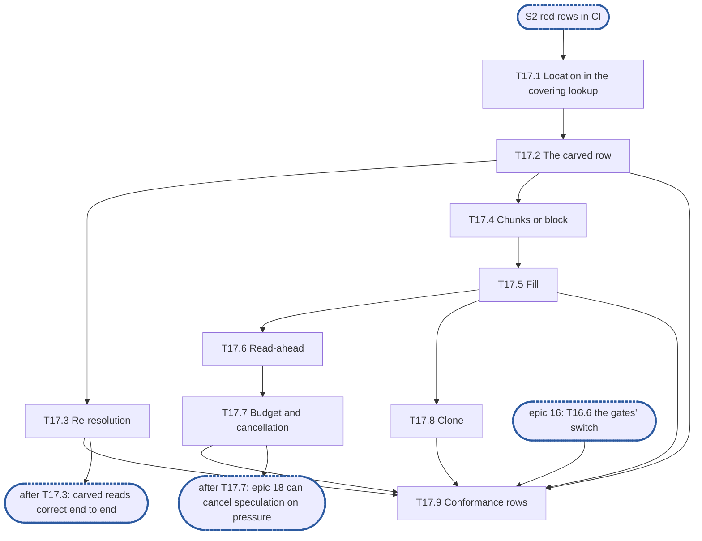

# Epic 17: engine offload remote reads, fill and speculation

**Sources:** [RFC 8](../docs/internals/rfcs/rfc-8-engine.md) §1.1 (cold-read isolation, no copy
of the bytes kept), §3.1 (`fill` and the speculator as a module), §3.3 (readahead frontiers are
memory), §7.1 (the carved row), §7.2, §7.3, §7.4 (read-ahead; pre-warm deferred), §7.5, §7.7, §7.8,
§9.1 (adoption, the copies narrowed to what no ref covers, the destination's fill refused, the
missing-chunk backstop), §11.2's remote-unavailable row for reads, §13's E9, E10, E14, E25 and E34,
§14's read, fetch, fill, speculation and re-resolution series and the `engine.fetch` span, and the
§15.1 and §15.2 rows in §3's last table; [RFC 6](../docs/internals/rfcs/rfc-6-block-metadata.md)
§8.1 (the covering lookup, as this epic's pull request amends it to name a carved span's chunk
location), §2.2, §2.5, §6.6 and §7.2; [RFC 3](../docs/internals/rfcs/rfc-3-syncer.md) §1.3
(`Fetch`, `Prefetch`, the error table, borrowed bytes), §4.1 to §4.5;
[RFC 1](../docs/internals/rfcs/rfc-1-journal.md) §3.4 (`Fill`) and §3.7 (`Extents`);
[RFC 4](../docs/internals/rfcs/rfc-4-remote-tier.md) §4.1 (`Name`, `ChunkRange`, `ErrNotFound`);
[RFC 5](../docs/internals/rfcs/rfc-5-transforms.md) §2.7 (the material errors).
**Track:** C.
**Epic 17 estimate: 9 subtasks, 25.25 man-days.**
**Depends on:** sync point **S2, red rows in CI**: epic 12's rows and the fixture's component
options; **epic 11's frozen surface**: `Settings.FillLowWater`, `ShareSettings`' read-ahead caps and
speculation budget, the `Stats` fields `Fetches`, `FetchBytes`, `Fills`, `SpeculationBytes`,
`SpeculationUsedBytes`, `Reresolves`, and the recorded declarations `Handle.Fill` and the flow's
`Fetch` and `Prefetch`; **epic 16's T16.1**: the binding's `flow`, opened at attach as a demand flow, and
every engine the fixture and the in-package tests build composing RFC 3's syncer over two in-memory
stores, with `FaultRemote` real (its D9, D10), which T17.2's tests stand in for with a flow they open
themselves until it lands (the offload plan's §3.3); **epic 16's T16.6**, the gates' switch
`Deps.Gates policy.Gates` (its D6), which `fill` reads from T17.9;
**S5's first half, partly**: RFC 3's syncer (`pkg/syncer/pool`) over RFC 4's in-memory store through
`codec.Store`, and RFC 5's material errors in the `pkg/transform` root (epic 15 admits that root for
`offload/` only; T17.2 admits it, and the `pkg/remote` root, for the engine's own package);
**epic 15's T15.8**, which registers the `unit/engine-allocs` suite rule 4's allocation check runs
in. The conformance rows also wait on epics 15 and 16 (the carver, chain and
syncer options made real) and on **S6** for the rows that evict through the real journal's
`Release`.
**Blocks:** epic 18, which calls T17.7's cancellation of queued speculation from `write.go` for
every write it paces or refuses; epic 19, through track C's order only.

---

## 1. Goal

Epic 17 makes a read reach past the journal. A carved run is fetched through the share's flow,
chunk by chunk, each verified before a byte of it reaches the caller; an absent object is
re-resolved while its location moves; a cold read asks for chunks or for the whole block; the
fetched bytes may fill the journal beside the reply, never in its way; a sequential reader is read
ahead within its share's budget; and a clone adopts carved refs instead of copying what a ref
already holds.

**At the end of the epic:**

- a read of a carved extent returns its verified bytes in file order, fails as **Lost**, corrupt or
  unavailable distinguishably, and never answers from a chunk that did not verify;
- the first part's `ErrUnavailable` for a carved run, its `decision:` in `read.go` and the tests
  that pinned it are gone;
- a get that finds its object absent re-runs the covering lookup while each answer names a new
  location, and fails as **Lost** when one repeats or a chunk has no record;
- a fill never delays or fails a read, and loses to any write that landed meanwhile;
- read-ahead never delays a demand read, never refuses a write, never fetches what the journal
  holds, and stays within the share's speculation budget;
- a clone copies only the source runs no live chunk covers at or above their version, and adopts
  the rest.

### 1.1 In scope

The covering lookup's chunk location (RFC 6 §8.1 as amended); the carved row of §7.1 with §7.2's
reply, §7.5's unavailable answer and the material errors; §7.7's re-resolution; §7.8's choice of
chunks or block; `fill`, the journal's `Fill` beside the reply, and the in-memory journal's `Fill`
and `Extents`; the speculator's read-ahead with its budget, windows and cancellations; §9.1's
narrowed copies, the destination fill exclusion and the missing-chunk backstop's log; the §14
series and span of these paths; the fixture controls epic 12 proposed for these rows, made real.

### 1.2 Out of scope

- `PreWarm`, the speculator's pre-warm, `fill`'s rule 3 (a pre-warm asked to yield) and the
  pre-warm legs of §7.4's checks and of §15.1's "§9.1 no pre-clone fill": deferred, unowned until a
  pre-warm action is specified (the offload plan's §6.1 row on `PreWarm`).
- Posting capacity pressure from `admit` and the pacing path, and so cancelling speculation there:
  epic 18, which calls T17.7's entry point.
- Opening a binding's flow at attach and closing it at `Drop`, composing the syncer in every
  fixture, and the gates' switch itself: epic 16 (its T16.1, D6, D9).
- Relocating a chunk (RFC 6 §7.3): RFC 9's, with GC; the relocation leg of "§7.7 re-resolution"
  waits on it (the offload plan's §6.1 row this pull request adds; D2).
- A read's span linking to a joined fetch's span (RFC 8 §14): RFC 3's, once it reports a join
  (D9; the §6.1 row this pull request adds).
- Reading a carved chunk of an older namespace generation on another store: RFC 27, with the re-home
  (D4; the offload plan's §6.1 row on the re-home).
- The clone's admission, registration, journal step, phases and refusals, and `kvstore`'s carrying
  of a gone chunk's ref as **Lost**: the first part's, kept.
- Turning green the rows that need a pass end to end or the real journal's `Release`: they turn
  green in whichever change lands last of this epic, S3 and S6 (T17.9). Until then this epic's unit
  tests are the green coverage of what they check.

### 1.3 Names used here

- **S2**, red rows in CI: the end of epic 12; epics 13, 15 and 17 start there.
- **S3**, a pass runs end to end: the end of epic 16, over S5's carver and syncer and S6's `Offload`.
- **S5**, offload components built: the RFC 2 to RFC 5 plans' implementation epics; its first half
  is the carver, RFC 3's syncer, RFC 4's in-memory store with `codec.Store` and RFC 5's chain.
- **S6**, journal offload half built: the journal plan's epics 9b and 7b (`Offload`, `Release`,
  `Unmark`, …).
- **§7.4 S1, S2, S3, S4, S5** are RFC 8 §7.4's five speculator rules, never synchronisation points;
  this document always writes them with the section ("§7.4 S3").
- **E3, E9, E10, E14, E25, E34** are RFC 8 §13's invariants of those numbers, not epics.
- **The first part**: the journal-only engine, epics 1 to 10 of RFC 8's first plan, whose read and
  clone code this epic extends.
- **The integration epic**, epic 21: the node's content wiring composes offload.

## 2. How the general rules apply

The rules are those of [the offload plan's §1.5](rfc-8-offload-engine-plan.md#15-general-rules-for-each-epic),
cited by number and title and not copied.

| Rule | Subtasks | How |
| --- | --- | --- |
| rule 1, independent unit tests ([`CLAUDE.md`, "Writing tests"](../CLAUDE.md#writing-tests)) | all | tests run over the first part's in-memory journal and `kvstore` over the in-memory `kv.KV`, refs and blocks written through `kvstore`'s `Intend` and `Commit` and `codec.Store`'s put into RFC 4's in-memory store (kind 2, RFC 4's suite), fetched through RFC 3's real syncer, faults from RFC 4's fault wrapper (kind 3); a carved extent is one the journal never held, so no pass and no `Release` is needed; no engine-side double is written |
| rule 2, fuzz the key and ref decoders the queue's rebuild reads | none | no decoder: the chunk location arrives decoded by `kvstore`, and the block body is RFC 4's codec's |
| rule 3, observability follows RFC 25 | T17.2, T17.3, T17.4, T17.5, T17.7 | `engine_reads_total`'s `remote` class, `engine_fetches_total` by `shape`, `engine_fetch_bytes_total`, `engine_fills_total` by `result` and, on `declined`, `reason`, `engine_speculation_bytes_total`, `engine_speculation_used_bytes_total` and `engine_reresolves_total`, as `Stats` fields with no share label; the `engine.fetch` span |
| rule 4, profiling | T17.2, T17.5, T17.6, T17.7 | every test runs under `prof.Watch`; a read's fetch goroutines are joined before it returns, and each fill and prefetch consumer runs inside its binding's gate, so `Unbind` and `Close` wait for it and a leak fails the run; a read of held content still updates the read table (R30, R49) and counts used speculative bytes (D11), and that work must not allocate, asserted under `unit/engine-allocs`, the suite epic 15's T15.8 registers |
| rule 5, public interface and internals ([`CLAUDE.md`, "Verifying a change"](../CLAUDE.md#verifying-a-change)) | all | asserted at `Read`'s reply and error, which the filesystem service consumes; a fill at the journal's next `ReadAt`; a location at the engine's re-resolution, not at the store; `-race` on every concurrent leg |
| rule 6, known failures shrink | T17.2, T17.9 | each row of §15.1 and §15.2 this epic owns leaves `known.yaml` in the change that turns it green, or has its `message:` rewritten in the change that moves its first failing check |
| rule 7, v2 ignores v1, and the engine imports only what RFC 0 §1.2 allows | T17.2 | the read path calls the flow through the `pkg/syncer` root, already allowed (epic 11), and reads RFC 4's errors from the `pkg/remote` root and the material errors from the `pkg/transform` root, all contracts, which `imports_test.go`'s `allowed` gains for the engine's own package (epic 15 admits them for `offload/` only); tests may import `pkg/syncer/pool`, `pkg/remote/memory` and `pkg/remote/codec` |
| rule 8, real dependencies for properties of those dependencies | T17.1, T17.5, T17.9 | the location join is tested in `kvstore` over each backend RFC 6's suite runs; the in-memory journal's `Fill` and `Extents` are held to the real journal by the fixture's agreement tests; T17.9's rows run over the real journal |
| rule 9, code comment conventions ([`CLAUDE.md`, "Code comments"](../CLAUDE.md#code-comments)) | T17.2, T17.4, T17.8 | `read.go`'s carved-run `decision:` deleted, its read-class `decision:` reworded for D13, and `allocation.go`'s `ponytail:` on `paint` deleted once carved pieces are clipped (T17.2); §7.8's quarter `decision:` at the choice (T17.4); §9.1's clone-copies `decision:` kept and reworded for the narrowed copies (T17.8); each §4 decision leaves the marker it names |
| rule 10, a test must be able to fail | all | each test names the break it catches; none asserts a stub's answer |
| rule 11, a symbol is exported only if the RFC's interface uses it | T17.1, T17.5, T17.6, T17.8, T17.9 | the only exported additions are RFC 6's `Location` and `Span.Loc`, `kvstore`'s `Content.WithLogger`, the in-memory journal's `Fill` and `Extents`, and epic 12's proposed fixture controls, `FailNextFill` among them; `fill` and the speculator are unexported |
| rule 12, each subtask creates only what it declares | all | `Handle.Fill` joins `Deps` with T17.5 and `Handle.Extents` with T17.6, each with its first caller; each fixture control lands with its first test; the read state lands with T17.4, its first reader |

## 3. Requirements and invariants

Every obligation RFC 8, RFC 6, RFC 3 and RFC 1 place on this epic, numbered so subtasks and tests
can cite them. Rows of §15 the epic turns green are listed last.

**Resolution of a carved run**

| # | Requirement | Kind | Source | Subtasks |
| --- | --- | --- | --- | --- |
| R1 | The journal is asked before block metadata, and metadata only about what the journal does not hold, on the carved path too | MUST | RFC 8 §7.1 | T17.2 |
| R2 | The resolution is computed per request and never kept, fetched locations included | MUST NOT | RFC 8 §7.1 | T17.2, T17.3 |
| R3 | Zeros are returned only for a hole or a zero ref, never for a carved run whose fetch failed | MUST NOT | RFC 8 §7.1, E9 | T17.2 |
| R4 | A fetch per missing extent, never per window: an extent over *n* blocks costs one fetch per block, whatever the window | invariant | RFC 8 §7.1; RFC 3 §1.3 | T17.2 |
| R5 | A carved span names its chunk's location, the block and the body's position and length with the block's encoded size, read in the same transaction in the namespace the ref's generation names; a span whose chunk record is gone, names a deleted block or names a block with no record names none | MUST | RFC 6 §8.1 (as amended here), §2.1, §2.2; RFC 8 §7.1 | T17.1 |
| R6 | The covering lookup still costs O(log *n* + results) with the locations joined | bound | RFC 6 §8.1 | T17.1 |
| R7 | A ref under an overwrite, in a file whose `applied` and whose run's overwrite version are both at or below `asOf`, is never fetched: the run reads **Lost** | MUST NOT | RFC 8 §7.1, E9 | T17.2 |
| R8 | A **Remote** extent whose fetch cannot complete, the remote unreachable or the demand deadline expired, fails the read with an error distinct from **Lost** | MUST | RFC 8 §7.5, §11.2, E9 | T17.2 |
| R9 | A material unavailable or unknown fails the read as the remote being unavailable; a material destroyed makes the chunk **Lost**, never corrupt | MUST | RFC 3 §1.3; RFC 5 §2.7 | T17.2 |
| R10 | A chunk that fails verification fails the read as corrupt | invariant | RFC 8 §7.7, E9 | T17.2 |
| R64 | A part whose stream the syncer ends by detaching the caller, an error wrapping `remote.ErrTransient` but not `remote.ErrThrottled`, is fetched again once for the chunks it did not yield, or read from what a fill left; only a second such end fails the read unavailable (D14) | MUST | RFC 3 §4.3, §4.2 point 4 | T17.2 |

**The reply**

| # | Requirement | Kind | Source | Subtasks |
| --- | --- | --- | --- | --- |
| R11 | `dst` is filled in file order, held bytes, zeros and remote chunks, and `dst[:n]` holds verified bytes only | MUST | RFC 8 §7.2 | T17.2 |
| R12 | No byte of a chunk is copied into `dst` before the whole chunk has verified | MUST NOT | RFC 8 §7.2, E10 | T17.2 |
| R13 | The reply is taken from the verified bytes the fetch returned, never by re-reading the journal after a fill | MUST NOT | RFC 8 §7.2 | T17.2, T17.5 |
| R14 | A read that fails part-way returns `n`, the bytes filled in file order before the first failing part, and the error | invariant | RFC 8 §7.2 | T17.2 |
| R15 | A whole-block fetch is verified the same way, each chunk as its last byte arrives, and only the read's chunks are copied | invariant | RFC 8 §7.2; RFC 3 §1.3 | T17.4 |
| R16 | A fetched chunk's `Bytes` are copied out before the next iteration, since they are borrowed until then | MUST | RFC 3 §1.3 | T17.2, T17.4, T17.5 |
| R17 | The fetches of one read run at once, so its latency is the slowest chunk's, not the sum | invariant | RFC 8 §7.2 | T17.2 |
| R18 | No payload is kept in engine state: bytes pass through to `dst` and to the journal, and a fill's copy is released when its `Fill` returns | invariant | RFC 8 §1.1 | T17.2, T17.5 |
| R65 | A fetch that ends without an error but without yielding a chunk the read wants, or a location whose position and length pass the block's encoded size, fails the read as corrupt, never leaving that part of `dst` as the caller left it | MUST | RFC 8 §7.2, E9; RFC 4, "What this RFC promises" (no short get) | T17.2, T17.4 |

**Re-resolution**

| # | Requirement | Kind | Source | Subtasks |
| --- | --- | --- | --- | --- |
| R19 | A get that finds its object absent runs the covering lookup for the extent again and acts on the new answer | MUST | RFC 8 §7.7, E14 | T17.3 |
| R20 | It keeps doing so while each answer names a different location, bounded by the read's deadline | MUST | RFC 8 §7.7, E14 | T17.3 |
| R21 | A new answer of a hole or past end of file is answered as such; an uncarved run of a file whose `applied` or whose run's overwrite version is above `asOf` asks the journal again | MUST | RFC 8 §7.7, §7.1 | T17.3 |
| R22 | The read fails as **Lost** when an answer names a location that already missed, or a chunk with no chunk record or whose record names a deleted block or a block with no record; a carved span whose first resolution carries no `Loc` reads **Lost** without a fetch | MUST | RFC 8 §7.7, E14 and RFC 6 §8.1, as amended here | T17.2, T17.3 |
| R23 | A verification failure, a transport error or a timeout never triggers re-resolution | MUST NOT | RFC 8 §7.7 | T17.3 |

**Chunks or the block**

| # | Requirement | Kind | Source | Subtasks |
| --- | --- | --- | --- | --- |
| R24 | A read asks for only its chunks when its missing bytes are at most a quarter of the block and it is not sequential (it neither starts at the block's beginning nor continues where the file's previous read ended); otherwise for the whole block | SHOULD | RFC 8 §7.8 | T17.4 |
| R25 | A fetch's ranges are whole chunks, each by its hash and recorded range, each distinct chunk once however many of the read's spans name it | invariant | RFC 3 §1.3 | T17.2, T17.4 |

**Fill**

| # | Requirement | Kind | Source | Subtasks |
| --- | --- | --- | --- | --- |
| R26 | `fill` decides per demanded extent: fill unless the journal's free capacity is below the fill low-water mark, or the read is part of a sequential scan longer than the read-ahead window | SHOULD | RFC 8 §7.3, §3.1 | T17.5 |
| R27 | `fill` takes plain inputs, does no I/O, holds no component, and calls no other policy function | MUST NOT | RFC 8 §3.1 | T17.5 |
| R63 | `fill` is a gate, never what keeps a read correct: with the gates' switch off it fills every demanded extent, and the Group A rows still pass | MUST NOT | RFC 8 §3.2, E3; epic 16, D6 | T17.9 |
| R28 | `Fill` is passed exactly the verified bytes fetched for one carved span, with that span's ref's `Newest` and the `asOf` the journal answered before the covering lookup that produced the fetched resolution: step 1's for a demand read and for its R64 re-fetch, the triggering read's step 1 for a hint, never one read after that lookup | MUST | RFC 8 §7.2; RFC 1 §3.4 | T17.5, T17.6 |
| R29 | A refused fill is not an error, and a fill never delays or fails the reply | MUST NOT | RFC 8 §7.2, E10; RFC 3 §4.2 | T17.5 |

**The speculator**

| # | Requirement | Kind | Source | Subtasks |
| --- | --- | --- | --- | --- |
| R30 | The speculator is an unexported struct: it takes each read's `(file, off, len, time)` and yields hints labelled speculation, and cancellations, to the flow's `Prefetch` | invariant | RFC 8 §7.4, §3.1 | T17.6 |
| R31 | §7.4 S1: every hint is issued through `Prefetch`, and the engine sets no other priority | MUST | RFC 8 §7.4, E25; RFC 3 §4.4 | T17.6 |
| R32 | §7.4 S2: speculative fills stop while free capacity is below the low-water mark, and queued hints are cancelled when a write meets capacity pressure | invariant | RFC 8 §7.4, E25 | T17.7 |
| R33 | §7.4 S3: speculative bytes in flight per share stay within its budget, and read-ahead of one reader within its window | MUST | RFC 8 §7.4 | T17.6, T17.7 |
| R34 | §7.4 S4: speculation is memory only; a frontier lost to a restart is relearnt from the next reads | MUST | RFC 8 §7.4, §3.3 | T17.4, T17.6 |
| R35 | §7.4 S5: no speculative fetch for a block the journal holds whole; for a block held in part, only the missing chunks unless the whole block costs fewer round trips | MUST NOT | RFC 8 §7.4, §7.8, E25 | T17.6 |
| R36 | The window opens at one block on the first read that continues the last, doubles on each further one up to the smaller of `readahead.max_blocks` and `readahead.max_bytes`, and a read that does not continue resets it and cancels the file's queued hints | invariant | RFC 8 §7.4 | T17.6 |
| R37 | A cancelled or abandoned speculative fetch fails no read | MUST | RFC 3 §4.4, §4.5 | T17.7 |

**Clone**

| # | Requirement | Kind | Source | Subtasks |
| --- | --- | --- | --- | --- |
| R38 | A clone copies only the source runs the journal holds at `asOf` newer than any ref over them, or under no ref; carved refs are adopted by the metadata-only batches, and the clone never waits on the remote tier | MUST | RFC 8 §9.1, E34 | T17.8 |
| R39 | A source ref whose chunk record is gone, or names a deleted block, is carried into the destination as uncarved, reading **Lost**, counted and logged at `Error` | MUST | RFC 8 §9.1, E34; RFC 6 §6.6, §7.2 | T17.8 |
| R40 | A fill of the destination extent, by a demand read or by speculation, whose fetch resolved before the clone's journal step never installs | MUST NOT | RFC 8 §9.1 | T17.8 |

**Isolation and observability**

| # | Requirement | Kind | Source | Subtasks |
| --- | --- | --- | --- | --- |
| R41 | No lock, queue or other serialisation point shared by more than one file or share is held across I/O or a wait on a read's path: its fetch, and its hand-off to a fill and to the speculator; a fill and a hint run off that path (D3) | MUST NOT | RFC 8 §1.1 | T17.2, T17.5, T17.7 |
| R42 | `engine_reads_total` counts a read served from the remote under `remote`; `engine_fetches_total` by `shape` `chunks` or `block`; `engine_fetch_bytes_total`; `engine_fills_total` by `result` `done`, `declined` or `refused`, a declined fill also by `reason` `low_water`, `scan` or `bound`; `engine_speculation_bytes_total` and `engine_speculation_used_bytes_total`; `engine_reresolves_total`; none share-labelled | MUST | RFC 8 §14 | T17.2, T17.3, T17.4, T17.5, T17.7 |
| R43 | A content call opens an `engine.fetch` child span per fetch it waits on, carrying the share, the file, the bytes and the outcome | MUST | RFC 8 §14 | T17.2 |
| R44 | A **Lost** or corrupt read logs the file and extent at `Error`, once per extent, on the remote path as on the journal's | MUST | RFC 8 §14 | T17.2, T17.3 |

**Module checks (unit tests, green with this epic)**

| # | Requirement | Kind | Source | Subtasks |
| --- | --- | --- | --- | --- |
| R45 | §7.4 S1: with the fetcher saturated by read-ahead for one file, a demand read of another is not held behind it | test row | RFC 8 §7.4 Checks | T17.6 |
| R46 | §7.4 S3: 10³ files read sequentially at once never take speculative bytes in flight past the share's budget | test row | RFC 8 §7.4 Checks | T17.7 |
| R47 | §7.4 S3, read-ahead window: the window opens only for a sequential replay, not a random or strided one, and a random read cancels queued hints | test row | RFC 8 §7.4 Checks | T17.6 |
| R48 | §7.4 S4, read-ahead half: after a restart during a read-ahead no speculative state was persisted and the window reopens from the next reads | test row | RFC 8 §7.4 Checks | T17.6 |
| R49 | §7.4 S5, read leg: a held file read sequentially twice costs the remote zero requests; with one block not held, exactly that block's chunks are fetched | test row | RFC 8 §7.4 Checks | T17.6 |

**Conformance rows this epic turns green**

Each is green in whichever change lands last of this epic, S3 and, where the row evicts, S6
(§1.2); none is the only test of a requirement above.

| # | Requirement | Kind | Source | Subtasks |
| --- | --- | --- | --- | --- |
| R50 | "§7.1 stale ref", `TestRFC8A_StaleRef` | test row | RFC 8 §15.1; epic 12, T12.3 | T17.9 |
| R51 | "§7.1 the order", `TestRFC8A_TheOrderOfAReadsSteps`, and its swapped-steps build failing | test row | RFC 8 §15.1; epic 12, T12.3 | T17.9 |
| R52 | "§7.2 streaming, verified", `TestRFC8A_StreamingVerified` | test row | RFC 8 §15.1; epic 12, T12.3 | T17.9 |
| R53 | "§7.2 fill cannot fail a read", `TestRFC8A_FillCannotFailARead` | test row | RFC 8 §15.1; epic 12, T12.3 | T17.9 |
| R54 | "§7.2 fill loses to a write", `TestRFC8A_FillLosesToAWrite` | test row | RFC 8 §15.1; epic 12, T12.3 | T17.9 |
| R55 | "§7.7 re-resolution", `TestRFC8A_Reresolution`, but its relocation leg, `TestRFC8A_ReresolutionRelocation` (D2) | test row | RFC 8 §15.1; epic 12, T12.3 | T17.9 |
| R56 | "§7.6 zero ref under an overwrite", `TestRFC8A_ZeroRefUnderAnOverwrite` | test row | RFC 8 §15.1; epic 12, T12.3 | T17.9 |
| R57 | "§9.1 clone keeps writes outside its extent", offload half, `TestRFC8A_CloneKeepsWritesOutsideItsExtentOffloaded` | test row | RFC 8 §15.1; epic 12, T12.3 | T17.9 |
| R58 | "§9.1 no pre-clone fill", the demand read's leg, `TestRFC8A_NoPreCloneFill` | test row | RFC 8 §15.1; epic 12, T12.3 | T17.9 |
| R59 | "§9.1 Lost source run carried", `TestRFC8A_LostSourceRunCarried` | test row | RFC 8 §15.1; epic 12, T12.3 | T17.9 |
| R60 | "§9.1 one source state", `TestRFC8A_OneSourceState` | test row | RFC 8 §15.1; epic 12, T12.3 | T17.9 |
| R61 | "§1.1 no cross-share slowdown", cold reads, `TestRFC8B_NoCrossShareSlowdownColdReads` | test row | RFC 8 §15.2; epic 12, T12.7 | T17.9 |
| R62 | "§7.1 the join", its carved and stale rows, which the first part's `TestRFC8A_TheJoin` leaves to this part | test row | RFC 8 §15.1 | T17.9 |

## 4. Decisions this epic takes

- **D1, the covering lookup names a carved span's location.** RFC 8 §7.1 resolves a carved ref's
  chunk and §7.7 has the reader "run the covering lookup again" while "each answer names a different
  location", but RFC 6 §8.1 returned the ref alone and no engine view read a chunk record. This
  epic's pull request amends RFC 6 §8.1 and its types: `Location` (block, position, length and the
  block's encoded size, never the refcount, so two answers compare by where the chunk is) and
  `Span.Loc`, set on a carved span in `Content.Covering`'s own transaction and zero when the chunk
  record is gone, names a deleted block or names a block with no record. Those two new **Lost**
  causes are why this pull request also amends RFC 8 §7.7's rule and E14, and RFC 9 §4.3's, which
  said a read is **Lost** only when a location misses twice or a chunk has no record. The join is in
  `Content.Covering` only: a clone batch's `adopt`, `Allocation` and `SnapshotCovering` share the
  lookup, pay nothing for it and return no `Loc`, which the amended comment says, so a later reader
  of carved data through them adds the join. The join reads the chunk records the results name in
  one `GetMany`, then their blocks' records in a second, so it costs two round trips whatever the
  results. A second call for the location would let a relocation
  slip between the two reads. The ref still names only its hash (RFC 6 §2.5). Changing it later
  costs a field and the join, nothing persisted. The join decodes the block record only up to its
  `Size`, which the record stores before its carried list, so its CPU does not grow with the block's
  chunks; a `ponytail:` at the join says the point read still fetches the whole record, up to 1,024
  carried entries, and names the upgrade, the size kept on the chunk record, if lookups over
  many-chunk blocks show in a profile. Prior art: none found.
- **D2, re-resolution is a pure function of the locations seen.** The loop of RFC 8 §7.7 keeps the
  locations that missed and calls `reresolve(missed []entity.Location, next entity.Span, asOf
  entity.JournalVersion) step`, answering fetch, re-ask the journal, zeros, past end of file or
  **Lost**. It is table-tested on its own (`CLAUDE.md`, "Put the logic in a function of its
  inputs"), so a location moving twice is tested here although nothing in v1.1 moves a chunk.
  The row's relocation leg is a test of its own, `TestRFC8A_ReresolutionRelocation`, not a
  subtest, since a red subtest would fail `TestRFC8A_Reresolution` too; it is red with a
  `known.yaml` entry until RFC 9's relocation lands, since nothing moves a chunk while its refs are live before GC's (RFC 6 §7.3),
  and the offload plan's §6.1 gains that row in this pull request. The user decided this on
  2026-11-26. Rejected: building `kvstore`'s `Blocks.Relocate` here, about 3 man-days ahead of GC,
  a GC mechanism whose only caller would be a test. Prior art: none found.
- **D3, a fill copies its bytes, bounded per share.** Once a chunk is in `dst` the reply needs the
  fetch no longer, but `dst` is the caller's once `Read` returns, so a fill copies the extent's
  verified bytes and runs in its own goroutine, beside the reply. RFC 8 §1.1 forbids a payload
  copied through engine state: the copy is a buffer in flight to the journal, as a write's `p` is,
  kept by nothing and released when `Fill` returns (R18). A fill is one carved span: its verified
  bytes, at most one chunk (RFC 2's `Max`, 1 MiB by default), filled with that span's ref's `Newest`
  and the `asOf` R28 names, so a read of any size fills span by span and one `Fill` never mixes
  versions. Each binding holds a byte semaphore of 4 MiB of fills in flight, each span taking its
  size by try-acquire, never waiting; a span that does not fit is declined, counted `declined` with `reason` `bound`, so
  no fill waits and no share's fills hold another's. A span always fits a semaphore no fill holds,
  so a chunk over 4 MiB (RFC 2 allows a `Max` up to 16 MiB, §3.7) still fills alone and the
  bound is at most the larger of 4 MiB and one chunk. Speculative fills do not take it: their bytes stay charged to the
  speculation budget until their `Fill` returns (T17.7). Each fill runs inside its binding's gate,
  entered before the goroutine starts, so `Unbind` and `Drop` wait for it and a shut gate declines it
  (RFC 8 E13). A fill runs beside the reply, off the request path RFC 8 §1.1 constrains, so epic 18's
  engine-wide destroyed-material read lock at `fillExtent` breaks no rule of R41. A `decision:` at the
  hand-off names these rules and the ceiling, fills declined under a burst of cold reads, withdrawn if
  B4 shows declined fills costing re-fetches, which the `bound` reason lets B4 tell from
  `fill`'s own declines (`low_water`, `scan`; the user's decision of 2026-11-26); a `ponytail:` says one `Fill` per span writes a record
  per chunk, and names the upgrade, adjacent spans of one version filled together, if journal record
  counts show in a profile. Prior art: Linux's page cache inserts read pages
  asynchronously and drops readahead under memory pressure (from memory).
- **D4, one flow per share serves every carved read of the share.** A ref of an older namespace
  generation is fetched through the share's one flow, on the share's store. In v1.1 every
  generation of a share lives on one store: only a re-home (RFC 27) moves a share between
  namespaces, and `Bind` refuses a new store or write namespace for a served share (epic 16's D5),
  so a binding's flow never changes under a read. A `decision:` at the fetch names the ceiling and RFC 27 as what withdraws it. Prior
  art: none found.
- **D5, a file's read state lives in the speculator's own table.** The first part's file entry
  exists only while it holds pending work, so a file that is only read has none. The speculator
  keeps, per file, the end of the last read, the length of the sequential scan it continues, the
  read-ahead window, the cancel function of its queued hints and its speculatively filled extents
  not yet read, at most `readahead.max_blocks` of them, the oldest dropped first and all cleared when
  the window resets, in a table sharded by file like the file table, each shard's lock held for the
  update only, never across I/O. The table holds at most 10⁴ files; the least recently read is
  dropped first. That meets §1.1 (keyed by file) and §3.3 (memory). RFC 8 §7.4 keeps this state per
  open file, but the engine sees no open (NFSv3 has none), so it keeps it per file: two readers
  streaming one file at different offsets reset each other's window on every read (R36), and neither
  is read ahead. A `ponytail:` names both ceilings, that one and a file dropped from the table
  relearning its window, and the upgrades: a few streams per file, each matched by where a read
  continues, which needs §7.4's reset rule reworded, if B4 or a user shows concurrent readers of one
  file; a cap from RFC 24's memory budget once it sets one. Prior art: Linux keeps readahead state
  per open file (`struct file_ra_state`), which the engine cannot; ZFS's prefetcher keeps several
  streams per file (from memory).
- **D6, §7.4 S5's held check is the journal's `Extents`.** The handle already answers `Extents`
  (RFC 1 §3.7) on `feat/storage-v2`; the engine's `Handle` gains it with T17.6, its first caller,
  and the in-memory journal with it. No marker. Prior art: none found.
- **D7, `fill`'s third rule and pre-warm are not built.** They need a pre-warm, which is deferred
  with `PreWarm` (the offload plan's §6.1 row); the function takes no pre-warm input, and adding one
  later changes an unexported signature only. Rule 2 compares the scan's length with the window's
  cap, `readahead.max_blocks` and `readahead.max_bytes`, the most the window can be. No marker: the
  ledger row records it. The speculator issues no hint for a file whose scan rule 2 would decline:
  its fetched chunks could not fill, so read-ahead would fetch each block twice. Past that point the
  scan is served by demand fetches, as RFC 8 §7.3's backup example says; a `decision:` at the hint
  says so, withdrawn if B4 shows long scans need read-ahead held in memory.
- **D8, the missing-chunk backstop is logged by `kvstore`.** The batch that finds a source ref with
  no chunk record, or one naming a deleted block, runs inside `kvstore`'s `Resume`, which already
  carries it as **Lost** and which the engine does not see into. `Content` gains `WithLogger`, as
  `Lifecycle` has, and each batch collects the refs it carries and, once its transaction has
  committed, logs the destination file, the extent and a running count at `Error`, so a batch that
  `kv.Update` retries on a conflict logs and counts once. RFC 6 §10.2 names no series for it, so the count lives in the log line; a `decision:` at
  the log says so, withdrawn when RFC 6 names a series. Reporting it through `Resume`'s result
  instead would change RFC 6's surface and epic 14's removal source for a case a correct store never
  reaches. Prior art: none found.
- **D9, a read joining a fetch does not link to its span.** RFC 8 §14 asks for the link, but the
  syncer joins fetches internally and its `Fetch` reports no join. Each read opens its own
  `engine.fetch` span; a `decision:` at the span says so, and the offload plan's §6.1 gains the row
  in this pull request. Prior art: none found.
- **D10, pressure cancels through one entry point.** `(*speculator).cancelQueued(j)` cancels every
  queued hint of journal `j`'s shares. Hints queue per binding (T17.6), so it cancels the queues
  of `j`'s bindings and never walks the read table. This epic calls it from the first part's
  refusal path in `capacity.go`, the one place a write meets capacity pressure today; epic 18 calls
  it from `write.go` for every write it paces or refuses (its T18.7), and may then drop this
  epic's call, which a refused write would otherwise make twice, harmlessly. Prior art: none found.
- **D11, used speculative bytes are counted at the next demand read.** A speculative fill records
  its extent in the file's read state (D5); a demand read answered from held bytes overlapping it
  adds the overlap to `engine_speculation_used_bytes_total` and forgets it. A `ponytail:` says an
  extent dropped with its file's state, or evicted unread, is counted neither way, at most D5's 10⁴
  files' worth, and names the upgrade, a count from the journal's eviction report, if B4 needs the
  figure exact. Prior art: none found.
- **D12, §7.8's quarter compares encoded bytes.** The missing bytes are counted as the sum of the
  wanted chunks' `Loc.Length`, each distinct chunk once (R25), and compared with `Loc.BlockSize`, both encoded, so the quarter holds
  like for like whatever the block compresses to. The quarter's `decision:` (rule 9) says so. Prior
  art: none found.
- **D13, a read that fetched counts as `remote`.** `engine_reads_total` counts a successful read
  `remote` when any part was fetched, else `hole` when any part read as zeros, else `journal`; a
  failed read keeps its failing part's class. The fetch is the costly path the series exists to
  show. `read.go`'s read-class `decision:` is reworded to that order (rule 9). Prior art: none found.
- **D14, a detach and an outage both end in `ErrTransient`.** RFC 3 epic 6's D6 (#6008) ends a
  detached stream with a plain wrap of `remote.ErrTransient`, which an outage past the syncer's
  retry bound also returns, so the engine cannot tell them apart and fetches either once more (R64).
  An outage therefore waits through the retry bound twice, at most the read's deadline. The order
  of the checks is fixed: `ErrThrottled`, which wraps `ErrTransient`, is tested first
  and fails the read `ErrUnavailable` with no second fetch. A `decision:` at the check names
  the doubled wait, withdrawn if RFC 3 gives a detach an error of its own. Prior art: none found.

## 5. Target tree

On `feat/storage-v2`.

```text
pkg/metadata/entity/content.go      T17.1  Location, Span.Loc
pkg/metadata/kvstore/covering.go    T17.1  the location join in Content.Covering
pkg/metadata/kvstore/clone.go       T17.8  the backstop's log; Content.WithLogger
pkg/engine/
  read.go                           T17.2  the carved row's reply in file order, the remote class (D13)
  allocation.go                     T17.2  carved pieces clipped; paint's ponytail deleted
  imports_test.go                   T17.2  the pkg/remote and pkg/transform roots allowed for "."
  fetch.go                          T17.2  the fetch per carved part, its errors; T17.3 reresolve and its loop; T17.4 blockShape
  readstate.go                      T17.4  the speculator's per-file read table (D5)
  fill.go                           T17.5  the per-share fill hand-off beside the reply
  policy.go                         T17.5  fill (epic 15's file, or created here if this lands first)
  speculate.go                      T17.6  the speculator, windows, hints; T17.7 budget, cancellation, counters
  deps.go                           T17.5  Handle.Fill; T17.6 Handle.Extents
  capacity.go                       T17.7  the refusal path's cancelQueued
  clone.go                          T17.8  copies narrowed to runs no live chunk covers
  types.go, health.go               T17.2 to T17.7  the Stats fields filled
  read_test.go                      T17.2  the stub-backed "carved after a hole" row rewritten over kvstore;
                                           TestReadResolutionTable's "carved" row reads Lost
pkg/engine/enginetest/
  fake.go                           T17.5  the in-memory journal's Fill and the Fill fault wrapper; T17.6 its Extents
  journal_test.go                   T17.5, T17.6  Fill and Extents agreement with the real journal
  offload.go                        T17.9  FailNextFill, HoldBetweenReadSteps, HoldNextRelease, Evict
  components.go                     T17.6  WithoutReadahead
pkg/engine/conformance/
  rfc8_cover_test.go                T17.2  TestRFC8A_CarvedRunFailsUnavailable becomes the carved row's fetch test
  rfc8_remote_test.go               T17.9  "§7.1 the join"'s carved and stale rows
test/engine/known.yaml              T17.9  entries removed or their messages rewritten
```

## 6. Subtasks

### T17.1 The covering lookup names a carved span's chunk location

**Subtask T17.1 estimate: 2 man-days.**

- **Track:** C. **Depends on:** S2.
- **Covers:** R5, R6.
- **Deliverables:** in `entity`, as RFC 6 §8.1 and §2 now say:
  ```go
  // Location is where a chunk's body is: its block, its position and length there, and the
  // block's encoded size (RFC 6 §8.1).
  type Location struct {
  	Block                       BlockName
  	Position, Length, BlockSize int64
  }
  // Span gains:
  	Loc Location // when Carved, but a zero ref: where the chunk is; zero when its record is gone,
  	             // names a deleted block or names a block with no record. Set by Covering only:
  	             // Allocation and SnapshotCovering return none.
  ```
  `kvstore`'s `Content.Covering` fills `Loc` inside its one `View`: one `GetMany` of the chunk
  records of the distinct hashes the results name, in the namespace `Ref.NSGen` names, then one of
  the records of the distinct blocks they name, each decoded up to its `Size`; `adopt` and `Allocation`, which share
  `covering`, do not. D1's `ponytail:`. Consumed by T17.2 (the fetch), T17.3 (the location compare), T17.4 (the quarter) and
  T17.8 (the narrowed copies).
- **Acceptance criteria:**
  - A carved span over a committed block names that block and the body's position and length the
    commit recorded; a zero ref's span names none; a span whose chunk record was pruned, or whose
    block is deleted, names none.
  - Two spans of one chunk cost one chunk read; the lookup's reads grow with results, not with the
    file's refs.
- **Tests:** in `kvstore`, over the memory KV, Badger under `t.TempDir()` and FoundationDB where it
  runs: a block committed with two chunks, a file's refs over both and a zero ref, its covering
  lookup asserting each span's `Loc` against the commit's `ChunkAt`s (catches a location read from
  the wrong namespace generation or position, R5); the block marked deleted through `Blocks`, and
  then pruned, asserting no `Loc` each time (catches a location of a deleted block, which would be
  fetched, R5); `kv`'s counting wrapper over a file of 10⁴ refs reading a 4-ref extent, asserting the
  reads stay within a constant of the results (catches a scan of the file's refs or of chunk
  records, R6). No test double.
- **Rules:** rule 8: run over each backend RFC 6's suite names.

### T17.2 The carved row: fetch, verified reply, distinguishable failures

**Subtask T17.2 estimate: 6 man-days.**

- **Track:** C. **Depends on:** T17.1.
- **Covers:** R1 to R4, R7 to R14, R16 to R18, R22, R25, R41 to R44, R64, R65.
- **Deliverables:** in `read.go` and `fetch.go`, `resCarved` fetches: each carved part of a missing
  extent, one per block, is one `Fetch(ctx, name, want)` on the binding's `syncer.Flow`, `name` the
  span's block as RFC 4's `remote.Name`, `want` its chunks as `remote.ChunkRange`s from `Loc`, one per distinct hash however many spans
  name it (R25); the parts of one read run at once, one goroutine per part joined before `Read`
  returns; each yielded chunk is copied into `dst` at the file offsets of every span naming its
  hash (each ref's `Skip` and length) before the next iteration; the first failing part sets `n`
  and the error. A carved span with no `Loc` reads **Lost**, logged, with no fetch (R22); one whose
  `Loc.Position+Loc.Length` passes `Loc.BlockSize` fails `vfserr.ErrCorrupt`, logged, with no
  fetch; a fetch that ends with no error but has not yielded every wanted chunk fails
  `vfserr.ErrCorrupt` (R65). A carved run `paint` split around a pending deallocate or
  truncate has each piece's span and `Ref` clipped to that piece, so its bytes come from the right
  offset of the chunk; `allocation.go`'s `ponytail:` on `paint` is deleted (rule 9).
  `remote.ErrNotFound` hands the part to T17.3; `remote.ErrCorrupt` and `ErrMalformed` fail it as
  `vfserr.ErrCorrupt`; `ErrMaterialDestroyed` as `vfserr.ErrLost`; `remote.ErrThrottled`, tested
  before `ErrTransient`, which it wraps, as `vfserr.ErrUnavailable`; any other end wrapping
  `remote.ErrTransient`, which is how the syncer detaches a caller (RFC 3 epic 6's D6, #6008), is
  fetched again once for the chunks it did not yield (one re-fetch per part, whatever its cause,
  shared with T17.4's ranged retry, so no part is fetched more than twice), after re-asking the journal for what a fill
  left (R64, D14's `decision:`); `ErrMaterialUnavailable`, `ErrUnknownMaterial`,
  `remote.ErrInvalid`, `ErrDenied`, a second transient end, the context's deadline and any error
  not listed here as `vfserr.ErrUnavailable`. The `decision:` that a carved run fails unavailable is
  deleted (rule 9); D4's `decision:` at the fetch. The tests that pinned it go with it: the
  conformance test `TestRFC8A_CarvedRunFailsUnavailable` becomes the carved row's own test,
  fetching what it carves; `read_test.go`'s "carved after a hole" row, which runs over a stub
  covering lookup, is rewritten over `kvstore` (`CLAUDE.md`: a touched test is brought in line); and
  `TestReadResolutionTable`'s "carved" row, a span with no `Loc`, now expects `ErrLost` and the
  `lost` class. `imports_test.go`'s `allowed` gains the `pkg/remote` and `pkg/transform` roots for
  the engine's own package (rule 7). `readClass` gains `classRemote`, counted as D13 orders it;
  `Stats.Fetches` and `FetchBytes` filled; an `engine.fetch` child span per fetch
  with share, file, bytes and outcome (D9's `decision:`). The fetch runs on the binding's `flow`
  epic 16's T16.1 opens. Until T16.1 lands, T17.2's tests set that field per instance from
  `export_test.go` to a flow they open over RFC 4's in-memory store themselves (the offload plan's
  §3.3), so this subtask waits on no subtask of epic 16; a hook between the journal step and the metadata step is set per instance
  from `export_test.go`. A test helper, `carved(t, ...)`, writes a file's
  existence and refs through `kvstore`'s `Commit` and `Intend` and the block through
  `codec.Store`'s put into RFC 4's in-memory store, so the journal never held the bytes. Consumed by
  `Read`'s callers and T17.3 to T17.9.
- **Acceptance criteria:**
  - A cold read of a carved extent returns its bytes; a read spanning held, hole and carved parts
    returns each in file order.
  - With the fifth of eight chunks corrupt, `n` covers the first four exactly, `dst` past them holds
    no byte of the fifth, and the error is `ErrCorrupt`.
  - A stale ref under a committed overwrite reads **Lost** and no fetch is counted; so does a carved
    span whose chunk record is gone.
  - A carved run split by a pending deallocate reads each piece from its own offset in the chunk.
  - With the store unreachable, the read fails `ErrUnavailable`, never `ErrLost`; past the read's
    deadline likewise; a destroyed material reads `ErrLost`, an unavailable or unknown one
    `ErrUnavailable`.
- **Tests:** at `Read`, which the filesystem service calls, over the in-memory journal, `kvstore` and
  RFC 3's syncer over RFC 4's in-memory store: the mixed read (catches a part written out of order,
  or zeros for a carved part, R3, R11); the fifth-chunk corruption through RFC 4's fault wrapper,
  kind 3, asserting `n`, the untouched tail of `dst` and the error (catches a copy before
  verification or a wrong `n`, R12, R14); the mixed read's `Stats` after it, the read counted
  `remote` and `FetchBytes` equal to the encoded bytes fetched (catches a remote read counted `hole`
  or `journal`, D13, R42); the stale ref with `Stats.Fetches` 0 (catches a fetch of a superseded
  chunk, R7); a carved span whose chunk record was pruned, **Lost** with `Stats.Fetches` 0 and the
  loss logged (catches a get of block name zero answered `ErrUnavailable`, R22); a 12 KiB carved
  file with an uncommitted punch-hole over `[4 KiB, 8 KiB)`, its `[8 KiB, 12 KiB)` read equal to the
  chunk's bytes there (catches a piece copied from the chunk's start, R11); the unreachable store and the expired deadline on the injected clock
  (catch `Lost` reported for an outage, R8); the material errors raised by RFC 5's in-memory
  `keys.Provider` (catch a destroyed material read as corrupt, R9); a cold read over two blocks with
  every get held at the fault wrapper until both blocks' gets have arrived, then released (catches
  parts fetched one after another, which never brings the second while the first is held, R4, R17);
  a ranged fetch of several chunks whose bytes, after the next iteration, still read right in `dst`
  (catches a borrowed buffer kept instead of copied, R16); a file of four identical chunks, the
  `want` asked for holding the hash once and every span's bytes right (catches a range asked
  twice, or a chunk copied only to its first span, R25); a `Loc` whose position and length pass its
  block's size, `ErrCorrupt` with `Stats.Fetches` 0 (R65); the read order: the hook holding a read between its
  journal step and its metadata step while a ref is committed over the extent, released, asserting
  the bytes and no **Lost** (catches metadata asked first or a resolution kept, R1, R2); share A's
  cold read held at the fault wrapper while share B's cold read returns, the generous timeout only a
  backstop (catches a lock or queue shared across shares, R41); the span through the fixture's
  `Trace` (R43); the loss log once per extent (R44); `prof.Watch` after a read that failed part-way
  (catches a fetch goroutine left running and a buffer held past the read, R18); two cold reads of
  one block joined in the syncer's single flight, one held between two chunk copies by a hook set
  per instance from `export_test.go` past the syncer's detach bound, its read returning every byte
  with one more fetch counted (catches a detach mapped to `ErrUnavailable`, R64); every get of a
  block failing past the syncer's retry bound, the read `ErrUnavailable` after exactly two fetches
  (catches an unbounded re-fetch, R64); every get throttled past the bound, the read
  `ErrUnavailable` after exactly one fetch (catches the transient check run before the throttled
  one, D14).
- **Rules:** rule 4: the per-part goroutines are joined before `Read` returns; rule 6: the pinning
  test's entry, if any, follows it; rule 7: imports through contracts only.

### T17.3 Re-resolution of an absent object

**Subtask T17.3 estimate: 2.5 man-days.**

- **Track:** C. **Depends on:** T17.2.
- **Covers:** R2, R19 to R23, R42, R44.
- **Deliverables:** in `fetch.go`, `reresolve(missed []entity.Location, next entity.Span, asOf
  entity.JournalVersion) step`, pure (D2), answering fetch, re-ask, zeros, past end of file or lost,
  and its loop on `remote.ErrNotFound`: covering lookup again for the part, the step applied to
  each span of the new answer, the
  journal re-asked for an uncarved run above `asOf`, bounded by the read's deadline; no
  re-resolution on corrupt, transport or timeout errors. `Stats.Reresolves` filled. Consumed by
  T17.2's fetch path and T17.9's "§7.7 re-resolution" row.
- **Acceptance criteria:**
  - A location that misses twice reads **Lost**; one whose second answer differs is fetched there.
  - A truncate between resolution and get, whose block is then gone, answers past end of file, not
    **Lost**.
  - A corrupt get never re-runs the lookup.
- **Tests:** `reresolve` by table: new location, repeated location, no location, hole, past end of
  file, uncarved above `asOf` by `applied`, by overwrite version, and at or below both (each row
  catches one wrong step, R20 to R22). At `Read`: the block deleted from RFC 4's in-memory store
  with its chunk record kept, asserting **Lost** after exactly one re-resolution (catches an
  unbounded loop, R22); the file truncated in `kvstore` and its block deleted from the store while
  the get is held at the fault wrapper, asserting a short read (catches **Lost** for a removal,
  R21); a corrupt chunk, asserting `Reresolves` 0 (catches re-resolution on corruption, R23); a
  fresh read after a re-resolution resolving anew (catches a remembered location, R2). No test
  double beyond the fault wrapper.

### T17.4 Chunks or the whole block

**Subtask T17.4 estimate: 1.5 man-days.**

- **Track:** C. **Depends on:** T17.2.
- **Covers:** R15, R16, R24, R25, R34, R42, R65.
- **Deliverables:** `readstate.go`, the speculator's per-file read table (D5, its `ponytail:`), its
  first fields the end of the last read and the length of the scan it continues;
  `blockShape(missing, blockSize int64, startsBlock, continues bool) shape`, pure, `missing` the sum
  of the distinct wanted chunks' `Loc.Length` (D12), with RFC 8 §7.8's quarter `decision:` at it; a
  whole-block fetch passes an empty `want` and picks the read's chunks out of the stream by
  `Ref.Hash`, copying each to every span naming it and only those; a stream that ends cleanly
  without one of them fails `vfserr.ErrCorrupt` (R65). A whole-block stream that ends with `ErrCorrupt`, `ErrMalformed`
  or `ErrMaterialDestroyed`, which may be a chunk the read does not want, is not mapped: the wanted
  chunks not yet yielded are fetched again once by range, the part's one re-fetch (T17.2), and that
  fetch's end is mapped as T17.2 says. `Stats.Fetches` by shape. Consumed by T17.2's fetch,
  T17.5's `fill` and T17.6, which adds its fields.
- **Acceptance criteria:**
  - A 4 KiB random read of a 4 MiB block asks for its chunk; a read starting the block, or
    continuing the last, asks for the block; a read missing more than a quarter asks for the block.
  - A file only ever read, with no pending work, keeps its read state between reads.
- **Tests:** `blockShape` by table at the quarter's edge, one byte either side (catches an
  off-by-one or a swapped condition, R24); at `Read`, the shape counters for a random and a
  sequential pair of reads of a file the journal holds nothing of (catches state kept on the file
  entry, which such a file lacks, R24); a whole-block fetch whose `dst` holds only the read's bytes
  (catches neighbouring chunks copied, R15); a whole-block fetch with a chunk the read does not want
  corrupted through the fault wrapper, the read returning its bytes after one ranged fetch more
  (catches a read failed by a chunk it never wanted, R15); a whole-block fetch whose chunks, after
  the next iteration, still read right in `dst` (catches a borrowed buffer kept, R16); a sequential
  read of a file of identical chunks, `dst` right at every span and the block's missing bytes
  counted once per chunk (catches a chunk copied to its first span only, or the quarter counted
  twice, R25, D12); a whole-block fetch of a block that lacks a hash the read's ref names, which
  ends cleanly, failing `ErrCorrupt` with the tail of `dst` untouched (catches a read that fails
  open on broken metadata, R65); `want` ranges equal to the spans' locations (catches a
  range splitting a chunk, R25); the table past 10⁴ files dropping the least recently read (catches
  an unbounded table, R34).

### T17.5 Fill beside the reply

**Subtask T17.5 estimate: 2.5 man-days.**

- **Track:** C. **Depends on:** T17.4.
- **Covers:** R13, R16, R18, R26 to R29, R41, R42.
- **Deliverables:** `fill(r readInfo, s journalStats) bool` in `policy.go`, pure (R27), rules 1 and
  2 (D7), the low-water mark from `Settings.FillLowWater` and the scan length from T17.4's state;
  `Handle.Fill` joins `Deps`, its first caller here; `fill.go`'s hand-off (D3): a copy of each
  demanded carved span's verified bytes, with the `asOf` R28 names and that span's ref's `Newest`,
  filled in its own goroutine under the binding's 4 MiB byte semaphore, each span taking its own
  size by try-acquire, never waiting, and always fitting a semaphore no fill holds (D3), inside the binding's gate, so `Unbind`, `Drop` and `Close` wait for it; a `journal.ErrStaleFill`
  or a capacity refusal counted `refused`, never returned; `Stats.Fills` by result, and declines by reason; D3's
  `decision:`. Every `Fill` call goes through one function, `fillExtent`, the site where epic 18's
  T18.4 holds its destroyed-material read lock (its D10) across the check of the fetched block's
  materials (`Materials`) and the `Fill`, landing the extent unmarked when that material was
  reported destroyed (its R53); this epic builds no lock. The in-memory journal (`enginetest/fake.go`) gains `Fill`, and `enginetest` a fault wrapper
  (kind 3) around any handle's `Fill`, the real journal's or the in-memory one's, that fails the
  next call; `enginetest/journal_test.go` holds its `Fill` to the real journal's beside
  `TestShareAgreesWithTheJournal`: the stale refusal, never overwriting held bytes, the offloaded
  bit set, the capacity refusal. Consumed by `Read`, T17.6's speculative fills and T17.9's
  `FailNextFill`, which exposes the wrapper.
- **Acceptance criteria:**
  - A cold read with `Fill` failing returns the fetched bytes and no error.
  - A write landing between the fetch and its fill survives: the next read returns the write.
  - A fill makes the next read of the extent local (`Stats.Fetches` unchanged by it), and the
    journal holds each filled span at its ref's `Newest`.
  - An 8 MiB cold read of 1 MiB chunks, its fills held, fills the first 4 MiB and declines the
    rest; a 16 MiB chunk fills alone.
  - A share unbound while one of its fills is held returns only once the fill has.
  - Below the low-water mark, or in a sequential scan past the window's cap, the fill is `declined`,
    with `reason` `low_water` or `scan`; one the semaphore has no room for, with `reason` `bound`.
- **Tests:** `fill` by table over free capacity at and either side of the mark and scan lengths
  either side of the cap (each row catches one inverted rule, R26), and at `Read` one cold read
  below the mark and one in a scan past the cap, each counted `declined` with its own `reason`
  (catches a decline counted under the wrong reason, R42); at `Read`: `FailNextFill`,
  asserting the bytes and no error (catches a reply that waits on or fails with the fill, R29); a
  fill held before its `Fill` call while the extent is written, then released, asserting the write
  reads back and the fill counted `refused` (catches a fill that overwrites, R28, R29); a second
  read after a done fill with `Fetches` unchanged, and the journal's `ReadAt` answering each filled
  span's `Held.Version` equal to its ref's `Newest` and its bytes equal to the chunk's, over an
  extent of two refs of different `Newest` (catches a fill of the wrong extent, version or bytes,
  R28); an 8 MiB cold read of 1 MiB chunks with every fill held, then released, four counted `done`
  and four `declined` with `reason` `bound` (catches a fill that waits for room, D3, R42); a read of one 16 MiB chunk, under a
  carver `Max` of 16 MiB, counted `done` (catches a bound no chunk over 4 MiB can fit, D3);
  the read held after its covering lookup while the file is written, then released, the fill counted
  `refused` (catches an `asOf` read after the lookup, R28); the reply's bytes asserted while the fill is still held (catches a reply answered by
  re-reading the journal, R13); a share's semaphore filled by held fills, a further fill of that
  share declined with `reason` `bound` while another share's fill is done (catches an unbounded hand-off or one shared
  across shares, R18, R41); `Unbind` of a share with a fill held before its `Fill`, returning only
  after its release, and no `Fill` reaching the dropped handle (catches a fill outliving its share,
  E13); the agreement test (catches the in-memory `Fill` drifting from the real one).
- **Rules:** rule 4: fills run inside the binding's gate and are joined at `Unbind` and `Close`;
  rule 8: the agreement test.

### T17.6 Read-ahead windows and hints

**Subtask T17.6 estimate: 3 man-days.**

- **Track:** C. **Depends on:** T17.5.
- **Covers:** R28, R30, R31, R33 to R36, R45, R47 to R49.
- **Deliverables:** `speculate.go`: the unexported `speculator`, one per engine, over T17.4's table:
  each read's `(file, off, len, time)` updates the window as R36 says, the only work on `Read`'s
  goroutine; each hint is a `(binding, file, block)` carrying the triggering read's step-1 `asOf` (R28),
  queued on its binding's own queue, never one shared across shares (R41), and resolved and issued
  off `Read`'s goroutine by that binding's own bounded set of consumers: checked first against
  the journal's `Extents` (D6), so a block held whole costs no covering lookup, then resolved
  through the covering lookup and issued as `Prefetch(ctx, name, want)` with `want` empty or the
  missing chunks by T17.4's rule; its stream is consumed by that consumer, which picks each span's
  chunk out of it by `Ref.Hash`, as T17.4 does for a demand read, and hands each span its own
  chunk's bytes to `fill`; each consumer runs inside its binding's gate, so `Unbind` and `Drop` wait
  for it, and a hint left on a binding whose gate has shut, by `Unbind` or `Drop`, is discarded
  unissued;
  no hint is issued for a file whose scan `fill`'s rule 2 would decline (D7's `decision:`); a read
  that does not continue cancels the file's queued hints, and so does a speculative fill refused as
  stale, which also resets the file's window, so a file appended while it is read (a log tail)
  stops being read ahead until a read continues it again with a fresh `asOf`. `Handle.Extents` joins `Deps`, its first
  caller here; the in-memory journal gains `Extents`, held to the real journal's by the agreement
  test. In `enginetest`, `WithoutReadahead() Option`, epic 12's D8 control for RFC 5's engine
  rows, made real: read-ahead off for every share the fixture binds. Consumed by `Read`, and by
  T17.7.
- **Acceptance criteria:**
  - The window follows R36's example step by step.
  - A held file read sequentially twice issues no prefetch; with one block never written to the
    journal, only that block's chunks are prefetched.
  - After a restart the window starts at zero and opens on the first read that continues the last.
  - A scan longer than the window's cap issues no further hint.
- **Tests:** RFC 8 §7.4's checks, `unit`, over RFC 3's syncer and RFC 4's in-memory store: §7.4 S3's
  window row, a sequential, a random and a strided replay with the hints asserted per read (catches
  a window opened for a stride or not reset, R36, R47); §7.4 S5's read leg over a file whose
  blocks the journal holds but one, which is only carved, with the fetch and speculation counters 0
  and `kv`'s counting wrapper seeing no read from a hint on the held reads, then exactly that
  block's chunks (catches a whole-block refetch of a held file, or a covering lookup run before
  `Extents`, R35, R49); a sequential scan past the window's cap, `Stats.SpeculationBytes` unchanged
  by the reads after it (catches hints whose chunks `fill` declines, D7); a hint held between its
  covering lookup and its fill while the file is written, the fill counted `refused` (catches a
  hint's `asOf` read after its lookup, R28); that refusal leaving no queued hint and the window
  reset (catches hints that keep fetching what can never fill); a whole-block prefetch of a block
  of several chunks, of which the file's spans name two, the journal's `ReadAt` answering each
  span's bytes equal to its own chunk's (catches a neighbouring verified chunk installed, R28); §7.4 S4's read-ahead half, the engine closed and reopened over the same journal and
  store, asserting `kvstore`'s key count unchanged by the reads and the window reopening (R34, R48);
  §7.4 S1, the fetch pool saturated by prefetch gets held at the fault wrapper, which records
  arrival order and passes each call through, with more hints queued behind them; a demand read of
  another file is issued, one held prefetch released, and the next get to reach the store is the
  demand read's, not a queued hint's (catches a hint issued through `Fetch`, which would queue as
  demand ahead of it, R31, R45); `Unbind` of a share with a consumer held mid-stream, returning only
  after its release (catches a consumer outliving its share, E13); the agreement test for
  `Extents`; a sequential read under `WithoutReadahead`, no prefetch issued (catches a control that
  leaves read-ahead on). The replays use the injected clock for `time`.

### T17.7 Speculation budget, cancellation and its counters

**Subtask T17.7 estimate: 2.5 man-days.**

- **Track:** C. **Depends on:** T17.6.
- **Covers:** R32, R33, R37, R41, R42, R46.
- **Deliverables:** a per-binding atomic of speculative bytes in flight, a hint charged the larger
  of its transfer's encoded size (the distinct wanted chunks' `Loc.Length` summed, or the block's
  `Loc.BlockSize` for a whole-block prefetch) and the plaintext its fills copy (its spans' lengths),
  so compressible data cannot hold more than the budget, and issued only while that fits
  `ShareSettings.SpeculationBudget`; a whole-block hint that would not fit an empty budget asks for
  its chunks by range instead, and one that still would not is dropped, logged at `Debug` (RFC 8 §14
  names no series for it); the charge is released
  once its stream has ended and its last fill has returned or been declined, so the budget also
  bounds the copies speculative fills hold (D3); speculative fills skipped
  below the low-water mark; `cancelQueued(j)` (D10), called from `capacity.go`'s refusal path;
  `Stats.SpeculationBytes` and `SpeculationUsedBytes` (D11, its `ponytail:`). Consumed by epic 18,
  which calls `cancelQueued` from `admit`.
- **Acceptance criteria:**
  - Speculative bytes in flight for a share never exceed its budget.
  - A write refused for capacity cancels every queued hint of its journal's shares, and no read
    fails for it.
  - A speculatively filled extent read later counts its bytes as used.
- **Tests:** §7.4 S3's budget row, 10³ files read sequentially at once with every prefetch held at
  the fault wrapper, asserting the sum of the held prefetches' requested bytes never passes the
  budget, and `Stats.SpeculationBytes` equal to the bytes the released prefetches carried (catches a
  check after the issue, a release before the stream ends, or a whole-block prefetch charged at its
  wanted chunks only, R33, R42, R46); a hint over chunks that compress four to one, charged at
  their plaintext (catches a budget that bounds encoded bytes only, R33); a whole-block hint over a
  block larger than the budget, issued as ranges (catches a hint that never issues); a prefetch whose fills are held after its stream ended, still
  charged until they return (catches a release before the fills, D3); a refusal
  through the first part's capacity fixture while hints are held, asserting each cancelled and every
  concurrent demand read answered (catches cancellation that fails a read or misses a share, R32,
  R37); free capacity below the mark with a hint's chunks arriving, asserting no fill (R32);
  `Stats.SpeculationUsedBytes` equal to the overlap after a demand read of a speculated extent
  (catches the count missed or taken twice, R42); two shares speculating with one
  share's prefetches held, the other's still issued, consumed and filled, its bytes read back from
  the journal (catches a lock or consumer set shared across shares, R41).

### T17.8 Clone: narrowed copies and the backstop's log

**Subtask T17.8 estimate: 2.75 man-days.**

- **Track:** C. **Depends on:** T17.5.
- **Covers:** R38 to R40.
- **Deliverables:** in `clone.go`, `size` cuts each held run at the span edges of the source's
  covering lookup at `asOf`, one lookup per `copyBuf` window as it already reads the journal, so no
  one transaction spans a 1 GiB source (`clone_max_len`) with the location join, and keeps every piece not covered by a carved span with a `Loc` and a
  ref `Newest` at or above the run's version, so `copyRuns` copies only those pieces and the
  adoption takes the rest (RFC 8 §9.1 applies per span, never per whole held run); a piece over a
  ref whose chunk is gone, or under no ref, is still copied, never left to the backstop. Adoption
  reads the source's refs again in each batch, after `size`; that is safe because the source's
  writes answer `ErrDelay` through the clone, so a ref an offload commits over a piece meanwhile
  carries the same bytes at or above the run's version, and the piece's chunk stays live while a
  ref names it. §9.1's clone-copies `decision:` reworded to
  say so. In `kvstore`, `Content.WithLogger(log *slog.Logger) Content` and the clone batch's log of
  each source ref it carries as **Lost** with a running count, after the batch's transaction
  commits (D8's `decision:`); the carrying itself
  is the first part's. The fixture passes its logger. Consumed by the first part's clone path and
  T17.9's clone rows; `WithLogger` by the integration epic.
- **Acceptance criteria:**
  - Cloning a source held whole and offloaded whole copies nothing and reads the source's bytes
    from the adopted refs; one held newer than its ref copies exactly that run.
  - A held source run over a ref whose chunk record is gone is copied, and reads its bytes.
  - A held run of `[0, 8 MiB)` at v5 with only `[0, 4 MiB)` under a qualifying ref copies exactly
    `[4, 8 MiB)`; one straddling a qualifying span and a stale one copies the stale part.
  - A source ref, not held, whose chunk record is gone or whose block is deleted reads **Lost** in
    the destination and logs once at `Error`.
  - A demand read's fill of the destination, held across the clone's journal step and released,
    installs nothing, and the extent reads the source's bytes.
- **Tests:** at `Clone` and the destination's `Read`, over the in-memory journal and `kvstore`: the
  two copy cases, asserting the reservation's byte count (catches every held run still copied, or a
  newer run adopted from a stale ref, R38); the held run over a gone chunk (catches a narrowing that
  drops it to the backstop, reading **Lost** for bytes the journal has, R38); the half-covered and
  the straddling held runs, asserting the reservation's byte count and the destination's bytes over
  the uncovered part (catches a whole held run dropped when one span over it qualifies, R38); the
  two backstop legs, record gone and block deleted, asserting **Lost** and the captured log line,
  the carry a regression check of the first part's (catches a silent carry, R39), and the same batch
  forced through two conflicts by the fault-injecting `kv.KV`, one line and a count of 1 (catches a
  log inside the retried transaction, D8); the held fill, with
  `Stats.Fills` counting it `refused` (catches a fill installed over the removal, R40), and the
  same with a speculative fill, a hint on the destination held between its covering lookup and its
  fill across the clone's journal step (catches the speculative leg left ungated, R40); an offload
  of the source committing between `size` and the first adoption batch, the destination reading
  the source's bytes (catches a narrowing that trusts refs the batch no longer sees, R38); a source
  of several `copyBuf` windows, `kv`'s counting wrapper seeing one covering transaction per window
  (catches one lookup over the whole source); the remote
  unavailable throughout the first case, asserting the clone completes (catches a clone that
  fetches, R38).

### T17.9 The conformance rows

**Subtask T17.9 estimate: 2.5 man-days.**

- **Track:** C. **Depends on:** T17.2, T17.3, T17.5, T17.7, T17.8. Also epic 16's T16.6
  (`Deps.Gates`, `Ungated()`).
- **Covers:** R50 to R63.
- **Deliverables:** `fill` answering fill whatever its inputs when `Deps.Gates` is ungated (epic
  16's D6). Epic 12's proposed controls made real in `enginetest/offload.go`: `FailNextFill(err
  error)`, T17.5's kind-3 wrapper around the handle's `Fill`, over the real journal's handle;
  `HoldBetweenReadSteps() (entered <-chan struct{}, release func())`, the per-instance hook T17.2
  added; `HoldNextRelease() (entered <-chan struct{}, release func())` on a clone's
  `CloneHold.Release`; `Evict(id entity.FileID)` through the real journal's `Release`, refused by the
  journal until S6. `Relocate` stays refused by name, and the relocation leg moves out of `TestRFC8A_Reresolution`
  into `TestRFC8A_ReresolutionRelocation` with its own `known.yaml` entry (D2). "§7.1 the join"'s carved and stale rows
  as a test of their own beside `TestRFC8A_TheJoin`, with refs written as
  `TestRFC8A_CarvedRunFailsUnavailable` writes them. Every row of R50 to R62 runs past its controls;
  each that passes leaves `test/engine/known.yaml`, and each still red has its `message:` rewritten
  to the check it now meets: the carver's refusal until epic 15, `RunPass`'s until epic 16's
  T16.3,
  `Evict`'s until S6 (rule 6). The unit tests of T17.2 to T17.8 that check what a row checks stay:
  they are the green coverage until the row turns green.
- **Acceptance criteria:**
  - No row's entry names a check the row no longer meets first.
  - Each row that turns green here was seen failing on its own assertion with this epic's change to
    its path reverted, as epic 12's §9 asks.
- **Tests:** `fill`'s table run ungated, every row filling (catches a gate that ignores the
  switch, R63). The thirteen rows, in `engine-conformance`. Doubles: RFC 4's in-memory store, kind 2,
  under its fault wrapper, kind 3; the fixture's fault `kv.KV`, kind 3. "§7.1 the order" is also run
  once over a build with the two steps swapped, which must fail it (R51).
- **Rules:** rule 6, the entries; rule 8, the rows run over the real journal on a real directory.

## 7. Order of work



Checkpoint after T17.3: a carved read is correct, whatever it fetches. Checkpoint after T17.7: the
entry point epic 18 calls exists. T17.9 also waits on epic 16's T16.6, the gates' switch; nothing
before it waits on epic 16, since T17.2's tests open their own flow until T16.1. T17.4 needs only T17.2 and can run beside T17.3; T17.8 needs only T17.5 and can run beside T17.6 and T17.7.

## 8. Suggested pull requests

| PR | Subtasks | Man-days | After | Why together |
| --- | --- | --- | --- | --- |
| 1 | T17.1, T17.2, T17.3 | 10.5 | — | carved reads end to end: the location, the fetch and its failures, re-resolution |
| 2 | T17.4, T17.5, T17.6, T17.7 | 9.5 | PR 1 | what a read fetches and keeps: the shape, the fill and the speculator, which reads both |
| 3 | T17.8, T17.9 | 5.25 | PR 2, epic 16's T16.6 | the clone's adoption and the rows that check the whole epic |

A suggestion only: one pull request per subtask works as well. PR 3's T17.8 may open beside PR 2
once T17.5 is in.

## 9. Open points

- **Rows that need the real journal's `Release`** ("§7.1 the order", "§7.2 streaming, verified",
  the fill rows, "§9.1 no pre-clone fill", the cold-read row) stay red after this epic until S6;
  whichever of this epic and the journal plan's epic 9b lands second removes their entries.
- **The gates' switch** is epic 16's D6, `Deps.Gates policy.Gates`; `fill` reads it in T17.9, which
  waits on epic 16's T16.6, and R63's test follows it. T17.5 lands gated only, so track C waits on
  no subtask of epic 16 before T17.9.
- **Hand-offs from other documents.** Epic 18 (#6010, its D10 and T18.4) adds the
  destroyed-material read lock at T17.5's `fillExtent`. RFC 3 epic 6 (#6008, its D6) ends a
  detached stream with an error wrapping `remote.ErrTransient`, which T17.2 fetches again once
  (R64).
- **The fill bound** (4 MiB per share, D3) and **the read table's size** (10⁴ files, D5) are
  guesses; B4 in epic 22 measures declined fills, re-fetches and windows relearnt.
