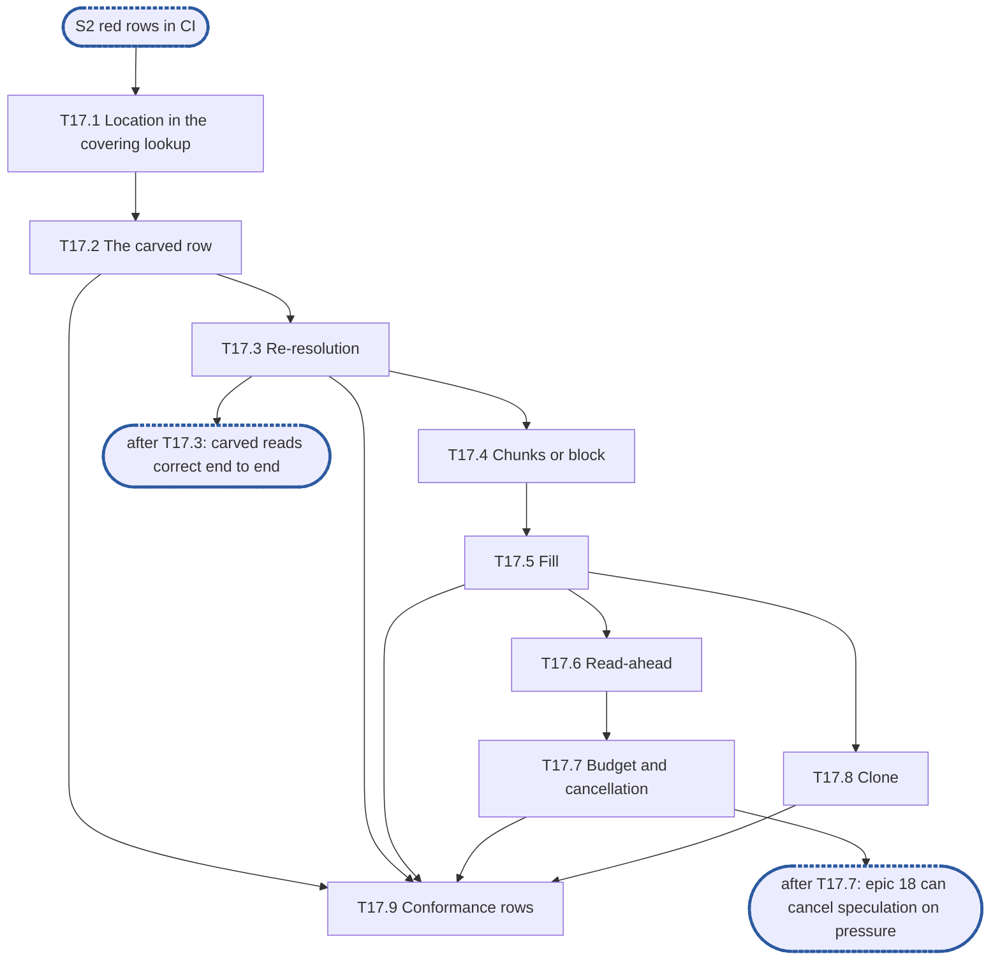

# Epic 17: engine offload remote reads, fill and speculation

**Sources:** [RFC 8](../docs/internals/rfcs/rfc-8-engine.md) §1.1 (cold-read isolation), §3.1
(`fill` and the speculator as a module), §3.3 (readahead frontiers are memory), §7.1 (the carved
row), §7.2, §7.3, §7.4 (read-ahead; pre-warm deferred), §7.5, §7.7, §7.8, §9.1 (adoption, the
copies narrowed to what no ref covers, the destination's fill refused, the missing-chunk backstop),
§11.2's remote-unavailable row for reads, §13's E9, E10, E14, E25 and E34, §14's read, fetch, fill,
speculation and re-resolution series and the `engine.fetch` span, and §15.1's and §15.2's rows
named under "Done when" below; [RFC 6](../docs/internals/rfcs/rfc-6-block-metadata.md) §8.1 (the
covering lookup, as this epic's pull request amends it to name a carved span's chunk location),
§2.2 and §2.5; [RFC 3](../docs/internals/rfcs/rfc-3-syncer.md) §1.3 (`Fetch`, `Prefetch`, the error
table, borrowed bytes), §4.1 to §4.5; [RFC 1](../docs/internals/rfcs/rfc-1-journal.md) §3.4
(`Fill`); [RFC 4](../docs/internals/rfcs/rfc-4-remote-tier.md) §4.1 (`Name`, `ChunkRange`,
`ErrNotFound`); [RFC 5](../docs/internals/rfcs/rfc-5-transforms.md) §2.7 (the material errors).
**Track:** C.
**Epic 17 estimate: 9 subtasks, 25 man-days.**
**Depends on:** sync point **S2, red rows in CI**: epic 12's rows and the fixture's component
options; **epic 11's frozen surface**: `Settings.FillLowWater`, `ShareSettings`' read-ahead caps and
speculation budget, the `Stats` fields `Fetches`, `FetchBytes`, `Fills`, `SpeculationBytes`,
`SpeculationUsedBytes`, `Reresolves`, and the recorded declarations `Handle.Fill` and the flow's
`Fetch` and `Prefetch`; **epic 16, partly**: a binding's flow opened at `Bind` (until it lands, this
epic's tests install a flow over RFC 4's in-memory store on the binding through `export_test.go`);
**S5's first half, partly**: RFC 3's syncer (`pkg/syncer/pool`) over RFC 4's in-memory store through
`codec.Store`, and RFC 5's material errors in the `pkg/transform` root (epic 15 admits that root into
the engine's import walk). The conformance rows also wait on epics 15 and 16 (the carver, chain and
syncer options made real) and on **S6** for the rows that evict through the real journal's
`Release`.
**Blocks:** epic 18, which calls T17.7's cancellation of queued speculation from `admit` and the
pacing path; epic 19, through track C's order only.

---

## 1. Goal

Epic 17 makes a read reach past the journal. A carved run is fetched through the share's flow,
chunk by chunk, each verified before a byte of it reaches the caller; an absent object is
re-resolved while its location moves; a cold read asks for chunks or for the whole block; the
fetched bytes may fill the journal beside the reply, never in its way; a sequential reader is read
ahead within its share's budget; and a clone adopts carved refs instead of copying what a ref
already holds.

**At the end of the epic:**

- a read of a carved extent returns its verified bytes in file order, fails as **Lost**, corrupt or
  unavailable distinguishably, and never answers from a chunk that did not verify;
- the first part's `ErrUnavailable` for a carved run, and its `decision:` in `read.go`, are gone;
- a get that finds its object absent re-runs the covering lookup while each answer names a new
  location, and fails as **Lost** when one repeats or a chunk has no record;
- a fill never delays or fails a read, and loses to any write that landed meanwhile;
- read-ahead never delays a demand read, never refuses a write, never fetches what the journal
  holds, and stays within the share's speculation budget;
- a clone copies only the source runs no ref covers at or above their version, and adopts the rest.

### 1.1 In scope

The covering lookup's chunk location (RFC 6 §8.1 as amended); the carved row of §7.1 with §7.2's
reply, §7.5's unavailable answer and the material errors; §7.7's re-resolution; §7.8's choice of
chunks or block; `fill`, the journal's `Fill` beside the reply, and the in-memory journal's `Fill`;
the speculator's read-ahead with its budget, windows and cancellations; §9.1's narrowed copies, the
destination fill exclusion and the missing-chunk backstop; the §14 series and span of these paths;
the fixture controls epic 12 proposed for these rows, made real.

### 1.2 Out of scope

- `PreWarm`, the speculator's pre-warm, `fill`'s rule 3 (a pre-warm asked to yield) and the
  pre-warm legs of §7.4's checks and of §15.1's "§9.1 no pre-clone fill": deferred, unowned until a
  pre-warm action is specified (the offload plan's §6.1 row on `PreWarm`).
- Posting capacity pressure from `admit` and the pacing path, and so cancelling speculation there:
  epic 18, which calls T17.7's entry point.
- Opening a binding's flow at `Bind` and closing it at `Drop`: epic 16.
- Relocating a chunk (RFC 6 §7.3): GC's, RFC 9 (the relocation leg of "§7.7 re-resolution" is §9's
  first open point).
- A read's span linking to a joined fetch's span (RFC 8 §14): the join happens inside the syncer,
  which reports none (§4, D9).
- Reading a carved chunk of an older namespace generation on another store: RFC 27, with the re-home
  (D4).
- The clone's admission, registration, journal step, phases and refusals: the first part's, kept.
- Turning green the rows that need a pass end to end or the real journal's `Release`: they turn
  green in whichever change lands last of this epic, S3 and S6 (T17.9).

### 1.3 Names used here

- **S2**, red rows in CI: the end of epic 12; epics 13, 15 and 17 start there.
- **S3**, a pass runs end to end: the end of epic 16, over S5's carver and syncer and S6's `Offload`.
- **S5**, offload components built: the RFC 2 to RFC 5 plans' implementation epics; its first half
  is the carver, RFC 3's syncer, RFC 4's in-memory store with `codec.Store` and RFC 5's chain.
- **S6**, journal offload half built: the journal plan's epics 9b and 7b (`Offload`, `Release`,
  `Unmark`, …).
- **§7.4 S1, S2, S3, S4, S5** are RFC 8 §7.4's five speculator rules, never synchronisation points; this
  document always writes them with the section ("§7.4 S3").
- **E9, E10, E14, E25, E34** are RFC 8 §13's invariants of those numbers, not epics.
- **The first part**: the journal-only engine, epics 1 to 10 of RFC 8's first plan, whose read and
  clone code this epic extends.
- **The integration epic**, epic 21: the node's content wiring composes offload.

## 2. How the general rules apply

The rules are those of [the offload plan's §1.5](rfc-8-offload-engine-plan.md#15-general-rules-for-each-epic),
cited by number and title and not copied.

| Rule | Subtasks | How |
| --- | --- | --- |
| rule 1, independent unit tests ([`CLAUDE.md`, "Writing tests"](../CLAUDE.md#writing-tests)) | all | tests run over the first part's in-memory journal and `kvstore` over the in-memory `kv.KV`, refs and blocks written through `kvstore`'s `Intend` and `Commit` and `codec.Store`'s put into RFC 4's in-memory store (kind 2, RFC 4's suite), fetched through RFC 3's real syncer, faults from RFC 4's fault wrapper (kind 3); no pass is needed and no engine-side double is written |
| rule 2, fuzz the key and ref decoders the queue's rebuild reads | none | no decoder: the chunk location arrives decoded by `kvstore`, and the block body is RFC 4's codec's |
| rule 3, observability follows RFC 25 | T17.2, T17.3, T17.4, T17.5, T17.7 | `engine_reads_total`'s `remote` class, `engine_fetches_total` by `shape`, `engine_fetch_bytes_total`, `engine_fills_total` by `result`, `engine_speculation_bytes_total`, `engine_speculation_used_bytes_total` and `engine_reresolves_total`, as `Stats` fields with no share label; the `engine.fetch` span |
| rule 4, profiling | T17.2, T17.5, T17.6 | every test runs under `prof.Watch`; the fill workers and the speculator's prefetch consumers are joined at `Close`, so a leak fails the run; the first part's allocation assertion on a read of held content stays green (no path here runs for held bytes) |
| rule 5, public interface and internals ([`CLAUDE.md`, "Verifying a change"](../CLAUDE.md#verifying-a-change)) | all | asserted at `Read`'s reply and error, which the filesystem service consumes; a fill at the journal's next `ReadAt`; a location at the engine's re-resolution, not at the store; `-race` on every concurrent leg |
| rule 6, known failures shrink | T17.9 | each row of §15.1 and §15.2 this epic owns leaves `known.yaml` in the change that turns it green, or has its `message:` rewritten in the change that moves its first failing check |
| rule 7, v2 ignores v1, and the engine imports only what RFC 0 §1.2 allows | T17.2 | the read path calls the flow through the `pkg/syncer` root and reads RFC 4's errors from the `pkg/remote` root and the material errors from the `pkg/transform` root, all contracts; tests may import `pkg/syncer/pool`, `pkg/remote/memory` and `pkg/remote/codec` |
| rule 8, real dependencies for properties of those dependencies | T17.1, T17.5, T17.9 | the location join is tested in `kvstore` over each backend RFC 6's suite runs; a fill's refusal against a write is the real journal's (`Fill`'s `asOf` check) in T17.9's rows, the in-memory journal's in the unit tests |
| rule 9, code comment conventions ([`CLAUDE.md`, "Code comments"](../CLAUDE.md#code-comments)) | T17.2, T17.4, T17.8 | `read.go`'s carved-run `decision:` deleted (T17.2); §7.8's quarter `decision:` at the choice (T17.4); §9.1's clone-copies `decision:` kept and reworded for the narrowed copies (T17.8); each §4 decision leaves the marker it names |
| rule 10, a test must be able to fail | all | each test names the break it catches; none asserts a stub's answer |
| rule 11, a symbol is exported only if the RFC's interface uses it | T17.1, T17.5, T17.8, T17.9 | the only exported additions are RFC 6's `Span.Chunk` and `Span.BlockSize`, `kvstore`'s `Content.WithLogger`, the in-memory journal's `Fill` and epic 12's proposed fixture controls; `fill` and the speculator are unexported |
| rule 12, each subtask creates only what it declares | all | `Handle.Fill` joins `Deps` with T17.5, its first caller; each fixture control lands with T17.9's rows; the per-file read state lands with T17.4, its first reader |

## 3. Requirements and invariants

Every obligation RFC 8, RFC 6, RFC 3 and RFC 1 place on this epic, numbered so subtasks and tests
can cite them. Rows of §15 the epic turns green are listed last.

**Resolution of a carved run**

| # | Requirement | Kind | Source | Subtasks |
| --- | --- | --- | --- | --- |
| R1 | The journal is asked before block metadata, and metadata only about what the journal does not hold, on the carved path too | MUST | RFC 8 §7.1 | T17.2 |
| R2 | The resolution is computed per request and never kept, fetched locations included | MUST NOT | RFC 8 §7.1, §3.3 | T17.2, T17.3 |
| R3 | Zeros are returned only for a hole or a zero ref, never for a carved run whose fetch failed | MUST NOT | RFC 8 §7.1, E9 | T17.2 |
| R4 | One fetch per missing extent, never one per window | invariant | RFC 8 §7.1 | T17.2 |
| R5 | A carved span names the chunk record its ref names, read in the same transaction in the namespace the ref's generation names, with its block's encoded size; a span whose record is gone names none | MUST | RFC 6 §8.1 (as amended here), §2.1, §2.2; RFC 8 §7.1 | T17.1 |
| R6 | The covering lookup still costs O(log *n* + results) with the locations joined | bound | RFC 6 §8.1 | T17.1 |
| R7 | A ref under an overwrite at or below `asOf` is never fetched: the run reads **Lost** | MUST NOT | RFC 8 §7.1, E9 | T17.2 |
| R8 | A **Remote** extent whose fetch cannot complete, the remote unreachable or the demand deadline expired, fails the read with an error distinct from **Lost** | MUST | RFC 8 §7.5, §11.2, E9 | T17.2 |
| R9 | A material unavailable fails the read as the remote being unavailable; a material destroyed makes the chunk **Lost**, never corrupt | MUST | RFC 3 §1.3; RFC 5 §2.7 | T17.2 |
| R10 | A chunk that fails verification fails the read as corrupt | invariant | RFC 8 §7.7, E9 | T17.2 |

**The reply**

| # | Requirement | Kind | Source | Subtasks |
| --- | --- | --- | --- | --- |
| R11 | `dst` is filled in file order, held bytes, zeros and remote chunks, and `dst[:n]` holds verified bytes only | MUST | RFC 8 §7.2 | T17.2 |
| R12 | No byte of a chunk is copied into `dst` before the whole chunk has verified | MUST NOT | RFC 8 §7.2, E10 | T17.2 |
| R13 | The reply is taken from the verified bytes the fetch returned, never by re-reading the journal after a fill | MUST NOT | RFC 8 §7.2 | T17.2, T17.5 |
| R14 | A read that fails part-way returns `n`, the bytes filled in file order before the first failing part, and the error | MUST | RFC 8 §7.2 | T17.2 |
| R15 | A whole-block fetch is verified the same way, each chunk as its last byte arrives, and only the read's chunks are copied | invariant | RFC 8 §7.2; RFC 3 §1.3 | T17.2, T17.4 |
| R16 | A fetched chunk's `Bytes` are copied out before the next iteration, since they are borrowed until then | MUST | RFC 3 §1.3 | T17.2, T17.5 |
| R17 | The fetches of one read run at once, so its latency is the slowest chunk's, not the sum | invariant | RFC 8 §7.2 | T17.2 |

**Re-resolution**

| # | Requirement | Kind | Source | Subtasks |
| --- | --- | --- | --- | --- |
| R18 | A get that finds its object absent runs the covering lookup for the extent again and acts on the new answer | MUST | RFC 8 §7.7, E14 | T17.3 |
| R19 | It keeps doing so while each answer names a different location, bounded by the read's deadline | MUST | RFC 8 §7.7, E14 | T17.3 |
| R20 | A new answer of a hole or past end of file is answered as such; an uncarved run of a file whose `applied` or whose run's overwrite version is above `asOf` asks the journal again | MUST | RFC 8 §7.7, §7.1 | T17.3 |
| R21 | The read fails as **Lost** when an answer names a location that already missed, or a chunk with no chunk record | MUST | RFC 8 §7.7, E14 | T17.3 |
| R22 | A verification failure, a transport error or a timeout never triggers re-resolution | MUST NOT | RFC 8 §7.7 | T17.3 |

**Chunks or the block**

| # | Requirement | Kind | Source | Subtasks |
| --- | --- | --- | --- | --- |
| R23 | A read asks for only its chunks when its missing bytes are at most a quarter of the block and it is not sequential (it neither starts at the block's beginning nor continues where the file's previous read ended); otherwise for the whole block | SHOULD | RFC 8 §7.8 | T17.4 |
| R24 | A fetch's ranges are whole chunks, each by its hash and recorded range | invariant | RFC 3 §1.3 | T17.4 |

**Fill**

| # | Requirement | Kind | Source | Subtasks |
| --- | --- | --- | --- | --- |
| R25 | `fill` decides per demanded extent: fill unless the journal's free capacity is below the fill low-water mark, or the read is part of a sequential scan longer than the read-ahead window | SHOULD | RFC 8 §7.3, §3.1 | T17.5 |
| R26 | `fill` takes plain inputs, does no I/O, holds no component, and calls no other policy function | MUST NOT | RFC 8 §3.1 | T17.5 |
| R27 | `Fill` is passed exactly the verified bytes fetched for that extent, with step 1's `asOf` and the ref's version | MUST | RFC 8 §7.2; RFC 1 §3.4 | T17.5 |
| R28 | A refused fill is not an error, and a fill never delays or fails the reply | MUST NOT | RFC 8 §7.2, E10; RFC 3 §4.2 | T17.5 |

**The speculator**

| # | Requirement | Kind | Source | Subtasks |
| --- | --- | --- | --- | --- |
| R29 | The speculator is an unexported struct: it takes each read's `(file, off, len, time)` and yields hints labelled speculation, and cancellations, to the flow's `Prefetch` | invariant | RFC 8 §7.4, §3.1 | T17.6 |
| R30 | §7.4 S1: every hint is issued through `Prefetch`, and the engine sets no other priority | MUST | RFC 8 §7.4, E25; RFC 3 §4.4 | T17.6 |
| R31 | §7.4 S2: speculative fills stop while free capacity is below the low-water mark, and queued hints are cancelled when a write meets capacity pressure | MUST | RFC 8 §7.4, E25 | T17.7 |
| R32 | §7.4 S3: speculative bytes in flight per share stay within its budget, and read-ahead of one reader within its window | MUST | RFC 8 §7.4 | T17.6, T17.7 |
| R33 | §7.4 S4: speculation is memory only; a frontier lost to a restart is relearnt from the next reads | MUST | RFC 8 §7.4, §3.3 | T17.6 |
| R34 | §7.4 S5: no speculative fetch for a block the journal holds whole; for a block held in part, only the missing chunks unless the whole block costs fewer round trips | MUST NOT | RFC 8 §7.4, §7.8, E25 | T17.6 |
| R35 | The window opens at one block on the first read that continues the last, doubles on each further one up to the smaller of `readahead.max_blocks` and `readahead.max_bytes`, and a read that does not continue resets it and cancels the file's queued hints | invariant | RFC 8 §7.4 | T17.6 |
| R36 | A cancelled or abandoned speculative fetch fails no read | MUST | RFC 3 §4.4, §4.5 | T17.7 |

**Clone**

| # | Requirement | Kind | Source | Subtasks |
| --- | --- | --- | --- | --- |
| R37 | A clone copies only the source runs the journal holds at `asOf` newer than any ref over them, or under no ref; carved refs are adopted by the metadata-only batches, and the clone never waits on the remote tier | MUST | RFC 8 §9.1, E34 | T17.8 |
| R38 | A source ref whose chunk record is gone, or names a deleted block, is carried into the destination as uncarved, reading **Lost**, counted and logged at `Error` | MUST | RFC 8 §9.1, E34; RFC 6 §6.6 | T17.8 |
| R39 | A fill of the destination extent, by a demand read or by speculation, whose fetch resolved before the clone's journal step never installs | MUST NOT | RFC 8 §9.1 | T17.8 |

**Isolation and observability**

| # | Requirement | Kind | Source | Subtasks |
| --- | --- | --- | --- | --- |
| R40 | No lock, queue or other serialisation point shared by more than one file or share is held across a fetch, a fill or a speculative hint | MUST NOT | RFC 8 §1.1 | T17.2, T17.5, T17.7 |
| R41 | `engine_reads_total` counts a read served from the remote under `remote`; `engine_fetches_total` by `shape` `chunks` or `block`; `engine_fetch_bytes_total`; `engine_fills_total` by `result` `done`, `declined` or `refused`; `engine_speculation_bytes_total` and `engine_speculation_used_bytes_total`; `engine_reresolves_total`; none share-labelled | MUST | RFC 8 §14 | T17.2, T17.3, T17.4, T17.5, T17.7 |
| R42 | A content call opens an `engine.fetch` child span per fetch it waits on, carrying the share, the file, the bytes and the outcome | MUST | RFC 8 §14 | T17.2 |
| R43 | A **Lost** or corrupt read logs the file and extent at `Error`, once per extent, on the remote path as on the journal's | MUST | RFC 8 §14 | T17.2, T17.3 |

**Module checks (unit tests, green with this epic)**

| # | Requirement | Kind | Source | Subtasks |
| --- | --- | --- | --- | --- |
| R44 | §7.4 S1: with the fetcher saturated by read-ahead for one file, a demand read of another stays within its unloaded bound | test row | RFC 8 §7.4 Checks | T17.6 |
| R45 | §7.4 S3: 10³ files read sequentially at once never take speculative bytes in flight past the share's budget | test row | RFC 8 §7.4 Checks | T17.7 |
| R46 | §7.4 S3, read-ahead window: the window opens only for a sequential replay, not a random or strided one, and a random read cancels queued hints | test row | RFC 8 §7.4 Checks | T17.6 |
| R47 | §7.4 S4, read-ahead half: after a restart during a read-ahead no speculative state was persisted and the window reopens from the next reads | test row | RFC 8 §7.4 Checks | T17.6 |
| R48 | §7.4 S5, read leg: a held file read sequentially twice costs the remote zero requests; with one block's extents released, exactly that block's chunks are fetched | test row | RFC 8 §7.4 Checks | T17.6 |

**Conformance rows this epic turns green**

| # | Requirement | Kind | Source | Subtasks |
| --- | --- | --- | --- | --- |
| R49 | "§7.1 stale ref", `TestRFC8A_StaleRef` | test row | RFC 8 §15.1; epic 12, T12.3 | T17.9 |
| R50 | "§7.1 the order", `TestRFC8A_TheOrderOfAReadsSteps`, and its swapped-steps build failing | test row | RFC 8 §15.1; epic 12, T12.3 | T17.9 |
| R51 | "§7.2 streaming, verified", `TestRFC8A_StreamingVerified` | test row | RFC 8 §15.1; epic 12, T12.3 | T17.9 |
| R52 | "§7.2 fill cannot fail a read", `TestRFC8A_FillCannotFailARead` | test row | RFC 8 §15.1; epic 12, T12.3 | T17.9 |
| R53 | "§7.2 fill loses to a write", `TestRFC8A_FillLosesToAWrite` | test row | RFC 8 §15.1; epic 12, T12.3 | T17.9 |
| R54 | "§7.7 re-resolution", `TestRFC8A_Reresolution`, but its relocation leg (§9) | test row | RFC 8 §15.1; epic 12, T12.3 | T17.9 |
| R55 | "§7.6 zero ref under an overwrite", `TestRFC8A_ZeroRefUnderAnOverwrite` | test row | RFC 8 §15.1; epic 12, T12.3 | T17.9 |
| R56 | "§9.1 clone keeps writes outside its extent", offload half, `TestRFC8A_CloneKeepsWritesOutsideItsExtentOffloaded` | test row | RFC 8 §15.1; epic 12, T12.3 | T17.9 |
| R57 | "§9.1 no pre-clone fill", the demand read's leg, `TestRFC8A_NoPreCloneFill` | test row | RFC 8 §15.1; epic 12, T12.3 | T17.9 |
| R58 | "§9.1 Lost source run carried", `TestRFC8A_LostSourceRunCarried` | test row | RFC 8 §15.1; epic 12, T12.3 | T17.9 |
| R59 | "§9.1 one source state", `TestRFC8A_OneSourceState` | test row | RFC 8 §15.1; epic 12, T12.3 | T17.9 |
| R60 | "§1.1 no cross-share slowdown", cold reads, `TestRFC8B_NoCrossShareSlowdownColdReads` | test row | RFC 8 §15.2; epic 12, T12.7 | T17.9 |

## 4. Decisions this epic takes

- **D1, the covering lookup names a carved span's location.** RFC 8 §7.1 resolves a carved ref's
  chunk and §7.7 has the reader "run the covering lookup again" while "each answer names a different
  location", but RFC 6 §8.1 returned the ref alone and no engine view read a chunk record. This
  epic's pull request amends RFC 6 §8.1 and its `Span`: a carved span carries the chunk record its
  ref names, read in the lookup's own transaction, and its block's encoded size (§7.8's quarter
  needs it). A second call for the location would let a relocation slip between the two reads, and
  would be a second method on the view for one question. The ref still names only its hash (RFC 6
  §2.5). Changing it later costs a field and the lookup's join, nothing persisted. Prior art: an
  extent tree resolving a logical address through an indirection table at lookup, as ZFS's
  dedup-table and Btrfs's extent-tree lookups do, rather than the reference carrying the physical
  address (from memory). No marker: RFC 6 states it.
- **D2, re-resolution is a pure function of the locations seen.** The loop of RFC 8 §7.7 keeps the
  locations that missed and calls `reresolve(missed []location, next span) step`, answering fetch,
  re-ask the journal, zeros, past end of file or **Lost**. The function is table-tested on its own
  (`CLAUDE.md`, "Put the logic in a function of its inputs"), so the "location moves twice" case is
  tested here even though nothing in v1.1 moves a chunk (§9's first point). Prior art: none found.
- **D3, the fill runs beside the reply, on a copy, bounded per journal.** Once a chunk's bytes are
  in `dst` the reply no longer needs the fetch, but `dst` is the caller's after `Read` returns, so a
  fill takes a copy of the extent's verified bytes and runs on one of a fixed number of fill
  workers per journal (four), and a fill finding them all busy is declined, counted as `declined`.
  A `decision:` at the hand-off says the bound declines fills under a burst of cold reads rather
  than holding memory for them, and is withdrawn if B4 shows declined fills costing re-fetches.
  Prior art: Linux's page cache inserts read pages asynchronously and drops readahead under memory
  pressure (from memory).
- **D4, one flow per share serves every carved read of the share.** A ref of an older namespace
  generation is fetched through the share's one flow, on the share's store. In v1.1 every
  generation of a share lives on one store, since only a re-home (RFC 27) moves a share between
  namespaces. A `decision:` at the fetch names the ceiling and RFC 27 as what withdraws it. Prior
  art: none found.
- **D5, per-file read state lives in the file's entry.** The end of the last read, the read-ahead
  window, the queued hints' cancel function and the speculatively filled extents not yet read are
  kept on the engine's per-file entry, under its lock, never across I/O, and go with the entry. That
  meets §1.1 (keyed by file) and §3.3 (memory). A `ponytail:` marker says a file whose entry is
  dropped between reads loses its window and relearns it; key it by open handle if a protocol
  workload shows windows reset mid-scan. Prior art: Linux keeps readahead state per open file
  (`struct file_ra_state`, from memory).
- **D6, §7.4 S5's held check reads the journal into a block-sized buffer.** The handle has no
  extents-only call (RFC 1 §3.7's `Extents` is not on it), so before a hint the speculator asks
  `ReadAt` for the block's extents of the file into a buffer of one block, reused per file. A
  `ponytail:` names the ceiling, one extra local read per hint, and the upgrade, `Extents` on the
  handle, the same one the first part's clone `ponytail:` names. Prior art: none found.
- **D7, `fill`'s third rule and pre-warm are not built.** They need a pre-warm, which is deferred
  with `PreWarm` (the offload plan's §6.1 row); the function takes no pre-warm input, and adding one
  later changes an unexported signature only. No marker: the ledger row records it.
- **D8, the missing-chunk backstop is logged by `kvstore`.** The batch that finds a source ref with
  no chunk record runs inside `kvstore`'s `Resume`, which the engine does not see into. `Content`
  gains `WithLogger`, as `Lifecycle` has, and the batch logs the destination file, the extent and a
  running count at `Error`. RFC 6 §10.2 names no series for it, so the count lives in the log line;
  a `decision:` at the log says so, withdrawn when RFC 6 names a series. Prior art: none found.
- **D9, a read joining a fetch does not link to its span.** RFC 8 §14 asks for the link, but the
  syncer joins fetches internally and its `Fetch` reports no join. Each read opens its own
  `engine.fetch` span; the link waits for RFC 3 to expose one (§9). A `decision:` at the span says
  so. Prior art: none found.
- **D10, pressure cancels through one entry point.** `(*speculator).cancelQueued()` cancels every
  queued hint of a journal's shares. This epic calls it from the first part's refusal path in
  `capacity.go`, the one place a write meets capacity pressure today; epic 18 adds the call from
  `admit` when it paces. Prior art: none found.
- **D11, used speculative bytes are counted at the next demand read.** A speculative fill records
  its extent on the file's entry (D5); a demand read answered from held bytes overlapping it adds
  the overlap to `engine_speculation_used_bytes_total` and forgets it. A `ponytail:` says an extent
  forgotten with its entry, or evicted unread, is never counted either way, and that a count read
  from the journal's eviction report would replace it if B4 needs the figure exact. Prior art: none
  found.

## 5. Target tree

On `feat/storage-v2`.

```text
pkg/metadata/entity/content.go      T17.1  Span.Chunk, Span.BlockSize
pkg/metadata/kvstore/covering.go    T17.1  the location join on carved spans
pkg/metadata/kvstore/clone.go       T17.8  the backstop's log; Content.WithLogger
pkg/engine/
  read.go                           T17.2  the carved row, the fetch per extent, the reply; T17.3 re-resolution; T17.4 chunks or the block
  reresolve.go                      T17.3  reresolve, the pure step
  fill.go                           T17.5  the fill workers, the hand-off beside the reply
  policy.go                         T17.5  fill (epic 15's file, or created here if this lands first)
  speculate.go                      T17.6  the speculator, windows, hints; T17.7 budget, cancellation, counters
  file.go                           T17.4  the per-file read state (D5)
  deps.go                           T17.5  Handle.Fill
  capacity.go                       T17.7  the refusal path's cancelQueued
  clone.go                          T17.8  copies narrowed to runs no ref covers
  types.go, health.go               T17.2 to T17.7  the Stats fields filled
pkg/engine/enginetest/
  fake.go                           T17.5  the in-memory journal's Fill
  offload.go                        T17.9  FailNextFill, HoldBetweenReadSteps, HoldNextRelease, Evict
test/engine/known.yaml              T17.9  entries removed or their messages rewritten
```

## 6. Subtasks

### T17.1 The covering lookup names a carved span's chunk location

**Subtask T17.1 estimate: 2 man-days.**

- **Track:** C. **Depends on:** S2.
- **Covers:** R5, R6.
- **Deliverables:** `entity.Span` gains, as RFC 6 §8.1 now says:
  ```go
  Chunk     Chunk // when Carved, but a zero ref: the chunk record Ref names; zero when the record is gone
  BlockSize int64 // when Chunk is set: its block's encoded size
  ```
  `kvstore`'s `covering` fills both for each carved span inside its one `View`: one point read of
  the chunk record per distinct chunk hash the results name, in the namespace `Ref.NSGen` names, and
  one of the block record per distinct block. `Allocation`, which returns a `Span` too, leaves both
  zero. Consumed by T17.2 (the fetch), T17.3 (the location compare) and T17.4 (the quarter).
- **Acceptance criteria:**
  - A carved span over a committed block names that block and the body's position and length the
    commit recorded; a zero ref's span names none; a span whose chunk record was deleted names none.
  - Two spans of one chunk cost one chunk read; the lookup's reads grow with results, not with the
    file's refs.
- **Tests:** in `kvstore`, over the memory KV, Badger under `t.TempDir()` and FoundationDB where it
  runs: a block committed with two chunks, a file's refs over both and a zero ref, its covering
  lookup asserting each span's location against the commit's `ChunkAt`s (catches a location read
  from the wrong namespace generation or position, R5); the same after the chunk record is deleted
  through the store's own prune, asserting no location (catches a stale or invented location, which
  would fetch a deleted block, R5); the store's existing read counter, counted by its own suite, over
  a file of 10⁴ refs reading a 4-ref extent, asserting the reads stay within a constant of the
  results (catches a scan of the file's refs or of chunk records, R6). No test double.
- **Rules:** rule 8: run over each backend RFC 6's suite names.

### T17.2 The carved row: fetch, verified reply, distinguishable failures

**Subtask T17.2 estimate: 5 man-days.**

- **Track:** C. **Depends on:** T17.1.
- **Covers:** R1 to R4, R7 to R17, R40 to R43.
- **Deliverables:** in `read.go`, `resCarved` fetches: each carved part of a missing extent is one
  `Fetch(ctx, name, want)` on the binding's `syncer.Flow`, `name` the span's block as RFC 4's
  `remote.Name`, `want` its chunks as `remote.ChunkRange`s from the span's location; the fetches of
  one read run at once, one goroutine per missing extent joined before `Read` returns; each yielded
  chunk is copied into `dst` at its file offsets (the ref's `Skip` and length) before the next
  iteration, and its bytes kept for T17.5; the first failing part sets `n` and the error.
  `ErrNotFound` hands the part to T17.3; `remote.ErrCorrupt` and `ErrMalformed` fail it as
  `vfserr.ErrCorrupt`; `ErrMaterialDestroyed` as `vfserr.ErrLost`; `ErrMaterialUnavailable`, every
  transient, throttled or denied error and the context's deadline as `vfserr.ErrUnavailable`. The
  `decision:` that a carved run fails unavailable is deleted (rule 9); D4's `decision:` at the
  fetch. `readClass` gains `classRemote`; `Stats.Fetches` and `FetchBytes` filled; an `engine.fetch`
  child span per fetch with share, file, bytes and outcome. Until epic 16 opens flows at `Bind`, an
  `export_test.go` setter installs a flow on a binding. A test helper, `carved(t, ...)`, writes a
  file's existence and refs through `kvstore`'s `Commit` and `Intend` and the block through
  `codec.Store`'s put into RFC 4's in-memory store, so the journal never held the bytes. Consumed by
  `Read`'s callers, T17.3 to T17.9.
- **Acceptance criteria:**
  - A cold read of a carved extent returns its bytes; a read spanning held, hole and carved parts
    returns each in file order.
  - With the fifth of eight chunks corrupt, `n` covers the first four exactly, `dst` past them holds
    no byte of the fifth, and the error is `ErrCorrupt`.
  - A stale ref under a committed overwrite reads **Lost** and no fetch is counted.
  - With the store unreachable, the read fails `ErrUnavailable`, never `ErrLost`; past the read's
    deadline likewise; a destroyed material reads `ErrLost`, an unavailable one `ErrUnavailable`.
- **Tests:** at `Read`, which the filesystem service calls, over the in-memory journal, `kvstore` and
  RFC 3's syncer over RFC 4's in-memory store: the mixed read (catches a part written out of order,
  or zeros for a carved part, R3, R11); the fifth-chunk corruption through RFC 4's fault wrapper,
  kind 3, asserting `n`, the untouched tail of `dst` and the error (catches a copy before
  verification or a wrong `n`, R12, R14); the stale ref with `Stats.Fetches` 0 (catches a fetch of a
  superseded chunk, R7); the unreachable store and the expired deadline (catch `Lost` reported for
  an outage, R8); the two material errors raised by RFC 5's in-memory `keys.Provider` (catch a
  destroyed material read as corrupt, R9); 32 chunks over two blocks with every get held by the
  fault wrapper until all 32 are in flight, released together (catches serial fetches, which never
  reach 32, R4, R17); a whole-block fetch whose chunks are copied into a second read's `dst` after
  the first's iteration has moved on (catches borrowed bytes kept, R16); a read of share A's cold
  file held at the fault wrapper while share B's cold read completes, a bounded wait as the
  assertion with a comment saying so (catches a lock or queue shared across shares, R40); the span
  through the fixture's `Trace` (R42); the loss log once per extent (R43); a `go test` build with
  the journal step and the metadata step swapped failing "§7.1 the order"'s unit leg (R1, done once
  as the verification, not kept). Rows' entries are T17.9's.
- **Rules:** rule 4: the per-extent goroutines are joined before `Read` returns, which `prof.Watch`
  checks; rule 7: imports through contracts only.

### T17.3 Re-resolution of an absent object

**Subtask T17.3 estimate: 2.5 man-days.**

- **Track:** C. **Depends on:** T17.2.
- **Covers:** R2, R18 to R22, R41, R43.
- **Deliverables:** `reresolve.go`: `reresolve(missed []location, next entity.Span, asOf
  entity.JournalVersion) step`, a pure function (D2) answering fetch, re-ask, zeros, past end of
  file or lost; `read.go`'s loop on `remote.ErrNotFound`: covering lookup again for the part, the
  step applied, the journal re-asked for an uncarved run above `asOf`, bounded by the read's
  deadline; no re-resolution on corrupt, transport or timeout errors. `Stats.Reresolves` filled.
  Consumed by T17.2's fetch path and T17.9's "§7.7 re-resolution" row.
- **Acceptance criteria:**
  - A location that misses twice reads **Lost**; one whose second answer differs is fetched there.
  - A truncate between resolution and get answers past end of file, not **Lost**.
  - A corrupt get never re-runs the lookup.
- **Tests:** `reresolve` by table: new location, repeated location, no chunk record, hole, past end
  of file, uncarved above `asOf` by `applied`, by overwrite version, and at or below both (each row
  catches one wrong step, R19 to R21). At `Read`: the block deleted from RFC 4's in-memory store
  with its chunk record kept, asserting **Lost** after exactly one re-resolution (catches an
  unbounded loop, R21); the file truncated in `kvstore` between the lookup and the get, held there by
  the fault wrapper, asserting a short read (catches **Lost** for a removal, R20); a corrupt chunk,
  asserting `Reresolves` 0 (catches re-resolution on corruption, R22); a fresh read after a
  re-resolution resolving anew (catches a remembered location, R2). No test double beyond the fault
  wrapper.

### T17.4 Chunks or the whole block

**Subtask T17.4 estimate: 1.5 man-days.**

- **Track:** C. **Depends on:** T17.3.
- **Covers:** R15, R23, R24, R41.
- **Deliverables:** the per-file read state on the file's entry (D5), its first field the end of the
  last read; `blockShape(missing, blockSize int64, startsBlock, continues bool) shape`, pure, with
  RFC 8 §7.8's quarter `decision:` at it; a whole-block fetch passes an empty `want` and copies only
  the read's chunks. `Stats.Fetches` by shape. Consumed by T17.2's fetch and T17.6, which reads the
  same state.
- **Acceptance criteria:**
  - A 4 KiB random read of a 4 MiB block asks for its chunk; a read starting the block, or
    continuing the last, asks for the block; a read missing more than a quarter asks for the block.
- **Tests:** `blockShape` by table at the quarter's edge, one byte either side (catches an
  off-by-one or a swapped condition, R23); at `Read`, the shape counters for a random and a
  sequential pair of reads (catches the state not updated, R23); a whole-block fetch whose `dst`
  holds only the read's bytes (catches neighbouring chunks copied, R15); `want` ranges equal to the
  span locations' (catches a range splitting a chunk, R24).

### T17.5 Fill beside the reply

**Subtask T17.5 estimate: 3 man-days.**

- **Track:** C. **Depends on:** T17.4.
- **Covers:** R13, R16, R25 to R28, R40, R41.
- **Deliverables:** `fill(r readInfo, s journalStats) bool` in `policy.go`, pure (R26), rules 1 and
  2 (D7), the low-water mark from `Settings.FillLowWater` and the window from the per-file state;
  `Handle.Fill` joins `Deps`, its first caller here; `fill.go`'s workers per journal (D3), handed a
  copy of each demanded extent's verified bytes with step 1's `asOf` and the ref's `Newest`; a
  `journal.ErrStaleFill` or a capacity refusal counted `refused`, never returned; `Stats.Fills` by
  result. The in-memory journal (`enginetest/fake.go`) gains `Fill`, held to the journal
  conformance suite's `Fill` rows. D3's `decision:`. Consumed by `Read` and T17.6's speculative
  fills.
- **Acceptance criteria:**
  - A cold read with `Fill` failing returns the fetched bytes and no error.
  - A write landing between the fetch and its fill survives: the next read returns the write.
  - A fill makes the next read of the extent local (`Stats.Fetches` unchanged by it).
  - Below the low-water mark, or in a sequential scan past the window, the fill is `declined`.
- **Tests:** `fill` by table over free capacity at and either side of the mark and scan lengths
  either side of the window (each row catches one inverted rule, R25); at `Read`: `Fill` failing
  through the fixture's journal fault (kind 3), asserting the bytes and no error (catches a reply
  that waits on or fails with the fill, R28); a fill held at its worker while the extent is written,
  then released, asserting the write reads back and the fill counted `refused` (catches a fill that
  overwrites, R27, R28); a second read after a done fill with `Fetches` unchanged (catches a fill of
  the wrong extent or version, R27); a reply whose bytes are asserted before the fill worker is
  released (catches a reply answered by re-reading the journal, R13); every worker held and a fifth
  fill declined (catches an unbounded hand-off, D3); the in-memory journal's `Fill` through the
  journal suite's rows (kind 2).
- **Rules:** rule 4: the workers stop at `Close`, joined.

### T17.6 Read-ahead windows and hints

**Subtask T17.6 estimate: 3 man-days.**

- **Track:** C. **Depends on:** T17.5.
- **Covers:** R29, R30, R32 to R35, R44, R46 to R48.
- **Deliverables:** `speculate.go`: the unexported `speculator`, one per engine, its state per file
  (D5): each read's `(file, off, len, time)` updates the window as R35 says; each hint is a
  `(file, block)` resolved through the covering lookup, checked against the journal (D6), and issued
  as `Prefetch(ctx, name, want)` with `want` empty or the missing chunks by T17.4's rule; its stream
  is consumed by a bounded set of consumers that hand each chunk to `fill`; a read that does not
  continue cancels the file's queued hints. D5's and D6's `ponytail:`s. Consumed by `Read`, and by
  T17.7.
- **Acceptance criteria:**
  - The window follows R35's example step by step.
  - A held file read sequentially twice issues no prefetch; with one block's extents released, only
    that block's missing chunks are prefetched.
  - After a restart the window starts at zero and reopens on the second continuing read.
- **Tests:** RFC 8 §7.4's checks, `unit`, over RFC 3's syncer and RFC 4's in-memory store: §7.4 S3's
  window row, a sequential, a random and a strided replay with the hints asserted per read (catches
  a window opened for a stride or not reset, R35, R46); §7.4 S5's read leg, with `Stats` fetch and
  speculation counters 0 then exactly one block's chunks (catches whole-block refetch of a held
  file, R34, R48); §7.4 S4's read-ahead half, the engine closed and reopened over the same journal
  and store, asserting nothing speculative was written to `kvstore` (its key count unchanged) and
  the window reopens (R33, R47); §7.4 S1, the syncer's fetch workers filled with one file's
  read-ahead while a demand read of another runs, its latency within a bound measured unloaded in
  the same test, a bounded wait as the assertion (catches a hint issued through `Fetch`, R30, R44).
  The first two use the injected clock for `time`.

### T17.7 Speculation budget, cancellation and its counters

**Subtask T17.7 estimate: 2.5 man-days.**

- **Track:** C. **Depends on:** T17.6.
- **Covers:** R31, R32, R36, R40, R41, R45.
- **Deliverables:** a per-share atomic of speculative bytes in flight, a hint issued only while it
  fits `ShareSettings.SpeculationBudget`, released as the stream ends; speculative fills skipped
  below the low-water mark; `cancelQueued()` (D10), called from `capacity.go`'s refusal path;
  `Stats.SpeculationBytes` and `SpeculationUsedBytes` (D11, its `ponytail:`). Consumed by epic 18,
  which calls `cancelQueued` from `admit`.
- **Acceptance criteria:**
  - Speculative bytes in flight for a share never exceed its budget.
  - A write refused for capacity cancels every queued hint of its journal's shares, and no read
    fails for it.
  - A speculatively filled extent read later counts its bytes as used.
- **Tests:** §7.4 S3's budget row, 10³ files read sequentially at once with the per-share in-flight
  figure sampled at every hint through an `export_test.go` hook, asserting it never passes the
  budget (catches a check after the issue, R32, R45); a refusal through the first part's capacity
  fixture while hints are queued at the fault wrapper, asserting each cancelled and every concurrent
  read answered (catches cancellation that fails a read or misses a share, R31, R36); free capacity
  below the mark with a hint's chunks arriving, asserting no fill (R31); a used-bytes count after a
  demand read of a speculated extent (R41); two shares' speculation running with one share's
  prefetches held, the other's hints still issued (catches a lock shared across shares, R40).

### T17.8 Clone: narrowed copies, the backstop, the destination's fill

**Subtask T17.8 estimate: 2.5 man-days.**

- **Track:** C. **Depends on:** T17.5.
- **Covers:** R37 to R39.
- **Deliverables:** in `clone.go`, `size` keeps a held run only where no carved ref over it, from the
  source's covering lookup at `asOf`, has `Newest` at or above the run's version, so `copyRuns`
  copies only those and the adoption takes the rest; §9.1's clone-copies `decision:` reworded to
  say so. In `kvstore`, `Content.WithLogger(log *slog.Logger) Content` and the clone batch's log of
  each source ref it carries as **Lost** with a running count (D8's `decision:`); the fixture passes
  its logger. Consumed by the first part's clone path and T17.9's clone rows; `WithLogger` by the
  integration epic.
- **Acceptance criteria:**
  - Cloning a source held whole and offloaded whole copies nothing and reads the source's bytes
    from the adopted refs; one held newer than its ref copies exactly that run.
  - A source ref whose chunk record is gone reads **Lost** in the destination and logs once at
    `Error`.
  - A demand read's fill of the destination, held across the clone's journal step and released,
    installs nothing, and the extent reads the source's bytes.
- **Tests:** at `Clone` and the destination's `Read`, over the in-memory journal and `kvstore`: the
  two copy cases, asserting the reservation's byte count (catches every held run still copied, or
  a newer run adopted from a stale ref, R37); the chunk record deleted before phase 2, asserting
  **Lost** and the captured log line (catches a zeroed run or a silent carry, R38); the held fill,
  with `Stats.Fills` counting it `refused` (catches a fill installed over the removal, R39). The
  remote unavailable throughout the first case, asserting the clone completes (catches a clone that
  fetches, R37).

### T17.9 The conformance rows

**Subtask T17.9 estimate: 3 man-days.**

- **Track:** C. **Depends on:** T17.2, T17.3, T17.5, T17.7, T17.8.
- **Covers:** R49 to R60.
- **Deliverables:** epic 12's proposed controls made real in `enginetest/offload.go`:
  `FailNextFill(err error)` at the journal's `Fill`; `HoldBetweenReadSteps() (entered <-chan
  struct{}, release func())`, a hook between `ReadAt` and the covering lookup set per instance;
  `HoldNextRelease() (entered <-chan struct{}, release func())` on a clone's `CloneHold.Release`;
  `Evict(id entity.FileID)` through the real journal's `Release`, refused by the journal until S6.
  `Relocate` stays refused by name (§9). Every row of R49 to R60 runs past its controls; each that
  passes leaves `test/engine/known.yaml`, and each still red has its `message:` rewritten to the
  check it now meets: the carver's refusal until epic 15, the syncer's until epic 16, `Evict`'s
  until S6 (rule 6).
- **Acceptance criteria:**
  - No row's entry names a check the row no longer meets first.
  - Each row that turns green here was seen failing on its own assertion with this epic's change to
    its path reverted, as epic 12's §9 asks.
- **Tests:** the twelve rows, in `engine-conformance`. Doubles: RFC 4's in-memory store, kind 2,
  under its fault wrapper, kind 3; the fixture's fault `kv.KV`, kind 3. "§7.1 the order" is also run
  once over a build with the two steps swapped, which must fail it (R50).
- **Rules:** rule 6, the entries; rule 8, the rows run over the real journal on a real directory.

## 7. Order of work



Checkpoint after T17.3: a carved read is correct, whatever it fetches. Checkpoint after T17.7: the
entry point epic 18 calls exists. T17.8 needs only T17.5 and can run beside T17.6 and T17.7.

## 8. Suggested pull requests

| PR | Subtasks | Man-days | After | Why together |
| --- | --- | --- | --- | --- |
| 1 | T17.1, T17.2, T17.3 | 9.5 | — | carved reads end to end: the location, the fetch and its failures, re-resolution |
| 2 | T17.4, T17.5, T17.6, T17.7 | 10 | PR 1 | what a read fetches and keeps: the shape, the fill and the speculator, which reads both |
| 3 | T17.8, T17.9 | 5.5 | PR 2 | the clone's adoption and the rows that check the whole epic |

A suggestion only: one pull request per subtask works as well. PR 3's T17.8 may open beside PR 2
once T17.5 is in.

## 9. Open points

- **The relocation leg of "§7.7 re-resolution" (pending the user's answer).** The row relocates a
  chunk twice between resolution and get, but nothing in the repository moves a chunk while its
  refs are live: RFC 6 §7.3's relocation is GC's (RFC 9), and `kvstore` has no `Relocate`. Written
  in place (recommended): D2 tests the rule as a pure function, the row's relocation leg becomes a
  subtest of its own whose `known.yaml` entry waits on RFC 9's relocation, and a row is added to the
  offload plan's §6.1 ledger in this pull request before it leaves draft. The other option builds
  `kvstore`'s `Blocks.Relocate` here, as RFC 6 §7.3 specifies it with its checks, as a T17.10 of
  about 3 man-days, ahead of GC; it lands a GC mechanism with a test as its only caller.
- **Rows that need the real journal's `Release`** ("§7.1 the order", "§7.2 streaming, verified",
  the fill rows, "§9.1 no pre-clone fill", the cold-read row) stay red after this epic until S6;
  whichever of this epic and the journal plan's epic 9b lands second removes their entries.
- **A read's span linking to a joined fetch** (D9) needs RFC 3 to report a join from `Fetch`; this
  epic proposes nothing to RFC 3, and the link stays unbuilt until it does.
- **The fill workers' count** (four per journal, D3) is a guess; B4 in epic 22 measures declined
  fills and re-fetches.
