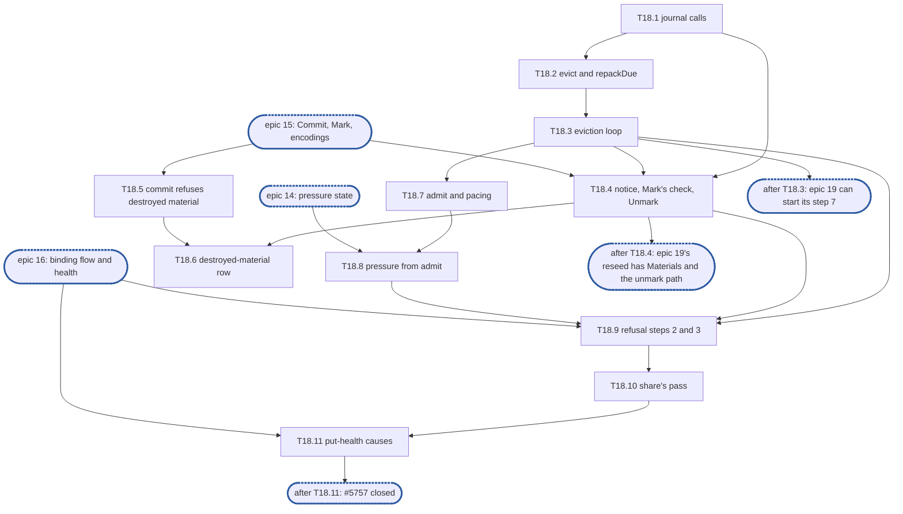

# Epic 18: engine offload local space

**Sources:** [RFC 8](../docs/internals/rfcs/rfc-8-engine.md) §3.1 (`evict`, `repackDue`, `admit`),
§3.2 and §3.3 (the policy functions' limits), §10 (local space whole), §10.1 (eviction), §10.2
(steps 2 and 3, in the refusal's caller and in the share's pass; the put-health causes of the
table's first two rows and the index-bound row's put-health half), §10.2.1 (pacing), §10.3 (the
loop's repack), §10.4 (destroyed material, but the reseed's half), §2.5 start step 7 and stop step 3
(the eviction loop's start and join), §6.1 (posting `Pressure`, and the "pressure band", "lost
events" and "growth" checks' capacity legs), §11.2's "Journal at capacity" row, §13 E3, E11 and
E33, §14 (the local-space series and the `engine.pace` span), §15.1's "§10.2 retry later", "§2.5
clone resumed at a full limit" (its remote half) and "§10.4 destroyed material" (but its crash
leg), §15.2's "§10 occupancy triggers eviction", "§10.2 refusal loop", "§10.2 one pass per
share", "§10.3 repack reserve" and "§10.2.1 pacing law";
[RFC 6](../docs/internals/rfcs/rfc-6-block-metadata.md) §5.4 (the key-record row of the reads
that gate a commit); [RFC 5](../docs/internals/rfcs/rfc-5-transforms.md) §2.7 and Appendix B.2
(destroyed material and the master key's marking); [RFC 1](../docs/internals/rfcs/rfc-1-journal.md)
§3.5 (`Release`), §3.7 and §4.4 (the figures and the per-segment accounting eviction reads);
[RFC 3](../docs/internals/rfcs/rfc-3-syncer.md) §2.8 (a direction's cause);
[RFC 13](../docs/internals/rfcs/rfc-13-configuration.md) Appendix B, the eviction occupancy
target and `eviction.repack_threshold`; [RFC 14](../docs/internals/rfcs/rfc-14-open-state.md) §9.3
and §12's L9; [RFC 17](../docs/internals/rfcs/rfc-17-vfs.md) §6's V20, its offload half.
**Track:** B.
**Epic 18 estimate: 11 subtasks, 28.5 man-days.**
**Depends on:**
- epic 11's frozen surface: `Settings.EvictionTarget` and `RepackThreshold`, and the `Stats` fields
  `EvictedBytes` and `PacingSeconds` this epic fills;
- epic 12's red rows this epic turns green and its proposed fixture controls this epic makes real
  (`MeasuredDrain`, and `DestroyDataKey`, `DestroyMasterKey`, `MarkRecordDestroyed`,
  `DestroyCurrent`, `HoldBetweenPinAndCommit`, `HoldBetweenCommitAndMark`), at S2;
- epic 14's T14.4, the journal's pressure state, which `admit` and step 3 set;
- epic 15's pipeline: the offload commit transaction (T15.4) that T18.5 adds its key-record reads
  to, with their slot already counted in the floor (T15.2), the block record's `encodings` (T15.3),
  and Mark (T15.9), whose report T18.4 puts under the destroyed-material lock;
- epic 16's binding flow and its `Health(Put)` read into the binding (T18.9, T18.11), and the gates'
  switch (T18.3's eager mode);
- sync point **S5**'s RFC 5 half: `keys.DestroyedNotice` on `keystest`'s in-memory provider, and the
  key-record view with its `kvstore` implementation, whose state is a byte `kvstore` reads without
  the provider (the RFC 5 plan's epics 6 and 8);
- sync point **S6**, the journal plan's epic 9b: `Release` and `Unmark` on the real journal. Until it
  lands the in-memory journal carries both (T18.1) and every row over the real journal stays red at
  their `ErrNotImplemented`.
**Blocks:** epic 19, whose start step 7 starts this eviction loop (T18.3) and whose reseed reads
`Content.Materials` and unmarks through the same path (T18.4), and adds the reseed's gate on
eviction to the loop; epic 21, which wires `Deps.Destroyed` from the node's key provider (T18.4);
epic 22, which burns the rows down over the real journal once S6 lands.

---

## 1. Goal

Epic 18 makes local space work now that offload drains dirty bytes: an eviction loop frees clean,
offloaded content by segment, writes are paced before the limit, the refusal table frees space
through eviction and pressure before it syncs, and a store's put-health cause decides between a
retry and no space. Destroyed transform material is handled on both sides of the commit: the commit
refuses under it, and an extent committed before it is made dirty again.

**At the end of the epic:**

- each journal runs one eviction loop, started at start step 7 and joined at stop step 3, that
  evicts offloaded extents by segment once allocated occupancy passes the target, repacks what it
  evicted from, and requests a repack when unreclaimed bytes pass their threshold;
- the refusal path of the journal's own capacity, and the share's pass for a share limit, evict and
  repack, then turn pressure on and evict what offload frees, before the first part's sync;
- the refusal table answers dirty bytes behind a put-healthy store, and a store unhealthy with
  `ErrTransient`, as `ErrDelay`, and a store denying puts for quota, access or size as `ErrNoSpace`
  at once; #5757's four rows are green and its pull request closes #5757;
- every write is paced by RFC 8 §10.2.1's law and the journal's pressure follows its band;
- an offload commit refuses a block whose `encodings` name a key record marked destroyed; the
  destroyed-material notice unmarks every held extent a destroyed material's blocks cover, and Mark
  never marks after a destroy it has been told of.

### 1.1 In scope

`evict`, `repackDue` and `admit`; the journal calls eviction makes (`Release`, `Unmark`, the
inspection) and the in-memory journal's copies of them; the eviction loop; steps 2 and 3 of the
refusal table in both places; the put-health causes; pacing and the pressure band; the
destroyed-material notice, Mark's check and the commit's key-record read in `kvstore`; the reads of
a file's materials in `kvstore`; the local-space series and span; the rows listed in the sources.

### 1.2 Out of scope

- The reseed: its clear of every extent whose block's `encodings` name a destroyed key record, its
  gate on offer and eviction, its crash leg of "§10.4 destroyed material"
  (`TestRFC8A_DestroyedMaterialCrashBeforeUnmark`), and start step 7's start of the reseed: epic 19,
  which calls this epic's loop start and `Content.Materials`.
- The Intent refusal under destroyed current material, the leg "no replacement material" of "§10.4
  destroyed material" asserts: epic 15 (T15.8); this epic's row asserts it.
- A remote-only chunk under destroyed material reading **Lost**: epic 17, whose read path tells the
  errors apart; this epic's row asserts it.
- Cancelling speculation on pressure: epic 17.
- The put-unhealthy pause of a store's shards, reading the flow's health into the binding, the gates'
  switch and the rerun of every Group A row under it, and the "pressure band" check's put-unhealthy
  leg: epic 16.
- `material_destroyed` as an engine condition, with its `data_loss`: epic 20.
- Passing the node's key provider as `Deps.Destroyed`: epic 21.
- `Release` and `Unmark` on the real journal: the journal plan's epic 9b (S6).
- An eviction loop woken by occupancy crossing its target rather than a fixed tick: unowned,
  deferred in the offload plan's ledger ("An eviction loop woken by the journal's occupancy").
- Detecting bucket-setting drift, which `evict`'s trust in the offloaded bit depends on: RFC 9,
  deferred in the offload plan's ledger ("Detecting bucket-setting drift").
- Per-share budget values for capacity and pacing: RFC 24, deferred in the offload plan's ledger
  ("Per-share budget values").
- Fuzz or model targets for the pacing law: unowned, deferred in the offload plan's ledger ("Fuzz
  or model targets for the queue's keys and the pacing law"); T18.7 checks it by a table.

### 1.3 Names used here

- **S2**, red rows in CI: the end of epic 12, whose rows this epic turns green.
- **S5**, offload components built: the RFC 2 to RFC 5 plans' implementation epics; here, RFC 5's
  notice and key-record view.
- **S6**, journal offload half built: the journal plan's epics 9b and 7b; here, 9b's `Release` and
  `Unmark`.
- **E3**, **E11**, **E33**: RFC 8 §13's invariants of those numbers, not epics.
- **The first part**: the journal-only engine, epics 1 to 10 of RFC 8's first plan, whose refusal
  path (`capacity.go`, `repack.go`) and in-memory journal this epic extends.
- **The fixture**: `pkg/engine/enginetest`, the first part's engine fixture with epic 12's controls.

## 2. How the general rules apply

The rules are those of [the offload plan's §1.5](rfc-8-offload-engine-plan.md#15-general-rules-for-each-epic),
cited by number and title and not copied.

| Rule | Subtasks | How |
| --- | --- | --- |
| rule 1, independent unit tests ([`CLAUDE.md`, "Writing tests"](../CLAUDE.md#writing-tests)) | all | over the first part's in-memory journal with its segment model, held to the journal's suite rows for every call it gains (T18.1), `kvstore` over the in-memory `kv.KV`, RFC 5's chain over `keystest`'s in-memory provider with its notice, and the real carver and syncer through the fixture from epic 15 and 16; the injected clock for every tick and wait |
| rule 2, fuzz the key and ref decoders the queue's rebuild reads | none | no new decoder: the key record's state byte is RFC 5 epic 6's, read through its codec, and the block record's `encodings` decoder is epic 15's target |
| rule 3, observability follows RFC 25 | T18.3, T18.7, T18.9 | `EvictedBytes` (`engine_evicted_bytes_total`), `PacingSeconds` (`engine_pacing_seconds`) and the first part's refusal counter, none labelled by share per operation; the `engine.pace` child span; `journal_full` kept as the first part raises it |
| rule 4, profiling | T18.3, T18.4, T18.7 | tests under the fixture's `prof.Watch`, which fails a loop or a notice poll left running after `Close`; `admit` reads no `Stats()` per write (D3), and no allocation gate, since neither of the rule's two hot paths is touched |
| rule 5, public interface and internals ([`CLAUDE.md`, "Verifying a change"](../CLAUDE.md#verifying-a-change)) | all | each rule asserted where its value is consumed: an eviction at the journal's held bytes and a later read, a cause at the refusal's answer to the writer, a pacing delay at the write's return on the test clock, a destroyed material at the offloaded bit `Release` reads and at the block record a read finds absent |
| rule 6, known failures shrink | T18.3, T18.6, T18.7, T18.9, T18.11 | each row's entry leaves `test/engine/known.yaml` in the change that turns it green; a row still red over the real journal until S6 has its `message:` rewritten to the `ErrNotImplemented` it then meets |
| rule 7, v2 ignores v1, and the engine imports only what RFC 0 §1.2 allows | T18.4 | `Deps.Destroyed` is `keys.DestroyedNotice`, the `pkg/transform/keys` contract epic 15 admits; `kvstore` imports nothing of `pkg/transform` (D11); no new import otherwise |
| rule 8, real dependencies for properties of those dependencies | T18.5, T18.6 | the commit's conflict with a destroy runs on `kvstore` over Badger, and FoundationDB where it runs, beside the in-memory `kv.KV`; rows over the real journal on a real directory |
| rule 9, code comment conventions ([`CLAUDE.md`, "Code comments"](../CLAUDE.md#code-comments)) | T18.3, T18.5, T18.7, T18.9, T18.11 | RFC 8 §10's concurrent-refusal `ponytail:` at the refusal path (T18.9), §10.1's eviction `ponytail:` at `evict` (T18.2), §10.2.1's fixed-constants `decision:` at the law (T18.7), §10.4's undeclared-loss `decision:` at the commit's read (T18.5), §10.2's two-rows `decision:` kept at the table (T18.11); the loop's fixed-tick `ponytail:` (T18.3); the first part's repack-at-refusal `ponytail:` (T18.9) and dirty-bytes `decision:` (T18.11) deleted; each §4 decision's marker |
| rule 10, a test must be able to fail | all | each test names the break it catches |
| rule 11, a symbol is exported only if the RFC's interface uses it | T18.1, T18.4, T18.5 | the one exported engine addition is `Deps.Destroyed` with the declared journal calls and `Inspector`; `kvstore` exports `Content.Materials` and `ErrMaterialDestroyed` for the engine; the policy functions, the loop and the lock are unexported |
| rule 12, each subtask creates only what it declares | all | `Release`, `Unmark` and `Inspect` join the declared journal with their first callers (T18.3, T18.4); `Content.Materials` with the notice (T18.4); no state the reseed needs is built ahead of epic 19 |

## 3. Requirements and invariants

Every obligation the sources place on this epic, numbered so subtasks and tests can cite them.

**The policy functions**

| # | Requirement | Kind | Source | Subtasks |
| --- | --- | --- | --- | --- |
| R1 | `evict`, `repackDue` and `admit` take plain inputs and return a decision; none does I/O, holds a reference to a component or calls a mechanism, so each is table-tested on its own | MUST NOT | RFC 8 §3.1 | T18.2, T18.7 |
| R2 | They are not folded into one policy evaluator and none calls another; where one decision needs another's output, the engine passes it in | MUST NOT | RFC 8 §3.1 | T18.2, T18.7 |
| R3 | The policy state this epic adds lives in memory; a restart may lose all of it and the engine behaves correctly from an empty state | MUST | RFC 8 §3.3 | T18.3, T18.4, T18.7 |
| R4 | No policy gate is the only thing standing between the system and data loss: with eviction as eager as possible the Group A checks still pass, since `Release` refuses an extent whose offloaded bit is unset | MUST NOT | RFC 8 §3.2, §13 E3; §15.1 "§3.2 no gate is safety" | T18.3 |

**Eviction**

| # | Requirement | Kind | Source | Subtasks |
| --- | --- | --- | --- | --- |
| R5 | Eviction is triggered by allocated occupancy, the journal's `UsedBytes`, against the journal's maximum and each share's limit, never by dirty plus unreclaimed bytes alone | invariant | RFC 8 §10, §13 E33; RFC 1 §3.7 | T18.2, T18.3 |
| R6 | `evict` selects by segment, the segments whose held bytes are oldest and fewest evicted together, and within that oldest first, until allocated occupancy falls below a target under the maximum | invariant | RFC 8 §10.1; RFC 13 Appendix B (the eviction occupancy target) | T18.2 |
| R7 | An extent's age is the latest of its write, its fill and its last repack copy; nothing records a read that hits held content | invariant | RFC 8 §10.1 | T18.2 |
| R8 | Only the offloaded bit decides whether an extent may be evicted: a Dirty or Offered extent never is, and journal durability never decides | invariant | RFC 8 §10, §13 E11 | T18.2, T18.3 |
| R9 | Eviction writes nothing to metadata | invariant | RFC 8 §10.1 | T18.3 |
| R10 | Each journal runs one eviction loop, started at start step 7, which calls `evict` and `repackDue` and runs the journal's `Release` and `Repack` itself; eviction and repack are not work-queue work | MUST | RFC 8 §10, §2.5 step 7, §6.1 | T18.3 |
| R11 | `Close` cancels the eviction loop and joins it at stop step 3; a join past its bound leaves what the loop depends on open and reports the failure | MUST | RFC 8 §2.5 stop steps 3 and 5 | T18.3 |
| R12 | Locks, deny modes, delegations, open handles and snapshots never make an extent ineligible for eviction or reclamation | MUST NOT | RFC 8 §10.4; RFC 14 §9.3, §12 (L9) | T18.3 |
| R13 | `Release` is called only on content whose offload commit has itself committed | MUST NOT | RFC 1 §3.5 | T18.3 |
| R14 | Every capacity measure reads `UnreclaimedBytes` and `DirtyBytes`, never a release's result, since `Release` frees nothing itself | invariant | RFC 8 §10.3; RFC 1 §3.5 | T18.3, T18.7, T18.9 |
| R15 | Neither the loop nor a refusal takes the queue's keys: a refusal racing the loop costs copy work, never correctness | invariant | RFC 8 §10 | T18.3, T18.9 |

**Repack**

| # | Requirement | Kind | Source | Subtasks |
| --- | --- | --- | --- | --- |
| R16 | `repackDue` requests a repack when `UnreclaimedBytes` pass the `eviction.repack_threshold` fraction of the journal's capacity, run through the journal's `Repack(budget, scope)`; it requests one when the journal is at capacity | MUST | RFC 8 §10.3; RFC 13 Appendix B | T18.2, T18.3 |
| R17 | The scope aims a pass: eviction repacks exactly the segments it just evicted from, a share at its limit the segments holding its records, and an unscoped pass lets the journal choose | invariant | RFC 8 §10.2 step 2, §10.3, §13 E33 | T18.3, T18.9, T18.10 |
| R18 | Repack draws on the journal's repack reserve, outside every share's limit, so a share at its limit never blocks the repack that frees space for every share: repack of another share's released segments proceeds and frees space for a third share | test row | RFC 8 §10.3; §15.2 "§10.3 repack reserve" | T18.3 |

**The refusal table**

| # | Requirement | Kind | Source | Subtasks |
| --- | --- | --- | --- | --- |
| R19 | Step 2: evict offloaded extents by segment, repack exactly those segments, then retry | MUST | RFC 8 §10.2 | T18.9, T18.10 |
| R20 | Step 3: if what is held is dirty and the remote is put-healthy, turn the journal's pressure on if it is not already, so it is offloaded at once, then evict and repack what that made offloaded, and retry | MUST | RFC 8 §10.2, §6.1 | T18.9, T18.10 |
| R21 | For the journal's own capacity steps 2 and 3 run in the refusal's caller, under its deadline; for a share's limit they run inside the share's pass, under the engine's lifetime, before its sync, with the pass's join rule and bounded wait unchanged | MUST | RFC 8 §10, §10.2 | T18.9, T18.10 |
| R22 | The cause of a put-unhealthy store comes from the flow's `Health(Put)`: `ErrTransient` answers `ErrDelay` for as long as it lasts; `ErrDenied` of cause quota, access or size, and `ErrDrift`, answer `ErrNoSpace` at once | MUST | RFC 8 §10.2 (the table's first two rows); RFC 3 §2.8 | T18.11 |
| R23 | Dirty bytes with the store put-healthy are what can still free space, and answer `ErrDelay`; bytes of a suspect segment, an unread record or a write to an unread file never count as freeable | MUST | RFC 8 §10.2 (the table's first row) | T18.11 |
| R24 | The index-bound row answers `ErrDelay` while offload, eviction, repack, the sync or the stamp can lower the count, and `ErrNoSpace` at once when the held extents are all dirty, no retained extent waits on a sync or a stamp, and the store is put-unhealthy for a cause of the second row | MUST | RFC 8 §10.2 (the index-bound row) | T18.11 |
| R25 | The deadline ends the wait, never the cause's class: an `ErrDelay` standing at the deadline stays `ErrDelay`, and a transient cause that turns permanent while the client retries answers `ErrNoSpace` at once | MUST NOT | RFC 8 §10.2, §13 E33 | T18.11 |
| R26 | A journal at capacity runs §10.2 and raises `journal_full` for a refusal of its own capacity or a full device | MUST | RFC 8 §11.2 ("Journal at capacity") | T18.9 |
| R27 | §10.2 retry later, the store legs, and its siblings: a full journal of dirty bytes with the remote reachable answers `ErrDelay` and succeeds once offload and repack free space; unreachable past the deadline, `ErrDelay` throughout; quota, `413` and `403` refusals answer `ErrNoSpace` at once and succeed once lifted; a clone resumed at a full limit with the remote down finishes once it returns; V20's offload half; #5757's four rows | test row | RFC 8 §15.1 "§10.2 retry later", "§2.5 clone resumed at a full limit"; RFC 17 §6 V20 | T18.11 |
| R28 | §10.2 refusal loop: a write at capacity over offloaded content succeeds after the engine evicts and repacks, and over dirty content once it offloads, evicts and repacks; an engine that evicts without repacking frees nothing | test row | RFC 8 §15.2 | T18.9 |
| R29 | §10 occupancy triggers eviction: a journal at its maximum with filled, offloaded content evicts and accepts a write, where a trigger on dirty plus unreclaimed bytes would see no pressure | test row | RFC 8 §15.2 | T18.3 |
| R30 | §10.2 one pass per share stays green with steps 2 and 3 inside the pass | test row | RFC 8 §15.2 | T18.10 |

**Pacing**

| # | Requirement | Kind | Source | Subtasks |
| --- | --- | --- | --- | --- |
| R31 | `admit` acts only before the journal call and is never given a refusal | MUST | RFC 8 §10.2, §3.1 | T18.7 |
| R32 | A write of *n* bytes is delayed *d* = (*n* / *r*) · (*M* − *S*) / (*L* − *S*) for *S* < *M* < *L*, and 0 for *M* ≤ *S*: *M* dirty plus unreclaimed bytes of the journal or of the write's share, whichever is nearer its limit *L*; *S* half of *L*; *r* the rate *M* fell over the last 10 s while work was pending, floored at 1 MiB/s | bound | RFC 8 §10.2.1 | T18.7 |
| R33 | *r* is measured, not refreshed by the wait: a trickle of progress does not stretch a delay already computed | invariant | RFC 8 §10.2.1 | T18.7 |
| R34 | A delay that would pass the caller's deadline returns `ErrDelay` at once instead of sleeping | MUST | RFC 8 §10.2.1, §10.2 | T18.7 |
| R35 | Clean held bytes are not pacing pressure | invariant | RFC 8 §10 | T18.7 |
| R36 | §10.2.1 pacing law: with *M* half-way between *S* and *L* at a measured drain rate *r*, a write of *n* bytes is delayed *n* / 2*r* within 10 %, and zero below *S* | test row | RFC 8 §15.2 | T18.7 |
| R37 | `admit` posts `Pressure(on)` once *M* rises past *S* and `Pressure(off)` once it falls below 0.9 *S*; the refusal path's step 3 posts `Pressure(on)` | MUST | RFC 8 §6.1, §10.2.1 | T18.8, T18.9 |
| R38 | pressure band, the oscillation leg: *M* held oscillating 1 % either side of *S* for 10 minutes turns pressure on once and never off | test row | RFC 8 §6.1 Checks | T18.8 |
| R39 | lost events, the pressure leg: with `Pressure` events dropped at random beside the queue's, every dirty extent is still offered within the maximum age plus one tick | test row | RFC 8 §6.1 Checks | T18.8 |
| R40 | growth, the pacing leg: with the consumer stalled, writes are slowed only by capacity pacing | test row | RFC 8 §6.1 Checks | T18.8 |

**Destroyed material**

| # | Requirement | Kind | Source | Subtasks |
| --- | --- | --- | --- | --- |
| R41 | When transform material is destroyed or declared lost, the engine clears the offloaded bit (`Unmark`) of each held extent whose remote body depends on it, so it is unevictable and offered again under current material until a new block holding it commits | MUST | RFC 8 §10.4, §13 E11; RFC 5 §2.7 | T18.4 |
| R42 | The offload commit transaction reads with conflict tracking the key record of each material the block's `encodings` name, never a list its caller passes, and refuses to commit if any record is marked destroyed | MUST | RFC 8 §10.4; RFC 6 §5.4 | T18.5 |
| R43 | A destroy that commits first refuses the commit; a destroy ordered after the commit finds the block committed and its extents' offloaded bits are cleared | invariant | RFC 8 §10.4; RFC 6 §5.4 | T18.4, T18.5 |
| R44 | The engine abandons a refused attempt and offers its extents again under current material | MUST | RFC 8 §10.4 | T18.5 |
| R45 | A destroyed master key is covered the same way: the commit refuses a data key it wraps, whose record the provider marked | invariant | RFC 8 §10.4; RFC 5 Appendix B.2 | T18.5 |
| R46 | The engine never marks an attempt's extents offloaded once any material the attempt pinned has been reported destroyed: Mark checks under the lock the notice's `Unmark` takes and leaves the extents Dirty | MUST NOT | RFC 8 §10.4 | T18.4 |
| R47 | The commit refuses only on a key record marked destroyed: a loss no operator has declared marks no record, and a commit under it lands | invariant | RFC 8 §10.4 (its `decision:`) | T18.5 |
| R48 | §10.4 destroyed material, but its crash leg: covered extents lose their bit, are not evicted, are offloaded again and read back; a remote-only chunk reads **Lost**; a master key destroyed, or a record marked destroyed, between pin and Commit refuses the commit and no block commits; a destroy between Commit and Mark leaves the extents unmarked; no replacement material refuses the pass at Intent | test row | RFC 8 §15.1 | T18.6 |

**Observability**

| # | Requirement | Kind | Source | Subtasks |
| --- | --- | --- | --- | --- |
| R49 | Evictions and bytes freed, pacing delays and refusals are counted as `engine_evicted_bytes_total`, `engine_pacing_seconds` and `engine_write_refusals_total` | MUST | RFC 8 §14 | T18.3, T18.7, T18.9 |
| R50 | A content call waiting on pacing opens a child of the caller's span, `engine.pace`, carrying the share and file by ID, the bytes and the outcome | MUST | RFC 8 §14 | T18.7 |

## 4. Decisions this epic takes

- **D1, the engine declares the journal's inspection.** `evict` needs RFC 1 §4.4's per-segment
  accounting and each held extent's segment and offloaded bit, which `*journal.Journal` serves as
  `Inspect()` returning a concrete `journal.Inspector`, and the in-memory journal cannot build one.
  The engine declares `type Inspector interface { Segments() []journal.SegmentInfo; All()
  iter.Seq2[journal.FileID, []journal.IndexEntry] }` and `Journal.Inspect() Inspector`;
  `journalOf` returns the journal's own value, which satisfies it, as it wraps `Share` and
  `Reserve` today. No marker. Prior art: the first part's `journalOf`; the Go FAQ on covariant
  result types (from memory).
- **D2, an extent's age is its segment's place in the append order.** RFC 8 §10.1 dates an extent by
  its latest write, fill or repack copy, and the journal records no time per extent or segment
  (RFC 1 §4.4). A write, a fill and a repack copy all append to an active segment, and segments are
  numbered in the order they open, so a lower `SegmentID` holds older bytes. `evict` orders the
  segments holding offloaded bytes oldest first by ID and skips a segment whose held bytes left
  after eviction (its dirty and retained ones) pass half its allocation, since repack would copy
  more than it frees; it takes whole segments until the bytes it would release cover the need. A
  `ponytail:` at `evict`, beside RFC 8 §10.1's own: segment order is the age of a segment's oldest
  byte, not its newest; upgrade to a per-segment last-append time kept in memory when B3 shows
  repack bytes per byte freed above §10.1's 5.7. Prior art: the log-structured file system's
  cleaner, which picks segments by age and live fraction (Rosenblum and Ousterhout, from memory).
- **D3, `admit` reads a snapshot, not `Stats()`.** `Stats()` copies the journal's maps on every
  call, and the write path calls none today. The eviction loop's tick, one per second (fixed),
  stores the journal's and each share's dirty, unreclaimed and limit figures in an atomic snapshot,
  and each admitted write adds its length to a per-journal and per-share counter since that tick;
  `admit` reads the snapshot plus the counter. A `ponytail:` at the snapshot: the figures lag up to a
  tick, so a write may be paced a tick late; upgrade to journal-served atomic gauges when B3 shows
  refusals the lag let through. Prior art: none found.
- **D4, *r* is measured from consecutive snapshots.** At each tick, *M* fell by the previous *M*
  plus the bytes admitted since, less the new *M*. A ring of the last ten ticks' falls, those whose
  previous *M* was zero skipped (no work pending), gives *r* over 10 s, floored at 1 MiB/s, per
  journal and per share. The wait reads the *r* computed when the delay was, never a later one
  (R33). No marker beyond §10.2.1's. Prior art: Linux's `balance_dirty_pages`, which estimates a
  device's write bandwidth over a short period and pauses a writer in proportion to how far the
  dirty count is past its setpoint (from memory).
- **D5, pressure follows the measure nearest its limit.** RFC 8 §10.2.1 takes *M* of the journal or
  of the write's share. `admit` turns the journal's pressure on when the journal's or any bound
  share's *M* passes its *S*, and off once every one of them is below 0.9 of its *S*, as the loop's
  tick re-reads them; the state call is epic 14's, which ignores a repeat. A `decision:` at the
  post. Prior art: none found.
- **D6, step 3 waits for the next offload report, bounded.** After pressure turns on, the refusal
  waits for the journal's next offload report, a channel every Mark closes and replaces, for at most
  a tenth of the time left to its deadline (3 s with none, as the share's pass waits), then evicts
  and repacks what is now offloaded, and retries. A refusal whose wait ends with nothing reported
  answers from the figures as the first part does. A `decision:` at the wait. Prior art: the first
  part's `awaitPass`.
- **D7, a cause the table does not name answers retry-later, and a binding with no flow is
  put-healthy.** RFC 3 §2.8 also names `ErrCorrupt` (puts failing in transit), which neither row
  lists; it, and any cause not named, answers `ErrDelay`, as the first part's `unknownRow` answers a
  limit it does not know: a wrong retry costs a wait, a wrong no-space a client failure. A share
  bound with no flow, which only the first part's rows build, counts as put-healthy, as epic 14's D8
  does for pressure. A `decision:` at the cause's mapping. Prior art: the first part's `unknownRow`.
- **D8, the drift cause is mapped and never raised in v1.1.** `ErrDrift` lands with RFC 9's
  `Recheck` (the RFC 3 plan defers it), so the mapping names it in a comment and maps it to
  `ErrNoSpace` once the value exists; `evict` carries the `decision:` the offload plan asks for, that
  it trusts the offloaded bit while bucket-setting drift goes undetected, withdrawn when `Recheck`
  runs. Prior art: none found.
- **D9, the notice is drained before every eviction, and a failed read stops eviction.** `Deps`
  gains `Destroyed keys.DestroyedNotice`. Each eviction loop tick, and each refusal's step 2 and 3,
  first calls `DestroyedSince` from the engine's cursor (per incarnation, never persisted, as RFC 5
  epic 8's D10 settles) and unmarks what it reports (T18.4) before it calls `evict`. A
  `DestroyedSince` that fails skips that eviction and logs; the refusal then answers from its
  figures. A `decision:` at the drain: a destroy the provider reports after the drain and before
  `Release` loses that extent's local copy, content whose remote copy the destroy already made
  unreadable (RFC 5 Appendix B.4); overturned if a destroy must never lose a held copy, which would
  need eviction to read the key records it releases under. Prior art: none found.
- **D10, one lock orders the notice against Mark.** The engine keeps the material IDs reported
  destroyed in this incarnation (namespace, kind, ID) in a set behind a `sync.RWMutex`. Mark holds
  the read lock across its check of the block's `encodings` against the set and its `report`; the
  notice holds the write lock only to add the IDs it read, then runs its unmark scan unlocked. A
  Mark that checked before the add has reported before the add returns, so the scan after it finds
  its bits set and clears them; one that checks after sees the ID and leaves the extents Dirty. The
  set lives in memory (R3); epic 19's reseed covers a restart. A `decision:` at the lock. Prior art:
  none found.
- **D11, `kvstore` answers which materials cover a file's extent, and refuses by its own error.**
  The notice needs, for each held offloaded extent, the materials the covering blocks' `encodings`
  name; refs name chunks, not blocks. `kvstore`'s `Content` gains
  `Materials(ctx, share, file, off, n) iter.Seq2[MaterialSpan, error]`, each carved span with its
  block's namespace and `[]entity.MaterialRef`, read through the chunk's block record as the
  commit's own reads find it; epic 19's reseed calls it too. The commit refuses with
  `kvstore.ErrMaterialDestroyed`, naming the material, since `kvstore` imports nothing of
  `pkg/transform`; a material the `encodings` name with no key record refuses as `ErrInconsistent`,
  failing closed. The implementing pull request amends RFC 6 §10.1's `Content` sketch with
  `Materials` and RFC 8 §2.1's table and §2.6's `Deps` with `Destroyed`. `decision:` markers at the
  missing-record refusal and at `Materials`, the latter a `ponytail:` that it reads one block record
  per carved span, upgraded to a material-to-block index when a destroy over a large journal shows
  in a profile. Prior art: none found.
- **D12, a refused commit is abandoned like an over-`K` one.** The pipeline answers
  `kvstore.ErrMaterialDestroyed` as epic 15 answers an over-`K` or intent-missing commit: `Abandon`,
  the extents left Dirty and the file's offload key posted again, so the next pass pins current
  material; it is not counted toward O6's failing file, since the file did nothing wrong. No marker.
  Prior art: none found.
- **D13, RFC 8 §10.4's two MAYs are not adopted.** No setting or record names an operator's
  retention pin, so there is nothing to honour; suspending eviction while the remote is unreachable
  would keep cached content readable during an outage, but it is an availability policy no row asks
  for, and §3.2 forbids it to matter for safety. A `decision:` at the loop names both. Prior art:
  none found.
- **D14, the gates' switch makes eviction eager.** RFC 8 §15.1's "§3.2 no gate is safety" evicts as
  eagerly as possible; under epic 16's switch, read per instance from the engine's seams, the loop
  evicts every offloaded extent at every tick regardless of the target. No marker beyond the seam's
  comment. Prior art: the first part's `seams`.

## 5. Target tree

On `feat/storage-v2`.

```text
pkg/engine/
  deps.go                 T18.1  Handle.Release, Handle.Unmark, Journal.Inspect, Inspector; T18.4 Deps.Destroyed, Content.Materials
  journalof.go            T18.1  journalOf.Inspect
  policy.go               T18.2  evict, repackDue, evictUnit; T18.7 admit, admission, the law
  evict.go                T18.3  the eviction loop per journal, its snapshot (D3) and eager mode (D14); T18.4 the drain before evict
  material.go             T18.4  the destroyed set and its lock (D10), the notice's drain and unmark scan
  capacity.go             T18.7  admit's call before the journal write, the drain-rate ring (D4); T18.11 the causes
  repack.go               T18.9  steps 2 and 3 in relieve; T18.10 in sharePass; T18.11 settled reads the cause
  queue.go                T18.8  admit's pressure posts (D5)
  write.go                T18.7  admit before WriteAt, the engine.pace span
  close.go                T18.3  the loop joined at stop step 3
  recover.go              T18.3  the loop started at step 7
  offload/                T18.4  Mark under the read lock; T18.5 ErrMaterialDestroyed abandoned (D12)
  health.go               T18.3  EvictedBytes; T18.7 PacingSeconds
  export_test.go          T18.3 to T18.11  accessors of the snapshot, the ring, the set, the loop's tick
  policy_test.go evict_test.go material_test.go capacity_test.go repack_test.go  T18.2 to T18.11
  enginetest/fake.go      T18.1  FakeHandle.Release and Unmark, FakeJournal.Inspect
  enginetest/fake_segments.go  T18.1  per-segment held and offloaded bytes for Inspect
  enginetest/journal_test.go  T18.1  the three calls agree with the journal
  enginetest/material.go  T18.6  the material controls made real
  enginetest/space.go     T18.7  MeasuredDrain made real
  conformance/            T18.3, T18.6, T18.7, T18.9, T18.11  the rows green, or their messages rewritten
pkg/metadata/kvstore/
  offload.go              T18.5  the commit's tracked key-record reads, ErrMaterialDestroyed
  materials.go            T18.4  Content.Materials
  offload_test.go materials_test.go  T18.4, T18.5
internal/vfs/integration/rows_test.go  T18.11  TestV20's offload half green
test/engine/known.yaml    T18.3, T18.6, T18.7, T18.9, T18.11  entries removed or rewritten
```

## 6. Subtasks

### T18.1 The journal calls eviction makes

**Subtask T18.1 estimate: 2.5 man-days.**

- **Track:** B. **Depends on:** none. Epic 15's in-memory journal with its per-extent offloaded
  bits.
- **Covers:** none of R1 to R50 on its own: consumed by T18.2 and T18.3 (`Inspect`, `Release`) and
  T18.4 (`Unmark`), which cover R8, R13 and R41.
- **Deliverables:** in `deps.go`, `Handle` gains `Release(ctx, id journal.FileID, extents
  []journal.Extent) error` and `Unmark(ctx, id journal.FileID, extents []journal.Extent) error`, as
  `*journal.Handle` has them; `Journal` gains `Inspect() Inspector`, with D1's interface, and
  `journalOf` returns the journal's own. The in-memory journal gains each, held to the journal's
  suite rows for them (`TestRFC28A_UnmarkClears` among the `stub:` entries of
  `test/journal/known.yaml`) through `enginetest/journal_test.go`'s "agrees with the journal" form
  over the fake and the real journal: `Release` all or nothing, refusing with a `NotOffloadedError`
  listing every extent whose bit is unset, turning held bytes into unreclaimed ones in the segment
  model and freeing nothing; `Unmark` clearing the bits named; `Inspect`'s `Segments` with held and
  retained bytes per segment and `All` with each entry's segment and bit. Each declaration joins
  `Handle` and `Journal` only in the change that adds its first caller (T18.3, T18.4), so the first
  part's architecture test stays green. Consumed by T18.2, T18.3, T18.4.
- **Acceptance criteria:**
  - The fake's `Release` of a set naming one Dirty extent releases nothing and lists it.
  - A released extent's bytes appear in `UnreclaimedBytes` and its segment's held bytes fall; `UsedBytes`
    is unchanged until a repack.
  - `Unmark` then `Release` of the same extent is refused.
- **Tests:** the agreement tests, each run over both journals (the real one's rows for `Release`
  and `Unmark` skip with S6's issue named until 9b lands; `Inspect` runs over both now): a release
  that would make partial progress (catches a fake that releases the offloaded half), an unmark
  that a later `Release` refuses (catches a fake that keeps the bit), segment figures after a
  release (catches a fake that frees bytes on release, which would make every eviction test pass
  without repack). No double: the fake is the verified in-memory journal.
- **Rules:** rule 1: the fake passes the journal's rows before any engine test reads it; rule 12:
  each call joins the declared interface with its first caller.

### T18.2 `evict` and `repackDue`

**Subtask T18.2 estimate: 2 man-days.**

- **Track:** B. **Depends on:** T18.1.
- **Covers:** R1, R2, R5, R6, R7, R8, R16.
- **Deliverables:** in `policy.go`,
  ```go
  type evictUnit struct {
  	segment journal.SegmentID
  	file    journal.FileID
  	extents []journal.Extent // offloaded, held in segment
  }
  func evict(now time.Time, s journalStats, need int64) []evictUnit
  func repackDue(s journalStats) bool
  ```
  `journalStats` gains the inspection's segments and each segment's offloaded extents, gathered by
  the caller. `evict` takes segments as D2 orders them, units of offloaded extents only, until the
  released bytes cover `need`; stranded tags and suspect segments are left out. `repackDue` answers
  true when unreclaimed bytes pass `RepackThreshold` of the journal's maximum, or when the journal is
  at its maximum. RFC 8 §10.1's eviction `ponytail:` and D2's at `evict`; D8's drift `decision:` at
  `evict`. Consumed by T18.3 and T18.9.
- **Acceptance criteria:**
  - No unit names a Dirty or Offered extent, whatever `need` is.
  - Segments are taken oldest first, the half-held-after-eviction rule skipping one, and a
    segment's offloaded extents are taken together.
- **Tests:** tables over plain inputs: a segment of only dirty bytes never yields a unit (catches
  R8); three segments with offloaded bytes and a need two of them cover yield the two oldest, whole
  (catches a per-extent pick that scatters, R6); a segment whose dirty bytes would stay above half
  is skipped (D2); `repackDue` false just below the threshold, true at it and at capacity with no
  unreclaimed bytes (catches R16's capacity half). No double.
- **Rules:** rule 9: the two markers above.

### T18.3 The eviction loop

**Subtask T18.3 estimate: 3.5 man-days.**

- **Track:** B. **Depends on:** T18.2. Epic 16's gates' switch for the eager mode.
- **Covers:** R3, R4, R5, R8, R9, R10, R11, R12, R13, R14, R15, R16, R17, R18, R29, R49.
- **Deliverables:** in `evict.go`, one loop per open journal, started at start step 7 and at a late
  attach's step 7, on the injected clock at a fixed 1 s tick (§4.3's `ponytail:`): each tick reads
  `Stats()` once, stores D3's snapshot, and when `UsedBytes` passes `EvictionTarget` of the
  journal's maximum, or a share's used bytes its limit's, gathers the inspection and calls `evict`
  for the bytes over the target, `Release`s each unit (a refusal by the headroom or the index bound
  ends the round, logged), and `Repack`s exactly the segments it released from at the journal's
  `RepackReserveBytes`; then, if `repackDue`, an unscoped `Repack`. `EvictedBytes` counts what each
  release named. No call takes a file guard, an open, a lock or a snapshot hold (R12). D13's and
  D14's `decision:`s at the loop. `Close` cancels it with the other loops at stop step 3 and joins
  it within the stop bound, a failed join reported and the journal left open. Consumed by T18.4,
  T18.7, T18.9 and epic 19.
- **Acceptance criteria:**
  - A journal at its maximum with clean, offloaded content falls below the target within a tick and
    accepts a write; one full of dirty bytes evicts nothing.
  - The loop writes no metadata transaction (R9).
  - After `Close`, no loop goroutine remains, and a join past the bound leaves the journal open.
- **Tests:**
  - **§10 occupancy triggers eviction** (R29, R5), `TestRFC8B_OccupancyTriggersEviction`, over the
    fixture: green over the in-memory journal; its entry's `message:` rewritten to the real
    journal's `Release` `ErrNotImplemented` until S6 (rule 6).
  - **§10.3 repack reserve** (R18), `TestRFC8B_RepackReserveOverReleasedSegments`, as above.
  - **L9** (R12), `TestRFC14_L9`: an open and a lock held on a file whose extent is offloaded; the
    loop evicts and repacks it (catches an eviction that consults open state), as above.
  - at the store's write counter, a wrapper that records each transaction and passes it through:
    none during ten eviction rounds (catches R9).
  - the loop and a refusal racing on one journal under `-race`, the fixture's `AtRepackSelected`
    hook releasing both at once: no extent is lost, a later read of every file returns its bytes
    (catches a correctness dependence on one repacker, R15).
  - with the gates' switch on (D14), every offloaded extent is released at the next tick and every
    file still reads back from the remote store (R4, the half the loop owns).
  - `Close` with the loop's round held by the `AtRepackSelected` hook past the stop bound: the
    failure is reported and the journal stays open (R11).
  Doubles: the recording pass-through wrapper and the fixture's kind-3 hooks.
- **Rules:** rule 4: `prof.Watch` fails a leaked loop; rule 6: the three rows' entries rewritten.

### T18.4 Destroyed material: the notice, Mark's check and `Unmark`

**Subtask T18.4 estimate: 4 man-days.**

- **Track:** B. **Depends on:** T18.1, T18.3. Epic 15's Mark and `encodings`; S5's
  `keys.DestroyedNotice` on `keystest`'s in-memory provider.
- **Covers:** R3, R41, R43, R46.
- **Deliverables:** `Deps.Destroyed keys.DestroyedNotice` (nil refused by `New`, as `Clock` is);
  `kvstore`'s `Content.Materials` and `MaterialSpan` (D11) with its `ponytail:`, and the engine's
  declared `Content` gaining it; in `material.go`, D10's set and lock with its `decision:`, and
  `drainDestroyed(ctx)`: `DestroyedSince` from the cursor, the IDs added under the write lock, then
  for each journal's files with offloaded entries in a destroyed ID's namespace, `Materials` over
  those extents and `Unmark` of every extent a destroyed material covers. The loop's tick calls it
  before `evict`, and a failed read skips the round (D9, its `decision:`). In `offload/`, Mark takes
  the read lock, checks the block's `encodings` against the set, and reports only when none is in
  it, leaving the extents Dirty otherwise. Consumed by T18.6, T18.9 and epic 19.
- **Acceptance criteria:**
  - Once the notice reports a data key, every held extent its blocks cover has its bit clear before
    the next eviction round, and is offered again by the next age tick.
  - A Mark after the notice's add leaves its extents Dirty; one before has them cleared by the scan.
  - A failed `DestroyedSince` evicts nothing that round.
- **Tests:** over the unit fixture with `keystest`'s provider and `kvstore` on the in-memory
  `kv.KV`, on the injected clock:
  - destroy a data key covering half of a file's offloaded extents: after one tick those extents
    are refused by `Release` and the others are not (catches an unmark by file rather than by
    material, R41, at `Release`, the bit's consumer);
  - Mark held between its check and its report by a per-instance hook, the notice's add run, then
    released: the extents end clear (the scan found them), and with the order reversed they end
    Dirty and are never reported offloaded (catches a check outside the lock, R46, R43);
  - a notice wrapper failing `DestroyedSince` once (kind 3): that tick releases nothing (D9);
  - `Materials` over a file with three blocks under two materials, in `kvstore`'s tests over the
    in-memory `kv.KV` and Badger: each span names its block's materials (catches a lookup by the
    file's current material);
  - a restart with the set empty: nothing is marked from memory, and no test relies on the set
    surviving (R3).
  Doubles: kind 3 around the notice; the Mark hook set from `export_test.go`.
- **Rules:** rule 7: `keys.DestroyedNotice` is the RFC 5 contract; `kvstore` imports nothing of
  `pkg/transform`. Rule 11: `Materials` is exported for the engine and the reseed.

### T18.5 The offload commit refuses destroyed material

**Subtask T18.5 estimate: 3 man-days.**

- **Track:** B. **Depends on:** none. Epic 15's T15.2, T15.3 and T15.4; S5's key records in
  `kvstore`.
- **Covers:** R42, R43, R44, R45, R47.
- **Deliverables:** in `kvstore`'s offload commit, for each `MaterialRef` of the block's `encodings`,
  a tracked read of the key record at `NS‖ns‖key‖kind‖keyID`, its state byte read without the
  provider; a `destroyed` state refuses the whole transaction with `ErrMaterialDestroyed` naming
  the material, and a missing record refuses it as `ErrInconsistent` (D11, its `decision:`).
  RFC 8 §10.4's undeclared-loss `decision:` at the read. In `offload/`, a commit refused with
  `ErrMaterialDestroyed` is abandoned as D12 says. Consumed by T18.6.
- **Acceptance criteria:**
  - A record marked destroyed before the commit refuses it; nothing of the block is written and its
    intent is abandoned.
  - A destroy committed after a commit's snapshot and before its commit aborts it (the conflict).
  - A material with an undeclared loss (no record marked) commits.
- **Tests:** in `kvstore`, over the in-memory `kv.KV`, Badger, and FoundationDB where `fdbkvtest`
  runs (rule 8):
  - a record marked destroyed, then a commit naming it: refused, `Block(name)` absent (catches R42);
  - the commit's transaction paused after its snapshot by a kind-3 hold on the `kv.KV`, the record
    marked by another transaction, then released: the commit aborts and its retry is refused
    (catches an untracked read, R42, R43);
  - the reverse order: the commit lands, the later mark commits, and the block stays (R43's second
    half, which T18.4 then clears);
  - a block whose `encodings` name a data key wrapped by a master key whose records the provider
    marked through `kvstore`'s key-record view: refused (R45, the commit reading what the
    provider wrote);
  - a commit naming material the caller's list omits but the `encodings` name: refused (catches a
    read of the caller's list);
  - a record with no `destroyed` mark under a lost key: commits (R47).
  In the engine, over the unit fixture: a pass whose commit is refused leaves its extents Dirty,
  its intent abandoned, and a second pass under the provider's current material commits (R44).
  Doubles: kind 3 on the `kv.KV`.
- **Rules:** rule 8: the conflict is a property of the store, run on the real backends.

### T18.6 The destroyed-material row

**Subtask T18.6 estimate: 1.5 man-days.**

- **Track:** B. **Depends on:** T18.4, T18.5. Epic 17's **Lost** read; epic 15's Intent refusal.
- **Covers:** R48.
- **Deliverables:** epic 12's material controls in `enginetest/material.go` made real over the
  fixture's provider and pipeline: `DestroyDataKey`, `DestroyMasterKey`, `MarkRecordDestroyed`,
  `DestroyCurrent`, and the two holds through the pipeline's per-instance hooks;
  `TestRFC8A_DestroyedMaterial` green over the in-memory journal, its entry's `message:` rewritten
  to the real journal's `Unmark` `ErrNotImplemented` until S6, removed once it passes.
  `TestRFC8A_DestroyedMaterialCrashBeforeUnmark` keeps its entry, for epic 19.
- **Acceptance criteria:**
  - Every leg of R48 passes, each failing first on its own assertion with the change it guards
    reverted (the notice's unmark, the commit's read, Mark's check).
- **Tests:** the row. Doubles: the fixture's holds, kind 3.
- **Rules:** rule 6: the entry rewritten, then removed.

### T18.7 `admit` and the pacing law

**Subtask T18.7 estimate: 3 man-days.**

- **Track:** B. **Depends on:** T18.3.
- **Covers:** R1, R2, R3, R14, R31, R32, R33, R34, R35, R36, R49, R50.
- **Deliverables:** in `policy.go`,
  ```go
  type admission struct {
  	delay  time.Duration
  	refuse bool // the delay would pass the deadline: ErrDelay(DelayCapacity) at once
  	nearS  bool // the journal's or this share's M is past its S (D5)
  }
  func admit(s journalStats, sh shareView, n int64) admission
  ```
  with *S* = *L* / 2 and RFC 8 §10.2.1's fixed-constants `decision:`; `journalStats` and
  `shareView` carry D3's snapshot plus the bytes admitted since and D4's *r*. In `capacity.go`, the
  drain-rate ring fed by the loop's tick. In `write.go`, `admit` before the journal's `WriteAt`, the
  wait on the injected clock's `After` under the caller's context, inside an `engine.pace` child
  span with the share, the file, the bytes and the outcome, and the delay observed in
  `PacingSeconds`; a delay past the deadline answers `ErrDelay` (`DelayCapacity`) at once, counted
  as a refusal. `MeasuredDrain` in the fixture returns the journal's *r*. Consumed by T18.8.
- **Acceptance criteria:**
  - Below *S* no write waits; half-way to *L* a write waits *n* / 2*r*.
  - A delay longer than the time left to the deadline returns at once.
  - Clean held bytes do not change *M*.
- **Tests:**
  - a table over `admit`: *M* at *S*, half-way, just under *L*; *r* below the floor; clean bytes
    only; a deadline shorter than the delay (catches R32, R34, R35, and a law keyed on `UsedBytes`);
  - **§10.2.1 pacing law** (R36), `TestRFC8B_PacingLaw`: green over the in-memory journal, the delay
    read on the test clock, never slept; its entry removed;
  - a delay computed, then a tick reporting a trickle of drain during the wait: the write returns at
    the computed delay (catches a wait that re-reads *r*, R33);
  - the ring's arithmetic after ticks with writes and drains, and a tick with *M* at zero skipped
    (D4);
  - at the tracer the fixture passes, a paced write's `engine.pace` span with its four attributes
    (R50).
  No double but the clock and the tracer, which keeps the spans it was given.
- **Rules:** rule 3: the span and the histogram; rule 9: §10.2.1's `decision:`, D3's `ponytail:`.

### T18.8 Pressure from `admit`, and the queue checks' capacity legs

**Subtask T18.8 estimate: 1.5 man-days.**

- **Track:** B. **Depends on:** T18.7. Epic 14's T14.4.
- **Covers:** R37, R38, R39, R40.
- **Deliverables:** in `queue.go`, the post of D5 with its `decision:`: on each tick, and on an
  `admit` whose `nearS` changed, epic 14's `pressure(on)` when any measure is past its *S* and
  `pressure(off)` when all are below 0.9 of theirs. Consumed by T18.9.
- **Acceptance criteria:**
  - Pressure turns on when a share passes its *S* though the journal is below its own.
  - It stays on until every measure is below 0.9 of its *S*.
- **Tests:** over the unit fixture on the injected clock, the instance's totals sized down as epic
  14's D5 lets a test:
  - **pressure band** (R38): *M* held oscillating 1 % either side of *S* for 10 simulated minutes;
    `QueueEvents["pressure"]` counts one change (catches a toggle at *S*);
  - **lost events, the pressure leg** (R39): epic 14's drop seam dropping `Pressure` posts with
    probability ½ beside `Dirty` and every third tick; every dirty file is still dispatched within
    the maximum age plus one tick;
  - **growth, the pacing leg** (R40): the run hook pausing every run while writes fill past *S*;
    each write returns, and every wait is an `engine.pace` span (catches a wait on the queue).
  No double but the clock, the seeded source, epic 14's seam and hook.

### T18.9 Refusal steps 2 and 3 for the journal's own capacity

**Subtask T18.9 estimate: 3 man-days.**

- **Track:** B. **Depends on:** T18.3, T18.4, T18.8. Epic 16's binding health.
- **Covers:** R14, R15, R17, R19, R20, R21, R26, R28, R37, R49.
- **Deliverables:** `relieve`'s steps become RFC 8 §10.2's four for the journal's own capacity:
  after step 1's repack, step 2 drains the notice, calls `evict`, releases and repacks exactly
  those segments; step 3, when held bytes are dirty and the binding is put-healthy, calls
  `pressure(true)`, waits as D6 says with its `decision:`, then evicts and repacks what that
  offloaded; then the first part's step 4. Each step retries the write between steps, as the first
  part's do, and each counts its refusal as the first part's `answeredAs` does, `journal_full`
  raised as before. The first part's repack-at-refusal `ponytail:` is deleted and RFC 8 §10's
  concurrent-refusal `ponytail:` placed at `relieve`. Consumed by T18.10.
- **Acceptance criteria:**
  - A write refused at the journal's maximum over offloaded content succeeds after step 2, with no
    sync run.
  - Over dirty content with the store healthy, it succeeds once step 3's offload reports.
  - `journal_full` is raised for the refusal as the first part raises it.
- **Tests:**
  - **§10.2 refusal loop** (R28), `TestRFC8B_RefusalLoop`: green over the in-memory journal, its
    entry's `message:` rewritten to the real journal's `Release` until S6;
  - a step 2 that releases without repacking, planted: the retry is refused again (catches R19's
    repack, the row's last sentence);
  - step 3 with the run hook holding every pass: the refusal answers `ErrDelay` within a tenth of
    its deadline on the test clock, pressure on (D6, R20, R37);
  - the first part's refusal tests (`capacity_repack_test.go`, `capacity_internal_test.go`) passing
    with the new steps, each still failing on its own planted break.
  Doubles: epic 14's run hook; the fixture's hooks.
- **Rules:** rule 9: the two `ponytail:`s; rule 6: the row's entry.

### T18.10 The share's pass gains steps 2 and 3

**Subtask T18.10 estimate: 1.5 man-days.**

- **Track:** B. **Depends on:** T18.9.
- **Covers:** R17, R19, R20, R21, R30.
- **Deliverables:** `sharePass` runs step 2 over the share's offloaded extents and step 3 for its
  dirty bytes before its sync, under the engine's lifetime, the pass's `syncing` flag set only when
  the sync begins, so a later refusal still joins through both steps; its bounded wait and its
  answer from the figures afterwards unchanged.
- **Acceptance criteria:**
  - A share at its limit over offloaded content is relieved by the pass's step 2, with no sync.
  - A refusal arriving during step 2 or 3 joins the pass in flight.
- **Tests:** **§10.2 one pass per share** (R30), the first part's green row, still green with a pass
  that evicts; a refusal arriving while the pass is in step 3, held by the run hook, joins it and
  is answered by the same pass (catches `syncing` set too early); a share at its limit with
  offloaded bytes relieved without its sync, the share's `Files` sync counted at the fake (catches
  steps run after the sync). No double but the hook.

### T18.11 The put-health causes in the refusal table

**Subtask T18.11 estimate: 3 man-days.**

- **Track:** B. **Depends on:** T18.10. Epic 16's flow and its `Health(Put)`.
- **Covers:** R22, R23, R24, R25, R27.
- **Deliverables:** `settled` reads, beside the bytes `left` reports, the binding's put-health
  cause: put-healthy, or no flow (D7), with freeable dirty bytes, `ErrDelay`; `ErrTransient` and
  any cause the table does not name, `ErrDelay` (D7, its `decision:`); `ErrDenied` of cause quota,
  access or size read through `remote.DeniedError`, `ErrNoSpace` at once, naming the store and the
  cause; `ErrDrift` mapped as D8 says. Freeable dirty bytes leave out those held in suspect
  segments and unread ranges, read from the inspection. The index-bound row gains its put-health
  half. The first part's dirty-bytes `decision:` in `settled` is deleted, RFC 8 §10.2's two-rows
  `decision:` kept, and the first part's no-space row rewritten to the table's second row.
- **Acceptance criteria:**
  - The same full journal of dirty bytes answers `ErrDelay` with the store unreachable and
    `ErrNoSpace` with it full.
  - A store that turns from unreachable to denied while a writer retries answers `ErrNoSpace` at the
    next retry, not at the deadline.
- **Tests:**
  - **§10.2 retry later, the store legs** (R27, R22, R25),
    `TestRFC8A_RetryLaterAtTheShareLimit/the_remote_tier's_half`, over `FaultRemote`'s outage,
    quota, `413` and `403` rules: green over the in-memory journal;
  - **§2.5 clone resumed at a full limit, the remote half** (R27),
    `TestRFC8A_CloneResumedAtAFullLimit/the_remote_tier's_half`: green, as above;
  - **V20, the offload half** (R27), `TestV20/the_offload_half`: green;
  - #5757's four rows, `TestRFC8A_RetryLaterAtTheShareLimit`, `TestRFC8A_CloneResumedAtAFullLimit`,
    `TestRFC8A_CloneRetryLaterAtTheDestinationLimit` and `TestRFC8B_SharedJournalRetryLaterAtTheLimit`:
    green, their entries removed, and the pull request closing #5757;
  - a table over `settled`: each cause, dirty bytes in a suspect segment only, the index-bound row
    with all held extents dirty and the store denied (catches R23, R24, and an engine reading a bare
    healthy flag, which answers the outage and the full store alike);
  - a writer retrying with the store's fault switched from outage to quota mid-way: the next retry
    answers `ErrNoSpace` (R25).
  Doubles: `FaultRemote`, RFC 4's fault wrapper (kind 3).
- **Rules:** rule 6: the six entries removed, or the rows over the real journal rewritten until S6
  if any still fails there; rule 9: the deleted and kept markers.

## 7. Order of work



T18.1 to T18.3 are the blockers. T18.5 touches only `kvstore` and the pipeline's commit answer, and
can run at any point once epic 15's commit lands. The pacing path, T18.7 and T18.8, needs only the
loop's snapshot, and runs beside the material path.

## 8. Suggested pull requests

| PR | Subtasks | Man-days | After | Why together |
| --- | --- | --- | --- | --- |
| 1 | T18.1, T18.2, T18.3 | 8 | — | the eviction loop whole, with the journal calls it is the first caller of |
| 2 | T18.4, T18.5, T18.6 | 8.5 | PR 1 | destroyed material on both sides of the commit and its row |
| 3 | T18.7, T18.8 | 4.5 | PR 1 | pacing and the pressure band; can be open beside PR 2 |
| 4 | T18.9, T18.10, T18.11 | 7.5 | PR 2, PR 3 | the refusal table's steps 2 and 3 and its causes, closing #5757 |

A suggestion only: one pull request per subtask works as well. T18.5 can also ship on its own
beside PR 1.

## 9. Open points

- **Rows over the real journal wait on S6.** Every row this epic turns green passes over the
  in-memory journal; over the real journal `Release` and `Unmark` answer `ErrNotImplemented` until
  the journal plan's epic 9b, so their entries stay with rewritten messages until then, and epic 22
  removes those left.
- **The fixture's provider must write its key records through `kvstore`'s view.** T18.5's commit
  reads the key records in the fixture's own store, so `WithChain`'s `keystest` provider must keep
  them there, not in `keystest.Records`; if S5's in-memory provider cannot, the fixture builds RFC
  5's provider over `kvstore`'s view with its key-file custody under `t.TempDir()`.
- **`Content.Materials` and `Deps.Destroyed` amend RFC 6 §10.1 and RFC 8 §2.1 and §2.6** in the pull
  requests that add them (D11); epic 19's reseed is their second caller.
- **Estimate.** 28.5 man-days in 11 subtasks against the offload plan's 30 in 8: the journal calls
  and the in-memory journal's copies are a subtask of their own (T18.1), and the material path is
  three. T18.4 is the least certain figure: the unmark scan over every held file of a namespace has
  not been measured.
