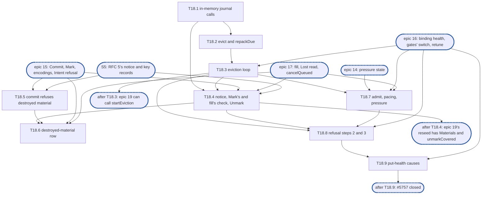

# Epic 18: engine offload local space

**Sources:** [RFC 8](../docs/internals/rfcs/rfc-8-engine.md) §3.1 (`evict`, `repackDue`, `admit`),
§3.2 and §3.3 (the policy functions' limits), §10 (local space whole), §10.1 (eviction), §10.2
(steps 2 and 3, in the refusal's caller and in the share's pass; the put-health causes of the
table's first two rows and the index-bound row's put-health half), §10.2.1 (pacing), §10.3 (the
loop's repack), §10.4 (destroyed material, but the reseed's half), §2.5 stop steps 3 and 4 (the
eviction loop's join), §6.1 (posting `Pressure`, and the "pressure band", "lost events" and
"growth" checks' capacity legs), §11.2's "Journal at capacity" row, §13 E3, E11 and E33, §14 (the
local-space series and the `engine.pace` span), §15.1's "§10.2 retry later", "§2.5 clone resumed at
a full limit" (its remote half) and "§10.4 destroyed material" (but its crash leg), §15.2's "§10
occupancy triggers eviction", "§10.2 refusal loop", "§10.2 one pass per share", "§10.3 repack
reserve" and "§10.2.1 pacing law";
[RFC 6](../docs/internals/rfcs/rfc-6-block-metadata.md) §4.4 (the kept ref's row, as D17 amends it) and §5.4 (the key-record row of the reads
that gate a commit); [RFC 5](../docs/internals/rfcs/rfc-5-transforms.md) §2.7 and Appendix B.2
(destroyed material and the master key's marking); [RFC 1](../docs/internals/rfcs/rfc-1-journal.md)
§3.5 (`Release`), §3.7 and §4.4 (the figures and the per-segment accounting eviction reads);
[RFC 3](../docs/internals/rfcs/rfc-3-syncer.md) §2.8 (a direction's cause);
[RFC 13](../docs/internals/rfcs/rfc-13-configuration.md) Appendix B, the eviction occupancy
target, `eviction.repack_threshold` and the index excess row; [RFC 14](../docs/internals/rfcs/rfc-14-open-state.md)
§9.3 and §12's L9; [RFC 17](../docs/internals/rfcs/rfc-17-vfs.md) §6's V20, its offload half; the
offload plan's epic 18 "Done when", which names issue #5757's four rows.
**Track:** B.
**Epic 18 estimate: 9 subtasks, 31 man-days.**
**Depends on:**
- epic 11's frozen surface: `Settings.EvictionTarget` and `RepackThreshold`, and the `Stats` fields
  `EvictedBytes` and `PacingSeconds` this epic fills;
- epic 12's red rows this epic turns green and its proposed fixture controls this epic makes real
  (`MeasuredDrain`, and `DestroyDataKey`, `DestroyMasterKey`, `MarkRecordDestroyed`,
  `DestroyCurrent`, `HoldBetweenPinAndCommit`, `HoldBetweenCommitAndMark`), at S2;
- epic 14's T14.4, the journal's pressure state, which `admit`'s caller and step 3 set;
- epic 15's pipeline: the offload commit transaction (T15.4) that T18.5 adds its key-record reads
  to, with their slot already counted in the floor (T15.2), the block record's `encodings` (T15.3),
  and Mark (T15.9), whose report T18.4 puts under the destroyed-material lock; its Intent refusal
  under destroyed current material (T15.8), which T18.6's row asserts;
- epic 16's binding flow and its `Health(Put)` read into the binding (T18.8, T18.9), the gates'
  switch (T18.3's eager mode), and its `retune(b)` (epic 16's T16.4 and its D13), the one function
  per binding that sets each shard's offload tenant from the kept put health and the journal's
  pressure, through which epic 14's pressure cap runs, so a pressure change this epic makes reaches
  the tenants only through it (T18.7);
- epic 17's T17.7 `(*speculator).cancelQueued(j)`, the one entry point that cancels the queued
  speculation of journal `j`'s shares under capacity pressure, which the pacing path calls (T18.7);
  its fill, which T18.4 puts under the destroyed-material lock; and its **Lost** read, which T18.6's
  row asserts;
- sync point **S5**'s RFC 5 half: `keys.DestroyedNotice` on `keystest`'s in-memory provider, and the
  key-record view with its `kvstore` implementation, whose state is a byte `kvstore` reads without
  the provider (the RFC 5 plan's epics 6 and 8);
- sync point **S6**, the journal plan's epic 9b: `Release` and `Unmark` on the real journal. Until it
  lands the in-memory journal carries both (T18.1) and every row over the real journal stays red at
  their `ErrNotImplemented`.
**Blocks:** epic 19, whose start step 7 calls `startEviction` (T18.3, D16) and adds the reseed's
gate on eviction, and whose reseed reads `Content.Materials` and unmarks through `unmarkCovered`
(T18.4); epic 21, which wires `Deps.Destroyed` from each store configuration's key provider (T18.4,
D9); epic 22, which burns the rows down over the real journal once S6 lands.

---

## 1. Goal

Epic 18 makes local space work now that offload drains dirty bytes: an eviction loop frees clean,
offloaded content by segment, writes are paced before the limit, the refusal table frees space
through eviction and pressure before it syncs, and a store's put-health cause decides between a
retry and no space. Destroyed transform material is handled on both sides of the commit: the commit
refuses under it, and an extent committed or filled before it is made dirty again.

**At the end of the epic:**

- each journal runs one eviction loop, joined at stop step 3, that evicts offloaded extents by
  segment once allocated occupancy, less what is already released, passes the target, repacks what
  it evicted from, and requests a repack when unreclaimed bytes pass their threshold; epic 19's step
  7 starts it;
- the refusal path of the journal's own capacity, and the share's pass for a share limit, evict and
  repack, then turn pressure on and evict what offload frees, before the first part's sync;
- the refusal table answers dirty bytes behind a put-healthy store, a store unhealthy with
  `ErrTransient`, and offloaded bytes whose eviction a gate holds as `ErrDelay`, and a store denying
  puts for quota, access or size, with nothing else left to free, as `ErrNoSpace` at once; #5757's
  four rows are green and the pull request that turns them green closes #5757;
- every write is paced by RFC 8 §10.2.1's law and the journal's pressure follows its band;
- an offload commit refuses a block whose `encodings` name a key record marked destroyed, and
  repoints a chunk it would adopt from a block under destroyed material, and replaces a ref it would
  keep as already committed whose block is under destroyed material; the destroyed-material
  notice unmarks every held extent a destroyed material's blocks cover, and neither Mark nor a fill
  marks after a destroy the engine has been told of.

### 1.1 In scope

`evict`, `repackDue` and `admit`; the journal calls eviction makes (`Release`, `Unmark`, the
inspection) and the in-memory journal's copies of them; the eviction loop; steps 2 and 3 of the
refusal table in both places; the put-health causes; pacing and the pressure band; the
destroyed-material notice, Mark's and the fill's check, and the commit's key-record reads in
`kvstore`; the reads of a file's materials in `kvstore`; the local-space series and span; the rows
listed in the sources.

### 1.2 Out of scope

- The reseed: its clear of every extent whose block's `encodings` name a destroyed key record, its
  gate on offer and eviction, its crash leg of "§10.4 destroyed material"
  (`TestRFC8A_DestroyedMaterialCrashBeforeUnmark`), and start step 7's call that starts the
  eviction loop and the reseed: epic 19, which calls this epic's `startEviction`, `Materials` and
  `unmarkCovered`.
- The Intent refusal under destroyed current material, the leg "no replacement material" of "§10.4
  destroyed material" asserts: epic 15 (T15.8); this epic's row asserts it.
- A remote-only chunk under destroyed material reading **Lost**: epic 17, whose read path tells the
  errors apart; this epic's row asserts it.
- Cancelling speculation on pressure: epic 17's `cancelQueued` (its T17.7, its D10), which it already
  calls from the first part's refusal path; this epic adds only the call from the pacing path
  (T18.7).
- Setting a shard's offload tenant: epic 16's `retune(b)`; this epic only changes the journal's
  pressure state that `retune` reads (T18.7).
- The put-unhealthy pause of a store's shards, reading the flow's health into the binding, the gates'
  switch and the rerun of every Group A row under it, and the "pressure band" check's put-unhealthy
  leg: epic 16.
- How the store error is classified (`ErrDenied`, not `ErrInvalid`, for a quota refusal), which "§10.2
  retry later" also asserts: RFC 4's plan (its codec's error mapping) and RFC 3's plan (the
  direction's cause); this epic's row asserts it at the engine.
- `material_destroyed` as an engine condition, with its `data_loss`: epic 20.
- Passing each store configuration's key provider as `Deps.Destroyed`: epic 21.
- `Release` and `Unmark` on the real journal: the journal plan's epic 9b (S6).
- An operator's retention pin excluding a share from eviction (RFC 8 §10.4's MAY): unowned, deferred
  in the offload plan's ledger ("An operator's retention pin"), which this pull request adds (D13).
- An eviction loop woken by occupancy crossing its target rather than a fixed tick: unowned,
  deferred in the offload plan's ledger ("An eviction loop woken by the journal's occupancy").
- Detecting bucket-setting drift, which `evict`'s trust in the offloaded bit depends on: RFC 9,
  deferred in the offload plan's ledger ("Detecting bucket-setting drift").
- Per-share budget values for capacity and pacing: RFC 24, deferred in the offload plan's ledger
  ("Per-share budget values").
- Fuzz or model targets for the pacing law: unowned, deferred in the offload plan's ledger ("Fuzz
  or model targets for the queue's keys and the pacing law"); T18.7 checks it by a table.

### 1.3 Names used here

- **S2**, red rows in CI: the end of epic 12, whose rows this epic turns green.
- **S5**, offload components built: the RFC 2 to RFC 5 plans' implementation epics; here, RFC 5's
  notice and key-record view.
- **S6**, journal offload half built: the journal plan's epics 9b and 7b; here, 9b's `Release` and
  `Unmark`.
- **E3**, **E11**, **E33**: RFC 8 §13's invariants of those numbers, not epics.
- **The first part**: the journal-only engine, epics 1 to 10 of RFC 8's first plan, whose refusal
  path (`capacity.go`, `repack.go`) and in-memory journal this epic extends.
- **The fixture**: `pkg/engine/enginetest`, the first part's engine fixture with epic 12's controls.

## 2. How the general rules apply

The rules are those of [the offload plan's §1.5](rfc-8-offload-engine-plan.md#15-general-rules-for-each-epic),
cited by number and title and not copied.

| Rule | Subtasks | How |
| --- | --- | --- |
| rule 1, independent unit tests ([`CLAUDE.md`, "Writing tests"](../CLAUDE.md#writing-tests)) | all | over the first part's in-memory journal with its segment model, held to the journal's suite rows for every call it gains (T18.1), `kvstore` over the in-memory `kv.KV`, RFC 5's chain over `keystest`'s in-memory provider with its notice, and the real carver and syncer through the fixture from epics 15 and 16; the injected clock for every tick and wait |
| rule 2, fuzz the key and ref decoders the queue's rebuild reads | none | no new decoder: the key record's state byte is RFC 5 epic 6's, read through its codec, and the block record's `encodings` decoder is epic 15's target |
| rule 3, observability follows RFC 25 | T18.3, T18.7, T18.8 | `EvictedBytes` (`engine_evicted_bytes_total`), `PacingSeconds` (`engine_pacing_seconds`, in RFC 25 §2.6's `request` buckets) and the first part's refusal counter and rate-limited `Warn`, none labelled by share per operation; the `engine.pace` child span, allocation-free unsampled; `journal_full` kept as the first part raises it |
| rule 4, profiling | T18.3, T18.4, T18.7 | tests under the fixture's `prof.Watch`, which fails a loop, a round or a scan left running after `Close`; `admit` reads no `Stats()` per write (D3), and no allocation gate, since neither of the rule's two hot paths is touched |
| rule 5, public interface and internals ([`CLAUDE.md`, "Verifying a change"](../CLAUDE.md#verifying-a-change)) | all | each rule asserted where its value is consumed: an eviction at the journal's held bytes and a later read, a cause at the refusal's answer to the writer, a pacing delay at the write's return on the test clock, a destroyed material at the offloaded bit `Release` reads and at the chunk record a covering lookup resolves |
| rule 6, known failures shrink | T18.1, T18.3, T18.6, T18.7, T18.8, T18.9 | each row's entry leaves `test/engine/known.yaml` in the change that turns it green; a row still red over the real journal until S6 has its `message:` rewritten to the `ErrNotImplemented` it then meets; T18.1's real-journal legs land red in `test/journal/known.yaml` |
| rule 7, v2 ignores v1, and the engine imports only what RFC 0 §1.2 allows | T18.4 | `Deps.Destroyed` answers `keys.DestroyedNotice`, the `pkg/transform/keys` contract epic 15 admits, keyed by the `pkg/syncer` root's `StoreID`, which epic 11 admits; `kvstore` imports nothing of `pkg/transform` (D11) |
| rule 8, real dependencies for properties of those dependencies | T18.4, T18.5, T18.6 | the commit's conflict with a destroy and `Materials` run on `kvstore` over Badger, and FoundationDB where it runs, beside the in-memory `kv.KV`; rows over the real journal on a real directory |
| rule 9, code comment conventions ([`CLAUDE.md`, "Code comments"](../CLAUDE.md#code-comments)) | T18.2, T18.3, T18.4, T18.5, T18.7, T18.8, T18.9 | RFC 8 §10.1's eviction `ponytail:` and D2's and D8's markers at `evict` (T18.2); the loop's fixed-tick `ponytail:` and D13's `decision:` (T18.3); D9's, D10's and D11's markers (T18.4); §10.4's undeclared-loss `decision:`, D15's and D17's (T18.5); §10.2.1's fixed-constants `decision:` and D3's, D4's and D5's markers (T18.7); §10's concurrent-refusal `ponytail:` and D6's `decision:` at the refusal path, the first part's repack-at-refusal `ponytail:` deleted (T18.8); §10.2's two-rows `decision:` kept at the table, D7's added and the first part's dirty-bytes `decision:` deleted (T18.9) |
| rule 10, a test must be able to fail | all | each test names the break it catches |
| rule 11, a symbol is exported only if the RFC's interface uses it | T18.3, T18.4, T18.5 | the exported engine additions are `Deps.Destroyed` and the declared journal calls with `Inspector`; `kvstore` exports `Content.Materials`, `MaterialSpan` and `ErrCommitUnderDestroyedMaterial` for the engine; the policy functions, the loop and the lock are unexported |
| rule 12, each subtask creates only what it declares | all | `Release` and `Inspect` join the declared journal with their first caller (T18.3), `Unmark` with its (T18.4); `Content.Materials` and `unmarkCovered` with the notice (T18.4), which epic 19's reseed reuses; `startEviction` lands with the loop, which the fixture's start calls until epic 19's step 7 does (D16); the reseed's gate on eviction is epic 19's, built with the reseed |

## 3. Requirements and invariants

Every obligation the sources place on this epic, numbered so subtasks and tests can cite them.

**The policy functions**

| # | Requirement | Kind | Source | Subtasks |
| --- | --- | --- | --- | --- |
| R1 | `evict`, `repackDue` and `admit` take plain inputs and return a decision; none does I/O, holds a reference to a component or calls a mechanism, so each is table-tested on its own | MUST NOT | RFC 8 §3.1 | T18.2, T18.7 |
| R2 | They are not folded into one policy evaluator and none calls another; where one decision needs another's output, the engine passes it in | MUST NOT | RFC 8 §3.1 | T18.2, T18.7 |
| R3 | The policy state this epic adds lives in memory; a restart may lose all of it and the engine behaves correctly from an empty state | MUST | RFC 8 §3.3 | T18.3, T18.4, T18.7 |
| R4 | No policy gate is the only thing standing between the system and data loss: with eviction as eager as possible the Group A checks still pass, since `Release` refuses an extent whose offloaded bit is unset | MUST NOT | RFC 8 §3.2, §13 E3; §15.1 "§3.2 no gate is safety" | T18.3 |

**Eviction**

| # | Requirement | Kind | Source | Subtasks |
| --- | --- | --- | --- | --- |
| R5 | Eviction is triggered by allocated occupancy, the journal's `UsedBytes`, against the journal's maximum and each share's limit, never by dirty plus unreclaimed bytes alone | invariant | RFC 8 §10, §13 E33; RFC 1 §3.7 | T18.2, T18.3 |
| R6 | `evict` selects by segment, the segments whose held bytes are oldest and fewest evicted together, and within that oldest first, until allocated occupancy falls below a target under the maximum | invariant | RFC 8 §10.1; RFC 13 Appendix B (the eviction occupancy target) | T18.2 |
| R7 | An extent's age is the latest of its write, its fill and its last repack copy; nothing records a read that hits held content | invariant | RFC 8 §10.1 | T18.2 |
| R8 | Only the offloaded bit decides whether an extent may be evicted: a Dirty or Offered extent never is, and journal durability never decides | invariant | RFC 8 §10, §13 E11 | T18.2, T18.3 |
| R9 | Eviction writes nothing to metadata | invariant | RFC 8 §10.1 | T18.3 |
| R10 | Each journal runs one eviction loop, which calls `evict` and `repackDue` and runs the journal's `Release` and `Repack` itself; eviction and repack are not work-queue work. Its start at start step 7 is epic 19's call | MUST | RFC 8 §10, §2.5 step 7, §6.1 | T18.3 |
| R11 | `Close` cancels the eviction loop and joins it at stop step 3, before closing the journals at step 4; a join past its bound leaves what the loop depends on open and reports the failure | MUST | RFC 8 §2.5 stop steps 3, 4 and 5 | T18.3 |
| R12 | Locks, deny modes, delegations, open handles and snapshots never make an extent ineligible for eviction or reclamation | MUST NOT | RFC 8 §10.4; RFC 14 §9.3, §12 (L9) | T18.3 |
| R13 | `Release` is called only on content whose offload commit has itself committed | MUST NOT | RFC 1 §3.5 | T18.3 |
| R14 | Every capacity measure reads `UnreclaimedBytes` and `DirtyBytes`, never a release's result, since `Release` frees nothing itself | invariant | RFC 8 §10.3; RFC 1 §3.5 | T18.2, T18.3, T18.7, T18.8 |
| R15 | Neither the loop nor a refusal takes the queue's keys: a refusal racing the loop costs copy work, never correctness | invariant | RFC 8 §10 | T18.3, T18.8 |
| R52 | Eviction releases whole extents, so a release splits no held extent | invariant | RFC 13 Appendix B (the index excess row) | T18.2 |

**Repack**

| # | Requirement | Kind | Source | Subtasks |
| --- | --- | --- | --- | --- |
| R16 | `repackDue` requests a repack when `UnreclaimedBytes` pass the `eviction.repack_threshold` fraction of the journal's capacity, run through the journal's `Repack(budget, scope)`; it requests one when the journal is at capacity | MUST | RFC 8 §10.3; RFC 13 Appendix B | T18.2, T18.3 |
| R17 | The scope aims a pass: eviction repacks exactly the segments it just evicted from, a share at its limit the segments holding its records, and an unscoped pass lets the journal choose | invariant | RFC 8 §10.2 step 2, §10.3, §13 E33 | T18.3, T18.8 |
| R18 | Repack draws on the journal's repack reserve, outside every share's limit, so a share at its limit never blocks the repack that frees space for every share: repack of another share's released segments proceeds and frees space for a third share | test row | RFC 8 §10.3; §15.2 "§10.3 repack reserve" | T18.3 |

**The refusal table**

| # | Requirement | Kind | Source | Subtasks |
| --- | --- | --- | --- | --- |
| R19 | Step 2: evict offloaded extents by segment, repack exactly those segments, then retry | MUST | RFC 8 §10.2 | T18.8 |
| R20 | Step 3: if what is held is dirty and the remote is put-healthy, turn the journal's pressure on if it is not already, so it is offloaded at once, then evict and repack what that made offloaded, and retry | MUST | RFC 8 §10.2, §6.1 | T18.8 |
| R21 | For the journal's own capacity steps 2 and 3 run in the refusal's caller, under its deadline; for a share's limit they run inside the share's pass, under the engine's lifetime, before its sync, with the pass's join rule and bounded wait unchanged | MUST | RFC 8 §10, §10.2 | T18.8 |
| R22 | The cause of a put-unhealthy store comes from the flow's `Health(Put)`: `ErrTransient` answers `ErrDelay` for as long as it lasts; `ErrDenied` of cause quota, access or size, and `ErrDrift`, answer `ErrNoSpace` at once when nothing else can free space | MUST | RFC 8 §10.2 (the table's first two rows); RFC 3 §2.8 | T18.9 |
| R23 | Unreclaimed bytes, and dirty bytes with the store put-healthy, are what can still free space, and answer `ErrDelay`; bytes of a suspect segment, an unread record or a write to an unread file never count as freeable | MUST | RFC 8 §10.2 (the table's first row) | T18.9 |
| R24 | The index-bound row answers `ErrDelay` while offload, eviction, repack, the sync or the stamp can lower the count, and `ErrNoSpace` at once when the held extents are all dirty, no retained extent waits on a sync or a stamp, and the store is put-unhealthy for a cause of the second row | MUST | RFC 8 §10.2 (the index-bound row) | T18.9 |
| R25 | The deadline ends the wait, never the cause's class: an `ErrDelay` standing at the deadline stays `ErrDelay`, and a transient cause that turns permanent while the client retries answers `ErrNoSpace` at once | MUST NOT | RFC 8 §10.2, §13 E33 | T18.9 |
| R26 | A journal at capacity runs §10.2 and raises `journal_full` for a refusal of its own capacity or a full device | MUST | RFC 8 §11.2 ("Journal at capacity") | T18.8 |
| R27 | §10.2 retry later, the store legs, and its siblings: a full journal of dirty bytes with the remote reachable answers `ErrDelay` and succeeds once offload and repack free space; unreachable past the deadline, `ErrDelay` throughout; one share filled to its journal limit, `ErrDelay`; a quota refusal answers `ErrNoSpace` at once with the store error reaching the engine as `ErrDenied`, not `ErrInvalid`; `413` and `403` refusals answer `ErrNoSpace` at once and succeed once lifted; a clone resumed at a full limit with the remote down finishes once it returns; V20's offload half; #5757's four rows | test row | RFC 8 §15.1 "§10.2 retry later", "§2.5 clone resumed at a full limit"; RFC 17 §6 V20; the offload plan's epic 18 "Done when" (#5757) | T18.9 |
| R28 | §10.2 refusal loop: a write at capacity over offloaded content succeeds after the engine evicts and repacks, and over dirty content once it offloads, evicts and repacks; an engine that evicts without repacking frees nothing | test row | RFC 8 §15.2 | T18.8 |
| R29 | §10 occupancy triggers eviction: a journal at its maximum with filled, offloaded content evicts and accepts a write, where a trigger on dirty plus unreclaimed bytes would see no pressure | test row | RFC 8 §15.2 | T18.3 |
| R30 | §10.2 one pass per share stays green with steps 2 and 3 inside the pass | test row | RFC 8 §15.2 | T18.8 |

**Pacing**

| # | Requirement | Kind | Source | Subtasks |
| --- | --- | --- | --- | --- |
| R31 | `admit` acts only before the journal call and is never given a refusal | MUST | RFC 8 §10.2, §3.1 | T18.7 |
| R32 | A write of *n* bytes is delayed *d* = (*n* / *r*) · (*M* − *S*) / (*L* − *S*) for *S* < *M* < *L*, and 0 for *M* ≤ *S*: *M* dirty plus unreclaimed bytes of the journal or of the write's share, whichever is nearer its limit *L*; *S* half of *L*; *r* the rate *M* fell over the last 10 s while work was pending, floored at 1 MiB/s | bound | RFC 8 §10.2.1 | T18.7 |
| R33 | *r* is measured, not refreshed by the wait: a trickle of progress does not stretch a delay already computed | invariant | RFC 8 §10.2.1 | T18.7 |
| R34 | A delay that would pass the caller's deadline returns `ErrDelay` at once instead of sleeping | MUST | RFC 8 §10.2.1, §10.2 | T18.7 |
| R35 | Clean held bytes are not pacing pressure | invariant | RFC 8 §10 | T18.7 |
| R36 | §10.2.1 pacing law: with *M* half-way between *S* and *L* at a measured drain rate *r*, a write of *n* bytes is delayed *n* / 2*r* within 10 %, and zero below *S* | test row | RFC 8 §15.2 | T18.7 |
| R37 | Pressure turns on once *M* rises past *S* and off once it falls below 0.9 *S*; the refusal path's step 3 turns it on | MUST | RFC 8 §6.1, §10.2.1 | T18.7, T18.8 |
| R38 | pressure band, the oscillation leg: *M* held oscillating 1 % either side of *S* for 10 minutes turns pressure on once and never off | test row | RFC 8 §6.1 Checks | T18.7 |
| R39 | lost events, the pressure leg: with `Pressure` events dropped at random beside the queue's, every dirty extent is still offered within the maximum age plus one tick | test row | RFC 8 §6.1 Checks | T18.7 |
| R40 | growth, the pacing leg: with the consumer stalled, writes are slowed only by capacity pacing | test row | RFC 8 §6.1 Checks | T18.7 |

**Destroyed material**

| # | Requirement | Kind | Source | Subtasks |
| --- | --- | --- | --- | --- |
| R41 | When transform material is destroyed or declared lost, the engine clears the offloaded bit (`Unmark`) of each held extent whose remote body depends on it, so it is unevictable and offered again under current material until a new block holding it commits | MUST | RFC 8 §10.4, §13 E11; RFC 5 §2.7 | T18.4 |
| R42 | The offload commit transaction reads with conflict tracking the key record of each material the block's `encodings` name, never a list its caller passes, and refuses to commit if any record is marked destroyed | MUST | RFC 8 §10.4; RFC 6 §5.4 | T18.5 |
| R43 | A destroy that commits first refuses the commit; a destroy ordered after the commit finds the block committed and its extents' offloaded bits are cleared | invariant | RFC 8 §10.4; RFC 6 §5.4 | T18.4, T18.5 |
| R44 | The engine abandons a refused attempt and offers its extents again under current material | MUST | RFC 8 §10.4 | T18.5 |
| R45 | A destroyed master key is covered the same way: the commit refuses a data key it wraps, whose record the provider marked | invariant | RFC 8 §10.4; RFC 5 Appendix B.2 | T18.4, T18.5 |
| R46 | The engine never marks an attempt's extents offloaded once any material the attempt's refs depend on has been reported destroyed: Mark checks under the lock the notice's `Unmark` takes and leaves the extents Dirty | MUST NOT | RFC 8 §10.4 | T18.4 |
| R47 | The commit refuses only on a key record marked destroyed: a loss no operator has declared marks no record, and a commit under it lands | invariant | RFC 8 §10.4 (its `decision:`) | T18.5 |
| R51 | A commit never lands a ref whose chunk record names a block under destroyed material: a chunk it would adopt from an older live block whose `encodings` name a destroyed key record is repointed to its own block | invariant | RFC 8 §13 E11; this document's D15 | T18.5 |
| R53 | A fill never lands an extent offloaded once the engine has been told the material of the block it was fetched from is destroyed | invariant | RFC 8 §10, §13 E11; this document's D10 | T18.4 |
| R54 | A commit never keeps, as already committed, a ref whose chunk record names a block whose `encodings` name a key record marked destroyed or missing: a new ref at that ref's own `newest` replaces it as if it were newer, and one below it is refused as live, its extent left unreported, so no ref is replaced with strictly older content (RFC 6 M10) | MUST | RFC 6 §4.4, §5.4 (as D17 amends them); RFC 8 §10.4 | T18.5 |
| R48 | §10.4 destroyed material, but its crash leg: covered extents lose their bit, are not evicted, are offloaded again and read back; a remote-only chunk reads **Lost**; a master key destroyed, or a record marked destroyed, between pin and Commit refuses the commit and no block commits; a destroy between Commit and Mark leaves the extents unmarked; no replacement material refuses the pass at Intent | test row | RFC 8 §15.1 | T18.6 |

**Observability**

| # | Requirement | Kind | Source | Subtasks |
| --- | --- | --- | --- | --- |
| R49 | Evictions and bytes freed, pacing delays and refusals are counted as `engine_evicted_bytes_total`, `engine_pacing_seconds` and `engine_write_refusals_total`; no per-operation metric carries a share label, and the pacing histogram uses the `request` buckets | MUST | RFC 8 §14 | T18.3, T18.7, T18.8 |
| R50 | A content call waiting on pacing opens a child of the caller's span, `engine.pace`, carrying the share and file by ID, the bytes and the outcome; an unsampled one costs no allocation | MUST | RFC 8 §14 | T18.7 |

Enforced without a new test: R2 by review and by `policy.go` holding only the five functions, none
calling another (the first part's review rule); R31 by `admit`'s signature, which takes no error;
R13 by epic 15's Mark-after-commit check (T15.9), since only Mark sets the bit eviction reads.

## 4. Decisions this epic takes

- **D1, the engine declares the journal's inspection.** `evict` needs RFC 1 §4.4's per-segment
  accounting and each held extent's segment and offloaded bit, which `*journal.Journal` serves as
  `Inspect()` returning a concrete `journal.Inspector`, and the in-memory journal cannot build one.
  The engine declares `type Inspector interface { Segments() []journal.SegmentInfo; All()
  iter.Seq2[journal.FileID, []journal.IndexEntry] }` and `Journal.Inspect() Inspector`; since Go
  has no covariant results, `journalOf` wraps `Inspect` to return the journal's own value as the
  interface, as it wraps `Share` and `Reserve` today. No marker. Prior art: the first part's
  `journalOf`; the Go FAQ on covariant result types (from memory).
- **D2, an extent's age is its segment's place in the append order, and only ended segments are
  evicted from.** RFC 8 §10.1 dates an extent by its latest write, fill or repack copy, and the
  journal records no time per extent or segment (RFC 1 §4.4). A write, a fill and a repack copy all
  append to an active segment, and segments are numbered as they open, so a lower `SegmentID` holds
  older bytes. `evict` considers sealed and failed segments, never an active, damaged, retired or
  suspect one: releasing from an active segment frees nothing, since RFC 1's `Repack` does not seal
  yet (RFC 8 §10.2), and a failed segment's bytes are reclaimable as §10.2 counts them. It ranks
  them by the fraction of their allocation still held after eviction (dirty and retained bytes),
  lowest first, then by ID, oldest first, so repack copies least, and takes whole segments, each
  index entry's extent whole (R52), until the bytes it would release cover the need. For a share's
  limit the caller gathers `s` over the share's files only, so units of other shares are never
  released for it, and the RFC's `evict(now, s, need)` keeps its signature. A `ponytail:` at
  `evict`, beside RFC 8 §10.1's own: segment order is the age of a segment's oldest byte, and a slow
  stream's open segment holds new bytes under a low ID; per-segment offloaded bytes come from
  walking `Inspect().All()`, which copies the index, once per round. Upgrade to a per-segment
  last-append time kept in memory when B3 shows repack bytes per byte freed above §10.1's 5.7, and to
  a `SegmentInfo.OffloadedBytes` (an RFC 1 §4.4 amendment) when the walk shows in a profile. Prior
  art: the log-structured file system's cleaner, which picks segments by age and live fraction
  (Rosenblum and Ousterhout, from memory).
- **D3, `admit` reads a snapshot, not `Stats()`, and the round runs off the tick.** `Stats()` copies
  the journal's maps on every call, and the write path calls none today. The eviction loop's tick,
  one per second (fixed), first stores the journal's and each share's dirty, unreclaimed and limit
  figures in an atomic snapshot and feeds D4's ring, then starts the notice's drain and an eviction
  round in a goroutine of their own, skipping them while the last is still in flight, so a slow
  `Release`, `Repack`, scan or Mark never freezes pacing or pressure. Each write adds its length to
  a per-journal and per-share counter at admission, before it waits, so concurrent writers inside a
  tick see each other's bytes; `admit` reads the snapshot plus the counter. A `ponytail:` at the
  snapshot: the drain figures lag up to a tick; upgrade to journal-served atomic gauges when B3
  shows refusals the lag let through. Prior art: none found.
- **D4, *r* is the journal's drain counters over elapsed time.** *M* is dirty plus unreclaimed
  bytes, and what lowers it is offload marking dirty bytes and storage freed by repack or
  retirement, so *r* is the rise of the journal's monotone `Counters.MarkedBytes` plus
  `Counters.FreedBytes` over the last 10 s of `Clock.Elapsed`, from a ring of the tick's samples,
  samples taken while *M* was zero skipped (no work pending), floored at 1 MiB/s. That is the fall
  RFC 8 §10.2.1 names with what raises *M* left out: a difference of *M* itself would read a drain
  near zero in exactly the ticks the loop evicts, since a `Release` turns clean bytes unreclaimed
  and an overwrite of clean bytes raises *M* twice. `ShareStats` keeps no such counters, so a
  share's measure is paced at the journal's *r*. A `decision:` at the ring says both, upgraded to
  per-share counters when B3 shows one share paced by another's drain. The wait reads the *r*
  computed when the delay was, never a later one (R33). Prior art: Linux's `balance_dirty_pages`,
  which estimates a device's write bandwidth over a short period and pauses a writer in proportion
  to how far the dirty count is past its setpoint (from memory).
- **D5, pressure turns on from any write, and off only at the tick.** RFC 8 §10.2.1 takes *M* of the
  journal or of the write's share. `admit` reports `nearS` when either is past its *S*, and its
  caller posts `Pressure(on)`; only the loop's tick, which reads every bound share, posts
  `Pressure(off)`, once the journal's and every share's *M* are below 0.9 of their *S* and no
  refusal turned pressure on since the previous tick, so a write to one share never turns off the
  pressure another share's measure set, and a refusal's pressure lasts until a tick passes with no
  refusal. The state call is epic 14's, which ignores a repeat. A `decision:` at the post. Prior art:
  none found.
- **D6, step 3 waits one loop tick in the caller's path only.** After pressure turns on, a refusal
  of the journal's own capacity waits on the injected clock for one loop tick, at most a tenth of
  the time left to its deadline (3 s with none), so the offload pressure starts and the loop's next
  round can run, then evicts and repacks what is now offloaded, and retries. Inside the share's
  pass, which has no caller deadline and whose joiners wait at most a tenth of theirs, step 3 turns
  pressure on and evicts what is offloaded at that moment, with no wait, so the pass reaches its
  sync inside its joiners' wait. A `decision:` at each. Prior art: the first part's `awaitPass`.
- **D7, a cause the table does not name answers retry-later, and a binding with no flow is
  put-healthy.** RFC 3 §2.8 also names `ErrCorrupt` (puts failing in transit), which neither row
  lists; it, and any cause not named, answers `ErrDelay`, as the first part's `unknownRow` answers a
  limit it does not know: a wrong retry costs a wait, a wrong no-space a client failure. A share
  bound with no flow, which only the first part's rows build, counts as put-healthy, as epic 14's D8
  does for pressure. A `decision:` at the cause's mapping. Prior art: the first part's `unknownRow`.
- **D8, the drift cause is mapped and never raised in v1.1.** `ErrDrift` lands with RFC 9's
  `Recheck` (the RFC 3 plan defers it), so the mapping names it in a comment and maps it to
  `ErrNoSpace` once the value exists. `evict` carries a `decision:` that it trusts the offloaded bit
  while bucket-setting drift goes undetected, so a drift that lost a committed body loses the held
  copy too; withdrawn when `Recheck` runs. Prior art: none found.
- **D9, one notice per store configuration, read before every release, and a namespace's eviction
  held while its destroy is unscanned.** RFC 5 §3.1 has one provider per store configuration, so
  `Deps` gains `Destroyed func(store syncer.StoreID) keys.DestroyedNotice`, the engine keeping one
  cursor per distinct notice the bindings' stores return (per incarnation, never persisted, as RFC
  5 epic 8's D10 settles: a cursor of another incarnation, the 0 each start begins with included,
  reads the provider's list from its start, and what was destroyed before is the reseed's).
  **Reading** a notice is cheap and serialised by one mutex: the loop's round and every refusal's
  step 2 and 3 read each notice the journal's bindings use, calling `DestroyedSince` until a call
  returns no ID, as `keys.DestroyedNotice` asks, or until 16 calls, and adding each batch to D10's set as unscanned before taking its cursor, before they
  release anything. A call returns at most 256 IDs (RFC 5 epic 8's D10), so one call a round would
  leave the rest unread while that round releases their namespaces' extents; a read that fails
  part-way keeps the cursor of the last batch added and counts as failed, and so does one that
  stops at its 16 calls, so a refusal under a mass destroy waits on at most 16 provider calls and
  releases nothing under that notice until a later read drains it. **Scanning** is the loop's alone:
  its round runs the unmark scan (T18.4) over the unscanned IDs, marking an ID scanned only once
  every held file of its namespace has been scanned; a scan cut short by an error, a deadline or a
  closed journal leaves the ID unscanned, to be run again by the next round, which the scan's
  idempotence makes safe. The scan of an ID reads only the held files epic 19's reseed visited
  before the ID was added: the provider marks the key records before it reports a destroy (RFC 8
  §10.4), so a visit begun after the add reads the record destroyed and clears the file's extents
  itself, and a file not yet visited cannot be evicted before its visit (epic 19's R14). D10's set
  numbers its adds, and the reseed calls `reseedVisit(file)` as it begins a file's visit, before
  its first read, which records the last number given for that file (T18.4). Without it every restart would scan again every
  material ever destroyed, since the provider lists at each namespace's `Open` every record it finds
  `destroyed` and the cursor restarts at 0, holding each namespace's eviction until its scans end;
  with it, the IDs listed after a restart scan only the files the reseed visited before their
  listing, and nothing is persisted (R3). A file with no recorded visit
  is skipped only when `startEviction` was told the reseed gates eviction, which epic 19's step 7
  says; until then a scan reads every held file, as it must with no reseed, and that runs only over
  the in-memory journal, which a restart empties (D16). Each unit is released under D10's read lock, after checking that its
  namespace holds no unscanned ID and that its notice's last read succeeded; a unit of such a
  namespace is skipped, and other namespaces evict as before. A `decision:` at the read: a destroy
  the provider reports after a release's check loses that extent's local copy, content whose remote
  copy the destroy already made unreadable (RFC 5 Appendix B.4); overturned if a destroy must never
  lose a held copy, which would need eviction to read the key records it releases under. Prior art:
  none found.
- **D10, one lock orders the notice against Mark, fills and releases.** The engine keeps the
  material IDs reported destroyed in this incarnation (namespace, kind, ID), each marked scanned or
  not, in one map behind a `sync.RWMutex`. Mark holds the read lock across its check of every
  material its refs depend on (the commit's answer, D15) and its `report`; a fill of epic 17 holds it at `fillExtent`, epic 17's one `Fill` site (its T17.5),
  across its check of the materials of the block it fetched from, read with `Materials`, and its
  `Fill`; a release holds it as D9 says. On a hit, a material of that block in the set, the fill
  releases the read lock, takes the write lock (a `sync.RWMutex` cannot be upgraded, and `Lock`
  under its own `RLock` deadlocks), checks again, a hit staying a hit since the set only grows and
  the block's materials are fixed, and runs `Fill` then `Unmark` over the filled extent under it: RFC 1
  §3.4 sets a filled extent's bit and `Fill` takes no flag to leave it clear, so the bit is cleared
  by the call the scan uses, and under the write lock no release or Mark runs between the two. An
  `Unmark` that fails sets the ID back to unscanned, so D9 holds the namespace's eviction until a
  scan clears the bit; a crash between the two leaves a bit set over a block whose key record reads
  `destroyed`, which epic 19's reseed clears before the file can be evicted (RFC 8 §10.4). The notice's read takes
  the write lock only to add the IDs it read. A Mark or fill that checked before the add has
  reported before the add returns, so the scan after it finds its bits set and clears them; one that
  checks after sees the ID and leaves the extents Dirty. The set lives in memory (R3); epic 19's
  reseed covers a restart. A `decision:` at the lock. Prior art: none found.
- **D11, `kvstore` answers which materials cover a file's extent, with their state, and refuses by
  its own error.** The notice, fills and epic 19's reseed need, for each held extent, the materials
  the covering blocks' `encodings` name and whether each key record is `destroyed`; refs name chunks,
  not blocks. `kvstore`'s `Content` gains
  `Materials(ctx, share, file, off, n) iter.Seq2[MaterialSpan, error]`, each carved span with the
  block its chunk record names, that block's namespace, and each `entity.MaterialRef` with its key
  record's state byte, read page by page through `kvstore`'s `pages`, one `View` per page of refs,
  so no snapshot outlives `kv.TxnLimits.Age` (FoundationDB's five seconds, which `badgerkv` mirrors)
  however many spans the extent holds. Pages may read different snapshots: a key record's
  `destroyed` mark never clears, so a later page reads every mark an earlier one did, and a ref
  replaced between pages names a block whose commit checked its own materials (R42). The engine factors the unmark as
  `unmarkCovered(ctx, b, file, extents)`, which clears the bit of each extent a span covers whose
  material reads `destroyed`; the provider marks the record before it reports the destroy (RFC 5
  Appendix B.2), so the notice's scan and epic 19's reseed run the same code, the notice only
  choosing which namespaces to scan. The commit refuses with
  `kvstore.ErrCommitUnderDestroyedMaterial`, naming the material, since `kvstore` imports nothing
  of `pkg/transform` and a second `ErrMaterialDestroyed` beside `keys.ErrMaterialDestroyed` would
  invite a wrong `errors.Is`; a material the `encodings` name with no key record refuses as
  `ErrInconsistent`, failing closed. The implementing pull request amends RFC 6 §10.1's `Content`
  sketch with `Materials` and RFC 8 §2.1's table and §2.6's `Deps` with `Destroyed`. A `decision:` at
  the missing-record refusal, and a `ponytail:` at `Materials`, which reads one block record per
  carved span, upgraded to a material-to-block index when a destroy over a large journal shows in a
  profile. Prior art: none found.
- **D12, a refused commit is abandoned like an over-`K` one.** The pipeline answers
  `ErrCommitUnderDestroyedMaterial` as epic 15 answers an over-`K` or intent-missing commit:
  `Abandon`, the extents left Dirty and the file's offload key posted again, so the next pass pins
  current material; it is not counted toward O6's failing file, since the file did nothing wrong. A
  missing key record's `ErrInconsistent` is abandoned the same way but counted toward O6, so a store
  whose records are missing surfaces as `file_offload_failing` rather than re-offering silently for
  ever. No marker. Prior art: none found.
- **D13, RFC 8 §10.4's two MAYs are not adopted.** No setting or record names an operator's
  retention pin, so there is nothing to honour; this pull request adds the pin to the offload plan's
  §6.1 deferral ledger and amends its epic 18 outline to match, and §10.2's second row keeps naming
  it for when one exists. Suspending eviction while the remote is unreachable would keep cached
  content readable during an outage, but it is an availability policy no row asks for, and §3.2
  forbids it to matter for safety. A `decision:` at the loop names both. Prior art: none found.
- **D14, the gates' switch makes eviction eager.** RFC 8 §15.1's "§3.2 no gate is safety" evicts as
  eagerly as possible; under epic 16's switch, read per instance from the engine's seams, the loop
  evicts every offloaded extent at every tick regardless of the target. No marker beyond the seam's
  comment. Prior art: the first part's `seams`.
- **D15, a commit that adopts a chunk from a block under destroyed material repoints it.** Today
  `kvstore`'s `commitBlock` leaves a chunk record naming an older live block as it is, so the new
  refs read the older block's copy. If that block's material is destroyed while the block is still
  live, a read of the commit's own `encodings` sees nothing destroyed and the commit lands refs no
  copy can read, which Mark then makes evictable: RFC 8 E11's failure. So the commit also reads,
  tracked, the key records of each adopted block's `encodings` (whose records `chunksOf` already
  loads), and repoints a chunk to the new block when any is `destroyed`, as it repoints one whose
  block is not live; it then lands on its own copy under current material. Its `CommitResult` gains
  the materials of every block its refs read, its own and the adopted ones, which Mark checks (D10),
  so a destroy of an adopted block's material reported between the commit and Mark leaves the
  extents Dirty too. RFC 8 §10.4 and RFC 6 §5.4 name only the block's own `encodings`; this document
  decides the rest, and the implementing pull request amends both sections to name the adopted
  blocks'. A `decision:` at the repoint. Prior art: none found.
- **D16, `startEviction` is the loop's one start, and epic 19 calls it.** Start step 7 is
  epic 19's, so T18.3 provides the unexported `startEviction(j, reseedGates bool)` and its join,
  the flag saying whether the reseed gates each file's eviction (D9); until epic 19's
  step 7 lands, the fixture's start and the first part's `Start` call it where step 7's comment
  stands. The reseed's gate on eviction ("evicted only once the reseed has run for it", RFC 8 §2.5)
  is epic 19's, built with the reseed it reads. Until then eviction trusts the persisted bits, which
  is safe while only the in-memory journal can release, before S6; a `decision:` at
  `startEviction` says so, and the open points name the order S6 and epic 19 must land in. Prior
  art: none found.
- **D17, a re-offer after a destroy replaces the ref it would keep.** RFC 6 §4.4 treats a new ref
  whose `newest` lies inside an existing ref's version range as already committed: `replaceRefs`
  keeps the existing ref and reports its extent offloaded. A re-offer after a destroy carries the
  same content at the same version, so every extent it offers lands in that row, and the kept ref
  still names the old chunk. D15's repoint reaches that chunk only when the new block carries it,
  and it need not: the re-offer cuts its chunks afresh, and one can straddle the old chunk's bounds.
  For example, block A under data key K1 holds chunk C1 over [0, 1 MiB) at version 5; K1 is
  destroyed and the notice unmarks [0, 1 MiB); the re-offer, merged with dirty bytes written after
  it beyond 1 MiB, cuts [0, 768 KiB) and [768 KiB, 2 MiB) into block B under K2. The second ref's
  `newest` is above 5, so it replaces C1's ref over [768 KiB, 1 MiB); the first carries version 5
  over [0, 768 KiB), so C1's ref is kept there, B carries nothing D15 can repoint, the commit
  reports [0, 768 KiB) offloaded, Mark sets the bits, since D15's answer names B's materials and no
  adopted block's, and eviction drops the only copy anyone can read: the next read of [0, 768 KiB)
  is **Lost**. Widening Mark's check to
  A would only stall it: the extent would be offered and kept for ever, and after a restart, with
  the set empty, marked. So the commit reads,
  tracked, the key records of the block each kept ref's chunk record names (the block records
  `chunksOf` already loads), and, when any reads `destroyed`, replaces the ref as a newer one would
  if the new ref's `newest` equals the kept ref's own, the version a re-offer of the same content
  carries, and otherwise refuses the new ref as live and leaves its extent unreported. A pass
  offered before the kept ref's commit has a `newest` below it, so replacing on any version inside
  the range would serve its older bytes where the kept ref's newer ones were (RFC 6 M10). A missing
  key record on a kept ref's block is judged as `destroyed`, not refused as D11 refuses the
  commit's own: the replacement lands the content on a block whose material is current, while a
  refusal would keep every later re-offer of the file's extent from landing. This amends RFC 6
  §4.4's middle row and §5.4's key-record row, in this document's pull request, since the RFC's
  text forbids the replacement. A `decision:` at the replacement names both, and a `ponytail:` its
  ceiling: a kept ref spanning versions whose re-cut chunk holds only older ones is refused on every
  re-offer, its extent Dirty and counted toward O6 (D12), until a version per byte range lets the
  commit tell a re-offer from a stale pass. Prior art: none found.

## 5. Target tree

On `feat/storage-v2`.

```text
pkg/engine/
  deps.go                 T18.3  Handle.Release, Journal.Inspect, Inspector; T18.4 Handle.Unmark, Deps.Destroyed, Content.Materials
  journalof.go            T18.3  journalOf.Inspect
  policy.go               T18.2  evict, repackDue, evictUnit; T18.7 admit, admission, the law
  evict.go                T18.3  startEviction, the loop per journal, its snapshot and round (D3), eager mode (D14)
  material.go             T18.4  the destroyed map and its lock (D10), the notices' reads and cursors, the scan, unmarkCovered
  capacity.go             T18.7  the drain-rate ring (D4); T18.9 the causes
  repack.go               T18.8  steps 2 and 3 in relieve and in sharePass; T18.9 settled reads the cause
  queue.go                T18.7  the pressure posts (D5)
  write.go                T18.7  admit before the refusal loop, the engine.pace span
  close.go                T18.3  the loop joined at stop step 3
  read.go fill.go         T18.4  the fill's check under the lock
  offload/                T18.4  Mark under the read lock over the commit's materials; T18.5 the refusals answered (D12)
  health.go               T18.3  EvictedBytes; T18.7 PacingSeconds
  export_test.go          T18.3 to T18.9  accessors of the snapshot, the ring, the map, the loop's tick and round
  policy_test.go evict_test.go material_test.go capacity_test.go repack_test.go  T18.2 to T18.9
  enginetest/fake.go      T18.1  FakeHandle.Release and Unmark, FakeJournal.Inspect over the existing segment model
  enginetest/journal_test.go  T18.1  the three calls agree with the journal
  enginetest/material.go  T18.5  WithChain's provider over kvstore's KeyRecords; T18.6 the material controls made real
  enginetest/space.go     T18.7  MeasuredDrain made real
  conformance/            T18.3, T18.6, T18.7, T18.8, T18.9  the rows green, or their messages rewritten
pkg/metadata/kvstore/
  offload.go              T18.5  the commit's tracked key-record reads, the adopted blocks' read and repoint (D15), replaceRefs' kept-ref key-record read, replacement and refusal (D17), ErrCommitUnderDestroyedMaterial
  materials.go            T18.4  Content.Materials, MaterialSpan
  offload_test.go materials_test.go  T18.4, T18.5
internal/vfs/integration/rows_test.go  T18.9  TestV20's offload half green
test/engine/known.yaml    T18.3, T18.6, T18.7, T18.8, T18.9  entries removed or rewritten
test/journal/known.yaml   T18.1  the real journal's Release and Unmark legs, red until S6
.planning/rfc-8-offload-engine-plan.md  this pull request: the retention pin's ledger row and the epic 18 outline (D13)
```

## 6. Subtasks

### T18.1 The in-memory journal's eviction calls

**Subtask T18.1 estimate: 1.5 man-days.**

- **Track:** B. **Depends on:** none. Epic 15's in-memory journal with its per-extent offloaded
  bits.
- **Covers:** none of the R-rows on its own: consumed by T18.2 and T18.3 (`Inspect`, `Release`) and
  T18.4 (`Unmark`), which cover R8, R41 and R52.
- **Deliverables:** the in-memory journal only, over its existing segment model
  (`enginetest/fake_segments.go`): `FakeHandle.Release` and `Unmark`, with the signatures
  `*journal.Handle` has, and `FakeJournal.Inspect` returning a value with D1's `Segments` and `All`,
  held to the journal's suite rows for them through `enginetest/journal_test.go`'s "agrees with the
  journal" form over the fake and the real journal: `Release` all or nothing, refusing with a
  `NotOffloadedError` listing every extent whose bit is unset, turning held bytes into unreclaimed
  ones in the segment model and freeing nothing; `Unmark` clearing the bits named; `Segments` with
  held and retained bytes and the seal, failed and suspect flags per segment, and `All` with each
  entry's segment and bit. The engine's declarations join `Handle` and `Journal` with their first
  callers, `Release` and `Inspect` in T18.3, `Unmark` in T18.4, so the first part's architecture
  test stays green. Consumed by T18.2, T18.3, T18.4.
- **Acceptance criteria:**
  - The fake's `Release` of a set naming one Dirty extent releases nothing and lists it.
  - A released extent's bytes appear in `UnreclaimedBytes` and its segment's held bytes fall;
    `UsedBytes` is unchanged until a repack.
  - `Unmark` then `Release` of the same extent is refused.
- **Tests:** the agreement tests, each run over both journals: a release that would make partial
  progress (catches a fake that releases the offloaded half), an unmark that a later `Release`
  refuses (catches a fake that keeps the bit), segment figures after a release (catches a fake that
  frees bytes on release, which would make every eviction test pass without repack). Over the real
  journal the `Release` and `Unmark` legs land red until S6, each a `known:` entry in
  `test/journal/known.yaml` naming the journal plan's epic 9b issue, beside the existing `stub:`
  rows (`TestRFC28A_UnmarkClears` among them); `Inspect`'s legs pass over both now. No double: the
  fake is the verified in-memory journal.
- **Rules:** rule 1: the fake passes the journal's rows before any engine test reads it; rule 6:
  the entries; rule 12: no declaration lands here.

### T18.2 `evict` and `repackDue`

**Subtask T18.2 estimate: 2.5 man-days.**

- **Track:** B. **Depends on:** T18.1.
- **Covers:** R1, R2, R5, R6, R7, R8, R14, R16, R52.
- **Deliverables:** in `policy.go`,
  ```go
  type evictUnit struct {
  	segment journal.SegmentID
  	file    journal.FileID
  	extents []journal.Extent // whole index entries, offloaded, held in segment
  }
  func evict(now time.Time, s journalStats, need int64) []evictUnit
  func repackDue(s journalStats) bool
  ```
  `journalStats` gains the inspection's segments and each segment's offloaded extents, gathered by
  the caller over the refusal's scope (a share's files for its limit, D2). `evict` considers sealed
  and failed segments only, ranks and takes them as D2 says, units of whole offloaded entries only,
  until the released bytes cover `need`; stranded tags and damaged, retired and suspect segments are
  left out. The caller computes `need` from `UsedBytes` less `UnreclaimedBytes` less the target, so
  bytes already released and awaiting repack count as freed (R14). `repackDue` answers true when
  unreclaimed bytes pass `RepackThreshold` of the journal's maximum, or when the journal is at its
  maximum. RFC 8 §10.1's eviction `ponytail:` and D2's at `evict`; D8's drift `decision:` at
  `evict`. Consumed by T18.3 and T18.8.
- **Acceptance criteria:**
  - No unit names a Dirty or Offered extent, an extent of an active segment, or part of an entry,
    whatever `need` is.
  - Segments are taken by the live fraction left after eviction, then oldest first, and a segment's
    offloaded extents are taken together.
  - A journal whose every sealed segment is more than half dirty still evicts its offloaded bytes.
- **Tests:** tables over plain inputs: a segment of only dirty bytes never yields a unit (catches
  R8); an active segment of offloaded bytes yields none (catches a release that frees nothing);
  three sealed segments with offloaded bytes and a need two of them cover yield the two emptiest,
  whole (catches a per-extent pick that scatters, R6); two segments of equal live fraction, the
  higher-numbered holding a fresh fill and a repack copy, take the lower first (catches an age
  read from anything but the append order, R7); every segment two-thirds dirty still yields units
  (catches the live fraction used as an exclusion); a need smaller than one entry still releases
  the whole entry (catches a split, R52); `repackDue` false just below the threshold, true at it and
  at capacity with no unreclaimed bytes (catches R16's capacity half). No double.
- **Rules:** rule 9: the markers above.

### T18.3 The eviction loop

**Subtask T18.3 estimate: 3.5 man-days.**

- **Track:** B. **Depends on:** T18.2. Epic 16's gates' switch for the eager mode; epic 19 calls
  `startEviction` from its step 7.
- **Covers:** R3, R4, R5, R8, R9, R10, R11, R12, R14, R15, R16, R17, R18, R29, R49.
- **Deliverables:** `Handle.Release` and `Journal.Inspect() Inspector` declared in `deps.go` (D1),
  `journalOf` wrapping `Inspect`. In `evict.go`, `startEviction(j, reseedGates)` and its join (D16, its
  `decision:`), one loop per open journal on the injected clock at a fixed 1 s tick (§4.3's
  `ponytail:`): each tick reads `Stats()` once and stores D3's snapshot, then, unless a round is in
  flight, starts one: when `UsedBytes` less `UnreclaimedBytes` passes `EvictionTarget` of the
  journal's maximum, or a share's used bytes its limit's, it gathers the inspection, calls `evict`
  for the bytes over the target, `Release`s each unit as D9 allows (a `NotOffloadedError` from a unit
  an overwrite or a destroy raced skips that unit; a refusal by the headroom or the index bound ends
  the round, logged), and `Repack`s exactly the segments it released from at the journal's
  `RepackReserveBytes`; then, if `repackDue`, an unscoped `Repack`. `EvictedBytes` counts what each
  release named; the bytes freed are the journal's own `Counters.FreedBytes`, which the node adapts
  beside it for RFC 8 §14's row. No call takes a file guard, an open, a lock or a snapshot hold
  (R12). D13's and D14's `decision:`s at the loop. `Close` cancels it with the other loops at stop
  step 3 and joins it, round included, within the stop bound, before step 4 closes the journals, a
  failed join reported and the journal left open. Consumed by T18.4, T18.7, T18.8 and epic 19.
- **Acceptance criteria:**
  - A journal at its maximum with clean, offloaded content falls below the target within a tick and
    accepts a write; one full of dirty bytes evicts nothing.
  - With repack held, no round releases more than the target first asked for.
  - The loop writes no metadata transaction (R9).
  - After `Close`, no loop or round goroutine remains, and a join past the bound leaves the journal
    open.
- **Tests:**
  - **§10 occupancy triggers eviction** (R29, R5), `TestRFC8B_OccupancyTriggersEviction`, over the
    fixture: green over the in-memory journal; its entry's `message:` rewritten to the real
    journal's `Release` `ErrNotImplemented` until S6 (rule 6).
  - **§10.3 repack reserve** (R18), `TestRFC8B_RepackReserveOverReleasedSegments`, as above.
  - **L9** (R12), `TestRFC14_L9`: an open and a lock held on a file whose extent is offloaded; the
    loop evicts and repacks it (catches an eviction that consults open state), as above.
  - the fixture's `AtRepackSelected` hook holding every repack for ten ticks: the bytes released in
    total never pass the first round's need (catches a need read from `UsedBytes` alone, which
    evicts the whole cache, R14).
  - a pass-through wrapper on the journal recording each `Repack`'s scope: a round's repack names
    exactly the segments it released from (catches an unscoped repack, R17).
  - at the store's write counter, a wrapper that records each transaction and passes it through,
    with the offload pipeline quiesced by epic 14's run hook: none during ten eviction rounds
    (catches R9).
  - with the gates' switch on (D14), every offloaded extent is released at the next tick and every
    file still reads back from the remote store (R4, the half the loop owns).
  - a round held by the `AtRepackSelected` hook for ten ticks: the snapshot still advances every
    tick and no second round starts (catches pacing frozen by a slow round, D3).
  - `Close` with a round held by the same hook past the stop bound: the failure is reported and the
    journal stays open (R11).
  - `EvictedBytes` after a round equals the bytes its releases named (R49).
  Doubles: the recording pass-through wrappers, epic 14's run hook and the fixture's kind-3 hooks;
  each clock advance waits for the loop's timer to be registered on the test clock first.
- **Rules:** rule 4: `prof.Watch` fails a leaked loop; rule 6: the three rows' entries rewritten.

### T18.4 Destroyed material: the notice, Mark's and the fill's check, and `Unmark`

**Subtask T18.4 estimate: 6 man-days.**

- **Track:** B. **Depends on:** T18.1, T18.3. Epic 15's Mark and `encodings`; epic 17's fill (its T17.5's `fillExtent`); S5's
  `keys.DestroyedNotice` on `keystest`'s in-memory provider.
- **Covers:** R3, R41, R43, R45, R46, R53.
- **Deliverables:** `Handle.Unmark` declared; `Deps.Destroyed func(syncer.StoreID)
  keys.DestroyedNotice` (nil refused by `New`, as `Clock` is) and a cursor per distinct notice
  (D9); `kvstore`'s `Content.Materials` and `MaterialSpan` with each material's state (D11), with
  its `ponytail:`, and the engine's declared `Content` gaining it; in `material.go`, D10's map and
  lock with its `decision:`, the notices' read with D9's `decision:`, `unmarkCovered` (D11), and the
  round's scan: for each unscanned ID, every held file of its namespace with offloaded entries that
  the reseed visited before the ID's add (D9), `Materials` over those extents and `unmarkCovered`,
  the ID marked scanned once its scan completes; the add's number in D10's set, `reseedVisit(file)`
  recording the last number given for the file, which epic 19's reseed calls as it begins a visit,
  and `startEviction`'s flag saying the reseed gates eviction, so a file with no visit is skipped
  (D9).
  A release skips a unit whose namespace holds an unscanned ID or whose notice's last read failed
  (D9), each notice read until a call returns none. In `offload/`, Mark takes the read lock,
  checks every material the commit's answer names
  (D15) against the map, and reports only when none is in it, leaving the extents Dirty otherwise;
  epic 17's fill takes it the same way, at `fillExtent`, the one function every `Fill` call goes
  through (epic 17's T17.5), over the materials `Materials` reads for the fetched extent, a hit
  running `Fill` then `Unmark` under the write lock (D10). Consumed by T18.6, T18.8 and epic 19, whose reseed calls `Materials` and
  `unmarkCovered`.
- **Acceptance criteria:**
  - Once the notice reports a data key, no held extent its blocks cover is released, and each has
    its bit clear after the next completed scan and is offered again by the next age tick.
  - A Mark or a fill after the notice's add leaves its extents Dirty; one before has them cleared by
    the scan.
  - A notice read that fails, or a scan cut short, releases nothing of that namespace until a later
    round completes it; other namespaces keep evicting.
- **Tests:** over the unit fixture with `keystest`'s provider and `kvstore` on the in-memory
  `kv.KV`, on the injected clock:
  - destroy a data key covering half of a file's offloaded extents: after one round those extents
    are refused by `Release` and the others are not (catches an unmark by file rather than by
    material, R41, at `Release`, the bit's consumer);
  - destroy a master key: the held extents under every data key it wraps lose their bit (catches a
    notice naming only the master key, which no `encodings` entry names, R45);
  - Mark held between its check and its report by a per-instance hook, the notice's read started in
    a goroutine, and the test waiting for that read to block on the lock before releasing Mark: the
    extents end clear (the scan found them); with the read run first, they end Dirty and are never
    reported offloaded (catches a check outside the lock, R46, R43);
  - a commit adopting a chunk from a live block whose material is destroyed between the commit and
    Mark: the extents end Dirty (catches a Mark checking only its own block's materials, R46);
  - a fill of an extent fetched under a material destroyed between the fetch and the fill: the
    extent lands Dirty and is offered again (catches a fill outside the lock, R53); with the fill
    held by a hook between its `Fill` and `Unmark` and a round's release of that file started, the
    release blocks on the lock and, once the fill resumes, finds the bit clear (catches the pair run
    under the read lock); with `Unmark` failing once (kind 3), the
    namespace releases nothing until the next scan clears the bit (D10);
  - a notice holding 300 destroyed IDs: one read adds all 300 before the round releases anything,
    and an extent under the 300th is not released (catches one batch a round, D9);
  - a round already releasing a namespace's units when its material is reported: the next unit is
    skipped (catches a check made once per round rather than per unit, D9);
  - a notice wrapper failing `DestroyedSince` once, and an `Unmark` failing midway through a scan
    (kind 3 each): that namespace releases nothing that round or the next, the ID stays unscanned,
    and the round after completes the scan and evicts (catches a cursor advanced past an unfinished
    scan, D9);
  - `keystest`'s provider destroying 20 batches' worth of IDs before a refusal: the refusal makes 16
    calls, releases nothing under that notice, and a later read drains the rest before any release
    (catches an unbounded read, or a capped read counted as succeeded, D9);
  - a fill whose block's material is in the set, with the run's `-race` and a timeout as backstop:
    the fill returns, its extent's bit clear (catches a read lock upgraded in place, D10);
  - two shares on two store configurations with two notices: a destroy reported by one holds only
    its namespace's eviction and unmarks only its extents (catches one cursor for every provider,
    and a gate on the whole engine);
  - `Materials` over a file with three blocks under two materials, one marked destroyed, in
    `kvstore`'s tests over the in-memory `kv.KV` and Badger: each span names its block's materials
    and the marked one's state (catches a lookup by the file's current material); and over a file
    of more than one page of refs, on a `kv.KV` wrapper that fails as too old any `View` reading
    more than one page (kind 3): every span is returned (catches one snapshot over the whole
    extent);
  - a restart with the map empty: nothing is marked from memory, and no test relies on the map
    surviving (R3);
  - a restart over records holding 50 destroyed IDs, which the provider lists again at `Open`
    before any held file's visit, `startEviction` told the reseed gates, then every file's visit
    recorded through `reseedVisit` as the reseed would, with
    `Materials` failing for those files through a kind 3 wrapper, and one more ID destroyed after
    the listing: the first round releases the 50's namespaces, which a scan would have held on the
    failing read, and the new ID's namespace releases nothing until its scan clears its bits; with
    one file's visit recorded before the 50 were listed and the wrapper lifted, that file's bits
    under them are cleared before its namespace releases (catches every material ever destroyed
    scanned again after a restart, holding eviction, D9; and a scan skipping a file visited before
    the destroy was listed);
  Doubles: kind 3 around the notice and the fake's `Unmark`; the Mark and fill hooks set from
  `export_test.go`.
- **Rules:** rule 7: `keys.DestroyedNotice` is the RFC 5 contract; `kvstore` imports nothing of
  `pkg/transform`. Rule 8: `Materials` on Badger. Rule 11: `Materials` is exported for the engine
  and the reseed. At the ceiling: the read, the scan and the two lock holders are one ordering
  argument and cannot be split without shipping a lock that orders nothing.

### T18.5 The offload commit refuses destroyed material

**Subtask T18.5 estimate: 5 man-days.**

- **Track:** B. **Depends on:** none. Epic 15's T15.2, T15.3 and T15.4; S5's key records in
  `kvstore`.
- **Covers:** R42, R43, R44, R45, R47, R51, R54.
- **Deliverables:** in `kvstore`'s offload commit, for each `MaterialRef` of the block's
  `encodings`, a tracked read of the key record at `NS‖ns‖key‖kind‖keyID`, its state byte read
  without the provider; a `destroyed` state refuses the whole transaction with
  `ErrCommitUnderDestroyedMaterial` naming the material, and a missing record refuses it as
  `ErrInconsistent` (D11, its `decision:`). The same tracked read of each adopted block's
  `encodings`, repointing a chunk whose older block's material is destroyed, and `CommitResult`
  gaining the materials of every block its refs read (D15, its `decision:`). In `replaceRefs`, the
  same tracked read of the block each ref it would keep as already committed names, when any record
  reads `destroyed` or is missing replacing that ref at its own `newest` and refusing a new ref
  below it as live (D17, its `decision:` and `ponytail:`), with RFC 6 §4.4 and §5.4 as amended
  here. RFC 8 §10.4's
  undeclared-loss `decision:` at the read. In `offload/`, both refusals answered as D12 says. The
  fixture's `WithChain` provider keeps its key records in the fixture's own `kvstore` through its
  `KeyRecords` view, in the same change, so no green row's commit finds its records missing.
  Consumed by T18.4 (the commit's materials) and T18.6.
- **Acceptance criteria:**
  - A record marked destroyed before the commit refuses it; nothing of the block is written and its
    intent is abandoned.
  - A destroy committed after a commit's snapshot and before its commit aborts it (the conflict).
  - A material with an undeclared loss (no record marked) commits.
  - A commit adopting a chunk from a live block under destroyed material lands with the chunk
    repointed to its own block.
  - A commit at a kept ref's own `newest`, over a ref whose block is under destroyed material or
    names a missing key record, replaces that ref with its own; one below that `newest` is refused
    for that ref and reports nothing over it.
  - Every green `engine-conformance` row stays green with the reads in place.
- **Tests:** in `kvstore`, over the in-memory `kv.KV`, Badger, and FoundationDB where `fdbkvtest`
  runs (rule 8):
  - a record marked destroyed, then a commit naming it: refused, `Block(name)` absent (catches R42);
  - the commit's transaction paused after its snapshot by a kind-3 hold on the `kv.KV`, the record
    marked by another transaction, then released: the commit aborts and its retry is refused
    (catches an untracked read, R42, R43);
  - the reverse order: the commit lands, the later mark commits, and the block stays (R43's second
    half, which T18.4 then clears);
  - a block whose `encodings` name a data key wrapped by a master key whose records the provider
    marked through `kvstore`'s key-record view: refused (R45, the commit reading what the provider
    wrote);
  - a commit naming material the caller's list omits but the `encodings` name: refused (catches a
    read of the caller's list);
  - a record with no `destroyed` mark under a lost key: commits (R47);
  - block A live under a destroyed data key, then a commit of block B carrying one of A's chunks
    under current material: B lands, the chunk record names B, and a covering lookup of the new
    ref resolves to B (catches an adoption that reads only B's `encodings`, R51);
  - a commit naming a material with no key record: refused `ErrInconsistent`;
  - the straddling chunk: block A under data key K1 with one chunk over [0, 1 MiB) at version 5, K1
    marked destroyed, then block B under K2 at version 5 with chunks over [0, 768 KiB) and
    [768 KiB, 2 MiB), neither A's: B lands, a covering lookup over [0, 1 MiB) resolves only to B,
    and A's chunk count drops (catches the kept ref, R54); the same commit with K1 not marked keeps
    A's ref (the row still holds for live material);
  - the same, with K1 marked by another transaction after the commit's snapshot: the commit aborts
    and its retry replaces (catches an untracked read of the kept ref's block, R54);
  - A's ref over [0, 1 MiB) spanning versions [3, 7], K1 marked destroyed, then a commit at version
    5 over [0, 1 MiB): that ref refused as live, A's ref still covering the range and nothing
    reported over it (catches a stale pass replacing newer content, R54, RFC 6 M10);
  - the straddling commit with A's key record deleted rather than marked: B lands and replaces A's
    ref (catches a missing record on a kept ref's block refused, wedging the file, D17).
  In the engine, over the unit fixture: a pass whose commit is refused leaves its extents Dirty,
  its intent abandoned, and a second pass under the provider's current material commits (R44); a
  missing record's refusal counts toward the file's failing count (D12); the straddling case end to
  end, a destroy of the material of a file's offloaded extent, a write next to it, and the re-offer
  committed with the gates' switch on (D14): after eviction the extent reads back its bytes from the
  new block, never **Lost** (R54 at the read, its consumer). Doubles: kind 3 on the
  `kv.KV`.
- **Rules:** rule 8: the conflict is a property of the store, run on the real backends; rule 9: the
  three markers.

### T18.6 The destroyed-material row

**Subtask T18.6 estimate: 1.5 man-days.**

- **Track:** B. **Depends on:** T18.4, T18.5. Epic 17's **Lost** read; epic 15's Intent refusal.
- **Covers:** R48.
- **Deliverables:** epic 12's material controls in `enginetest/material.go` made real over the
  fixture's provider and pipeline: `DestroyDataKey`, `DestroyMasterKey`, `MarkRecordDestroyed`,
  `DestroyCurrent`, and the two holds through the pipeline's per-instance hooks;
  `TestRFC8A_DestroyedMaterial` green over the in-memory journal, its entry's `message:` rewritten
  to the real journal's `Unmark` `ErrNotImplemented` until S6, removed once it passes.
  `TestRFC8A_DestroyedMaterialCrashBeforeUnmark` keeps its entry, for epic 19.
- **Acceptance criteria:**
  - Every leg of R48 passes, each failing first on its own assertion with the change it guards
    reverted (the notice's unmark, the commit's read, Mark's check).
- **Tests:** the row. Doubles: the fixture's holds, kind 3.
- **Rules:** rule 6: the entry rewritten, then removed.

### T18.7 `admit`, the pacing law and pressure

**Subtask T18.7 estimate: 4 man-days.**

- **Track:** B. **Depends on:** T18.3. Epic 14's T14.4; epic 16's `retune`; epic 17's T17.7.
- **Covers:** R1, R2, R3, R14, R31, R32, R33, R34, R35, R36, R37, R38, R39, R40, R49, R50; RFC 8
  §7.4's "queued hints are cancelled when a write meets capacity pressure" on the pacing path,
  which epic 17 owns as its R32 (its T17.7).
- **Deliverables:** in `policy.go`,
  ```go
  type admission struct {
  	delay  time.Duration
  	refuse bool // the delay would pass the deadline: ErrDelay(DelayCapacity) at once
  	nearS  bool // the journal's or this share's M is past its S (D5)
  }
  func admit(s journalStats, sh shareView, n int64) admission
  ```
  with *S* = *L* / 2, *M* at or past *L* clamped to the delay at *L*, and RFC 8 §10.2.1's
  fixed-constants `decision:`; `journalStats` and `shareView` carry D3's snapshot plus the bytes
  admitted since and D4's *r*. In `capacity.go`, D4's ring fed by the loop's tick, with its
  `decision:`. In `write.go`, one `admit` before `answeringRefusals`, outside the file entry's lock
  and before the write registers on the entry, so a refused retry is never paced again and no
  removal or clone waits out a delay: the write's bytes added to D3's counters, then the wait on the
  injected clock's `After` under the caller's context (its deadline, or RFC 17's 30 s default with
  none), inside an `engine.pace` child span with the share, the file, the bytes and the outcome, the
  delay observed in `PacingSeconds` in the `request` buckets; a delay past the deadline answers
  `ErrDelay` (`DelayCapacity`) at once, counted as a refusal. Every paced or refused write calls epic
  17's `(*speculator).cancelQueued(j)` for its journal before it waits (epic 17's D10). In
  `queue.go`, D5's posts with its `decision:`: `Pressure(on)` from a write whose `nearS` is set,
  `Pressure(off)` only from the tick. The state change reaches each shard's offload tenant only
  through epic 16's `retune(b)` for every binding on the journal (epic 16's D13); this epic calls no
  `SetTenant` itself. `MeasuredDrain` in the fixture returns the journal's *r*. Consumed by T18.8.
- **Acceptance criteria:**
  - Below *S* no write waits; half-way to *L* a write waits *n* / 2*r*.
  - A delay longer than the time left to the deadline returns at once.
  - Clean held bytes do not change *M*.
  - Pressure turns on when a share passes its *S* though the journal is below its own, and stays on
    until every measure is below 0.9 of its *S*.
- **Tests:**
  - a table over `admit`: *M* at *S*, half-way, just under *L*, at and past *L*; *r* below the
    floor; clean bytes only; a deadline shorter than the delay (catches R32, R34, R35, and a law
    keyed on `UsedBytes`);
  - **§10.2.1 pacing law** (R36), `TestRFC8B_PacingLaw`: green over the in-memory journal, the delay
    read on the test clock, never slept; its entry removed;
  - a delay computed, then a tick reporting a trickle of drain during the wait: the write returns at
    the computed delay (catches a wait that re-reads *r*, R33);
  - the ring after ticks with offload marks, evictions and repacks: an eviction tick reads no fall
    in *r* (catches *r* taken from *M*'s own difference, D4), and a tick with *M* at zero is skipped;
  - ten writers admitted inside one tick: each later one sees the earlier ones' bytes in *M*
    (catches a counter added after the wait, D3);
  - at the tracer the fixture passes, a paced write's `engine.pace` span with its four attributes
    (R50), and `PacingSeconds` holding its delay (R49);
  - a read-ahead hint queued on a share, then a write paced on its journal, then a second hint
    queued while still paced and a second write: both hints are cancelled and never fetched, read at
    the remote store's get count (catches a pacing path that does not call `cancelQueued`, or calls
    it once per change);
  - **pressure band** (R38): *M* held oscillating 1 % either side of *S* for 10 simulated minutes;
    `QueueEvents["pressure"]` counts one change (catches a toggle at *S*);
  - two shares, A past its *S* and B below 0.9 of its own: writes to B never turn pressure off, and
    it turns off at the first tick after A falls below 0.9 *S* (catches a write posting off, D5,
    R37);
  - pressure on just after a `Drop` cancelled a binding's tenants: no tenant of the dropped share
    comes back in `JournalStats.Work` (catches a pressure path that writes tenants around
    `retune`);
  - **lost events, the pressure leg** (R39): epic 14's drop seam dropping `Pressure` posts with
    probability ½ beside `Dirty` and every third tick; every dirty file is still dispatched within
    the maximum age plus one tick;
  - **growth, the pacing leg** (R40): epic 14's run hook pausing every run while writes fill past
    *S*; each write returns, and every wait is an `engine.pace` span (catches a wait on the queue).
  No double but the clock, the tracer, which keeps the spans it was given, the seeded source, and
  epic 14's seam and hook.
- **Rules:** rule 3: the span and the histogram; rule 9: the markers above.

### T18.8 Refusal steps 2 and 3, in the caller and in the share's pass

**Subtask T18.8 estimate: 4 man-days.**

- **Track:** B. **Depends on:** T18.3, T18.4, T18.7. Epic 16's binding health.
- **Covers:** R14, R15, R17, R19, R20, R21, R26, R28, R30, R37, R49.
- **Deliverables:** `relieve`'s steps become RFC 8 §10.2's four for the journal's own capacity:
  after step 1's repack, step 2 reads the notices (D9), calls `evict` over the journal and releases
  as D9 allows, then repacks exactly those segments; step 3, when held bytes are dirty and the
  binding is put-healthy, posts `Pressure(on)`, waits as D6 says, then evicts and repacks what that
  offloaded; then the first part's step 4. `sharePass` runs step 2 over the share's files and step
  3, turning pressure on and evicting what is offloaded at that moment with no wait (D6), before its
  sync, under the engine's lifetime, the pass's `syncing` flag set only when the sync begins, so a
  later refusal still joins through both steps; its bounded wait and its answer from the figures
  afterwards unchanged. Each step retries the write between steps, as the first part's do, and each
  counts its refusal as the first part's `answeredAs` does, `journal_full` raised as before. The
  first part's repack-at-refusal `ponytail:` is deleted and RFC 8 §10's concurrent-refusal
  `ponytail:` placed at `relieve`; D6's `decision:` at each wait. Consumed by T18.9.
- **Acceptance criteria:**
  - A write refused at the journal's maximum over offloaded content succeeds after step 2, with no
    sync run; a share at its limit over offloaded content is relieved by its pass's step 2.
  - Over dirty content with the store healthy, a refusal of the journal's own capacity succeeds once
    step 3's offload reports.
  - A refusal arriving during the pass's step 2 or 3 joins it.
  - `journal_full` is raised for the refusal as the first part raises it.
- **Tests:**
  - **§10.2 refusal loop** (R28), `TestRFC8B_RefusalLoop`: green over the in-memory journal, its
    entry's `message:` rewritten to the real journal's `Release` until S6;
  - a step 2 that releases without repacking, planted: the retry is refused again (catches R19's
    repack, the row's last sentence), and the recording wrapper's scope names the released segments
    (R17);
  - **§10.2 one pass per share** (R30), the first part's green row, still green with a pass that
    evicts;
  - a refusal arriving while the pass is in step 3, held by epic 14's run hook, joins it and is
    answered by the same pass (catches `syncing` set too early);
  - a share at its limit over dirty content with a joiner of no deadline: the pass reaches its sync
    before the joiner's 3 s wait ends (catches a step-3 wait in the pass, D6);
  - step 3 in the caller with the run hook holding every pass: pressure is on, and the caller's wait
    ends after one tick on the test clock (D6, R20, R37);
  - a refusal of the journal's maximum reads `journal_full` from `Stats().Journals[dir].Conditions`
    and `engine_write_refusals_total` counts it (R26, R49);
  - the first part's refusal tests (`capacity_repack_test.go`, `capacity_internal_test.go`,
    `capacity_sharepass_test.go`) passing with the new steps, each still failing on its own planted
    break.
  Doubles: epic 14's run hook; the fixture's hooks; the recording wrapper; each clock advance waits
  for the waiter to register first.
- **Rules:** rule 9: the two `ponytail:`s and D6's `decision:`; rule 6: the row's entry.

### T18.9 The put-health causes in the refusal table

**Subtask T18.9 estimate: 3 man-days.**

- **Track:** B. **Depends on:** T18.8. Epic 16's flow and its `Health(Put)`.
- **Covers:** R22, R23, R24, R25, R27.
- **Deliverables:** `settled` answers `ErrDelay` while anything can still free space: unreclaimed
  bytes `left` reports, offloaded held bytes whose eviction D9's gate held, or dirty bytes behind a
  put-healthy binding, or one with no flow (D7). Only when none of those holds does it read the
  binding's put-health cause: `ErrTransient`, and any cause the table does not name, `ErrDelay` (D7,
  its `decision:`); `ErrDenied` of cause quota, access or size read through `remote.DeniedError`,
  `ErrNoSpace` at once, naming the store and the cause; `ErrDrift` mapped as D8 says. Freeable dirty
  bytes leave out those held in suspect segments and unread ranges, read from the inspection. The
  index-bound row gains its put-health half. The first part's dirty-bytes `decision:` in `settled`
  is deleted, RFC 8 §10.2's two-rows `decision:` kept, and the first part's no-space row rewritten to
  the table's second row.
- **Acceptance criteria:**
  - The same full journal of dirty bytes answers `ErrDelay` with the store unreachable and
    `ErrNoSpace` with it full.
  - A denied store with unreclaimed bytes, or with offloaded bytes a destroy's scan holds, answers
    `ErrDelay`.
  - A store that turns from unreachable to denied while a writer retries answers `ErrNoSpace` at the
    next retry, not at the deadline.
- **Tests:**
  - **§10.2 retry later, the store legs** (R27, R22, R25),
    `TestRFC8A_RetryLaterAtTheStore`, over `FaultRemote`'s outage,
    quota, `413` and `403` rules: green over the in-memory journal;
  - **§2.5 clone resumed at a full limit, the remote half** (R27),
    `TestRFC8A_CloneResumedAtAFullLimitWithTheRemoteDown`, its restart handing `Start` both shares
    through the fixture's `CrashAll`, made real here: green, as above;
  - **V20, the offload half** (R27), `TestV20/the_offload_half`: green;
  - #5757's four rows, `TestRFC8A_RetryLaterAtTheShareLimit`, `TestRFC8A_CloneResumedAtAFullLimit`,
    `TestRFC8A_CloneRetryLaterAtTheDestinationLimit` and `TestRFC8B_SharedJournalRetryLaterAtTheLimit`:
    green, their entries removed, and the pull request closing #5757;
  - a table over `settled`: each cause; a denied store with unreclaimed bytes left; offloaded bytes
    held by D9's gate with the notice failing; dirty bytes in a suspect segment only; the
    index-bound row with all held extents dirty and the store denied (catches R23, R24, a cause read
    before the freeable bytes, and an engine reading a bare healthy flag, which answers the outage
    and the full store alike);
  - step 3's wait ending with nothing offloaded over dirty bytes behind a healthy store: `ErrDelay`
    (the leg the first part's `settled` answered `ErrNoSpace`);
  - a writer retrying with the store's fault switched from outage to quota mid-way: the next retry
    answers `ErrNoSpace` (R25).
  Doubles: `FaultRemote`, RFC 4's fault wrapper (kind 3).
- **Rules:** rule 6: the entries of `TestRFC8A_RetryLaterAtTheShareLimit`,
  `TestRFC8A_RetryLaterAtTheStore`, `TestRFC8A_CloneResumedAtAFullLimit`,
  `TestRFC8A_CloneResumedAtAFullLimitWithTheRemoteDown`, `TestRFC8A_CloneRetryLaterAtTheDestinationLimit`,
  `TestRFC8B_SharedJournalRetryLaterAtTheLimit` and `TestV20/the_offload_half` removed, or a row over
  the real journal rewritten until S6 if any still fails there; rule 9: the deleted and kept
  markers.

## 7. Order of work



T18.1 to T18.3 are the blockers. T18.5 touches only `kvstore` and the pipeline's commit answer, and
can run at any point once epic 15's commit lands; T18.4 reads its commit's materials, so whichever
lands second wires Mark's check over them. The pacing path, T18.7, needs only the loop's snapshot,
and runs beside the material path.

## 8. Suggested pull requests

| PR | Subtasks | Man-days | After | Why together |
| --- | --- | --- | --- | --- |
| 1 | T18.1, T18.2, T18.3 | 7.5 | — | the eviction loop whole, with the journal calls it is the first caller of |
| 2 | T18.5, T18.4, T18.6 | 11 | PR 1 | destroyed material on both sides of the commit and its row |
| 3 | T18.7 | 4 | PR 1 | pacing and the pressure band; can be open beside PR 2 |
| 4 | T18.8, T18.9 | 7 | PR 2, PR 3 | the refusal table's steps 2 and 3 and its causes, closing #5757 |

A suggestion only: one pull request per subtask works as well. T18.5 can also ship on its own
beside PR 1.

## 9. Open points

- **Rows over the real journal wait on S6.** Every row this epic turns green passes over the
  in-memory journal; over the real journal `Release` and `Unmark` answer `ErrNotImplemented` until
  the journal plan's epic 9b, so their entries stay with rewritten messages until then, and epic 22
  removes those left.
- **Needs on epic 19's document.** Its reseed calls `reseedVisit(file)` as it begins each file's
  visit, before its first read, and its step 7 calls `startEviction` with `reseedGates` true (D9),
  so the notice's scan skips what the reseed covers. Not edited here: #6433 holds that document.
- **S6 must not reach eviction before epic 19's reseed gate.** Eviction trusts the persisted bits
  until epic 19 gates it (D16), which is safe only while no real journal can release. If 9b lands
  before epic 19, the change that composes the real journal's `Release` keeps `startEviction` off
  over a real journal until epic 19's gate is in; epic 19's document should state the same
  ordering.
- **The drain counters read zero on the real journal today.** `journal.Stats`'s offload counters,
  `MarkedBytes` among them, read zero until the journal's offload half lands (S6), so over the real
  journal *r* is `FreedBytes` alone or the 1 MiB/s floor, and pacing is stricter than the law
  intends until then. D4 needs nothing new once 9b fills them.
- **The fixture's provider over `kvstore`'s view.** T18.5 moves `WithChain`'s provider's key records
  into the fixture's `kvstore`; if S5's in-memory provider cannot take a `KeyRecords` view, the
  fixture builds RFC 5's provider over `kvstore`'s view with its key-file custody under
  `t.TempDir()`, which T18.5's figure would not cover.
- **RFC amendments the implementing pull requests make.** `Content.Materials` amends RFC 6 §10.1,
  `Deps.Destroyed` RFC 8 §2.1 and §2.6, and D15's adopted-block read and Mark's check over the
  commit's materials amend RFC 8 §10.4 and RFC 6 §5.4. D17's amendment of RFC 6 §4.4 and §5.4
  lands with this document, since `replaceRefs` cannot replace a ref the RFC's text keeps.
- **RFC 5 epic 8's notice must name every data key a master-key destroy marks**, not only the
  master key, since `encodings` name data keys; T18.4's master-key test holds it, and RFC 5 epic 8's
  D9 is read so ("adds the IDs to the notice"). If it names the master key alone, T18.4 maps it to
  the data keys through the key records it wraps.
- **Epic 17's fill takes the destroyed-material lock (D10).** Epic 17 builds the fill with one
  `Fill` site, `fillExtent` (its T17.5, #6002); this epic adds the read lock and the materials check
  there, a hit running `Fill` then `Unmark` under the write lock, and epic 17 builds no lock.
- **Estimate.** 31 man-days in 9 subtasks, which the offload plan now carries, against its 30 in
  8 before the breakdown: the in-memory journal's calls are a subtask of their own (T18.1), and the
  material path is three, with the adopted-block repoint (D15), the kept ref's replacement (D17)
  and the fill's check the plan did not foresee. T18.4 is the least
  certain figure: the unmark scan over every held file of a namespace has not been measured.
