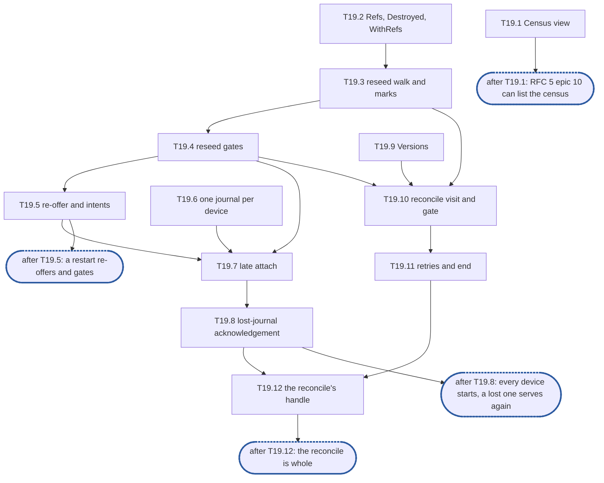

# Epic 19: engine offload restart and the metadata reconcile

**Sources:** [RFC 8](../docs/internals/rfcs/rfc-8-engine.md) §2.5 (start steps 6 and 7: the reseed
and the metadata reconcile, the late attach of a journal refused at `Start`, the lost-journal
acknowledgement, `Bind`'s takeover of the reconcile's handle, the restart re-offer, the stop's joins),
§2.3 (`Unbind`'s cancel of the reconcile's visit), §2.1 and §2.6 (`Refs`, one journal per device),
§5.1 (the loss sequence at a start past an acknowledged loss, and the reconcile's raise), §10.4 (the
reseed's clearing of destroyed material), §11.1 (`journal_unreconciled`), §11.2's "Crash" and "Local
corruption naming no record" rows, §13's E30 and E36, §14 (`engine_reseed_files_remaining`,
`engine_ledger_mismatches_total`, the reseed's root span), and these rows: §15.1's "§2.5 restart
re-offer", "§2.5 journal gone" and "§2.5 attach after a device loss" (the acknowledgement), "§2.5
metadata reconcile" (single-node cases), "§2.5 `Bind` takes over the reconcile's handle", "§2.5
unsuitable journal at start", "§2.5 unread range at start", "§2.5 reseed gates offer and eviction",
"§4.1 verifier inputs" (the offloaded loss), "§5.1 durable commits", "§10.4 destroyed material" (its
crash leg); §15.2's "§2.3 removal during a reconcile"; §15.3's "§2.5 reseed".
[RFC 6](../docs/internals/rfcs/rfc-6-block-metadata.md) §10.1 (`Existence.Versions`, the `Census`
view on `Blocks`), §2.3 (`encodings`), §7.6 (put intents);
[RFC 16](../docs/internals/rfcs/rfc-16-metadata-store.md) §3.1 (`Inspect.Refs`), §3.2
(`RecordJournal`), §4.2 (`J‖journal`, `JD‖node‖device`), §4.4 (counters many writers change);
[RFC 5](../docs/internals/rfcs/rfc-5-transforms.md) §5.3 (what a census counts);
[RFC 1](../docs/internals/rfcs/rfc-1-journal.md) §3.3 (`MarkOffloaded`, `Unmark`, `DropOlder`,
`Reconciled`); [RFC 11](../docs/internals/rfcs/rfc-11-ownership.md) §2.1 (one shard, one journal
device).
**Track:** C.
**Epic 19 estimate: 12 subtasks, 39 man-days.**
**Depends on:** sync point **S2**, red rows in CI (epic 12): the fixture's `WithRefs`, `WithDevices`,
`AcknowledgeLoss` and `ReopenOwingReconcile`, refusing by name, the proposed controls `HoldNextVisit`,
`HoldReconcileAfterMarkCheck`, `HoldReconcileBeforeClose` and `ImportRef`, and the thirteen entries
whose rows this epic turns green; epic 11's frozen `Stats` fields `LedgerMismatches` and
`JournalStats.ReseedFilesRemaining`; epic 14's tenants and rebuilds (its T14.1, T14.2, T14.5), which
the late attach runs; epic 15's block record `entity.Encoding` (its D6, T15.3), which the census
counts and the reseed's destroyed read follows; epic 16's passes (its T16.3), whose runs the reseed
gates; epic 18's eviction loop and its destroyed-material notice with the lock Mark and `Unmark`
take, which start step 7 starts and the reseed shares, with the RFC 5 plan's epics 6 and 8 (the
  key-record view in `kvstore` and `keystest`'s notice) that epic 18 brings in; **S6**: the journal plan's epic 9b for
`MarkOffloaded` and `Unmark` over the real journal, and its epic 7b for `DropOlder` and `Reconciled`,
which gate T19.10 to T19.12.
**Blocks:** the RFC 5 plan's epic 10, whose census listing reads T19.1's view; epic 20, whose
`material_destroyed` evaluation reads the same census (T19.1); the integration epic, through S4.

---

## 1. Goal

Epic 19 is what a start adds once offload exists. A restarted engine marks again what its refs
justify, clears what nothing justifies or what destroyed material covers, re-offers the rest under new
names, and abandons the put intents its shards left; a journal refused at `Start` attaches later with
the same steps; a lost journal serves again once an operator has acknowledged it; and a journal owing a
metadata reconcile drops, file by file, what metadata shows superseded, gating each file until then.

**At the end of the epic:**

- every block record of a namespace is counted in its `Census` view until pruned, and the view answers
  from counts, never a walk of block records;
- after a restart no file is offered or evicted before the reseed has visited it, no bit stays set that
  no ref justifies, and none stays set over destroyed material;
- a node with several journal devices starts each, and a refused one leaves the others serving;
- a lost journal raises `journal_lost` until acknowledged, and its shares then read **Lost** where
  content was never offloaded;
- a journal owing a reconcile serves every file only once visited, drops what metadata shows
  superseded, settles through `Reconciled`, and keeps one owner per handle under every interleaving of
  `Bind`, `Unbind`, `Drop` and `Close`;
- the thirteen rows of §6's catalogue are green and out of `test/engine/known.yaml`.

### 1.1 In scope

`kvstore`'s `Census`, `Inspect.Refs`, `Existence.Versions`, the reseed's destroyed-material read, the
lost-journal acknowledgement record, the shard's journal identity; the engine's start step 7 reseed and
reconcile, the late attach's steps 6 and 7, the restart's intent abandonment, one journal per device,
the reconcile's handle ownership; the fixture controls epic 12 left refusing for this epic.

### 1.2 Out of scope

- The node action that writes the lost-journal acknowledgement, and RFC 16 §3 naming its read: RFC 28's
  plan, the offload plan's §6.1 rows "The lost-journal acknowledgement's admin-only node action" and
  "RFC 16 §3 naming `Lifecycle`'s read". The fixture's `AcknowledgeLoss` writes the record until then.
- The unread-range acknowledgement at a refused open (`AcknowledgeUnreadable` in `Deps`, its run by the
  retry, and the "acknowledging the range instead" leg of "§2.5 unread range at start"): RFC 28's plan,
  a §6.1 row this pull request adds (D9, pending the user's answer, §9).
- Choosing which device a new share is placed on: a §6.1 row this pull request adds (D5).
- The reconcile's replica clauses (a replica's visit, its loss point, a promotion, `ErrAmnesiac`, the
  takeover's push, `Copy` and repair), "a new primary settles before serving", and RFC 8 E36's
  replicated half: the cluster stage, §6.1 row "The cluster rules".
- The reconcile's snapshot-capture visit and the acknowledgement's `failed` snapshots: RFC 12, §6.1 row
  "Snapshot-hold ordering".
- The salvage export a stranded tag runs during the reconcile (a leg of "§2.5 metadata reconcile"):
  epic 20; whichever of the two lands second removes the row's entry.
- The read-only journal's reopen in place, which runs the reseed this epic builds: unowned, RFC 8 E42
  (the offload plan's §6 point 5).
- The destroyed-material notice, Mark's check and the commit's tracked read of key records: epic 18.
  This epic reads the lock and the reported set epic 18 keeps (D3).
- The census refresher, its gauge and its listing: the RFC 5 plan's epic 10.
- Collecting the orphan of a re-offered put once the epoch is superseded (a leg of "§2.5 restart
  re-offer"): RFC 9, §6.1 row "GC composed in the node".

### 1.3 Names used here

- **S2**, red rows in CI: the end of epic 12, the fixture's refusing controls and the rows' entries.
- **S4**, offload complete in the fixture: epics 13 to 20 done; the integration epic starts there.
- **S6**, journal offload half built: the journal plan's epics 9b (`MarkOffloaded`, `Unmark`, the
  offload calls) and 7b (`DropOlder`, `Reconciled`, `AcknowledgeUnreadable`).
- **The integration epic**, epic 21: the node composes offload.
- **The first part**: the journal-only engine, epics 1 to 10 of RFC 8's first plan; its epic 6 built
  `Start`, the refused devices and their retry.
- **RFC 8 E30, E36 and E42**: invariants of RFC 8 §13, not epics: a file offered and evicted only
  once reseeded, the operator gate for a shard with no replica, the read-only journal's reopen.
- **#3708**: the issue that no input of the engine names the journal a share lives on.
- **#3717** and **#3889**: the two blocked issues this epic lands at their `decision:` sites, the ranges counted in one call and a
  failed `Bind` after the takeover.

## 2. How the general rules apply

The rules are those of [the offload plan's §1.5](rfc-8-offload-engine-plan.md#15-general-rules-for-each-epic),
cited by number and title and not copied.

| Rule | Subtasks | How |
| --- | --- | --- |
| rule 1, **Independent unit tests** ([`CLAUDE.md`, "Writing tests"](../CLAUDE.md#writing-tests)) | all | engine tests over the first part's unit fixture and its in-memory journal, `kvstore` over the in-memory `kv.KV`; store views over `kvstoretest`'s backends; the store's key-record view (the RFC 5 plan's epic 6) for key records and `keystest`'s provider for the notice (its epic 8); no double but the injected clock, kind 3 faults and per-instance hooks set from `export_test.go` |
| rule 2, **Fuzz the key and ref decoders the queue's rebuild reads** | T19.1, T19.6 | the census delta and total records and the shard record with its journal identity each gain a decode fuzz target in the nightly `fuzz` suite, seeded with a record written without the new field where one existed |
| rule 3, **Observability follows RFC 25** | T19.3, T19.10, T19.11 | `engine_reseed_files_remaining` into `JournalStats.ReseedFilesRemaining`, `engine_ledger_mismatches_total` into `Stats.LedgerMismatches`, a ledger mismatch logged at `Warn` with its file and extent, a reseed's root span; `journal_unreconciled` per share or per journal in `Stats` |
| rule 4, **Profiling** | T19.3, T19.10, T19.12 | the reseed walk, the reconcile walk and the lost journal's retry are goroutines the fixture's `prof.Watch` checks across `Close`; no allocation assertion: neither is a hot path RFC 8 names |
| rule 5, **Public interface and internals** ([`CLAUDE.md`, "Verifying a change"](../CLAUDE.md#verifying-a-change)) | all | the reseed's bit is asserted at the journal's `Release` and an eviction, which consume it; a reconcile's drop at a read; the census at the view RFC 5 epic 10 reads; the acknowledgement at `Start`'s `Stats` |
| rule 6, **Known failures shrink** | T19.2 to T19.5, T19.7, T19.8, T19.10 to T19.12 | each row's entry leaves `test/engine/known.yaml` in the change that turns it green; T19.2 rewrites every entry whose message was `WithRefs`'s refusal, T19.10 every one whose message was `ReopenOwingReconcile`'s |
| rule 7, **v2 ignores v1, and the engine imports only what RFC 0 §1.2 allows** | T19.2, T19.3, T19.6, T19.8 | `Deps.Refs` and the reseed's destroyed read are engine-declared interfaces over `entity` types; the engine never imports `kvstore`, `keys`' implementation or the key records' codec, and holds no key material (D2) |
| rule 8, **Real dependencies for properties of those dependencies** ([`CLAUDE.md`, "Writing tests"](../CLAUDE.md#writing-tests)) | T19.3, T19.5, T19.10 to T19.12 | the crash legs and the reconcile rows run over the real journal with its crash seam once S6 lands; the census and the acknowledgement over `kvstore` on every backend `kvstoretest` runs |
| rule 9, **Code comment conventions** ([`CLAUDE.md`, "Code comments"](../CLAUDE.md#code-comments)) | T19.1, T19.5, T19.6, T19.8, T19.10, T19.11 | RFC 8 §2.5's four reconcile `decision:`s and its `newest` `ponytail:` at their sites; this epic's markers named in §4 |
| rule 10, **A test must be able to fail** ([`CLAUDE.md`, "Writing tests"](../CLAUDE.md#writing-tests)) | all | each test names the break that fails it on its assertion; each row is reverted to its red message once before its entry goes |
| rule 11, **A symbol is exported only if the RFC's interface uses it** | T19.1, T19.2, T19.6, T19.8 | exported: RFC 6's `EncodingCount` and views, RFC 16's `Refs`, the store calls `Lifecycle` gains (D6), `entity`'s new fields; the reseed and the reconcile are unexported |
| rule 12, **Each subtask creates only what it declares** | all | `Deps.Refs` and `Deps.Destroyed` join with T19.3, the reseed; `Handle.MarkOffloaded` and `Unmark` with T19.3, after their journal suite rows; `DropOlder` and `Reconciled` with T19.10, after 7b's rows |

## 3. Requirements and invariants

Every obligation the sources place on this epic, numbered so subtasks and tests can cite them. The
rows' own assertions are RFC 8 §15's text; a row's requirement here names the leg this epic owns.

**Store views**

| # | Requirement | Kind | Source | Subtasks |
| --- | --- | --- | --- | --- |
| R1 | The `Census` view of a namespace counts every block record until it is pruned, `retired` and `deleted` ones included, per transform, version and material, as the block record's `encodings` list them | MUST | RFC 5 §5.3; RFC 6 §2.3, §10.1 | T19.1 |
| R2 | The census never depends on timing, and a block's entry in it never changes, since a block is never re-encoded in place (D1 counts its `encodings` once at commit and uncounts them once at prune) | invariant | RFC 5 §5.3; RFC 6 §2.3 | T19.1 |
| R3 | No counter is read and rewritten by the transaction that changes it: a commit or a prune changing the census writes a record unique to it, which reads nothing | MUST | RFC 16 §4.4 | T19.1 |
| R4 | `Versions` reports over `[off, off+n)` each run with the highest version metadata records over it (its overwrite record, the covering live ref's `newest`, a committed hole, a removal not done) and the file's committed size and `applied`, in one read; a file with no `File` record and no removal not done is `ErrNotFound` | MUST | RFC 6 §10.1; RFC 8 §2.5 | T19.9 |
| R5 | `Refs` yields a file's live and history refs alike from an offset, each saying which | MUST | RFC 16 §3.1; RFC 8 §2.1, §2.5 | T19.2 |
| R6 | The reseed reads whether a block's material is destroyed from the durable key records, a master-key destroy's marks included, never from the notice's cursor | MUST | RFC 8 §10.4 | T19.2, T19.3 |

**The reseed**

| # | Requirement | Kind | Source | Subtasks |
| --- | --- | --- | --- | --- |
| R7 | Start step 7 starts the scheduler's dispatch, the age tick, the removal rescan, eviction and the reseed, after step 6 | MUST | RFC 8 §2.5 step 7 | T19.4 |
| R8 | The reseed reads each held file's refs, live and history alike, and marks through `MarkOffloaded` every held extent a committed ref covers, at the ref's versions | MUST | RFC 8 §2.5 step 7; RFC 1 §3.3 | T19.3 |
| R9 | A bit no ref justifies is reported as a ledger mismatch and cleared with `Unmark`, so the extent is offered again; the reseed never clears a bit through `MarkOffloaded` | MUST | RFC 8 §2.5 step 7; RFC 1 §3.3 | T19.3 |
| R10 | The reseed clears the offloaded bit of each extent whose block's `encodings` name material whose key record is marked destroyed, before that file can be evicted | MUST | RFC 8 §10.4 | T19.3, T19.4 |
| R11 | A destroy reported while the reseed runs never leaves an extent marked: the reseed marks under the lock Mark and the notice's `Unmark` take, against the material reported destroyed, as RFC 8 §10.4 binds Mark (D3) | invariant | RFC 8 §10.4 (Mark's rule), applied by D3 | T19.3 |
| R12 | The reseed reads at most eight files' refs at a time per journal, beside the runs that reseed their own file | bound | RFC 8 §2.5 step 7 | T19.3 |
| R13 | `engine_reseed_files_remaining`, labelled by journal, reports the held files the reseed has yet to visit; `engine_ledger_mismatches_total` counts the bits it cleared; a mismatch logs the file and extent at `Warn`; a reseed opens a root span | MUST | RFC 8 §2.5 step 7, §14 | T19.3 |
| R14 | A file is offered and evicted after a restart only once the reseed has run for it | invariant | RFC 8 §2.5 step 7, §13 E30 | T19.4 |
| R15 | The reseed visits first the files offload or eviction asks for, and an offload run handed a file the reseed has not visited reseeds it before it offers | MUST | RFC 8 §2.5 step 7 | T19.4 |
| R16 | §2.5 reseed gates offer and eviction, §2.5 reseed, and §10.4 destroyed material's crash leg (a crash after a destroy and before its `Unmark`: the reseed clears the bits before any of those extents is evicted) | test row | RFC 8 §15.1, §15.3 | T19.4 |

**Restart re-offer and intents**

| # | Requirement | Kind | Source | Subtasks |
| --- | --- | --- | --- | --- |
| R17 | Before serving, a restarted single node abandons every put intent its own shards hold | MUST | RFC 8 §2.5 ("Restart re-offers"); RFC 6 §7.6 | T19.5 |
| R18 | Each abandonment transaction stays within the key budget `K` | bound | RFC 6 §5.2, §7.6 | T19.5 |
| R19 | §2.5 restart re-offer (but its collection leg), §5.1 durable commits, and §4.1 verifier inputs' offloaded loss | test row | RFC 8 §15.1 | T19.5 |

**Journals and their devices**

| # | Requirement | Kind | Source | Subtasks |
| --- | --- | --- | --- | --- |
| R20 | `Start` opens the journal of each device `Deps.Devices` names, and a share gets its handle on the journal it lives on, counts in that journal's floor only and is forgotten there | MUST | RFC 8 §2.1, §2.3, §2.5 step 1, §2.6; RFC 11 §2.1 | T19.6 |
| R21 | A share refused on one device does not fail `Start`; the other devices' shares serve | MUST | RFC 8 §2.5 | T19.6, T19.7 |
| R22 | Once a retried open succeeds, the engine attaches the journal's shares as a bound share is, raises their incarnations at attach, runs steps 3 to 6 and step 7's reseed for that journal, serves each file once step 3 has run for it, and then clears the condition | MUST | RFC 8 §2.5 | T19.7 |
| R23 | §2.5 unsuitable journal at start (two devices), and §2.5 unread range at start but its acknowledged-range leg (D9) | test row | RFC 8 §15.1 | T19.7 |

**The lost-journal acknowledgement**

| # | Requirement | Kind | Source | Subtasks |
| --- | --- | --- | --- | --- |
| R24 | The acknowledgement is a store record naming the device and the lost journal's `JournalID`, read through `Lifecycle` at step 1 and at each retried open | MUST | RFC 8 §2.5, §2.1 (`Lifecycle` row) | T19.8 |
| R25 | It applies only to that recorded journal, never to one not recorded, and is consumed when the new journal's `RecordJournal` commits or the recorded journal opens, so it never acknowledges a later loss on the same device | MUST | RFC 8 §2.5 | T19.8 |
| R26 | Until acknowledged, every share on a device whose recorded journal is missing or foreign is refused, each named, and the directory is never opened as a new journal; a retried open that finds the journal missing or foreign is gated the same way and raises `journal_lost` | MUST NOT | RFC 8 §2.5 step 1 | T19.8 |
| R27 | After the acknowledgement, the shares' content that was never offloaded resolves **Lost**, never zeros | MUST | RFC 8 §2.5 step 1, §7.1 | T19.8 |
| R28 | At a start past an acknowledged loss each file of a share attached to that journal starts its loss sequence at 1 rather than 0 | MUST | RFC 8 §5.1 | T19.8 |
| R29 | The operator gate binds every shard with no replica, which on a single node is every shard | invariant | RFC 8 §2.5 step 1, §13 E36 | T19.8 |
| R30 | §2.5 journal gone and §2.5 attach after a device loss, their acknowledgement legs | test row | RFC 8 §15.1 | T19.8 |

**The reconcile's scope and visit**

| # | Requirement | Kind | Source | Subtasks |
| --- | --- | --- | --- | --- |
| R31 | When `Stats.Recovery` says a reconcile is owed, the reseed runs it | MUST | RFC 8 §2.5 step 7 | T19.10 |
| R32 | Its scope is the files the open recovered of every tag the journal holds, attached or not, except a stranded tag's and those of a shard whose removal row reads offloaded or later; a file first appended after the open counts as visited | MUST | RFC 8 §2.5 step 7; RFC 16 §2.3.2 | T19.10 |
| R33 | A file's visit reseeds its bits from its live and history refs before it calls `DropOlder` | MUST | RFC 8 §2.5 step 7 | T19.10 |
| R34 | The visit splits each held extent at the boundaries `Versions` reports, one call per extent, takes per piece the highest of its versions (and `applied` past the committed size), and calls `DropOlder` with `below` that version; a piece past `size` above `applied` is kept; a file with no `File` record and no unfinished removal has all its held content dropped | MUST | RFC 8 §2.5 step 7; RFC 1 §3.3 | T19.10 |
| R35 | The file's loss sequence rises where only an overwrite record knew the newer bytes, and only there | MUST | RFC 8 §5.1 | T19.10 |
| R36 | Each file's content is gated until visited: a read, write, truncate, deallocate, delete, clone into it, offer, eviction, or copy or clone source on an unvisited file visits it first; one whose visit has not finished by its deadline is answered retry-later (`DelayFrozen`); its metadata is served meanwhile | MUST | RFC 8 §2.5 step 7, §12.1 | T19.10 |
| R37 | Files nothing touches are visited by the walk at its pace, under eight files' metadata reads at a time per journal | bound | RFC 8 §2.5 step 7 | T19.10 |
| R38 | Start step 4's re-make of a clone whose source is unvisited visits the source first and waits for it as for space, never holding start up | MUST | RFC 8 §2.5 step 4 | T19.10 |

**The reconcile's retries and end**

| # | Requirement | Kind | Source | Subtasks |
| --- | --- | --- | --- | --- |
| R39 | A metadata read that fails leaves the file gated and is retried every 30 s, `journal_unreconciled` naming the share and the cause until it succeeds; the reconcile never gives up | MUST | RFC 8 §2.5 step 7, §11.1 | T19.11 |
| R40 | A `DropOlder` answering `ErrNoSpace` or `ErrJournalReadOnly` ungates the file; after `ErrJournalReadOnly` the reconcile stops calling `Reconciled` | MUST | RFC 8 §2.5 step 7; RFC 1 §3.3 | T19.11 |
| R41 | Once every file in the scope is visited, the reconcile calls `Reconciled`, retried every 30 s under `journal_unreconciled` while it answers `ErrNoSpace`, raises `journal_unreconciled` from `Stats.Recovery`'s reason while the journal settles, and then repacks the segments the open named | MUST | RFC 8 §2.5 step 7, §11.1 | T19.11 |
| R42 | §2.5 metadata reconcile, single-node cases, with #3717's regression leg | test row | RFC 8 §15.1 | T19.11 |

**The reconcile's handle**

| # | Requirement | Kind | Source | Subtasks |
| --- | --- | --- | --- | --- |
| R43 | A tag not yet attached is visited through a handle `Share` opens (its limit as D8 decides) with, as floor, the larger of its version floor and version limit as step 1 read them, closed once that tag's visit ends unless a `Bind` took it over | MUST | RFC 8 §2.5 step 7 | T19.12 |
| R44 | The handle has one owner at a time, decided under the lock that serializes the share table's swaps: the takeover marks it bound under that lock before `Share`; the reconcile, in one hold, records the visit's end, checks the mark and marks it closing, and calls `Close` after releasing the lock | MUST | RFC 8 §2.5 step 7 | T19.12 |
| R45 | A `Bind` taking it over does everything `Bind` does: reads the floor and limit again, raises the counter through `Share` on the open handle, writes the limit before it publishes; the share's unvisited files stay gated; a `Bind` finding the handle closing waits outside the lock for that `Close` and attaches afresh | MUST | RFC 8 §2.5 step 7 | T19.12 |
| R46 | A `Bind` failing after the takeover undoes its other steps but not the handle: in one hold it clears the mark, reads whether the visit ended and ends its lifecycle call, and closes the handle itself only if the visit had ended | MUST | RFC 8 §2.5 step 7 | T19.12 |
| R47 | `Unbind` cancels the reconcile's visit of the share's tag, waits for it and counts the tag's files visited, so `Drop` never closes a handle the visit uses and the reconcile still reaches `Reconciled` | MUST | RFC 8 §2.3 | T19.12 |
| R48 | `Close` cancels and joins the reseed and the reconcile at its step 3, closes no handle marked closing at its step 4 but joins its own `Close` within the stop bound, and a join past its bound leaves what it depends on open | MUST | RFC 8 §2.5 Stop steps 3 to 5 | T19.3, T19.12 |
| R49 | §2.5 `Bind` takes over the reconcile's handle, with #3889's regression leg, and §2.3 removal during a reconcile | test row | RFC 8 §15.1, §15.2 | T19.12 |

## 4. Decisions this epic takes

- **D1, the census is delta records folded on read, keyed by encoding.** RFC 6 §10.1 declares
  `Census(ctx) iter.Seq2[EncodingCount, error]` and defines no entry, and RFC 5 epic 10's listing needs
  counts, not a walk (R1, R3). `entity` gains, beside epic 15's `Encoding` and `MaterialRef`:
  ```go
  // EncodingCount is one census entry: the block records of a namespace whose encodings name this
  // transform, version and material, retired and deleted ones included until pruned (RFC 5 §5.3).
  type EncodingCount struct {
  	Transform uint16
  	Version   uint8
  	Material  MaterialRef // zero for a transform that takes none
  	Blocks    int64
  }
  ```
  A block commit that writes a block record with `encodings`, and `Prune` deleting one, write one
  delta record `NS‖ns‖cd‖unique` (the node, its epoch and a sequence, as RFC 16 §4.4's usage deltas)
  holding ±1 per distinct (transform, version, material) the block names; it reads nothing. `Census`
  first folds every delta into the totals `NS‖ns‖ct‖entry`, at most `K` keys a transaction, then reads
  the totals in one view, so a read costs O(distinct entries) plus the deltas since the last read. A
  block naming one entry twice counts once. The delta is one more key in a block commit, which RFC 6
  §5.2's floor must count: epic 15's T15.2 counts it once this lands (§9). No backfill: a store holding blocks committed before this
  lands has a census short by them, which `kvstore`'s `Check` reports (T19.1). A `ponytail:` at the
  fold: only a read folds, so deltas grow between reads, bounded by RFC 5 epic 10's 5-minute refresher;
  add a background fold when a namespace's unfolded deltas show in a census read's profile. RFC 6
  §10.1 and RFC 16 §4.2 are amended with the entry and the two key families in T19.1's pull request.
  Settled now because RFC 5 epic 10 and epic 20 read it. Prior art: RFC 16 §4.4's usage deltas and
  `kvstore`'s directory fold (`dirfold.go`), which this follows (checked).
- **D2, the reseed's destroyed read is one store call per file, answered inside the store.** The
  engine holds no key material, and the key-record view's `Load` returns a non-encrypting namespace's
  chunk-ID key in the clear (the RFC 5 plan's epic 6, D1), so the engine never reads key records. It
  declares, with T19.3:
  ```go
  // Destroyed reports which of chunks, all the file's, sit in blocks whose encodings name material
  // whose key record is marked destroyed (RFC 8 §10.4), in one read.
  Destroyed(ctx context.Context, share entity.ShareID, file entity.FileID, chunks []entity.ChunkHash) ([]entity.ChunkHash, error)
  ```
  on block metadata's `Content` view, which `kvstore` answers by reading each chunk's record, its
  block's `encodings` and each named material's key-record state in one view, matching by namespace,
  kind and ID. RFC 8 §2.1's row already holds every `Content` method; RFC 6 §10.1 is amended with
  the call in T19.2's pull request. Prior art: none found.
- **D3, the reseed marks under the notice's lock.** RFC 8 §10.4 makes Mark check, under the lock the
  notice's `Unmark` takes, that no pinned material has been reported destroyed; the reseed's
  `MarkOffloaded` races the notice the same way. So the reseed takes epic 18's lock, drops from what it
  marks every extent whose chunk's material is in the set the notice has reported, and marks; the
  durable read of D2, made at each visit, covers what was destroyed before this process, and the
  notice's poll starts before the reseed's first visit, so no destroy falls between the two. A `decision:` at the reseed's mark
  says it relies on epic 18's lock. Prior art: RFC 8 §10.4's Mark rule (checked).
- **D4, the reseed is one walk per journal in file order, with an asked-first queue.** At step 7 the
  reseed walks the journal's held files in the order `Files` lists them, keeping a cursor and a small
  set of the files visited ahead of it, so a file is visited when it is behind the cursor or in the
  set: memory follows the files asked for out of order, not the 10⁸ files a journal can hold. Up to
  eight workers take the next file, first from a queue of the files an offer, an eviction or a
  reconcile gate asked for. An offload run handed an unvisited file runs its visit inline instead and
  adds it to the set, so a file is visited once. A file first written after the open has no offloaded
  bit to reseed and counts as visited. The option of a visited bit per held file was rejected for that
  memory. Prior art: none found.
- **D5, a share's journal is its shard's primary journal identity, as the first part's epic 6 D10
  decided.** `entity.Shard` gains `Journal [16]byte`, RFC 16 §2's `Shard.Primary` journal identity,
  written where the store creates the shard; `entity.TagRecord` gains `Journal`, so `Tags` answers it.
  `Start` matches it against the identity `JournalID` answers for each device. A zero identity is
  allowed only while `Deps.Devices` names one device, and binds to it; with several, a share whose
  shard names no device's journal, zero included, is refused by name. The re-initialisation's
  `RecordJournal` rewrites, as a compare-and-swap on each, the shards naming the replaced identity, in
  its one transaction. A `ponytail:` at `RecordJournal`: more shards on one device than `K` fail the
  rewrite; batch it, under the acknowledgement's guard, once a device holds that many. A `decision:` at
  the match: one share's shards on two journals are refused, since v1.1 places a share on one device.
  Which device a new share goes to is the control plane's, a §6.1 row added here. The option of a
  `Device` field on RFC 8 §12.1's `Share`, #3708's (1b), was rejected as the first part's D10 rejected
  it: the node would have to know a placement the store already records. Prior art: the first part's
  epic 6 D10 and #3708 (checked).
- **D6, the acknowledgement is `J‖journal‖ack`, consumed with its journal's records.** The key is
  empty, a presence marker under the lost journal's `J‖journal`, whose value already names the node
  and device. `Lifecycle` gains
  `LossAcknowledged(ctx, id [16]byte) (bool, error)` and `ConsumeLossAck(ctx, id [16]byte) error`;
  `Store` gains `AcknowledgeLoss(ctx, node entity.NodeID, device entity.JournalDir, expect [16]byte)
  error`, refused unless `JD‖node‖device` names `expect`, as `acknowledge-unreadable` takes its
  `expect JournalID`. The re-initialisation's `RecordJournal` deletes it with the old journal's records,
  which it already deletes by prefix; a retried open of the recorded journal that succeeds consumes it.
  A lost journal's open is retried every 30 s by the first part's retry loop (`retryUnsuitable`, which
  `Close` already joins), widened to a missing or foreign journal, so the acknowledgement is read at
  each retried open (R24) and a reattached journal is found. An acknowledged loss clears
  `journal_lost`; its shares serve once a journal is recorded for the device and opens, since only the
  initialisation step creates one (RFC 1 §3). RFC 8 §15.1's "journal gone" leg reads as if the
  acknowledgement alone served; T19.8 re-initialises the device in that leg as the operator's step, and
  proposes the row's wording (pending the user's answer, §9). Prior art: RFC 16 §3.2's proposal that
  the re-initialisation calls `RecordJournal` (checked).
- **D7, a journal attached holding none of its shares' tags starts its loss floor at 1.** A start past
  an acknowledged loss attaches a re-initialised journal, whose acknowledgement the re-initialisation
  already consumed, so nothing at that start names the loss. Every such journal holds none of the tags
  of the shares it serves, so the engine starts that journal's loss floor (RFC 8 §5.1's `ponytail:`)
  at 1 whenever its first attach in the process finds that. A fresh journal's shares hold no file, and
  an imported share's files fail one flush at most, the safe direction. A `decision:` at the floor says
  it is wider than "past an acknowledged loss", withdrawn if a spurious flush failure is reported.
  Prior art: none found.
- **D8, an unattached tag's handle is opened at the share's recorded floor and the journal's
  maximum.** `Share` needs the share's journal limit and floor, and a tag not attached belongs to a
  share `Start` was not handed, so the engine reads its floor and version limit through `Lifecycle` as
  step 1 does. RFC 8 §2.5 names the share's journal limit, a share setting the engine is not handed for
  such a tag; the handle stages no write (R43), so the limit bounds nothing, and the engine passes the
  journal's maximum. T19.12's pull request amends §2.5's sentence to say so. A `decision:` at the open
  says so. Prior art: none found.
- **D9, the unread-range acknowledgement waits for its trigger (pending the user's answer).** RFC 8
  §2.5 has a refused open's retry run `AcknowledgeUnreadable` once an operator acknowledges the range,
  and RFC 23 §3.3's `acknowledge-unreadable` is that trigger, which the RFC 23 plan gives RFC 28's
  plan. With no caller in v1.1, `Deps.AcknowledgeUnreadable`, its run and the row's
  "acknowledging the range instead" leg go to RFC 28's plan, a §6.1 row this pull request adds; the
  leg becomes a subtest of its own, its entry naming that row's issue. The other option, a store record
  of acknowledged ranges written by the fixture as D6's is, builds a resumable operation nothing in
  v1.1 starts. Prior art: the cross-plan contract's "pieces with no caller in v1.1 are deferred".
- **D10, intents are abandoned in batches within `K`.** `kvstore`'s `AbandonShardIntents` scans a
  namespace's intents in one read and abandons them in one transaction; T19.5 pages both, at most `K`
  keys a transaction, as `pages` does elsewhere in `kvstore`, and the engine calls it for each
  namespace its served shares write, before step 8. No marker. Prior art: `kvstore`'s `pages` (checked).

## 5. Target tree

On `feat/storage-v2`.

```text
pkg/metadata/entity/
  content.go              T19.1  EncodingCount; T19.6 Shard.Journal
  control.go              T19.6  TagRecord.Journal
pkg/metadata/kvstore/
  census.go               T19.1  Census, its deltas at commit and Prune, the fold, its codecs
  offload.go, blocks.go   T19.1  the census delta written by the block commit and by Prune
  check.go                T19.1  the census checked against a walk of block records
  inspect.go              T19.2  the Inspect view and its Refs; Content.Destroyed
  blocks.go               T19.5  AbandonShardIntents paged within K
  shards.go, shares.go    T19.6  the shard's journal identity, written at creation
  lifecycle.go            T19.6  Tags' journal, RecordJournal's rewrite; T19.8 AcknowledgeLoss, LossAcknowledged, ConsumeLossAck
  versions.go             T19.9  Existence.Versions
  kvstoretest/            T19.1, T19.2, T19.6, T19.8, T19.9  each view's rows over every backend
pkg/engine/
  deps.go                 T19.3  Refs, Content.Destroyed, Handle.MarkOffloaded and Unmark; T19.8 Lifecycle's two calls; T19.10 Handle.DropOlder, Journal.Reconciled
  reseed.go               T19.3  the reseed walk; T19.4 the asked-first queue and the gates
  recover.go              T19.5  intents abandoned; T19.6 every device; T19.7 steps 6 and 7 at a late attach; T19.8 the lost journal's retry and its acknowledgement
  loss.go                 T19.8  the journal's loss floor at 1 (D7)
  reconcile.go            T19.10 the visit and the gate; T19.11 retries and the end; T19.12 the handle's owner
  share.go, unbind.go     T19.12 Bind's takeover, Unbind's cancel, Drop's wait
  close.go                T19.3  the reseed joined; T19.12 the closing handles joined
  health.go               T19.11 journal_unreconciled
  enginetest/             T19.2  WithRefs; T19.6 WithDevices(n); T19.8 AcknowledgeLoss; T19.10 ReopenOwingReconcile, HoldNextVisit, ImportRef; T19.12 the two reconcile holds
  enginetest/journal.go   T19.3  MarkOffloaded, Unmark; T19.10 DropOlder, Reconciled, each after its suite row
  conformance/            the rows' entries removed, each with the subtask that turns it green
test/engine/known.yaml    T19.2  messages rewritten; T19.4 to T19.12 entries removed
.planning/rfc-8-offload-engine-plan.md  this pull request: the two §6.1 rows of D5 and D9
```

## 6. Subtasks

Each row this epic turns green, with its test (epic 12's) and the subtask that removes its entry:
"§2.5 reseed gates offer and eviction" (`TestRFC8A_ReseedGatesOfferAndEviction`), "§2.5 reseed"
(`TestRFC8C_Reseed`) and "§10.4 destroyed material, crash before `Unmark`"
(`TestRFC8A_DestroyedMaterialCrashBeforeUnmark`), T19.4; "§2.5 restart re-offer"
(`TestRFC8A_RestartReoffer`), "§5.1 durable commits" (`TestRFC8A_DurableCommits`) and "§4.1 verifier
inputs" (`TestRFC8A_VerifierUnchangedByAnOffloadedLoss`), T19.5; "§2.5 unsuitable journal at start"
(`TestRFC8A_UnsuitableJournalAtStartBesideAServedDevice`) and "§2.5 unread range at start"
(`TestRFC8A_UnreadRangeAtStart`), T19.7; "§2.5 journal gone" (`TestRFC8A_JournalGoneAcknowledged`) and
"§2.5 attach after a device loss" (`TestRFC8A_AttachAfterDeviceLossAcknowledged`), T19.8; "§2.5
metadata reconcile" (`TestRFC8A_MetadataReconcile`), T19.11; "§2.5 `Bind` takes over the reconcile's
handle" (`TestRFC8A_BindTakesOverTheReconcilesHandle`) and "§2.3 removal during a reconcile"
(`TestRFC8B_RemovalDuringAReconcile`), T19.12.

### T19.1 The `Census` view, counted at commit and prune

**Subtask T19.1 estimate: 3 man-days.**

- **Track:** C. **Depends on:** none. Epic 15's T15.3 first, for `entity.Encoding`.
- **Covers:** R1, R2, R3.
- **Deliverables:** `entity.EncodingCount` (D1); in `kvstore`, `func (b Blocks) Census(ctx
  context.Context) iter.Seq2[entity.EncodingCount, error]`, the delta written by the block commit and by
  `Prune`, the fold within `K`, the delta and total codecs with their fuzz target; RFC 6 §5.2's floor
  raised by the delta's one key (D1); `Check` reporting a
  census that differs from a walk of the namespace's block records; D1's `ponytail:` at the fold; RFC 6
  §10.1 and RFC 16 §4.2 amended. Consumed by the RFC 5 plan's epic 10 (its T10.1 and T10.2) and epic 20.
- **Acceptance criteria:**
  - After any sequence of commits, abandons and prunes, `Census` equals a walk of the namespace's block
    records grouped by entry, `retired` and `deleted` ones included.
  - A commit writes its delta without reading a census key: two commits in one namespace never conflict
    on the census.
  - A namespace's census never names another's blocks.
- **Tests:** in `kvstoretest`, over every backend: a random sequence of commits under two chains, an
  abandon and prunes, `Census` compared after each with a walk (catches a missed delta at commit or
  prune, R1, R2); two concurrent commits in one namespace, neither answering `kv.ErrConflict`, and `kv.Counting`'s
  pass-through record showing the census delta written with no census key read (catches a counter read
  in the commit, R3); a
  store with a planted block record and no delta, which `Check` reports (catches the walk and the counts
  disagreeing unseen); the fuzz target on both codecs. No double but `kv.Counting`, a pass-through recorder.
- **Rules:** rule 2, the codecs' fuzz target; rule 9, D1's marker.

### T19.2 The reseed's store reads, and `WithRefs`

**Subtask T19.2 estimate: 2.5 man-days.**

- **Track:** C. **Depends on:** none. Epic 15's T15.3 first, for the block record's `encodings`.
- **Covers:** R5, R6.
- **Deliverables:** in `kvstore`, the `Inspect` view, which it does not have yet, with its first method,
  `func (i Inspect) Refs(ctx context.Context, share entity.ShareID, file entity.FileID, from int64)
  iter.Seq2[entity.ChunkRef, error]`, the share argument as `Covering` takes it, (live and history refs in offset order, a history ref
  telling itself by its `Died`) and `Content.Destroyed` (D2), with their `kvstoretest` rows; RFC 6
  §10.1 amended with `Destroyed`. In `enginetest`, `WithRefs()` made real: the fixture passes the store's
  `Inspect` as `Refs`; every `known.yaml` entry whose message is `WithRefs`'s refusal rewritten to the
  failure it meets now. Consumed by T19.3 and T19.10.
- **Acceptance criteria:**
  - `Refs` yields every live and history ref of the file from `from`, once each, in offset order.
  - `Destroyed` names a chunk whose block's `encodings` name a key record marked `destroyed`, a
    master-key destroy's mark included, and no other.
- **Tests:** in `kvstoretest`: a file with live refs, a history ref and a ref past `from` (catches a
  missing history ref or a wrong start, R5); a block under two materials with one record marked
  `destroyed` through the store's key-record view (the RFC 5 plan's epic 6), and a block under the other
  (catches a match on the wrong material or the notice's state, R6). No double.
- **Rules:** rule 6, the messages rewritten; rule 7: `Destroyed` hands the engine no key record.

### T19.3 The reseed's walk and its marks

**Subtask T19.3 estimate: 4 man-days.**

- **Track:** C. **Depends on:** T19.2. Epic 18's notice and its lock first, for D3.
- **Covers:** R6, R8, R9, R10, R11, R12, R13, R48 (the reseed's join).
- **Deliverables:** `reseed.go`: one walk per journal (D4) with eight workers; a file's visit reads
  `Refs`, marks with `MarkOffloaded` per ref at its `Oldest` and `Newest` under epic 18's lock less what
  `Destroyed` names or the notice has reported (D3), clears with `Unmark` every set bit no ref covers and
  every bit over a destroyed chunk, counting `LedgerMismatches` and logging each at `Warn`;
  `ReseedFilesRemaining` per journal; the `engine.reseed` root span. `Deps` gains `Refs` and
  `Content` gains `Destroyed`; `Handle` gains `MarkOffloaded` and `Unmark`, and the in-memory journal
  both, passing their journal suite rows. `Close` cancels and joins the walk at its step 3. D3's
  `decision:` at the mark. Consumed by T19.4 and T19.10.
- **Acceptance criteria:**
  - After a reseed every held extent a ref covers has its bit, none other has, and none over a destroyed
    chunk has, whatever the bits were before.
  - No more than eight files' refs are read at once per journal.
  - A destroy the notice reports while a file's visit is between its read and its mark leaves the
    extents unmarked.
- **Tests:** at the journal's `Release`, which consumes the bit, over the unit fixture: a file with a
  set bit no ref covers, released after the reseed and still held (catches an unjustified bit kept, R9);
  a ref's extent with no bit, released after the reseed (catches no mark, R8); a chunk whose block's
  material record is `destroyed`, not released (catches the cursor read instead of the records, R10,
  R6); a destroy reported through `keystest`'s notice while a hook in the visit, set from
  `export_test.go`, holds it between read and mark (catches a mark outside the lock, R11); 64 files with
  the store's `Refs` held through a pass-through wrapper that blocks until released and counts the open
  calls, never above eight (catches an unbounded walk, R12); `Stats` and the log after a mismatch
  (R13); `Close` during a held visit returning only after it (R48). Doubles: the injected clock, the
  hook, the blocking wrapper.
- **Rules:** rule 3, the gauge, the counter, the log and the span; rule 12, the four calls with their
  caller.

### T19.4 The reseed gates offer and eviction

**Subtask T19.4 estimate: 3 man-days.**

- **Track:** C. **Depends on:** T19.3. Epics 16 (its T16.3) and 18 (its eviction loop) first.
- **Covers:** R7, R10, R14, R15, R16.
- **Deliverables:** start step 7 in `Start` and `startOver`: the scheduler's `Start`, the age tick, the
  rescan, epic 18's eviction loop and the reseed, in that order after step 6; the visited set per
  journal; the offload source's run and the eviction loop asking for an unvisited file and waiting on
  its visit, the run visiting inline (D4); the three rows' entries removed. Consumed by T19.7 and
  T19.10.
- **Acceptance criteria:**
  - No extent of an unvisited file is evicted or offered; a full journal frees space at the reseed's
    pace, the asked-for files first.
  - The three rows of R16 pass over the real journal.
- **Tests:** the rows, over the real journal once S6's 9b lands; at the eviction loop, over the unit
  fixture: a full journal at restart with a hook holding the walk, where the file eviction asks for is
  visited first and evicted, and another file not (catches eviction before the visit, R14, R15); an
  offload run handed an unvisited file whose bit the reseed then sets, putting nothing (catches an offer
  before the visit, R14). Doubles: the crash seam and the hook.
- **Rules:** rule 6, the three entries; rule 8, the crash legs over the real journal.

### T19.5 Restart re-offer and abandoned intents

**Subtask T19.5 estimate: 2 man-days.**

- **Track:** C. **Depends on:** T19.4.
- **Covers:** R17, R18, R19.
- **Deliverables:** `AbandonShardIntents` paged within `K` (D10); `Start` calling it for each namespace
  its served shares write, after step 6 and before step 8, and a late attach for its journal's; the
  three rows' entries removed. Consumed by T19.7.
- **Acceptance criteria:**
  - No put intent of a served shard's namespace survives into serving.
  - Every abandonment transaction writes at most `K` keys.
- **Tests:** the rows over the real journal; in `kvstoretest`, 3·`K` intents abandoned, with the keys
  per transaction read from `kv.Counting`'s `MostWrites` (catches one unbounded transaction, R18); at
  the store's intents after `Start` returns (catches an abandon after serving begins, R17). No double
  but the counter.

### T19.6 One journal per device

**Subtask T19.6 estimate: 5 man-days.**

- **Track:** C. **Depends on:** none.
- **Covers:** R20, R21.
- **Deliverables:** `entity.Shard.Journal` and `entity.TagRecord.Journal`, written where `kvstore`
  creates a shard and answered by `Tags` (D5); `RecordJournal`'s rewrite of the shards naming a replaced
  identity, with D5's `ponytail:`; `Start` opening each device's journal and matching each share to
  one, the first part's one-device check in `startOver` and its two `ponytail:`s (there and at the conditions'
  report), and the `Devices[0]` loop, deleted; a share whose
  shards name no device's journal, or two, refused by name with D5's `decision:`; `WithDevices(n)` made
  real, the fixture writing each share's journal identity; the shard record's fuzz target. Consumed by
  T19.7 and T19.8.
- **Acceptance criteria:**
  - With two devices, each share attaches on the journal its shard names, counts in that journal's floor
    only, and its `Drop` forgets its tag there.
  - A refused device leaves the other device's shares serving.
  - The first part's single-device rows pass unchanged with zero identities.
- **Tests:** at `Stats` and a read, over the unit fixture with two in-memory journals: a write to each
  share read back after a restart, each journal's `Stats` naming its own tag only (catches a share on
  the wrong journal, R20); one device refused at the fake's `Open`, the other share serving (R21); a
  share naming a third identity refused by name; in `kvstoretest`, `RecordJournal` replacing an identity
  rewrites every shard naming it and no other. No double.
- **Rules:** rule 2, the shard record's fuzz target; rule 9, D5's two markers.

### T19.7 The late attach's steps 6 and 7

**Subtask T19.7 estimate: 2.5 man-days.**

- **Track:** C. **Depends on:** T19.4, T19.5, T19.6. Epic 14's T14.1 first.
- **Covers:** R21, R22, R23.
- **Deliverables:** `attachLate` adding the journal's shards as tenants of both sources and rebuilding
  them, abandoning its namespaces' intents and running its reseed before it clears the condition; the
  two rows' entries removed, the acknowledged-range leg moved to a subtest of its own with an entry
  naming D9's row's issue. Consumed by T19.8.
- **Acceptance criteria:**
  - A retried open that succeeds serves every file only after step 3 ran for it, and offers and evicts
    none before its reseed visit.
  - The two rows pass but the moved leg.
- **Tests:** the rows over the real journal; over the unit fixture, a late-attached journal whose dirty
  file reaches the offload source's run hook only after its visit (catches steps 6 and 7 skipped at a
  late attach, R22). Doubles: the hook and the injected clock.
- **Rules:** rule 6, the entries and the moved leg's new one.

### T19.8 The lost-journal acknowledgement

**Subtask T19.8 estimate: 3.5 man-days.**

- **Track:** C. **Depends on:** T19.7.
- **Covers:** R24, R25, R26, R27, R28, R29, R30.
- **Deliverables:** in `kvstore`, `AcknowledgeLoss`, `LossAcknowledged` and `ConsumeLossAck` (D6), the
  marker key deleted by `RecordJournal` with its journal's records;
  `Lifecycle` in `deps.go` gains the two reads; a lost journal's open retried every 30 s by the first
  part's retry loop, widened to a missing or foreign journal, reading the
  acknowledgement at each retry, `journal_lost` cleared once acknowledged, the acknowledgement consumed
  when the recorded journal opens; the journal's loss floor at 1 (D7) with its `decision:`;
  `AcknowledgeLoss(dir)` in `enginetest` made real; the two rows' entries removed, the "journal gone"
  leg re-initialising the device as the operator's step (D6). `Close` joins the retry as it does today.
- **Acceptance criteria:**
  - Without an acknowledgement, no directory is opened as a new journal and `journal_lost` stays; with
    one for another `JournalID`, the same.
  - A reattached journal that opens consumes the acknowledgement, and a second loss raises `journal_lost`
    again.
  - A re-initialised journal's shares serve, an unoffloaded extent reads **Lost**, and a file's first
    `Commit` returns a loss sequence of 1.
- **Tests:** the rows; in `kvstoretest`, an acknowledgement refused for a wrong `expect`, deleted by a
  re-initialising `RecordJournal` and left by a `RecordJournal` of the same identity; at `Start`'s
  `Stats`, an acknowledgement naming another journal keeping the shares refused (catches a device-wide
  acknowledgement, R25); at `Commit`, the loss sequence after the re-initialised attach (catches a floor
  left at 0, R28). Doubles: the injected clock.
- **Rules:** rule 9, D7's marker.

### T19.9 `Existence.Versions`

**Subtask T19.9 estimate: 1.5 man-days.**

- **Track:** C. **Depends on:** none.
- **Covers:** R4.
- **Deliverables:** `func (e Existence) Versions(ctx context.Context, share entity.ShareID, file
  entity.FileID, off, n int64) (runs []entity.VersionRun, size int64, applied entity.JournalVersion, err error)` in `kvstore`, with
  `entity.VersionRun` as RFC 6 §10.1 writes it, a second fold over the scan `Covering` already makes
  of refs, overwrite records, holes and unfinished removals, reporting the highest version per run
  instead of masking, and its `kvstoretest` rows. Consumed by T19.10.
- **Acceptance criteria:**
  - Each run reports the highest of its overwrite record, the covering live ref's `newest`, a committed
    hole and a removal not done; a file with no `File` record and no removal not done is `ErrNotFound`.
- **Tests:** in `kvstoretest`, one table row per source of a version and one where two overlap (catches
  a source left out, R4); a deleted, pruned file answering `ErrNotFound`. No double.

### T19.10 The reconcile's visit and its gate

**Subtask T19.10 estimate: 5 man-days.**

- **Track:** C. **Depends on:** T19.3, T19.4, T19.9. S6's 7b first.
- **Covers:** R31, R32, R33, R34, R35, R36, R37, R38.
- **Deliverables:** `reconcile.go`: the scope from `Stats.Recovery` and the open's files; a file's
  visit (the reseed's visit, `Versions` per held extent, `DropOlder` per piece, a deleted file dropped
  whole, the loss sequence raised for the overwrite-record case); the gate on every call of R36 through
  the reseed's asked-first queue (D4), `DelayFrozen` at the deadline; the walk under the reseed's eight
  workers; step 4's clone re-make visiting its source first. `Handle` gains `DropOlder` and `Journal`
  gains `Reconciled`, and the in-memory journal both, after 7b's suite rows. RFC 8 §2.5's `decision:`s
  on a superseded piece found only where metadata keeps a version, on stranded tags, and on ungating once
  dropped in memory, and its `newest` `ponytail:`, at their sites. `ReopenOwingReconcile`, `HoldNextVisit`
  and `ImportRef` made real in `enginetest`. Consumed by T19.11 and T19.12.
- **Acceptance criteria:**
  - No file in the scope serves content before its visit; its metadata serves throughout.
  - A piece below its version is dropped, the piece at it kept, a piece past `size` above `applied`
    kept, a deleted file's content dropped whole, and only the overwrite-record case raises the loss
    sequence.
- **Tests:** over the unit fixture and the in-memory journal once it has `DropOlder`: a read of an
  unvisited file held by `HoldNextVisit` until released, and answered `DelayFrozen` when its deadline
  passes first (catches an ungated call, R36); the four version sources, each read back after the visit
  (catches a wrong `below`, R34); the loss sequence of each case at `Commit` (catches a raise for a
  ref-covered piece, R35); a clone re-make whose source is held (catches a source read before its visit,
  R38). The row's single-node legs over the real journal in T19.11. Doubles: the hook and the injected
  clock.
- **Rules:** rule 9, the RFC's four markers' three here and its `ponytail:`; rule 12, the two journal
  calls after 7b's rows.

### T19.11 The reconcile's retries and its end

**Subtask T19.11 estimate: 3 man-days.**

- **Track:** C. **Depends on:** T19.10.
- **Covers:** R39, R40, R41, R42.
- **Deliverables:** a failed metadata read retried every 30 s on the injected clock with
  `journal_unreconciled` per share; `DropOlder`'s `ErrNoSpace` and `ErrJournalReadOnly` ungating;
  `Reconciled` once every visit ends, retried every 30 s while `ErrNoSpace`, stopped after
  `ErrJournalReadOnly`; `journal_unreconciled` per journal from `Stats.Recovery`'s reason; the open's
  named segments repacked; RFC 8 §2.5's `decision:` that `Reconciled` counts the ranges and settles in
  one call, with #3717's leg; the row's entry removed (with epic 20's salvage leg, §1.2).
- **Acceptance criteria:**
  - The reconcile never stops while a share's metadata fails, and `journal_unreconciled` names it.
  - `Reconciled` is called once every visit ends, and not after `ErrJournalReadOnly`.
- **Tests:** "§2.5 metadata reconcile" over the real journal; at `Stats`, a share whose store reads fail
  until the clock passes 30 s three times, then succeed (catches a reconcile that gives up, R39);
  `DropOlder` refused `ErrNoSpace` by the in-memory journal's fault wrapper, the file read at once
  (catches a file left gated, R40); #3717's leg: a share failing across two reopens, its ranges counted
  again at each (pins the `decision:`). Doubles: the fault `kv.KV`, the in-memory journal's fault
  wrapper, the injected clock.
- **Rules:** rule 3, `journal_unreconciled`; rule 9, the `decision:`.

### T19.12 The reconcile's handle

**Subtask T19.12 estimate: 4 man-days.**

- **Track:** C. **Depends on:** T19.8, T19.11.
- **Covers:** R43, R44, R45, R46, R47, R48, R49.
- **Deliverables:** an unattached tag's handle opened at D8's limits with its `decision:`; the handle's
  owner and closing marks under the share table's lock; `Bind`'s takeover, its wait on a closing handle,
  the failed `Bind`'s hand-back with #3889's leg; `Unbind` cancelling and joining the tag's visit and
  counting its files visited; `Drop` waiting for a closing handle's `Close`; `Close` joining the closing
  handles within the stop bound; `HoldReconcileAfterMarkCheck` and `HoldReconcileBeforeClose` made real;
  the two rows' entries removed.
- **Acceptance criteria:**
  - Under every interleaving the rows name, the journal holds one handle of the tag, none is closed
    while a share serves through it, and a later `Forget` of the tag succeeds.
  - `Unbind` during a visit returns only after it, and the reconcile still calls `Reconciled`.
- **Tests:** the two rows over the real journal; at a read through the takeover's handle, over the unit
  fixture, with the two holds: a `Bind` between the reconcile's release of the lock and its `Close`
  serving through a handle opened after it (catches the two-hold check, R44, R45); #3889's leg, a
  `Bind` failing after the takeover, the handle still open and the visit finishing through it (R46);
  `Close` with a closing handle held past the stop bound, the journal left open and reported (R48).
  Doubles: the holds and the injected clock.
- **Rules:** rule 4, no goroutine left after `Close`; rule 8, over the real journal.

## 7. Order of work



T19.1, T19.2, T19.6 and T19.9 need nothing of this epic and can start at once; T19.3 waits on epic
18's lock, T19.4 on epics 16 and 18, and T19.10 to T19.12 on S6's 7b. Track C starts with the reseed's
marks over the in-memory journal and takes start step 7 last.

## 8. Suggested pull requests

| PR | Subtasks | Man-days | After | Why together |
| --- | --- | --- | --- | --- |
| 1 | T19.1, T19.2 | 5.5 | — | the store views the census listing and the reseed read; can be open beside PR 3 |
| 2 | T19.3, T19.4, T19.5 | 9 | PR 1 | the reseed, its gates and the re-offer: a restart that marks, gates and re-offers |
| 3 | T19.6, T19.7, T19.8 | 11 | PR 2 for T19.7 | every device started, a refused one attached late, a lost one acknowledged |
| 4 | T19.9, T19.10, T19.11 | 9.5 | PR 2, S6's 7b | the reconcile's walk, gate, retries and end |
| 5 | T19.12 | 4 | PR 3, PR 4 | the handle's owner, the only part racing `Bind`, `Unbind`, `Drop` and `Close` |

A suggestion only: one pull request per subtask works as well.

## 9. Open points

- **Pending the user's answer: the "journal gone" row and the acknowledgement (D6).** RFC 8 §15.1's
  leg "Acknowledge the loss; assert the shares serve" reads as if the acknowledgement alone served, but
  only the initialisation step creates a journal (RFC 1 §3, RFC 8 §2.1). D6 re-initialises the device in
  that leg as the operator's step, and T19.8 proposes "acknowledge the loss and re-initialise the
  device" as the row's wording. The other option, the engine initialising a lost device once
  acknowledged, gives `Deps` an `Init` and a `RecordJournal` and amends RFC 1 §3, RFC 8 §2.1 and RFC 16
  §3.2. Recommended: D6.
- **Pending the user's answer: the unread-range acknowledgement goes to RFC 28's plan (D9),** a cut of
  what epic 11 recorded for this epic (`Deps.AcknowledgeUnreadable`) and of one leg of a row the plan's
  "Done when" lists. This pull request adds the §6.1 row; the leg's entry names its issue once created.
- **Pending the user's answer: multi-device start lands here (D5).** The plan's expected content does
  not name it, but two rows this epic owns need two devices and epic 12 left `WithDevices` to this epic.
  It costs T19.6's 5 man-days and follows the first part's epic 6 D10. The other option defers T19.6
  with placement: the two-device legs of "§2.5 unsuitable journal at start" and "§2.5 unread range at
  start" then stay known failures naming the placement row's issue, and the epic is 34 man-days. Which device a new share is placed
  on is the §6.1 row this pull request adds, so until the control plane names one, every share created
  in production lands on a one-device node's journal or is refused by name on a node with several.
- **The amendments the implementing pull requests carry:** RFC 8 §2.5's handle limit (D8, T19.12),
  RFC 6 §10.1 (`EncodingCount`, `Destroyed`) and RFC 16 §4.2 (the census keys, `J‖journal‖ack`, the shard's journal identity), each with its
  subtask, as epic 11's open points have the adding epic amend RFC 8 §2.1.
- **For epic 15:** the census delta is one more key in every block commit (D1), which its T15.2 floor
  and its "K floor" row must count; T19.1's pull request raises the floor by one key with it.
- **For epic 20:** `material_destroyed` reads the same census; T19.1's view answers from counts, so it
  can read the view rather than share RFC 5 epic 10's snapshot.
- **For epic 16:** its T16.2 names this epic's reseed as the drain that clears the pass registry's
  entries; that drain is the read-only reopen's, unowned (§1.2), not this epic's.
- **The estimate** is 12 subtasks and 39 man-days against the plan's 12 and 44: the reconcile is
  smaller than the plan sized once the reseed's visit is shared with it (D4), the unread-range
  acknowledgement moves out (D9), and multi-device start (D5) comes in. The least certain are T19.6,
  which touches every share creation path, and T19.10, whose size depends on 7b's `DropOlder`.
