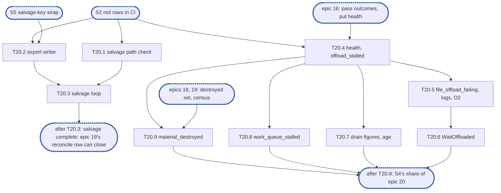

# Epic 20: engine offload health, drain and salvage

**Sources:** [RFC 8](../docs/internals/rfcs/rfc-8-engine.md) §3.1 (`health`, one policy function
of its own), §11.1 (health derived from recent outcomes, per direction, the drifted store, the
share's offload conditions, the registry names the engine raises, `stranded_export_failed`), §11.2
(the remote-unavailable row), §11.4 and §12.1 (the drain figures, the oldest unoffloaded age and its
bound, `WaitOffloaded`), §2.5 step 5 (the salvage export after serving, then `Forget`), §10.4 (the
destroyed material whose dependence `material_destroyed` reports), §13's RFC 8 E12 and E21, §14 (the
drain series, the offload health logs), and §15.2's rows "§11.1 health per direction", "§11.1
offload health", "§11.1 `stranded_export_failed`" and "§11.4 drain names its blocker", with §6.3's
"O2 long outage" check for its condition half; [RFC 1](../docs/internals/rfcs/rfc-1-journal.md) §3
(a stranded tag salvaged after serving: where, what, format, protection, failure, and `Forget`
only after the export) and its "§3 stranded tag salvaged after serving" row;
[RFC 13](../docs/internals/rfcs/rfc-13-configuration.md) §2.2 (a scratch path checked against
every journal at every start) and Appendix B's "oldest unoffloaded extent alert" row;
[RFC 25](../docs/internals/rfcs/rfc-25-observability.md) §2.5 (per-share figures and their sum),
§3.3 (a share inherits its store's conditions), §3.4 (derived, never latched) and §3.9's rows for
the six conditions this epic raises; [RFC 5](../docs/internals/rfcs/rfc-5-transforms.md) Appendix
B.2 (the salvage key) and B.4 (`material_destroyed`, with `data_loss`); [RFC 3](../docs/internals/rfcs/rfc-3-syncer.md)
§2.8 (the flow's `Healthy` and `Health`, a cause per direction).
**Track:** A.
**Epic 20 estimate: 9 subtasks, 23 man-days.**
**Depends on:** sync point **S2**, red rows in CI (epic 12): the fixture's `SalvageTo`,
`FaultRemote` and `BlockNextRun`, and the four rows this epic turns green; **epic 13**'s
`workqueue.Stats` with `Stalled` (its D8, pending the user's answer on #5986); **epic 14**'s age
tick, which walks each binding's `DirtyFiles`; **epic 15**'s `Failures` (its D11) and
`offload.Stats` (its D14); **epic 16**'s pass outcomes per binding (`Done`, `Retry`, `Throttled`,
`result="skipped"`) and the binding's kept put health (its T16.3, T16.4); **epic 18**'s
destroyed-material set (its D10); **epic 19**'s reseed read of the destroyed key records and the
`Census` view on `kvstore`; **S5**'s salvage-key wrap (the RFC 5 plan's epic 6, T6.4, its D13
pending RFC 5's author).
**Blocks:** epic 19's "§2.5 metadata reconcile" row, whose salvage leg needs T20.3; the
integration epic, which adapts every condition this epic puts in `Stats` into the engine's
`health.Source`, loads `salvage.path` and the alert bound, and builds `Deps.Salvage` and
`Deps.MaterialInUse` in the content wiring; epic 22, whose benchmarks stop their clocks at
`WaitOffloaded`.

---

## 1. Goal

Epic 20 makes the engine say how offload is doing, wait for it, and save what a stranded journal
tag holds. It adds no gate: every figure and condition here is a report, derived from current
evidence each time `Stats` is read, and the engine's offload, eviction and reads behave exactly as
epics 15 to 18 left them.

**At the end of the epic:**

- a share whose offload keeps failing or keeps being skipped reports `offload_stalled`, its cause
  saying whether the store's put direction or something else stopped it, and a file the pipeline
  has backed off reports `file_offload_failing`; both clear on their own once offload succeeds;
- `Stats` carries, per share and summed, dirty bytes, the drain rate over 10 s, the time to drain,
  and the oldest unoffloaded age, and `offload_age_exceeded` stands while that age is past the
  share's bound;
- each journal reports `work_queue_stalled` for every source and shard the scheduler finds stalled;
- `WaitOffloaded` returns once every byte the served shares held dirty at the call is offloaded,
  removed or released, and at its context's end names the oldest file left and what holds it;
- every stranded tag is exported under `salvage.path` after serving starts, sealed with a fresh
  salvage key the content wiring wraps, durably, and only then forgotten; a failed export raises
  `stranded_export_failed` naming the tag and is retried while serving;
- `material_destroyed` names each namespace and material whose destroyed key something still
  depends on, or whose dependence is not yet known, and clears once nothing depends on it.

### 1.1 In scope

RFC 8 §3.1's `health` and the conditions of §11.1 that need offload; §11.4's figures and
`WaitOffloaded`; the salvage export of RFC 1 §3 and its start-time path check; the engine's
`material_destroyed` evaluation; the `Warn` logs §14 names for these; the rows listed in Sources.

### 1.2 Out of scope

- The store's own `store_put_unhealthy` and `store_get_unhealthy`, and their inheritance by every
  share on the store (RFC 25 §3.3): the syncer raises them (the RFC 3 plan's epic 5 builds its
  `health.Source`), and the integration epic composes the inheritance through `Share.Store` (D1).
- Gating offload on the flow's put health, the put-unhealthy pause and the skipped pass: epic 16.
  The refusal table's answer from the put cause: epic 18. Failing **Remote** reads distinguishably:
  epic 17.
- Naming the drifted setting in the share's condition: it arrives as RFC 3's `ErrDrift`, which
  lands with `SetDrift`'s first caller, GC's `Recheck` (the offload plan's §6.1 row "Detecting
  bucket-setting drift", owner RFC 9). This epic carries whatever cause `Health(Put)` names, so
  `ErrDrift` needs no change here when it lands.
- Exporting a tag in plaintext because its share is known to use no transforms, writing the chain
  identity beside the export, and the old-to-new `FileID` map: each needs what a recovery import
  records (the offload plan's §6.1 row "§11.2's metadata-store-lost row and the salvage's
  recovery-import side", owner RFC 26). Until then every export is sealed (D8).
- The master-key destroy's check that no retained salvage export names the key (the offload plan's
  §6.1 row of that name, owner RFC 5's plan).
- The node's upload drain calling `WaitOffloaded` (the offload plan's §6.1 row "The node's upload
  drain calling `WaitOffloaded`", owner RFC 30's plan). `WaitOffloaded`'s first caller is epic 22.
- A scratch path that shares only a thinly provisioned volume group with a journal: T20.1 detects a
  shared device, filesystem, btrfs device or ZFS pool, not an LVM thin pool (the offload plan's
  §6.1 row "A scratch path on a journal's thin pool", added by this pull request, unowned).
- Loading `salvage.path` from the bootstrap file (RFC 13 Appendix C) and the alert bound from the
  settings table, building `Deps.Salvage` over RFC 5's provider and `Deps.MaterialInUse` over the
  census, registering the engine's `health.Source` and the alert rules: the integration epic.
- RFC 8 §15.4's benchmarks, whose clocks stop at `WaitOffloaded`: epic 22.

### 1.3 Names used here

- **E2**, epic 12, red rows and test foundations: the fixture's controls and the rows listed in
  `test/engine/known.yaml`.
- **S2**, red rows in CI: the end of epic 12.
- **S4**, offload complete in the fixture: epics 13 to 20 done; the integration epic starts there.
- **S5**, offload components built: the RFC 2 to RFC 5 plans' implementation epics; its half this
  epic needs is RFC 5's salvage-key wrap.
- **S1d**, transform pipeline agreed: the RFC 5 plan's S1, which fixed the salvage-key wrap's
  signature (`keys.SalvageWrapper`).
- **The integration epic**, epic 21: the node composes offload.
- **The first part**: the journal-only engine, epics 1 to 10 of RFC 8's first plan, whose
  `strandUnclaimed`, conditions and `Stats` this epic extends.
- **RFC 8 E12, E21**: invariants of RFC 8 §13, never epics.
- **O2, O6**: rows of RFC 8 §6.3's pipeline requirements and checks, never epics.

## 2. How the general rules apply

The rules are those of [the offload plan's §1.5](rfc-8-offload-engine-plan.md#15-general-rules-for-each-epic),
cited by number and title and not copied.

| Rule | Subtasks | How |
| --- | --- | --- |
| rule 1, **Independent unit tests** ([`CLAUDE.md`, "Writing tests"](../CLAUDE.md#writing-tests)) | all | the unit fixture over the first part's in-memory journal, RFC 3's real syncer over RFC 4's in-memory store through `codec.Store` under RFC 4's fault wrapper (kinds 2 and 3), RFC 5's real provider through `keystest` and the content wiring's `Salvage` built over it in the test, `kvstore` over the in-memory `kv.KV`, `t.TempDir()` for `salvage.path`, and the test clock (kind 1); no engine-side double |
| rule 2, **Fuzz the key and ref decoders the queue's rebuild reads** | none | nothing here decodes bytes the engine reads back: the salvage export is written for an operator's tools, and the tests' reader of it is test code. The export's format is fixed in a `decision:` (D7) |
| rule 3, **Observability follows RFC 25** | T20.4 to T20.9 | the six conditions by RFC 25 §3.9's names and scopes, in `Stats` (no `pkg/health` import); `engine_dirty_bytes`, `engine_drain_bytes_per_second`, `engine_drain_seconds` and `engine_unoffloaded_oldest_seconds` filled per share and as the sum or the worst, no per-operation share label; the `Warn` logs RFC 8 §14 names |
| rule 4, **Profiling** | T20.3, T20.6 | the salvage loop and `WaitOffloaded` run under the fixture's `prof.Watch`; a loop left running after `Stop`, a handle of a stranded tag left open, or a waiter left registered fails it |
| rule 5, **Public interface and internals** ([`CLAUDE.md`, "Verifying a change"](../CLAUDE.md#verifying-a-change)) | all | every condition is asserted at `Stats()`, which the node's adapter reads; the export at the bytes on disk, unsealed with the master key as an operator's tool would; `Forget` at the journal's `Stats().Shares`; `WaitOffloaded` at its return |
| rule 6, **Known failures shrink** | T20.3, T20.4, T20.6 | `TestRFC8B_StrandedExportFailed`, `TestRFC8B_HealthPerDirection`, `TestRFC8B_OffloadHealth` and `TestRFC8B_DrainNamesItsBlocker` leave `known.yaml` in the subtask that turns each green; T20.3 points `test/journal/trace.yaml`'s "stranded tag salvaged after serving" at its test |
| rule 7, **v2 ignores v1, and the engine imports only what RFC 0 §1.2 allows** | T20.2, T20.9 | `Deps.Salvage` and `Deps.MaterialInUse` are engine-declared (D5, D10), so the engine imports nothing of `pkg/transform/keys/provider` or `pkg/transform/encrypt`; `keys.MaterialID` is the `keys` contract, already allowed with epic 15; no `pkg/health` import is added |
| rule 8, **Real dependencies for properties of those dependencies** ([`CLAUDE.md`, "Writing tests"](../CLAUDE.md#writing-tests)) | T20.2, T20.3 | the export on a real directory, its syncs and rename asserted through a pass-through recorder around the real filesystem calls (D7), and `Forget` over the first part's real journal on a real directory for the restart leg |
| rule 9, **Code comment conventions** ([`CLAUDE.md`, "Code comments"](../CLAUDE.md#code-comments)) | T20.1 to T20.9 | RFC 1 §3's salvage `ponytail:` (every held extent) and `decision:` (after serving) at the export; this epic's markers, each named in §4 |
| rule 10, **A test must be able to fail** ([`CLAUDE.md`, "Writing tests"](../CLAUDE.md#writing-tests)) | all | every test names the planted break it catches |
| rule 11, **A symbol is exported only if the RFC's interface uses it** | T20.2, T20.7, T20.9 | exported: `Deps.SalvagePath`, `Deps.Salvage` with `Salvage` and `Seal` (RFC 1 §3's export, D5), `ShareSettings.OffloadAgeAlert` (RFC 13 Appendix B, D9), `Deps.MaterialInUse` and `Stats.Namespaces` with `NamespaceStats` (RFC 25 §3.9's namespace scope, D10); `health`, the drain ring and the export writer are unexported |
| rule 12, **Each subtask creates only what it declares** | all | `Handle.Extents` joins `Handle` with the export that first calls it (T20.2); each `Deps` member with its first caller; `Stats.Namespaces` with `material_destroyed` (T20.9) |

## 3. Requirements and invariants

Every obligation the sources place on this epic, numbered so subtasks and tests can cite them.

**Offload health**

| # | Requirement | Kind | Source | Subtasks |
| --- | --- | --- | --- | --- |
| R1 | `health` is one policy function of its own, per share and per direction: it is fed outcomes and read per share, and is never folded with another policy function nor calls one | MUST NOT | RFC 8 §3.1 | T20.4 |
| R2 | The engine reads the store's state only through its flow's `Healthy(d)` and `Health(d)`, and never probes the store itself to derive health | MUST NOT | RFC 8 §11.1; RFC 3 §2.8 | T20.4 |
| R3 | Health is per direction: a put-unhealthy store raises no condition about reads, and the share reports the two directions apart, each as the store's condition the share inherits | invariant | RFC 8 §11.1; RFC 25 §3.3 | T20.4 |
| R4 | A drifted store is put-unhealthy: its passes are skipped and its share's condition carries the put direction's cause; reads carry on | MUST | RFC 8 §11.1, RFC 8 E21; RFC 3 §2.8 | T20.4 |
| R5 | Sustained inability to offload is a condition of the share, `offload_stalled`, distinguishable from the remote being unreachable: an offload failing on metadata with the remote healthy is raised too | MUST | RFC 8 §11.1, RFC 8 E12; RFC 0 §10.2; RFC 25 §3.9 | T20.4 |
| R6 | A file the pipeline has backed off as failing is a condition of the share naming the file, `file_offload_failing` | MUST | RFC 8 §11.1, §6.3 O6; RFC 25 §3.9 | T20.5 |
| R7 | Every condition is derived from current evidence each time it is read, and cleared once the evidence no longer holds; none is a flag set until something clears it | MUST, MUST NOT | RFC 25 §3.4; RFC 3 §2.8 ("health is probed, never stored as a flag") | T20.3, T20.4, T20.5, T20.7, T20.8, T20.9 |
| R8 | The conditions are reported in `Stats`, per share, per journal, per namespace and for the node, under RFC 25 §3.9's names and scopes | MUST | RFC 8 §11.1, §12.1; RFC 25 §3.9 | T20.3, T20.4, T20.5, T20.7, T20.8, T20.9 |
| R9 | Ill health may slow offload attempts but never stops them without something independent observing recovery: no condition here gates anything | MUST NOT | RFC 8 §11.1 | T20.4 |
| R10 | A share entering or leaving an offload health condition logs at `Warn`, and so does a file backed off as failing | MUST | RFC 8 §14 | T20.5 |
| R11 | §11.1 health per direction: every put failing while gets succeed stops passes, **Remote** reads succeed and only a put condition is reported; drift stops puts, not reads | test row | RFC 8 §15.2 | T20.4 |
| R12 | §11.1 offload health: offload commits that all conflict with the remote healthy raise an offload condition, distinct from remote-unreachable, before the journal fills | test row | RFC 8 §15.2 | T20.4 |
| R13 | O2 long outage, the condition half: through 24 simulated hours of an unavailable remote with 10⁴ dirty files, no `file_offload_failing` is raised, exactly one `store_put_unhealthy` is, and the share reports its offload condition; the remote-unavailable row's engine answer, backing off offloads, is reported, not raised as a failing file | test row | RFC 8 §6.3, §11.2 | T20.5 |

**Drain**

| # | Requirement | Kind | Source | Subtasks |
| --- | --- | --- | --- | --- |
| R14 | Per share and summed: dirty bytes, the drain rate over a recent window, and the time to drain at that rate | MUST | RFC 8 §11.4, §14 (`engine_dirty_bytes`, `engine_drain_bytes_per_second`, `engine_drain_seconds`) | T20.7 |
| R15 | The age of the oldest unoffloaded extent each share's journal holds, from the journal's `OldestDirty` | MUST | RFC 8 §11.4, §14 (`engine_unoffloaded_oldest_seconds`); RFC 1 §3.7 | T20.7 |
| R16 | `offload_age_exceeded` is raised for a share while that age is past the share's configured bound | MUST | RFC 8 §11.4; RFC 13 Appendix B ("oldest unoffloaded extent alert"); RFC 25 §3.9 | T20.7 |
| R17 | Per-share figures carry no per-operation share label; each also has an unlabelled sum, and for an age the worst value | MUST | RFC 8 §14; RFC 25 §2.5 | T20.7 |
| R18 | `WaitOffloaded` returns once every byte written to the node before the call is offloaded; bytes removed or released after the call count as offloaded | MUST | RFC 8 §11.4, §12.1 | T20.6 |
| R19 | A wait ended by its ctx returns an error naming the oldest file still unoffloaded and its cause: the condition holding it, such as `file_offload_failing` or a put-unhealthy store, or none when offload is only behind | MUST | RFC 8 §11.4, §12.1 | T20.6 |
| R20 | §11.4 drain names its blocker: with one file whose offered reader fails every read and another truncated mid-drain, the wait returns at its deadline naming the failing file and `file_offload_failing`, never the truncated one | test row | RFC 8 §15.2 | T20.6 |

**The work scheduler**

| # | Requirement | Kind | Source | Subtasks |
| --- | --- | --- | --- | --- |
| R21 | `work_queue_stalled` is raised on the journal, naming the source and the tenant, while a run has outlived twice its run timeout or entries have been due with none dispatched for 5 minutes, as the scheduler reports it | MUST | RFC 8 §11.1, §6.1.1; RFC 25 §3.9 | T20.8 |

**Salvage**

| # | Requirement | Kind | Source | Subtasks |
| --- | --- | --- | --- | --- |
| R22 | Every stranded tag is exported for salvage **after** serving starts, while serving, and never before it: the export never withholds service | MUST | RFC 1 §3; RFC 8 §2.5 step 5 | T20.3 |
| R23 | `Forget` of a tag runs only after its export has succeeded; until then the tag stays stranded and its extents unevictable | MUST | RFC 1 §3; RFC 8 §2.5 step 5 | T20.3 |
| R24 | Exports go under `salvage.path`; at every start the path is checked against every journal and every journal against the path, one added since included, and refused if they share a device, a filesystem or free space | MUST | RFC 1 §3; RFC 13 §2.2 | T20.1 |
| R25 | A refused or unset `salvage.path` does not stop the node: each export fails as below | MUST | RFC 1 §3; RFC 13 §2.2, Appendix B (`salvage.path`) | T20.1, T20.3 |
| R26 | The export holds every held extent of the tag, read through a handle of the tag attached for the purpose | MUST | RFC 1 §3 | T20.2 |
| R27 | Per tag, the extents keyed by `FileID` and offset, each with its content version, in a directory of mode 0700 owned by the service | MUST | RFC 1 §3 | T20.2 |
| R28 | Never plaintext for a tag whose share encrypts or whose transforms the node cannot establish: sealed with a fresh salvage data key, one per export, under the AEAD that seals blocks, wrapped under the installation's current master key, the wrapped key written beside the export | MUST, MUST NOT | RFC 1 §3; RFC 5 Appendix B.2 (`salvage-key`) | T20.2 |
| R29 | An export that cannot get the master key fails, never falling back to plaintext | MUST NOT | RFC 1 §3 | T20.2, T20.3 |
| R30 | A failed export (no path, a refused one, a write error, no space, no master key) raises `stranded_export_failed` on the node naming the tag, is retried at every start and again while serving, and clears when the tag's export succeeds | MUST | RFC 1 §3; RFC 8 §11.1; RFC 25 §3.9 | T20.3 |
| R31 | §11.1 `stranded_export_failed`: with `salvage.path` refusing the process's writes, the condition names the tag and service continues; made writable while serving, the export succeeds on its retry and the condition clears with no restart | test row | RFC 8 §15.2 | T20.3 |
| R32 | RFC 1's "§3 stranded tag salvaged after serving", its single-node legs without an import: the tag stranded and reported before serving, serving not waiting for the export, the export complete, sealed, with a different key each time, failing without the master key, and refused path, misplaced path and full device each a failed export that waits `Forget` and completes once fixed | test row | RFC 1 §3 | T20.3 |

**Destroyed material**

| # | Requirement | Kind | Source | Subtasks |
| --- | --- | --- | --- | --- |
| R33 | The engine evaluates `material_destroyed` per namespace, naming the material ID: raised while a census entry or a journal-held chunk depends on destroyed material, or while that is not yet known; material nothing depends on raises nothing; it clears once nothing depends on it | MUST | RFC 25 §3.9; RFC 5 Appendix B.4; RFC 8 §10.4 | T20.9 |

## 4. Decisions this epic takes

- **D1, the share's direction conditions are its store's, inherited; the engine raises none per
  direction.** RFC 8 §11.1 has the share report the two directions apart, and RFC 25 §3.3 makes a
  store's condition apply to every share on it "with no second condition raised". So the syncer's
  `store_put_unhealthy` and `store_get_unhealthy` are the share's direction conditions, inherited
  through `Share.Store` by the node (the integration epic), and the engine's part is the cause it
  carries into `offload_stalled` (D2). A share-scoped copy of the store's state was rejected: it is
  the second condition RFC 25 forbids, and at 300 shares on a store it pages 300 times. No marker.
  Prior art: Kubernetes conditions on a node, which pods read without copying (from memory).
- **D2, `offload_stalled` stands while the share's offload has made no progress for 5 minutes.**
  `health` keeps, per binding, when its current run without progress began: the first pass outcome
  that was not `Done` (a `Retry`, or a skip for a put-unhealthy store) since the last `Done`, or the
  first age tick that found the binding put-unhealthy with dirty bytes held. A `Done` ends the run;
  a `Throttled` pass neither starts nor ends one, as O6 exempts it. The condition is derived at
  `Stats`: raised while a run is 5 minutes old and the share still holds dirty bytes, its cause the
  binding's kept `Health(Put)` error while put-unhealthy, otherwise the latest pass error. So an
  outage and a metadata wedge raise the same condition with different causes (R5), and a poison
  file, whose passes run alone while the others report `Done`, raises only its own (D3). 5 minutes
  is RFC 8 §6.1.1's stall bound for the work queue; a `decision:` marker at the constant says it is
  fixed, not a setting, withdrawn if the offload-health row's journal fills before it at the
  reference profile. Prior art: RFC 25 §3.2's `offload_stalled` then `journal_full`, each raised by
  its own evidence.
- **D3, `file_offload_failing` is read from epic 15's `Failures`.** A file whose count reached O6's
  five is raised, naming its `FileID`, and clears when its count resets at its next `Done`; the
  `Warn` on backing off is logged where the count crosses five, once per crossing. One condition per
  file: RFC 25 §13's cap on FileIDs per condition is its own open question, for the node-status
  record. No marker. Prior art: none found.
- **D4, transitions are logged at the age tick.** Conditions are derived when read, so "entering or
  leaving" (RFC 8 §14) is detected where the engine already looks at each binding on its clock:
  epic 14's age tick compares the binding's offload conditions with those it last logged, and logs
  each change once at `Warn`. No marker. Prior art: none found.
- **D5, the content wiring seals the export; the engine holds no salvage key.** The engine never
  holds key material, so it does not call RFC 5's `WrapSalvageKey` itself, which returns the key.
  It declares:
  ```go
  // Salvage seals one salvage export (RFC 1 §3): a fresh salvage key per export, wrapped
  // under the installation's current master key and bound to export (RFC 5 Appendix B.2).
  // The content wiring builds it over RFC 5's keys.SalvageWrapper and the AEAD that seals
  // blocks, so the key never reaches the engine.
  type Salvage interface {
  	NewSeal(ctx context.Context, export []byte) (Seal, error)
  }
  // Seal is one export's: Wrap is the wrapped key written beside it, Seal one record.
  type Seal interface {
  	Wrap() []byte
  	Seal(dst, aad, plain []byte) []byte
  }
  ```
  `NewSeal`'s error is the provider's (no master key among them), and fails the export (R29). The
  wiring calls `WrapSalvageKey(ctx, export)` and seals with the key it returns, then drops it; the
  RFC 5 plan's epic 6 names epic 20 as `WrapSalvageKey`'s caller, which this reads as epic 20's
  wiring (§9). Which configuration's master key wraps it is RFC 5 epic 6's D13, pending RFC 5's
  author: the wiring hands the engine that configuration's `Salvage`, and nothing here changes with
  the answer. Changing `Salvage` after the integration epic builds it rewrites that one adapter.
  No marker. Prior art: a KMS envelope encryption client, which hands the caller an encryptor and
  never the data key (from memory).
- **D6, the salvage path check compares device, filesystem and pool.** At `Start`, before any
  export, the engine compares `salvage.path` with every `Deps.Devices` entry: the same device
  (`stat`'s device), the same filesystem (`statfs`'s filesystem ID), or, on Linux, one btrfs
  device or one ZFS pool as `/proc/self/mountinfo`'s mount source names them; on Windows, the same
  volume serial. Any match refuses the path for this run, the refusal naming the journal it shares
  with. A `ponytail:` at the check: an LVM thin pool shared with a journal passes; read the volume
  group from the device mapper once a deployment puts a scratch path on a journal's thin pool (the
  §6.1 row this pull request adds). The check is the engine's because it holds the journal
  directories and is the export's only user; RFC 13 §2.2's node-level wording is met since the
  engine runs inside the node's start. Prior art: `df`'s and `findmnt`'s mount-source matching
  (from memory).
- **D7, the export's layout, and its durability before `Forget`.** One directory per export,
  `<salvage.path>/<journal ID hex>/tag-<tag>-<export ID hex>`, mode 0700, written as
  `.tmp-<export ID hex>` and renamed once complete. It holds `export`, the bytes the salvage key
  is bound to (a format version, the journal ID, the tag, the 16-byte export ID); `salvage-key`, the
  wrap; and `extents`, a sequence of records, each the `FileID` (16 bytes), the offset and length
  (8 bytes each, big-endian), the content version as the journal's opaque bytes, and the body sealed
  with associated data `export ‖ FileID ‖ offset ‖ version`, one record per at most 1 MiB of an
  extent, so a record is never read whole into memory beyond that. Every file and the directory are
  synced, then renamed, then the parent synced, and only then does `Forget` run. A failed attempt
  removes its `.tmp-` directory. A `decision:` marker at the format, since recovery tools read it:
  withdrawn when RFC 26's recovery import defines the reader, which then owns it. The file calls go
  through a small interface over `os` so a pass-through recorder can assert the syncs reach the
  filesystem before `Forget` (CLAUDE.md "Outputs are not interactions"). Prior art: the
  write-to-temporary-then-rename of `git`'s object store and `rsync` (from memory).
- **D8, every export is sealed in this release.** RFC 1 §3 exports a tag in plaintext only when its
  share is known to use no transforms, but a stranded tag is by definition one no share record of
  the installation names, so nothing here can establish its share's transforms; only a recovery
  import records them (§1.2's RFC 26 row). So every export is sealed, and an installation with no
  master key fails every export and keeps its stranded tags until it has one. A `decision:` marker
  at the seal's call says so, withdrawn when RFC 26 records a stranded tag's chain identity.
  Prior art: none found.
- **D9, the alert bound rides `ShareSettings`, pending the user's answer (§9).** RFC 8 §11.4 has the
  engine "raise an alert when it passes a configured bound", RFC 25 §3.9 registers
  `offload_age_exceeded` as RFC 8's condition, and RFC 25 §7 alerts on conditions, so the engine
  needs the bound, which epic 11 left to an alert rule. `ShareSettings` gains `OffloadAgeAlert
  time.Duration` (RFC 13 Appendix B's "oldest unoffloaded extent alert", share scope, live,
  proposed 1 h), validated by `validShare` as the other fields are, with the fixture and the
  wiring passing 1 h until the integration epic loads it. Adding a field to epic 11's frozen
  `ShareSettings` changes no existing one. No marker. Prior art: none found.
- **D10, `material_destroyed`'s dependence is asked of the content wiring, pending the user's answer
  (§9).** The candidates are the materials epic 18's set holds as destroyed (the notice in this
  incarnation, and the destroyed key records epic 19's reseed reads at start). For each, the
  engine asks
  ```go
  // MaterialInUse is whether a census entry of namespace ns names material id
  // (RFC 25 §3.9, RFC 5 §5.3). An error leaves the answer unknown.
  MaterialInUse func(ctx context.Context, ns entity.NamespaceID, id keys.MaterialID) (bool, error)
  ```
  which the content wiring answers from the namespace's `Census` view (epic 19), and can answer
  from RFC 5 epic 10's census snapshot once that keeps its entries per namespace and material
  (§9), so the blocks are walked once for both. A held chunk's remote copy depends on the material
  only through a block whose record the census counts until it is pruned, and a ref keeps its
  block's record, so the census answer covers the journal-held case; a `decision:` marker at the
  evaluation says so, withdrawn if a block record can be pruned while a ref names it. The
  condition is raised from the moment a material joins the set, unknown, until an answer of false
  clears it: an error or a pending read keeps it raised (fail closed). Each candidate is asked once
  on joining and then every 5 minutes while raised, on the engine's clock. A namespace whose
  destroyed key records the reseed has not yet read raises it naming no material, cause "destroyed
  material not yet read", until the read completes. `Stats` gains `Namespaces
  map[entity.NamespaceID]NamespaceStats` with `Conditions`, RFC 25 §3.9 scoping the condition to the
  namespace; additive to epic 11's frozen `Stats`. Prior art: none found.
- **D11, the drain rate counts the bytes reported offloaded over 10 s.** The pipeline's report of a
  file's extents adds their bytes to `offload.Stats` (a field `OffloadedBytes` epic 15's struct
  gains), and the binding keeps a ring of ten one-second buckets on `Clock.Elapsed`, filled at each
  report and read at `Stats`, with no goroutine. The rate is the ring's sum over 10 s; the summed
  rate is the shares'. Time to drain is dirty bytes over that rate, zero with nothing dirty, and the
  largest `time.Duration` with dirty bytes and no drain, which the node's adapter exports as
  `+Inf`; a `decision:` at that value. A drop in dirty bytes was rejected as the measure: a truncate
  or an overwrite moves it without offloading anything. 10 s is RFC 8 §10.2.1's window for its own
  drain rate. Prior art: Prometheus's `rate()` over a range (from memory).
- **D12, the oldest unoffloaded age per share is read at the age tick.** The journal's
  `OldestDirty` is per journal, so each share's figure is the oldest non-zero write time epic 14's
  age tick saw in the binding's `DirtyFiles`; a zero time, which a rebuild leaves, reads as the
  journal's `OldestDirty`, an upper bound. The summed figure is the worst journal's `OldestDirty`.
  A `ponytail:` at the figure: a share's age lags by up to one age tick, and after a restart reads
  its journal's oldest until its files are offered again; upgrade to a per-share `OldestDirty` in
  the journal's `Stats.Shares` when an alert on one share fires for another's backlog. Prior art:
  none found.
- **D13, `WaitOffloaded` waits on a snapshot of the dirty files at the call.** At the call it reads
  each served binding's `DirtyFiles` into the oldest dirty write time per file; a file is done once
  `DirtyFiles` no longer lists it, or lists it with a later oldest time (its old bytes left and only
  newer ones remain). Removed and released bytes leave `DirtyFiles` (RFC 1 §3.7), so they count as
  offloaded; a file of a share dropped since is done. A stranded tag is no served share's and is
  never waited on, or a node with one would never drain; a `decision:` marker says so. The wait
  re-checks at each age tick of the files' journal and returns `ctx`'s error, wrapped with the oldest
  file left (by its snapshot time, then `FileID`), its share and its cause by D3's and D2's state, or
  "behind". No version comparison is used: `DirtyFiles` carries write times, and the journal's
  versions stay opaque outside `journalof.go`. Prior art: `sync(2)`'s semantics, which wait for data
  dirty at the call, not data written after (from memory).
- **D14, the salvage loop retries every 30 s.** After serving starts, one goroutine per engine runs
  each journal's stranded tags in turn, and on any failure raises `stranded_export_failed` for the
  tag and tries again 30 s later on the engine's clock, as the first part retries an unsuitable
  journal; `Stop` cancels it and joins it before the journals close. A tag stranded at a late attach
  joins the loop. A crash between an export and its `Forget` exports the tag again at the next start;
  a `ponytail:` says a second export is written rather than the first one found, upgraded to reuse a
  complete export of the same journal and tag if operators find duplicates confusing. Prior art: the
  first part's 30 s retried open.

## 5. Target tree

On `feat/storage-v2`.

```text
pkg/engine/
  deps.go                 T20.1 Deps.SalvagePath; T20.2 Deps.Salvage, Salvage, Seal, Handle.Extents; T20.9 Deps.MaterialInUse
  types.go                T20.7 ShareSettings.OffloadAgeAlert; T20.9 Stats.Namespaces, NamespaceStats
  share.go                T20.7 validShare refuses a non-positive OffloadAgeAlert
  salvage.go              T20.2 the export writer and its format (D7, D8); T20.3 the loop, Forget after, stranded_export_failed (D14)
  salvagepath.go          T20.1 the path check's comparison (D6)
  salvagepath_linux.go    T20.1 mountinfo's mount source
  salvagepath_unix.go     T20.1 device and filesystem IDs
  salvagepath_windows.go  T20.1 volume serials
  health.go               T20.4 health, offload_stalled (D2); T20.5 file_offload_failing, the transition logs (D3, D4); T20.7 the drain figures and offload_age_exceeded; T20.8 work_queue_stalled
  drain.go                T20.6 WaitOffloaded's waiters (D13); T20.7 the drain ring (D11, D12)
  material.go             T20.9 the dependence evaluation over epic 18's set (D10)
  recover.go              T20.1 the check at Start; T20.3 the loop started after step 8 (the first part's file)
  removals_start.go       T20.3 strandUnclaimed hands its tags to the loop (the first part's file)
  queue.go                T20.4 the age tick feeds health; T20.5 the transition logs; T20.6 the waiters re-checked (epic 14's file)
  pass.go                 T20.4 each pass outcome fed to health (epic 16's file)
  offload/stats.go        T20.7 OffloadedBytes (epic 15's file)
  close.go                T20.3 Stop joins the loop; T20.6 waiters answered at Stop
  enginetest/salvage.go   T20.3 SalvageTo made real
  enginetest/fake.go      T20.2 FakeHandle.Extents
  enginetest/journal_test.go  T20.2 Extents agrees with the journal
  salvage_test.go, salvagepath_test.go, health_test.go, drain_test.go, material_test.go  T20.1 to T20.9 the unit tests
  conformance/rfc8_health_test.go  T20.3, T20.4, T20.6 the rows green, T20.5 O2's condition legs
  export_test.go          T20.2 the filesystem recorder hook; T20.4 health's clock accessors
test/engine/known.yaml    T20.3, T20.4, T20.6 four entries removed
test/journal/trace.yaml   T20.3 "stranded tag salvaged after serving" names its test
.planning/rfc-8-offload-engine-plan.md  this pull request: §6.1 gains "A scratch path on a journal's thin pool" (D6)
```

## 6. Subtasks

### T20.1 The salvage path check at start

**Subtask T20.1 estimate: 2 man-days.**

- **Track:** A. **Depends on:** S2.
- **Covers:** R24, R25.
- **Deliverables:** `Deps.SalvagePath string`, the bootstrap's `salvage.path`, empty when unset. In
  `salvagepath.go`, `checkSalvagePath(path string, journals []string, id func(string) (pathID,
  error)) error`, a pure comparison of each journal's `pathID` (device, filesystem, mount source)
  against the path's, naming the journal it shares with and what it shares; per-OS `pathID`
  readers (D6) with D6's `ponytail:`. `Start` runs it once, after the journals are listed and before
  serving; a refusal is logged at `Warn` and kept for T20.3, and `Start` goes on. Consumed by T20.3.
- **Acceptance criteria:**
  - A path in a journal's directory, on its filesystem, or on another subvolume of its btrfs
    filesystem is refused, naming that journal; a separate `t.TempDir()` filesystem is not.
  - A journal added to `Deps.Devices` on the path's filesystem is refused at the next start, so the
    check runs in both directions.
  - An unset path is refused as unset, and neither case fails `Start`.
- **Tests:** at `checkSalvagePath`, table-driven over `pathID` values built by hand (catches a
  comparison that misses one of the three, R24); the real readers over `t.TempDir()` and a journal
  directory beneath it, so one filesystem (catches a reader that returns a per-path ID); a Linux
  test over two btrfs subvolumes or a ZFS dataset when `DITTOFS_POOL_DIR` names one, skipping by
  that name otherwise; at `Start` over the unit fixture, the refusal read back from T20.3's export
  failing and `Start` returning nil (catches a refusal that stops the node, R25). No test double.
- **Rules:** rule 9: D6's `ponytail:`.

### T20.2 The export writer and its seal

**Subtask T20.2 estimate: 3 man-days.**

- **Track:** A. **Depends on:** S2, S5's salvage-key wrap.
- **Covers:** R26, R27, R28, R29.
- **Deliverables:** `Deps.Salvage Salvage` with `Salvage` and `Seal` (D5), refused nil by `New`.
  `Handle.Extents(id journal.FileID) ([]journal.Extent, error)`, as `*journal.Handle` has it, and
  `FakeHandle.Extents` with an "agrees with the journal" test. In `salvage.go`, `exportTag(ctx, j
  Journal, tag, dir string) error`: attaches a handle of the tag, walks `Files` and `Extents`,
  reads each extent through `ReadAt` in at most 1 MiB pieces into one reused buffer, seals each
  piece through a `Seal` from `NewSeal(ctx, export)`, and writes D7's layout through the small
  filesystem interface, closing the handle before it returns. RFC 1 §3's `ponytail:` (every held
  extent) and D7's and D8's `decision:` markers. In the test package, a reader of the format that
  unseals with the key the test's wiring kept, and a `Salvage` built over `keystest`'s provider as
  the integration epic will build it. Consumed by T20.3.
- **Acceptance criteria:**
  - An exported tag holds every held extent of the tag, byte for byte after unsealing, each with its
    `FileID`, offset and version; nothing of another tag.
  - No plaintext byte of the tag appears in any file of the export; `salvage-key` holds a wrap that
    unwraps with the master key; two exports of one tag use different keys.
  - A `NewSeal` refused for a missing master key writes nothing and leaves no `.tmp-` directory.
  - The export directory's mode is 0700.
- **Tests:** over the unit fixture's in-memory journal with three files under the stranded tag and
  one under a served tag, a 3 MiB extent among them: the reader's output against the written bytes
  (catches a dropped or truncated extent, or a record split at 1 MiB losing bytes, R26, R27); a scan
  of every export file for each extent's plaintext (catches an unsealed record, R28); two exports'
  wraps differ (catches a reused key, R28); the provider with no master key loaded, the export
  directory empty after (catches a plaintext fallback or a partial export, R29); a body moved to
  another record's offset fails to unseal (catches associated data that omits the offset, D7); an
  allocation check that one export's memory stays under 2 MiB at a 64 MiB extent (catches an
  extent read whole). Doubles: none; the provider is RFC 5's own, through `keystest`.
- **Rules:** rule 7: `Salvage` is engine-declared, so no `keys/provider` import; rule 9: the
  markers named.

### T20.3 The salvage loop and `stranded_export_failed`

**Subtask T20.3 estimate: 3 man-days.**

- **Track:** A. **Depends on:** T20.1, T20.2.
- **Covers:** R7, R8, R22, R23, R25, R29, R30, R31, R32.
- **Deliverables:** in `salvage.go`, the loop (D14), started after start step 8 and fed by
  `strandUnclaimed`'s tags, at start and at a late attach: `exportTag`, then the syncs and rename,
  then `Forget`; on failure the tag's `stranded_export_failed` (node scope, naming the journal and
  the tag, its cause the failure) and a retry 30 s later; on success the condition derived away.
  RFC 1 §3's "salvage runs after serving" `decision:` at the start of the loop, and D14's
  `ponytail:`. `Stop` cancels and joins it. `enginetest`'s `SalvageTo(dir)` made real; the entry of
  `TestRFC8B_StrandedExportFailed` removed. `test/journal/trace.yaml`'s row names
  `TestRFC8A_StrandedTagSalvagedAfterServing`, its import legs left to RFC 26. Consumed by epic 19's
  "§2.5 metadata reconcile" (whichever lands second removes its entry), and the integration epic.
- **Acceptance criteria:**
  - `Start` returns and the shares serve before any export of a stranded tag begins.
  - `Forget` of a tag is never called before its export's files and directories are synced and
    renamed.
  - A refused or unset path, a write error, a full device and a missing master key each raise
    `stranded_export_failed` naming the tag, never fail a request, and are retried; the tag's held
    bytes stay in `Stats().Shares` until the export succeeds.
  - Fixed while serving, the next retry exports, forgets, and the condition is gone at the next
    `Stats` with no restart.
- **Tests:**
  - `TestRFC8B_StrandedExportFailed` green: the path under a regular file, then a writable path,
    the retry driven by advancing the test clock 30 s (R31).
  - `TestRFC8A_StrandedTagSalvagedAfterServing` in `engine-conformance`, RFC 1's row without the
    import: the tag stranded and reported before serving, a read on a served share answered while
    the export is held by a per-instance hook (catches an export before serving, R22); the
    pass-through recorder around the filesystem calls showing every sync before the journal's
    `Forget` is reached (catches a `Forget` before the export is durable, R23); unset path,
    a path on the journal's filesystem, the export's device full (a fault wrapper around the
    filesystem interface returning `ENOSPC`, kind 3) and no master key, each a raised condition,
    the tag's bytes still held, and `Forget` not called (R25, R29, R30, R32).
  - Over the first part's real journal on a real directory: a crash after the rename and before
    `Forget`, then a restart, strands and exports the tag again and forgets it (catches a tag lost
    or forgotten unexported across a restart, R23).
  - `prof.Watch` around `Stop` (catches the loop or a tag's handle left behind).
  Doubles: kind 3 around the filesystem interface; the recorder passes every call through.
- **Rules:** rule 4, the leak check; rule 6, the entry removed and the trace row pointed; rule 9,
  the markers named.

### T20.4 `health` and `offload_stalled`

**Subtask T20.4 estimate: 3.5 man-days.**

- **Track:** A. **Depends on:** S2, epic 16 (T16.3, T16.4).
- **Covers:** R1, R2, R3, R4, R5, R7, R8, R9, R11, R12.
- **Deliverables:** in `health.go`, RFC 8 §3.1's `health`: per binding, `observe(outcome)` taking
  a pass outcome (`Done`, `Retry` with its error, `Throttled`, a skip with the put error) or an age
  tick's put state with dirty bytes held, and `of(share) shareHealth`, the run's start and its
  latest cause (D2), under its own mutex, taken last and held across no call. Epic 16's pass result
  and age tick feed it; `Stats` derives `offload_stalled` per share from `of` and the share's dirty
  bytes, at its constant and `decision:`. No condition here gates a pass or an eviction. The
  entries of `TestRFC8B_HealthPerDirection` and `TestRFC8B_OffloadHealth` removed. Consumed by
  T20.5, T20.6 and the integration epic.
- **Acceptance criteria:**
  - A share whose passes all return `Retry` on commit conflicts with the store put-healthy reports
    `offload_stalled` 5 minutes after the first, its cause the conflict; one `Done` clears it at
    the next `Stats`.
  - A share on a put-unhealthy store with dirty bytes reports `offload_stalled` after 5 minutes, its
    cause the flow's `Health(Put)` error; a get-unhealthy store raises nothing from the engine.
  - `Throttled` passes alone never raise it; a share with no dirty bytes never reports it.
- **Tests:**
  - At `health`, table-driven over outcome sequences on the test clock (kind 1): the 5-minute edge
    a nanosecond short and past, a `Throttled` between failures, a `Done` ending the run (catches a
    run started by a throttle or not ended by a success, R5, R7).
  - `TestRFC8B_HealthPerDirection` green over the fixture's `FaultRemote` failing every put while
    gets succeed: passes stop, a **Remote** read succeeds, and the share's conditions are one
    `offload_stalled` whose cause is the put error, none naming reads; the drift rule as a
    `Recheck` would raise it, the same with the drift's cause, then cleared (R3, R4, R11).
  - `TestRFC8B_OffloadHealth` green: every offload commit conflicting through the fixture's
    `kv.KV` fault wrapper (kind 3), the store healthy, `offload_stalled` raised with the conflict as
    its cause before the journal reports `journal_full` (R5, R12).
  - The engine's import walk unchanged and RFC 3's syncer reporting no extra probe while `Stats` is
    read in a loop (catches a probe from health, R2).
- **Rules:** rule 3, the condition by its name and scope; rule 9, D2's `decision:`.

### T20.5 `file_offload_failing`, the transition logs and O2's conditions

**Subtask T20.5 estimate: 1.5 man-days.**

- **Track:** A. **Depends on:** T20.4, epic 15 (its D11).
- **Covers:** R6, R7, R8, R10, R13.
- **Deliverables:** `file_offload_failing` per file from the binding's `Failures` at O6's five
  (D3), derived at `Stats`; the `Warn` where a count crosses five; at each age tick, each binding's
  offload conditions compared with those last logged and every change logged once at `Warn` (D4).
  Epic 16's "O2 long outage" check gains its condition legs. Consumed by T20.6.
- **Acceptance criteria:**
  - A poison file among 10³ others reports `file_offload_failing` naming its `FileID`, and the share
    no `offload_stalled`; the condition clears at its next `Done`.
  - Through 24 simulated hours of outage with 10⁴ dirty files: no `file_offload_failing`, one
    `store_put_unhealthy` from the syncer, `offload_stalled` with the put cause; all gone within one
    age tick of the store reporting healthy and the next `Done`.
  - Entering and leaving `offload_stalled` each log one `Warn`; so does a file backed off.
- **Tests:** epic 16's O2 test extended with the condition legs, the syncer's condition read from
  RFC 3's own `health.Source` built in the test (R13); RFC 8 §6.3's O6 poison file, its condition
  read at `Stats` (catches a poison file raising the share's stall, or a count read from the wrong
  binding, R6); the logs captured through the fixture's `slog` handler writing to a buffer, one
  line per transition across repeated `Stats` reads (catches a log per read, R10). No test double
  beyond the fault wrapper around the remote store.
- **Rules:** rule 3, the logs RFC 8 §14 names.

### T20.6 `WaitOffloaded`

**Subtask T20.6 estimate: 2.5 man-days.**

- **Track:** A. **Depends on:** T20.5, epic 14 (the age tick).
- **Covers:** R18, R19, R20.
- **Deliverables:** in `drain.go`, `WaitOffloaded` filled (D13): the snapshot of every served
  binding's `DirtyFiles`, a waiter re-checked at each age tick of each journal it waits on, the
  error at `ctx`'s end naming the oldest file left, its share and its cause from T20.4's and T20.5's
  state; waiters answered with the engine's closed error at `Stop`. D13's `decision:` on stranded
  tags. The entry of `TestRFC8B_DrainNamesItsBlocker` removed. Consumed by epic 22's benchmarks.
- **Acceptance criteria:**
  - With every served file offloaded, removed or released, the call returns nil at the next tick.
  - Bytes written after the call do not hold it.
  - At its deadline it returns an error that `errors.Is` `ctx.Err()` and names the oldest file left
    and `file_offload_failing`, a put-unhealthy store, or "behind".
  - A stranded tag's dirty bytes never hold it.
- **Tests:** `TestRFC8B_DrainNamesItsBlocker` green: one file whose offered reader fails every read
  through the journal seam's fault rule (kind 3), another truncated mid-drain, the clock advanced
  past the deadline; the error names the failing file and `file_offload_failing` and not the
  truncated one (R20). At `WaitOffloaded` over the unit fixture: a file written after the call while
  older ones drain, the call returning once the older are offloaded (catches a wait on every dirty
  byte, R18); a file truncated to zero during the wait (catches a removal not counted as offloaded,
  R18); the store put-unhealthy at the deadline, the error naming it (R19); a stranded tag beside a
  drained share (catches a wait that includes it, D13); `prof.Watch` after a cancelled wait
  (catches a waiter left registered).
- **Rules:** rule 4, the leak check; rule 6, the entry removed; rule 9, D13's `decision:`.

### T20.7 The drain figures and `offload_age_exceeded`

**Subtask T20.7 estimate: 3 man-days.**

- **Track:** A. **Depends on:** T20.4, epic 14 (the age tick), epic 15 (its D14).
- **Covers:** R7, R8, R14, R15, R16, R17.
- **Deliverables:** `offload.Stats.OffloadedBytes`, added at each report; in `drain.go`, the
  per-binding ring (D11) and the per-share oldest age (D12) with their markers; in `health.go`,
  epic 11's `DirtyBytes`, `DrainBytesPerSecond`, `DrainTime` and `OldestUnoffloaded` filled per
  share and in `Stats` as the sum, or the worst for the age. `ShareSettings.OffloadAgeAlert` (D9)
  with `validShare`'s refusal and the fixture's and the wiring's 1 h; `offload_age_exceeded` per
  share derived at `Stats`. Consumed by the integration epic, which exports the gauges under RFC 25
  §2.5's worst-n rule.
- **Acceptance criteria:**
  - Dirty bytes per share match the journal's `Stats().Shares` and sum to the journal's.
  - At a steady offload of 4 MiB/s on the test clock the rate reads 4 MiB/s within one bucket, and
    falls to zero 10 s after offload stops; time to drain is dirty bytes over it, the largest
    duration with no drain.
  - A share's oldest age is the age of its oldest dirty write; `offload_age_exceeded` stands while it
    is past `OffloadAgeAlert` and clears once the extent is offloaded.
  - A `Bind` with `OffloadAgeAlert` zero is refused naming the share and the key.
- **Tests:** at the ring, table-driven: reports across bucket edges, a gap longer than the window,
  a report at the window's last nanosecond (catches an off-by-one bucket or a stale bucket kept,
  R14); at `Stats` over the unit fixture with two shares on one journal, one draining and one
  stuck: per-share rates and ages apart, the sum and the worst right (catches one share's figure
  reported for another, R14, R15, R17); a truncate dropping dirty bytes leaving the rate unchanged
  (catches a rate taken from dirty bytes falling, D11); `offload_age_exceeded` across its bound on
  the test clock (R16); the share-settings refusal in `share_test.go`'s table. No test double.
- **Rules:** rule 3, the four series' fields; rule 9, D11's `decision:` and D12's `ponytail:`.

### T20.8 `work_queue_stalled`

**Subtask T20.8 estimate: 1 man-days.**

- **Track:** A. **Depends on:** T20.4, epic 13 (T13.4), epic 14.
- **Covers:** R7, R8, R21.
- **Deliverables:** in `health.go`, `work_queue_stalled` per journal for every source and shard
  whose `JournalStats.Work` entry has `Stalled`, naming the source and the shard, derived at
  `Stats`. Consumed by the integration epic.
- **Acceptance criteria:**
  - A stuck run of one shard raises the condition for that source and shard only, and it clears
    when the run returns.
- **Tests:** epic 14's `TestRFC8B_AStuckRun`, green since epic 14, gains the assertion that the
  journal's conditions name the source and the shard (catches a condition raised for the wrong
  tenant or not cleared, R21). No test double.
- **Rules:** rule 3, the condition by its scope.

### T20.9 `material_destroyed`

**Subtask T20.9 estimate: 3.5 man-days.**

- **Track:** A. **Depends on:** T20.4, epic 18 (T18.4), epic 19 (the reseed's key-record read and the
  `Census` view).
- **Covers:** R7, R8, R33.
- **Deliverables:** `Deps.MaterialInUse` (D10), refused nil by `New`; in `material.go`, each
  candidate's state (unknown, in use, clear), asked on joining epic 18's set and every 5 minutes
  while raised, on the engine's clock, through one loop per engine joined at `Stop`; `Stats.Namespaces`
  and `NamespaceStats` (D10); `material_destroyed` derived per namespace and material at `Stats`,
  and the "not yet read" state per namespace until the reseed's read completes. D10's `decision:`.
  In the fixture, `MaterialInUse` over `kvstore`'s real `Census` view on the in-memory `kv.KV`, as
  the integration epic's wiring will answer it. Consumed by the integration epic, which adapts it
  with `data_loss` severity.
- **Acceptance criteria:**
  - A destroyed data key whose blocks the census lists raises `material_destroyed` naming the
    namespace and the key's ID; with the blocks pruned, it clears at the next answer.
  - A destroyed key a held, unmarked chunk depends on stays raised while that chunk's block is
    recorded.
  - Until the reseed's read completes, and while `MaterialInUse` fails, the condition stands.
  - A destroyed key whose census was empty raises nothing once answered.
- **Tests:** at `Stats` over the unit fixture with `keystest`'s provider and `kvstore` on the
  in-memory `kv.KV`, each case a test, as the offload plan's epic 20 "Done when" asks: the census
  case (catches a condition that ignores the census, R33); the journal-held case, a chunk unmarked
  by epic 18 (catches a clear while a held chunk depends); the reseed's read held by a per-instance
  hook, the namespace's "not yet read" condition standing (catches a fail-open start); a fault
  wrapper around the `Census` view failing (kind 3), the condition standing (catches an error read
  as "not in use"); the empty census and the pruned blocks, each clear after one answer driven by
  the test clock (catches a latched condition, R7). `prof.Watch` around `Stop`.
- **Rules:** rule 7: `keys.MaterialID` is the contract's; rule 9: D10's `decision:`.

## 7. Order of work



T20.1 to T20.3 need neither passes nor epic 16, so they fill track A's wait for epic 16's pass
outcomes; T20.7 to T20.9 can run in any order once T20.4 lands.

## 8. Suggested pull requests

| PR | Subtasks | Man-days | After | Why together |
| --- | --- | --- | --- | --- |
| 1 | T20.1, T20.2, T20.3 | 8 | — | the salvage export end to end, from the path check to `Forget`, with its two rows |
| 2 | T20.4, T20.5, T20.6 | 7.5 | epic 16 | offload health and the wait that names it, with three rows; can be open beside PR 1 |
| 3 | T20.7, T20.8 | 4 | PR 2 | the drain figures and the two remaining report-only conditions |
| 4 | T20.9 | 3.5 | PR 2, epics 18 and 19 | `material_destroyed`, the one fail-closed evaluation |

A suggestion only: one pull request per subtask works as well.

## 9. Open points

**Pending the user's answer** (the pull request is a draft until each is answered):

- **D9, the alert bound.** Options: **A (recommended, written in place)** `ShareSettings` gains
  `OffloadAgeAlert time.Duration`, and the engine raises `offload_age_exceeded`, which RFC 25 §3.9
  registers as RFC 8's and §7 alerts on; **B** the condition is dropped from the engine and the
  integration epic's alert rule reads `engine_unoffloaded_oldest_seconds` against the bound, as
  epic 11 assumed, which leaves RFC 25 §3.9's row with no raiser and needs it amended. A follows
  RFC 25 §7 ("alert on conditions, not on raw metrics") and costs one validated field.
  ```go
  type ShareSettings struct { /* epic 11's four */ OffloadAgeAlert time.Duration } // A
  ```
- **D10, where `material_destroyed` reads the census.** Options: **A (recommended, written in
  place)** `Deps.MaterialInUse(ctx, ns, id) (bool, error)`, answered by the content wiring from the
  `Census` view now and from RFC 5 epic 10's snapshot once that keeps per-namespace, per-material
  entries, so one walk serves both; **B** the engine declares the `Census` view itself and walks it
  per candidate, a second walk beside T10.1's; **C** the engine reads T10.1's snapshot, which then
  must exist before S4, though RFC 5 plans it after S7. A keeps the engine's question narrow and
  leaves the sharing to the wiring, which holds both.

**For other plans:**

- **RFC 5 epic 10 (#5997)**: under D10 A, its T10.1 snapshot can answer `MaterialInUse` if it keeps
  each namespace's entries by material before summing them by transform; until then the wiring walks
  the view only for destroyed material, which is rare.
- **RFC 5 epic 6 (#5976)**: `WrapSalvageKey`'s caller is the content wiring's `Salvage` (D5), which
  also needs RFC 5's block AEAD over a raw key, exported by `pkg/transform/encrypt` or `chain` for the
  wiring. Its D13 (which master key) is still RFC 5's author's.
- **RFC 1 §3 and RFC 5 Appendix B.2**: with D8, a non-encrypting installation with no master key
  can never salvage a stranded tag, so the tag's bytes stay held; RFC 1's author may want the
  plaintext case for "no namespace of the installation encrypts" too.
- **RFC 8 §10.4** says "the provider's `material_destroyed`"; RFC 25 §3.9, as the RFC 5 plan
  amends it, has the engine evaluate it. §10.4's wording should follow when next revised.
- **Epic 13's D8 (#5986)**: T20.8 reads `Stalled`; under its option B it reads the fields that
  option gives instead, with the same estimate.
- **Without GC** (RFC 9 deferred), no block record is pruned, so a destroyed material that ever
  sealed a block keeps `material_destroyed` raised for good, as RFC 25 §3.9 counts every census
  entry; that is fail closed, and clears once GC prunes.

**Estimate.** 23 man-days in 9 subtasks against the plan's 20 in 7. Added: the salvage path check's
per-OS readers (T20.1) and the export's durability legs (T20.3); `material_destroyed`'s
fail-closed states (T20.9). The least certain figures are T20.3, the first export over the real
journal's stranded handle, and T20.9, which depends on how epic 19's reseed exposes its key-record
read.
