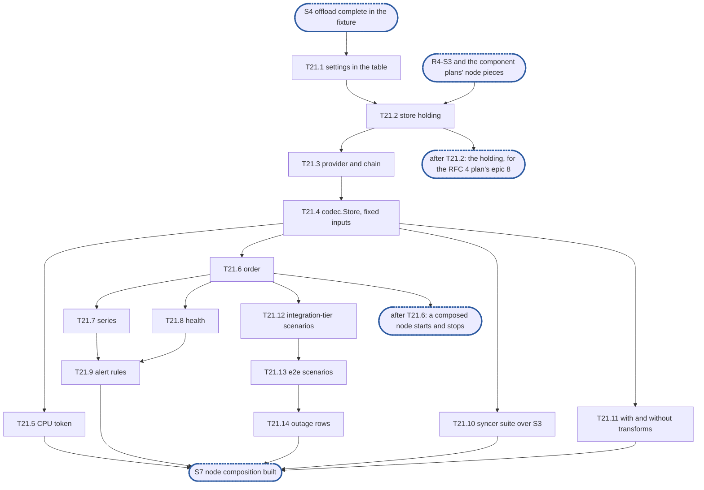

# Epic 21: engine offload integration, the node composes offload

**Sources:** [RFC 8](../docs/internals/rfcs/rfc-8-engine.md) §2.1 (the root's obligations: every
share has a remote block store, composition at construction, a capability declared and refused when
absent, the syncer's `Store` as RFC 4's `codec.Store` with no error mapped), §2.6 (build, start and
stop order, the engine closing only what it opened), §2.8 (the content wiring and who imports it),
§13's RFC 8 E5, and §15.2's "§2.1 one clock" row at the node;
[RFC 23](../docs/internals/rfcs/rfc-23-control-plane.md) §2.1 (the node's build order, the remote
stores held one client per store configuration and ref-counted, no component building or closing
another) and §2.2 (start step 5, stop step 8); [RFC 3](../docs/internals/rfcs/rfc-3-syncer.md) §2.2
(the pools' fixed sizing, a namespace opened later with a larger `Max`), §2.10 (the two worker
counts) and §8.1's real-backend row; [RFC 4](../docs/internals/rfcs/rfc-4-remote-tier.md) §4.10 (one
client per store configuration, the limit this epic passes until the RFC 4 plan's epic 8) and
§7.3's "§3.3 transforms" row; [RFC 5](../docs/internals/rfcs/rfc-5-transforms.md) Appendix B.4 (an
unavailable key behaves as an unavailable remote and recovers); [RFC 13](../docs/internals/rfcs/rfc-13-configuration.md)
Appendix B (the keys this part and its components read, loaded from the node's table);
[RFC 24](../docs/internals/rfcs/rfc-24-resources.md) §6.2 (the CPU token);
[RFC 25](../docs/internals/rfcs/rfc-25-observability.md) §2.4 and §2.5 (entity labels, per-share
figures), §3.9 (`material_destroyed`), §7 (alerting) and §8.1 (each component a `Source` the node
adds); [RFC 21](../docs/internals/rfcs/rfc-21-nfs.md) §13's "§11.5 full journal" row, its
store-unreachable leg; [RFC 22](../docs/internals/rfcs/rfc-22-smb.md) §18's "§16.5 remote outage on
reads" row; and the journal plan's system scenario catalogue,
[`rfc-1-journal-epic2.md`](rfc-1-journal-epic2.md) §7.1 and §7.2, the rows it leaves to RFC 8's
second part. Every citation is `develop`'s text; the code lands on `feat/storage-v2`, and the paths
below are paths there.
**Track:** the team.
**Epic 21 estimate: 14 subtasks, 41 man-days.**
**Depends on:** sync point **S4**, offload complete in the fixture (epics 13 to 20): `content.Compose`
already composes `Deps.Carver`, `Deps.Chain`, `Deps.Puts` (epic 15), `pool.New` over the stores it
is given, each registered with its probe key, `Share.Store` and the share's refusal at `Bind` (epic
16), `Deps.Watch` (epic 14), and the engine's `Stats` carry every offload condition, `material_destroyed`
among them (epic 20); **S5's second half**, the RFC 4 plan's **R4-S3** (its epics 3 to 6): the S3
store with `NewClient(ClientConfig, Deps)` and the checked `Open`, `codec.Store` with `MaxHeaderLen`,
LocalStack over HTTPS in `integration` with `s3fault`; the RFC 3 plan's **epics 5 and 8**: the
`health.Source` for the two store conditions and the syncer's settings section and summed collector,
in `internal/node/content`; the RFC 4 plan's **epic 7**: the remote-store sections, recorders,
collectors and its alert expression; the RFC 5 plan's **epics 6, 8 and 9**: the provider, its
`keys` object and rotation run, the transforms' sections, collectors and material health source;
the RFC 2 plan's **epic 3**: `pkg/carver/section`; RFC 13 naming the keys of `Target` and of the
three engine rows Appendix B leaves unnamed (T21.1 registers each when it is named). T21.13 and T21.14
also need the NFS and SMB adapters serving on the filesystem service (the RFC 21 and RFC 22 plans).
**Blocks:** **S7** and so epic 22, whose burn-down and benchmarks run over the composed node; the RFC
4 plan's **epic 8, the client limit** (#6003, with its subtasks #6004 and #6005), which replaces the
limit T21.2 builds each client with and runs its two rows over T21.2's holding; the RFC 3 plan's
epic 9 (B5 on the composed node); the RFC 5 plan's epics 10 and 11 (the census over a composed node,
its engine rows); and the RFC 8 offload plan's epic 22.

---

## 1. Goal

Epic 21 makes a `dfs` node compose offload for real: remote stores built from the store
configurations an operator writes, one client per configuration, the syncer over a `codec.Store` per
store with each store's transform chain, the material provider, the CPU token, every component's
settings loaded from the node's table, every component's collectors, health sources and alert rules
registered, and the rows that only a composed node can pass. Its end is S7.

**At the end of the epic:**

- a share served by `dfs start` offloads to the S3-compatible store its namespace names, reads its
  evicted content back from it, and no production path builds the in-memory remote store;
- the stores of one store configuration share one client, built with the limit `upload_workers +
  fetch_workers + 2`, released when the last store of the configuration closes;
- the node builds the stores, then the syncer, then the engine, and stops them in reverse;
- every key this part and its components read is loaded from the node's settings table, and
  reaches its component through `Apply` or at the next start as RFC 13 Appendix B classes it;
- every offload, store and material condition is in the health evaluator, every component's series is
  scraped from the node's registry, and every component's alert rules are in one generated rules file
  checked against a scrape;
- `syncertest`'s Group A and lifecycle checks pass in `integration` against LocalStack behind a fault
  proxy; the engine's read and write rows pass with and without transforms; the NFS and SMB
  remote-outage rows and the journal plan's system scenarios pass on a composed node in `e2e`.

### 1.1 In scope

The node's settings table and reaches for the components' sections and the engine's keys; the
store holding; the provider and chain per store configuration and the key-record suite against
`kvstore`; a `codec.Store` per store with its census lookup, registered with the syncer; the
syncer's fixed inputs and the namespace opened later with a larger `Max` or block target; the CPU
token; the node's build and stop order; registering collectors, per-share flow gauges, health
sources and alert rules, and the form of an alert rule; the S7 suite run; the with-and-without
transforms rows; the system scenarios and the remote-outage rows on a composed node.

### 1.2 Out of scope

- The client limit derived from its callers, `clientLimit`, and RFC 4 §7.1's two §4.10 rows: the RFC
  4 plan's epic 8, which replaces T21.2's sum (#6003).
- GC's term in the client limit, GC's scheduler instance and a namespace added to GC: RFC 9, the
  offload plan's §6.1 row "GC composed in the node".
- The counts reduced to fit the transfers pool (RFC 24 §7.2, RFC 3 §2.10): the caller that first
  passes the syncer that pool's size, the RFC 3 plan's §6.1 row on it.
- Spreading connections across the store's addresses: RFC 3 §9 defers it until a measurement asks
  for it (D3).
- The decoder's CPU token: only GC's verification would pass one, and the decoder takes none in v1.1
  (D5; the RFC 4 plan's §6.1 row deferring it to RFC 9).
- Building the components' sections, collectors, recorders, health sources and alert expressions:
  the RFC 3 plan's epics 5 and 8, the RFC 4 plan's epic 7, the RFC 5 plan's epic 9 and the RFC 2
  plan's epic 3. This epic registers what they build and settles the rules' form (D7).
- The census refresher and its collector: the RFC 5 plan's epic 10, planned after S7; it joins
  T21.6's order when it lands.
- The engine's `Deps.Carver`, `Chain`, `Puts`, `Syncer`, `Watch` and `Share.Store`: epics 14, 15 and
  16, which add each with its first caller. This epic changes only where the stores they compose come
  from (D2).
- "§2.1 remote required", the row adding a share whose configuration names no store: the RFC 23
  plan's epic 3. This epic keeps it green with real stores (T21.6).
- `PreWarm`, the node's upload drain calling `WaitOffloaded`, and the lost-journal acknowledgement's
  node action: the offload plan's §6.1 rows on each.
- The benchmarks, the soak with remote faults and the burn-down: epic 22.
- The journal's own soak (`rfc-1-journal-epic2.md` §7.2's long soak): the journal plan's epic 12.

### 1.3 Names used here

- **E1**, epic 11, interfaces: `Settings`, `ShareSettings`, `Share.Store` and `Stats`.
- **E2**, epic 12, red rows and test foundations: the fixture and `test/engine/known.yaml`.
- **S4**, offload complete in the fixture: epics 13 to 20 done; this epic starts here.
- **S5**, offload components built: the RFC 2 to RFC 5 plans' implementation epics; its second half
  is the RFC 4 plan's R4-S3.
- **R4-S3**, the RFC 4 plan's store and codec complete: its epics 3 to 6 done.
- **S3** names the storage service (Amazon S3 and the services compatible with it) everywhere in
  this document except inside **R4-S3**.
- **S7**, node composition built: the end of this epic.
- **S6**, journal offload half built: the journal plan's epics 9b and 7b; epic 22 needs it, and the
  e2e rows here run over the real journal it completes.
- **The first part**: the journal-only engine, epics 1 to 10 of RFC 8's first plan, whose
  `engineDefaults` this epic replaces.
- **RFC 8 E5**: an invariant of RFC 8 §13, never an epic: every share has a remote block store.
- **#4276**: the issue that asks the node to compose the syncer and the remote clients and the
  registry to refuse the in-memory remote store outside tests.

## 2. How the general rules apply

The rules are those of [the offload plan's §1.5](rfc-8-offload-engine-plan.md#15-general-rules-for-each-epic),
cited by number and title and not copied.

| Rule | Subtasks | How |
| --- | --- | --- |
| rule 1, **Independent unit tests** ([`CLAUDE.md`, "Writing tests"](../CLAUDE.md#writing-tests)) | T21.1 to T21.9, T21.11 | the node and the content wiring over RFC 4's in-memory store (kind 2, RFC 4's suite) and its fault wrapper (kind 3), RFC 5's real chain and `keystest`'s provider, `kvstore` over the in-memory `kv.KV`, the test clock (kind 1); the store holding's tests count what the holding hands out, which is its output, not a recording of calls; no node-side double |
| rule 2, **Fuzz the key and ref decoders the queue's rebuild reads** | none | nothing here decodes bytes; the settings sections decode through `pkg/settings`, which its own plan fuzzes |
| rule 3, **Observability follows RFC 25** | T21.7, T21.8, T21.9 | the components' series registered on the node's registry, per-flow queue gauges by share under §2.5's worst-n rule through `shareGaugeSpec`, the conditions in the evaluator, alerts on conditions (§7); no new series of the engine's own |
| rule 4, **Profiling** | all | every node test runs under `internal/prof`'s goroutine and descriptor checks; T21.6's stop test fails on a client, flow or provider loop left open; no allocation assertion, since nothing here is per operation |
| rule 5, **Public interface and internals** ([`CLAUDE.md`, "Verifying a change"](../CLAUDE.md#verifying-a-change)) | all | each value is asserted where it is consumed: a setting at the component's `Apply` or its built config, a client's limit at the client's caps, a condition at the evaluator's `Conditions`, a series in a scrape of the node's registry, an alert's names in that same scrape |
| rule 6, **Known failures shrink** | T21.10, T21.11 | `integration` and `e2e` keep no known list, so their rows land green; T21.11's engine rows are green already and gain a second run |
| rule 7, **v2 ignores v1, and the engine imports only what RFC 0 §1.2 allows** ([RFC 0 §1.2](../docs/internals/rfcs/rfc-0-data-lifecycle.md)) | T21.2, T21.3, T21.4 | implementations (`pkg/remote/s3`, `pkg/remote/codec`, `pkg/syncer/pool`, `pkg/transform/chain`, `keys/provider`) are imported by `internal/node` and `internal/node/content` only; the node's content-importers test and the engine's transitive walk stay as they are; no engine package changes its imports |
| rule 8, **Real dependencies for properties of those dependencies** ([`CLAUDE.md`, "Writing tests"](../CLAUDE.md#writing-tests)) | T21.3, T21.10, T21.12, T21.13, T21.14 | LocalStack over HTTPS behind `s3fault` for remote semantics (`LOCALSTACK_HTTPS_ENDPOINT`, a skip naming it otherwise, never counted); `kvstore` over Badger under `t.TempDir()`, the memory KV and FoundationDB where it runs for the key records; the real journal on a real directory for the system scenarios |
| rule 9, **Code comment conventions** ([`CLAUDE.md`, "Code comments"](../CLAUDE.md#code-comments)) | T21.2, T21.4, T21.5, T21.9 | RFC 24 §6.2's `decision:` and two `ponytail:`s at the token; this epic's own markers, each named in §4; epic 16's `uploadWorkers` `ponytail:` and its D7 `decision:` withdrawn with the constant they mark (T21.1); the RFC 23 plan's `ponytail:` on every share naming the in-memory store withdrawn (T21.2) |
| rule 10, **A test must be able to fail** ([`CLAUDE.md`, "Writing tests"](../CLAUDE.md#writing-tests)) | all | each test names the planted break it catches |
| rule 11, **A symbol is exported only if the RFC's interface uses it** | all | `node.Config` gains one field (D2); everything else is unexported in `internal/node` or `internal/node/content`, read by tests through `export_test.go` |
| rule 12, **Each subtask creates only what it declares** | all | each section joins the table with the component that reads it, each source and collector with its registration, the token with its one consumer |

## 3. Requirements and invariants

Every MUST and MUST NOT the sources place on the node's composition of offload, numbered so subtasks
and tests can cite them. Obligations of a component itself (the syncer's admission, the codec's
token take and return, a recorder's label cap) are that component's plan's, and are named only
where this epic's code must honour them.

**Composition**

| # | Requirement | Kind | Source | Subtasks |
| --- | --- | --- | --- | --- |
| R1 | A share whose configuration names no remote block store is refused, naming the share, and no binding is created, on a composed node whose stores are real; there is no local-only path | MUST | RFC 8 §2.1, §13 RFC 8 E5 | T21.6 |
| R2 | Composition happens at construction: no capability is wired onto a serving engine by a setter, and a changed store configuration reaches a share only as a replaced binding | MUST, MUST NOT | RFC 8 §2.1 | T21.2 |
| R3 | No production path builds the in-memory remote store: a fixture supplies it whole, production never does (#4276) | MUST NOT | RFC 8 §2.1 (a production constructor accepting what tests omit); RFC 29 §4.11 | T21.2 |
| R4 | The syncer's `Store` for each store is RFC 4's `codec.Store`, the block codec with the store's transform chain over the store, registered with the syncer under its `ProbeKey`; no error is mapped between them | MUST | RFC 8 §2.1's table, D5 of the offload plan | T21.4 |
| R5 | The content wiring builds the concrete chain and injects it into the engine and the codec; the engine and the codec import only the `pkg/transform` root | MUST | RFC 8 §2.8 | T21.3, T21.4 |
| R6 | `node.New` builds, in order, the metadata store, the remote stores, the syncer, open state, the engine; `Start` starts them in that order and `Stop` stops them in reverse, the engine before open state, then the syncer, then the remote stores | MUST | RFC 8 §2.6; RFC 23 §2.1's table, §2.2 stop step 8 | T21.6 |
| R7 | The remote stores are held one client per store configuration, ref-counted; the last store of a configuration to close releases its client | MUST | RFC 23 §2.1; RFC 4 §4.10 | T21.2 |
| R8 | No component builds another or closes anything it was handed: the syncer closes no store, the engine closes no syncer, the root closes what it built | MUST NOT | RFC 23 §2.1; RFC 8 §2.6 | T21.6 |
| R9 | Until the RFC 4 plan's epic 8 derives it, each client is built with the limit `upload_workers + fetch_workers + 2`, from the counts the syncer was built with, never lower | MUST | RFC 4 §4.10; RFC 4 plan D6 | T21.2 |

**The syncer's fixed inputs**

| # | Requirement | Kind | Source | Subtasks |
| --- | --- | --- | --- | --- |
| R10 | The pools' `Max` is the largest `Max` of the namespaces the process serves at start, never less than the default 1 MiB, and the per-worker figure `Max + MaxDecodeLen(Max) + header cap` is fixed at start, for both halves | MUST | RFC 3 §2.2 | T21.4 |
| R11 | `MaxDecodeLen` is the maximum over every registered transform, so neither a chain changed to a cheaper one nor to a costlier one moves the bound | MUST | RFC 3 §2.2 | T21.4 |
| R12 | A namespace opened after start with a larger `Max`, or a larger block target, than the pools were sized from is not opened until the next start; meanwhile the node raises a health condition naming the namespace and both figures | MUST | RFC 3 §2.2; [`rfc-3-syncer-epic1.md`](rfc-3-syncer-epic1.md) §9 (`BlockTarget` the largest at start) | T21.4 |
| R13 | `upload_workers` and `fetch_workers` are the syncer's only two settings, process-wide, read at start; the engine's pass bound reads the same `upload_workers` | MUST | RFC 3 §2.10; RFC 8 §6.2 | T21.1, T21.4 |

**Settings**

| # | Requirement | Kind | Source | Subtasks |
| --- | --- | --- | --- | --- |
| R14 | Every key RFC 13 Appendix B gives this part, the first part, the syncer, the remote stores, the transforms and the carver is declared in the node's one settings table with its scope and class, and the table matches Appendix B | MUST | RFC 13 Appendix B | T21.1 |
| R15 | No constructor takes settings: the first node-level settings reach the engine through `Apply` before its `Start`, and every later change the same way; a key Appendix B classes restart-only reaches its component at the next start | MUST | RFC 8 §2.6; RFC 23 §2.1, §2.2 step 4; RFC 13 Appendix B | T21.1 |

**Material**

| # | Requirement | Kind | Source | Subtasks |
| --- | --- | --- | --- | --- |
| R16 | A namespace whose key material is unavailable behaves as an unavailable remote, and recovers when the key returns, without the node restarting (pending, §9 point 1) | MUST | RFC 5 Appendix B.4 | T21.3 |
| R17 | The key-record view `kvstore` implements passes RFC 5's key-record suite over the memory KV, Badger and FoundationDB where it runs, the key lock's conflict included | test row | RFC 5 plan D7 | T21.3 |

**CPU**

| # | Requirement | Kind | Source | Subtasks |
| --- | --- | --- | --- | --- |
| R18 | The runtime's default parallelism is used and never overridden; the background-token count is three quarters of it as read at start, at least one | MUST, MUST NOT | RFC 24 §6.2 | T21.5 |
| R19 | Tokens are granted in arrival order, and a worker waiting for one holds its worker and nothing else | invariant | RFC 24 §6.2 | T21.5 |
| R20 | Request-path CPU takes no token: the root passes the token to the codec's background encode only, never to a demand read's or a read-ahead's decode | MUST | RFC 24 §6.2 | T21.5 |

**Observability and health**

| # | Requirement | Kind | Source | Subtasks |
| --- | --- | --- | --- | --- |
| R21 | Each component is a `Source` the node adds to the health evaluator with `Add` and removes with `Remove`: the engine's offload conditions, the syncer's two store conditions, the provider's two material conditions and R12's condition | MUST | RFC 25 §8.1, §3.9 | T21.8 |
| R22 | `material_destroyed` is unhealthy with `data_loss` while a census entry or a journal-held chunk depends on the material, or while that is not yet known, and the node adapts it from the engine, which alone evaluates it | MUST | RFC 25 §3.9; RFC 8 §10.4 | T21.8 |
| R23 | Per-share figures follow §2.5's worst-n rule: the syncer's per-flow queue gauges are exported by share, never one series per flow | MUST | RFC 25 §2.5 | T21.7 |
| R24 | An entity label takes the object's name, not an internal ID, the journal excepted (pending, §9 point 2) | MUST | RFC 25 §2.4 | T21.7 |
| R25 | Alerts are on conditions wherever a condition exists, with the class and delay of RFC 25 §3.9's row; an alert names the condition, the subject, the cause and `since` and links the troubleshooting entry; one condition is one alert however many shares inherit it | MUST | RFC 25 §7 | T21.9 |
| R26 | The only alerts that read metrics directly are the scraper's stopped-exporting, `health_status{scope="installation"}` away from `healthy`, and the bug counters §7 names, `codec_verify_failures_total` and `transform_decode_failures_total{error="malformed"}` net of the syncer's recovered re-gets among them | MUST | RFC 25 §7 | T21.9 |

**Rows only a composed node passes**

| # | Requirement | Kind | Source | Subtasks |
| --- | --- | --- | --- | --- |
| R27 | The syncer's Group A checks and lifecycle checks run against a local emulator of the remote service with a fault proxy between them | test row | RFC 3 §8.1 | T21.10 |
| R28 | The engine's read and write tests run with and without transforms, with no difference observable apart from offsets and timing | test row | RFC 4 §7.3 ("§3.3") | T21.11 |
| R29 | "§2.1 one clock": the node under two test clocks, one 5 % fast, every wait on another clock's timeout ending no sooner than its bound by the slow clock, with the syncer and the stores composed | test row | RFC 8 §15.2 | T21.12 |
| R30 | Several shares, one journal per device; capacity; cold reads after eviction and a restart, never zeros, a lost extent failing; share lifecycle; at the filesystem service's integration tier on a composed node | test row | [`rfc-1-journal-epic2.md`](rfc-1-journal-epic2.md) §7.1; RFC 0 I1 | T21.12 |
| R31 | Durability through the protocols, the reference workloads, process limits, start and devices, and process death against power loss, on a real `dfs` with kernel clients | test row | [`rfc-1-journal-epic2.md`](rfc-1-journal-epic2.md) §7.2 | T21.13 |
| R32 | "§11.5 full journal", its leg with the store unreachable for 2 minutes past the caller's deadline: every retry `NFS4ERR_DELAY`, never `NFS4ERR_NOSPC`, success once the store returns | test row | RFC 21 §13 | T21.14 |
| R33 | "§16.5 remote outage on reads": `STATUS_PENDING` and success once the store returns, `STATUS_UNEXPECTED_IO_ERROR` past `pending_timeout`, and a half-evicted file read with `MinimumCount` its length pending, not short | test row | RFC 22 §18 | T21.14 |

## 4. Decisions this epic takes

- **D1, the plan's expected content is narrowed to what no earlier epic or component plan builds.**
  Epics 14 to 16 put `Deps.Watch`, `Deps.Carver`, `Chain`, `Puts`, `pool.New` over the stores
  `content.Compose` is given, each store's probe-key registration and `Share.Store` in the content
  wiring with their first callers; the RFC 3, 4 and 5 plans build their sections, collectors and
  health sources there. This epic changes only where the stores come from, and registers the rest.
  So the plan's "`Deps.Carver`, `Syncer`, `Refs`, `Watchdog` from the root" and "the syncer built
  once" are already met when it starts, and are checked here only by T21.6's order. No marker.
  Prior art: the first part's epic 10, which composed nothing new and only proved what its epics
  built (read the document).
- **D2, `node.Config` gains `Remote`, the opener from a store configuration to a remote store; the
  host passes S3's.** RFC 23 §2.1's `Config` already takes the KV for the same reason: "the in-memory
  one, held to RFC 16's KV suite, in a multi-node test". `Remote func(ctx, StoreConfig) (remote.Store,
  error)`, the contract types of `pkg/remote`; `cmd/dfs`'s host passes `content.OpenS3`, `nodetest`
  passes `pkg/remote/memory`'s opener, and `New` refuses a nil `Remote` naming it (RFC 8 §2.1). So no
  record names an in-memory kind and production has no code path to it (R3); the RFC 23 plan's
  `ponytail:` "every MVP share names the in-memory remote store" is withdrawn with it. RFC 23 §2.1's
  `Config` sketch gains the field in T21.2's pull request. Rejected: a store kind `memory` refused at
  the API outside a build tag, which hides a production path behind a tag (`CLAUDE.md`, "By kind");
  a package-level opener a test swaps, which `CLAUDE.md` bans; and a kind table set by an option in `export_test.go`, which reaches `package node`'s own tests but not `nodetest`'s callers. Prior art: RFC 23's `Config.KV`
  (read the RFC).
- **D3, connections are not spread across a store's addresses.** The plan's D5 names it; RFC 3 §9
  lists "spreading connections across the service's addresses" as deferred until a measurement
  asks for it. The RFC wins; nothing is built. No marker, since no code holds the choice. Prior art:
  the AWS SDK's default resolver, which dials what DNS returns and leaves spreading to the service's
  load balancer (from memory).
- **D4, the store holding is a ref-counted map from a store configuration's ID to its client, in
  `internal/node/content`.** `acquire(cfg)` builds the client on its first store, with R9's limit,
  and returns it with a release; the last release closes it. Stores of one configuration are opened
  through the checked `Open` (RFC 4's epic 5) on the shared client. A `ponytail:` at the limit's sum
  names the RFC 4 plan's epic 8 as the upgrade, at no migration since nothing persists it. Prior art:
  rclone's backend cache, one remote per configuration string, reference-counted (from memory).
- **D5, the token is `golang.org/x/sync/semaphore`'s `Weighted`, passed to the codec's encode only.**
  The module is already a dependency; its `Acquire` is FIFO, as RFC 24 §6.2 requires. Weight one per
  chunk, size `max(1, 3*runtime.GOMAXPROCS(0)/4)` read once at `New`. The decoder's token has no v1.1
  caller (only GC's verification would pass one), so nothing passes it (R20), whichever of the RFC 4
  plan's documents keeps the optional parameter. RFC 24 §6.2's `decision:` and two `ponytail:`s at
  the site. Prior art: Go's `x/sync/semaphore`, whose waiters are served in arrival order (from memory; T21.5's order test checks it).
- **D6, the syncer's fixed inputs are computed once, in `content.Compose`, from the namespaces the
  records list at start.** `Max` and the block target are each the largest over those namespaces,
  floored at RFC 2's defaults; `MaxDecodeLen` comes from the chain over every registered transform;
  `HeaderCap` from `codec.MaxHeaderLen`. A namespace opened later with a larger figure is left
  unopened and raises `namespace_restart_needed` (proposed, a namespace-scoped condition naming the
  namespace, the figure and both values), cleared at the next start; RFC 25 §3.9 gains the row in
  T21.4's pull request. A `decision:` at the check: a restart is the only resize, withdrawn if pools
  are ever resized live. Prior art: none found.
- **D7, an alert rule is a Prometheus rule in one generated file, `deploy/prometheus/alerts.yaml`,
  built by `go run ./cmd/genalerts` from Go values each component exports as plain data.** The
  values: `{Name, Expr, For, Severity, Summary}`, with `Expr` the component's own expression string
  (RFC 4's `verifyAlert`, RFC 5's four, the syncer's two, the engine's offload conditions). A rule on
  a condition reads `health_conditions{condition="<name>"}` with the `For` and the class of RFC 25
  §3.9's row; the bug-counter rules keep their own expressions. `internal/node` holds the one list;
  a unit test renders it and fails if the checked-in file differs, as `docs/guide/cli.md` is held to
  `cmd/gendocs`, and a second test scrapes a composed node's registry and fails on any metric or
  label a rule names that the scrape lacks. Settled now, because every component's rule takes this
  form; changing it later rewrites each rule, at no data migration. Prior art: the Prometheus
  "mixin" convention (kubernetes-mixin, etcd's alerts), rule groups generated from code and
  shipped as YAML beside the binary (from memory).
- **D8, the per-flow gauges reach a share through the flow IDs the engine already holds.** Epic 16
  opens one flow per share; the engine's `ShareStats` gains no field: the node's stats fetch takes
  the syncer's `Stats` beside `engine.Stats`, and maps each flow ID to the share whose binding opened
  it through a `func(FlowID) (ShareID, bool)` the content wiring builds from the bindings it knows,
  feeding the existing `shareGaugeSpec` worst-n path. A flow with no share (none in v1.1) is summed
  only. Prior art: the node's own `journalShareGauges` (read the code).
- **D9, entity label values are the IDs the API spells, until a record holds a name — pending the
  user's answer (§9 point 2).** No store or namespace record on `feat/storage-v2` holds a name
  (`entity.Namespace`, `apiv1.StoreSpec`); RFC 25 §2.4 allows an ID for the journal alone. The
  recommended value is the ID as the API writes it (`idString`), the one string handed to every
  recorder and collector of the store and the namespace, with RFC 25 §2.4's exception widened to
  stores and namespaces until their records gain a name. Prior art: Ceph's `ceph_pool_*` series keyed
  by `pool_id`, with an info metric mapping it to the name (from memory).
- **D10, a store whose provider fails at start is retried every 30 s, without a restart — pending
  the user's answer (§9 point 1).** RFC 5 Appendix B.4 has the namespace behave as an unavailable
  remote and recover when the key returns; nothing reopens it. Recommended, as the RFC 5 plan's epic
  11 recommends: the content wiring retries the provider's open for that store every 30 s, as RFC 8
  §2.5 retries a refused journal, `material_unavailable` naming the namespace meanwhile, and the
  namespace's shares attach once it opens. A `decision:` at the retry. Prior art: RFC 8 §2.5's
  retried open (read the RFC).

## 5. Target tree

On `feat/storage-v2`.

```text
cmd/dfs/                         T21.2   the host passes content.OpenS3 as Config.Remote (D2)
cmd/genalerts/main.go            T21.9   renders internal/node's rules (D7)
deploy/prometheus/alerts.yaml    T21.9   generated, checked in
internal/node/
  node.go                        T21.2   Config.Remote; New refuses it nil; T21.4 the stores into Compose
                                 T21.6   the order and the stop
  settings.go                    T21.1   newTable and newReaches gain the components' sections and the engine's
  engine_settings.go             T21.1   the engine's section: node keys to engine.Settings, share keys to ShareSettings
  stats.go                       T21.7   the syncer's Stats in the snapshot; flow gauges by share (D8); work-queue series
  health.go                      T21.8   the sources added and removed
  alerts.go                      T21.9   Rules(), the one list (D7)
  alerts_test.go                 T21.9   rendered file matches; every name in a scrape
  appendixb_test.go              T21.1   passes with every section (the RFC 13 plan's check)
  order_test.go                  T21.6   build, start and stop order; R1 on real stores
  oneclock_test.go               T21.12  R29
  integration_test.go            T21.12  R30, tag integration
  nodetest/                      T21.2   Config.Remote over pkg/remote/memory
internal/node/content/
  stores.go                      T21.2   the holding (D4), OpenS3
  provider.go                    T21.3   the provider and chain per store configuration; the retry (D10)
  provider_test.go               T21.3   the key-record suite over kvstore (R17)
  codecstore.go                  T21.4   codec.Store per store, its census lookup; the fixed inputs (D6)
  cputoken.go                    T21.5   the token (D5)
  syncer_s3_test.go              T21.10  syncertest Group A and lifecycle over S3, tag integration
test/engine/                     T21.11  the read and write rows run under both chains
test/e2e/                        T21.13  the system scenarios; T21.14 the outage rows
test/suites.yaml                 T21.10  the integration cell's package list gains internal/node/content
docs/guide/configuration.md      T21.1   the engine's keys and their classes
docs/internals/rfcs/rfc-23-control-plane.md  T21.2's pull request: Config.Remote
docs/internals/rfcs/rfc-25-observability.md  T21.4's pull request: namespace_restart_needed's row
```

## 6. Subtasks

### T21.1 Every component's settings in the node's table

**Subtask T21.1 estimate: 3.5 man-days.**

- **Track:** the team. **Depends on:** S4.
- **Covers:** R13 (the engine's half), R14, R15.
- **Deliverables:**
  - `newTable` gains the sections the component plans build: the remote store's (the RFC 4 plan's
    epic 7), the syncer's (the RFC 3 plan's epic 8), the carver's `Target` (`pkg/carver/section`, the
    RFC 2 plan's epic 3) once RFC 13 names its key; `newReaches` gains each one's reach, a restart
    reach for the syncer's two counts and the remote store's bound keys. The transforms' section and
    reach are the RFC 5 plan's epic 9's own edit, and stay.
  - `engine_settings.go`: the engine's section, every RFC 13 Appendix B key both parts of the engine
    read, node scope decoded into `engine.Settings` and passed through `Apply` by the node's `apply`
    (replacing `engineDefaults`), share scope decoded into `engine.ShareSettings` for each share's
    `Bind` (replacing the defaults epic 11 has the node pass). The three rows Appendix B leaves
    unnamed (the eviction occupancy target, the fill low-water mark, the speculation budget) join
    when RFC 13 names them; until then the node passes RFC 13's proposed values, as it does today.
  - `upload_workers` read into the engine's pass bound, withdrawing epic 16's `uploadWorkers = 128`
    constant with its `ponytail:` and its D7 `decision:`; `engine.Settings` gains the field, additive
    to epic 11's frozen set (§9 point 4).
  - `docs/guide/configuration.md`: the engine's keys with their scope and class.
  Consumed by T21.2 (the remote sections), T21.4 (the two counts), epic 22.
- **Acceptance criteria:**
  - `TestAppendixBMatchesTheTable` passes with every section, and fails when one key is dropped.
  - A live engine key changed in the records reaches `engine.Apply` within one reconcile; a
    restart-only key changed while serving changes nothing until the next start.
  - The node passes no constant to `Apply` or to a share's `Bind`.
- **Tests:** at `engine.Apply` and `Bind`, which the node calls, over `nodetest` with the in-memory
  KV and the test clock: a record setting `offload.max_age` reaches the share's binding (catches a
  section decoded but never handed on); `upload_workers` changed at runtime leaves the pass bound and
  the pools unchanged until restart (catches a restart key applied live, R13); the Appendix B check
  with one key dropped from the engine's section (catches a key the table misses, R14).
- **Rules:** rule 9, the withdrawn markers; rule 12, each section with the component that reads it.

### T21.2 The store holding

**Subtask T21.2 estimate: 3.5 man-days.**

- **Track:** the team. **Depends on:** T21.1.
- **Covers:** R2, R3, R7, R9.
- **Deliverables:**
  - `node.Config.Remote` (D2), refused nil at `New`; `cmd/dfs` passes `content.OpenS3`, `nodetest`
    the in-memory store's opener.
  - `content/stores.go`: the holding (D4), `acquire(cfg StoreConfig) (client, release func(),
    error)`; `OpenS3` builds `s3.NewClient(ClientConfig, Deps)` with `Limit: uploadWorkers +
    fetchWorkers + 2` from the counts T21.1 loads (a `ponytail:` naming the RFC 4 plan's epic 8), the
    credential unsealed through the RFC 4 plan's epic 7's parse, and opens each namespace's store
    through the checked `Open` on the shared client, passing `MaxBlockSize` and handing the `Claim`
    on; a changed store configuration closes the old store after its bindings are replaced through
    `Bind` (R2).
  - The RFC 23 plan's `ponytail:` on the in-memory store withdrawn; RFC 23 §2.1's `Config` sketch
    gains `Remote`.
  Consumed by T21.4 (the stores), the RFC 4 plan's epic 8 (the holding it derives the limit for).
- **Acceptance criteria:**
  - Two namespaces on one store configuration share one client; the second namespace's close keeps
    it, the last closes it.
  - The client's limit equals `upload_workers + fetch_workers + 2` from the loaded counts.
  - `cmd/dfs` has no path to `pkg/remote/memory`: the node's import walk refuses it in production
    code.
- **Tests:** at the holding, which T21.4 calls, over `pkg/remote/memory`'s opener (kind 2): two
  stores, one configuration, one client handed out, closed only after both releases (catches a
  client per store, or one closed under a live store, R7); the limit read back from the client
  `OpenS3` builds, in `integration` against LocalStack (catches a term dropped, R9); the node's
  import walk with a planted `pkg/remote/memory` import in `internal/node`'s production code
  (catches R3); a store configuration's change replacing the share's binding, read back from the
  engine's bindings (R2).
- **Rules:** rule 7, the walk; rule 9, the `ponytail:` at the sum.

### T21.3 The provider and the chain per store configuration

**Subtask T21.3 estimate: 4 man-days.**

- **Track:** the team. **Depends on:** T21.2.
- **Covers:** R5 (the chain's half), R16, R17.
- **Deliverables:**
  - `content/provider.go`: one provider per store configuration per node (the RFC 5 plan's epic 8's
    D12), built with `kvstore`'s key-record view, the store's `keys` object put and get, the `storage`
    key's ID and fingerprint, and the rotation inputs the RFC 5 plan's epic 8 names (`KeysObjects`,
    `After`, `RotationNeeded`), its `Run` started with the stores and stopped before them; the chain
    built over it with `chain.NewChain`, `Require` and `Encrypts` from the transforms' section; both
    handed to `content.Compose` in place of the fixture's `keystest` provider.
  - D10's retry of a store whose provider failed at start, pending §9 point 1.
  - `provider_test.go`: RFC 5's key-record suite over `kvstore` on the memory KV, Badger under
    `t.TempDir()` and FoundationDB where it runs, unless the RFC 5 plan's epic 6 moves that run into
    `kvstore`'s own tests first (§9 point 3).
  Consumed by T21.4 (the chain for each `codec.Store`), T21.8 (the provider's health source).
- **Acceptance criteria:**
  - Every namespace of a composed node encodes under its store configuration's chain, and a block
    written by one configuration's chain is read back through it after a restart.
  - A provider that fails at start leaves its namespaces' shares unattached with
    `material_unavailable` naming the namespace, and they attach within 30 s of the key returning.
- **Tests:** at the engine's read, which the filesystem calls, over `nodetest` with the in-memory
  store: a block written, the node restarted, read back verified (catches a chain rebuilt from
  other material); a provider failed through the RFC 5 plan's fault wrapper around `keystest`'s
  provider (kind 3), then restored, the test clock advanced past 30 s, the share attached (catches
  no retry, R16); the key-record suite over three backends (R17).
- **Rules:** rule 8, the backends; rule 9, D10's `decision:`.

### T21.4 A `codec.Store` per store and the syncer's fixed inputs

**Subtask T21.4 estimate: 4 man-days.**

- **Track:** the team. **Depends on:** T21.3.
- **Covers:** R4, R5 (the codec's half), R10, R11, R12, R13 (the syncer's half).
- **Deliverables:**
  - `content/codecstore.go`: for each store from T21.2, `codec.New` with the store's chain, the
    format version from the remote section, and `Config.Census`, a lookup by block name over the
    block record (absent answers `ErrNotFound`); handed to `content.Compose` as the stores epic 16's
    `pool.New` registers under each `ProbeKey`. No error mapped.
  - D6's fixed inputs into `pool.Config`: the two counts, `Max`, the block target, `MaxDecodeLen`,
    `HeaderCap`; the check refusing to open a namespace with a larger figure, and its condition,
    `namespace_restart_needed`, with RFC 25 §3.9's row in this subtask's pull request and a
    `decision:` at the check.
  Consumed by T21.5 (the codec the token is passed to), T21.6, T21.10, T21.11.
- **Acceptance criteria:**
  - A put through a composed node reaches the store encoded by that store's chain, and the census
    lookup answers the block's encodings.
  - The pools are sized once from the largest `Max` and block target served at start, at least the
    defaults; a chain change while serving leaves the per-worker figure unchanged.
  - A namespace created after start with a `Max` above the pools' is not opened, the condition
    names it with both figures, and the next start opens it.
- **Tests:** at the syncer's `Stats` and the evaluator, which the node reads: two namespaces at
  start with `Max` 1 MiB and 4 MiB, the per-worker figure read back from `pool.Config` equal to the
  4 MiB one (catches the first or the default taken, R10); the chain switched to compression while
  serving, the figure unchanged (catches a bound from the current chain, R11); a namespace with
  `Max` 8 MiB added while serving, unopened and its condition raised, opened after a restart
  (catches R12); a fetch through a composed node of a block whose census entry is missing, failing
  `ErrNotFound`, never decoding (catches a census defaulting).
- **Rules:** rule 9, D6's `decision:`.

### T21.5 The CPU token

**Subtask T21.5 estimate: 2 man-days.**

- **Track:** the team. **Depends on:** T21.4.
- **Covers:** R18, R19, R20.
- **Deliverables:** `content/cputoken.go`: the token (D5), sized once at `New`, with RFC 24 §6.2's
  `decision:` and two `ponytail:`s; passed to every `codec.Store`'s encode, and to no decode.
  Consumed by T21.4's codecs.
- **Acceptance criteria:**
  - The count is three quarters of `GOMAXPROCS` at start, at least one.
  - Waiters are granted in arrival order and hold nothing else while they wait.
  - A demand read and a read-ahead decode with every token held.
- **Tests:** at the token: counts for one, two, four and sixteen processors (catches the fraction
  or the floor, R18); three waiters queued in order released in that order (catches a non-FIFO
  grant, R19). Through the codec with a count of one: a second upload's encode waits while the first
  holds the token, and a read through the composed node completes with the token held (catches a
  token on the request path, R20).
- **Rules:** rule 9, the three markers.

### T21.6 Build and stop order on the composed node

**Subtask T21.6 estimate: 1.5 man-days.**

- **Track:** the team. **Depends on:** T21.4.
- **Covers:** R1, R6, R8.
- **Deliverables:** the node's start and stop with the stores and the syncer in RFC 23 §2.1's
  order; `order_test.go`. Consumed by T21.10 to T21.14, which run the composed node.
- **Acceptance criteria:**
  - `Stop` closes the engine, then open state, then the syncer, then the stores, then the metadata
    store; a failed start closes what it opened in reverse.
  - A share whose namespace names no store is refused naming the share on a node with real stores.
- **Tests:** at `Node.Stop`, over `nodetest`: each component's close observed through the in-memory
  store's open count and the syncer's open flows at each stop step, read from their `Stats` (catches
  the syncer closed under a live flow, or a store under a live syncer, R6, R8); a start failing at
  the engine leaving no store or client open, under `prof.Watch` (catches a leak); "§2.1 remote
  required" over the composed node (R1).
- **Rules:** rule 4, the stop test under `prof.Watch`.

### T21.7 The components' series on the node's registry

**Subtask T21.7 estimate: 3 man-days.**

- **Track:** the team. **Depends on:** T21.6.
- **Covers:** R23, R24.
- **Deliverables:** the syncer's summed collector (the RFC 3 plan's epic 8), the remote store's
  recorders and collectors (the RFC 4 plan's epic 7) and the transforms' collectors (the RFC 5 plan's
  epic 9) registered on the node's registry, each handed the store's and namespace's label value
  (D9); the node's stats snapshot widened to the syncer's `Stats`, the per-flow queue gauges
  (`syncer_queue_depth`, `syncer_waiters`) exported by share (D8); the scheduler's dropped and
  expired counts, kept monotonic across a departed tenant, as epic 13 hands them.
  Consumed by T21.9's scrape check.
- **Acceptance criteria:**
  - A scrape of a composed node holds every series RFC 3 §2.12, RFC 4 §4.12 and RFC 5 §6 name.
  - The queue gauges carry the share, worst-n, and their sums match the syncer's own.
  - A share dropped and re-added never lowers `engine_work_items_dropped_total`.
- **Tests:** at a scrape of the node's registry, the operator's view: the series list against each
  RFC's table (catches a collector never registered); two shares with one flow held busy, the busy
  share first in the worst-n gauge (catches a flow mapped to the wrong share); a drop and re-add with
  the counter read before and after (catches a counter reset by a departed tenant).
- **Rules:** rule 3; rule 5, the scrape.

### T21.8 Health sources

**Subtask T21.8 estimate: 2 man-days.**

- **Track:** the team. **Depends on:** T21.6.
- **Covers:** R21, R22.
- **Deliverables:** in `internal/node/health.go`, the evaluator gains the engine's offload
  conditions adapted from `Stats` (epic 20's `offload_stalled`, `file_offload_failing`,
  `offload_age_exceeded`, `stranded_export_failed` and `material_destroyed` with `data_loss`), the
  syncer's `content.StoreHealth` over the node's one flow per store (the RFC 3 plan's epic 5), the
  provider's `material_unavailable` and `material_unknown` source (the RFC 5 plan's epic 9) and
  T21.4's condition; each source removed with the component that owns it. Consumed by T21.9.
- **Acceptance criteria:** every condition named above reaches the evaluator's `Conditions` with
  its subject and cause, and leaves it when cleared.
- **Tests:** at the evaluator's `Conditions`, which `/api/v1/health` reads: the store faulted for
  puts through the in-memory store's fault wrapper (kind 3), `store_put_unhealthy` naming the store
  and `offload_stalled` naming the share (catches a source never added); material destroyed through
  the RFC 5 plan's notice on `keystest`'s provider, `material_destroyed` with `data_loss` (catches the
  severity dropped, R22); the store removed, its condition gone (catches a source never removed).

### T21.9 Alert rules and their form

**Subtask T21.9 estimate: 3 man-days.**

- **Track:** the team. **Depends on:** T21.7, T21.8.
- **Covers:** R25, R26.
- **Deliverables:** D7: `internal/node/alerts.go`'s `Rules()`, a rule per condition of RFC 25 §3.9
  this part and its components raise, with the row's class and delay (`offload_age_exceeded` with
  RFC 13 Appendix B's oldest-unoffloaded bound), the syncer's `store_put_unhealthy` and
  `store_get_unhealthy`, the RFC 4 plan's `verifyAlert` and the RFC 5 plan's four, each linking its
  troubleshooting entry; `cmd/genalerts`; `deploy/prometheus/alerts.yaml`.
- **Acceptance criteria:**
  - The checked-in file is what `cmd/genalerts` renders.
  - Every metric and label every rule names is in a scrape of a composed node.
  - A rule on a condition groups by subject: one alert per condition and store, however many
    shares.
- **Tests:** at the rendered file, which an operator loads: the render compared with the checked-in
  file (catches a rule added without regenerating); the scrape check (catches a rule naming a series
  nothing exports, R26); `promtool test rules` over a fixture series where 300 shares inherit one
  store's condition, asserting one alert (catches a rule grouped by share, R25), run in `unit` where
  `promtool` is on the path, else skipped naming it.

### T21.10 S7: the syncer's suite over S3

**Subtask T21.10 estimate: 3 man-days.**

- **Track:** the team. **Depends on:** T21.4.
- **Covers:** R27.
- **Deliverables:** `content/syncer_s3_test.go`, tag `integration`: `syncertest`'s Group A and
  lifecycle checks with an opener returning the S3 store through T21.2's holding and `codec.Store`
  over it, against LocalStack over HTTPS (`LOCALSTACK_HTTPS_ENDPOINT`) behind `s3fault`, given the
  proxy's control (`Faults.Drop` among it) and the store's checksum modes as the RFC 3 plan's D2 has
  the suite take them; a row they cannot give skipped by name. `test/suites.yaml`'s integration cell
  gains the package.
- **Acceptance criteria:** every Group A and lifecycle check passes or is skipped by name; with the
  variable unset the test skips naming it.
- **Tests:** the suite itself; its "§2.6 no inference" check run once with `s3fault` dropping the
  response after the body, failing on the assertion when the codec reports success (catches the
  proxy wired but never faulting).
- **Rules:** rule 8, LocalStack and `s3fault`.

### T21.11 The engine's rows with and without transforms

**Subtask T21.11 estimate: 1.5 man-days.**

- **Track:** the team. **Depends on:** T21.4.
- **Covers:** R28.
- **Deliverables:** `engine-conformance`'s read and write rows run twice, once with the empty chain
  and once with compression and encryption over `keystest`'s provider, through the fixture's chain
  option. Consumed by epic 22.
- **Acceptance criteria:** every read and write row passes under both chains, and their results
  differ only in offsets and timing.
- **Tests:** the rows themselves; a planted transform that drops a chunk's last byte fails the
  encrypted run on its assertion and not the plain one (catches a run that never encodes).

### T21.12 System scenarios at the integration tier, and one clock at the node

**Subtask T21.12 estimate: 3 man-days.**

- **Track:** the team. **Depends on:** T21.6.
- **Covers:** R29, R30.
- **Deliverables:** `internal/node/integration_test.go` rows over `vfs.Filesystem` on a composed
  node, the real journal on a temporary directory and the in-memory store (kind 2): several shares
  on one journal per device; capacity, retry-later at the journal's maximum and `ENOSPC` on a full
  filesystem; cold reads after eviction and a restart, never zeros, a lost extent failing; share
  create, remove and re-create with a new tag. `oneclock_test.go`: RFC 8 §15.2's "§2.1 one clock"
  through the node with the syncer and stores composed.
- **Acceptance criteria:** each row passes; the one-clock row names a component that reads a private
  clock.
- **Tests:** the rows; a cold read run with the store's get faulted to return zeros fails the "never
  zeros" assertion (catches a check that reads the journal, not the remote).
- **Rules:** rule 8, the real journal.

### T21.13 System scenarios on a real `dfs`

**Subtask T21.13 estimate: 4.5 man-days.**

- **Track:** the team. **Depends on:** T21.12.
- **Covers:** R31.
- **Deliverables:** `test/e2e` rows on a real `dfs` with kernel NFS and SMB clients, against
  LocalStack: NFS COMMIT and SMB flush surviving a host crash, an unflushed write surviving process
  death, `bounded` losing at most its bound, a failed sync changing the write verifier; the four
  reference workloads; the descriptor bound under `ulimit -n`; start refused with no journal device,
  a disk moved to another installation or a swapped journal directory refused; `SIGKILL` and a power
  cut kept distinct.
- **Acceptance criteria:** each row passes in `e2e`, which keeps no known list.
- **Tests:** the rows. This subtask's estimate is the least certain: the rows depend on the adapters
  serving on the filesystem service, and a row that finds a bug grows (§9 point 5).
- **Rules:** rule 8, a real `dfs`; rule 6, no known list.

### T21.14 The remote-outage rows

**Subtask T21.14 estimate: 2.5 man-days.**

- **Track:** the team. **Depends on:** T21.13.
- **Covers:** R32, R33.
- **Deliverables:** in `test/e2e`, RFC 21 §13's "§11.5 full journal" leg with the store unreachable
  for 2 minutes, and RFC 22 §18's "§16.5 remote outage on reads", over a composed `dfs` whose store is
  LocalStack behind `s3fault`.
- **Acceptance criteria:** each leg's assertions hold as the RFC row states them.
- **Tests:** the rows; the SMB row's half-evicted read with `MinimumCount` 0 answered at once
  (catches a pending answer where data is local).

## 7. Order of work



T21.2 is the blocker the RFC 4 plan's epic 8 builds on, though that epic starts only at S7. After
T21.6 the observability branch (T21.7 to T21.9) and the scenario branch (T21.12 to T21.14) are
independent, and T21.10 and T21.11 need only T21.4.

## 8. Suggested pull requests

| PR | Subtasks | Man-days | After | Why together |
| --- | --- | --- | --- | --- |
| 1 | T21.1, T21.2 | 7 | — | the settings and the store holding they configure: real stores in the node |
| 2 | T21.3, T21.4, T21.5 | 10 | PR 1 | the provider, the `codec.Store` per store over it and its token: offload to S3 |
| 3 | T21.6, T21.10, T21.11 | 6 | PR 2 | the order and the two suites that prove the composition |
| 4 | T21.7, T21.8, T21.9 | 8 | PR 3 | series, health and the alerts that read both; can be open beside PR 5 |
| 5 | T21.12, T21.13, T21.14 | 10 | PR 3 | the system scenarios and outage rows on the composed node |

A suggestion only: one pull request per subtask works as well.

## 9. Open points

1. **Pending the user's answer: is a store whose provider failed at start opened again without a
   restart (D10)?** The RFC 5 plan's epic 11 asks the same question and names this epic as the one
   that opens stores.
   - **(a) Recommended: retried every 30 s, no restart**, as RFC 8 §2.5 retries a refused journal;
     `material_unavailable` names the namespace meanwhile and its shares attach once it opens. Cost:
     a retry loop in `content/provider.go` and one test leg (included in T21.3's 4 man-days).
   - **(b) Opened at the next start only**, as a namespace with too large a `Max` is (D6): the
     condition says a restart is needed. Cost: none; the store stays unavailable until an operator
     restarts.
   This document is written for (a).
2. **Pending the user's answer: the label value of a store and a namespace (D9).** RFC 25 §2.4 has
   an entity label take the object's name, and neither record holds one.
   - **(a) Recommended: the ID as the API spells it**, with RFC 25 §2.4's journal exception widened to
     stores and namespaces until their records gain a name; the amendment lands in T21.7's pull
     request. Example: `remote_request_seconds{store="0f3a…"}`.
   - **(b) Names added to the store and namespace records** (RFC 16, RFC 23 and the API), then used as
     labels. Cost: a record and API change in three RFCs, outside this epic.
   This document is written for (a).
3. **Where RFC 5's key-record suite runs against `kvstore`.** The RFC 5 plan's D7 runs it from the
   content wiring's tests; the RFC 5 plan's epic 6 breakdown (open) moves it into `kvstore`'s own
   tests. T21.3 runs it unless that move has landed, and then drops the leg (0.5 man-days).
4. **Departures from documents other epics wrote, all additive:** `engine.Settings` gains
   `UploadWorkers` (T21.1), which epic 11 did not freeze; `node.Config` gains `Remote` (D2), which
   RFC 23 §2.1 is amended for; RFC 25 §3.9 gains `namespace_restart_needed` (D6).
5. **Estimate.** 41 man-days in 14 subtasks against the plan's 36 in 10. Added: the engine's own
   settings section (the plan's figure has the engine's keys loaded but not declared), the provider's
   wiring per store configuration (the RFC 5 plan's epic 8 names its inputs after the plan was
   written), and the e2e scenarios split from the outage rows. Removed: spreading connections (D3),
   and the syncer's construction, registration and `Deps` members, which epics 14 to 16 build (D1).
   If epic 15's D2 resolves to its option A, part of T21.3's provider work lands in epic 15, which
   did not count it, and this figure drops by about 1.5 man-days. The least certain figures are T21.13,
   whose rows wait on the adapters and grow with each bug they find, and T21.3, whose rotation inputs
   come from an open breakdown.
6. **Plan text this document departs from.** The plan's epic 21 lists spreading connections (D3),
   "`Deps.Carver`, `Syncer`, `Refs`, `Watchdog` from the root" and the syncer's construction (D1), and
   a decoder token (D5); the RFC 3 and RFC 5 plans call S7 "store adapter and node composition
   built", while the offload plan's D5 has no adapter and its S7 is "node composition built". The
   plan is not edited here.
