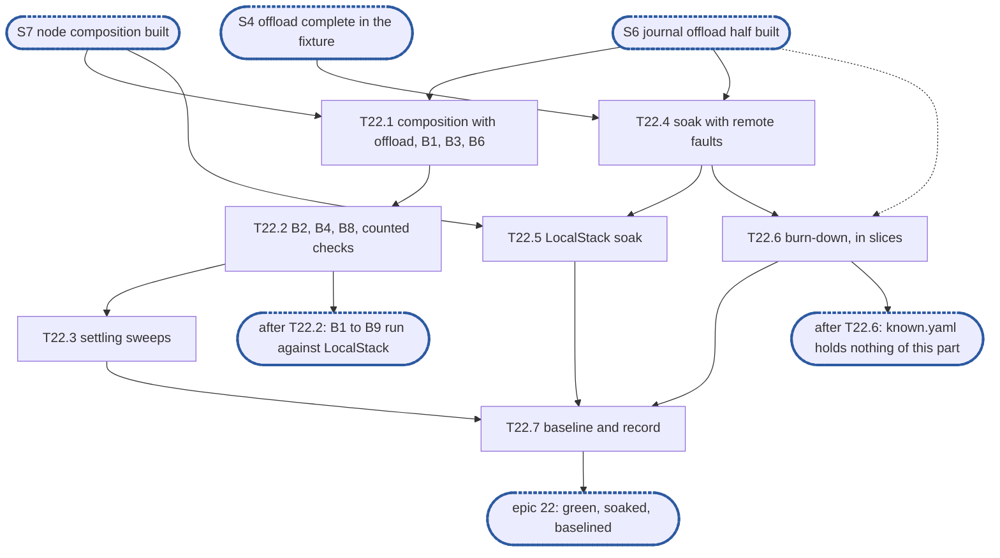

# Epic 22: engine offload E2E green

**Sources:** [RFC 8](../docs/internals/rfcs/rfc-8-engine.md) §15's opening paragraph (every check
against the engine as production composes it), the two MUST NOTs under §15.3 and §15's Suites
paragraph; the rows of §15.1 to §15.3 that epic 12 catalogues, as their burn-down; §15.4 (B1 to B4,
B6 and B8; B5, B7 and B9 again with offload composed; its `decision:`, its Method paragraph); §11.4's
clock sentence; §14's `engine_stage_busy_ratio`; §16's questions 1, 4 and question 2's read-ahead cap,
with §6.2, §6.3, §7.3 and §7.4, which state them. [RFC 3](../docs/internals/rfcs/rfc-3-syncer.md)
§8.1's Soak row and §8.6's sentence placing it. [RFC 13](../docs/internals/rfcs/rfc-13-configuration.md)
Appendix B's rows for `offload.max_age`, `offload.retry_min`, `offload.retry_max`,
`offload.retry_max_pressure`, `readahead.max_blocks`, `readahead.max_bytes` and the fill low-water mark,
their "settled by" column. [RFC 14](../docs/internals/rfcs/rfc-14-open-state.md) §12's L9 and
[RFC 17](../docs/internals/rfcs/rfc-17-vfs.md) §6's V20 (its offload half), rows of epic 12's catalogue.
The [RFC index](../docs/internals/rfcs/rfc-index.md), "Test tiers": what must not stand in, a check
that did not run is a failure, recording results, a proposed target replaced once by measurement.
[RFC 29](../docs/internals/rfcs/rfc-29-test-harness.md) §4.3 (tiers), §4.7 (known failures and the
unexpected pass), §4.9 (a component's suites paragraph) and §4.10 (benchmarks and long runs). Every
citation is `develop`'s text. The code lands on `develop`, and the paths below are paths there.
**Track:** the team.
**Epic 22 estimate: 7 subtasks, 25.5 man-days.**
**Depends on:** **S7**, node composition built (epic 21): `internal/node/content` builds a share's
S3 store, `codec.Store` over it and the syncer from a store configuration, and `syncertest`'s Group A
suite runs against LocalStack behind a fault proxy. **S6**, journal offload half built: every row, the
soak and every benchmark run over the real journal. **S4**, offload complete in the fixture (epics 13
to 20), with **S5**'s two halves. **Epic 12**: the rows in `engine-conformance` and
`test/engine/known.yaml`, and `enginetest`'s `WithCarver`, `WithChain` and `WithRefs` (no argument,
E12's D1) and `(*Fixture).FaultRemote`, which epic 16 makes real; the syncer the fixture composes for
every engine (epic 16's D9), with no option, since epic 21 deletes `WithSyncer` (its D11). **The RFC 4 plan's
epic 3**: `pkg/remote/s3/s3fault` (the transport under the S3 client, its `Inject` rules, its record of
the requests that reached it, `FreshBucket`), the `service:localstack` needs entry and
`LOCALSTACK_HTTPS_ENDPOINT`. **The first part's epic 10**: `engine-soak` with its oracle and fault log,
`engine-bench` with `composeBench`, B5, B7 and B9, and its T10.5 baseline of those three, which T22.7
compares against.
**Blocks:** the release: the offload programme (#5488) closes on this epic. The RFC 3 plan's ledger
row for the soak (RFC 3 §8.1) closes on the first scheduled nightly run of T22.5's option. Later
changes of the settled defaults, and the first real-service run, are read against the series this
epic starts on the reference box.

---

## 1. Goal

Epic 22 closes the offload part. It turns every red row of the part green over the real journal and
the composed components, runs the crash-and-restart soak with offload composed and the remote store
failing on cue, runs the hours-long soak against LocalStack that RFC 3 hands to the engine, and runs
the nine §15.4 benchmarks against LocalStack with a recorded baseline. It writes little engine code:
the fixes the real journal shows, the soak's remote faults, the benchmark composition with offload,
six benchmarks, the settling sub-benchmarks and three counted checks that run on every pull request.

**At the end of the epic:**

- `test/engine/known.yaml` holds no entry naming an issue of epics 11 to 22 or #5757, and
  `test/engine/soak-known.yaml` holds none; `engine-conformance` is green on every pull request
  (T22.6);
- `engine-soak` replays its seeds with offload, eviction and remote reads composed, faults at every
  pipeline step and read step that calls a dependency, and partitions to the remote store and to the
  metadata store, on every pull request (T22.4);
- `engine-soak`'s `localstack` option runs for hours, nightly, against LocalStack with outages on a
  cycle, and after each outage tasks, open connections, `inflight_bytes` and queue depth return to
  idle (T22.5);
- `engine-bench` runs B1 to B9 over one composition with offload against LocalStack and fails when one
  of the nine did not run; every count that follows from a rule fails the benchmark when broken, and
  the three of them that need no service also run in `engine-conformance`; every proposed figure is
  reported; the baseline of all nine is recorded on the reference box, and B5, B7 and B9 are compared
  with the first part's (T22.1, T22.2, T22.7);
- RFC 13 Appendix B's rows for the fill low-water mark, `offload.max_age` and the `offload.retry_*`
  keys carry their settled values, and RFC 8 §6.2's dirty-byte threshold and §7.3's scan threshold,
  which have no RFC 13 row, theirs in RFC 8's text; RFC 8 §16's
  questions 1 and 4 are answered, and question 2's read-ahead cap has its LocalStack figures beside it;
  RFC 8 §15's Suites paragraph names what runs where (T22.3, T22.7).

### 1.1 In scope

The burn-down of `test/engine/known.yaml` and `soak-known.yaml` for this part, the re-pointing of
entries whose epic closed, and the coverage table of epic 12's catalogue; engine fixes the real
journal or the composed components show, each with its unit test; the soak's remote faults and
partitions, and its idle checks; `enginetest`'s store option and syncer figures for the LocalStack
run; `engine-soak`'s `localstack` option; `composeBench` with offload and the raw baselines; B1, B2,
B3, B4, B6 and B8; B5, B7 and B9 rerun; the settling sub-benchmarks; the counted checks in
`engine-conformance`; `engine-bench`'s guard, needs and ran-every-benchmark check; the baseline; the
RFC 8 §15 and §16 and RFC 13 Appendix B edits that record the results; `tests.yml`'s select and
`dt docs`.

### 1.2 Out of scope

- Turning each row green in the first place: the middle epics (13 to 20) whose issue its entry
  names. This epic takes only what is still red when they close, or what S5 and S6 hold red past them.
- #5757's four entries: epic 18 turns them green and closes #5757; this epic only checks none is left
  (R11).
- The first part's #5261 entries (the journal's lost-tail refusal): the journal's, not this part's.
- The journal plan's system scenarios and the RFC 21 and RFC 22 plans' remote-outage rows: they run in
  `e2e`, which keeps no known list, so E21 lands them green on the composed node (the plan's §1.4).
- The benchmarks run per change, and RFC 29 §4.10's after-merge comparison against the stored
  baseline: the plan's §6.1 row "The benchmarks run per change against an emulator" (unowned), whose
  trigger is this epic's recorded baseline.
- §15.4's daily runs against each real service, and the baselines that replace its proposed targets:
  the plan's §6.1 row "§15.4's daily runs against each real service" (unowned).
- B9's snapshot-cut run: RFC 12's, though no §6.1 row names it yet (§9 point 7).
- RFC 8 §16 question 2's yield mechanism, and every pre-warm leg: the plan's §6.1 row "`PreWarm` and
  the speculator's pre-warm" (unowned).
- The engine-cost benchmark of §15.4's `ponytail:`: the first part's ledger row (unowned).
- Bucket-setting drift: the plan's §6.1 row "Detecting bucket-setting drift" (RFC 9).
- The rows that need a second node or a shard move: the plan's §6.1 row "The cluster rules".
- RFC 13 rows whose settling measurement names a §15.4 benchmark but which RFC 8 §16 does not ask
  this epic to answer: write pacing, the speculation budget, `eviction.repack_threshold` and the
  eviction occupancy target (§9 point 6).

### 1.3 Names used here

- **E12**, epic 12, red rows and test foundations: the catalogue of 50 rows in `engine-conformance`,
  their `known.yaml` entries, and `enginetest`'s component options and controls.
- **E13** to **E20**, the middle epics: the scheduler, the work queue, the pipeline, passes, remote
  reads, local space, restart and the reconcile, and health, drain and salvage. Each turns its rows
  green and removes their entries.
- **E14**, epic 14, the work queue, whose D5 registers the offload and removal sources' limits as
  constants these benchmarks measure; **E16**, epic 16, which makes `FaultRemote` real and builds the
  gates' switch the §3.2 row reruns under; **E17**, epic 17, whose fill bound and read table size B4
  measures; **E18**, epic 18, which closes #5757.
- **E21**, epic 21, the integration epic: the node composes offload.
- **S4**, offload complete in the fixture: epics 13 to 20 done.
- **S5**, offload components built: the RFC 2 to RFC 5 plans' implementation epics, in two halves.
- **S6**, journal offload half built: the journal plan's epics 9b and 7b.
- **S7**, node composition built: the end of epic 21.
- **S3** in this document is the storage service's protocol (the S3 store), never the plan's
  synchronisation point of that name, which is not used here.
- **E1, E3, E4, E5, E6, E7, E8** in RFC 13 Appendix B's "settled by" column are RFC 8 §15.4's B1 and
  B3 to B8, under an older numbering that collides with RFC 8 §13's invariants E1 to E42 (§9 point 5).
- **The first part**: the journal-only engine, epics 1 to 10 of RFC 8's first plan; its epic 10
  built the soak, `engine-bench` and B5, B7 and B9.
- **The reference box**: the harness's dedicated host, which a cell reaches with
  `needs: [linux, host:dedicated]`, and where the first part's baselines are taken.
- **#5757**: the issue the first part's four share-limit and clone entries name. **#5261**: the
  issue its two lost-tail entries name.
- **D1** to **D12** are this epic's decisions (§4); another epic's are written with it named.

## 2. How the general rules apply

The rules are those of
[the offload plan's §1.5](rfc-8-offload-engine-plan.md#15-general-rules-for-each-epic), cited by
number and title and not copied.

| Rule | Subtasks | How |
| --- | --- | --- |
| rule 1, **Independent unit tests** ([`CLAUDE.md`, "Writing tests"](../CLAUDE.md#writing-tests)) | T22.2, T22.4, T22.6 | each engine fix the burn-down makes lands with a unit test over the first part's in-memory journal and the components' real implementations; the counted checks run over RFC 4's in-memory store; the soak's `attribute` keeps its table test, extended for remote faults |
| rule 2, **Fuzz the key and ref decoders the queue's rebuild reads** | none | no decoder is written here; the decoders are epics 14 to 16's, with their targets |
| rule 3, **Observability follows RFC 25** | T22.1, T22.2, T22.4, T22.5 | the benchmarks and the soak read RFC 8 §14's and RFC 3's series only through `Stats` and the syncer's figures, by the names the RFCs give them (`engine_stage_busy_ratio`, `inflight_bytes`, the queue depths); nothing new is exported |
| rule 4, **Profiling** | T22.1, T22.4, T22.5 | the soak runs under the fixture's `prof.Watch`, and its idle check reads goroutines and descriptors from `internal/prof`; the benchmark composition keeps the first part's heap slack. The allocation gate on the two hot paths is epic 15's `unit/engine-allocs` |
| rule 5, **Public interface and internals** ([`CLAUDE.md`, "Verifying a change"](../CLAUDE.md#verifying-a-change)) | all | the benchmarks measure through `vfs.Service`; a cold read's fetch is proved at the store, from `s3fault`'s record, not from an engine counter (D7); the soak's oracle reads through the filesystem service |
| rule 6, **Known failures shrink** | T22.6 | every entry that turns green leaves in that change; an entry whose epic closed moves to this epic's issue (D2) |
| rule 7, **v2 ignores v1, and the engine imports only what RFC 0 §1.2 allows** | T22.1, T22.4, T22.5 | only test files change outside engine fixes: `internal/vfs/integration` and `enginetest` import the content wiring and `s3fault`, which tests may; no production import changes, and v1 is not read |
| rule 8, **Real dependencies for properties of those dependencies** ([`CLAUDE.md`, "Writing tests"](../CLAUDE.md#writing-tests)) | all | every row, the soak and the benchmarks run over the real journal on a real directory; the benchmarks and the `localstack` soak over the S3 store against LocalStack; the `pr` soak and the counted checks over RFC 4's in-memory store, which RFC 4's suite holds |
| rule 9, **Code comment conventions** ([`CLAUDE.md`, "Code comments"](../CLAUDE.md#code-comments)) | T22.1, T22.2, T22.3, T22.4, T22.5, T22.6 | `decision:` markers at D5's reported targets, D7's cold-read check, D10's selection rules, D3's acceptance, D4's outage driver, and wherever the real journal forces a behaviour the RFC leaves open; no RFC 8 marker is this epic's to place |
| rule 10, **A test must be able to fail** ([`CLAUDE.md`, "Writing tests"](../CLAUDE.md#writing-tests)) | all | each asserted count is seen to fail on a planted break that breaks that count, named in each subtask's Tests; a reported figure fails nothing, and §4 says why; a settled default is a review rule (R36) |
| rule 11, **A symbol is exported only if the RFC's interface uses it** | none | nothing production is exported; the fixture's store option and syncer figures are test API in `enginetest` |
| rule 12, **Each subtask creates only what it declares** | all | each helper lands with the benchmark or soak run that calls it; the fixture's store option lands with the `localstack` run, its first caller |

## 3. Requirements and invariants

Every obligation the sources place on this epic. Where the check is another epic's, the row says so.

**The burn-down**

| # | Requirement | Kind | Source | Subtasks |
| --- | --- | --- | --- | --- |
| R1 | Every Group A row epic 12 catalogues passes over the real journal and the composed components, its entry removed: §3.2 no gate is safety, §6.8 per-block reporting, §4.1 verifier inputs (the offloaded loss), §6.4 guard across a removal, §8.3 transfer survives a removal, §2.5 restart re-offer, journal gone and attach after a device loss (the acknowledgement), metadata reconcile, `Bind` takes over the reconcile's handle, unsuitable journal at start, unread range at start, reseed gates offer and eviction, §6.6 minted names and intents, §6.7 widening and stretch ends, §9.1 clone keeps writes outside its extent (offload half) and no pre-clone fill (a demand read's leg), §6.4 guard is not a fence, §7.1 stale ref and the order, §7.2 streaming, verified, fill cannot fail a read and fill loses to a write, §7.7 re-resolution, §5.1 durable commits and overwrite waits for existence (offload half), §7.6 zero ref under an overwrite, §9.1 Lost source run carried and one source state, §2.5 clone resumed at a full limit (remote half), §10.2 retry later, §10.4 destroyed material | test row | RFC 8 §15.1; plan §1.4 | T22.6 |
| R2 | Every Group B row epic 12 catalogues passes the same way: §11.1 health per direction, offload health and `stranded_export_failed`, §10 occupancy triggers eviction, §10.2 refusal loop, §10.3 repack reserve, §10.2.1 pacing law, §2.3 removal during a reconcile, §2.5 join, §8.1 removal wedge (the undecodable ref), §11.4 drain names its blocker, §1.1 no cross-share slowdown (cold reads), §6.1.1 a stuck run | test row | RFC 8 §15.2; plan §1.4 | T22.6 |
| R3 | The two Group C rows pass: §2.5 reseed, and §2.4 settings in the form epic 12 writes it | test row | RFC 8 §15.3; plan §1.4 | T22.6 |
| R4 | The other plans' rows pass: L9 (an open and a lock never stop eviction or reclamation) and V20's offload half | test row | RFC 14 §12; RFC 17 §6; plan §1.4 | T22.6 |
| R5 | "§3.2 no gate is safety" passes whole: every other Group A row passes with suspension, pins and health gating off and eviction as eager as possible | test row | RFC 8 §15.1 | T22.6 |
| R6 | The two extensions pass in their offload halves, `TestRFC8C_Settings` and `TestV20`, and the remote halves of "§2.5 clone resumed at a full limit" and "§10.2 retry later" pass as the new tests epic 12 adds beside the first part's, `TestRFC8A_CloneResumedAtAFullLimitWithTheRemoteDown` and `TestRFC8A_RetryLaterAtTheStore` | test row | plan §1.4; epic 12 | T22.6 |
| R7 | A sink that always succeeds never stands in for Group A or the pipeline's checks, and a single-file rig never stands in for §8.3 | MUST NOT | RFC 8 §15 (under §15.3) | T22.4, T22.6 |
| R8 | Every check runs against the engine as production composes it: the rows and the soaks build the components through the node's content wiring; the benchmarks build the remote components through it, and the journal and store as the first part's benchmark composition does, beside the rows that run the fixture | invariant | RFC 8 §15 (opening paragraph); RFC index, "What must not stand in" | T22.1, T22.4, T22.5, T22.6 |
| R9 | A known failure that passes fails the run, so an entry leaves `known.yaml` in the change that turns its test green, a journal or component change included | invariant | RFC 29 §4.7; plan rule 6 | T22.6 |
| R10 | Every planned entry names an open issue of the epic that turns it green; an entry whose epic closed names this epic's | invariant | RFC 29 §4.7; plan §1.4 | T22.6 |
| R11 | When the epic is done, `test/engine/known.yaml` holds no entry naming an issue of epics 11 to 22 or #5757, and `test/engine/soak-known.yaml` holds none | invariant | plan, epic 22 (its opening sentence); plan §1.4 (#5757's four entries) | T22.6 |

How R7, R9 and R11 are enforced once this epic lands: R7 by epic 12's fixture, whose rows reach a
component only through the content wiring and never through a double (E12's D1), and by the rows of
R1 that run two passes at once; R9 by the harness, which fails a run whose known failure passes; R11
by T22.6's acceptance check, since a file that still holds a red row's entry passes the harness.

**The soak**

| # | Requirement | Kind | Source | Subtasks |
| --- | --- | --- | --- | --- |
| R12 | Under crashes, restarts and fault schedules, with offload, eviction and remote reads composed, every acknowledged synced write reads back its bytes or reads **Lost**, in the three cases the first part's oracle defines; a read that a remote fault reached answers an error, never wrong bytes | invariant | RFC 8 §5.1, §7.1, §7.2 | T22.4 |
| R13 | The soak's faults reach every step that calls a dependency (the intent and commit transactions, the put and the mark of a pass, the fetch of a read), and partitions cut the remote store and the metadata store for spans of calls | invariant | plan, epic 22; RFC 8 §6.3, §7.2 | T22.4 |
| R14 | Nightly, for hours, against a local emulator of the remote service with outages injected on a cycle, the soak asserts that tasks, open connections, `inflight_bytes` and queue depth return to idle after each outage | test row | RFC 3 §8.1 (Soak) | T22.4, T22.5 |
| R15 | RFC 3's soak runs in the engine's soak suite, on the engine as the node composes it | invariant | RFC 3 §8.1, §8.6 | T22.5 |
| R16 | A check that did not run is a failure: a run that needs LocalStack fails, naming `LOCALSTACK_HTTPS_ENDPOINT`, when it is unset, and a benchmark run fails when any of B1 to B9 printed no result | invariant | RFC index, "A check that did not run is a failure"; plan rule 8 (the variable) | T22.1, T22.5 |
| R17 | The `pr` soak fits its tier's budget, shared with `engine-conformance`, and every soak cell is selected by the workflow that runs the branch, or the branch never runs it | invariant | RFC 29 §4.3 | T22.4, T22.5 |

**The benchmarks**

| # | Requirement | Kind | Source | Subtasks |
| --- | --- | --- | --- | --- |
| R18 | B1: sustained writes of non-deduplicating data larger than the journal; offloaded MiB/s reported as a fraction of raw puts of the same block size on the same store at the same pool sizes, measured in runs interleaved with it; target 80 % | bound (reported) | RFC 8 §15.4 (B1) | T22.1 |
| R19 | B2: 10⁴ and 10⁵ files of 64 KiB created, written and closed; files/s within 20 % across directory sizes (reported); puts per file at most ⌈64 KiB / block target⌉ (asserted) | bound | RFC 8 §15.4 (B2) | T22.2 |
| R20 | B3: B1 below and above the soft threshold; p99 submission latency ≤ 50 ms, max ≤ 500 ms, offloaded throughput within 10 % of B1 (reported); the above-threshold leg is paced, or it measured nothing (asserted) | bound | RFC 8 §15.4 (B3), §10.2.1 | T22.1 |
| R21 | B4: random 4 KiB reads of evicted content take one request per read (asserted) with p99 ≤ 2 store round trips (reported); sequential reads fetch at most 1.1 bytes per byte read (reported) | bound | RFC 8 §15.4 (B4) | T22.2 |
| R22 | B6: one file written sequentially to 20 × the journal's capacity; offloaded MiB/s over the last tenth within 10 % of the first tenth (reported); its extents made offloaded while it is still written, block by block, never only at the end of a pass (asserted) | bound | RFC 8 §15.4 (B6), §6.8 | T22.1 |
| R23 | B8: cold sequential 8 MiB reads, their chunks fetched at once; p99 ≤ the slowest chunk's fetch and verification plus 10 % | bound (reported) | RFC 8 §15.4 (B8), §7.2 | T22.2 |
| R24 | B5, B7 and B9 run again over the composition with offload: B5's and B7's counts asserted as the first part asserts them, their latencies and B9's figures reported, each compared with the first part's baseline | bound | RFC 8 §15.4 (B5, B7, B9); plan, epic 22 | T22.1, T22.7 |
| R25 | The method: the raw link, raw object storage and the full stack measured on the same hosts at the same time, each reported as a fraction of the one below; data that does not deduplicate; every stage's occupancy (`engine_stage_busy_ratio`) beside B1; the network distance to the store recorded; runs long enough to exhaust the local device's write cache | invariant | RFC 8 §15.4 (Method), §14 | T22.1 |
| R26 | A benchmark of the write path stops its clock at `WaitOffloaded`, never at the last acknowledgement | MUST | RFC 8 §11.4 | T22.1, T22.2 |
| R27 | §15.4's figures (80 %, 20 %, 50 ms, 500 ms, 10 %, 2 round trips, 1.1, 2×) are release bars proposed, not measured; the first baseline run against each service replaces each with its measured value plus headroom, and a figure that run misses is a design finding, never relaxed. A LocalStack baseline replaces none of them | invariant | RFC 8 §15.4 (`decision:`); plan, epic 22 ("Done when", the LocalStack clause) | T22.1, T22.2, T22.7 |
| R28 | Every result is recorded in absolute numbers with the commit, the box (CPU, memory, device and its raw figures), the operating system and filesystem with its mount options, and each row's concurrency; one reference box carries the series, and results from another box are compared only with themselves | invariant | RFC index, "Recording results" | T22.1, T22.7 |
| R29 | Performance is tracked, not gated: the benchmarks run in a `manual` cell as Go benchmark output compared with `benchstat`; a baseline is replaced only through a pull request, with the commit and box it was measured on beside it. The after-merge comparison step §4.10 describes is deferred (§1.2) | invariant | RFC 29 §4.3, §4.10 | T22.7 |
| R30 | A cold read proves it reached the store: no cache between the check and the store answers it, and the check asserts the fetch happened | invariant | RFC index, "What must not stand in" | T22.2 |
| R31 | The remote tier under test is a local emulator of the remote service; the scheduled real-service half is deferred (§1.2) | invariant | RFC index, "What must not stand in"; RFC 8 §15.4 | T22.1, T22.5 |
| R32 | The counts that follow from a rule and need no service (B2's puts per file, B4's one request per random read, B6's per-block marks) run in a tier that runs, not only in a manual cell | invariant | RFC index, "A check that did not run is a failure" (a check skipped in every tier) | T22.2 |

**The open questions and the settings they settle**

| # | Requirement | Kind | Source | Subtasks |
| --- | --- | --- | --- | --- |
| R33 | Question 1: fill-always, the fill rule and fill-never compared on a large-file workload by hit rate and write refusals, the fill low-water mark taking the value that comparison selects; the scan threshold measured on a workload whose reads form scans past the read-ahead window | invariant | RFC 8 §16 (1), §7.3; RFC 13 Appendix B (fill low-water mark) | T22.3 |
| R34 | Question 4: the dirty-byte threshold and `offload.max_age` take the values a streaming workload (B1, B6) selects, by whether the age bound rather than the byte bound fragments blocks; `offload.retry_min`, `offload.retry_max` and `offload.retry_max_pressure` take the values failing-store and recovered-store runs select, the cap neither hammering a failing store nor leaving a recovered one idle | invariant | RFC 8 §16 (4), §6.2, §6.3; RFC 13 Appendix B | T22.3 |
| R35 | Question 2's read-ahead cap: `readahead.max_blocks` and `readahead.max_bytes` measured across caps, by B4's sequential bytes fetched per byte read and B8's first-byte latency | invariant | RFC 8 §16 (2), §7.4; RFC 13 Appendix B | T22.3 |
| R36 | A setting's default takes the value its settling measurement selects, with no headroom and no miss; the RFC 13 row records it. The one default whose selecting measure is a latency, the read-ahead cap, is recorded and not settled (D10) | invariant | RFC index, "A proposed target is replaced once" | T22.3 |
| R37 | RFC 8 §15's Suites paragraph says which suites run §15.4's benchmarks and the soak, and which still run nowhere | invariant | RFC 8 §15 (Suites); RFC 29 §4.9 | T22.7 |

How R36 is enforced: by review. A default is a value, and no test can tell a selected one from a
guessed one; the pull request that settles it carries the sweep's output and the selection rule D10
states, so the reviewer reads one against the other.

The candidates of the owned sections that bind other epics are theirs: each row's behaviour (the
middle epics, through E12's catalogue); §15.3's architecture rows (the first part); §15.4's
`ponytail:` (unowned, §1.2); the per-change and daily runs (§1.2). §15.4's sentence "These measure
the pipeline, against a local emulator per change and each real service daily" is met here only for
the emulator, by hand, which §1.2 records.

## 4. Decisions this epic takes

- **D1, the burn-down ends at a file with no entry of this part, not at a row count.** Epic 12
  counts 50 rows, and the middle epics split rows into subtests with entries of their own (E12's D4
  and D6, epic 16's rerun of every Group A row under the gates' switch). A count would let a row
  without a test pass unseen. So T22.6 tables every row of E12's catalogue against its tests, and ends
  when R11 holds. Prior art: the first part's epic 10, D1 (checked).
- **D2, entries whose epic closed move to this epic's issue as soon as it exists.** The middle
  epics' documents remove an entry "whichever of this epic and S6 lands second" (epic 17's open
  points, checked), so an epic can close with its rows red over the real journal, and its entries
  then name a closed issue. T22.6's first slice moves them in one change, keeping each `message`, and
  runs again whenever an epic closes before S6. #5757's and #5261's entries are not moved. Prior art:
  the first part's epic 10, D4 (checked).
- **D3, the `pr` soak's remote faults are rules on the fixture's own fault points, and an error
  is excused only where the fault log puts one.** The soak's store rules (`soakStoreRules`, already
  on every store update) and journal rules stay; it gains `FaultRemote` rules (a put failed or cut, a
  get failed or corrupted, a delete refused) and partitions, rules with `From` and `Count` and no
  `Prob` over every op of the remote store or the store, so each fires on calls the seed fixes and the
  test asserts from the fault log that it fired. All of it goes through the seed's `sim.NewSchedule`,
  so a flag replays it, and none delays (the first part's rule: a delay waits on the test clock only
  the writer moves). The journal is sized so the eviction loop evicts during a seed, and the restart's
  verification reads run with the remote rules paused, so they fetch and must read exact. During the
  loop, bytes a read returns must be exact. `excused` keeps its rule unchanged, `ErrDelay` excused with
  no fault and any other error only in a faulted call; the remote side is `attribute`'s, which marks a
  call faulted when a remote fault failed or corrupted an operation in it, a corrupted get carrying
  no error in the log. A `decision:` beside `attribute` names the rule and that a read answering
  another error with no fault in its call would overturn it. After each partition the loop calls `WaitOffloaded`, moving the test
  clock as it waits, then asserts the syncer's `inflight_bytes`, waiters and queue depth, the engine's
  queue depths and the goroutine count are back at their values before the partition. Prior art: the
  first part's fault log and `excused` (`soak_test.go`, checked).
- **D4, the hours-long soak is an option of `engine-soak` against LocalStack, its outages driven by
  calls and by the requests they turn away, never by the wall clock.** RFC 3 §8.1 puts it "in the
  engine's soak on the composed node". The node's `node.New` has no crash seam, so the option runs the
  same loop and oracle over the fixture with the stores the content wiring builds for the node (E21),
  through a fixture option naming the S3 store at `LOCALSTACK_HTTPS_ENDPOINT` behind `s3fault`, in a
  bucket from `s3fault.FreshBucket`. An outage opens at the loop's every Nth client call, as an
  `s3fault.Inject` rule failing every request unsent, and closes once `s3fault`'s record holds at least
  K requests since the rule was injected, so it is never shorter than the store's retries reaching it.
  Then the idle check of D3 runs, open connections read as the process's descriptors
  (`prof.Descriptors`): after the client's idle-connection timeout, they must be back at their count
  before the first outage within the first part's tolerance, so a connection leaked per outage grows
  them cycle after cycle. The run lasts `DITTOFS_SOAK_DURATION`, as `journal-soak` does. A wait that
  never sees K requests fails at a backstop, printing the idle figures. An option rather than a new
  suite: one loop, one oracle, one group. Prior art: `journal-soak`'s duration and timeouts (checked);
  RFC 4 epic 3's `Inject` and request record (checked).
- **D5, asserted counts and reported figures.** What follows from a rule is asserted with `b.Fatalf`,
  as the first part does for B5 and B7: B2's puts per file, B4's one request per random read, B6's
  marks during the write, B3's above-threshold leg being paced, and every cold read reaching the store
  (D7). The three counts that need no service also run in `engine-conformance` over RFC 4's in-memory
  store, through its load record, so a pull request that breaks one fails (R32). Every figure §15.4's
  `decision:` lists as proposed is reported with `b.ReportMetric` and fails nothing (R27): a LocalStack
  run replaces none of them, so failing on one would gate a release bar no service has measured. A
  `decision:` at the reported targets says so and names the first real-service run as what replaces
  them. Prior art: the first part's epic 10, D6 (checked).
- **D6, one benchmark composition, with offload.** `composeBench` gains the carver, RFC 5's chain over
  its in-memory `keys.Provider`, the syncer and the S3 store at `LOCALSTACK_HTTPS_ENDPOINT`, each
  built by the content wiring as the node builds it (E21), with `s3fault` under the client for its
  request record, a fresh bucket per benchmark, a journal capacity each benchmark sets, and seeded
  random data so nothing deduplicates. B5, B7 and B9 then run over it unchanged but for D9's wait,
  which is what "again with offload composed" asks. `engine-bench` adds `needs: ["service:localstack"]`
  and refuses an unset `LOCALSTACK_HTTPS_ENDPOINT` before `go test` runs, exiting 2, as it refuses an
  unset `DITTOFS_BENCH_DIR`; after the run it fails unless `bench.txt` holds a result line for each of
  `BenchmarkB1` to `BenchmarkB9`, as `journal-bench` checks for its own. The per-change smoke the first part's T10.5 registers
  (`-benchtime=1x`, `tier: pr`) runs where no LocalStack is, and CI starts none, so `composeBench` takes
  the S3 store only when `LOCALSTACK_HTTPS_ENDPOINT` is set and otherwise RFC 4's in-memory store,
  through the same content wiring; `engine-bench`'s guard keeps the hand run from falling back. In the
  smoke, B1's link and raw-put layers, which need the service's port, are not measured and report no
  fraction, and the counts read the in-memory store's load record in place of `s3fault`'s; every
  benchmark still runs and its asserted counts hold. Prior art: the first part's
  epic 10, D12, and `journal-bench`'s check (checked).
- **D7, a cold read is proved at the store.** B4 and B8 read content the engine's own eviction loop
  evicted, waiting until the share's `Stats` shows the file's extent no longer held. B4's random reads
  each touch a chunk no earlier read of the run touched, so no fill or earlier fetch can serve them,
  and each is asserted to reach exactly one get in `s3fault`'s record, with `Stats`' speculation bytes
  unchanged. B4's sequential reads and B8 are asserted per run: bytes fetched at least the bytes read,
  and gets at least the blocks touched, since read-ahead legitimately serves later reads from earlier
  fetches. Prior art: the RFC index's cold-read rule, which this applies.
- **D8, B1's three layers are measured inside one iteration.** Each iteration runs, on fresh data: the
  link (a TCP bulk transfer of the bytes to LocalStack's port, discarded by a sink there), raw puts
  (S3 `PutObject` of block-target objects through the client at `upload_workers` concurrency, the
  codec bypassed) and the full stack, alternating their order between iterations, so a drifting host
  moves all three. Each is reported as MiB/s and as a fraction of the one below; B1's 80 % is the full
  stack over raw puts. The network distance is the TCP round trip. B1's data is at least twice the
  journal and at least the box's memory, recorded with the result, so neither the device's write cache
  nor the page cache absorbs it. Prior art: RFC 3 §7.4's B5 (raw calls at the same pool size, checked).
- **D9, every write-path clock stops at `WaitOffloaded`.** B1, B2, B3, B6, and B5, B7 and B9 once they
  run with offload, end each iteration with `WaitOffloaded` inside the timed region; the per-call
  latencies they report are unchanged. A read benchmark does not wait. Prior art: none found; RFC 8
  §11.4's MUST.
- **D10, a default is settled where its selecting measure does not move with the store's latency, by
  a rule stated before the run.** Against LocalStack on loopback a round trip is a fraction of a
  millisecond, so only counts are trusted. Each sweep is a sub-benchmark of the benchmark whose
  workload it varies, and selects by:
  - the fill low-water mark: the value with the highest hit rate among those with no more write
    refusals than fill-never, on B4's large file with writes beside its reads; fill-never is the mark
    at 100 % of the maximum footprint, fill-always at 0 %;
  - the scan threshold: the smallest value at which B4's sequential scan past the window fills
    nothing it does not read again, on B4's sequential workload;
  - the dirty-byte threshold and `offload.max_age`: the smallest age, and the smallest threshold, at
    which B6's stream closes no block below target except a file's last. A larger age fragments no
    more than a smaller one, so the largest passing age is always the top of the sweep and selects
    nothing;
  - `offload.retry_min` and `offload.retry_max`: under an `s3fault` outage in B1, the smallest caps
    whose requests to the failing store stay under one per second per file, and whose idle time after
    the store returns stays under the cap itself;
  - `offload.retry_max_pressure`: the same rule in B3's above-threshold leg, where pressure is on,
    with `s3fault` failing a share of puts low enough that the store stays put-healthy. RFC 8 §6.1
    lowers the cap to it only for a put-healthy store, so B1's outage, which makes the store
    put-unhealthy, leaves `offload.retry_max` in force and cannot select it; the leg fails unless the
    store stayed put-healthy and pressure stayed on through it, or it measured nothing;
  - the read-ahead cap: recorded, not selected, since B8's half is a first-byte latency; question 2's
    cap stays open until the first real-service run (§1.2).
  A `decision:` on the sweeps states these rules. Prior art: the RFC index's settling rule, which this
  applies.
- **D11, other epics' constants are measured, and changed only where a run shows one binding.** E14's
  D5 (the sources' `Batch`, `Concurrency` and `RunTimeout`) and E17's fill bound and read table size
  are proposals those epics hand to these benchmarks. The sweeps report each beside the run that
  reaches it; one changes only when a sweep point shows it limiting throughput or causing re-fetches,
  in the same pull request as the figure. Prior art: none found.
- **D12, the baseline is one file, replaced through a pull request.** The first part's epic 10 plans
  `baseline.txt` beside the benchmarks (its T10.5); T22.7 replaces its B5, B7 and B9 lines with the
  offload composition's and adds the other six, from a run of ten on the reference box, and the pull
  request shows `benchstat` of the old file against the new one, which is the comparison R24 asks for.
  Prior art: RFC 29 §4.10's stored baseline.

## 5. Target tree

```text
test/engine/
  known.yaml                         T22.6          entries re-pointed (D2), then removed (R11)
  soak-known.yaml                    T22.4          none kept; a flaky seed is quarantined
test/suites.yaml                     T22.1, T22.5   engine-bench: service:localstack, the endpoint guard,
                                                    the ran-every-benchmark check (D6); engine-soak: the
                                                    localstack option (D4), the pr cell's -skip
.github/workflows/tests.yml          T22.5          the plan job's select names engine-soak/localstack
pkg/engine/                          T22.6          fixes the real journal shows, each with its unit test
pkg/engine/conformance/
  counts_test.go                     T22.2          the counted checks of D5, over the in-memory store
pkg/engine/enginetest/
  remote.go                          T22.5          WithStore, the S3 store the content wiring builds (D4)
  fixture.go                         T22.4          SyncerStats, the syncer's figures for the idle check
internal/vfs/integration/
  soak_test.go                       T22.4, T22.5   remote rules, partitions, the idle check, excused's
                                                    remote case; the localstack outage cycle (D4)
  benchcompose_test.go               T22.1          composeBench with offload and LocalStack (D6); the
                                                    three layers (D8); D9's wait; the round trip in printBox
  bench_b1_test.go                   T22.1, T22.3   B1, B3 and B6; the dirty-threshold, age and retry sweeps
  bench_b2_test.go                   T22.2          B2
  bench_b4_test.go                   T22.2, T22.3   B4 and B8, the cold-read proof (D7); the fill, scan
                                                    and read-ahead sweeps
  baseline.txt                       T22.7          all nine, from the reference box (D12)
docs/internals/rfcs/rfc-8-engine.md  T22.3, T22.7   §16's answers, §6.2's and §7.3's thresholds; §15's Suites
docs/internals/rfcs/rfc-3-syncer.md  T22.7          §8.6's sentence naming the option
docs/internals/rfcs/rfc-13-configuration.md  T22.3  the settled rows; B for the old E ids
docs/internals/testing.md            T22.1, T22.5   regenerated by dt docs
```

## 6. Subtasks

### T22.1 The benchmark composition with offload, B1, B3 and B6

**Subtask T22.1 estimate: 5.25 man-days.**

- **Track:** the team. **Depends on:** none. It needs S7 (E21's store composition), S6 and the RFC 4
  plan's epic 3.
- **Covers:** R8, R16, R18, R20, R22, R24 to R28, R31.
- **Deliverables:**
  - `composeBench` with offload (D6): the content wiring's carver, chain, syncer and S3 store at
    `LOCALSTACK_HTTPS_ENDPOINT` behind `s3fault`, a bucket from `FreshBucket`, the journal capacity
    as a parameter, seeded random data, RFC 4's in-memory store in its place when the endpoint is
    unset, for the `pr` smoke; its trace hook keeping the spans it is given, an output sink
    B8 reads. Consumed by every benchmark of this epic and by B5, B7 and B9.
  - D9's wait in B5, B7 and B9, whose counts stay asserted. Consumed by T22.7's baseline.
  - The three layers of D8, and `printBox` extended with the round trip, the data size, the
    LocalStack version and the pool sizes. Consumed by B1 and T22.7's record.
  - `bench_b1_test.go`: `BenchmarkB1` (D8's layers and fractions; `engine_stage_busy_ratio` per stage
    as metrics); `BenchmarkB3` (B1 below and above the soft threshold; p99 and max submission latency,
    throughput against B1; the above-threshold leg fails unless the engine's pacing counter rose in it);
    `BenchmarkB6` (one file to 20 × the journal; last tenth against first tenth; fails unless the
    journal recorded more `MarkOffloaded` calls for the file than the share's `OffloadPasses` rose by,
    which only a per-block report gives). Each clock stops at `WaitOffloaded` (D9).
  - `engine-bench` in `test/suites.yaml`: `needs: ["service:localstack"]`, the endpoint guard and the
    ran-every-benchmark check (D6); `dt docs`.
- **Acceptance criteria:**
  - with LocalStack up and `DITTOFS_BENCH_DIR` set, `dt run engine-bench` reports B1's three layers and
    fractions, the four stages' busy ratios, B3's latencies and B6's two tenths;
  - with `LOCALSTACK_HTTPS_ENDPOINT` unset the cell exits 2 naming it, and no `go test` runs;
  - with one benchmark skipped, the cell fails naming it;
  - the first part's `pr` smoke, with `LOCALSTACK_HTTPS_ENDPOINT` unset, runs every benchmark and
    passes;
  - every reported figure carries the unit `benchstat` reads, and the header carries R28's fields.
- **Tests:** planted breaks, each seen to fail before the pull request opens: the pipeline's per-block
  report held until the pass ends (B6's count, RFC 8 §6.8); pacing disabled (B3's leg); a `b.Skip` in
  B2 (the ran-every-benchmark check); the endpoint unset (the guard). The reported figures fail nothing
  (D5). No test double: LocalStack and the real journal.
- **Rules:** rule 3, the stage series through `Stats`; rule 9, D5's `decision:`. Others as §2 says.

### T22.2 B2, B4, B8 and the counted checks

**Subtask T22.2 estimate: 4.25 man-days.**

- **Track:** the team. **Depends on:** T22.1.
- **Covers:** R19, R21, R23, R26, R27, R30, R32.
- **Deliverables:**
  - `bench_b2_test.go`: `BenchmarkB2/<10000|100000>`, each 64 KiB file written in two 32 KiB writes;
    files/s per directory size, and puts per file from `s3fault`'s record, failing above ⌈64 KiB /
    block target⌉.
  - `bench_b4_test.go`: the eviction wait and the proofs of D7; `BenchmarkB4/random`, one get per
    4 KiB read asserted, p99 reported against a raw ranged get's in the same iteration;
    `BenchmarkB4/sequential`, bytes fetched per byte read reported; `BenchmarkB8`, 8 MiB cold
    sequential reads, p99 reported against each read's slowest chunk fetch and verification plus
    10 %, from the `engine.fetch` spans `composeBench` keeps.
  - `pkg/engine/conformance/counts_test.go`, over the fixture with RFC 4's in-memory store and its load
    record: a file of 64 KiB offloaded in at most ⌈64 KiB / block target⌉ puts; a cold 4 KiB read of an
    untouched chunk taking one get; a file twice the journal marked offloaded in more calls than its
    passes (D5, R32).
- **Acceptance criteria:**
  - each benchmark fails naming the read when a random read reached no get or two, and per run when
    fetched bytes fall short of bytes read (R30);
  - B2 and its counted check fail when a file takes more puts than the bound;
  - B2's clock stops at `WaitOffloaded`; B4's and B8's do not wait;
  - `counts_test.go` runs green in `engine-conformance` on every pull request.
- **Tests:** planted breaks, each seen to fail on its assertion, in the benchmark and in its counted
  check: each write offered in its own pass, so a file takes two puts (B2's bound); a 4 KiB read split
  into a get per 4 KiB of its chunk (B4's one request); a read served from a copy kept after eviction
  (D7's proof). No test double: the in-memory store is RFC 4's, held to its suite, and its load record
  is an output it keeps.
- **Rules:** rule 5, the proof at the store; rule 9, D7's `decision:`. Others as §2 says.

### T22.3 The settling sweeps

**Subtask T22.3 estimate: 2.5 man-days.**

- **Track:** the team. **Depends on:** T22.2.
- **Covers:** R33 to R36.
- **Deliverables:**
  - The sweeps of D10 as sub-benchmarks: the fill low-water mark and the scan threshold in
    `bench_b4_test.go`, the read-ahead cap across B4's sequential reads and B8, the dirty-byte
    threshold and `offload.max_age` under B6, the `offload.retry_*` caps under an `s3fault` outage in
    B1; E14's and E17's constants reported where a run reaches them (D11); D10's `decision:`.
  - RFC 8 §6.2's dirty-byte threshold and §7.3's scan threshold, which have no RFC 13 row, settled in
    RFC 8's text. RFC 13 Appendix B: the fill low-water mark, `offload.max_age` and the
    `offload.retry_*` rows settled to the values D10's rules select, with the
    run's commit and box; the read-ahead row with the LocalStack figures beside the proposal; the
    "settled by" column's old E ids written as B (§9 point 5). RFC 8 §16's questions 1 and 4 answered,
    question 2's cap with its figures.
- **Acceptance criteria:**
  - each settled default is the value D10's rule selects from the run in the pull request;
  - a constant of E14 or E17 changes only with the sweep point that shows it binding (D11).
- **Tests:** none of its own: a sweep reports and fails nothing, and R36 is a review rule (§3).
- **Rules:** rule 9, D10's `decision:`. Others as §2 says.

### T22.4 The soak with offload and remote faults

**Subtask T22.4 estimate: 3.5 man-days.**

- **Track:** the team. **Depends on:** none. It needs S4, S6 and E16's `FaultRemote`.
- **Covers:** R7, R8, R12 to R14, R17.
- **Deliverables:**
  - `soak_test.go`: the fixture composed with `WithCarver`, `WithChain` and `WithRefs`, the syncer
    composed with every engine (epic 16's D9),
    a journal small enough that each seed evicts, the remote rules and partitions of D3 in the seed's
    schedule, the paused remote rules for the verification reads, the idle check after each partition,
    and `attribute`'s remote side with D3's `decision:`.
  - `enginetest`: `(*Fixture).SyncerStats() syncer.Stats`, the composed syncer's figures, consumed by
    the idle check here and by T22.5.
  - The seed count set so `engine-soak` stays within the `pr` budget, from
    `dt plan --tier pr --estimate` (R17).
- **Acceptance criteria:**
  - every seed passes over the real journal but seeds 1 and 2, which `test/harness/quarantine.yaml`
    lists under #3596 and #4771, the journal's issues and not this epic's: they still run with offload
    composed and their results are recorded, graded quarantined, and are read by hand at acceptance
    rather than counted as passes; their entries leave when those issues close. The test asserts from
    each seed's fault log that every partition fired and that the seed evicted and read remotely;
  - after each partition the idle figures equal their values before it;
  - `soak-known.yaml` stays empty.
- **Tests:** `TestSoakAttribute` gains the remote side, each case failing when `attribute` ignores it:
  a failed remote put or get in the call marks it faulted; a corrupted get, logged with no error, marks
  it faulted; a remote fault of an earlier call marks no later one. `TestSoakExcused` gains nothing:
  `excused` sees only the faulted flag, and its two cases for that flag already exist, and wrong bytes
  are the oracle's check, not `excused`'s. Mutants run by hand once the soak is green: a failed put
  reported offloaded, which the soak must fail on a read after eviction; a fetch that skips
  verification, which the soak must fail on wrong bytes after a corrupted get; a fetch leaking its
  buffer past a cancelled read, which the idle check must fail. The faults are kind 3, wrappers on real
  implementations.
- **Rules:** rule 4, the idle check's goroutines; rule 9, D3's `decision:`. Others as §2 says.

### T22.5 The hours-long soak against LocalStack

**Subtask T22.5 estimate: 3 man-days.**

- **Track:** the team. **Depends on:** T22.4. It needs S7 and the RFC 4 plan's epic 3.
- **Covers:** R8, R14 to R17, R31.
- **Deliverables:**
  - `enginetest`'s `WithStore`, the S3 store the content wiring builds from a store configuration,
    with a transport hook for `s3fault` (its argument follows E21's store configuration; §9 point 3),
    since the syncer the fixture composes for every engine runs over RFC 4's in-memory store and
    takes none. Consumed by the `localstack` run.
  - `soak_test.go`: `TestSoakLocalStack`, the outage cycle of D4, the run bound by
    `DITTOFS_SOAK_DURATION`, the idle check with descriptors, its backstop printing the idle figures;
    D4's `decision:` at the driver.
  - `engine-soak`'s `pr` command gains `-skip=^TestSoakLocalStack$`: its `-run=^(TestSoak|TestOracle)`
    has no `$`, so it also matches the new test, which would fail every pull request on the unset
    endpoint.
  - `engine-soak`'s `localstack` option: its own `cmd`, `go test -tags=engine_conformance,engine_soak
    -run=^TestSoakLocalStack$ -timeout=150m ./internal/vfs/integration/`, after the endpoint guard;
    `tier: nightly`, `needs: ["service:localstack"]`, `DITTOFS_SOAK_DURATION: "2h"`,
    `timeout: { test: 150m, cell: 160m }`, as `journal-soak`'s; its name in `tests.yml`'s select;
    `dt docs`.
- **Acceptance criteria:**
  - a `workflow_dispatch` of `tests.yml` at the nightly tier on `develop` runs the option for
    its full duration and passes, every outage closed by K requests;
  - with `LOCALSTACK_HTTPS_ENDPOINT` unset the option fails naming it (R16);
  - the `pr` cell's `go test -json` output holds no event for `TestSoakLocalStack`.
- **Tests:** mutants run by hand: a client that never closes an idle connection, which the descriptor
  check must fail over a few cycles; a retry loop that ignores its budget, which the idle check must
  show. The outage is `s3fault`'s, kind 3.
- **Rules:** rule 8, LocalStack; rule 9, D4's `decision:`. Others as §2 says.

### T22.6 The burn-down

**Subtask T22.6 estimate: 5.5 man-days.**

- **Track:** the team. **Depends on:** T22.4, for its last slice's check of `soak-known.yaml`. Each
  slice waits on what it names; slice 0 needs only this epic's issue.
- **Covers:** R1 to R11.
- **Deliverables:** in slices:

  | Slice | Waits on | Man-days |
  | --- | --- | --- |
  | 0 | this epic's issue: entries naming a closed issue re-pointed (D2), and the coverage table; again whenever a middle epic closes with entries left | 0.5 |
  | a | S6's first half: `Offload`, `OffloadMany`, `MarkOffloaded`, `Unmark`, `Release` on the real journal | 2 |
  | b | S6's second half: `DropOlder`, `Reconciled`, `AcknowledgeUnreadable` | 1.25 |
  | c | S5's halves that landed after their epic: the destroyed-material notice, the key-record view, the salvage-key wrap | 1 |
  | d | the last Group A row: "§3.2 no gate is safety" whole, and R11's check | 0.75 |

  The coverage table, in slice 0's description, lists every row of E12's catalogue against the test
  and subtests that check it, and every test of `pkg/engine/conformance` against its row; a row with no
  test gets one, red, naming this epic's issue. Each later slice turns its entries' tests green and
  removes them. Where the real journal or a composed component shows the engine wrong, the fix with a
  unit test over the in-memory journal and the row that found it. A run over the in-memory journal a
  middle epic kept beside a red real-journal row is dropped once the real row is green (rule 8).
- **Acceptance criteria:**
  - no entry names a closed issue; #5757's and #5261's are untouched by slice 0;
  - `test/engine/known.yaml` holds no entry naming an issue of epics 11 to 22 or #5757, and
    `soak-known.yaml` none (R11);
  - `dt run engine-conformance` passes under `-race` with no entry but #5261's, if the journal's
    lost-tail fix has not landed;
  - every row of R1 to R6 names its test in the table and runs over the real journal and the
    components the content wiring builds.
- **Tests:** the rows, run as CI runs them; an entry whose message no longer matches turns the run red
  (RFC 29 §4.7). For each engine fix, a unit test that fails when the fix is reverted, read where the
  value is consumed.
- **Rules:** rule 6, throughout; rule 8, the in-memory runs dropped; rule 9, a `decision:` where the
  real journal forces a behaviour the RFC leaves open. Others as §2 says.

### T22.7 The baseline and the record

**Subtask T22.7 estimate: 1.5 man-days.**

- **Track:** the team. **Depends on:** T22.3, T22.5, T22.6.
- **Covers:** R24, R27 to R29, R37.
- **Deliverables:**
  - `baseline.txt` (D12): all nine from a run of ten on the reference box, after the settled defaults
    and the burn-down's fixes are in, its header carrying R28's fields; the pull request shows
    `benchstat` of the first part's file against it.
  - RFC 8 §15's Suites paragraph, the one place it is edited: `engine-bench` runs §15.4's benchmarks by
    hand against LocalStack on the reference box, `engine-conformance` the counted checks, `engine-soak`
    and its `localstack` option the soak; the per-change and daily runs still nowhere. RFC 3 §8.6's
    sentence names the option. `docs/internals/testing.md` regenerated.
- **Acceptance criteria:**
  - `benchstat` reads the old and new files and gives B5's and B9's fsync and write p99 against the
    first part's; a row more than 10 % worse carries a recorded decision in the pull request before the
    new file becomes the baseline (the RFC index's regression rule);
  - each §15.4 figure the run misses is recorded as a finding against RFC 8, not loosened (R27).
- **Tests:** none of its own; B5's and B7's counts are the first part's checks, seen to fail on its
  mutants again over the offload composition.
- **Rules:** rule 4, the heap slack kept. Others as §2 says.

## 7. Order of work



T22.1 is the blocker: the composition the other benchmarks, the sweeps and the baseline run over, and
its path runs to T22.3. The soak path, T22.4 and T22.5, is open beside it. T22.6 depends on T22.4 only
for its last slice's check; its slice 0 starts with the epic's issue, long before S6, and its other
slices go as S6 and S5's late halves land. T22.7 goes last, so the baseline is taken with the settled
defaults and the burn-down's fixes in.

## 8. Suggested pull requests

| PR | Subtasks | Man-days | After | Why together |
| --- | --- | --- | --- | --- |
| 1 | T22.1, T22.2 | 9.5 | — | the composition with offload, the six new benchmarks against LocalStack and their counted checks |
| 2 | T22.3 | 2.5 | PR 1 | the sweeps, the settled RFC 13 rows and §16's answers |
| 3 | T22.4, T22.5 | 6.5 | — | the soak with remote faults and its LocalStack option, one loop and one oracle |
| 4.0 to 4d | T22.6 | 0.5, 2, 1.25, 1, 0.75 | each after what its slice waits on; 4d after PR 3 | the burn-down, one slice each; 4.0 open beside every other |
| 5 | T22.7 | 1.5 | PRs 2, 3 and 4d | the baseline, the comparison and the suites paragraph |

A suggestion only: one pull request per subtask works as well. PRs 1, 3 and 4.0 are independent and
can be open at once.

## 9. Open points

1. **Estimate against the plan's figure.** The plan says 7 subtasks and 21.5 man-days; this document
   says 7 and 25.5. Added: the settling sweeps (in T22.3, 2.5), which the plan's "answered from those
   runs" leaves inside the benchmarks; the counted checks in `engine-conformance` (in T22.2, 0.75); the
   re-pointing slice (D2, 0.5), needed because the middle epics can close before S6; the in-memory
   store under the first part's `pr` benchmark smoke (in T22.1, 0.25). The burn-down's
   5.5 days is a guess (plan §6 point 2): its size is what S5 and S6 leave red, unknown until they
   land, and it is the least certain figure here, with T22.5, whose LocalStack run has not been timed.
2. **No nightly runs on `feat/storage-v2`.** The schedule runs on `develop` only, so the `localstack`
   option starts its nightly series when the branch reaches `develop`; until then it is accepted by a
   `workflow_dispatch` run (T22.5), and the RFC 3 plan's soak row stays open until the first scheduled
   run. The benchmarks are run by the reference box's owner from a checkout.
3. **The fixture's store option follows epic 21's store configuration.** Epic 21's document is not
   written yet; `WithStore`'s argument is whatever type its content wiring takes to build an S3 store,
   with a hook for the transport, which S7's own `syncertest` run behind a fault proxy already needs.
   If epic 21 exposes no such hook, T22.1 and T22.5 add it there, about half a day.
4. **The first part's baseline may not exist yet.** T22.7 compares against the first part's T10.5
   `baseline.txt`, which is not on `feat/storage-v2` today. If it is still missing, `engine-bench` is run
   at T22.1's parent commit on the same box and week, and that run is the comparison's other side.
5. **RFC 13's settling column cites RFC 8's benchmarks as E1 and E3 to E8.** Those ids are RFC 8
   §13's invariants; the column means B1 and B3 to B8. T22.3 rewrites them all, since a reader
   following E4 to RFC 8 lands on an unrelated invariant.
6. **Four RFC 13 rows name these benchmarks and no epic settles them.** Write pacing (B3 across
   thresholds and floors), the speculation budget (B4 and B8 at 1, 4 and 16 readers against write
   refusals), `eviction.repack_threshold` and the eviction occupancy target (the profile workload
   across values) are outside the questions RFC 8 §16 asks here, and no epic of the part owns their
   settling. T22.3's sweeps could carry them at about a day more; the plan's owner decides, or they
   become ledger rows.
7. **B9's snapshot-cut run has no ledger row.** The plan's §6.1 RFC 12 row names the pipeline's hold
   ordering and the cut's calls, not B9's cut leg; it should gain it, in a pull request against the
   plan.
8. **R27 and the RFC index pull apart.** RFC 8 §15.4 has the first run "against each service" replace
   a proposed target; the index has the first run "on the reference box" replace it. T22.7's run is on
   the reference box but against LocalStack. This epic follows RFC 8 and the plan's epic 22, and
   replaces nothing; the index's sentence wants a clause for a benchmark whose target is set against a
   service, in an RFC pull request of its own.
9. **B9 runs through `vfs.Service`, not SMB,** as the first part adapted it (its epic 10, D8). With
   SMB in v1.1, the SMB run is nobody's yet; the adaptation is kept, and the gap is noted here.
10. **The reference box's three measurements.** The index requires raw stage costs, the dedup ratio and
    the journal-shape benchmark on the reference box before any decision that depends on numbers. D10's
    settlings are such decisions; T22.3 checks the three are recorded, and if not, it records the
    settled figures as proposals still, beside the sweep, until they are.
