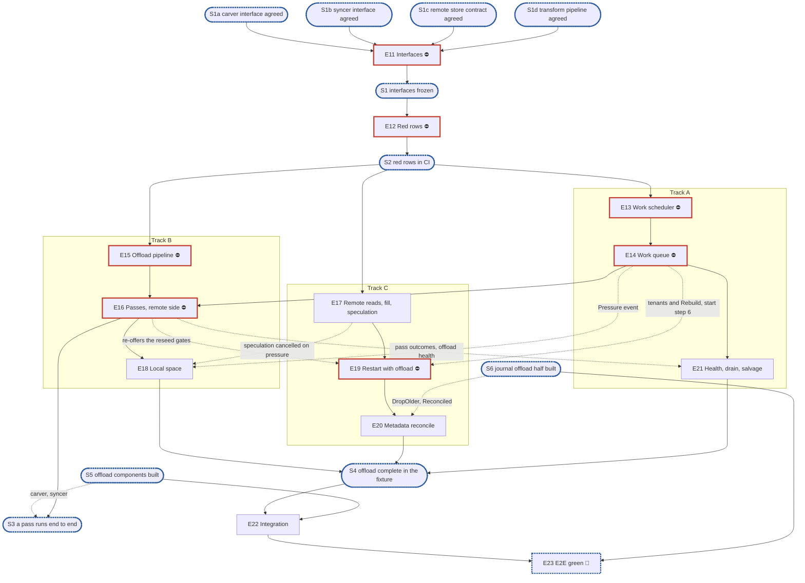

# RFC 8 — engine, the offload part: implementation plan

**Scope:** the second part of [RFC 8, the engine](../docs/internals/rfcs/rfc-8-engine.md): exactly what
[`rfc-8-journal-only-engine-plan.md`](rfc-8-journal-only-engine-plan.md) (the **first part**) leaves out.
Every row of the first part's deferral ledger (its §6.1) whose owner is "RFC 8 second part plan" is
taken here, each mapped to an epic in §1.1. Also taken over: #5318 (offload composed in the engine;
three engine known failures wait on it) and #4276 (the syncer and the remote clients composed in the
node, deferred by [`rfc-23-control-plane-plan.md`](rfc-23-control-plane-plan.md)'s §6.1). Related
RFCs, with how far each is in scope:
- [RFC 2](../docs/internals/rfcs/rfc-2-carver.md), [RFC 3](../docs/internals/rfcs/rfc-3-syncer.md),
  [RFC 4](../docs/internals/rfcs/rfc-4-remote-tier.md) and [RFC 5](../docs/internals/rfcs/rfc-5-transforms.md):
  **only the parts this RFC cannot work without**, their public surfaces, which their own plans build
  ([`rfc-2-carver-plan.md`](rfc-2-carver-plan.md) and the RFC 3, 4 and 5 plans written beside this
  one). This plan composes them; §3.2 names the four points where each surface is agreed.
- RFC 0, 1, 28, 6, 9, 12, 14, 15, 16, 17, 23, 25 and 29: **constraints only**. GC (RFC 9) is planned
  later; this plan builds the shared work scheduler GC will also instantiate (D3), and nothing of GC.

**Tracks:** A, B and C (§3.4).
**Programme:** [#5488](https://github.com/cubbit/dittofs/issues/5488), "offload: RFC 2–5 and the
engine's offload part", release v1.1, under roadmap epic [#5487](https://github.com/cubbit/dittofs/issues/5487).
This plan owns the integration of the four components into the engine and the node. It builds on the
first part, stage 3 of #3119, whose epic 10 (E2E green, #4206) is still running: this part builds on
top of it, not beside it, and touches its code only where a first-part stand-in is withdrawn (§1.1).
**Naming:** there is no v1 for this part. v1's engine was deleted by #3645, and the v1 block tier
(`pkg/block/{remote,middleware,blockcodec,syncer,carver,chunker}`) by #3119's stage 4, D8 (#5484).
"The first part" is the journal-only engine; "this part" is the offload part.
**Transition:** new installations only, as #3119 decided. Nothing of the v1 block tier is read,
migrated or run beside this part, so no metric, span, log key or setting carries a version.
**Which RFC 8:** `origin/develop`'s. #5481 (§10.2 step 4) and #5467 (the interface table, §8, §9.1)
edit it while this plan is written, so the plan cites sections and rows, never line numbers.
**Inputs settled with the user (Step 0):** the RFC; the scope above; no v1 and the transition; the
related RFCs as above; plans land on `develop`, and code lands where the engine lives,
`feat/storage-v2` (D2); the programme #5488; epics numbered from 11 (D1), the user having chosen a
separate second-part plan over revising the first part's; no dashboards; this output path; status
draft. **Defaults used:** none beyond these.

---

## 1. Introduction

### 1.1 What we are building

The offload half of the engine RFC 8 describes: dirty journal content offered, carved, packed, named,
put and committed, then evicted, refetched, filled and read ahead, with the background work that
drives it, its recovery after a crash, its health, and its composition in the node. RFC 8's
[Start here](../docs/internals/rfcs/rfc-8-engine.md#Start%20here) is the overview; this plan adds who
builds what, in which order.

There is no v1 to replace, so in place of the skill's v1 table this one maps each item the first part
deferred to the epic that takes it, and the first-part stand-in it withdraws:

| First part's deferral (its §6.1) | Epic | First-part stand-in withdrawn |
| --- | --- | --- |
| Offload: RFC 8 §3, §6, §7.2–§7.4, §7.7, §7.8, §8.3, §11.4; carver, syncer, remote block store, work scheduler, fill, speculator | 13 to 18, 21 | a carved run read as `ErrUnavailable` (its epic 3) |
| `Carver`, `Syncer`, `Refs` in `Deps`; start steps 6 and 7 | 11, 19 | — |
| Clone's adoption of carved refs | 17 | the copy of every journal-held run (its epic 8) |
| Eviction, pacing, the pressure flag; §10.1, §10.2.1, §10.4 | 18 | the `decision:` that dirty bytes free nothing (its epic 7), withdrawn by #5318 |
| The metadata reconcile, with `Bind` taking over its handle | 20 | — |
| Repack from the eviction loop | 18 | its epic 7's `ponytail:` on repack at a refusal only |
| Removal phase 2 and its prune on the shared scheduler | 14 | its epic 5's `ponytail:` on one loop per journal |
| Offload health, put and get health, `stranded_export_failed` with the salvage export, `PreWarm`, `WaitOffloaded` | 17, 21 | — |
| Rows, or halves of rows, needing offload, eviction, fills, pacing or the scheduler; the operator's acknowledgement serving a journal-gone share again | 12, 19 | its "adapted" rows' other halves |
| §4.1's `Dirty` event, §2.3's flow, key scope and budgets | 14, 16 | — |
| §15.4's B1 to B4, B6 and B8 | 23 | — |
| The node's syncer and remote clients; the registry's refusal of the in-memory remote store outside tests (#4276) | 22 | RFC 23 plan's `ponytail:` "every MVP share names the in-memory remote store" |

Three more plans hand rows to this one, and each is taken: the journal plan's salvage export and its
failure condition (epic 21; its sealing waits on RFC 5's master key, as S1d says); the RFC 14 plan's
L9, which needs eviction (epic 18); and the RFC 21 and RFC 22 plans' remote-outage rows on a composed
node (epic 22). The RFC 2 plan's ledger hands over the `carver_` series, RFC 2 §2.4's two exceptions
with RFC 8 §6.7's widening, recording chunking settings and reporting a change as a migration, and the
Intent step's namespace refusal (epics 15 and 16).

**Dependency limits.** The engine calls the four components only through interfaces it declares
(RFC 8 §2.1), so each middle epic builds against those declarations and against components that pass
their own conformance suites. What this part cannot do before the components exist is run a pass end to
end (S3) or compose the node (epic 22). The journal's offload half (its epics 7b and 9b) gates the
metadata reconcile (epic 20). GC, snapshots, re-homes and the cluster stay constraints (§6.1).

### 1.2 How the plan is organised

Epics 11 and 12 are the team's and run first: the frozen surface, agreed with the four component plans
at S1a to S1d, and the red rows. Nine middle epics, three per track, implement the part along RFC 8's
seams: the background-work machinery (track A), the offload path (track B), and reads with restart
(track C). Epic 22 composes the part into the node; epic 23 burns the known failures down and runs the
benchmarks.

### 1.3 What epic 11 must deliver

The exported surface this part adds to `pkg/block/engine` and creates in `pkg/sched`, frozen at S1,
with stub bodies:

- **`Deps`** gains the members RFC 8 §2.6 names that this part calls: `Carver`, `Syncer`, `Refs` and
  `Watchdog`. `Gate` stays out (RFC 12's), and so does `Metrics` (D6).
- **The engine's declared interfaces** grow by exactly the calls of RFC 8 §2.1's table this part
  makes: the journal's `Reconciled`, the handle's `Offload`, `OffloadMany`, `Fill`, `Release`,
  `MarkOffloaded`, `Unmark`, `DirtyFiles` and `DropOlder`; the carver and block assembler (RFC 2 §2,
  §5.1); the syncer's `OpenFlow` and a flow's calls (RFC 3 §1.3); the store views the pipeline and the
  reseed call (RFC 6 §7.6, §8.1, §10.1; RFC 16 §3.1's `Refs`). Their parameter types are the
  components' own, as agreed at S1a to S1d.
- **`Settings` and `Share`** gain the keys RFC 13 Appendix B gives RFC 8 §6.1, §6.2, §6.3, §7.4,
  §8.1 and §10.3, and the share's write namespace and store (RFC 8 §12.1's `Share`).
- **`PreWarm` and `WaitOffloaded`** (RFC 8 §12.1), and the `Stats` fields of RFC 8 §11.4 and §14 this
  part fills.
- **`pkg/sched`**, RFC 8 §6.1.1's surface whole: the engine is its first consumer, GC its second.

No internal interface is declared: the in-memory journal of the first part's epic 2 already holds the
journal's two consumers, and grows with each epic that calls a new journal method (rule 12).

### 1.4 What epic 12 must deliver

**The suite and its registration.** The rows join the engine's conformance suite the first part
registered, `engine-conformance` (`pkg/block/engine/conformance`, tag `engine_conformance`,
`known: test/engine/known.yaml`, `tier: pr`, in group `engine`), so no new suite, tag or group is
registered and RFC 8's suites paragraph needs no change. Each red row is one `known.yaml` entry as
`CLAUDE.md` "By kind" lists its fields, with `issue:` the epic issue of the epic that turns it green;
those issues exist before epic 12's pull request lands (§1.5's instruction). The three entries #5318
holds (`TestRFC8A_RetryLaterAtTheShareLimit`, `TestRFC8A_Clone`, `TestRFC8B_SharedJournal`) are
re-pointed to epic 18's issue.

**The scenario catalogue, by source.**
- **RFC 8 §15.1, Group A**, the rows needing offload, eviction, fills or the scheduler, and the
  offload halves of rows the first part ran "adapted": §3.2 no gate is safety; §6.8 per-block
  reporting; §4.1 verifier inputs (the offloaded loss); §6.4 guard across a removal; §8.3 transfer
  survives a removal; §2.5 restart re-offer; §2.5 journal gone (the acknowledgement); §2.5 metadata
  reconcile; §2.5 `Bind` takes over the reconcile's handle; §2.5 unsuitable journal at start and
  unread range at start (the late attach's steps 6 and 7); §2.5 reseed gates offer and eviction;
  §6.6 minted names and intents; §6.7 widening; §6.7 stretch ends; §9.1 clone keeps writes outside
  its extent (offload half); §9.1 no pre-clone fill; §6.4 guard is not a fence; §7.1 stale ref;
  §7.1 the order; §7.2 streaming, verified; §7.2 fill cannot fail a read; §7.2 fill loses to a write;
  §7.7 re-resolution; §5.1 durable commits; §5.1 overwrite waits for existence (offload half); §7.6
  zero ref under an overwrite; §9.1 clone never waits; §9.1 Lost source run carried; §9.1 one source
  state; §2.5 clone resumed at a full limit (remote half); §10.2 retry later; §10.4 destroyed
  material. 34 rows.
- **RFC 8 §15.2, Group B**: §11.1 health per direction; §11.1 offload health; §11.1
  `stranded_export_failed`; §10 occupancy triggers eviction; §10.2 refusal loop; §10.3 repack
  reserve; §10.2.1 pacing law; §2.3 unbind and drop; §2.3 removal during a reconcile; §2.5 join;
  §8.1 removal wedge (the undecodable ref); §11.4 drain names its blocker; §1.1 no cross-share
  slowdown (cold reads). 13 rows. §6.1.1 a stuck run imports `pkg/sched` and is epic 13's.
- **RFC 8 §15.3, Group C**: §2.5 reseed; §2.4 settings (the chunking half: a changed profile reported
  as a migration). 2 rows.
- **Other plans' rows**: RFC 14's L9 (locks do not pin bytes; the RFC 14 plan's ledger). 1 row. The
  RFC 21 and RFC 22 remote-outage rows run in `e2e`, which keeps no known list, so they land green in
  epic 22.

The module checks of RFC 8 §6.1, §6.3 and §7.4 import `pkg/sched` or `offload/`, which do not exist at
S2, so they land with epics 13, 14, 15 and 17, green.

**The test components.** The first part's fixture (`enginetest`) gains options for `Carver`, `Syncer`
and `Refs`. Until S5 delivers the components, it passes stubs of the engine's declared interfaces that
refuse every call, so each row is red at one named check, the stub's refusal, as the first part's rows
were red at the journal's `Init`; the epic that first needs a real component swaps it in (epic 16 for
the carver and RFC 3's syncer over its in-memory store with its fault wrapper; epic 19 for `Refs`).
No other component is new: the clock, `sim.Schedule`, the fault-injecting `kv.KV` and the profiling
harness are the first part's.

### 1.5 General rules for each epic

> **Instruction for whoever expands an epic into its detailed description and subtasks,
> human or AI:**
>
> - **Creating an epic from this plan: use the `epic-breakdown` skill.** Whenever the user
>   asks to create an epic from this plan, or to expand, detail or break one down, run the
>   `epic-breakdown` skill (`.claude/skills/epic-breakdown/SKILL.md`) on this plan and that
>   epic, rather than writing the epic document freehand. It extracts the RFC's MUST and
>   MUST NOT into numbered requirements, estimates each subtask in man-days and suggests
>   the pull requests. A human doing it by hand follows the same skill.
> - **Epic and subtask, nothing else.** The units of work are the epic and its subtasks,
>   with subtask ids `<e>.<n>` (`subtask 4.3`, or `T4.3` for short), assigned by the epic
>   document. No other word names
>   them: not task, ticket, story, step or phase, in headings, tables, ids or prose.
> - **The epic stands alone for what to build.** Its requirements, subtasks and decisions
>   are in the epic document itself, which never refers to this plan for them or says "see
>   the plan": the RFC sections it implements, the interfaces it builds on, the
>   subtasks, and a short legend of the names it borrows from this plan (E1, E2, S1, the
>   integration epic, …). It cites the numbered rules below, without copying them, in a
>   table of how each applies: each row names its rule by number and bold title, which
>   says what the rule requires, and the table links this §1.5 with a full link (the
>   plan's path and the section's anchor) and the `CLAUDE.md` sections that hold a rule,
>   so the epic reads alone and its reader can still open each rule's text in one click.
> - **The epic document records decisions, not progress, like this plan.** It has no
>   status fields, no checkboxes to tick and no sections to keep up to date as the work
>   goes on. It is revised through a pull request only when a decision changes.
> - **Subtasks are not pull requests.** A subtask is ideally up to 5 man-days. The owner
>   ships subtasks as they see fit, one pull request each or several together; the epic
>   document only suggests a grouping, each suggested pull request ideally up to 15
>   man-days. Cut and group by logic, readability, dependencies and a deliverable that can
>   be named, not to hit a number.
> - **Every subtask states how it meets each rule that applies to it.** A rule that does
>   not apply is named, with the reason.
> - **In the issue tracker, once each document merges,** following `epic-breakdown`
>   Step 6, their one description. Issues point at the documents and copy nothing; once
>   created, their `Estimate` and blocked-by links are the current estimate and
>   dependencies, and the documents are not revised to follow them. The
>   epic issues exist before E2's pull request lands, because each red test's
>   `known.yaml` entry names one; subtask issues come once their epic document has
>   merged. The release an epic ships in is set by the RFC's roadmap epic that its epic
>   issue sits under, never in a document and never on the epic issue on its own: the epic
>   issue and its subtask issues copy that roadmap epic's milestone, and an epic changes
>   release only by moving under the roadmap epic of the other release.

In this plan E1 and E2 are epics 11 and 12, and the integration epic is epic 22 (D1).

1. **Independent unit tests.** Each epic carries its own unit tests, over the first part's in-memory
   journal, the real carver (a pure function), RFC 3's real syncer over RFC 3's in-memory store, and
   `kvstore` over the in-memory `kv.KV`, each a kind the `CLAUDE.md` "Writing tests" section allows.
   E11 declares no internal interface for a test to stand in for (rule 12). The pipeline's tests in
   `offload/` import only those, as RFC 8 §2.8 requires.
2. **Fuzz tests: none.** The engine parses no bytes: block bodies are RFC 4's codec's, chunk hashes are
   recomputed against a plan, and every store record arrives through a typed call. RFC 8 §15.3's
   `ponytail:` names the pure parts checked by tables instead (the work queue's keys, the pacing law),
   and its marker goes at those code sites. The scheduler's state table is checked by its table
   (epic 13). `CLAUDE.md` "Writing tests", "By kind", holds the fuzz rule for the decoders the
   component plans build.
3. **Observability follows RFC 25.** Counters and gauges are RFC 8 §14's, `engine_` prefixed (RFC 25
   §2.1), never share-labelled per operation, per-share figures under RFC 25 §2.5's worst-n rule,
   exposed through `Stats` as the first part does (D6). Spans are RFC 8 §14's `engine.fetch` and
   `engine.pace`, and root spans for a pass, a reseed and a pre-warm page. Conditions are RFC 8
   §11.1's, in RFC 25 §3.9's registry. `pkg/sched` owns the `engine_queue_*` and `engine_work_*`
   series for every instance. The Carve state derives RFC 2 §2.3's `carver_` series (RFC 25 §2.8),
   since the carver keeps none. Each epic names what it owns.
4. **Profiling.** Tests and benchmarks run under the first part's profiling harness (`prof.Watch` in
   the fixture) and fail on goroutine, descriptor or memory leaks. Allocation assertions sit on two hot
   paths: a put's source holding one chunk per worker (RFC 8 §6.3), and a read of held content whose
   cost is unchanged by this part. The engine-cost benchmark stays deferred (RFC 8 §15.4's `ponytail:`,
   the first part's ledger).
5. **Public interface and internals.** Tests cover both the internal package API and the public
   behaviour the epic enables, including concurrency under `-race`. Test at the layer that
   **consumes** a value (see `CLAUDE.md`, "Verifying a change"): an offloaded bit at the journal's
   `Release`, a ref at the store's covering lookup, a health cause at the refusal table's answer.
6. **Known failures shrink.** A red test that turns green leaves `test/engine/known.yaml` in the same
   change (`CLAUDE.md`, "Writing tests", "By kind"; RFC 29 §4.7 fails a run whose known failure
   passes), a component plan's pull request included.
7. **v2 ignores v1.** The first part's import walk over every package of `pkg/block/engine`, now with
   `pkg/sched`, keeps refusing `pkg/vfs` and the v1 metadata service. Its refusal of the v1 block
   tier's paths is reconciled with the component plans once #5484 deletes the tier, since a v2
   component may take one of those paths (§6 point 6). The allowlist names each package an exception
   applies to, test packages included.
8. **Real dependencies for properties of those dependencies**, as `CLAUDE.md`'s "Writing tests" says.
   Here: the real journal on a real directory with its crash seam, for durability, recovery and the
   offloaded-bit ledger; `kvstore` for what an offload, intent or removal transaction commits and
   conflicts on; a real S3-compatible endpoint (localstack, `dt services up localstack`) for remote
   semantics, at the integration tier, skipping by name when absent; RFC 3's in-memory store only where
   RFC 3's suite holds it.
9. **Code comment conventions** (`CLAUDE.md`, "Code comments"). RFC 8's markers go at the sites that
   implement them: §6.1's prune `ponytail:` and removal-key `decision:`, §6.1.1's no-borrowing
   `decision:`, §6.3's five-failures `decision:`, §7.8's quarter `decision:`, §9.1's clone-copies
   `decision:`, §10's concurrent-refusal and §10.1's eviction `ponytail:`s, §10.2's two-rows and
   §10.2.1's fixed-constants `decision:`s, §2.5's reconcile `decision:`s and `ponytail:`, §15.3's
   fuzz `ponytail:`. The first part's markers this part withdraws are deleted with the stand-in.
10. **A test must be able to fail** (`CLAUDE.md`, "Writing tests"), and nothing else would catch the
    change it guards: not the compiler, not the diff, not a later epic's tests. A review rule that no
    test can check, such as "stubs never panic", stays a review rule.
11. **A symbol is exported only if the RFC's interface uses it.** Everything exported is frozen at S1.
    The pipeline's states, the policy functions and the speculator are unexported, or internal to
    `offload/`.
12. **Each subtask creates only what it declares.** No empty package and no stub without a caller. A
    package, an option, an in-memory journal call or a test helper lands with its first consumer.

## 2. Epics at a glance

| # | Epic | Content | Subtasks | Man-days | Track | Blocks |
| --- | --- | --- | --- | --- | --- | --- |
| 11 | **Interfaces** ⛔ | `Deps` and the declared interfaces grown, `Settings` keys, `PreWarm`, `WaitOffloaded`, `pkg/sched`'s surface; S1a to S1d folded | 5 | 9.5 | team | **everything** |
| 12 | **Red rows and test foundations** ⛔ | 50 rows in `engine-conformance`, red; the fixture's component options and stubs | 8 | 30 | team | **all testing** in 13 to 23 |
| 13 | **The shared work scheduler** ⛔ | `pkg/sched`: keys and states, batches, backoff, reservations, fairness, rate, watchdog turns, the §6.1.1 checks | 7 | 22 | A | 14 |
| 14 | **The work queue** ⛔ | the offload and removal sources, the four events, the age tick, the rescan, removals moved onto the scheduler | 6 | 17 | A | 16, 18, 19, 21 |
| 15 | **The offload pipeline** ⛔ | `offload/`: Carve, Assemble, Intent, Put, Commit, Mark; O1 to O8 but O7; minting, runs and ends | 8 | 29 | B | 16 |
| 16 | **Passes and the bindings' remote side** ⛔ | capture under guards, the pass registry, §8.3, a share's flow, namespace and pause; S3 | 6 | 20 | B | 18, 19, 21 |
| 17 | **Remote reads, fill and speculation** | the carved row, verified streaming, re-resolution, chunk or block, `fill`, the speculator and `PreWarm`, clone adoption | 8 | 26 | C | 18, 19 |
| 18 | **Local space with offload** | eviction loop, `evict`, `repackDue`, refusal rows with put-health causes, pacing and pressure, destroyed material | 7 | 24 | B | 22 |
| 19 | **Restart with offload** ⛔ | start steps 6 and 7, the reseed and its gates, intents abandoned, re-offer, a lost journal served again | 6 | 19 | C | 20 |
| 20 | **The metadata reconcile** | the scope, per-file visits and gating, `DropOlder`, `Reconciled`, `Bind`'s takeover, `journal_unreconciled` | 7 | 26 | C | 22 |
| 21 | **Health, drain and salvage** | per-direction health and drift, the offload conditions, §11.4 and `WaitOffloaded`, the salvage export | 6 | 19 | A | 22 |
| 22 | **Integration: the node composes offload** | syncer and stores in `enginewire` and `node.New`, the `Store` adapter, keys, alerts, the in-memory store refused | 6 | 18.5 | team | 23 |
| 23 | **E2E green** 🔀 | burn `known.yaml` down, the soak with remote faults, B1 to B4, B6, B8, and B5, B7, B9 with offload | 6 | 19 | team | release |
| | **Total** | | **86** | **279** | | |

**Plan estimate: 86 subtasks, 279 man-days.**

RFC 8 is 4,229 lines, which gives N = 11, clamped to 8. This part covers about half of it in nine
cohesive areas: the scheduler, the queue, the pipeline, passes, remote reads, local space, restart,
the reconcile, and health; one more than N, kept because the scheduler is GC's too and the reconcile
waits on a different journal epic than the reseed.

⛔ = blocker: other epics cannot finish until this one has delivered.
🔀 = synchronisation point: the team converges, and the work that follows depends on
everything before it.

## 3. Synchronisation points, blockers and the split

### 3.1 Dependency graph



### 3.2 Synchronisation points

The four component points are external: each is reached when that component's plan freezes its
surface (its own S1) with this plan's authors in the review, and epic 11 folds what was agreed. Their
names are fixed so the RFC 2 to RFC 5 plans can cite them.

- **S1a 🔀 carver interface agreed** (external: the RFC 2 plan's S1, which that plan's S3, "the
  carver's surface in the pipeline agreed", names from its side). Agreed: `Cut` and its settings
  value per namespace, how that value reaches the Carve state with one `Deps.Carver` (RFC 8 §2.6),
  the chunk ID under the namespace's key (RFC 2 §4.3), the block name's construction (RFC 2 §4.2), and
  the assembler's fold (RFC 2 §5.1) with the four inputs the RFC 2 plan leaves open: the key budget,
  the lookup while deduplication is off, the all-zero flag, and the age input.
- **S1b 🔀 syncer interface agreed** (external: the RFC 3 plan's S1). Agreed: the methods of RFC 3
  §1.3 the engine calls (`Register` stays the root's), the error values and the denial causes the
  refusal table reads (RFC 8 §10.2), `Healthy` and `Health` per direction, and the in-memory store with
  its fault wrapper, held to RFC 3's suite, which the engine's tests use.
- **S1c 🔀 remote store contract agreed** (external: the RFC 4 plan's S1). Agreed: the codec and store
  calls the engine's `Store` adapter composes (RFC 4 §3, §4.1), the closed error set (RFC 4 §4.8) and
  its mapping onto RFC 3's values with the quota and size causes (RFC 8 §2.1's table), and how a
  `Recheck` drift reaches a flow's health (RFC 4 §4.11, RFC 3 §2.8).
- **S1d 🔀 transform pipeline agreed** (external: the RFC 5 plan's S1). Agreed: building a share's
  chain from its configuration, the chain ID in a block name (RFC 5 §2.8), the material errors
  (RFC 5 §2.7), each namespace's chunk-ID key (RFC 5 Appendix B.2), the signal that material was
  destroyed (RFC 8 §10.4), and sealing a salvage export under the master key (RFC 1 §3's salvage).
- **S1 🔀 interfaces frozen** (end of epic 11, after S1a to S1d). Nothing in epics 13 to 21 starts
  before it.
- **S2 🔀 red rows in CI** (end of epic 12). The 50 rows compile, run on every pull request to
  `feat/storage-v2` and are listed in `known.yaml`. Epics 13, 15 and 17 start here.
- **S3 🔀 a pass runs end to end** (inside track B, the end of epic 16 over S5's carver and RFC 3's
  syncer). A file written through the journal is offered, carved, packed, put through a flow to RFC 3's
  in-memory store, committed and reported offloaded. The RFC 2 plan names this point its S4.
- **S4 🔀 offload complete in the fixture** (epics 13 to 21 done). Every method of §1.3 has its
  behaviour, and every row whose component and journal call exist is green. Epic 22 starts here.
- **S5 🔀 offload components built** (external: the RFC 2 to RFC 5 plans' implementation epics). The
  carver and assembler and RFC 3's syncer with its in-memory store gate S3; RFC 4's codec and S3 store
  and RFC 5's chain gate epic 22.
- **S6 🔀 journal offload half built** (external: the journal plan's epics 7b and 9b). Epic 9b's calls
  are on `feat/storage-v2` already; epic 7b's `DropOlder`, `Reconciled` and `AcknowledgeUnreadable`
  are not, and gate epic 20 and the rows that need them.

### 3.3 Blockers

- **S1a to S1d (external)** block epic 11, so the four component plans' surface epics come first in
  the programme.
- **E11 and E12** block everything. Keep them short and do them together.
- **E13** blocks E14: the engine's sources run on the scheduler.
- **E14** blocks E16 (a pass is the offload source's run), and partly E18 (the pressure event), E19
  (start step 6 adds each shard as a tenant and rebuilds it) and E21 (the scheduler's stats feed
  `work_queue_stalled`).
- **E15** blocks E16: the engine runs the pipeline it builds.
- **E16** blocks E18 (eviction needs offloaded bits, and the refusal table's third row offloads at
  once), and partly E19 (the reseed gates the re-offer) and E21 (pass outcomes feed offload health).
- **E17** blocks partly E18 (speculation is cancelled on pressure, and `fill` reads the low-water
  mark eviction keeps), and E19 through track C's order only.
- **E19** blocks E20: the reconcile runs inside the reseed (RFC 8 §2.5 step 7).
- **E18, E20 and E21** block E22 through S4.
- **E22** blocks E23: the burn-down runs over the composed node.
- **S5 (external)** blocks S3, and with it E16's finish, and E22.
- **S6 (external)** blocks E20's rows over the real journal, and E23.

### 3.4 Splitting the work

- **Track A, background-work machinery:** epic 13, epic 14, then epic 21. The scheduler is a library
  with no engine dependency, so it starts at S2 with nothing to wait on; the queue puts the engine's
  sources on it; health reads what both report.
- **Track B, the offload path:** epic 15, epic 16, then epic 18. The pipeline's state machine is built
  over the components' in-memory implementations; the engine then runs it as passes, and local space
  evicts what passes made offloaded.
- **Track C, reads and restart:** epic 17, epic 19, then epic 20. Remote reads need refs, which the
  fixture writes through `kvstore` before any pass exists; the reseed reads the same refs; the
  reconcile runs inside the reseed.
- **Where the team converges:** epics 11 and 12 before S2; epics 22 and 23 after S4.
- **Where the tracks wait on each other:** track B's epic 16 waits on track A's epic 14 for the
  offload source, about 39 man-days into track A, against about 29 into track B; epic 15's last
  subtasks (O6's per-file count, the abandoned intents) fill the gap. Track C's epic 19 waits on epic
  14's tenants and epic 16's passes; it starts with the reseed's marks and unmarks, which need neither.
  Track A's epic 21 reads epic 16's pass outcomes, which land about 10 man-days after track A
  reaches it; its drain metrics and salvage export, which need no pass, come first.
  Track A ends about 14 man-days before tracks B and C; it takes the `Store` adapter's preparation for
  epic 22 (D5) once S1c and S1d are agreed.

## 4. Implementation decisions

### 4.1 Directory layout

```text
pkg/sched/                              E11 surface; E13 behaviour (RFC 8 §6.1.1)
  sched.go                              E11: the exported types and methods, stubs
  state.go dispatch.go reserve.go       E13: key states, batches and fairness, reservations
pkg/block/engine/                       the first part's package
  deps.go                               E11: Carver, Syncer, Refs, Watchdog; the declared interfaces grown
  types.go                              E11: Settings keys, Share's namespace and store, Stats fields
  prewarm.go drain.go                   E11 stubs; E17 PreWarm; E21 WaitOffloaded
  policy.go                             E15 offloadDue; E17 fill; E18 evict, repackDue, admit; E21 health
  queue.go                              E14: the offload and removal sources, events, age tick, rescan
  removals.go                           E14: phase 2 and prune moved onto the removal source
  pass.go flow.go                       E16: capture, the pass registry, a binding's flow
  read.go fill.go speculate.go          E17
  evict.go capacity.go pace.go          E18 (capacity.go is the first part's)
  reseed.go                             E19
  reconcile.go                          E20
  health.go salvage.go                  E21 (health.go is the first part's)
  offload/                              E15: the pipeline state machine
  enginetest/                           E12: component options and stubs; E16, E19: real components
  conformance/                          E12: the rows
  enginewire/                           E22: syncer, stores, the Store adapter (D5)
pkg/metadata/kvstore/                   E19: Inspect.Refs; E20: Existence.Versions
internal/node/                          E22: build and stop order, keys, alert rules
test/engine/known.yaml                  E12
```

### 4.2 Decisions

- **D1 — epics numbered from 11.** The first part used epics 1 to 10 and labels `rfc-8-epic-1` to
  `rfc-8-epic-10`, so this plan starts at 11: epic 11 takes E1's role, epic 12 E2's, epics 13 to 21
  are the middle epics, epic 22 the integration and epic 23 E2E green. Labels are `rfc-8-epic-11` to
  `rfc-8-epic-23` and epic documents `rfc-8-offload-engine-epic<k>.md`. Subtask ids (`T<e>.<n>` with `<e>` from 11) cannot
  collide with the first part's; a pull request still names the plan's slug, `RFC 8 offload-engine`
  before its ids, as `pr-opening` asks when an RFC has two plans. Prior art: none found; the repository's
  own convention. Applied by every epic.
- **D2 — code lands on `feat/storage-v2`.** The engine and the journal live there; the plan lands on
  `develop`. Prior art: none found; the first part did the same. Every epic.
- **D3 — `pkg/sched` is built here, whole.** RFC 8 §6.1.1 specifies it once for the engine and GC
  and §2.8 places it; the engine is its first consumer and GC, planned later, instantiates it
  unchanged. Prior art: Kubernetes client-go's workqueue keeps a key in one worker at a time and marks
  a key posted while it runs to run again, with per-item exponential backoff (from memory). Epic 13.
- **D4 — the pipeline's tests compose real components.** `offload/` is tested over the real carver,
  RFC 3's syncer over its in-memory store and fault wrapper, `kvstore` over the in-memory `kv.KV` and
  the in-memory journal, each held to its own suite, as RFC 8 §2.8 and §6.3's checks say; no
  engine-side double is written. Prior art: none found. Epics 15 and 16.
- **D5 — the RFC 3 `Store` adapter is built here, in `enginewire`** — *pending the user's answer*
  (§6 point 1). RFC 3 §1.3 and RFC 8 §2.1 say the engine supplies it by composing RFC 4's codec and
  RFC 5's chain over the share's remote store, mapping their errors onto RFC 3's values; this plan
  places that composition in `enginewire` and builds it in epic 22, against S1b to S1d. Prior art:
  rclone's `crypt` and `compress` remotes wrap a backend behind the same backend interface (from
  memory). Epic 22.
- **D6 — `Deps` grows only by what this part calls; metrics stay on `Stats`.** `Watchdog` joins
  because the scheduler's liveness turn (RFC 25 §3.5) has no `Stats` form; `Metrics` stays out, as
  the first part decided (its §6 point 14), and the root keeps adapting `Stats`. `pkg/health` and
  `pkg/metrics` now exist on `feat/storage-v2`; moving the engine onto `pkg/metrics` stays the first
  part's ledger row. Prior art: none found. Epics 11 and 21.
- **D7 — snapshot-hold ordering is RFC 12's.** The Commit step copies each extent's `Cut` into the
  ref's `born` as RFC 8 §6.3 says, since the ref is persisted; "a held version commits first" and "a
  run splits at a live hold mark" are left to RFC 12, as no hold mark exists before RFC 12 cuts.
  Adding them later rewrites nothing persisted. Unbind's `keepHolds` offload and the cut's
  `PrepareCut` and `CommitCut` go the same way. Prior art: none found. Epic 15; §6.1.
- **D8 — the re-home seam is built, the re-home is not.** The pass registry records each pass's
  captured write namespace, the Intent step refuses a stale one (RFC 8 E39) and `Bind` naming a new
  write namespace joins the passes captured under the old (RFC 8 §2.3), since the registry already
  carries the namespace; `State: Closing`'s clone counting and a copied image's `Fenced` state are RFC
  27's. Prior art: none found. Epic 16.
- **D9 — single node only.** Every shard is primary here, so the primary-only post filter is the
  identity, a stale-epoch refusal (O7) cannot arise, and the handover and lease-loss drains are the
  cluster stage's. `CancelTenant` and `WaitTenant` are built, since `Unbind` and `Drop` use them.
  Prior art: none found. Epics 14 and 16; §6.1.
- **D10 — the stand-ins go with their replacements.** Epic 14 deletes the first part's removal loop
  and its `ponytail:`; epic 18 deletes the repack-at-refusal `ponytail:` and the `decision:` that dirty
  bytes free nothing, which turns #5318's three rows green. Prior art: none found. Epics 14 and 18.
- **D11 — a lost journal served again reads an acknowledgement record** — *pending the user's answer*
  (§6 point 2). RFC 8 §2.5 has an operator acknowledge a lost journal, but neither RFC 8 §12.1 nor RFC
  23 names the call. Proposed: RFC 23 adds a node action that writes the acknowledgement in the store,
  and `Lifecycle` gains the read the engine makes at start step 1 and at a retried attach (an
  amendment to RFC 8 §2.1, RFC 16 §3 and RFC 23 §4). Prior art: RFC 23's `acknowledge-unreadable`
  action, the same shape. Epic 19.
- **D12 — chunking settings are recorded where RFC 13 §5.3 says, and checked at `Bind`.** `Apply`
  refuses an invalid value through the carver's own validation (RFC 2 §3.7); `Bind` compares a share's
  value with the record of what produced its namespace's content and reports a change as a migration
  rather than applying it (RFC 2 §3.6, RFC 8 §2.4). The RFC 2 plan's ledger hands this over. Prior art:
  none found. Epic 16.
- **D13 — `PreWarm` is built with no caller in the node yet.** RFC 23 has no pre-warm action, so the
  engine method and the speculator's pre-warm are built and tested through the fixture, and the
  action is RFC 23's (§6.1). `WaitOffloaded`'s first caller is epic 23's benchmarks, whose clocks
  RFC 8 §11.4 stops at it. Prior art: none found. Epics 17, 21 and 23.

### 4.3 Knowingly simple implementations

RFC 8's own `ponytail:` notes are placed by rule 9. This plan adds one:

- **The eviction loop wakes on a fixed tick.** It reads the journal's occupancy every second (fixed)
  rather than waking on each write that crosses a threshold. *Ceiling:* a write burst can fill up to a
  second's worth of headroom before eviction reacts, which the refusal path then covers inline.
  *Upgrade path:* wake the loop on the journal's occupancy crossing its target, once B3 shows refusals
  that a sooner eviction would have avoided. *Epic:* 18.

## 5. The epics in detail

### Epic 11 — Interfaces ⛔

**Epic 11 estimate: 5 subtasks, 9.5 man-days.**

The surface of §1.3, with stub bodies, and the agreement with the four component plans that freezes
it. **Owns:** RFC 8 §2.1's table for the calls this part makes, §2.6, §6.1.1's signatures, §12.1's
`PreWarm` and `WaitOffloaded`. **Done when:** RFC 8 §15.3's "§2.1 declared interfaces" row stays green
over the grown `Deps` (every declared method has a caller by S4, epic 23 checking), and the S1 review
has settled S1a to S1d.

**Expected content:**
- `Deps`' new members and the engine's declared carver, syncer, flow and view interfaces, in the
  components' types as S1a to S1d agree.
- The journal and handle interfaces grown by the offload calls, and the first part's in-memory journal
  left to grow with each caller (rule 12).
- `Settings` and `Share` fields for RFC 13 Appendix B's offload, removal, read-ahead and eviction keys
  and the share's write namespace and store; `Apply`'s validation of them.
- `PreWarm`, `WaitOffloaded` and the `Stats` fields, stubbed.
- `pkg/sched`'s exported surface, stubbed.
- The S1 review with the RFC 2 to RFC 5 plans' authors.

### Epic 12 — Red rows and test foundations ⛔

**Epic 12 estimate: 8 subtasks, 30 man-days.**

§1.4 whole: 50 rows written red over the fixture and listed in `known.yaml`, #5318's three entries
re-pointed, and the fixture's options for the new components with stubs that refuse every call.
**Owns:** RFC 8 §15.1 to §15.3 for the rows §1.4 lists, and §15's composition rule. **Done when:** S2:
`engine-conformance` runs them all, each red at its named check.

**Expected content:**
- The epic issues the entries name, asked for through `epic-breakdown` Step 6.3 once this plan merges,
  under roadmap epic #5487; #5318's entries re-pointed.
- The fixture's `Carver`, `Syncer` and `Refs` options and their refusing stubs.
- Group A rows of the offload path (§6.4, §6.6 to §6.8, §8.3, §5.1, restart re-offer), about 12.
- Group A rows of reads, clones and fills (§7.1, §7.2, §7.6, §7.7, §9.1), about 13.
- Group A rows of restart and capacity (§2.5's journal gone, reconcile, takeover, late attaches,
  reseed gates; §10.2; §10.4), about 9.
- Group B rows (13) and Group C rows (2).
- RFC 14's L9.

### Epic 13 — The shared work scheduler ⛔

**Epic 13 estimate: 7 subtasks, 22 man-days.**

`pkg/sched` as RFC 8 §6.1.1 specifies it: a library each component instantiates, holding no durable
state. **Owns:** RFC 8 §6.1.1; RFC 25 §3.5 for its watchdog turns. **Done when:** RFC 8 §15.2's "§6.1.1 a
stuck run" row, and RFC 8 E41's scheduler half, pass in `unit` under `-race` with an injected clock.

**Expected content:**
- The key state table and the merge of posts, with no post ever shortening a backoff.
- Batches per source, completion per item, `RunTimeout` and overdue runs with `work_queue_stalled`.
- Per-key jittered backoff, `Deadline` and `Expired`, and `Done`'s reset.
- Concurrency per source and per tenant; the fixed total, reserved per source and tenant, drops
  counted; fairness by weight.
- `Rate` and `Throttled`; `SetTenant` live, `Paused`, `CancelTenant`, `WaitTenant`, `Stop`.
- The watchdog turn after each dispatch and return, and the five-minute stall.
- `Stats` and the `engine_queue_*` and `engine_work_*` series; the §6.1.1 `decision:` on borrowing.

### Epic 14 — The work queue ⛔

**Epic 14 estimate: 6 subtasks, 17 man-days.**

The engine's two sources on one scheduler instance per journal, and the events that feed them. The
first part's removal loop is deleted (D10). **Owns:** RFC 8 §4.1 step 4, §6.1, §8.1's phase-2 and
prune scheduling, §11.2's backoff rows for removals. **Done when:** RFC 8 §6.1's checks (lost events,
growth, starvation, rebuild of the queue's half, pressure band) pass over the fixture, RFC 8 E23 and
E41 hold, and RFC 8 §15.2's "§8.1 removal wedge" row turns green with epic 15's undecodable-ref half.

**Expected content:**
- The offload source and the removal source with their `Rebuild`s, from `DirtyFiles` and the
  unfinished-removal index.
- `Dirty`, posted by `Write` after staging; `AgeTick` per journal; `RemovalPending`.
- `Pressure` as a state with its band, and the backoff cap lowered for put-healthy shards.
- The removal rescan from a per-shard cursor, `removal.rescan`, and on a risen drop count.
- Phase 2 and the prune as removal runs, with `removal_stalled` and the first part's tests moved over.
- The queue's metrics, and the prune `ponytail:` and removal-key `decision:` of RFC 8 §6.1.

### Epic 15 — The offload pipeline ⛔

**Epic 15 estimate: 8 subtasks, 29 man-days.**

`offload/`, the state machine per pass, with a sub-machine per block from Intent on, over the
components' real implementations (D4). Capture is the engine's (epic 16); this epic starts from an
offer. **Owns:** RFC 8 §3.1's `offloadDue`, §6.2, §6.3 (but snapshot-hold ordering, D7), §6.5's V1,
§6.6, §6.7, §6.8; RFC 2 §2.4's two exceptions as the caller's. **Done when:** RFC 8 §6.3's checks but
O7's pass in `unit` over the in-memory components, and RFC 8 E4, E7, E8, E18, E20, E22 and E40's
offload commits hold; RFC 8 §15.1's "§6.6 minted names", "§6.7 widening", "§6.7 stretch ends" and
"§6.8 per-block reporting" rows go green at S3.

**Expected content:**
- `offloadDue` with the block-target, age and pressure triggers, and a pass bounded by `upload_workers`
  block targets.
- Carve: one `Cut` per maximal stretch, `realEnd`, `consumed`, widening to re-tile, and the age's forced
  final cut; the `carver_` series.
- Assemble: every chunk carried, zero refs, early close within `K`, as S1a agrees the inputs.
- Intent: the stale-namespace refusal, the name minted once per attempt, the durable intent.
- Put: streamed from the offer, hashes recomputed, one attempt per name, no second retry layer.
- Commit and Mark: one transaction per block, the over-`K` and intent-missing paths, `report` of
  exactly what committed, `born` from the offer's cut.
- O1 deadlines, O2 backoff through the scheduler's result, O4's own intents abandoned, O5, O6's
  per-file count in the binding's policy state, O8.
- The §6.3 check table, with its long-outage and soak rows on the injected clock.

### Epic 16 — Passes and the bindings' remote side ⛔

**Epic 16 estimate: 6 subtasks, 20 man-days.**

The engine runs epic 15's pipeline as the offload source's runs, and each binding gains its remote
side. The fixture swaps the stubs for S5's carver and RFC 3's syncer here, which is S3. **Owns:** RFC 8
§2.3's remote side, flow, key scope and the passes `Unbind` and `Drop` join, §2.4's chunking half
(D12), §6.4, §8.3, §11.1's put-unhealthy pause. **Done when:** RFC 8 §15.1's "§6.4 guard across a
removal", "§8.3 transfer survives a removal" (both orders, every removal kind), "§6.4 guard is not a
fence" and "§3.2 no gate is safety", §15.2's "§2.3 unbind and drop" and "§2.5 join", and §15.3's "§2.4
settings" chunking half turn green; RFC 8 E6, E16, E17, E39 hold.

**Expected content:**
- Capture: files' guards in identity order, sync and existence commit, `OffloadMany` with each file's
  `Through`, the captured namespace and chunk-ID key.
- The pass registry, the prune's in-flight floor read from it, a removal's guard ordering against a
  capture.
- §8.3: refs over a later removal dropped at commit and never reported, a wholly removed pass aborted.
- A binding's flow opened at `Bind`, closed at `Drop` and `Close`; `Unbind`'s join and `Drop`'s
  `CancelTenant`; a re-home `Bind` joining the old namespace's passes (D8).
- A put-unhealthy store pausing its shards' tenants, read at each tick and before each pass.
- The chunking settings' validation and migration report (D12); the fixture's real carver and syncer.

### Epic 17 — Remote reads, fill and speculation

**Epic 17 estimate: 8 subtasks, 26 man-days.**

The read path past the journal, and everything that fetches. The first part's `ErrUnavailable` for a
carved run is replaced by the fetch. Refs for these tests are written through `kvstore`'s offload
commit, so the epic needs no pass. **Owns:** RFC 8 §3.1's `fill`, §7.1's carved row, §7.2, §7.3, §7.4,
§7.5, §7.7, §7.8, §9.1's adoption and fill exclusion, §12.1's `PreWarm`. **Done when:** RFC 8 §15.1's
"§7.1 stale ref", "§7.1 the order", "§7.2 streaming, verified", "§7.2 fill cannot fail a read", "§7.2
fill loses to a write", "§7.7 re-resolution", "§7.6 zero ref under an overwrite", "§9.1 no pre-clone
fill", "§9.1 Lost source run carried" and "§9.1 clone never waits" turn green, §7.4's checks pass, and
RFC 8 E9, E10, E14, E25, E34 hold.

**Expected content:**
- The carved row: `Fetch` per missing extent through the share's flow, chunks copied once verified,
  the reply in file order with `n` on a part-way failure.
- Errors told apart: unavailable, corrupt, and destroyed material read as **Lost**.
- Re-resolution of an absent object while its location moves, and the re-ask above `asOf`.
- Chunks or the whole block, with RFC 8 §7.8's `decision:`.
- `fill` and the journal's `Fill` beside the reply, never failing or delaying it.
- The speculator: read-ahead windows, S1 to S5, the speculation budget, cancellation on pressure.
- `PreWarm`: one page planned by block on a flow of its own, paused at the low-water mark.
- Clone: copies only of runs held newer than any ref, carved runs adopted, the destination's fill
  refused, the missing-chunk backstop.

### Epic 18 — Local space with offload

**Epic 18 estimate: 7 subtasks, 24 man-days.**

Eviction, pacing and the refusal table's whole first two rows, now that offload drains dirty bytes;
the first part's capacity stand-ins go (D10). **Owns:** RFC 8 §3.1's `evict`, `repackDue` and
`admit`, §10, §10.1, §10.2's first three steps and the put-health causes of its first two rows,
§10.2.1, §10.3's repack from the loop, §10.4; RFC 14 §9.3 for eviction. **Done when:** RFC 8 §15.1's
"§10.2 retry later" and "§10.4 destroyed material", §15.2's "§10 occupancy triggers eviction", "§10.2
refusal loop", "§10.3 repack reserve" and "§10.2.1 pacing law", RFC 14's L9, and #5318's three rows turn
green; RFC 8 E3, E11, E33 hold.

**Expected content:**
- The eviction loop per journal, started at start step 7, triggered by allocated occupancy, with
  `evict` by segment and RFC 8 §10.1's `ponytail:`; the loop's fixed tick (§4.3).
- `repackDue` in the loop, the repack-at-refusal `ponytail:` and the dirty-bytes `decision:` deleted.
- The refusal table's first two steps with eviction, and the third with pressure, the store's cause
  from `Health(Put)` deciding `ErrDelay` or `ErrNoSpace`.
- `admit` and the pacing law, with `engine.pace` spans and RFC 8 §10.2.1's `decision:`.
- Destroyed material clearing the offloaded bit through `Unmark`, from S1d's signal.
- Eviction never gated by locks, opens or snapshots; a retention pin honoured as policy.
- The counters of RFC 8 §14's local-space row.

### Epic 19 — Restart with offload ⛔

**Epic 19 estimate: 6 subtasks, 19 man-days.**

What a start adds once offload exists: the queue rebuilt, background work started, the reseed, and
the shares of a lost journal served again. **Owns:** RFC 8 §2.5 steps 6 and 7 (the reseed), the
restart re-offer and intent abandonment before serving, the late attach's steps 6 and 7, the
operator's acknowledgement (D11), §11.2's crash row; RFC 16 §3.1's `Refs`. **Done when:** RFC 8
§15.1's "§2.5 restart re-offer", "§2.5 reseed gates offer and eviction", "§2.5 journal gone" (the
acknowledgement), "§2.5 unsuitable journal at start", "§2.5 unread range at start" (once S6), "§4.1
verifier inputs" (the offloaded loss), "§5.1 durable commits" and "§2.5 clone resumed at a full limit"
(the remote half), and §15.3's "§2.5 reseed", turn green; RFC 8 E30 holds.

**Expected content:**
- `Inspect.Refs` on `kvstore`, the fixture's `Refs` option made real.
- Start step 6: each shard a tenant of both sources, rebuilt.
- Start step 7: the dispatch, age tick, rescan, eviction and reseed started; the reseed's marks, its
  ledger mismatches through `Unmark`, its bound of eight files, `engine_reseed_files_remaining`.
- A file offered or evicted only once reseeded, an offload run reseeding the file it is handed first.
- Every put intent of this node's shards abandoned before serving; the re-offer under a new name.
- The late attach running steps 6 and 7; the acknowledged lost journal's shares served (D11).

### Epic 20 — The metadata reconcile

**Epic 20 estimate: 7 subtasks, 26 man-days.**

The reconcile the reseed runs when the journal owes one. It needs the journal's `DropOlder` and
`Reconciled` (S6); until then it is built over the in-memory journal, its rows red over the real one.
**Owns:** RFC 8 §2.5 step 7's reconcile (but the replica clauses, D9), §2.3's reconcile clauses in
`Unbind`, §2.5's `Bind` takeover of the reconcile's handle, `journal_unreconciled`; RFC 6 §10.1's
`Versions`. **Done when:** RFC 8 §15.1's "§2.5 metadata reconcile" (its single-node cases) and "§2.5
`Bind` takes over the reconcile's handle", and §15.2's "§2.3 removal during a reconcile", turn green.

**Expected content:**
- `Existence.Versions` on `kvstore`.
- The scope from `Stats.Recovery` and `Files` at open, a stranded tag's files left out.
- A file's visit: its pieces split at the metadata records, `DropOlder` below the highest version,
  the loss sequence raised where only an overwrite record knew the newer bytes.
- Gating: each call RFC 8 §2.5 names visits the file first, `DelayFrozen` at its deadline; the walk's
  bound of eight files.
- Retries every 30 s under `journal_unreconciled`; `DropOlder`'s `ErrNoSpace` and read-only answers.
- `Reconciled`, retried while it refuses, then the named segments repacked.
- The handle's one owner under the share table's lock: `Bind`'s takeover, a failed `Bind`, the
  reconcile's close, `Unbind` cancelling a visit; RFC 8 §2.5's three reconcile `decision:`s and its
  `ponytail:`.

### Epic 21 — Health, drain and salvage

**Epic 21 estimate: 6 subtasks, 19 man-days.**

What the engine reports about offload, the drain wait, and the export of stranded tags. **Owns:** RFC
8 §3.1's `health`, §2.5 step 5's salvage export, §11.1's offload conditions and per-direction health,
§11.2's remote-unavailable row, §11.4, §12.1's `WaitOffloaded`, §14's offload and drain series; RFC 1
§3's salvage. **Done when:** RFC 8 §15.2's "§11.1 health per direction", "§11.1 offload health",
"§11.1 `stranded_export_failed`" and "§11.4 drain names its blocker" turn green; RFC 8 E12 and E21
hold.

**Expected content:**
- Health per share and direction from the flow's `Healthy` and `Health`, with drift as put-unhealthy.
- `offload_stalled`, `file_offload_failing`, `offload_age_exceeded`, `work_queue_stalled` and
  `stranded_export_failed`, in `Stats` and in `*Engine`'s conditions as a `health.Source`; each
  scheduler instance's watchdog loop from `Deps.Watchdog`.
- Dirty bytes, drain rate, drain time and the oldest unoffloaded age per share and summed.
- `WaitOffloaded`, naming the oldest file left and the condition holding it.
- The salvage export of each stranded tag after serving, under `salvage.path`, sealed through S1d's
  call for a share that encrypts and failing as `stranded_export_failed` without a master key; then
  `Forget`.
- The `Warn` logs RFC 8 §14 names for health changes and backed-off files.

### Epic 22 — Integration: the node composes offload

**Epic 22 estimate: 6 subtasks, 18.5 man-days.**

`enginewire` and `node.New` compose what epics 11 to 21 built with the four components (S5), as RFC 8
§2.6's build and stop order says. **Owns:** RFC 8 §2.1's root obligations (every share has a remote
store; the `Store` supplied from codec, chain and store, D5), §2.6's order; RFC 23 §2.1 and §2.2 for the
syncer and the remote stores; RFC 13 Appendix B for this part's keys; RFC 25 §7 for its alert rules.
**Done when:** RFC 8 §15.1's "§2.1 remote required" passes through the node; the RFC 21 plan's "§11.5
full journal with the store unreachable" and the RFC 22 plan's "§16.5 remote outage on reads" rows pass
on a composed node in `e2e`; `#4276`'s deferral row is closed by the registry refusing the in-memory
remote kind outside tests.

**Expected content:**
- The syncer built once and closed after the engine; remote stores registered per configuration,
  ref-counted, with their probe keys.
- The `Store` adapter: RFC 4's codec with RFC 5's chain over the share's store, errors mapped onto
  RFC 3's values with the quota and size causes (D5, pending).
- `Deps.Carver`, `Syncer`, `Refs`, `Watchdog` from the root; `*Engine` added to the health evaluator.
- RFC 13 Appendix B's keys this part reads, reloadable as that appendix says; the registry's refusal
  of the in-memory remote kind outside tests.
- Alert rules for RFC 8 §11.1's offload conditions and `offload_age_exceeded` (RFC 25 §7).
- The RFC 21 and RFC 22 remote-outage rows on the composed node.

### Epic 23 — E2E green 🔀

**Epic 23 estimate: 6 subtasks, 19 man-days.**

`test/engine/known.yaml` burnt down to empty of this part's entries, as S5 and S6 land, and the
benchmarks RFC 8 §15.4 names. Its size follows the components' and the journal's, not this part's
(§6 point 5). **Owns:** RFC 8 §15.4 (B1 to B4, B6, B8; B5, B7 and B9 again with offload composed).
**Done when:** every row of §1.4 is green over the real journal and the composed components, and each
benchmark has a recorded baseline against localstack.

**Expected content:**
- The burn-down, each row green over the real journal, its entry removed.
- The soak: random faults at every pipeline step and partitions to the store and metadata, at the
  `pr` tier with a short seed list and nightly with the long one.
- B1 to B4, B6 and B8 against localstack, clocks stopped at `WaitOffloaded`, stage occupancy reported.
- B5, B7 and B9 run again over the composed engine; the first part's baselines compared.
- RFC 8 §16's questions 1, 2 and 4 answered from those runs where they can be.
- The architecture test's "every declared method has a caller" check over the final `Deps`.

## 6. Risks and open points

**Pending the user's answer**
1. **Who builds RFC 3's `Store` adapter (D5).** RFC 3 §1.3 says "the engine implements it"; it
   composes RFC 4's codec and RFC 5's chain and maps three components' errors. Options: (a) this plan,
   in `enginewire`, epic 22 (recommended: it is composition, and `enginewire` is already the one
   composition package the node and the fixture share); (b) the RFC 4 plan, beside its codec; (c) the
   RFC 3 plan. Pending the user's answer; until then (a) stands in epic 22's estimate.
2. **How a lost journal's acknowledgement reaches the engine (D11).** RFC 8 §2.5 requires one and
   names no call; RFC 23 has no action for it. Options: (a) an RFC 23 node action writing a store
   record that a new `Lifecycle` read returns at start step 1 and at a retried attach (recommended;
   amends RFC 8 §2.1, RFC 16 §3, RFC 23 §4); (b) an engine method the node calls; (c) leave the
   journal-gone row's acknowledgement half to the RFC 23 plan and build nothing here. Pending the
   user's answer; until then (a)'s engine half stands in epic 19.

**Agreements this plan needs**
3. **S1a's open inputs** are the RFC 2 plan's to settle with this one: the settings value per
   namespace with one `Deps.Carver`, the key budget as an assembler input, the lookup while
   deduplication is off, and who computes the all-zero flag.
4. **The fixture's stubs** keep every new row red at one check until S5; a component plan that lands
   late leaves rows red longer, and epic 23 waits on it.

**Risks**
5. **The burn-down's size** depends on S5 and S6 landing; epic 23's estimate is a guess until the
   component plans and the journal's epic 7b have issues and estimates.
6. **v1 paths may be reused.** The v1 block tier sits at paths a v2 component may take
   (`pkg/block/carver`, `pkg/block/syncer`, …); rule 7's import walk refuses them by path today. Once
   #5484 deletes the tier, the walk's v1 list and the component plans' package paths are reconciled in
   epic 11.
7. **Benchmarks per change need an S3 emulator in CI.** RFC 8 §15.4 runs them per change against a
   local emulator; `CLAUDE.md` notes CI starts no S3 endpoint yet. Epic 23 registers them with
   localstack started by `dt services`; if CI cannot start it, that is a CI gap to close, not a
   departure from the RFC.
8. **The read-only journal's reopen** stays unowned in the first part's ledger. It runs this part's
   reseed when it lands; nothing here schedules the reopen itself.
9. **Two `known.yaml` owners.** Both RFC 8 plans write `test/engine/known.yaml` while the first part's
   epic 10 (#4206) runs; each entry names its epic's issue, and the two parts' epic numbers never
   collide (D1).

### 6.1 Deferral ledger

| Deferred | Why | Owner | Trigger |
| --- | --- | --- | --- |
| GC composed in the node, a namespace added to GC, GC's scheduler instance (header; D3; #4276's GC half) | GC is planned later | RFC 9 | GC is built |
| Snapshot-hold ordering in the pipeline, `Unbind`'s `keepHolds` offload, the cut's `PrepareCut` and `CommitCut`, the clone across a cut and between batches (D7) | no snapshot exists before RFC 12 | RFC 12 | snapshots are built |
| `State: Closing`'s clone counting, a re-home's switch, a copied image's `Fenced` state and §11.2's copied-image row (D8) | re-homes and namespace claims are RFC 27's | RFC 27 | RFC 27 is built |
| The cluster rules: handover and lease-loss drains, O7 stale epoch, the replica filter, the reconcile's replica clauses, cross-shard clone rows (D9) | single node | the cluster stage (RFC 10, RFC 11) | the cluster stage |
| The node's pre-warm action calling `PreWarm` (D13) | RFC 23 names no such action | RFC 23's plan | RFC 23 adds a pre-warm action |
| The node's upload drain calling `WaitOffloaded` (D13) | `drain` is RFC 30's, deferred by the RFC 23 plan | RFC 30's plan | that plan adds the verb |
| The lost-journal acknowledgement's node action (D11, §6 point 2) | RFC 23 names no such action | RFC 23's plan | the user's answer to §6 point 2 |
| Fuzz or model targets for the queue's keys and the pacing law (rule 2, RFC 8 §15.3's `ponytail:`) | tables check them | unowned | a table check misses a bug a random input would have found |
| An eviction loop woken by the journal's occupancy crossing its target, not a fixed tick (§4.3) | the fixed tick's lag is covered by the inline refusal path | unowned | B3 shows refusals a sooner eviction would have avoided |
| §11.2's metadata-store-lost row and the salvage's recovery-import side (epic 21) | RFC 26's | RFC 26 | the recovery import is built |

## 7. RFC coverage

| RFC section | Epic(s) |
| --- | --- |
| RFC 8 Start here, In short, §1, §1.1 | the first part; 17 (cold reads in §1.1's row) |
| RFC 8 §1.2 | review rule: E11 to E22 |
| RFC 8 §2.1 | 11 (the table's calls), 22 (root obligations, the `Store` adapter) |
| RFC 8 §2.2 | the first part's architecture test, kept by 11 |
| RFC 8 §2.3 | 16 (remote side, flows, passes joined), 20 (the reconcile's clauses); first part (rest); RFC 12 (`keepHolds`) |
| RFC 8 §2.4 | 11 (`Apply` of new keys), 16 (chunking migration, D12) |
| RFC 8 §2.5 | 19 (steps 6, 7, re-offer, intents, late attach, acknowledgement), 20 (reconcile, takeover), 21 (step 5's salvage); first part (rest) |
| RFC 8 §2.6 | 11 (`Deps`), 22 (build and stop order) |
| RFC 8 §2.7, §2.8 | the first part; 11 (`pkg/sched`, `offload/` placed per §2.8) |
| RFC 8 §3.1 | 15 (`offloadDue`), 17 (`fill`), 18 (`evict`, `repackDue`, `admit`), 21 (`health`) |
| RFC 8 §3.2, §3.3 | 16 (§3.2's row), every middle epic (memory-only state) |
| RFC 8 §4.1 | 14 (step 4's `Dirty`); first part (rest) |
| RFC 8 §5.1, §5.2 | the first part; 16 (Capture's existence commit), 19 (durable commits row); RFC 12 (cut) |
| RFC 8 §6, §6.1 | 14 |
| RFC 8 §6.1.1 | 13 |
| RFC 8 §6.2, §6.3, §6.5 to §6.8 | 15 (snapshot-hold ordering: RFC 12; O7: cluster) |
| RFC 8 §6.4 | 16 |
| RFC 8 §7.1 | the first part; 17 (the carved row, the re-ask with remote) |
| RFC 8 §7.2 to §7.5, §7.7, §7.8 | 17 |
| RFC 8 §7.6 | the first part; 17 (the zero-ref row with offload) |
| RFC 8 §8, §8.1, §8.2 | the first part; 14 (phase 2 and prune on the scheduler) |
| RFC 8 §8.3 | 16 |
| RFC 8 §9.1 | the first part; 17 (adoption, fill exclusion, remote rows); RFC 12 (snapshot cases); RFC 27 (`Closing`) |
| RFC 8 §10, §10.1, §10.2.1, §10.4 | 18 |
| RFC 8 §10.2, §10.3 | the first part; 18 (steps 1 to 3, put-health causes, the loop's repack) |
| RFC 8 §10.5 | constraint: RFC 9 |
| RFC 8 §11.1 | 21 (offload conditions, direction health); 22 (alert rules); first part (journal conditions) |
| RFC 8 §11.2 | 14 (removal backoff), 17 (remote unavailable reads), 18 (journal at capacity), 19 (crash), 21 (remote unavailable); first part (rest); RFC 26, RFC 27, cluster (their rows) |
| RFC 8 §11.3 | the first part |
| RFC 8 §11.4 | 21 |
| RFC 8 §12.1 | 11 (`PreWarm`, `WaitOffloaded`), 17, 21; first part (rest); RFC 12 (cut methods) |
| RFC 8 §12.2 | cluster (the first part's ledger) |
| RFC 8 §12.3 | review rule: E11 declares no residency write |
| RFC 8 §13 | E3, E11, E33: 18; E4, E7, E8, E18, E20, E22, E40: 15; E6, E16, E17, E39: 16; E9, E10, E14, E25, E34: 17; E12, E21: 21; E13: 13, 16; E23, E41: 13, 14; E30: 19; E5: 22; the rest the first part's |
| RFC 8 §14 | 13 (queue and work series), 15 (pipeline), 17 (reads, fetches, fills, speculation), 18 (local space), 19 (reseed), 21 (drain, health) |
| RFC 8 §15.1 to §15.3 | 12 (rows of §1.4), 13 to 21 (turn green), 23 (burn-down) |
| RFC 8 §15.4 | 23 |
| RFC 8 §16 | Q1, Q2, Q4: 23 (measured); Q3: the RFC 2 plan; Q5: the first part; Q6: unowned; Q7: RFC 12 |
| RFC 2 §2, §2.4, §3.6, §3.7, §4.2, §4.3, §5.1 | 11 (S1a), 15 (Carve, Assemble, minting), 16 (§3.6, §3.7, D12) |
| RFC 3 §1.3, §2.8 | 11 (S1b), 16 (flows), 17 (fetch, prefetch), 21 (health), 22 (registration) |
| RFC 4 §3, §4.1, §4.8, §4.11 | 11 (S1c), 22 (the `Store` adapter) |
| RFC 5 §2.7, §2.8, Appendix B.2 | 11 (S1d), 17 (destroyed material read Lost), 18 (`Unmark`), 21 (salvage sealing), 22 (chain) |
| RFC 1 §3 (offload calls, salvage), §3.3, §3.4, §3.5, §7.2 | constraints: 15 to 21 call them |
| RFC 6 §7.6, §8.1, §10.1; RFC 16 §3.1 | constraints: 15 (intents, commits), 17 (covering), 19 (`Refs`), 20 (`Versions`) |
| RFC 13 Appendix B | 11 (keys), 22 (loading) |
| RFC 14 §9.3 | 18 (L9) |
| RFC 23 §2.1, §2.2 | 22 |
| RFC 25 §2.1, §2.5, §3.5, §3.9, §7, §8.2 | rule 3; 13 (watchdog), 21 (conditions, `health.Source`), 22 (alerts, evaluator) |
| RFC 29 §4.7, §4.11 | 12, rules 1, 6, 8 |
