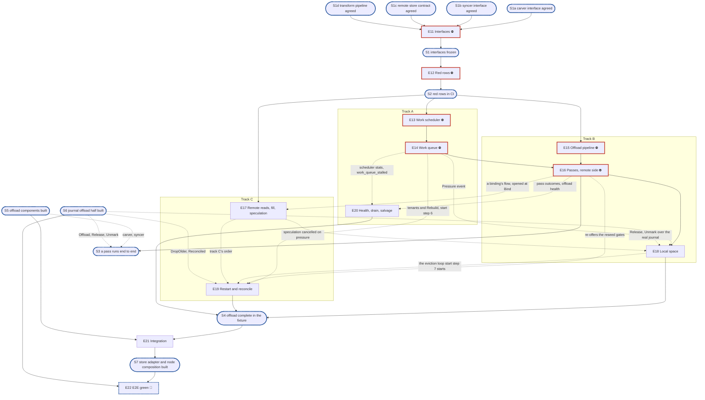

# RFC 8 — engine, the offload part: implementation plan

**Scope:** the second part of [RFC 8, the engine](../docs/internals/rfcs/rfc-8-engine.md): exactly what
[`rfc-8-journal-only-engine-plan.md`](rfc-8-journal-only-engine-plan.md) (the **first part**) leaves out.
Every row of the first part's deferral ledger (its §6.1) whose owner is "RFC 8 second part plan" is
taken here, each mapped to an epic in §1.1. Also taken over: #5318 (offload composed in the engine;
four engine known failures wait on it) and #4276 (the syncer and the remote clients composed in the
node, deferred by [`rfc-23-control-plane-plan.md`](rfc-23-control-plane-plan.md)'s §6.1). Related
RFCs, with how far each is in scope:
- [RFC 2](../docs/internals/rfcs/rfc-2-carver.md), [RFC 3](../docs/internals/rfcs/rfc-3-syncer.md),
  [RFC 4](../docs/internals/rfcs/rfc-4-remote-tier.md) and [RFC 5](../docs/internals/rfcs/rfc-5-transforms.md):
  **only the parts this RFC cannot work without**, their public surfaces, which their own plans build
  ([`rfc-2-carver-plan.md`](rfc-2-carver-plan.md) and the RFC 3, 4 and 5 plans written beside this
  one). This plan composes them; §3.2 names the four points where each surface is agreed.
- RFC 0, 1, 28, 6, 9, 12, 14, 15, 16, 17, 23, 25 and 29: **constraints only**. GC (RFC 9) is planned
  later; this plan builds the shared work scheduler GC will also instantiate (D3), and nothing of GC.

**Tracks:** A, B and C (§3.4).
**Programme:** [#5488](https://github.com/cubbit/dittofs/issues/5488), "offload: RFC 2–5 and the
engine's offload part", release v1.1, under roadmap epic [#5487](https://github.com/cubbit/dittofs/issues/5487).
This plan owns the integration of the four components into the engine and the node. It builds on the
first part, stage 3 of #3119, whose epic 10 (E2E green, #4206) is still running: this part builds on
top of it, not beside it, and touches its code only where a first-part stand-in is withdrawn (§1.1).
**Naming:** there is no v1 for this part. v1's engine was deleted by #3645, and the v1 block tier
(`pkg/block/{remote,middleware,blockcodec,syncer,carver,chunker}`) by #3119's stage 4, D8 (#5484).
Nothing of it moves: the component packages are new, each built at its path by its own plan. The engine
and the journal move to `pkg/engine` and `pkg/journal` in #3119's own pull request once T2.4 lands
(the stage 4 plan's ledger); the plan names them by their current paths.
"The first part" is the journal-only engine; "this part" is the offload part. In this plan "epic 11"
is always an epic and "RFC 8 E11" an invariant of RFC 8 §13.
**Transition:** new installations only, as #3119 decided. Nothing of the v1 block tier is read,
migrated or run beside this part, so no metric, span, log key or setting carries a version.
**Which RFC 8:** `origin/develop`'s, with #5481 and #5534 (§10.2's share pass and its step 1)
merged. The plan cites sections and rows, never line numbers.
**Inputs settled with the user (Step 0):** the RFC; the scope above; no v1 and the transition; the
related RFCs as above; plans land on `develop`, and code lands where the engine lives,
`feat/storage-v2` (D2); the programme #5488; epics numbered from 11 (D1), the user having chosen a
separate second-part plan over revising the first part's; no dashboards; this output path; status
draft. **Defaults used:** none beyond these.
**Cross-plan contract:** the five offload plans follow one contract, settled with the user after a
joint review: pieces with no caller in v1.1 are deferred and the RFC says they land with their first
caller; component packages are `pkg/carver`, `pkg/syncer`, `pkg/remote` (codec at
`pkg/remote/codec`) and `pkg/transform`; this plan owns the sync points of §3.2. **RFC amendments in
this plan's pull request:** RFC 0 §1.2 names two allowed import edges, the engine's wiring to the four
components and the codec to the transforms, and I6 follows it; RFC 8 §2.1 and §2.8 name
`enginewire`; RFC 8 §2.8 and §6.1.1 name the scheduler's package `pkg/workqueue`, and RFC 9, RFC 23
and the glossary follow; RFC 8 §6.1.1 lands `Rate` pacing, with the pace `Throttled` lowers, with GC's
sources; §12.1 lands `PreWarm` with its first caller, an operator's pre-warm action no RFC specifies
yet; §15.4's B1 measures against raw puts on the same store at the same time.

---

## 1. Introduction

### 1.1 What we are building

The offload half of the engine RFC 8 describes: dirty journal content offered, carved, packed, named,
put and committed, then evicted, refetched, filled and read ahead, with the background work that
drives it, its recovery after a crash, its health, and its composition in the node. RFC 8's
[Start here](../docs/internals/rfcs/rfc-8-engine.md#Start%20here) is the overview; this plan adds who
builds what, in which order.

There is no v1 to replace, so in place of the skill's v1 table this one maps each item the first part
deferred to the epic that takes it, and the first-part stand-in it withdraws:

| First part's deferral (its §6.1) | Epic | First-part stand-in withdrawn |
| --- | --- | --- |
| Offload: RFC 8 §3, §6, §7.2–§7.4, §7.7, §7.8, §8.3, §11.4; carver, syncer, remote block store, work scheduler, fill, speculator | 13 to 18, 20 | its own row "a carved run fails `ErrUnavailable`" (epic 17 deletes it) |
| `Carver`, `Syncer`, `Refs` in `Deps`; start steps 6 and 7 | 15, 16, 19 | — |
| `Gate` in `Deps` | §6.1, RFC 12 | — |
| Clone's adoption of carved refs | 17 | the copy of every journal-held run |
| Eviction, pacing, the pressure flag; §10.1, §10.2.1, §10.4 | 18 | the `decision:` that dirty bytes free nothing, and its own row's no-space half (epic 18; #5318's four entries) |
| The metadata reconcile, with `Bind` taking over its handle | 19 | — |
| Repack from the eviction loop | 18 | its epic 7's `ponytail:` on repack at a refusal only |
| Removal phase 2 and its prune on the shared scheduler | 14 | its epic 5's `ponytail:` on one loop per journal |
| Offload health, put and get health, `stranded_export_failed` with the salvage export, `WaitOffloaded` | 20; `PreWarm` §6.1 | — |
| Rows, or halves of rows, needing offload, eviction, fills, pacing or the scheduler; the operator's acknowledgement serving a journal-gone share again | 12, 19 | its "adapted" rows' other halves |
| §4.1's `Dirty` event, §2.3's flow, key scope and budgets | 14, 16; the budgets' values §6.1, RFC 24 | — |
| §15.4's B1 to B4, B6 and B8 | 22 | — |
| The node's syncer and remote clients; the registry's refusal of the in-memory remote store outside tests (#4276) | 21 | RFC 23 plan's `ponytail:` "every MVP share names the in-memory remote store" |

The first part's five rows "of this part's own" are settled so: epic 17 deletes the carved-run
`ErrUnavailable` row, which RFC 8 §15.1's "§7.1 the join" covers once a carved run fetches; epic 18
changes the refusal row's no-space answer for dirty bytes to RFC 8 §10.2's table, which "§10.2 retry
later" checks; the two racing refusals, the unsynced overwrite at a share limit and the unresolved
failed window stay as written.

Other plans hand rows here, and each is taken: the journal plan's salvage export and its failure
condition (epic 20, its sealing through S1d) and its system scenarios "RFC 8's second part writes the
rest" (epic 21); the RFC 14 plan's L9, which needs eviction (epic 18); the RFC 21 and RFC 22 plans'
remote-outage rows on a composed node (epic 21); and the RFC 2 plan's ledger rows for the `carver_`
series, RFC 2 §2.4's two exceptions with RFC 8 §6.7's widening, recording chunking settings and
reporting a change as a migration, the Intent step's namespace refusal and the nonce's source, and
RFC 2 §5.3 with §10.1's consumer checks (epics 15 and 16).

**Dependency limits.** The engine calls the four components only through interfaces it declares
(RFC 8 §2.1), so each middle epic builds against those declarations and against components that pass
their own conformance suites. What this part cannot do before the components exist is run a pass end to
end (S3) or compose the node (epic 21). The journal's offload half is not built: on `feat/storage-v2`
its `Offload`, `OffloadMany`, `MarkOffloaded`, `Unmark` and `Release` answer `ErrNotImplemented`, and
`DropOlder`, `Reconciled` and `AcknowledgeUnreadable` do not exist (the journal plan's epics 9b and
7b). That is S6, which gates S3, eviction and the reseed as well as the reconcile. The store's half
exists: `kvstore` has `Intend`, the per-block offload `Commit`, `Abandon` and `AbandonShardIntents`,
`Covering`, `Resume`, `PruneRemovals` and `UnfinishedRemovals`. GC, snapshots, re-homes and the
cluster stay constraints (§6.1).

### 1.2 How the plan is organised

Epics 11 and 12 are the team's and run first: the frozen surface, agreed with the four component plans
at S1a to S1d, and the red rows. Eight middle epics implement the part along RFC 8's seams: the
background-work machinery with health (track A), the offload path with local space (track B), and
reads with restart (track C). Epic 21 composes the part into the node; epic 22 burns the known
failures down and runs the benchmarks.

### 1.3 What epic 11 must deliver

The exported surface this part adds, frozen at S1, with stub bodies, and the component signatures
agreed at S1a to S1d:

- **`Settings` and `Share`** gain the keys RFC 13 Appendix B gives RFC 8 §6.1, §6.2, §6.3, §7.4,
  §8.1 and §10.3, and the share's write namespace and store (RFC 8 §12.1's `Share`).
- **`WaitOffloaded`** (RFC 8 §12.1), and the `Stats` fields of RFC 8 §11.4 and §14 this part fills.
  `PreWarm` is deferred with its first caller, an operator's pre-warm action no RFC specifies yet
  (§6.1).
- **`pkg/workqueue`**, RFC 8 §6.1.1's surface with stub bodies, `Limits.Rate` included, since the
  engine's sources register it as 0; positive-rate pacing and the pace `Throttled` lowers land with
  their first caller, GC's sources (§6.1). The engine is its first consumer, GC its second.
- **The signatures the engine will declare** for the carver, the syncer and its flows, `Refs`, and the
  journal's offload calls (RFC 8 §2.1's table), written into epic 11's document as agreed at S1a to
  S1d. They are not added to `Deps` or to the engine's declared interfaces here: RFC 8 §2.1 has a
  declared method with no caller fail the build (§15.3's "§2.1 declared interfaces", green today), and
  the real journal does not have `DropOlder` or `Reconciled` yet. Each member and method joins `Deps`
  in the epic that first calls it, as the first part grew `Deps` (rule 12).

`Gate` stays out (RFC 12's, §6.1), and so does `Metrics` (D6). No internal interface is declared: the
first part's in-memory journal already holds the journal's two consumers.

### 1.4 What epic 12 must deliver

**The suite and its registration.** The rows join the engine's conformance suite the first part
registered, `engine-conformance` (`pkg/block/engine/conformance`, tag `engine_conformance`,
`known: test/engine/known.yaml`, `tier: pr`, in group `engine`), so no new suite, tag or group is
registered and RFC 8's suites paragraph needs no change. Each red row is one `known.yaml` entry as
`CLAUDE.md` "By kind" lists its fields, with `issue:` the epic issue of the epic that turns it green;
those issues exist before epic 12's pull request lands (§1.5's instruction). The four entries #5318
holds since #5491 (`TestRFC8A_RetryLaterAtTheShareLimit`, `TestRFC8A_Clone`,
`TestRFC8A_CloneResumedAtAFullLimit`, `TestRFC8B_SharedJournal`) are re-pointed to epic 18's issue,
whose settled answer for a put-healthy store turns them green.

**The scenario catalogue, by source.** Only rows the first part does not catalogue whole, or catalogues
"adapted" with the rest sent here.
- **RFC 8 §15.1, Group A**: §3.2 no gate is safety; §6.8 per-block reporting; §4.1 verifier inputs
  (the offloaded loss); §6.4 guard across a removal; §8.3 transfer survives a removal; §2.5 restart
  re-offer; §2.5 journal gone (the acknowledgement); §2.5 attach after a device loss (the
  acknowledgement); §2.5 metadata reconcile; §2.5 `Bind` takes over the reconcile's handle; §2.5
  unsuitable journal at start; §2.5 unread range at start; §2.5 reseed gates offer and eviction; §6.6
  minted names and intents; §6.7 widening; §6.7 stretch ends; §9.1 clone keeps writes outside its
  extent (offload half); §9.1 no pre-clone fill (a demand read's fill stalled in place of the
  pre-warm, whose leg is deferred with `PreWarm`, §6.1); §6.4 guard is not a fence; §7.1 stale ref; §7.1 the
  order; §7.2 streaming, verified; §7.2 fill cannot fail a read; §7.2 fill loses to a write; §7.7
  re-resolution; §5.1 durable commits; §5.1 overwrite waits for existence (offload half); §7.6 zero ref
  under an overwrite; §9.1 Lost source run carried; §9.1 one source state; §2.5 clone resumed at a full
  limit (remote half); §10.2 retry later; §10.4 destroyed material. 33 rows.
- **RFC 8 §15.2, Group B**: §11.1 health per direction; §11.1 offload health; §11.1
  `stranded_export_failed`; §10 occupancy triggers eviction; §10.2 refusal loop; §10.3 repack
  reserve; §10.2.1 pacing law; §2.3 removal during a reconcile; §2.5 join; §8.1 removal wedge (the
  undecodable ref); §11.4 drain names its blocker; §1.1 no cross-share slowdown (cold reads); §6.1.1 a
  stuck run, over the engine's instances. 13 rows.
- **RFC 8 §15.3, Group C**: §2.5 reseed; §2.4 settings (the chunking half: a changed profile reported
  as a migration). 2 rows.
- **Other plans' rows**: RFC 14's L9 (locks do not pin bytes). 1 row.

49 rows. Two of them extend a test the first part already has rather than add a second one: "§2.5
clone resumed at a full limit" extends `TestRFC8A_CloneResumedAtAFullLimit` with its remote half, and
"§10.2 retry later" extends `TestRFC8A_RetryLaterAtTheShareLimit` with its store legs. "§2.1 remote
required" is the RFC 23 plan's (its epic 3), run through the node. The module
checks of RFC 8 §6.1.1, §6.3 and §7.4 are unit tests of `pkg/workqueue`, `offload/` and the speculator,
written green with epics 13, 15 and 17: `unit` keeps no known list. O1's crash leg is the exception: it
is a durability property, so epic 15 writes it in `engine-conformance` over the real journal, red
until S6 (rule 8). The journal plan's system
scenarios and the RFC 21 and RFC 22 rows run in `e2e`, which keeps no known list either, so they land
green with epic 21 or 22 (§6 point 3).

**The test components.** The first part's fixture (`enginetest`) gains options for the carver, the
syncer and `Refs`. Until S5 delivers the components, a row that needs one fails at one named check, the
fixture's refusal of a missing component, as the first part's rows failed at the journal's `Init`; the
epic that first calls a component swaps the real one in (epic 15 the carver, epic 16 RFC 3's syncer
over its in-memory store with its fault wrapper, epic 19 `Refs`), and in the same change rewrites the
`message:` of every row still red to the failure it now meets, since RFC 29 §4.7 matches it as a
substring.

**The in-memory journal's new calls come after their suite rows.** `Offload`, `OffloadMany`,
`Release`, `MarkOffloaded`, `Unmark`, `DropOlder` and `Reconciled` get their rows in the journal's
conformance suite first, written by epic 12 and red against the real journal until S6; the in-memory
journal gains each call, passing those rows, with the epic that first calls it (`CLAUDE.md`, "Writing
tests": the suite comes before the double). The clock, `sim.Schedule`, the
fault-injecting `kv.KV` and the profiling harness are the first part's.

### 1.5 General rules for each epic

> **Instruction for whoever expands an epic into its detailed description and subtasks,
> human or AI:**
>
> - **Creating an epic from this plan: use the `epic-breakdown` skill.** Whenever the user
>   asks to create an epic from this plan, or to expand, detail or break one down, run the
>   `epic-breakdown` skill (`.claude/skills/epic-breakdown/SKILL.md`) on this plan and that
>   epic, rather than writing the epic document freehand. It extracts the RFC's MUST and
>   MUST NOT into numbered requirements, estimates each subtask in man-days and suggests
>   the pull requests. A human doing it by hand follows the same skill.
> - **Epic and subtask, nothing else.** The units of work are the epic and its subtasks,
>   with subtask ids `<e>.<n>` (`subtask 4.3`, or `T4.3` for short), assigned by the epic
>   document. No other word names
>   them: not task, ticket, story, step or phase, in headings, tables, ids or prose.
> - **The epic stands alone for what to build.** Its requirements, subtasks and decisions
>   are in the epic document itself, which never refers to this plan for them or says "see
>   the plan": the RFC sections it implements, the interfaces it builds on, the
>   subtasks, and a short legend of the names it borrows from this plan (E1, E2, S1, the
>   integration epic, …). It cites the numbered rules below, without copying them, in a
>   table of how each applies: each row names its rule by number and bold title, which
>   says what the rule requires, and the table links this §1.5 with a full link (the
>   plan's path and the section's anchor) and the `CLAUDE.md` sections that hold a rule,
>   so the epic reads alone and its reader can still open each rule's text in one click.
> - **The epic document records decisions, not progress, like this plan.** It has no
>   status fields, no checkboxes to tick and no sections to keep up to date as the work
>   goes on. It is revised through a pull request only when a decision changes.
> - **Subtasks are not pull requests.** A subtask is ideally up to 5 man-days. The owner
>   ships subtasks as they see fit, one pull request each or several together; the epic
>   document only suggests a grouping, each suggested pull request ideally up to 15
>   man-days. Cut and group by logic, readability, dependencies and a deliverable that can
>   be named, not to hit a number.
> - **Every subtask states how it meets each rule that applies to it.** A rule that does
>   not apply is named, with the reason.
> - **In the issue tracker, once each document merges,** following `epic-breakdown`
>   Step 6, their one description. Issues point at the documents and copy nothing; once
>   created, their `Estimate` and blocked-by links are the current estimate and
>   dependencies, and the documents are not revised to follow them. The
>   epic issues exist before E2's pull request lands, because each red test's
>   `known.yaml` entry names one; subtask issues come once their epic document has
>   merged. The release an epic ships in is set by the RFC's roadmap epic that its epic
>   issue sits under, never in a document and never on the epic issue on its own: the epic
>   issue and its subtask issues copy that roadmap epic's milestone, and an epic changes
>   release only by moving under the roadmap epic of the other release.

In this plan E1 and E2 are epics 11 and 12, and the integration epic is epic 21 (D1).

1. **Independent unit tests.** Each epic carries its own unit tests, over the first part's in-memory
   journal, the real carver (a pure function), RFC 3's real syncer over RFC 3's in-memory store, and
   `kvstore` over the in-memory `kv.KV`, each a kind the `CLAUDE.md` "Writing tests" section allows.
   Epic 11 declares no internal interface for a test to stand in for (rule 12). The pipeline's tests in
   `offload/` import only those, as RFC 8 §2.8 requires, and reach the components through
   `enginewire` (rule 7).
2. **Fuzz the key and ref decoders the queue's rebuild reads.** Epic 14's `Rebuild` reads the
   unfinished-removal index and the refs a removal batch walks, and §15.2's "§8.1 removal wedge" feeds
   it an undecodable ref: a target per decoder asserts no panic, lengths inside the buffer, and decode,
   re-encode, decode equal, in the nightly `fuzz` suite the RFC 2 plan's epic 2 registers. Epic 15
   adds one for the block record's decode with the `encodings` it persists, seeded with a record
   written without them, and epic 16 one for the recorded chunking settings (D11). Block bodies are
   RFC 4's codec's and every other store record arrives through a typed call. RFC 8 §15.3's
   `ponytail:` names the pure parts checked by tables instead (the work queue's keys, the pacing law),
   and its marker goes at those code sites; the scheduler's state table is checked by its table (epic
   13). `CLAUDE.md` "Writing tests", "By kind", holds the fuzz rule for the decoders the component plans
   build.
3. **Observability follows RFC 25.** Counters and gauges are RFC 8 §14's, `engine_` prefixed (RFC 25
   §2.1), never share-labelled per operation, per-share figures under RFC 25 §2.5's worst-n rule,
   exposed through `Stats` as the first part does (D6). Spans are RFC 8 §14's `engine.fetch` and
   `engine.pace`, and root spans for a pass, a reseed and a pre-warm page. Conditions are RFC 8
   §11.1's, in RFC 25 §3.9's registry. `pkg/workqueue` owns the `engine_queue_*` and `engine_work_*`
   series for every instance. The Carve state derives RFC 2 §2.3's `carver_` series (RFC 25 §2.8),
   since the carver keeps none. Each epic names what it owns.
4. **Profiling.** Tests and benchmarks run under the first part's profiling harness (`prof.Watch` in
   the fixture) and fail on goroutine, descriptor or memory leaks. Allocation assertions sit on two hot
   paths: a put's source holding one chunk per worker (RFC 8 §6.3), and a read of held content whose
   cost is unchanged by this part, gated in a `unit/engine-allocs` option at `tier: pr`, which epic 15
   registers in `test/suites.yaml` with the first assertion. The engine-cost benchmark stays deferred
   (RFC 8 §15.4's `ponytail:`, the first part's ledger).
5. **Public interface and internals.** Tests cover both the internal package API and the public
   behaviour the epic enables, including concurrency under `-race`. Test at the layer that
   **consumes** a value (see `CLAUDE.md`, "Verifying a change"): an offloaded bit at the journal's
   `Release`, a ref at the store's covering lookup, a health cause at the refusal table's answer.
6. **Known failures shrink.** A red test that turns green leaves `test/engine/known.yaml` (or
   `test/engine/soak-known.yaml`) in the same change (`CLAUDE.md`, "Writing tests", "By kind"; RFC 29
   §4.7 fails a run whose known failure passes), a component plan's or the journal's pull request
   included. A change that makes a red row fail at a later check rewrites its `message:` in the same
   change.
7. **v2 ignores v1, and components import only what amended RFC 0 §1.2 names.** The first part's
   import walk (`pkg/block/engine/imports_test.go`) covers every package of `pkg/block/engine` and
   `pkg/workqueue`, keeps refusing `pkg/vfs`, the v1 metadata service and the v1 block tier, and
   allows `enginewire` alone to import `pkg/carver`, `pkg/syncer`, `pkg/remote`, `pkg/remote/codec`
   and `pkg/transform`, as RFC 0 §1.2 and its I6 name. The allowlist names each package an exception
   applies to, test packages included. Each entry is flipped with its first consumer (rule 12): epic 15
   the carver, which the fixture and `offload/`'s tests build through `enginewire`; epic 16 the syncer
   and its in-memory store; epic 21 the remote tier, its codec and the transforms.
8. **Real dependencies for properties of those dependencies**, as `CLAUDE.md`'s "Writing tests" says.
   Here: the real journal on a real directory with its crash seam, for durability, recovery and the
   offloaded-bit ledger; `kvstore` for what an offload, intent or removal transaction commits and
   conflicts on; a real S3-compatible endpoint, the LocalStack with HTTPS in `integration` that the RFC
   4 plan's epic 3 brings (a test reads `LOCALSTACK_HTTPS_ENDPOINT`), for remote semantics, a test that needs it waiting on it and never counting
   a skip as coverage; RFC 3's in-memory store only where
   RFC 3's suite holds it.
9. **Code comment conventions** (`CLAUDE.md`, "Code comments"). RFC 8's markers go at the sites that
   implement them: §6.1's prune `ponytail:` and removal-key `decision:`, §6.1.1's no-borrowing
   `decision:`, §6.3's five-failures `decision:`, §7.8's quarter `decision:`, §9.1's clone-copies
   `decision:`, §10's concurrent-refusal and §10.1's eviction `ponytail:`s, §10.2's two-rows and
   §10.2.1's fixed-constants `decision:`s, §2.5's four reconcile `decision:`s and its `ponytail:`,
   §15.3's fuzz `ponytail:`. The first part's markers this part withdraws are deleted with the
   stand-in: epic 17 deletes `read.go`'s `decision:` that a carved run fails the read unavailable,
   epic 18 `settled`'s that dirty bytes count as nothing to free.
10. **A test must be able to fail** (`CLAUDE.md`, "Writing tests"), and nothing else would catch the
    change it guards: not the compiler, not the diff, not a later epic's tests. A review rule that no
    test can check, such as "stubs never panic", stays a review rule.
11. **A symbol is exported only if the RFC's interface uses it.** Everything exported is frozen at S1.
    The pipeline's states, the policy functions and the speculator are unexported, or internal to
    `offload/`.
12. **Each subtask creates only what it declares.** No empty package and no stub without a caller. A
    package, a `Deps` member, a declared method, an in-memory journal call or a test helper lands with
    its first consumer; epic 11's stub bodies behind final signatures are the one exception.

## 2. Epics at a glance

| # | Epic | Content | Subtasks | Man-days | Track | Blocks |
| --- | --- | --- | --- | --- | --- | --- |
| 11 | **Interfaces** ⛔ | `Settings` keys, `WaitOffloaded`, `pkg/workqueue`'s surface; the component signatures agreed at S1a to S1d | 5 | 9.5 | team | **everything** |
| 12 | **Red rows and test foundations** ⛔ | 49 rows in `engine-conformance`, red; the journal suite's rows for the new calls; the fixture's component options | 8 | 26 | team | **all testing** in 13 to 22 |
| 13 | **The shared work scheduler** ⛔ | `pkg/workqueue`: keys and states, batches, backoff, reservations, fairness, watchdog turns | 7 | 20 | A | 14 |
| 14 | **The work queue** ⛔ | the offload and removal sources, the four events, the age tick, the rescan, the first part's removal loop moved onto the scheduler; the rebuild's decoders fuzzed | 6 | 15 | A | 16, 18, 19, 20 |
| 15 | **The offload pipeline** ⛔ | `offload/`: Capture to Mark over the store's existing calls; the chain pin; `encodings` at commit; O1 to O8 but O7, O1's crash leg over the real journal | 8 | 28 | B | 16 |
| 16 | **Passes and the bindings' remote side** ⛔ | the pass registry, §8.3, a share's flow, namespace and pause, chunking settings; S3 | 6 | 19 | B | 17, 18, 19, 20 |
| 17 | **Remote reads, fill and speculation** | the carved row, verified streaming, re-resolution, chunk or block, `fill`, read-ahead, clone adoption | 7 | 23 | C | 18 |
| 18 | **Local space with offload** | eviction loop, `evict`, `repackDue`, refusal steps 2 and 3 with the share's pass, put-health causes, pacing and pressure, destroyed material | 8 | 26.5 | B | 19, 21 |
| 19 | **Restart and the metadata reconcile** | start steps 6 and 7, the reseed and its gates, re-offer, a lost journal served again, the reconcile and `Bind`'s takeover, the `Census` view | 12 | 43 | C | 21 |
| 20 | **Health, drain and salvage** | per-direction health and drift, the offload conditions, §11.4 and `WaitOffloaded`, the salvage export | 6 | 18 | A | 21 |
| 21 | **Integration: the node composes offload** | the store adapter and its suite, clients per store configuration, the components' collectors, settings sections, keys and alerts, `materialtest` against the RFC 4 store, the import flips, system scenarios; S7 | 9 | 27 | team | 22 |
| 22 | **E2E green** 🔀 | burn `known.yaml` down, the soak with remote faults, B1 to B4, B6, B8, and B5, B7, B9 with offload; provisional (§6 point 2) | 6 | 18.5 | team | release |
| | **Total** | | **88** | **273.5** | | |

**Plan estimate: 88 subtasks, 273.5 man-days.**

RFC 8 is 4,229 lines, which gives N = 11, clamped to 8. This part covers about half of it in eight
cohesive areas, matching N: the scheduler, the queue, the pipeline, passes, remote reads, local space,
restart with its reconcile, and health.

⛔ = blocker: other epics cannot finish until this one has delivered.
🔀 = synchronisation point: the team converges, and the work that follows depends on
everything before it.

## 3. Synchronisation points, blockers and the split

### 3.1 Dependency graph



### 3.2 Synchronisation points

This plan owns the programme's sync points; the RFC 2 to RFC 5 plans cite them as `RFC 8 offload
plan S<x> <name>`, and their names hold whatever this plan renumbers inside. They are agreements on
documents and merged surfaces, not on #5484.

| Point | Name | What it is |
| --- | --- | --- |
| S1a | carver interface agreed | = the RFC 2 plan's S1. RFC 2 folds its open assembler inputs (key budget, lookup, all-zero flag, age) into its epic 1, so its S1 is final. |
| S1b | syncer interface agreed | = the RFC 3 plan's S1: a joint review of the written signatures with this plan's authors. No compile check. |
| S1c | remote store contract agreed | = the RFC 4 plan's S1, including the codec's encode and decode calls. |
| S1d | transform pipeline agreed | = the RFC 5 plan's S1, including the chain pin and release calls, the salvage-key wrap and the destroyed-material notice. |
| S3 | a pass runs end to end | internal to this plan; the RFC 2 plan's S3 cites it. |
| S5 | offload components built | the four components themselves. |
| S6 | journal offload half built | the journal plan's epics 9b and 7b. |
| S7 | store adapter and node composition built | epic 21 done: the RFC 3 store adapter passes `syncertest`'s conformance suite in `integration`; remote stores held one client per store configuration, ref-counted; each component's collectors and alert rules registered in the node. |

What each point means for this plan's epics:

- **S1a to S1d 🔀** are external, each reached at that plan's S1 with this plan's authors in the
  review; epic 11 folds what was agreed. S1a fixes `Cut`, its settings per namespace with one
  `Deps.Carver` (RFC 8 §2.6), the chunk ID under the namespace's key (RFC 2 §4.3), the block name and
  its nonce (RFC 2 §4.2) and the assembler's fold (RFC 2 §5.1). S1b fixes the calls of RFC 3 §1.3 the
  engine makes, the errors and denial causes the refusal table reads (RFC 8 §10.2). RFC 3's in-memory store and its fault wrapper are not part of S1b: they land at the RFC 3 plan's S2 (its epic 2), which S5 covers. S1c fixes the calls the store adapter composes and the mapping of
  RFC 4 §4.8's errors onto RFC 3's values. S1d fixes the chain, its ID and pin (RFC 5 §2.8), the
  material errors (RFC 5 §2.7), the chunk-ID key (RFC 5 Appendix B.2), the destroyed-material notice
  (RFC 8 §10.4) and the salvage-key wrap (RFC 1 §3).
- **S1 🔀 interfaces frozen** (this plan's S1: the end of epic 11, after S1a to S1d). Nothing in epics 13 to 20 starts
  before it.
- **S2 🔀 red rows in CI** (end of epic 12). The 49 rows compile, run on every pull request to
  `feat/storage-v2` and are listed in `known.yaml`. Epics 13, 15 and 17 start here.
- **S3 🔀 a pass runs end to end** (inside track B, the end of epic 16, over S5's carver and RFC 3's
  syncer and S6's `Offload`). A file written through the journal is offered, carved, packed, put
  through a flow to RFC 3's in-memory store, committed and reported offloaded. The RFC 2 plan names this point its S3.
- **S4 🔀 offload complete in the fixture** (epics 13 to 20 done). Every method of §1.3 has its
  behaviour, and every row whose component and journal call exist is green. Epic 21 starts here.
- **S5 🔀 offload components built** (external: the RFC 2 to RFC 5 plans' implementation epics). The
  carver and assembler and RFC 3's syncer with its in-memory store gate S3; RFC 4's codec and S3 store
  and RFC 5's chain gate epic 21.
- **S7 🔀 store adapter and node composition built** (end of epic 21). The RFC 3 and RFC 4 plans'
  epics that need a composed node, and epic 22, start here.
- **S6 🔀 journal offload half built** (external: the journal plan's epics 9b and 7b). 9b's `Offload`,
  `OffloadMany`, `MarkOffloaded`, `Unmark` and `Release` gate S3, eviction (epic 18) and the reseed's
  marks (epic 19); 7b's `DropOlder`, `Reconciled` and `AcknowledgeUnreadable` gate the reconcile and
  the unread-range row (epic 19). Until then those epics build over the first part's in-memory
  journal, which gains each call with its first caller, and their rows over the real journal stay red.
- **E22's 🔀** is the burn-down: the team converges on it once S6 and S7 are met.

### 3.3 Blockers

- **S1a to S1d (external)** block epic 11, so the four component plans' surface agreements come first
  in the programme.
- **E11 ⛔ and E12 ⛔** block everything. Keep them short and do them together.
- **E13 ⛔** blocks E14: the engine's sources run on the scheduler.
- **E14 ⛔** blocks E16 (a pass is the offload source's run), and partly E18 (the pressure event), E19
  (start step 6 adds each shard as a tenant and rebuilds it) and E20 (the scheduler's stats feed
  `work_queue_stalled`).
- **E15 ⛔** blocks E16: the engine runs the pipeline it builds.
- **E16 ⛔** blocks E18 (eviction needs offloaded bits, and the refusal table's third step offloads at
  once), and partly E17 (the carved row fetches through the flow a binding opens at `Bind`; until then
  epic 17's tests open a flow over RFC 3's in-memory store themselves), E19 (the reseed gates the
  re-offer) and E20 (pass outcomes feed offload health).
- **E17** blocks E18 partly (speculation is cancelled on pressure), and E19 through track C's order
  only.
- **E18** blocks E19 partly: start step 7 starts its eviction loop.
- **E18, E19 and E20** block E21 through S4.
- **E21** blocks E22 through S7: the burn-down and the benchmarks run over the composed node.
- **S5 (external)** blocks S3, and with it E16's finish, and E21.
- **S6 (external)** blocks S3, E18's and E19's rows over the real journal, and E22.

### 3.4 Splitting the work

- **Track A, background-work machinery and health:** epic 13, epic 14, then epic 20. The scheduler is
  a library with no engine dependency, so it starts at S2 with nothing to wait on; the queue puts the
  engine's sources on it; health reads what both report.
- **Track B, the offload path:** epic 15, epic 16, then epic 18. The pipeline's state machine is built
  over the components' in-memory implementations; the engine then runs it as passes, and local space
  evicts what passes made offloaded.
- **Track C, reads and restart:** epic 17, then epic 19. Remote reads need refs, which the fixture
  writes through `kvstore`'s offload commit before any pass exists; the reseed reads the same refs; the
  reconcile runs inside the reseed.
- **Where the team converges:** epics 11 and 12 before S2; epics 21 and 22 after S4.
- **Where the tracks wait on each other:** track B's epic 16 waits on track A's epic 14 for the offload
  source, about 35 man-days into track A against about 25 into track B; epic 15's last subtasks (O6's
  per-file count, the abandoned intents) fill the gap. Track A reaches epic 20 at about 35 man-days,
  and epic 16's pass outcomes land about 20 man-days later; epic 20's drain metrics, its `WaitOffloaded`
  over the journal's dirty figures and the salvage export, which need no pass, fill that wait, and
  track A then takes the store adapter's preparation for epic 21 (D5) once S1c and S1d are agreed.
  Track C's epic 19 waits on epic 14's tenants, epic 16's passes and epic 18's eviction loop, which
  start step 7 starts; it starts with the reseed's marks and unmarks over the in-memory journal, which
  need none of them, and takes start step 7 last.

## 4. Implementation decisions

### 4.1 Directory layout

```text
pkg/workqueue/                              E11 surface; E13 behaviour (RFC 8 §6.1.1)
pkg/block/engine/                       the first part's package
  deps.go                               E15 to E19: Carver, Syncer, Refs, Watchdog and the declared methods, each with its first caller
  types.go                              E11: Settings keys, Share's namespace and store, Stats fields
  policy.go                             E15 offloadDue; E17 fill; E18 evict, repackDue, admit; E20 health
  queue.go                              E14: the offload and removal sources, events, age tick, rescan
  removals.go                           E14: phase 2 and prune moved onto the removal source
  pass.go flow.go                       E16: the offload source's Run, the pass registry, a binding's flow
  read.go fill.go speculate.go          E17
  evict.go capacity.go                  E18 (capacity.go is the first part's; pacing joins it)
  recover.go                            E19: the reseed and the reconcile beside steps 1 to 5 (RFC 8 §2.8)
  health.go salvage.go                  E20 (health.go is the first part's); WaitOffloaded in health.go (E11 stub)
  offload/                              E15: the pipeline state machine, Capture to Mark (RFC 8 §2.8)
  enginetest/                           E12: component options; E15, E16, E19: real components
  conformance/                          E12: the rows
  enginewire/                           E15, E16: the carver and the syncer built for the fixture and offload/'s tests; E21: stores, the store adapter (D5), clients per store configuration
pkg/metadata/kvstore/                   E19: Inspect.Refs, Existence.Versions
internal/node/                          E21: build and stop order, keys, alert rules
test/engine/known.yaml                  E12
```

### 4.2 Decisions

- **D1 — epics numbered from 11.** The first part used epics 1 to 10 and labels `rfc-8-epic-1` to
  `rfc-8-epic-10`, so this plan starts at 11: epic 11 takes E1's role, epic 12 E2's, epics 13 to 20
  are the middle epics, epic 21 the integration and epic 22 E2E green. Labels are `rfc-8-epic-11` to
  `rfc-8-epic-22` and epic documents `rfc-8-offload-engine-epic<k>.md`. Subtask ids (`T<e>.<n>` with
  `<e>` from 11) cannot collide with the first part's; a pull request still names the plan's slug,
  `RFC 8 offload-engine`, before its ids, as `pr-opening` asks when an RFC has two plans. Prior art:
  none found. Every epic.
- **D2 — code lands on `feat/storage-v2`.** The engine and the journal live there; the plan lands on
  `develop`. Prior art: none found; the first part did the same. Every epic.
- **D3 — `pkg/workqueue` is built here, whole.** RFC 8 §6.1.1 specifies it once for the engine and GC
  and §2.8 places it; the engine is its first consumer and GC, planned later, instantiates it
  unchanged. Nothing in the repository does this: `pkg/schedule` parses intervals only. Prior art:
  Kubernetes client-go's workqueue keeps a key in one worker at a time and marks a key posted while it
  runs to run again, with per-item exponential backoff (from memory). Epic 13.
- **D4 — the pipeline's tests compose real components.** `offload/` is tested over the real carver,
  RFC 3's syncer over its in-memory store and fault wrapper, `kvstore` over the in-memory `kv.KV` and
  the in-memory journal, each held to its own suite, as RFC 8 §2.8 and §6.3's checks say; no
  engine-side double is written. Prior art: none found. Epics 15 and 16.
- **D5 — the RFC 3 store adapter is built here, in `enginewire`**, as the cross-plan contract settled
  (the RFC 3 plan's real-backend run folds into epic 21). RFC 3 §1.3 and RFC 8 §2.1 say the engine supplies it by composing RFC 4's codec and
  RFC 5's chain over the share's remote store, mapping their errors onto RFC 3's values; this plan
  places that composition in `enginewire` and builds it in epic 21, against S1b to S1d, with the
  past-the-end range wrap and connections spread across the store's addresses. Prior art:
  rclone's `crypt` and `compress` remotes wrap a backend behind the same backend interface (from
  memory). Epic 21.
- **D6 — `Deps` grows only by what this part calls; metrics stay on `Stats`.** `Watchdog` joins with
  epic 14, which hands each journal's scheduler instance its `Loop` (RFC 25 §3.5), since liveness has
  no `Stats` form; `Metrics` stays out, as the first part decided, and the root keeps adapting `Stats`.
  Prior art: none found. Epics 14 and 20.
- **D7 — snapshot-hold ordering is RFC 12's.** The Commit step copies each extent's `Cut` into the
  ref's `born` as RFC 8 §6.3 says, since the ref is persisted; "a held version commits first" and "a
  run splits at a live hold mark" are left to RFC 12, as no hold mark exists before RFC 12 cuts.
  Adding them later rewrites nothing persisted. Unbind's `keepHolds` offload, the cut's `PrepareCut`
  and `CommitCut`, and `Deps.Gate` go the same way. Prior art: none found. Epic 15; §6.1.
- **D8 — the re-home is RFC 27's.** The pass registry records each pass's captured write namespace and
  the Intent step refuses a stale one (RFC 8 E39), since both cost nothing more than the field; a
  `Bind` naming a new write namespace joining the old one's passes (RFC 8 §2.3), `State: Closing`'s
  clone counting and a copied image's `Fenced` state are deferred, as nothing in v1.1 re-homes. Adding
  the join later rewrites nothing persisted. Prior art: none found. Epic 16; §6.1.
- **D9 — single node only.** Every shard is primary here, so the primary-only post filter is the
  identity, a stale-epoch refusal (O7) cannot arise, and the handover and lease-loss drains are the
  cluster stage's. `CancelTenant` and `WaitTenant` are built, since `Unbind` and `Drop` use them.
  Prior art: none found. Epics 14 and 16; §6.1.
- **D10 — the stand-ins go with their replacements.** Epic 14 deletes the first part's removal loop
  and its `ponytail:`, moving its tests onto the removal source; epic 18 deletes the repack-at-refusal
  `ponytail:` and the `decision:` that dirty bytes free nothing, which turns #5318's four rows green.
  Prior art: none found. Epics 14 and 18.
- **D11 — chunking settings are recorded where RFC 13 §5.3 says, and checked at `Bind`.** `Apply`
  refuses an invalid value through the carver's own validation (RFC 2 §3.7); `Bind` compares a share's
  value with the record of what produced its namespace's content and reports a change as a migration
  rather than applying it (RFC 2 §3.6, RFC 8 §2.4). Prior art: none found. Epic 16.
- **D12 — `PreWarm` and `Rate` land with their first callers.** No RFC specifies a pre-warm action,
  so `PreWarm` and the speculator's pre-warm are deferred until one does, and positive-rate pacing to
  GC's sources; RFC 8 §6.1.1 and §12.1 are amended in this plan's pull request to say so. `Throttled`
  is kept as a backoff, as `Retry`'s, and the pace it lowers lands with `Rate`, one rule in RFC 8
  §6.1.1; `Limits.Rate` stays in the surface, registered 0. `WaitOffloaded`'s first caller is epic 22's benchmarks, whose clocks
  RFC 8 §11.4 stops at it. Prior art: none found. Epics 13, 17, 20 and 22; §6.1.
- **D13 — per-share budgets are weighted equally until RFC 24 sets them.** Each shard's tenant weight
  is its share's budget divided among the share's shards on the journal (RFC 8 §6.1), with every share
  given the same budget, since no setting or record carries one yet. Prior art: none found. Epic 14;
  §6.1.

### 4.3 Knowingly simple implementations

RFC 8's own `ponytail:` notes are placed by rule 9. This plan adds one:

- **The eviction loop wakes on a fixed tick.** It reads the journal's occupancy every second (fixed)
  rather than waking on each write that crosses a threshold. *Ceiling:* a write burst can fill up to a
  second's worth of headroom before eviction reacts, which the refusal path then covers inline.
  *Upgrade path:* wake the loop on the journal's occupancy crossing its target, once B3 shows refusals
  that a sooner eviction would have avoided. *Epic:* 18.

## 5. The epics in detail

### Epic 11 — Interfaces ⛔

**Epic 11 estimate: 5 subtasks, 9.5 man-days.**

The surface of §1.3, with stub bodies, and the agreement with the four component plans that freezes
the signatures later epics declare. **Owns:** RFC 8 §2.6's new members' types as agreed, §6.1.1's
signatures, §12.1's `WaitOffloaded`. **Done when:** S1: the S1 review has settled S1a to
S1d, and RFC 8 §15.3's "§2.1 declared interfaces" row stays green.

**Expected content:**
- The component signatures the engine will declare, recorded in the epic document in the components'
  types as S1a to S1d agree.
- `Settings` and `Share` fields for RFC 13 Appendix B's offload, removal, read-ahead and eviction keys
  and the share's write namespace and store; `Apply`'s validation of them.
- `WaitOffloaded` and the `Stats` fields, stubbed.
- `pkg/workqueue`'s exported surface, stubbed.
- The S1 review with the RFC 2 to RFC 5 plans' authors.

### Epic 12 — Red rows and test foundations ⛔

**Epic 12 estimate: 8 subtasks, 26 man-days.**

§1.4 whole: 49 rows written red over the fixture and listed in `known.yaml`, #5318's four entries
re-pointed, and the fixture's options for the new components. **Owns:** RFC 8 §15.1 to §15.3 for the
rows §1.4 lists, and §15's composition rule. **Done when:** S2: `engine-conformance` runs them all,
each red at its named check.

**Expected content:**
- The epic issues the entries name, asked for through `epic-breakdown` Step 6.3 once this plan merges,
  under roadmap epic #5487; #5318's entries re-pointed.
- The fixture's carver, syncer and `Refs` options, refusing by name while unset.
- The journal conformance suite's rows for `Offload`, `OffloadMany`, `Release`, `MarkOffloaded`,
  `Unmark`, `DropOlder` and `Reconciled`, red against the real journal until S6.
- Group A rows of the offload path (§3.2 no gate is safety, §6.4, §6.6 to §6.8, §8.3, §5.1, restart
  re-offer).
- Group A rows of reads, clones and fills (§7.1, §7.2, §7.6, §7.7, §9.1).
- Group A rows of restart and capacity (§2.5's journal gone, device loss, reconcile, takeover, late
  attaches, reseed gates, clone resumed at a full limit; §4.1 verifier inputs; §10.2; §10.4), the
  two of §1.4 that extend an existing test extending it.
- Group B rows (13), Group C rows (2), RFC 14's L9.

### Epic 13 — The shared work scheduler ⛔

**Epic 13 estimate: 7 subtasks, 20 man-days.**

`pkg/workqueue` as RFC 8 §6.1.1 specifies it: a library each component instantiates, holding no durable
state. **Owns:** RFC 8 §6.1.1; RFC 25 §3.5 for its watchdog turns, through `pkg/health`'s `Loop`.
**Done when:** RFC 8 §6.1.1's rules and RFC 8 E41's scheduler half pass as `unit` tests under `-race`
with an injected clock; RFC 8 §15.2's "§6.1.1 a stuck run" passes over a scheduler instance alone.

**Expected content:**
- The key state table and the merge of posts.
- Batches per source, completion per item, `RunTimeout` and overdue runs with `work_queue_stalled`.
- Per-key jittered backoff, `Deadline` and `Expired`, and `Done`'s reset.
- Concurrency per source and per tenant; the fixed total, reserved per source and tenant, drops
  counted; fairness by weight.
- `Throttled` backing its key off as `Retry` does; `SetTenant` live, `Paused`, `CancelTenant`,
  `WaitTenant`, `Stop`. Positive-rate pacing, and with it the pace `Throttled` lowers, is deferred
  (D12).
- `Loop.Turn` after each dispatch and return, and the five-minute stall.
- `Stats`, whose series each consumer registers under its own prefix (the engine's `engine_queue_*` and
  `engine_work_*`); RFC 8 §6.1.1's `decision:` on borrowing.

### Epic 14 — The work queue ⛔

**Epic 14 estimate: 6 subtasks, 15 man-days.**

The engine's two sources on one scheduler instance per journal, and the events that feed them. The
first part's removal loop is moved onto the removal source and deleted (D10); its store calls
(`UnfinishedRemovals`, `Resume`, `PruneRemovals`) are kept as they are. **Owns:** RFC 8 §4.1 step 4,
§6.1, §8.1's phase-2 and prune scheduling, §11.2's backoff rows for removals. **Done when:** RFC 8
§6.1's checks (lost events, growth, starvation, rebuild of the queue's half, pressure band) pass over
the fixture, RFC 8 E23 and E41 hold, RFC 8 §15.2's "§6.1.1 a stuck run" passes over the engine's
instances, and "§8.1 removal wedge" turns green with the undecodable ref.

**Expected content:**
- The offload source and the removal source with their `Rebuild`s, from `DirtyFiles` and the
  unfinished-removal index; `Deps.Watchdog` handing each instance its `Loop` (D6).
- `Dirty`, posted by `Write` after staging, never blocking it: a test fills the queue and asserts the
  write returns (RFC 8 §1.1); `AgeTick` per journal; `RemovalPending`.
- `Pressure` as a state with its band, and the backoff cap lowered for put-healthy shards.
- The removal rescan from a per-shard cursor, on `removal.rescan` and on a risen drop count.
- Tenant weights from share budgets (D13).
- The first part's removal tests moved over; RFC 8 §6.1's prune `ponytail:` and removal-key `decision:`.
- Fuzz targets for the unfinished-removal index key and the ref decoders the rebuild and a batch read
  (rule 2), in the `fuzz` suite.

### Epic 15 — The offload pipeline ⛔

**Epic 15 estimate: 8 subtasks, 28 man-days.**

`offload/`, the state machine per pass, with a sub-machine per block from Intent on, over the
components' real implementations (D4). Its Capture state takes the files' guards through a function the
engine hands it, so the package imports no engine type. The store's half is called, not built:
`kvstore`'s `Intend`, per-block `Commit` (with its missing-intent refusal and per-file result) and
`Abandon`. The fixture's carver option is made real here, and the red rows' messages rewritten.
The chain pin is held from Mint to Commit or Abandon, through S1d's pin and release calls, and
`kvstore`'s `BlockCommit` gains the block's `encodings` (RFC 6 §2.3), written at Commit: the census
is persisted, so it lands before the first block. **Owns:** RFC 8 §3.1's `offloadDue`, §6.2,
§6.3 (but snapshot-hold ordering, D7), §6.5's V1, §6.6, §6.7, §6.8; RFC 2 §2.4's two exceptions as the
caller's, RFC 2 §5.3 and §10.1's consumer checks. **Done when:** RFC 8 §6.3's failure and hang legs
pass in `unit` over the in-memory components, O7 aside; O1's crash leg runs in `engine-conformance`
over the real journal on a real directory and `kvstore`, red until S6 (rule 8); RFC 8 E4, E7, E8, E18, E20, E22 and E40's offload commits hold;
RFC 8 §15.1's "§6.6 minted names and intents", "§6.7 widening", "§6.7 stretch ends" and "§6.8
per-block reporting" go green at S3.

**Expected content:**
- `offloadDue` with the block-target, age and pressure triggers, and a pass bounded by `upload_workers` block targets, taken as a number: the RFC 3 plan's epic 8 declares the setting and epic 21 reads it, so this epic does not wait on it.
- Capture: guards in file-identity order, sync and existence commit, `OffloadMany` with each file's
  `Through`, the captured namespace and chunk-ID key.
- Carve: one `Cut` per maximal stretch, `realEnd`, `consumed`, widening to re-tile, the age's forced
  final cut; the `carver_` series; RFC 2 §10.1's consumer checks, among them each chunk's all-zero
  flag set from the bytes `emit` hands over and never set on a chunk with a non-zero byte, since a wrong
  flag makes a zero ref no block stores.
- Assemble: every chunk carried, zero refs, early close within `K` (the key budget `kvstore` computes at open, `budget.go`, which gains an accessor here), one flow and namespace per block
  (RFC 2 §5.3), as S1a agrees the inputs.
- Intent: the stale-namespace refusal, the chain pinned, the name minted once per attempt from a
  cryptographic nonce, `Intend`.
- Put: streamed from the offer, hashes recomputed, one attempt per name, no second retry layer.
- Commit and Mark: `Commit` per block with its `encodings`, over-`K` and intent-missing paths, `report`
  of exactly what committed, `born` from the offer's cut; O4 through `Abandon`; the pin released at
  either end.
- O1 deadlines, O2 backoff through the scheduler's result, O5, O6's per-file count in the binding's
  policy state, O8; the §6.3 check table, its long-outage and soak rows on the injected clock; O1's
  crash leg over the real journal's crash seam, with its `known.yaml` entry.
- A `Commit` that applied with its reply lost, RFC 16's unknown outcome: the fault-injecting `kv.KV`
  applies the transaction and drops the reply, and the test asserts the ref and its object both exist
  afterwards, whatever the pass then does.
- `unit/engine-allocs` registered with the put source's allocation assertion (rule 4); the block
  record's fuzz target (rule 2).

### Epic 16 — Passes and the bindings' remote side ⛔

**Epic 16 estimate: 6 subtasks, 19 man-days.**

The engine runs epic 15's pipeline as the offload source's runs, and each binding gains its remote
side. The fixture's syncer option is made real here, which with S5 and S6 is S3, and the red rows'
messages rewritten. **Owns:** RFC 8
§2.3's remote side, flow, key scope and the passes `Unbind` and `Drop` join, §2.4's chunking half
(D11), §6.4, §8.3, §11.1's put-unhealthy pause. **Done when:** RFC 8 §15.1's "§6.4 guard across a
removal", "§8.3 transfer survives a removal" (both orders, every removal kind), "§6.4 guard is not a
fence", "§3.2 no gate is safety" and "§5.1 overwrite waits for existence" (offload half), §15.2's "§2.5
join", and §15.3's "§2.4 settings" chunking half turn green; RFC 8 E6, E13, E16, E17, E39 hold.

**Expected content:**
- The offload source's `Run`: a pass per batch, one result per file, `Throttled` and the pause not
  counted as failures.
- The pass registry, the prune's in-flight floor read from it, a removal's guard ordering against a
  capture.
- §8.3: refs over a later removal dropped at commit and never reported, a wholly removed pass aborted.
- A binding's flow opened at `Bind`, closed at `Drop` and `Close`; `Unbind`'s join and `Drop`'s
  `CancelTenant`.
- A put-unhealthy store pausing its shards' tenants, read at each tick and before each pass.
- The chunking settings' validation and migration report (D11).

### Epic 17 — Remote reads, fill and speculation

**Epic 17 estimate: 7 subtasks, 23 man-days.**

The read path past the journal, and everything that fetches. The first part's `ErrUnavailable` for a
carved run, and its row, are replaced by the fetch. Refs for these tests are written through
`kvstore`'s offload commit, so the epic needs no pass. **Owns:** RFC 8 §1.1's cold-read isolation,
§3.1's `fill`, §7.1's carved row, §7.2, §7.3, §7.4, §7.5, §7.7, §7.8, §9.1's adoption and fill
exclusion. **Done when:** RFC 8 §15.1's "§7.1 stale ref", "§7.1 the order", "§7.2
streaming, verified", "§7.2 fill cannot fail a read", "§7.2 fill loses to a write", "§7.7
re-resolution", "§7.6 zero ref under an overwrite", "§9.1 no pre-clone fill" (its demand-read leg),
"§9.1 Lost source run carried", "§9.1 one source state" and "§9.1 clone keeps writes outside its
extent" (offload half), and §15.2's "§1.1 no cross-share slowdown" (cold reads), turn green; §7.4's
checks pass for read-ahead (S1, S3 with its window row, and S5's read leg), their pre-warm legs (S2,
S4, S5's) deferred with `PreWarm` (§6.1); RFC 8 E9, E10, E14, E25, E34 hold.

**Expected content:**
- The carved row: `Fetch` per missing extent through the share's flow, chunks copied once verified,
  the reply in file order with `n` on a part-way failure; `read.go`'s carved-run `decision:` deleted
  with its row (rule 9).
- Errors told apart: unavailable, corrupt, and destroyed material read as **Lost**.
- Re-resolution of an absent object while its location moves, and the re-ask above `asOf`.
- Chunks or the whole block, with RFC 8 §7.8's `decision:`.
- `fill` and the journal's `Fill` beside the reply, never failing or delaying it.
- The speculator's read-ahead: windows, RFC 8 §7.4's read-ahead checks (S1, S3, S5's read leg), the speculation budget,
  cancellation on pressure; its pre-warm deferred (D12).
- Clone: copies only of runs held newer than any ref, carved runs adopted, the destination's fill
  refused, checked with a demand read's fill stalled where the RFC row pre-warms, the missing-chunk
  backstop.

### Epic 18 — Local space with offload

**Epic 18 estimate: 8 subtasks, 26.5 man-days.**

Eviction, pacing and the refusal table's first two rows whole, now that offload drains dirty bytes;
the first part's capacity stand-ins go (D10). **Owns:** RFC 8 §3.1's `evict`, `repackDue` and
`admit`, §10, §10.1; §10.2's steps 2 and 3, run in the refusal's caller for the journal's own
capacity and inside the share's pass (`sharePass`, from #5491) for a share limit, as RFC 8 §10 says,
step 1 and step 4's pass being the first part's; the put-health causes of the table's first two rows
and the index-bound row's put-health half, which `settled` answers from `others` alone today;
§10.2.1, §10.3's repack from the loop, §10.4; RFC 14 §9.3 for eviction. **Done when:** RFC 8 §15.1's
"§10.2 retry later", "§2.5 clone resumed at a full limit" (remote half) and "§10.4 destroyed
material", §15.2's "§10 occupancy triggers eviction", "§10.2 refusal loop", "§10.3 repack reserve" and
"§10.2.1 pacing law", RFC 14's L9, and #5318's four rows turn green; §15.2's "§10.2 one pass per share"
stays green; RFC 8 E3, E11, E33 hold.

**Expected content:**
- The eviction loop per journal, started at start step 7, triggered by allocated occupancy, with
  `evict` by segment and RFC 8 §10.1's `ponytail:`; the loop's fixed tick (§4.3).
- `repackDue` in the loop; the repack-at-refusal `ponytail:` and the dirty-bytes `decision:` deleted.
- Steps 2 and 3 in the refusal's caller for the journal's own capacity: eviction by segment, then
  pressure, each repacking what it freed; the store's cause from `Health(Put)` deciding `ErrDelay` or
  `ErrNoSpace` for the first two rows and the index-bound row; the first part's no-space row rewritten.
- The share's pass gaining steps 2 and 3 before its sync, for a share limit, with its join rule (a
  later refusal joins while the pass's sync has not begun) and its bounded wait unchanged.
- `admit` and the pacing law, with `engine.pace` spans and RFC 8 §10.2.1's `decision:`.
- Destroyed material clearing the offloaded bit through `Unmark`, from S1d's signal.
- Eviction never gated by locks, opens or snapshots; a retention pin honoured as policy; a
  `decision:` at `evict` that it trusts the offloaded bit while bucket-setting drift goes undetected
  (§6.1's drift row), withdrawn when `Recheck` runs.
- The counters of RFC 8 §14's local-space row.

### Epic 19 — Restart and the metadata reconcile

**Epic 19 estimate: 12 subtasks, 43 man-days.**

What a start adds once offload exists: the queue rebuilt, background work started, the reseed with the
reconcile it runs when one is owed, and the shares of a lost journal served again. The reconcile needs
S6's `DropOlder` and `Reconciled`; until then it is built over the in-memory journal, its rows red
over the real one. **Owns:** RFC 8 §2.5 steps 6 and 7 (the reseed and the reconcile, but the replica
clauses, D9), the restart re-offer and intent abandonment before serving, the late attach's steps 6
and 7, §2.3's reconcile clauses in `Unbind`, §2.5's `Bind` takeover of the reconcile's handle, the
operator's acknowledgement (§6 point 1), §11.2's crash row, `journal_unreconciled`; RFC 16 §3.1's
`Refs` and the `Census` view, RFC 6 §10.1's `Versions`. **Done when:** RFC 8 §15.1's "§2.5 restart re-offer", "§2.5 reseed
gates offer and eviction", "§2.5 journal gone" and "§2.5 attach after a device loss" (the
acknowledgement), "§2.5 unsuitable journal at start", "§2.5 unread range at start", "§2.5 metadata
reconcile" (single-node cases), "§2.5 `Bind` takes over the reconcile's handle", "§4.1 verifier inputs"
(the offloaded loss), "§5.1 durable commits", §15.2's "§2.3 removal during a reconcile", and §15.3's "§2.5 reseed", turn green; RFC 8 E30 and E36
hold.

**Expected content:**
- `Inspect.Refs`, `Existence.Versions` and the `Census` view beside `Refs` on `kvstore`; the fixture's
  `Refs` option made real and the red rows' messages rewritten.
- Start step 6: each shard a tenant of both sources, rebuilt.
- Start step 7: the dispatch, age tick, rescan, epic 18's eviction loop and the reseed started; the reseed's marks, its
  ledger mismatches through `Unmark`, its bound, `engine_reseed_files_remaining`.
- A file offered or evicted only once reseeded, an offload run reseeding the file it is handed first.
- Every put intent of this node's shards abandoned before serving (`AbandonShardIntents`); the
  re-offer under a new name.
- The late attach running steps 6 and 7; the acknowledged lost journal's shares served.
- The reconcile's scope, its per-file visits and the pieces `DropOlder` drops, the loss sequence's raise.
- Gating of each call RFC 8 §2.5 names on a file not yet visited, and the walk's own pace.
- Retries under `journal_unreconciled`; `DropOlder`'s and `Reconciled`'s refusals; the named segments
  repacked.
- The handle's one owner under the share table's lock: `Bind`'s takeover, a failed `Bind`, the
  reconcile's close, `Unbind` cancelling a visit; RFC 8 §2.5's four reconcile `decision:`s and its
  `ponytail:`.

### Epic 20 — Health, drain and salvage

**Epic 20 estimate: 6 subtasks, 18 man-days.**

What the engine reports about offload, the drain wait, and the export of stranded tags. **Owns:** RFC
8 §3.1's `health`, §2.5 step 5's salvage export, §11.1's offload conditions and per-direction health,
§11.2's remote-unavailable row, §11.4, §12.1's `WaitOffloaded`, §14's offload and drain series; RFC 1
§3's salvage. **Done when:** RFC 8 §15.2's "§11.1 health per direction", "§11.1 offload health",
"§11.1 `stranded_export_failed`" and "§11.4 drain names its blocker" turn green; RFC 8 E12 and E21
hold.

**Expected content:**
- Health per share and direction from the flow's `Healthy` and `Health`, with drift as put-unhealthy
  once raised; `Recheck`'s only caller is GC (RFC 4 §4.11), so bucket-setting drift is undetected in
  v1.1 (§6.1).
- `offload_stalled`, `file_offload_failing`, `offload_age_exceeded`, `work_queue_stalled` and
  `stranded_export_failed`, in `Stats` and in `*Engine`'s conditions as a `health.Source`.
- Dirty bytes, drain rate, drain time and the oldest unoffloaded age per share and summed.
- `WaitOffloaded`, naming the oldest file left and the condition holding it.
- The salvage export of each stranded tag after serving, under `salvage.path`, sealed through S1d's
  call unless the share is known to use no transforms, a tag whose share's transforms the node cannot
  establish included, and failing as `stranded_export_failed` without a master key; `Forget` only
  after the export succeeds (RFC 1 §3).
- RFC 1 §3's start-time check that `salvage.path` shares no device or filesystem with a journal.
- The `Warn` logs RFC 8 §14 names for health changes and backed-off files.

### Epic 21 — Integration: the node composes offload

**Epic 21 estimate: 9 subtasks, 27 man-days.**

`enginewire` and `node.New` compose what epics 11 to 20 built with the four components (S5), as RFC 8
§2.6's build and stop order says. Its end is S7. **Owns:** RFC 8 §2.1's root obligations (the store
adapter, D5), §2.6's order; RFC 23 §2.1 and §2.2 for the syncer and the remote stores; RFC 13
Appendix B for this part's keys, the components' settings sections and the remote store's keys, which
the RFC 4 plan moves into `pkg/remote`; RFC 25 §7 for registering its alert rules and every
component's; amended RFC 0 §1.2's import edges. **Done when:** S7: the store
adapter passes `syncertest`'s conformance suite in `integration`; RFC 8 E5 holds through the node; the
engine's read and write tests run with and without transforms (the RFC 4 plan's row); the RFC 21 plan's
"§11.5 full journal with the store unreachable" and the RFC 22 plan's "§16.5 remote outage on reads"
rows pass on a composed node in `e2e`; the journal plan's system scenarios left to this part run in
`e2e`; #4276's row is closed by the registry refusing the in-memory remote kind outside tests;
`materialtest` passes against the RFC 4 store; the node builds the syncer before the engine and stops
it after, as RFC 8 §2.6 orders.

**Expected content:**
- The store adapter: RFC 4's codec with RFC 5's chain over the share's store, errors mapped onto
  RFC 3's values with the quota and size causes, checked by a table of each dialect's recorded error
  replies (S3, GCS, R2, MinIO), since LocalStack emulates none of `SlowDown`, 429, `QuotaExceeded` or
  413; the past-the-end range wrap, connections spread across the store's addresses (D5); `syncertest`
  run against it.
- The syncer built once and closed after the engine; remote stores registered per configuration, one
  client per store configuration, ref-counted, with their probe keys; until the RFC 4 plan's epic 8
  derives it, each client is built with the limit `upload_workers + fetch_workers + 1` (the syncer's two
  pools and the probe; GC's bound joins with RFC 9), never lower, and its constructor refuses a limit of
  0 or less.
- `Deps.Carver`, `Syncer`, `Refs`, `Watchdog` from the root; `*Engine` and the syncer's conditions added to the health evaluator; the node's stats fetch (`internal/node/stats.go`, `engine.Stats` only today) widened to the syncer's `Stats`.
- Each component's collectors and alert rules registered in `internal/node`, with RFC 8 §11.1's
  offload conditions and `offload_age_exceeded`, and RFC 3's `store_put_unhealthy` and
  `store_get_unhealthy` (RFC 25 §7).
- RFC 13 Appendix B's keys this part reads and the remote store's keys from `pkg/remote`, reloadable
  as that appendix says; the registry's refusal of the in-memory remote kind outside tests.
- Each component's settings section added to the node's table (`newTable`): the syncer's, and the
  carver's `Target`, which the RFC 2 plan's epic 3 declares and validates in `pkg/carver`, with the
  RFC 13 plan's Appendix B check (`TestAppendixBMatchesTheTable`) passing with each; `Target` waits on
  RFC 13 naming its key.
- The material provider's health source (`material_unavailable`) registered with the evaluator;
  RFC 5's `materialtest` `keys`-object suite run in `integration` against the RFC 4 store; the
  provider wired with the key-record view `kvstore` implements beside that store, and the namespace
  converted from `entity.NamespaceID` to `transform.NamespaceID`, since the transforms import no other
  component.
- The import walk's flips for `enginewire`'s edges to the remote tier, its codec and the transforms
  (rule 7).
- The engine's read and write tests with and without transforms.
- The RFC 21 and RFC 22 remote-outage rows and the journal plan's system scenarios on the composed
  node: cold reads after eviction and a restart, its reference workloads, capacity and durability
  through the protocols, and the one-clock leg at the node.

### Epic 22 — E2E green 🔀

**Epic 22 estimate: 6 subtasks, 18.5 man-days.**

`test/engine/known.yaml` burnt down to empty of this part's entries, as S5 and S6 land, and the
benchmarks RFC 8 §15.4 names. Its size follows the components' and the journal's, not this part's
(§6 point 2). **Owns:** RFC 8 §15.4 (B1 to B4, B6, B8; B5, B7 and B9 again with offload composed).
**Done when:** every row of §1.4 is green over the real journal and the composed components, and each
benchmark has a recorded baseline against LocalStack. A LocalStack baseline does not replace §15.4's
proposed targets: the first real-service run does (§6.1).

**Expected content:**
- The burn-down, each row green over the real journal, its entry removed.
- The soak in the existing `engine-soak` suite (`test/engine/soak-known.yaml`), extended with remote
  faults at every pipeline step and partitions to the store and metadata; the RFC 3 and RFC 4 plans run
  no soak of their own.
- B1 to B4, B6 and B8 in the existing `engine-bench` manual cell against LocalStack, clocks stopped at
  `WaitOffloaded`, stage occupancy reported; baselines taken with `-count=10` and compared with
  `benchstat` on the same host.
- B5, B7 and B9 run again over the composed engine; the first part's baselines compared.
- RFC 8 §16's questions 1 and 4, and question 2's read-ahead cap, answered from those runs where they
  can be; question 2's yield mechanism is pre-warm's, deferred with it.

## 6. Risks and open points

**Pending the user's answer**
1. **Proposed RFC amendment: how a lost journal's acknowledgement reaches the engine.** RFC 8 §2.5
   requires an operator to acknowledge a lost journal before its shares serve again, and neither RFC 8
   §12.1 nor RFC 23 names the call. Options: (a) RFC 23 §4 gains an admin-only node action writing a
   store record that names the device and the lost journal's expected `JournalID`, RFC 16 §3's
   `Lifecycle` and RFC 8 §2.1's table gain its read at start step 1 and at a retried attach, and the
   record applies only to that recorded journal, never to one "not recorded", and is consumed once the
   new journal is recorded, so it cannot acknowledge a later loss on the same device (recommended: the
   shape of `acknowledge-unreadable`, whose `expect JournalID` it follows, and the engine stays the
   store's reader); (b)
   an engine method the node calls; (c) leave the acknowledgement half of the two rows to the RFC 23
   plan and build nothing here. Pending the user's answer; until then the plan follows the RFC as
   written and (a)'s engine half stands in epic 19's estimate.

**Risks**
2. **Late components or journal halves.** The fixture keeps every new row red at one check until S5
   and S6; a component plan or the journal's epics 9b and 7b landing late leaves rows red longer, and
   epic 22's estimate is a guess until they have issues and estimates.
3. **The journal plan expects its system scenarios "listed as known failures"**, but `e2e` keeps no
   known list (RFC 29 §4.7), so epic 21 writes them green, once a composed node passes them; if e2e
   gains a known file first, they land red there instead.
4. **Benchmarks per change need an S3 emulator in CI.** RFC 8 §15.4 runs them per change against a
   local emulator; `CLAUDE.md` notes CI starts no S3 endpoint yet. Epic 22 runs them in the manual
   `engine-bench` cell against LocalStack; making them per change waits on CI starting one (§6.1).
5. **The read-only journal's reopen** stays unowned in the first part's ledger (RFC 8 E42). It runs
   this part's reseed when it lands; nothing here schedules the reopen itself.
6. **The form of an alert rule is open.** Epic 21 registers every component's alert rules in
   `internal/node`, and each component plan writes its own in the form epic 21 registers; no RFC 25
   plan fixes that form yet, so the first component to write a rule and epic 21 agree it.

### 6.1 Deferral ledger

| Deferred | Why | Owner | Trigger |
| --- | --- | --- | --- |
| GC composed in the node, a namespace added to GC, GC's scheduler instance (header; D3; #4276's GC half) | GC is planned later. Ceiling while it is: orphaned objects (§8.3's dropped refs, the abandoned intents of a restart, an `Abandon` after a put that landed) and dead blocks stay in the bucket and only grow, and no metric reports their rate; bucket-setting drift goes undetected while epic 18 evicts (the drift row below), so a loss it causes is permanent | RFC 9 | GC is built |
| Snapshot-hold ordering in the pipeline, `Unbind`'s `keepHolds` offload, the cut's `PrepareCut` and `CommitCut`, `Deps.Gate` (RFC 8 §16 Q7), the clone across a cut and between batches (D7) | no snapshot exists before RFC 12 | RFC 12 | snapshots are built |
| A re-home `Bind` joining the old namespace's passes, `State: Closing`'s clone counting, a re-home's switch, a copied image's `Fenced` state and §11.2's copied-image row (D8) | re-homes and namespace claims are RFC 27's | RFC 27 | RFC 27 is built |
| The cluster rules: handover and lease-loss drains, O7 stale epoch, the replica filter, the reconcile's replica clauses, cross-shard clone rows, RFC 8 E26 (D9) | single node | the cluster stage (RFC 10, RFC 11) | the cluster stage |
| Per-share budget values for capacity, transfers and pacing (D13) | no setting or record carries one | RFC 24 | RFC 24 is built |
| `PreWarm` and the speculator's pre-warm, and the pre-warm legs of §15.1's "§9.1 no pre-clone fill" and §7.4's S2, S4 and S5 (D12; RFC 8 §12.1 as amended) | no caller in v1.1 | unowned (no RFC specifies a pre-warm action) | a pre-warm action is specified |
| Positive-rate pacing in `pkg/workqueue`, and the pace a `Throttled` result lowers (D12; RFC 8 §6.1.1 as amended) | the engine's sources register `Rate` 0, and GC is planned later | RFC 9 | GC's sources land |
| The node's upload drain calling `WaitOffloaded` (D12) | `drain` is RFC 30's, deferred by the RFC 23 plan | RFC 30's plan | that plan adds the verb |
| The lost-journal acknowledgement's node action (§6 point 1) | RFC 23 names no such action | RFC 23's plan | the user's answer to §6 point 1 |
| The benchmarks run per change against an emulator (§6 point 4) | CI starts no S3 endpoint | unowned | CI starts an S3 endpoint |
| §15.4's daily runs against each real service, and the real-service baselines that replace its proposed targets (its `decision:`) | CI holds no real-service credentials and runs no daily cell | unowned | CI gains a daily cell with real-service credentials |
| An eviction loop woken by the journal's occupancy crossing its target, not a fixed tick (§4.3) | the fixed tick's lag is covered by the inline refusal path | unowned | B3 shows refusals a sooner eviction would have avoided |
| Fuzz or model targets for the queue's keys and the pacing law (rule 2, RFC 8 §15.3's `ponytail:`) | tables check them | unowned | a table check misses a bug a random input would have found |
| RFC 8 §16 Q6: upload delay for young data, and manual sync | unspecified policy | unowned | a measurement shows re-uploads of soon-overwritten data |
| Detecting bucket-setting drift: `Recheck` runs, raising the store's drift condition the engine reads (epic 20) | `Recheck`'s only caller is GC; drift goes undetected in v1.1 | RFC 9 | GC's `Recheck` lands |
| §11.2's metadata-store-lost row and the salvage's recovery-import side (epic 20) | RFC 26's | RFC 26 | the recovery import is built |

## 7. RFC coverage

| RFC section | Epic(s) |
| --- | --- |
| RFC 8 Start here, In short, §1, §1.1 | the first part; 17 (§1.1's cold-read row) |
| RFC 8 §1.2 | review rule: epics 11 to 21 |
| RFC 8 §2.1 | 15 to 19 (the table's calls, each with its caller), 21 (root obligations, the store adapter); RFC 23's plan ("§2.1 remote required") |
| RFC 8 §2.2 | the first part's architecture test, kept |
| RFC 8 §2.3 | 16 (remote side, flows, passes joined), 19 (the reconcile's clauses); first part (rest); RFC 12 (`keepHolds`) |
| RFC 8 §2.4 | 11 (`Apply` of new keys), 16 (chunking migration, D11) |
| RFC 8 §2.5 | 19 (steps 6, 7, re-offer, intents, late attach, acknowledgement, reconcile, takeover), 20 (step 5's salvage); first part (rest) |
| RFC 8 §2.6 | 11 (types), 14 to 19 (members), 21 (build and stop order) |
| RFC 8 §2.7, §2.8 | the first part; §4.1 (`pkg/workqueue`, `offload/` placed per §2.8) |
| RFC 8 §3.1 | 15 (`offloadDue`), 17 (`fill`), 18 (`evict`, `repackDue`, `admit`), 20 (`health`) |
| RFC 8 §3.2, §3.3 | 16 (§3.2's row), every middle epic (memory-only state) |
| RFC 8 §4.1 | 14 (step 4's `Dirty`); first part (rest) |
| RFC 8 §5.1, §5.2 | the first part; 15 (Capture's existence commit), 16 (the overwrite row's offload half), 19 (durable commits row); RFC 12 (cut) |
| RFC 8 §6, §6.1 | 14 |
| RFC 8 §6.1.1 | 13 (positive `Rate` and `Throttled`'s pace: RFC 9, §6.1) |
| RFC 8 §6.2, §6.3, §6.5 to §6.8 | 15 (snapshot-hold ordering: RFC 12; O7: cluster) |
| RFC 8 §6.4 | 15 (Capture), 16 (registry, guard rows) |
| RFC 8 §7.1 | the first part; 17 (the carved row, the re-ask with remote) |
| RFC 8 §7.2 to §7.5, §7.7, §7.8 | 17 |
| RFC 8 §7.6 | the first part; 17 (the zero-ref row with offload) |
| RFC 8 §8, §8.1, §8.2 | the first part; 14 (phase 2 and prune on the scheduler) |
| RFC 8 §8.3 | 16 |
| RFC 8 §9.1 | the first part; 17 (adoption, fill exclusion, remote rows); RFC 12 (snapshot cases); RFC 27 (`Closing`) |
| RFC 8 §10, §10.1, §10.2.1, §10.4 | 18 |
| RFC 8 §10.2, §10.3 | the first part (step 1, step 4's pass); 18 (steps 2 and 3, in the caller and in the share's pass, the put-health causes and the index-bound row's put-health half, the loop's repack) |
| RFC 8 §10.5 | constraint: RFC 9 |
| RFC 8 §11.1 | 20 (offload conditions, direction health); 21 (alert rules); first part (journal conditions) |
| RFC 8 §11.2 | 14 (removal backoff), 17 (remote reads), 18 (journal at capacity), 19 (crash), 20 (remote unavailable); first part (rest); RFC 26, RFC 27, cluster (their rows) |
| RFC 8 §11.3 | the first part |
| RFC 8 §11.4 | 20 |
| RFC 8 §12.1 | 11 (`WaitOffloaded`), 20; first part (rest); RFC 12 (cut methods); unowned (`PreWarm`, §6.1) |
| RFC 8 §12.2 | cluster (the first part's ledger) |
| RFC 8 §12.3 | review rule: no residency write is declared |
| RFC 8 §13 | RFC 8 E3, E11, E33 → epic 18; RFC 8 E4, E7, E8, E18, E20, E22, E40 → epic 15; RFC 8 E5 → epic 21; RFC 8 E6, E13, E16, E17, E39 → epic 16; RFC 8 E9, E10, E14, E25, E34 → epic 17; RFC 8 E12, E21 → epic 20; RFC 8 E23, E41 → epics 13, 14; RFC 8 E30, E36 → epic 19; RFC 8 E26 → cluster; RFC 8 E42 → unowned (the read-only reopen, §6 point 5); the rest the first part's |
| RFC 8 §14 | 13 (queue and work series), 15 (pipeline), 17 (reads, fetches, fills, speculation), 18 (local space), 19 (reseed), 20 (drain, health) |
| RFC 8 §15.1 to §15.3 | 12 (rows of §1.4), 13 to 20 (turn green), 22 (burn-down) |
| RFC 8 §15.4 | 22 (against LocalStack); the daily real-service runs unowned (§6.1) |
| RFC 8 §16 | Q1, Q4 and Q2's read-ahead cap: 22 (measured); Q2's yield mechanism: unowned, with `PreWarm` (§6.1); Q3: the RFC 2 plan; Q5: the first part; Q6: unowned (§6.1); Q7: RFC 12 (§6.1) |
| RFC 2 §2, §2.4, §3.6, §3.7, §4.2, §4.3, §5.1, §5.3, §10.1 | 11 (S1a), 15 (Carve, Assemble, minting, consumer checks), 16 (§3.6, §3.7, D11) |
| RFC 3 §1.3, §2.8 | 11 (S1b), 16 (flows), 17 (fetch, prefetch), 20 (health), 21 (registration) |
| RFC 4 §3, §4.1, §4.8, §4.11 | 11 (S1c), 21 (the store adapter) |
| RFC 5 §2.7, §2.8, Appendix B.2 | 11 (S1d), 17 (destroyed material read Lost), 18 (`Unmark`), 20 (salvage sealing), 21 (chain, `materialtest` against the RFC 4 store) |
| RFC 1 §3 (offload calls, salvage), §3.3, §3.4, §3.5, §7.2 | constraints: 15 to 20 call them |
| RFC 6 §7.6, §8.1, §10.1; RFC 16 §3.1 | constraints: 15 (intents, commits), 17 (covering), 19 (`Refs`, `Versions`) |
| RFC 13 Appendix B | 11 (keys), 21 (loading; the components' sections in `newTable`, `Target` once RFC 13 names its key) |
| RFC 14 §9.3 | 18 (L9) |
| RFC 23 §2.1, §2.2 | 21 |
| RFC 25 §2.1, §2.5, §3.5, §3.9, §7, §8.2 | rule 3; 13 (watchdog), 20 (conditions, `health.Source`), 21 (every component's alert rules, the evaluator, the material provider's health source) |
| RFC 29 §4.7, §4.11 | 12, rules 1, 6, 8 |
