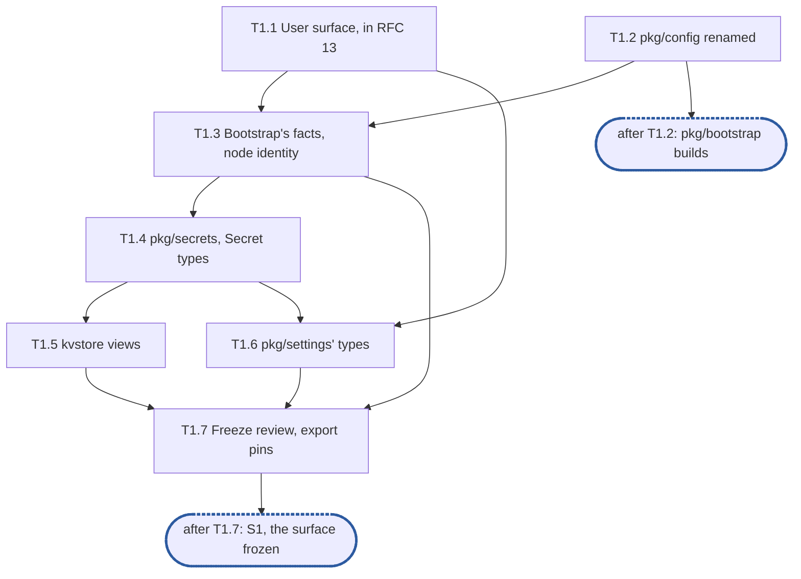

# Epic 1: configuration v2, the configuration surface

**Sources:** [RFC 13](../rfcs/rfc-13-configuration.md) §2.2 ("A host holds only its bootstrap",
but its scratch paths), §5's classes, §6's refusal as a user reads it, §7's provider and Appendix
B's value conventions, as declarations and as the user surface; [RFC
16](../rfcs/rfc-16-metadata-store.md) §2.3's `Setting`, `Secret` and `SecretOwner` and §3's settings
and secrets methods, as signatures.
**Track:** the team.
**Epic 1 estimate: 7 subtasks, 8.75 man-days.**
**Depends on:** S0, reached: RFC 23's epic 1 has stripped `pkg/config` to the bootstrap loader and
renamed its `Config` to `Bootstrap` (#4334). RFC 23's T2.4, which declares `ControlPlaneTx` for
T1.6, has landed (#4362, D2).
**Blocks:** E2, E3 and E4, which fill the bodies frozen here (S1); the RFC 18 plan's epic 2, which
adds the frozen `pkg/secrets` to identity's `Deps`; RFC 23's T3.10 and T5.4, which call the node
identity's entry points, and its T5.3 and T5.4, which seal through `pkg/secrets`.

---

## 1. Goal

Epic 1 settles how configuration looks to the people who use it, then freezes the code surface
every later epic of configuration v2 fills in. Configuration is the part of DittoFS an operator
touches first: the bootstrap file, the refusals they read and the values they type are agreed and
written into RFC 13 before any of it is built. Nothing the epic declares runs yet: every new body
is a stub, behind a signature that is final.

**At the end of the epic:**

- RFC 13 names every bootstrap key an operator writes, with its type, its default or "required"
  and its environment form, states the one shape every configuration refusal takes, and fixes how
  a duration, a size and a key are written (T1.1);
- `pkg/config` is gone and `pkg/bootstrap` builds in its place, with every importer (T1.2);
- `Bootstrap` holds RFC 13 §2.2's facts but its scratch paths, under the keys T1.1 names, and
  `pkg/bootstrap` exports the node identity's three entry points (T1.3);
- `pkg/secrets` exports the provider of RFC 13 §7, and `pkg/metadata/entity` the `Secret` record
  and its kind and owner (T1.4);
- kvstore's control-plane view has the settings delete, the cross-scope read and the secrets
  methods (T1.5);
- `pkg/settings` exports the classes, the section and its options, the table, the snapshot,
  `Read`, `Get`, `Diff`, `Keep`, `Check` with its `Put` and `Delete` writes, and their errors
  (T1.6);
- each of the three packages' exports is pinned by a test, and every symbol is matched to its
  first caller (T1.7): S1.

### 1.1 In scope

The user surface of configuration, as RFC 13 text; the rename of `pkg/config`; the declarations of
`pkg/bootstrap`, `pkg/settings`, `pkg/secrets` and the kvstore view's settings and secrets methods;
the move of `keyprovider` (D3); the export pins.

### 1.2 Out of scope

- Every body behind a stub: the loader's refusals, the node identity's reads and writes and the
  version gate (E2); sections, the snapshot, `Check` and the diff (E3); sealing, versions and
  pruning (E4).
- The kvstore view's `expect` on writes that have none today: RFC 23's T2.3.
- `dfs config`'s behaviour on the bootstrap and the configuration guide: E2, which implements what
  T1.1 settles.
- The management API's settings and secrets routes and `dfsctl`'s commands: RFC 23's epics 4 and
  6. T1.1 fixes the conventions they inherit (the key, the value, the refusal), not their routes.
- The scratch paths of RFC 13 §2.2 (`backups.spill_path`, `salvage.path`, `events.path`): they
  land with their first reader, RFC 26, RFC 1 and RFC 25.
- The initialise-if-empty option: E6, with its first caller.
- The Kubernetes operator's `internal/controller/config`, its own module, whose comments name
  `pkg/config`: RFC 23's O4 moves it.

### 1.3 Names used here

- **E1**, this epic.
- **E2**, epic 2, bootstrap, node identity and versions: the loader, the refused v1 keys and
  environment names, `dfs config` on the bootstrap, the node identity, the single-node version
  gate. Track A.
- **E3**, epic 3, settings: sections and the table, the effective value, the write check, classes
  and the diff. Track B.
- **E4**, epic 4, secrets: `Secret` records, sealing, versions, rotation and pruning. Track C.
- **E5**, epic 5, **the integration epic**: RFC 23's node and API on this library.
- **E6**, epic 6, E2E green: RFC 13 §9's single-node rows through the API.
- **S0**, RFC 23's epic 1 has stripped `pkg/config`. Reached with #4334.
- **S1**, the configuration surface frozen: this epic has merged.
- **S2**, secrets sealed: reached partway through E4, for the RFC 18 plan.
- **S3**, RFC 23's node reconciles and its write path exists, outside this epic.
- **S4**, RFC 23's `dfs init` exists, outside this epic.
- **RFC 23's T2.4**, `Write`, `ControlPlaneTx` and the audit record, in RFC 23's epic 2.
- **D1** to **D9** are this epic's decisions (§4). A decision of RFC 13's plan is always written
  with the plan named ("RFC 13's plan, D8").

## 2. How the general rules apply

The rules are those of
[RFC 13's plan, §1.5](rfc-13-config-plan.md#15-general-rules-for-each-epic), cited by number and
title and not copied.

| Rule | Subtasks | How |
| --- | --- | --- |
| rule 1, independent unit tests ([`CLAUDE.md`, "Writing tests"](../../../CLAUDE.md#writing-tests)) | T1.2 to T1.7 | each test runs on real values: the RFC's own appendices parsed from `docs/internals/rfcs/`, real `slog` and `fmt` output, the package's exported set read by `go/types`. No test double, and no internal interface for one to stand in for |
| rule 2, fuzz every decoder of untrusted bytes | none | this epic adds no decoder: the bootstrap file's, the `node-id` file's and a setting value's fuzz targets are E2's and E3's, the `Secret` codec's and the envelope's E4's |
| rule 3, observability follows RFC 25 | none | no series: the stubs serve nothing. Each of RFC 13 §8's series is its owning epic's |
| rule 4, profiling | none | no test here starts a goroutine or opens a store, so the leak check has nothing to find |
| rule 5, public interface and internals ([`CLAUDE.md`, "Verifying a change"](../../../CLAUDE.md#verifying-a-change)) | T1.3, T1.4, T1.7 | the bootstrap key test reads the keys a user writes, not the Go fields; the redaction test reads what a log line and `%v` print; the export pins read the packages as an importer sees them |
| rule 6, known failures shrink | none | no test lands red, and no suite with a `known.yaml` is touched |
| rule 7, v2 ignores v1 | T1.2, T1.3 | `pkg/config`'s loader, path search, decode hooks and decoder configuration are kept and renamed, nothing else; `keyprovider` moves unchanged but for its `mapstructure` tags (D3) |
| rule 8, real dependencies for properties of those dependencies | none | no property of a store, a key file or a journal directory is tested here; E2 and E4 test them on real ones |
| rule 9, code comment conventions ([`CLAUDE.md`, "Code comments"](../../../CLAUDE.md#code-comments)) | T1.4, T1.6 | RFC 13 §7's `decision:` note (two wrapping keys) at `secrets.Role`, the site that declares the two roles; RFC 13's plan's D9 `decision:` note at `secrets.ErrUnproven` and `settings.ErrUnproven`; RFC 13's plan's D11 note is E3's, at `Check`'s body |
| rule 10, a test must be able to fail | T1.2 to T1.7 | each test fails on a planted break: a bootstrap key missing from RFC 13's table, a role swapped in the kind table, a `Value` printed by `%v`, an extra export, a symbol with no caller listed |
| rule 11, a symbol is exported only if RFC 13's interfaces use it, or a component declares through it | T1.3 to T1.7 | the surface frozen here is R5 to R18; T1.7 pins each package's exports and lists each symbol's first caller |
| rule 12, each subtask creates only what it declares | all | each package lands with the subtask that declares its whole surface; a stub is declared only where T1.7 names its caller in a later epic or plan (D4); no test helper lands without the test that uses it |

## 3. Requirements and invariants

Every obligation RFC 13 and RFC 16 place on this epic's declarations, and the ones RFC 13's plan
sets for it, numbered so that subtasks and tests can cite them. Where the behaviour behind a
declaration is another epic's, the row says which.

**The user surface**

| # | Requirement | Kind | Source | Subtasks |
| --- | --- | --- | --- | --- |
| R1 | Every bootstrap fact an operator sets has one key name, a type, a default or "required", and one environment form, stated in RFC 13 before it is built | invariant | RFC 13 §2.2; RFC 13 plan, E1 | T1.1, T1.3 |
| R2 | A refusal of configuration names the field and the rule, and its source (the file, the variable or the record and its scope); it never prints the value, which may be a secret. E2 and E3 produce the refusals | MUST | RFC 13 §6 ("Refused, never replaced"), §7 ("Read never returns a secret") | T1.1 |
| R3 | A duration, a size and a setting's key are written one way in every section, so that a value valid in one is valid in all. E3 decodes them | invariant | RFC 13 §6 ("Unknown fields are refused"), Appendix B | T1.1 |

**The bootstrap**

| # | Requirement | Kind | Source | Subtasks |
| --- | --- | --- | --- | --- |
| R4 | `pkg/config` is gone and `pkg/bootstrap` builds in its place, with every importer, `dfs config`'s commands among them | invariant | RFC 13 plan, D8 | T1.2 |
| R5 | `Bootstrap` holds RFC 13 §2.2's facts but its scratch paths: the node's identity, the metadata store's address and credential, the journal devices and their paths, the listen addresses, the API's TLS certificate and key and its local socket path, the log destination and level, the roles and each role's wrapping-key location | MUST | RFC 13 §2.2 (its table) | T1.3 |
| R6 | A bootstrap fact is not a record field, and a record field is not overridable from the host: `Bootstrap` declares no field a setting also holds. E2 refuses the host's other names | MUST NOT | RFC 13 §2.2 | T1.3, T1.7 |
| R7 | The roles flag names `protocol` and `storage`; both is the only accepted value, which E2 enforces | MUST | RFC 13 §2.2 (roles row); RFC 15 §2.1, §2.2 | T1.3 |
| R8 | Each role names its wrapping key's location, and may name a next key beside the current one | MUST, MAY | RFC 13 §2.2 (wrapping-key row), §7 ("Two wrapping keys, one per role", "A wrapping key rotates the same way") | T1.3 |
| R9 | The node identity has three entry points: `NodeID`, which reads and compares every copy before the store opens and writes none; `InitNodeID`, for the initialisation step and a recovery import; `WriteMissingNodeIDs`, which writes a missing copy only beside a journal the store records for this node and device. E2 fills them | MUST | RFC 13 §2.2 (node identity row) | T1.3 |

**Secrets**

| # | Requirement | Kind | Source | Subtasks |
| --- | --- | --- | --- | --- |
| R10 | `pkg/secrets` exports RFC 13 §7's provider: `Resolve`, `Seal` returning the `Secret` unwritten for its caller's `Write`, `Versions`, `Prune` and `Delete`, each with the kind and owner it checks, `Seal` with its `Meta`, and `Meta` and `Version` | invariant | RFC 13 §7 ("One interface, two providers") | T1.4 |
| R11 | Two roles, `protocol` and `storage`; each secret kind is sealed under the key of the role §7's table gives it, so a kind's role is fixed data, not a caller's choice | MUST | RFC 13 §7 ("Two wrapping keys, one per role") | T1.4 |
| R12 | No log line, metric, `%v` or `dfs config show` carries a secret: an opened `Version` never prints its value, and a `Bootstrap` field that holds a credential is a type that redacts itself | MUST NOT | RFC 13 §7 ("Read never returns a secret") | T1.3, T1.4 |
| R13 | `entity.Secret`, `SecretKind` and `SecretOwner` are RFC 16 §2.3's: ID, kind, version, key ID, owner, sealed value, `KeyVersion` and `HandedOver`; an owner compared whole | MUST | RFC 16 §2.3 | T1.4 |
| R14 | Configuration holds no secret value, only a reference: a section declares each field that holds one, with the kind it must name, and a reference names a secret of that kind and that owner. E3 checks it | MUST NOT | RFC 13 §7 (first paragraph); RFC 13 plan, D10 | T1.5, T1.6 |

**The views**

| # | Requirement | Kind | Source | Subtasks |
| --- | --- | --- | --- | --- |
| R15 | kvstore's control-plane view has `DeleteSetting(ctx, scope, key, expect)`, `Secret(ctx, id, version)`, `PutSecret(ctx, s, expect)` and `PruneSecret(ctx, id, below)`, as RFC 16 §3 gives them | MUST | RFC 16 §3 | T1.5 |
| R16 | The view reads every scope's settings in one scan, for reconcile | invariant | RFC 13 plan, §1.1 and the reconcile marker of §4.3 | T1.5 |

**Settings**

| # | Requirement | Kind | Source | Subtasks |
| --- | --- | --- | --- | --- |
| R17 | Four binding classes, declared with each setting: live, restart, next write and bound | MUST | RFC 13 §5 (its table) | T1.6 |
| R18 | A section is declared from its component's typed settings, its defaults and its validator, with its scope in one of RFC 13 §3's three forms, its required keys, its write role and its secret references; `Check` takes the caller's role, a put or a delete, and whether the scope holds content, read by its caller in the write's transaction; `pkg/settings` declares no store interface | invariant | RFC 13 §3 ("How a scope is written"), §4.2, §5.1; RFC 13 plan, §1.3 and D2 | T1.6 |

**The freeze**

| # | Requirement | Kind | Source | Subtasks |
| --- | --- | --- | --- | --- |
| R19 | `pkg/bootstrap`, `pkg/settings` and `pkg/secrets` export only what RFC 13's interfaces use or a component declares through | invariant | RFC 13 plan, §1.5 rule 11 | T1.7 |
| R20 | Every symbol frozen at S1 is matched to its first caller, in a later epic of RFC 13's plan or in RFC 23's or RFC 18's | invariant | RFC 13 plan, E1 ("The freeze review") | T1.7 |

Key words in the owned sections that this epic does not carry: RFC 13 §2.2's "initialise if
empty **MUST NOT** be on by default" is E6's, with its first caller; §5's five-second bound is E5's;
§5's "**(cluster)**" rule waits for RFC 15; §7's lower-case "must" in its export and key-table
bullets describe RFC 26's and RFC 5's records.

## 4. Decisions this epic takes

- **D1, the user surface is settled in RFC 13, the developer surface here.** What an operator
  writes and reads (the bootstrap keys, the refusal's shape, the value conventions) is RFC text,
  since RFC 13 §2.2 names three bootstrap keys only and every later plan inherits the rest. T1.1
  amends RFC 13 on `develop`, reviewed before any of it is built. How a component declares a
  section (D9) is a Go signature, frozen by T1.6, and recorded here. No marker.
- **D2, `Check` takes RFC 23's `ControlPlaneTx`, which has landed.** `Check` runs inside the
  write's transaction and takes `entity.ControlPlaneTx`, which RFC 23's T2.4 declared on
  `feat/storage-v2` (#4362) without the settings delete and the secret writes. So T1.6 waits on
  nothing outside the epic, and T1.5 adds those writes' transaction forms to `ControlPlaneTx`, as
  RFC 23's epic 2 says in its D4 for whichever lands second. No marker.
- **D3, `keyprovider` moves here, not in E4.** `Bootstrap` names each role's wrapping key as a
  `keyprovider.Config`, so the type must be importable from `pkg/bootstrap` without the block
  middleware tree, which is why it moves at all. The move is unchanged but for one thing: each
  field gains a `mapstructure` tag equal to its `json` tag, since viper decodes by the
  `mapstructure` tag and would not match `retired_files` to `RetiredFiles`. The importers that move
  with it, RFC 13's plan's D5 list: `pkg/block/middleware/encryption/decorator.go`,
  `decorator_test.go`, `policy.go` and `README.md` (its relative `keyprovider/` link),
  `pkg/block/middleware/ordering_test.go`, `docs/guide/encryption.md`,
  `docs/internals/encryption-design.md`, `test/scenarios/12-smb-encryption-roundtrip-s.sh`, and
  `test/harness/run/gojson_test.go`, which holds the path as a string, so no compiler catches it.
  No marker.
- **D4, a stub fails loudly and names its epic.** A stub that returns an error returns one wrapping
  `errors.ErrUnsupported` and naming the epic that fills it, as RFC 23's epic 1 did; one that
  returns no error (`Of`, `Diff`, `Keep`) panics with the same text. A zero value would read as
  "no change" or "an empty section". Nothing calls a stub before its epic lands: T1.7's caller list
  says who calls it first. No marker.
- **D5, the memory limit is not a `Bootstrap` field.** RFC 13 §2.2 lists it as a host fact, but its
  sources are the runtime's soft limit, the container's and the host's memory, in RFC 24 §2.1's
  order, none of them a key of the file. A field would be a fourth source. No marker.
- **D6, `entity.ResourceRef` exists, and T1.4 uses it.** It is declared with `ResourceKind` in
  `pkg/metadata/entity/api.go` on `feat/storage-v2` (#4494), and `ControlPlaneTx.RunningOperation`
  already takes it. RFC 16 §2.3 uses it in `SecretOwner` and `Operation` as "the record's kind and
  ID". T1.4 declares no second one. No marker.
- **D7, `secrets.New` is part of the freeze.** The node and `dfs init` build a provider from the
  view and the two roles' keys; without a frozen constructor each would reach for the unexported
  struct. `bootstrap.Load` exists already; T1.3 only adds its environment argument. No marker.
- **D8, the secret kinds are RFC 16's list, and a kind with no role is not declared.**
  `SecretKind` declares RFC 16 §2.3's kinds whose role RFC 13 §7's table gives. The node credential
  (RFC 15 §4.4) has no role there and waits with the cluster; the directory's bind credential and
  the OpenID Connect client secret have no kind in RFC 16 (§9), and take `protocol` and `storage`
  once they do (RFC 13 §7, RFC 23 §5.5). Adding a constant later breaks no
  caller. No marker.
- **D9, the declaration API: a class is a struct tag.** A component's settings struct carries each
  field's class beside its `json` tag (`class:"restart"`), and `Of` panics on a field without one,
  so a class cannot drift from the field it describes and a renamed field takes its class with it.
  The scope, the override and the options stay arguments of `Of`:
  ```go
  func Of[T interface{ Validate() error }](prefix string, scope Scope, def T, opts ...Option) Section
  // Scope is one of RFC 13 §3's three forms: At(entity.ScopeInstallation),
  // PerThing(entity.ScopeNode, "journal"), or Override(entity.ScopeInstallation, entity.ScopeNode).
  ```
  The options are `WriteRole`, `Required` and `SecretRef(field, kind)`. `Of` panics on a `Required`
  or `SecretRef` field name that `T` does not have, and on a class missing from a field. A field
  tagged `json:"-"` (the adapters' `Addrs`) is not a setting and needs no class, and an embedded
  struct (the adapters' `Adapter`) is read as its own fields, flattened as `json` does. Against a map of classes
  beside the struct, as RFC 13's plan sketched: the map repeats every field name as a string, which
  only a panic at start ties back to the struct. T1.1's review may revise this decision through a
  pull request before T1.6 freezes it. No marker.
- **D10, a duration is a string with a unit everywhere an operator writes one, as T1.1 settles
  it (#4486).** RFC 13 Appendix B, as #4486 writes it: "a duration is a number and a unit, `ms`,
  `s`, `m` or `h`", and "a bare number is refused". Two types on `feat/storage-v2` hold a duration
  another way. `pkg/adapter/settings` declares `time.Duration` fields with plain `json` tags, which
  `encoding/json` writes as integer nanoseconds (`30000000000`): E3 gives those structs a string
  codec (`"30s"`), with a `Schema` raise by RFC 13's plan's D11. `keyprovider.Config` holds
  `TimeoutMS int` (`timeout_ms`): #4486's Appendix C renames it to `timeout`, a duration, and T1.3
  makes that change when it moves the package (D3's "unchanged" excepts it), with the refusal of
  `timeout_ms` naming `timeout`. T1.6's example test, on the adapters' section, checks the string
  form. No marker.
- **D11, today's bootstrap keys each have a decision, in #4486's Appendix C.** `Bootstrap.Node`
  and `Devices` (`mapstructure:"-"`, with a `ponytail:` marker, `pkg/config/config.go`) are
  retagged to `node.id` and `journals`, and the marker goes. `blockstore.journal.path` becomes
  `journals`, one entry per device. `logging.format` and `logging.rotation.*` stay, the rotation
  size as a size with its unit and the age as a duration. `database.*`, `controlplane.*`,
  `metrics.enabled`, `.host` and `.port`, and `shutdown_timeout` are renamed as Appendix C's table
  "From the files of today" says, and the keys that became records or settings are refused. T1.3
  builds `renamed_keys.go` from that table, so nothing is left undecided. No marker.

## 5. Target tree

```text
docs/internals/rfcs/rfc-13-configuration.md    T1.1  Appendix C, the bootstrap file; §6, the refusal's shape;
                                                     Appendix B's value conventions
pkg/bootstrap/                                  T1.2  renamed from pkg/config, with every importer
pkg/bootstrap/bootstrap.go                      T1.3  Bootstrap's fields, under Appendix C's keys
pkg/bootstrap/nodeid.go                         T1.3  NodeID, InitNodeID, WriteMissingNodeIDs (stubs)
pkg/bootstrap/keys_test.go                      T1.3  Bootstrap's keys against Appendix C
pkg/keyprovider/                                T1.3  moved from pkg/block/middleware/encryption/keyprovider (D3)
pkg/metadata/entity/secret.go                   T1.4  Secret, SecretKind, SecretOwner (ResourceRef exists, D6)
pkg/secrets/                                    T1.4  Role, Meta, Version, Provider, New, its methods and errors
pkg/secrets/redact_test.go                      T1.4  a Version never prints its value
pkg/secrets/roles_test.go                       T1.4  the kind table against RFC 13 §7
pkg/metadata/kvstore/settings.go                T1.5  DeleteSetting, AllSettings (stubs)
pkg/metadata/kvstore/secrets.go                 T1.5  Secret, PutSecret, PruneSecret (stubs)
pkg/settings/                                   T1.6  Class, Scope, Section, Of and its options, Table, Snapshot,
                                                      Read, Get, Diff, Change, Keep, Write, Put, Delete,
                                                      HoldsContent, Check, errors
pkg/{bootstrap,settings,secrets}/arch_test.go   T1.7  each package's exports pinned
```

## 6. Subtasks

### T1.1 The configuration's user surface, settled in RFC 13

**Subtask T1.1 estimate: 2 man-days.**

- **Track:** the team. **Depends on:** nothing.
- **Covers:** R1, R2, R3.
- **Deliverables:** a docs pull request on `develop` amending RFC 13, and reviewed before any code
  of E1 to E3 builds on it (D1):
  - **Appendix C, the bootstrap file.** One row per §2.2 fact but the scratch paths: its key in the
    file, its type, its default or "required", its environment form, and an example. It answers:
    the file's format and the order of its sources (the file, then the environment, then the
    defaults); how a nested key maps to a variable (`api.listen` to `DITTOFS_API_LISTEN`); how a
    list is written in the environment (the journal devices); which facts are paths, and whether a
    relative path is read against the file's directory; which facts are secrets or point at one
    (the store's credential, the wrapping keys), and how they are given without the secret in the
    file (a path to read, or a value, which T1.3 types so that it redacts itself; #4486 gives files); how a role names its current and next wrapping key.
  - **Today's keys (D11).** For each key `pkg/config` has today, and `Node` and `Devices`: kept,
    renamed (with a `renamed_keys.go` entry) or dropped, in Appendix C (#4486).
  - **§6, the refusal's shape.** One shape for every refusal of configuration, the file's, the
    environment's and a record's: what was refused (the key, the variable, or the record and its
    scope), the rule, and, for a v1 key, what replaced it; never the value. Two or more refusals in
    one file are reported together, so a user fixes the file in one pass. Examples for a v1 key, an
    unknown key, a value out of range and a bound setting refused while content exists.
  - **Appendix B's value conventions.** A key is lower case with dots and underscores, no two
    keys share an environment name, and an unknown `DITTOFS_*` variable or a mixed-case key is
    stated as refused or ignored (today an unknown file key only warns); a duration
    is a string with a unit (`"30s"`, D10), and a bare number refused; a size is a string or an integer
    of bytes, with `internal/bytesize`'s grammar; a list and a map are JSON's.
  - **`dfs config`'s three commands on the bootstrap.** What `show` prints (the effective
    bootstrap, each value's source, secrets as references only), what `validate` refuses (what a
    start refuses), and what `schema` describes (Appendix C).
  - **The developer surface.** D9's declaration of a section, shown on the adapters' section from
    `pkg/adapter/settings`, in the pull request's description; a change to D9 revises this
    document through the same review.
- **Acceptance criteria:**
  - Every key `pkg/config` has today has a decision (D11), and the duration convention names what
    `pkg/adapter/settings` and `keyprovider.Config` do (D10).
  - Every §2.2 fact but the scratch paths and the memory limit (D5) has one Appendix C row; no key
    there names a setting of Appendix B (R6).
  - The refusal's shape is stated once, in §6, and its examples carry no value.
  - The plans that edit `docs/guide/configuration.md` and the API's settings routes can cite the
    conventions rather than restate them.
- **Tests:** none in Go: the pull request is text. Appendix C is parsed by T1.3's test, and the
  value conventions by E3's decode tests, so a later drift fails there.

### T1.2 `pkg/config` renamed to `pkg/bootstrap`

**Subtask T1.2 estimate: 0.75 man-days.**

- **Track:** the team. **Depends on:** nothing (S0 is reached).
- **Covers:** R4.
- **Deliverables:** `git mv pkg/config pkg/bootstrap`, the package clause renamed, and every
  importer on `feat/storage-v2` with it: `cmd/dfs/commands/config`'s `edit.go`, `schema.go`,
  `show.go`, `validate.go` and `roundtrip_test.go`, `cmd/dfs/commands/start.go` and
  `internal/node/node.go` and `internal/node/nodetest/harness.go`. The paths held as strings, which no compiler catches, change too:
  `test/harness/plan/plan_test.go`'s two `pkg/config/config.go` and `test/suites.yaml`'s
  `pkg/config/**` glob; and `pkg/metadata/types.go`'s comment naming `pkg/config.ServerConfig`,
  which no longer exists. Nothing else changes: no field, no function, no behaviour.
- **Acceptance criteria:**
  - No Go file on `feat/storage-v2` imports `pkg/config`, and the directory is gone.
  - `test/suites.yaml`'s glob still selects the files it selected (now under `pkg/bootstrap`).
  - The build, `go vet` with every `lint-go` tag, and `dt`'s registry test pass.
- **Tests:** `plan_test.go`'s two cases, now naming `pkg/bootstrap/config.go`, still assert which
  cells a change to the loader selects (they fail if the glob in `test/suites.yaml` is left on the
  old path). The rest is checked by the build.

### T1.3 `Bootstrap`'s facts and the node identity's entry points

**Subtask T1.3 estimate: 1.75 man-days.**

- **Track:** the team. **Depends on:** T1.1 (the keys), T1.2.
- **Covers:** R1, R5, R6, R7, R8, R9.
- **Deliverables:**
  - `Bootstrap`'s fields, each tagged with Appendix C's key: the node's identity (optional), the
    metadata store's address and credential, the journal devices and their paths, the API's and
    the metrics listener's addresses, the API's TLS certificate and key and its local socket path,
    the log destination and level (kept), the roles, and each role's wrapping key as a
    `keyprovider.Config` (D3). No field for the memory limit (D5), the scratch paths or
    initialise-if-empty.
  - #4486 gives the store's credential as files (`metadata.foundationdb.tls.*`), so `Bootstrap`
    holds their paths only. If its review turns the credential into a value, a type for it whose `String`, `Format`,
    `LogValue`, `MarshalYAML` and `MarshalJSON` redact. Today `pkg/config` has no redaction hook,
    and `dfs config show` prints `yaml.Marshal(cfg)`, so without the type `show` would print the
    credential in clear from PR 3 until E2.
  - `keyprovider` moved to `pkg/keyprovider` with its `mapstructure` tags and its importers (D3).
    Its local provider still reads `DITTOFS_ENCRYPTION_PASSPHRASE` from the process, so both roles
    share one passphrase: the plan's `ponytail:` note on that travels with the moved code.
  - `Load` and `MustLoad` take the environment, `Load(path string, environ []string)`, and every
    caller passes `os.Environ()`, so epic 2's loader and its tests read no process state (epic 2's
    D2). The body ignores the argument until epic 2.
  - The node identity's entry points, with stub bodies (D4), shaped for their callers, RFC 23's
    T3.10 and T5.4:
    ```go
    // NodeID reads every journal directory's node-id copy and compares them, with b's
    // identity if it names one. Before the store opens; it writes nothing.
    func NodeID(b *Bootstrap) (entity.NodeID, error)
    // InitNodeID adopts or generates the identity and writes it into one journal
    // directory, between that journal's Init and RecordJournal, for the initialisation
    // step and a recovery import. Called once per directory.
    func InitNodeID(b *Bootstrap, installation [16]byte, dir string) (entity.NodeID, error)
    // WriteMissingNodeIDs writes a missing copy only beside a journal the store records
    // for this node and device, logging each write.
    func WriteMissingNodeIDs(b *Bootstrap, id entity.NodeID, recorded func(dir string) (bool, error)) error
    ```
- **Acceptance criteria:**
  - Every key of Appendix C is a `Bootstrap` key, and the other way round, and no two keys share
    an environment name.
  - A canary credential does not appear in `dfs config show`, in either format.
  - `dfs config schema` lists the new keys, and `dfs config show` and `validate` still pass on
    today's default file (their bodies are E2's).
  - The three entry points match their callers' calls in RFC 23's epic documents, or §9 records the
    difference.
- **Tests:** `keys_test.go` parses RFC 13's Appendix C from `docs/internals/rfcs/` and compares its
  keys with `Bootstrap`'s `mapstructure` paths, both ways (catches a field added without its RFC
  row, a row with no field, and a misspelled tag). A case decodes a file naming `retired_files`
  into the moved `keyprovider.Config` (catches the tag D3 adds being left out). The test fails if
  Appendix C yields no rows (a renamed heading), and asserts that each key has its own environment
  name (`api.tls_cert` and `api.tls.cert` both map to `DITTOFS_API_TLS_CERT`). A canary test runs the
  credential through `show` in YAML and JSON.

### T1.4 `pkg/secrets`' provider and the `Secret` record's types

**Subtask T1.4 estimate: 1.5 man-days.**

- **Track:** the team. **Depends on:** T1.3 (`keyprovider`'s new path).
- **Covers:** R10, R11, R12, R13.
- **Deliverables:**
  - In `pkg/metadata/entity`: `Secret`, `SecretKind` with D8's constants, `SecretOwner`,
    over the existing `ResourceRef` (D6). No codec: E4's.
  - In `pkg/secrets`: `Role` (`Protocol`, `Storage`) with RFC 13 §7's `decision:` note; the kind
    table giving each kind its role; `Meta`; `Version`, whose `String`, `Format` and `LogValue`
    print its number and `Meta` and never its value; `Provider`, `New` (D7), and RFC 13 §7's five
    methods with stub bodies (D4); the errors `ErrWrongRole`, `ErrWrongKind`, `ErrKindChanged` and
    `ErrUnproven` with RFC 13's plan's D9 `decision:` note.
    ```go
    func New(cp kvstore.ControlPlane, keys map[Role]keyprovider.KeyProvider) (*Provider, error)
    func (p *Provider) Seal(ctx context.Context, role Role, kind entity.SecretKind, owner entity.SecretOwner, ref entity.SecretRef, value []byte, m Meta) (entity.Secret, error)
    func (p *Provider) Resolve(ctx context.Context, role Role, kind entity.SecretKind, owner entity.SecretOwner, ref entity.SecretRef) ([]byte, error)
    func (p *Provider) Versions(ctx context.Context, role Role, kind entity.SecretKind, owner entity.SecretOwner, ref entity.SecretRef) ([]Version, error)
    func (p *Provider) Prune(ctx context.Context, kind entity.SecretKind, owner entity.SecretOwner, ref entity.SecretRef) error
    func (p *Provider) Delete(ctx context.Context, kind entity.SecretKind, owner entity.SecretOwner, ref entity.SecretRef) error
    ```
- **Acceptance criteria:**
  - The surface is RFC 13 §7's, with `Seal` returning the `Secret` unwritten.
  - Every declared kind has exactly one role, the one RFC 13 §7's table gives.
  - `pkg/secrets` and `pkg/settings` import neither each other.
- **Tests:** `redact_test.go` prints a `Version` holding a canary through `%v`, `%+v`, `%#v`,
  `fmt.Sprint` and an `slog` JSON handler, and fails if the canary appears (R12). `roles_test.go`
  compares the kind table with RFC 13 §7's table, parsed from the RFC and failing on zero rows (catches a kind sealed under
  the other role, which would let a protocol-only node open a storage secret).

### T1.5 The kvstore view's settings delete, cross-scope read and secrets

**Subtask T1.5 estimate: 0.5 man-days.**

- **Track:** the team. **Depends on:** T1.4 (`entity.Secret`).
- **Covers:** R15, R16.
- **Deliverables:** on kvstore's `ControlPlane`, with stub bodies (D4):
  `DeleteSetting(ctx, scope, key, expect)`, `AllSettings(ctx) iter.Seq2[entity.Setting, error]`
  (§9: the name waits on RFC 16), `Secret(ctx, id, version)`, `PutSecret(ctx, s, expect)` and
  `PruneSecret(ctx, id, below)`, each with its transaction form on `ControlPlaneTx` (D2), among them a tracked
  `Secret(id, version)` read, so that `Check` verifies a reference's kind and owner inside the
  write's transaction. `AllSettings` is provisional until E3's §4.3 benchmark.
- **Acceptance criteria:**
  - The four RFC 16 §3 methods have RFC 16's signatures.
  - `ControlPlaneTx` has a tracked read of a secret version, which `Check` calls.
  - E3 and E4 fill them without changing a signature, `AllSettings` aside.
- **Tests:** none of its own: the signatures are pinned by T1.7, and E3's and E4's tests run them.

### T1.6 `pkg/settings`' types

**Subtask T1.6 estimate: 1.5 man-days.**

- **Track:** the team. **Depends on:** T1.1 (the review of D9), T1.4 (`entity.SecretKind`).
- **Covers:** R14, R17, R18.
- **Deliverables:** with stub bodies (D4):
  - `Class` (`Live`, `Restart`, `NextWrite`, `Bound`) and the `class` struct tag (D9);
  - `Scope` and its three constructors, `At`, `PerThing` and `Override`;
  - `Section`, `Of` and its options `WriteRole`, `Required` and `SecretRef(field, kind)`;
  - `Table`, `Snapshot`, `Read(ctx, cp, table, node)` returning the snapshot and the sections it
    refused, `Change`, and
    `Get[T any](snap *Snapshot, section string, node entity.NodeID) (T, error)` (an error for a
    section the snapshot holds no value of, such as one held at start),
    `Diff(prev, cur *Snapshot) []Change` (a nil `prev` makes every key a change) and
    `(*Snapshot).Keep(section string, prev *Snapshot) *Snapshot` (the section's values from `prev`,
    the rest from the receiver);
  - a `Table` built from two sections that declare one key panics and names both sections, so
    keys stay unique across sections and the table's first test fails on a clash;
  - `Write`, `Put(s)`, `Delete(scope, key)`, `HoldsContent` (`func(scope entity.SettingScope) (bool, error)`, so that a write that is not
    bound never probes), and
    `Check(tx entity.ControlPlaneTx, caller entity.APIRole, w Write, holds HoldsContent) error`;
  - the errors `ErrUnknownKey`, `ErrWrongScope`, `ErrNewerSchema`, `ErrForbidden`, `ErrRequired`,
    `ErrInvalid`, `ErrBound`, `ErrSecretRef`, `ErrUnproven` (with RFC 13's plan's D9 note) and
    `ErrFormatVersion`.
- **Acceptance criteria:**
  - `pkg/settings` imports no store package and declares no store interface; `Check` reads only
    through the `ControlPlaneTx` it is given, and refuses a reference to a secret of another kind
    or another owner (R14).
  - A section can be declared for `pkg/adapter/settings`' NFS and SMB structs, in a test, with the
    adapters' scope form (installation, node override).
- **Decision note:** a secret's rotation never reaches `Check`, since a reference names the
  secret, not a version: the `decision:` note goes at `Check`'s declaration.
- **Tests:** an example test declares the adapters' section with D9's tags (it fails to compile if
  `Of`'s signature or an option changes, which is the freeze's point). The bodies are E3's, and
  E3's first `Table` test builds two sections sharing a key and asserts the panic.

### T1.7 The freeze review and the export pins

**Subtask T1.7 estimate: 0.75 man-days.**

- **Track:** the team. **Depends on:** T1.3, T1.4, T1.5, T1.6.
- **Covers:** R6, R19, R20.
- **Deliverables:**
  - One `arch_test.go` per package, `pkg/bootstrap`, `pkg/settings` and `pkg/secrets`, pinning its
    exported set as `internal/node`'s does: an extra export, an exported field added to a
    frozen struct, or a changed signature fails it.
  - The caller list, in the pull request's description: each frozen symbol with its first caller
    (an E2 to E5 subtask, RFC 23's T3.10, T5.3 or T5.4, or the RFC 18 plan's epic 2), and each
    symbol of T1.3 to T1.6's deliverables checked present. `Delete`, pinned here without a transaction, is
    listed as gaining one when E4 fills it.
- **Acceptance criteria:**
  - Every symbol T1.3 to T1.6 deliver is exported (they are RFC 13's plan's S1 list), and nothing
    else is but D7's `New`.
  - No `Bootstrap` key names a setting of RFC 13's Appendix B.
- **Tests:** each pin runs over a planted extra export in `testdata` and fails on it (catches a pin
  that compares nothing). A case parses Appendix B's setting keys and fails if one is a
  `Bootstrap` key (R6).

## 7. Order of work



T1.1 and T1.2 start at once and in parallel. Checkpoint after T1.1: the user surface is agreed,
the review the epic exists for. Checkpoint after T1.2: `pkg/config` is gone. No subtask waits
outside the epic (D2).

## 8. Suggested pull requests

| PR | Subtasks | Man-days | After | Why together |
| --- | --- | --- | --- | --- |
| 1 | T1.2 | 0.75 | none | the rename alone, mechanical and easy to review, on `feat/storage-v2` |
| 2 | T1.1 | 2 | none | the RFC 13 amendment, on `develop`, the review of the user surface; parallel with PR 1 |
| 3 | T1.3, T1.4, T1.5 | 3.75 | PR 1, PR 2 | the bootstrap's facts, the secrets surface and the views |
| 4 | T1.6, T1.7 | 2.25 | PR 3 | the settings surface and the pins that freeze all three packages: S1 |

A suggestion only: one pull request per subtask works as well.

## 9. Open points

- **The OpenID Connect client secret and the directory's bind credential have no secret kind.**
  RFC 16 §2.3's `Secret.Kind` list has neither. RFC 13 §7's table gives the bind credential the
  `protocol` role and leaves the client secret out, which RFC 23 §5.5 seals under `storage`. Until
  RFC 13 §7 and RFC 16 §2.3 are amended, D8 declares neither kind. The bind credential's kind is
  proposed in RFC 18's epic 6 breakdown (#4341, its D3). Pending #4472.
- **The cross-scope read has no RFC 16 signature.** RFC 16 §3 has `Settings(ctx, scope)` only;
  T1.5 names the one-scan read `AllSettings` until RFC 16 §3 gains it. Pending #4473.
- **Moved from E4.** `keyprovider`'s move (D3), which RFC 13's plan gives E4; E4's estimate loses
  it.
- **The estimate.** 8.75 man-days and 7 subtasks against the 6 and 4 first estimated: T1.1, the
  review of the user surface, adds 2; D3's move adds the rest.
