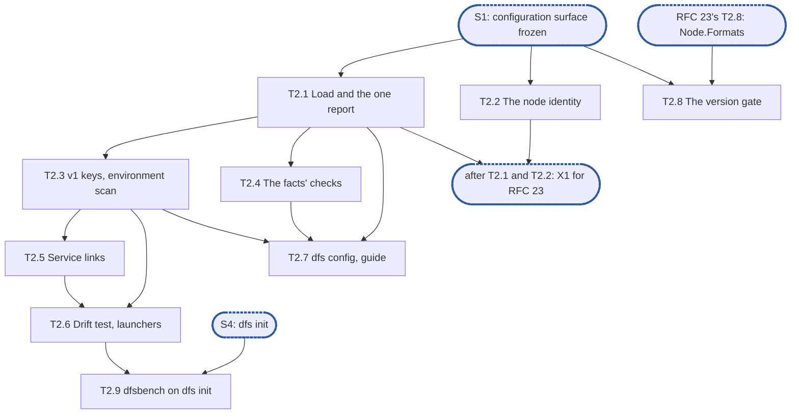

# Epic 2: configuration v2, bootstrap, node identity and versions

**Sources:** [RFC 13](../rfcs/rfc-13-configuration.md) §2.2 ("A host holds only its bootstrap",
but its scratch paths), its roles flag and node identity, §5.4's refusal to join and §5.5 on one
node, §6's refusal shape for the host's file, §8's format series, and Appendix C; [RFC
28](../rfcs/rfc-28-journal-format.md) §2.1's `node-id` file; [RFC 16](../rfcs/rfc-16-metadata-store.md)
§4.6's store format and §2.3's `Installation.Active` and `Node.Formats`.
**Track:** A.
**Epic 2 estimate: 9 subtasks, 15.75 man-days.**
**Depends on:** S1, the configuration surface frozen by E1: `pkg/bootstrap` with `Bootstrap`'s fields
under Appendix C's keys and the node identity's three entry points, and `pkg/keyprovider` moved.
RFC 23's epic 2 (T2.8, the `Node` record with `Formats`) for T2.8 here; S4, RFC 23's `dfs init`, for
T2.9.
**Blocks:** E5, which builds the node's table on a loaded bootstrap; RFC 23's epic 3 (`dfs start`
reads `Load` and `NodeID`, its T3.10 calls `WriteMissingNodeIDs`) and epic 5 (`dfs init` calls
`InitNodeID`): its X1.

---

## 1. Goal

Epic 2 makes a host's file load the way an operator reads it in RFC 13's Appendix C, refuse what is
not bootstrap in one readable report, give the node its identity, and start only where its
versions overlap the installation's.

**At the end of the epic:**

- `Load` reads the file `--config` or `DITTOFS_CONFIG` names, or the default, under the environment,
  and refuses an unknown key, a v1 key, a `DITTOFS_` name that is no bootstrap key and is not
  allowed, an unclean path, a single role, a missing or repeated wrapping key, and an API off
  loopback with no certificate, all in one report in RFC 13 §6's shape;
- the node identity is read, compared, written at initialisation and restored beside a recorded
  journal, as RFC 13 §2.2's node-identity row says;
- a start refuses an installation whose active versions lie outside its range, and registers that
  range in its node record;
- no file of the repository sets a refused name, a test keeps it so, and `dfsbench` starts its
  backend through `dfs init` and `dfs start`;
- `dfs config` and the configuration guide describe the bootstrap and nothing else.

### 1.1 In scope

The loader and its refusals; the environment scan and its allowed names; the node identity and the
`node-id` file; the single-node version gate and its two series; the drift test and the launchers;
`dfs config` on the bootstrap; the configuration guide; `dfsbench` on `dfs init`.

### 1.2 Out of scope

- The scratch paths of RFC 13 §2.2 and their start-time check: their first readers, RFC 26, RFC 1
  and RFC 25.
- Initialise-if-empty: E6, with its first caller.
- The call that raises an active version and its refusal while a node lags (RFC 13 §5.5): the
  deferral ledger, until a format has a second version; a test raises one by writing the record.
- The control plane's refusal to advance a namespace's block format version (RFC 13 §5.4): E3.
- The other launchers on `dfs init` (Compose, `docker/`, the bench and demo scripts): E6.
- The start step that calls `WriteMissingNodeIDs` and `dfs init` itself: RFC 23's T3.10 and T5.4.
- The Kubernetes operator, a module of its own that still sets v1's names: RFC 23's O4.

### 1.3 Names used here

- **E1**, epic 1, the configuration surface: the user surface in RFC 13 and the frozen
  declarations of `pkg/bootstrap`, `pkg/settings` and `pkg/secrets`.
- **E2**, this epic. Track A.
- **E3**, epic 3, settings: sections, the write check, classes. Track B.
- **E4**, epic 4, secrets. Track C.
- **E5**, epic 5, **the integration epic**: RFC 23's node and API on this library.
- **E6**, epic 6, E2E green: RFC 13 §9's single-node rows through the API, and the launchers on
  `dfs init`.
- **S1**, the configuration surface frozen: E1 has merged.
- **S4**, RFC 23's `dfs init` exists (its epic 5), outside this epic.
- **X1**, RFC 23's name for what its epics 3 and 5 take from this epic: `Load`, the node identity.
- **D7**, RFC 13's plan's decision on the bootstrap file, its environment scan and its allowed
  names; **D1** to **D6** without a plan named are this epic's own (§4).

## 2. How the general rules apply

The rules are those of
[RFC 13's plan, §1.5](rfc-13-config-plan.md#15-general-rules-for-each-epic), cited by number and
title and not copied.

| Rule | Subtasks | How |
| --- | --- | --- |
| rule 1, independent unit tests ([`CLAUDE.md`, "Writing tests"](../../../CLAUDE.md#writing-tests)) | all | files under `t.TempDir()`, the environment passed to the loader as a slice (D2), real journal directories made by the journal's own `Init`, Badger under `t.TempDir()` for the store; no double |
| rule 2, fuzz every decoder of untrusted bytes | T2.1, T2.2 | `FuzzLoad` over the file's bytes, `FuzzNodeID` over the `node-id` file's, each asserting no panic and, for a parse that succeeds, a re-encode that parses to the same value |
| rule 3, observability follows RFC 25 | T2.8 | `format_active_version` and `format_supported_range`, gauges labelled by format, set at start; no label carries a record or a secret |
| rule 4, profiling | all | every test runs under the leak check |
| rule 5, public interface and internals ([`CLAUDE.md`, "Verifying a change"](../../../CLAUDE.md#verifying-a-change)) | T2.1, T2.7, T2.8 | refusals are asserted on the text the operator reads, through `dfs config validate`'s output; the version gate through a start that refuses, not through the comparison |
| rule 6, known failures shrink | T2.6 | the launchers it edits run suites with a `known.yaml` (`pjdfstest`); none of their entries changes |
| rule 7, v2 ignores v1 | T2.1, T2.3 | the loader, its path search and its decode hooks are kept; `checkRenamedKeys` and its table are kept and extended; nothing reads a v1 key's value |
| rule 8, real dependencies for properties of those dependencies | T2.2, T2.8 | the `node-id` copies are real files in real journal directories; the store format is read from a real Badger store |
| rule 9, code comment conventions ([`CLAUDE.md`, "Code comments"](../../../CLAUDE.md#code-comments)) | T2.3, T2.5, T2.8 | a `decision:` note at the allowed names (why each launcher name passes), at the service-link exemption (a value's shape, not its name), and the `ponytail:` marker of the version gate (one comparison per format, no raise call) |
| rule 10, a test must be able to fail | all | each refusal has a test that feeds the refused input and asserts its line; each allowed name a test that it passes; the drift test runs over a planted file |
| rule 11, a symbol is exported only if RFC 13's interfaces use it | all | nothing beyond E1's frozen surface is exported, but `node.Format`'s values, which E1 does not cover, are declared with `Installation.Active` (T2.8) |
| rule 12, each subtask creates only what it declares | all | the `node-id` codec lands with `NodeID`, the series with the gate, the allowed list with the scan |

## 3. Requirements and invariants

Every obligation RFC 13, RFC 28 and RFC 16 place on this epic, and those RFC 13's plan sets for
it.

**Loading the file**

| # | Requirement | Kind | Source | Subtasks |
| --- | --- | --- | --- | --- |
| R1 | The file is `--config`'s, else `DITTOFS_CONFIG`'s, else `~/.config/dittofs/config.yaml`; the environment wins over the file, the file over the defaults | MUST | RFC 13 §2.2 ("One file, one name per fact"); RFC 13 plan, D7 | T2.1 |
| R2 | A key the file sets that Appendix C does not name refuses the start | MUST | RFC 13 §6 ("Unknown fields are refused"), §2.2 | T2.1 |
| R3 | A refusal reads `<where>: <key>: <rule>[; <what to do>]`; every refusal of one load is reported together | MUST | RFC 13 §6 ("A refusal says where, what and why") | T2.1 |
| R4 | A refusal never prints an environment variable's value or a credential's | MUST NOT | RFC 13 §6, §7 ("Read never returns a secret") | T2.1, T2.3 |
| R5 | A path is absolute and clean; a relative path, a `~` or a trailing slash is refused, never rewritten, since a journal's path is its identity in the store | MUST | RFC 13 Appendix C; RFC 16 §3 (`JournalDir`, "as written there") | T2.1 |
| R6 | A key in the file that is a setting is refused, naming the management API as the way to set it | MUST | RFC 13 §2.2 ("a record field MUST NOT be overridable from the host"), §6's example | T2.1 |

**The environment and the v1 names**

| # | Requirement | Kind | Source | Subtasks |
| --- | --- | --- | --- | --- |
| R7 | A v1 key, and its `DITTOFS_` form, refuses the start, naming its replacement | MUST | RFC 13 plan, transition policy and §1.1's list | T2.3 |
| R8 | A `DITTOFS_` name that is neither a bootstrap key nor allowed refuses the start; RFC 13 §9's "§2.2 no host override" row | MUST NOT | RFC 13 §2.2; RFC 13 plan, D7 | T2.3 |
| R9 | The allowed names pass: `DITTOFS_CONFIG`, `DITTOFS_ENCRYPTION_PASSPHRASE`, `DITTOFS_PASSWORD`, the launchers' prefixes and names and the git hooks' ten `DITTOFS_SKIP_*` names, by name not prefix; a bootstrap key wins over an allowed prefix | invariant | RFC 13 plan, D7 | T2.3 |
| R10 | A Kubernetes service link passes only while its value has a link's shape; a v1 or unknown name of a link's form with another value refuses | invariant | RFC 13 plan, D7 | T2.5 |
| R11 | Every file of the repository outside `_test.go` that names a `DITTOFS_` variable names a bootstrap key or an allowed one, and every launcher drops the names the scan refuses | invariant | RFC 13 plan, D7 | T2.6 |

**The facts' own checks**

| # | Requirement | Kind | Source | Subtasks |
| --- | --- | --- | --- | --- |
| R12 | The roles are `protocol` and `storage`, both; one alone refuses the start | MUST | RFC 13 §2.2 (roles row); RFC 15 §2.2 | T2.4 |
| R13 | Both roles' wrapping keys are named, and their key IDs differ; a copied key file or a link to one is the same key and refuses | MUST | RFC 13 §2.2 (wrapping-key row), §7 ("Two wrapping keys") | T2.4 |
| R14 | An `api.listen` address off loopback needs `api.tls.cert_file` and `api.tls.key_file` | MUST | RFC 23 §5.3; RFC 13 Appendix C | T2.4 |

**The node identity**

| # | Requirement | Kind | Source | Subtasks |
| --- | --- | --- | --- | --- |
| R15 | `node-id` is 24 bytes: magic `DNI1`, the 16-byte identity, CRC32C over the first 20; any other length, magic or checksum does not parse | MUST | RFC 28 §2.1 | T2.2 |
| R16 | A copy is written to `node-id.tmp`, synced, renamed, and the directory synced; a `node-id.tmp` is ignored and overwritten by the next write | MUST | RFC 28 §2.1; RFC 13 §2.2 | T2.2 |
| R17 | A start reads every copy and compares them as parsed identities; a copy that does not parse refuses, naming its directory, and is never taken as missing or written over | MUST | RFC 13 §2.2 (node-identity row) | T2.2 |
| R18 | A start refuses, naming the directories, if two copies differ, if no copy exists and the file names no identity, or if a copy differs from the file's identity | MUST | RFC 13 §2.2 (node-identity row) | T2.2 |
| R19 | Nothing rewrites a copy | invariant | RFC 13 §2.2 (node-identity row) | T2.2 |
| R20 | A missing copy is written, logged, only into a directory whose `format` names the journal the store records at `JD‖node‖device` for this node and device; a directory whose journal is not recorded gets none | MUST | RFC 13 §2.2 (node-identity row) | T2.2 |
| R21 | Initialisation generates the identity once and writes it into each directory after its `Init`; a rerun adopts a copy only from a directory whose `format` carries the installation's ID, refuses one that does not parse or two that differ, and takes nothing from another installation's directory | MUST | RFC 13 §2.2 (node-identity row) | T2.2 |

**Versions**

| # | Requirement | Kind | Source | Subtasks |
| --- | --- | --- | --- | --- |
| R22 | Each start registers, in its node record, the range it reads and writes for every shared format | MUST | RFC 13 §5.5; RFC 16 §2.3 (`Node.Formats`) | T2.8 |
| R23 | A start refuses when an active version, the store format's in `\x00format` or another's in `Installation.Active`, lies outside its range, naming the format and both versions | MUST | RFC 13 §5.5; RFC 16 §4.6 | T2.8 |
| R24 | A start refuses while a namespace it would serve writes a block format version it cannot read | MUST | RFC 13 §5.4 | T2.8 |
| R25 | A start never raises a version; a newer binary keeps writing the active ones, so the old binary still starts | MUST NOT | RFC 13 §5.5; RFC 16 §4.6 ("A store is never upgraded by being opened") | T2.8 |
| R26 | `format_active_version` and `format_supported_range`, labelled by format | MUST | RFC 13 §8 | T2.8 |

**Tools and guides**

| # | Requirement | Kind | Source | Subtasks |
| --- | --- | --- | --- | --- |
| R27 | `dfs config show` prints the effective bootstrap with each value's source and a credential by its path; `validate` refuses what a start refuses and starts nothing; `schema` prints Appendix C as a JSON Schema | MUST | RFC 13 Appendix C ("The file's commands") | T2.7 |
| R28 | `docs/guide/configuration.md` describes the bootstrap, and `docs/guide/cli.md` is regenerated | invariant | RFC 13 plan, O8 | T2.7 |
| R29 | `dfsbench`'s backend initialises through `dfs init`, with its first password, and starts with `dfs start` | invariant | RFC 13 plan, D7 | T2.9 |

Key words in the owned sections this epic does not carry: §2.2's "initialise if empty **MUST
NOT** be on by default" is E6's; §5.4's refusal to advance a namespace's version is E3's; §5.5's
refusal of the raise while a node lags waits with the raise call; RFC 28 §2.1's two other key words
bind the journal, which leaves `node-id` alone; RFC 16 §4.6's fold-rule key words bind the store.

## 4. Decisions this epic takes

- **D1, one report, not the first error.** `Load` collects every refusal of the file, the
  environment and the facts' checks, then returns them as one error whose lines are RFC 13 §6's
  shape, sorted by where and key. A user fixes a file in one pass. An unknown key's "did you mean"
  names the declared key at the smallest edit distance, at most two edits, else nothing. No marker.
- **D2, the environment is an argument.** `Load(path string, environ []string)` takes the
  environment as `os.Environ()`'s slice, so a test passes its own and nothing reads the process's
  environment but `dfs`'s commands. Viper's `AutomaticEnv` is not used: the scan binds each
  bootstrap key's name itself, so one list says what is read. E1's T1.3 freezes the signature with
  the argument, and its callers pass `os.Environ()`. No marker.
- **D3, keys are matched exactly.** The file's keys are compared as declared, in lower case, as a
  setting's are (RFC 13 Appendix B); viper lowers every key, so the check reads the file's own key
  spelling from the YAML before the decode. Pending the review of #4486's first open question; if
  it keeps viper's matching, the check is dropped and T2.1 is 0.5 man-days smaller. No marker.
- **D4, the node identity reads journals through the journal's own format reader.** Whether a
  directory's `format` carries the installation's ID, or names the journal the store records, is
  read with the journal package's exported format read, never by parsing the file again here. No
  marker.
- **D5, a test raises a version by writing the record.** No call raises an active version (the
  deferral ledger), so the gate's test writes `Installation.Active` and `\x00format` through
  kvstore and starts again. The gate carries RFC 13's plan's `ponytail:` marker (one comparison
  per format, single node).
- **D6, `Installation.Active` and `node.Format` land here.** RFC 23's epic 2 adds `Node.Formats`
  (its T2.8) but not `Installation.Active`; the gate is their first reader, so T2.8 declares
  `Format` (store, journal, block, settings schema) and `Active`, with their codec. No marker.

## 5. Target tree

```text
pkg/bootstrap/load.go                  T2.1  Load, the report, unknown and setting keys, paths
pkg/bootstrap/load_fuzz_test.go        T2.1  FuzzLoad
pkg/bootstrap/nodeid.go                T2.2  the node-id codec, NodeID, InitNodeID, WriteMissingNodeIDs
pkg/bootstrap/nodeid_fuzz_test.go      T2.2  FuzzNodeID
pkg/bootstrap/renamed_keys.go          T2.3  the v1 table, extended
pkg/bootstrap/environ.go               T2.3  the environment scan and its allowed names
pkg/bootstrap/validate.go              T2.4  roles, wrapping keys, TLS off loopback
pkg/bootstrap/servicelinks.go          T2.5  Kubernetes' service links by name and value shape
pkg/bootstrap/drift_test.go            T2.6  every DITTOFS_ name in the repository
cmd/dfs/commands/config/               T2.7  show, validate, schema on the bootstrap
docs/guide/configuration.md            T2.7  rewritten for the bootstrap
pkg/metadata/entity/                   T2.8  Format, Installation.Active
pkg/settings/versions.go               T2.8  the version gate, its two series
bench/                                 T2.9  dfsbench's backend on dfs init and dfs start
```

## 6. Subtasks

### T2.1 `Load` and the one report

**Subtask T2.1 estimate: 2.5 man-days.**

- **Track:** A. **Depends on:** S1.
- **Covers:** R1, R2, R3, R4, R5, R6.
- **Deliverables:** `Load(path, environ)` (D2) on the renamed loader: `--config`, else
  `DITTOFS_CONFIG`, else the default path; the environment over the file over the defaults; the
  decode with `mapstructure.Metadata`, its `Unused` keys refused as unknown, with D1's "did you
  mean", or as a setting when Appendix B names them, naming the management API; exact key matching
  (D3); every path checked absolute and clean; the report of D1. `MustLoad`'s fallback to defaults
  with a warning goes: a missing named file refuses, a missing default file loads the defaults
  silently, since a start then refuses for its required keys anyway. `FuzzLoad`.
- **Acceptance criteria:**
  - A file with two unknown keys, one setting key and a relative journal path yields one error with
    four lines, each in §6's shape.
  - An environment value never appears in an error, whatever the name.
- **Tests:** table tests over files under `t.TempDir()`, one row per refusal, asserting the exact
  line (catches a refusal that drops its rule or its hint); a key in another case refused (D3);
  `/data/j1/` refused and `/data/j1` accepted (catches a loader that cleans silently); the
  precedence of `--config` over `DITTOFS_CONFIG` over the default, and of a variable over the
  file; `FuzzLoad` seeded with each row.

### T2.2 The node identity

**Subtask T2.2 estimate: 2.5 man-days.**

- **Track:** A. **Depends on:** S1. Uses kvstore's `Lifecycle.JournalID` and the journal's format
  read (D4), both on `feat/storage-v2`.
- **Covers:** R15, R16, R17, R18, R19, R20, R21.
- **Deliverables:** the `node-id` codec; `NodeID`, which reads and compares every copy before the
  store opens and writes nothing; `InitNodeID`, for `dfs init` and a recovery import, adopting a
  copy only from a directory of this installation; `WriteMissingNodeIDs`, writing through
  `node-id.tmp`, sync, rename and directory sync, only beside a journal the store records for this
  node and device, logging each write. `FuzzNodeID`.
- **Acceptance criteria:**
  - Every refusal names the directories it read.
  - No path through the three writes over an existing `node-id`.
- **Tests:** on real journal directories under `t.TempDir()`, made by the journal's `Init`: two
  copies that differ refuse, naming both; no copy and no key refuses; a torn copy (20 bytes) and a
  flipped bit each refuse, naming the directory, and are left as they were; the golden vector
  (RFC 28 §2.1's layout, written by hand) parses; a copy differing from the file's `node.id`
  refuses; a `node-id.tmp` beside a good copy is ignored; a replaced device's empty directory gets
  no copy from `WriteMissingNodeIDs`; a rerun of `InitNodeID` adopts the copy of a directory of
  this installation and takes none from another's; `FuzzNodeID` seeded with those.

### T2.3 The refused v1 keys and the environment scan

**Subtask T2.3 estimate: 2 man-days.**

- **Track:** A. **Depends on:** T2.1.
- **Covers:** R4, R7, R8, R9.
- **Deliverables:** `checkRenamedKeys`' table extended with the v1 keys and their replacements
  (`database.*`, `controlplane.*`, `admin.*`, `kerberos.*`, `ldap.*`, `identity.machine_sid`,
  `gc.*`, `snapshot.*`, `integrity.*`, `metadata.*`, `blockstore.*` but the journal path,
  `metrics.*` but its listen address, `shutdown_timeout`); the scan of `environ` refusing each
  v1 name, naming its replacement, and every other `DITTOFS_` name that is no bootstrap key and is
  not allowed; the allowed names and prefixes, with a `decision:` note naming why each passes.
- **Acceptance criteria:**
  - Each allowed name and prefix passes; `DITTOFS_SKIP_TLS_VERIFY` refuses (a hook's names are
    allowed by name, not prefix).
  - A bootstrap key under an allowed prefix is read as the key.
- **Tests:** one row per allowed name and prefix; `DITTOFS_CONTROLPLANE_SECRET=s3cr3t` refuses,
  naming its replacement, and the output does not contain `s3cr3t` (catches a refusal that prints
  the value, R4); RFC 13 §9's "§2.2 no host override" row: `DITTOFS_ADAPTERS_SMB_PORT` set, the
  start refused and nothing applied.

### T2.4 The facts' own checks

**Subtask T2.4 estimate: 1.25 man-days.**

- **Track:** A. **Depends on:** T2.1.
- **Covers:** R12, R13, R14.
- **Deliverables:** `Bootstrap.Validate`: both roles; both wrapping keys named, loaded through
  `keyprovider` and their current key IDs compared; certificate and key when an `api.listen`
  address is not loopback.
- **Acceptance criteria:** each refusal is a line of T2.1's report, not a separate error.
- **Tests:** `roles: [storage]` refuses; one role's key missing refuses; two roles naming one key
  file, then a copy of it, then a symbolic link to it, each refuses (catches a check by path rather
  than by key ID); `api.listen: 0.0.0.0:8080` with no certificate refuses and `127.0.0.1:8080`
  passes. Key files are real `keyprovider` local files under `t.TempDir()`.

### T2.5 Kubernetes' service links

**Subtask T2.5 estimate: 1.5 man-days.**

- **Track:** A. **Depends on:** T2.3.
- **Covers:** R10.
- **Deliverables:** the scan ignores a name of a service link's forms while its value has the shape
  of any form the name parses as (RFC 13's plan, D7), with a `decision:` note; a bootstrap key still
  wins.
- **Acceptance criteria:** a misspelled `DITTOFS_…_PORT` holding no link's value is never let
  through by its name.
- **Tests:** the full set a pod gets for a CR named `dittofs` (its `-api`, `-metrics` and
  `-adapter-nfs` Services, none for `-headless`) and the operator's
  `DITTOFS_OPERATOR_CONTROLLER_MANAGER_METRICS_SERVICE_PORT`, once with IPv4 values and once with
  IPv6 ones (`tcp://[fd00::a]:9090`): all pass; `DITTOFS_METRICS_PORT=9091` and
  `DITTOFS_CONTROLPLANE_PORT=8080` refuse, naming their replacements; `DITTOFS_NFS_PORT=2049`
  refuses as unknown.

### T2.6 The drift test and the launchers

**Subtask T2.6 estimate: 2 man-days.**

- **Track:** A. **Depends on:** T2.3, T2.5.
- **Covers:** R11.
- **Deliverables:** a test scanning the repository by content, every file outside `_test.go` that
  holds a `DITTOFS_` name (Go, shell with or without `.sh`, Compose, `docker/`, Markdown but
  `docs/internals/` and `CHANGELOG.md`), failing on a name the scan refuses, with RFC 13's plan's
  D7 exemptions; every launcher and guide it finds corrected, `DITTOFS_ADMIN_INITIAL_PASSWORD`,
  `DITTOFS_CONTROLPLANE_SECRET`, v1's `DITTOFS_GC_*` and the others it lists dropped.
- **Acceptance criteria:** the test passes on the repository, and the launchers it edits still
  start what they started, or start nothing until E6 moves them to `dfs init` (RFC 23's plan, D6).
- **Tests:** the scan over a planted `testdata` tree holding one refused name in a shell file
  without an extension fails, naming the file and the line (catches a scan by extension).

### T2.7 `dfs config` and the configuration guide

**Subtask T2.7 estimate: 1.5 man-days.**

- **Track:** A. **Depends on:** T2.1, T2.3, T2.4.
- **Covers:** R27, R28.
- **Deliverables:** `show` with each value's source and a credential by its path; `validate`
  running `Load` and starting nothing; `schema` generated from `Bootstrap`'s fields; `edit`
  validating before it saves. `docs/guide/configuration.md` rewritten for the bootstrap, Appendix
  C's keys and the refusal shape, with a section for each later plan to add; `docs/guide/cli.md`
  regenerated.
- **Acceptance criteria:** `validate`'s output on a bad file is exactly the start's refusal.
- **Tests:** `validate` on T2.1's four-refusal file prints its four lines and exits non-zero;
  `show` on a file setting `store.credential_file` prints the path and never the file's content;
  `schema`'s property set equals Appendix C's keys (catches a field added without its schema).

### T2.8 The version gate

**Subtask T2.8 estimate: 1.75 man-days.**

- **Track:** A. **Depends on:** S1; RFC 23's T2.8 (`Node.Formats`).
- **Covers:** R22, R23, R24, R25, R26.
- **Deliverables:** `Format` and `Installation.Active` with their codec (D6); at start, the node's
  ranges written to its `Node` record, then every active version and each namespace's block
  format version compared with them, refusing with the format and both versions; the two series;
  the `ponytail:` marker (D5).
- **Acceptance criteria:** a refusal names the format, the active version and the binary's range;
  a start that passes writes nothing but its node record.
- **Tests:** on Badger under `t.TempDir()`: RFC 13 §9's "§5.5 version gate" single-node part, the
  active journal format raised past the binary's range through kvstore and the start refused,
  naming it; the store format in `\x00format` raised the same way; a namespace's block format
  version past the range refused (R24); a start under an older active version keeps it and the
  record is unchanged after (catches a start that upgrades, R25); the two series read from the
  registry.

### T2.9 `dfsbench` on `dfs init`

**Subtask T2.9 estimate: 0.75 man-days.**

- **Track:** A. **Depends on:** S4, T2.6.
- **Covers:** R29.
- **Deliverables:** `dfsbench`'s backend runs `dfs init` with its first password given by file,
  then `dfs start`, in place of the refused variables.
- **Acceptance criteria:** a `dfsbench` smoke run completes against the new backend.
- **Tests:** the `bench-smoke` cell runs it.

## 7. Order of work



T2.1 and T2.2 come first and in parallel: they are RFC 23's X1, on its critical path. Checkpoint
after T2.6: no file of the repository sets a refused name. T2.8 waits on RFC 23's node record and
T2.9 on its `dfs init`.

## 8. Suggested pull requests

| PR | Subtasks | Man-days | After | Why together |
| --- | --- | --- | --- | --- |
| 1 | T2.1, T2.2 | 5 | S1 | `Load` and the node identity, RFC 23's X1 |
| 2 | T2.3, T2.4, T2.5, T2.6 | 6.75 | PR 1 | every refusal of the host's names, and the repository brought in line with them |
| 3 | T2.7, T2.8 | 3.25 | PR 2, RFC 23's T2.8 | the commands and guide on the finished loader, and the version gate |
| 4 | T2.9 | 0.75 | PR 3, S4 | `dfsbench` on `dfs init`, once it exists |

A suggestion only: one pull request per subtask works as well.

## 9. Open points

- **Exact key matching (D3)** follows #4486's first open question; the estimate drops by 0.5
  man-days if the file keeps viper's matching.
- **`Installation.Active` has no owner in RFC 23's epic 2**, which adds `Node.Formats` only; T2.8
  declares it (D6).
- **FoundationDB's credential** (#4486's second open question) decides whether
  `store.credential_file` is one file or a certificate and key; T2.1's path check covers either.
- **The estimate.** 15.75 man-days and 9 subtasks against the 14.5 and 8 first estimated: T2.1
  carries the one report and the "did you mean" the user surface added.
