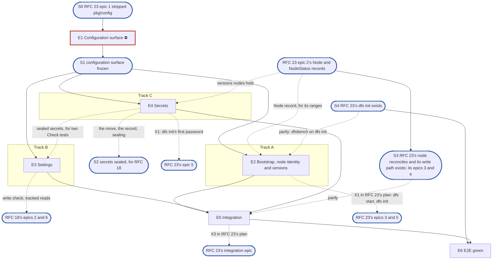

# RFC 13 — configuration v2: implementation plan

**Scope.** [RFC 13, configuration](../rfcs/rfc-13-configuration.md), its lifecycle on one node:
- the host's bootstrap, its loading and the node's identity;
- settings records, their scopes and the effective value across an override;
- validation, done twice by one rule set, and the bound-setting refusal;
- the binding classes, as a library the node's reconcile calls;
- the single-node version gate;
- sealed secrets, their versions and their rotation;
- RFC 13 §8's series.

What each setting means, its default and its validator stay with the component that reads it
(RFC 13 §1.1). This plan builds the machinery every component declares into, and is its one owner:
RFC 23's and RFC 18's plans consume it. Related RFCs, with how far each is in scope:

- **Only the parts RFC 13 cannot work without:**
  - [RFC 16](../rfcs/rfc-16-metadata-store.md): the `Setting` and `Secret` records, the settings
    generation, the installation's active versions and a node's ranges (§2.3, §3,
    §4.6).
- **Constraints only:**
  - [RFC 23](../rfcs/rfc-23-control-plane.md) and its plan (#4050): the node, its reconcile, its
    node-status records, the API's settings routes and `dfs init` are that plan's, and call this
    one;
  - [RFC 18](../rfcs/rfc-18-identity.md) and its plan: identity reads sealed NT hashes, keytabs and
    the machine password, and declares the `identity.*` section;
  - [RFC 20](../rfcs/rfc-20-adapters.md): `pkg/adapter/settings` is the template every section
    follows;
  - [RFC 25](../rfcs/rfc-25-observability.md): RFC 13 §8's series.
- **Out:**
  - the provisioning file (RFC 13 §2.4) and the backup location's record (RFC 13 §2.5, with
    RFC 26);
  - the scratch paths of RFC 13 §2.2, whose readers are not built yet;
  - the namespace key table (RFC 13 §7's material bullets, RFC 5's);
  - a change of a store's endpoint or credential, refused until it can be proven (D9);
  - the call that raises an active version (RFC 13 §5.5), while each format has one version;
  - the cluster rules (RFC 13 §5's two-step restart value, §5.4 and §5.5 across nodes).

**Tracks.** A, B and C, with no owner.

**Programme.** #3119, route B, on `feat/storage-v2`, and the v1.0 MVP issue #4053; roadmap epic
#3984. It owns the bootstrap, settings and secrets pieces RFC 23's plan had first placed in its
epics 1 to 4; that plan now consumes them (its D6, D10 and O11), and RFC 18's plan waits on its
secrets.

**Divergence from the planning skill.** There is no test-foundations epic, by the user's standing
decision for these plans. The leak check (`internal/prof`) and the KV fault wrapper (`pkg/metadata/kv/kvtest`) exist. The §1.5 instruction, copied
verbatim, says epic issues exist before "E2's pull request": that is the skill's red-suite epic,
which this plan does not have, so the clause binds no epic here.

**Naming.** v1 is today's configuration:
- `pkg/config`'s full server file and its environment overrides;
- the v1 control plane's settings tables, which RFC 23's plan deletes;
- `pkg/block/middleware/encryption/keyprovider` where it sits.

v2 is RFC 13's lifecycle. No user-visible name carries a version.

**Transition policy.** Fresh installs only (#3119, route B). A v1 key in the host file is refused at
start and names the record that replaced it.

**Defaults used from the skill's inputs:**
- output path: `docs/internals/planning/rfc-13-config-plan.md`;
- dashboards: none.

**RFC amendments in this pull request.** The user agreed to A1:
- **A1. Every write of `identity.directory`'s address, trust roots, domain controller address or DNS
  server, its first value included, is by `admin` only** (RFC 13 Appendix B's `identity.directory`
  row). An `operator`
  may otherwise keep the existing, correctly owned bind-credential reference, point the address at
  their own host and the trust roots at their own CA, and receive the credential; TLS does not help
  when they supplied the roots. The row's text is the RFC 18 plan's pull request's, word for
  word, which carries this clause too, so the two merge cleanly in either order.
- **A2. RFC 13 §7 names the provider's full surface**: beside the interface #4050 amends, `Seal`'s
  `Meta`, `Versions` and `Prune`, so the surface the RFC 18 plan's O9 freezes lives in the RFC
  rather than only here.

The amendments this plan relies on land with the plans that need them:
- the adapter `port` row and the `node-id` files, in #4050;
- a settings delete with `expect`, on `ControlPlane` and `ControlPlaneTx`, and the `Secret` view
  with its kind and owner (D10), in RFC 16 §3, in #4050, which edits that block;
- `identity.netbios_name` and its refusal of the directory's NetBIOS domain, the directory record's
  fields (its domain controller address and DNS server among them), the two secret references on
  a user, and `Secret`'s `KeyVersion` and `HandedOver` (RFC 16 §2.3), in the RFC 18 plan's pull
  request (#4058), which merges after this one (O7): until it does, this plan names them ahead of
  the RFC, and A1's row is carried by both.

## 1. Introduction

### 1.1 What we are building

RFC 13's "Start here" describes the result:
- a host file holds only the bootstrap;
- every setting is a record in the metadata store;
- a change is validated where it is written and again where it is used, and takes effect as its
  class says;
- no secret value is ever a setting.

What replaces what:

| v1 | v2 | Fate |
| --- | --- | --- |
| `pkg/config` (full server file, environment overrides, warnings on unknown keys) | `pkg/bootstrap`, the bootstrap only, unknown keys refused (D8) | stripped by RFC 23's plan's epic 1; renamed in epic 1, finished in epic 2 |
| `pkg/config/renamed_keys.go` (renamed keys refused; other unknown keys only warned) | the refused v1 keys, each naming its replacement: `database.*`, `controlplane.*` (its `port` and `tls` naming the bootstrap's API listen address and TLS, RFC 13 §2.2), `admin.*`, `kerberos.*`, `ldap.*`, `identity.machine_sid`, `gc.*`, `snapshot.*`, `integrity.*`, `metadata.*`, `blockstore.*` but the journal path, `metrics.*` (the bootstrap's metrics listen address), `shutdown_timeout` (`adapters.<protocol>.drain_timeout`), and their `DITTOFS_*` forms | reworked in epic 2 |
| `pkg/metadata/kvstore/settings.go` (`Settings`, `PutSetting`, `CFGGEN`, `Setting.Schema`) | the same, with a delete, a read across every scope in one scan, and a newer schema refused; `expect` is RFC 23's plan's (its epics 1 and 2) | extended in epic 3 |
| `KindSEC` reserved, no code | `Secret` records with versions and sealing | built in epic 4 |
| `pkg/block/middleware/encryption/keyprovider` | `pkg/keyprovider`, unchanged | moved in epic 4 (D5) |

**Dependency limits.** Sealing uses `keyprovider` (AES-256-GCM, key IDs, retired keys, a local key
file or KMIP) unchanged. A component's settings struct and validator live in that component's own
leaf settings package.

### 1.2 How the plan is organised

- Epic 1 declares the surface and renames `pkg/config` to `pkg/bootstrap`.
- Three middle epics on three tracks:
  - Track A: the bootstrap, the node identity and the version gate;
  - Track B: settings, validation and classes;
  - Track C: secrets.
- The integration epic wires the library into RFC 23's node and API, once they exist (S3).
- The E2E green epic runs RFC 13 §9's single-node rows end to end, once `dfs init` exists (S4).

RFC 13's suites paragraph puts its single-node rows in `unit`, and the rows needing a backup
location's lock in `integration`, which are out. No suite keeps a `known.yaml`, so each test lands
green with the epic that makes it pass.

### 1.3 What epic 1 must deliver

- **`pkg/bootstrap`**, renamed from what RFC 23's plan's epic 1 leaves of `pkg/config`, with RFC 13
  §2.2's facts (but its scratch paths) as `Bootstrap`'s fields, and its loader's signature.
- **`pkg/bootstrap`'s node identity:** `NodeID`, `InitNodeID` and `WriteMissingNodeIDs`.
- **`pkg/settings`' types:**
  - the binding classes;
  - a section, declared from a component's typed settings with its scope, its override, a class
    per key, and its options (write role, required keys, the thing a "per *thing*" scope is per,
    and the secret references it holds with their kind);
  - the table, the snapshot, `Read`, `Get`, `Diff` and `Keep`;
  - the write-path check, its `Put` and `Delete` writes, and its errors. Whether the scope holds
    content is an input to the check, which its caller reads in the write's transaction, so
    `pkg/settings` declares no store interface.
- **`pkg/secrets`' provider:** RFC 13 §7's `SecretProvider`, as A2 completes it: `Seal` with its kind, role, owner and
  `Meta` (a machine password's `KeyVersion` and `HandedOver`), `Resolve` with the kind, role and
  owner its caller expects, `Versions`, which opens every version still held as a `Version` with its
  number and `Meta`, `Prune` and `Delete`, and the package's own errors. These are what the RFC 18
  plan's O9 asks for.
- **The kvstore views' signatures:** the settings delete, the cross-scope read, and secrets.

It declares no internal interface. `keyprovider.KeyProvider` already exists.

### 1.4 The test catalogue and its components

There is no test-foundations epic (see the header).

**The catalogue.** RFC 13 §9's rows, each landing in the epic named under its **Done when:** line.
Out of scope, each named in O1:
- the provisioning file's and the backup location's rows;
- the cluster rows;
- "§2.2 scratch paths";
- "§5.2 same content" and "§5.2 backup location credential";
- "§7 rotation"'s wrapping-key half, which needs the reseal pass (§4.3);
- the namespace key rows: "§7 namespace keys", "§7 chunk-ID key", "§7 key table" and "§5.1 encryption bound";
- the engine's and the remote tier's own validator rows: "§5.3 recorded" and "§6 block target range";
- "§5 adapter port", which needs a serving adapter and the rebuild RFC 20's plan's epic 7 builds;
- "§2.2 explicit initialisation"'s recovery-import clause, which needs RFC 26.

**Scenarios from other sources:**
- a v1 key in the host file refuses the start and names its replacement (#3119, route B), in epic 2;
- a key in the node's table missing from Appendix B fails a unit test (D3), in epic 5;
- a live setting written through the API reaches the component that reads it, and a restart-class
  one lands in the restart-pending set (RFC 23 §2.4), in epic 5.

**The known-failure mechanism.** None.

**The test components:**
- the leak check;
- `kvtest`'s fault wrapper, for a commit that fails after a secret is sealed;
- `keyprovider`'s local provider, which is real, over two key files, one per role.

### 1.5 General rules for each epic

> **Instruction for whoever expands an epic into its detailed description and subtasks,
> human or AI:**
>
> - **Creating an epic from this plan: use the `epic-breakdown` skill.** Whenever the user
>   asks to create an epic from this plan, or to expand, detail or break one down, run the
>   `epic-breakdown` skill (`.claude/skills/epic-breakdown/SKILL.md`) on this plan and that
>   epic, rather than writing the epic document freehand. It extracts the RFC's MUST and
>   MUST NOT into numbered requirements, estimates each subtask in man-days and suggests
>   the pull requests. A human doing it by hand follows the same skill.
> - **Epic and subtask, nothing else.** The units of work are the epic and its subtasks,
>   with subtask ids `<e>.<n>` (`subtask 4.3`, or `T4.3` for short), assigned by the epic
>   document. No other word names
>   them: not task, ticket, story, step or phase, in headings, tables, ids or prose.
> - **The epic stands alone for what to build.** Its requirements, subtasks and decisions
>   are in the epic document itself, which never refers to this plan for them or says "see
>   the plan": the RFC sections it implements, the interfaces it builds on, the
>   subtasks, and a short legend of the names it borrows from this plan (E1, E2, S1, the
>   integration epic, …). It cites the numbered rules below, without copying them, in a
>   table of how each applies: each row names its rule by number and bold title, which
>   says what the rule requires, and the table links this §1.5 with a full link (the
>   plan's path and the section's anchor) and the `CLAUDE.md` sections that hold a rule,
>   so the epic reads alone and its reader can still open each rule's text in one click.
> - **The epic document records decisions, not progress, like this plan.** It has no
>   status fields, no checkboxes to tick and no sections to keep up to date as the work
>   goes on. It is revised through a pull request only when a decision changes.
> - **Subtasks are not pull requests.** A subtask is ideally up to 5 man-days. The owner
>   ships subtasks as they see fit, one pull request each or several together; the epic
>   document only suggests a grouping, each suggested pull request ideally up to 15
>   man-days. Cut and group by logic, readability, dependencies and a deliverable that can
>   be named, not to hit a number.
> - **Every subtask states how it meets each rule that applies to it.** A rule that does
>   not apply is named, with the reason.
> - **In the issue tracker, only when someone asks for issues,** following `epic-breakdown`
>   Step 6, their one description. Issues point at the documents and copy nothing. The
>   epic issues exist before E2's pull request lands, because each red test's
>   `known.yaml` entry names one; subtask issues come once their epic document has
>   merged. The release an epic ships in is set by the RFC's roadmap epic that its epic
>   issue sits under, never in a document and never on the epic issue on its own: the epic
>   issue and its subtask issues copy that roadmap epic's milestone, and an epic changes
>   release only by moving under the roadmap epic of the other release.


1. **Independent unit tests.** Each epic carries its own unit tests. They build on the leak check,
   `kvtest`'s fault wrapper, `keyprovider`'s local provider over key files under `t.TempDir()`, the
   implementation of an epic they depend on once it has landed, and only the test doubles
   `CLAUDE.md`'s "Writing tests" allows: the in-memory KV that RFC 16's KV suite holds, and an
   injected clock. Epic 1 declares no internal interface for a test to stand in for (§1.3).
2. **Fuzz every decoder of untrusted bytes** (`CLAUDE.md`, "Writing tests", the Fuzz paragraph,
   which states the property). For this RFC:
   - the bootstrap file;
   - a setting's value, decoded strictly over its section's defaults;
   - the `Secret` record's codec and the sealed envelope.
3. **Observability follows RFC 25.** Each epic owns the series of RFC 13 §8 for what it builds:
   - settings: `config_refused_total`, `config_bound_refusals_total` and
     `config_generation_lag_seconds`, the store time of the write that raised the generation to the
     time this node applied it, which RFC 23's node feeds from the positions it reconciles and
     reads for its `config_generation_behind` condition;
   - secrets: `config_secrets_behind`;
   - versions: `format_active_version`, `format_supported_range`.

   The provisioning series are out with the file. No label carries a record or a secret (RFC 13
   §8). No exception applies.
4. **Profiling.** Every test runs under the leak check, and fails on a goroutine, descriptor or heap
   growth left behind. RFC 13 names no allocation budget, so there is no allocations-per-operation
   assertion.
5. **Public interface and internals** (`CLAUDE.md`, "Verifying a change"). Tests cover the library
   and the behaviour it enables, under `-race`, at the layer that consumes a value. For example, a
   live change is proven by the component running the new value, not by the snapshot holding it; a
   sealed secret is proven by the other role's key failing to open it.
6. **Known failures shrink** (`CLAUDE.md`, "Writing tests", "By kind"). No suite RFC 13 names keeps
   a `known.yaml`, so no test lands red. Should a later epic register a cell with one, a red test
   that turns green leaves its suite's `known.yaml` in the same change, since RFC 29 §4.7 fails a run
   whose known failure passes.
7. **v2 ignores v1.** Nothing imports v1's server configuration, which RFC 23's plan's epic 1 strips
   first. What stays is kept in place and named:
   - `pkg/config`'s viper loading, its path search, its decode hooks and its `mapstructure` decoder
     configuration, renamed into `pkg/bootstrap`;
   - `renamed_keys.go`'s `checkRenamedKeys` and its table, extended with the refused keys. It sees
     only the file's keys, so refusing their `DITTOFS_*` forms is new code: a scan of the
     environment;
   - `keyprovider`, moved unchanged.
8. **Real dependencies for properties of those dependencies**, as `CLAUDE.md`'s "Writing tests"
   says. For this RFC:
   - sealing runs on real key files, one per role;
   - "a commit that fails after sealing leaves no secret behind" runs on Badger under `t.TempDir()`,
     with the commit faulted;
   - the node identity's copies are real files in real journal directories.
9. **Code comment conventions** (`CLAUDE.md`, "Code comments"). RFC 13's notes go at the code site
   that implements them: the `decision:` note of §7 (two wrapping keys). D9's refusal carries a
   `decision:` note of its own.
10. **A test must be able to fail** (`CLAUDE.md`, "Writing tests"), and nothing else would catch the
    change it guards: not the compiler, not the diff, not a later epic's tests.
11. **A symbol is exported only if RFC 13's interfaces use it, or a component declares through it.**
    `pkg/bootstrap`, `pkg/settings` and `pkg/secrets` export what the node, the API and each
    component's settings package call. All of it is frozen at S1.
12. **Each subtask creates only what it declares.** No empty package and no stub without a caller.
    A package, an option or a test helper lands with its first consumer.

## 2. Epics at a glance

| # | Epic | Content | Subtasks | Man-days | Track | Blocks |
| --- | --- | --- | --- | --- | --- | --- |
| E1 ⛔ | The configuration surface | `pkg/config` renamed to `pkg/bootstrap`, `Bootstrap` and the node identity's signatures, `pkg/settings`' types, `pkg/secrets`' provider, the kvstore views' signatures | 4 | 6 | team | every epic |
| E2 | Bootstrap, node identity and versions | the loader, `--config` and `DITTOFS_CONFIG`, refused v1 keys and environment names, the launchers off refused names, `dfs config` on the bootstrap, the roles flag, the node identity, the single-node version gate, `dfsbench` on `dfs init` | 8 | 14.5 | A | E5; RFC 23's epics 3 and 5 (its X1) |
| E3 | Settings | a delete and a cross-scope read, sections and the table, required keys, write roles and secret references, the effective value per scope form, the write check for puts and deletes, the bound, D9, secret-reference and format-version refusals, classes and the diff, the series and the reconcile benchmark | 8 | 18.5 | B | E5; partly RFC 18's plan's epics 2 and 6 |
| E4 | Secrets | `keyprovider` moved, `Secret` records with their kind and owner, envelope sealing, `Resolve` against the expected kind, versions, rotation, D9 on the stored kind, pruning against node status, deletion | 6 | 14 | C | E5; partly E3; RFC 18's plan (S2); RFC 23's epic 5 (its X1) |
| E5 | Integration | the node's table, reconcile per section and the API's settings routes on this library, secrets re-resolved, "§7 rotation", Appendix B's check | 4 | 12 | team | E6; RFC 23's integration epic (its X3) |
| E6 | E2E green | initialise-if-empty; Compose and `docker/` on `dfs init`; RFC 13 §9's single-node rows through the API | 5 | 10 | team | — |
| | **Total** | | **35** | **75** | | |

**Plan estimate: 35 subtasks, 75 man-days.**

The skill's estimate for RFC 13's 1,199 lines is 3 middle epics (`round(1199 / 400)`), and this plan
has 3.

**Legend.** ⛔ is a blocker. "team" is an epic that belongs to no track. "Partly" means the dependent
epic starts before the blocker lands and needs it for its remaining pieces (§3.3).

## 3. Synchronisation points, blockers and the split

### 3.1 Dependency graph



### 3.2 Synchronisation points

- **S0, before this plan.** RFC 23's plan's epic 1 has stripped `pkg/config` of v1's server sections.
  Unblocks epic 1, which renames what is left to `pkg/bootstrap`.
- **S1, the configuration surface frozen.** `pkg/bootstrap`, `pkg/settings` and `pkg/secrets` build
  with stub bodies, with everything a later epic calls: `Load`, `NodeID`, `InitNodeID` and
  `WriteMissingNodeIDs`; `Of` and its options, `Read`, `Get`, `Diff`, `Keep`, `Check` with `Put` and
  `Delete`; `Seal` with its kind, role, owner and `Meta`, `Resolve` with the expected kind, role and
  owner, `Versions`, `Prune` and `Delete`; the kvstore views'
  delete, cross-scope read and secrets. Unblocks epics 2, 3 and 4; with S2, the RFC 18 plan's epic 2, which
  adds `pkg/secrets` to identity's `Deps`.
- **S2, secrets sealed.** A `Secret` seals, resolves and versions under each role's key. It is
  reached partway through epic 4, once the move, the record and sealing are in; rotation's `Prune`,
  which waits partly on RFC 23's epic 2, does not hold it back. It unblocks the RFC 18 plan's epic 2,
  its first epic that seals: identity's NT hashes, and later its keytab and machine password.
- **S3, outside this plan.** RFC 23's plan's S2 (its epic 3: the node starts and reconciles, with an
  `apply` slot), its epic 2's `Node` and `NodeStatus` records and its epic 4's write path, with a
  slot for `Check`, exist. Unblocks epic 5, which fills both slots; RFC 23's plan calls that X3, and
  its integration epic waits for it. Neither of RFC 23's epics 3 and 4 calls this plan's epic 3, so
  no edge runs from it to them.
- **S4, outside this plan.** RFC 23's plan's `dfs init` exists (its epic 5). Unblocks epic 6, and
  epic 2's last piece, `dfsbench` on `dfs init`; the rest of epic 2 is RFC 23's X1, which `dfs init`
  itself waits on.

### 3.3 Blockers

| Epic | Blocks | Why |
| --- | --- | --- |
| E1 ⛔ | every epic | Every epic builds on the frozen surface. |
| E2, E3, E4 | E5 | Integration wires all three into the node and the API. |
| E1 | RFC 18's plan's epic 2 (S1) | Identity's `Deps` gain the frozen `pkg/secrets` surface there. |
| E4 | RFC 18's plan's epic 2 (S2) | Identity seals and resolves its secrets here. |
| E3 | RFC 18's plan's epics 2 and 6, partly | `identity.ntlm`'s validator and the NetBIOS cross-check are tracked reads through `Check`; the rest of both does not wait. |
| E4 | E3, partly | Two of `Check`'s tests, D9's credential reference repointed at a freshly sealed `remote credential` and D10's reference to a secret of another kind or owner, need sealed secrets; the rest of E3 does not wait. |
| E5 | E6 | E2E green runs the wired server. |
| RFC 23's epic 2 (outside) | E2 and E4, partly | The version gate adds a node's ranges to RFC 23's `Node` record, `WriteMissingNodeIDs` reads RFC 16's `JournalID`, and `Prune` reads the versions a node holds from its `NodeStatus`. Everything else in both epics starts at S1. |
| RFC 23's epics 2, 3 and 4 (outside, S3) | E5, partly | Integration wires this library into RFC 23's reconcile and write path, in the slots those epics leave; the table and D3's check start before (§3.4). |
| E2 | RFC 23's epics 3 and 5 (its X1), partly | `dfs start` reads `pkg/bootstrap` and the node identity, and `dfs init` writes the identity; the rest of both epics starts before. |
| E4 | RFC 23's epic 5 (its X1), partly | `dfs init`'s first password and the API's signing key are sealed `Secret` records. |
| E5 | RFC 23's integration epic (its X3) | RFC 23's §12 rows write and reconcile settings through the wired path. |
| RFC 23's epic 5 (outside, S4) | E6; E2, partly | The initialisation and upgrade rows run `dfs init`, and so does `dfsbench`'s backend, epic 2's last piece. |

### 3.4 Splitting the work

- **Track A** takes epic 2 at S1, first of all the middle epics' work, since it is on RFC 23's
  critical path (its X1): `Load` and the node identity come first, then the rest. Once it is done,
  and epic 3's `Of` has landed, it starts epic 5's table and Appendix B check, which need no RFC 23
  piece.
- **Track B** takes epic 3 at S1, the largest.
- **Track C** takes epic 4 at S1. Its S2 is on RFC 18's critical path, and RFC 23's `dfs init`
  waits on it too (X1), so it starts with the move, the record and sealing.
- **The team converges** at epic 1 and at epic 5.

## 4. Implementation decisions

### 4.1 Directory layout

```text
pkg/bootstrap/              renamed from pkg/config: Bootstrap, Load, refused keys,          E1, E2, E6
                            node identity, initialise-if-empty (E6)
pkg/settings/               sections, table, snapshot, Get, Check, Diff, versions, metrics   E1, E3, E2 (versions)
pkg/secrets/                Provider: Seal, Resolve, Prune, Delete; envelope                 E1, E4
pkg/keyprovider/            moved from pkg/block/middleware/encryption/keyprovider           E4
pkg/metadata/entity/        + Secret; Installation's active versions; ranges on RFC 23's Node E2, E4
pkg/metadata/kvstore/       settings: delete, cross-scope read, newer schema refused;        E3, E4
                            secrets (SEC)
internal/node/settings.go   the one settings table, naming every declared section           E5
```

### 4.2 Decisions

**D1. A setting is one record per key.** There is one `Setting` record per (scope, key), as kvstore
has today and as RFC 23's plan's generic `dfsctl setting` command assumes. A component's typed
settings are decoded from its rows over its defaults. This is the user's decision.
- **Prior art (from memory).** CockroachDB's `system.settings` and Consul's KV hold one row per key.
- **Applied by** epic 3.

**D2. A component declares its section; the node lists them in one table.** Each component's leaf
settings package exports its typed struct, its defaults and `Validate`. `internal/node` holds one
`settings.Table` literal naming each section with its scope, its override and a class per key. The
API's write check and reconcile both read that table. This is the user's decision.
- **Prior art (from memory).** CockroachDB registers settings from `init()`; the table here does
  the same job with no global state.
- **Applied by** epics 3 and 5.

**D3. Appendix B is checked against the table.** A unit test parses RFC 13 Appendix B and compares
it with the node's table, by key, scope and class. A key declared in the table that Appendix B lacks,
or holds with another scope or class, fails it. An Appendix B section no component has declared yet
is reported, not failed (O4). It also runs RFC 13 §9's "§3 scope forms" row.
- **Prior art.** None found.
- **Applied by** epic 5.

**D4. A secret is sealed as an envelope.** Each version gets a fresh data key, which seals the value
with AES-GCM, using the role, the kind, the owner, the reference, the version and a machine
password's `HandedOver` mark (RFC 16 §2.3) as additional data, each field length-prefixed. The role
follows from the kind (RFC 13 §7's table): `Seal` refuses a pair that does not match, so an NT hash
cannot be sealed under `storage`. `keyprovider` wraps that data key under the role's key. A sealed
value moved onto another record, role, kind, owner or version, or with its mark flipped, fails to
open. A machine password's `KeyVersion` is written with the version, outside the additional data,
and never changed (the RFC 18 plan's A10). This is the user's decision.
- **Prior art (from memory).** Vault's barrier binds each entry to its path the same way.
- **Applied by** epic 4.

**D5. `keyprovider` moves to `pkg/keyprovider`**, unchanged but for the move, so secrets and the
transform chain share it without one importing the other's middleware tree. Its importers on
`feat/storage-v2` move with it:
- `pkg/block/middleware/encryption/decorator.go`, `decorator_test.go` and `policy.go`;
- `pkg/block/middleware/encryption/README.md`, whose relative `keyprovider/` link breaks;
- `pkg/block/middleware/ordering_test.go`;
- `docs/guide/encryption.md` and `docs/internals/encryption-design.md`;
- `test/scenarios/12-smb-encryption-roundtrip-s.sh`;
- `test/harness/run/gojson_test.go`, which holds the path as a string, so no compiler catches it.

The v1 runtime's importers go with RFC 23's plan's epic 1.
- **Prior art.** None found.
- **Applied by** epic 4.

**D6. Secrets are their own package, `pkg/secrets`,** beside `pkg/settings`. A component that holds
a secret reference imports only it. Neither package imports the other: `pkg/secrets` has its own
`ErrUnproven` for D9's refusal at `Seal`, and the API maps it and `pkg/settings`' to one answer.
- **Prior art (from memory).** Kubernetes keeps Secrets apart from ConfigMaps.
- **Applied by** epic 4.

**D7. The bootstrap file keeps its path,** `~/.config/dittofs/config.yaml`, with `--config`, or
else `DITTOFS_CONFIG`, naming another, through the existing viper loader, renamed into
`pkg/bootstrap`; `DITTOFS_CONFIG` is new code, since nothing reads it today. An unknown key (the
decode's `Metadata.Unused`, refused after the v1 keys among them are named, since `ErrorUnused`
fails before `Unused` is filled), a v1 key (`checkRenamedKeys`), or a `DITTOFS_*`
name that is neither a bootstrap key nor one of the variables read outside viper refuses the start.
The last is a new scan of the environment, since viper reads only the names bound from the struct
and ignores the rest. The variables read outside viper are allowed, by name or by prefix:
- `DITTOFS_CONFIG`, the file's path (RFC 23's plan's D6);
- `DITTOFS_ENCRYPTION_PASSPHRASE`, which `keyprovider`'s local provider reads (§4.3);
- `dfsctl`'s `DITTOFS_PASSWORD`, which a shell that runs both may export;
- the repository's launchers, which a server they start inherits: the prefixes `DITTOFS_TEST_*`
  (`test/harness/env.sh`, `needs`), `DITTOFS_E2E_*`, `DITTOFS_SKIP_*` and `DITTOFS_PREPUSH_*`
  (`dtc` forwards these), and the names `DITTOFS_REPO`, `DITTOFS_FDB_CLUSTER_FILE`,
  `DITTOFS_FDB_DIR`, `DITTOFS_BIN`, `DITTOFS_MOUNT`, `DITTOFS_RESULTS_DIR`,
  `DITTOFS_KNOWN_FAILURES`, `DITTOFS_CLIENT_NS` and the Kerberos fixture's `DITTOFS_SPN`,
  `DITTOFS_UID` and `DITTOFS_GID`.

Kubernetes' service links are allowed by shape, since the scan of the repository cannot see them:
a pod in a namespace holding a Service named `dittofs-*`, such as the operator's `<cr>-api`, gets
`<SVC>_SERVICE_HOST`, `<SVC>_SERVICE_PORT*` and `<SVC>_PORT*`. A refused v1 name is checked first
and wins over the shape: `DITTOFS_CONTROLPLANE_PORT`, `DITTOFS_METRICS_PORT` and
`DITTOFS_ADAPTERS_NFS_PORT` match `<SVC>_PORT*` by name alone, and are refused naming their
replacement, never ignored as a service link. A bootstrap key wins over an allowed prefix: a future key under `DITTOFS_TEST_*` is read as the key,
never ignored as a launcher's. `DITTOFS_LOGGING_LEVEL`, which `dfsbench` sets, is the bootstrap's log
level (RFC 13 §2.2), so it stays a bootstrap key.

The list cannot drift. An epic 2 test scans the repository by content, not by extension, every file
outside `_test.go` that holds a `DITTOFS_` name (Go, shell with or without a `.sh`, Compose,
`docker/`, and Markdown but `docs/internals/` and `CHANGELOG.md`, which name v1's variables on
purpose), and fails on a name that is neither a bootstrap key nor allowed, so a guide such as
`README.md` or `docs/guide/` that still tells a user to set a refused variable fails it and epic 2
corrects it. It exempts a bare
`DITTOFS_` prefix literal (its own, `checkEnviron`'s, the fixture's) and `renamed_keys.go`'s
refusal table, which names the refused forms on purpose. The rule for launchers is the same scan:
**every launcher in the repository drops, in epic 2, each name the scan refuses**, whichever file
holds it, so no list of files is kept. Among them today are `DITTOFS_CONTROLPLANE_SECRET`,
`DITTOFS_ADMIN_INITIAL_PASSWORD` (`docker-compose.yml`, `docker/`, `dfsbench`'s backend,
`bench/ditto/night.sh`, `scripts/setup-dittofs-demo.sh`, `test/scenarios/lib/tools/dfs-server`,
`test/posix/setup-posix.sh`, the NLM interop script, and in Go `test/harness/fixture` and
`test/e2e/helpers`), v1's `DITTOFS_GC_*` and `DITTOFS_BLOCKSTORE_JOURNAL_CHUNK_SIZE`
(`test/scenarios/57-smb-2shares-compaction-l.sh`) and `test/posix/setup-posix.sh`'s
`DITTOFS_DATABASE_SQLITE_PATH` and `DITTOFS_CACHE_PATH`. Epic 2 lands after RFC 23's plan's epic 1
(S0, through epic 1), which owns the fixture and the e2e helpers and leaves them to it. The
operator is its own module, outside the test; it still sets v1's `DITTOFS_DATABASE_*`,
`DITTOFS_LDAP_*`, `DITTOFS_CONTROLPLANE_SECRET`, `DITTOFS_ADMIN_INITIAL_PASSWORD` and
`DITTOFS_KERBEROS_MACHINE_ACCOUNT_SECRET` (`dittoserver_controller.go`), which now refuse the
start, and moving it is RFC 23's plan's O4.

`dfsbench` comes back first, so v2 is measured against v1 as early as it can be: epic 2 ends by
starting its backend through `dfs init` and `dfs start`, once RFC 23's plan has `dfs init` (S4).
Epic 6 starts `docker-compose.yml`, `docker/`, `bench/ditto/night.sh`,
`scripts/setup-dittofs-demo.sh` and the NLM interop script the same way. Dropping the first-password name opens
no window of its own: until each is moved, the launchers start no server (RFC 23's plan's D6). This is the user's decision; RFC 23's plan's D6 points here.
- **Prior art (from memory).** etcd and PostgreSQL keep a host file of the same scope.
- **Applied by** epic 2.

**D8. Packages are named after RFC 13's own words.** `pkg/bootstrap` is the host file, what a node
needs before it reaches the store. `pkg/settings` is the records in the store. `pkg/config` goes
away, so "config" no longer names two things. A component's settings package is named `settings`
too, as `pkg/adapter/settings` already is (#4000). This is the user's decision.
- **Prior art.** None found.
- **Applied by** epics 1 and 2.

**D9. A change of a remote store's endpoint, bucket, prefix or credential is refused until it can
be proven.**
RFC 13 §5.2 allows one only once the store's capability check (RFC 4 §4.11) finds the namespace's
claim (RFC 27 §2.1) at the new location. Neither exists on `feat/storage-v2`, and a check without
the claim would pass any reachable bucket, so the change is refused, naming RFC 13 §5.2, and fails
closed. The MVP (#4053) has no remote store, so it loses nothing. Each code site carries a
`decision:` note naming the rule and its overturn: both pieces built.

The refusal sits at both places a change can enter:
- **The endpoint, bucket, prefix and credential reference, at `Check`.** This goes past RFC 13 §5.1
  for the bucket and the prefix, which it refuses only while content exists: here they are refused
  with no content too, since a store with none can be deleted and created again. RFC 13 §4.2 lists the
  credential reference with the location, and §5.2 proves a new credential the same way, so
  repointing the reference at a freshly sealed `remote credential` is a change like any other. A
  store location's first value, written when the store is created, is no change and passes; a
  later put, or a delete that changes the effective value, is refused.
- **The credential, at `Seal`.** `Seal` reads the kind off the stored record, never the caller's: a
  record already there with the `remote credential` kind refuses a new version, and a reseal under
  another kind is refused as a kind change. `Delete` refuses a credential a store record still
  names, checked in the delete's own `ControlPlaneTx` as a tracked read, so a concurrent store
  create conflicts with it rather than reopening delete-then-seal. A credential's first version,
  sealed when the store is created, passes; an identity provider's bind credential, a
  `protocol`-role secret of another kind, is not refused.

RFC 23's plan's credential rotation (its epic 3's runner kind) and its proven endpoint (its epic 4)
wait with it, in O1.
- **Prior art.** None found.
- **Applied by** epics 3 (`Check`) and 4 (`Seal`, `Delete`).

**D10. A reference resolves only to the secret its holder expects.** `Resolve` takes the kind, the
role and the owner from its caller, refuses a record of another kind or owner, and opens the value
with the expected kind and owner in the additional data, so the binding of D4 proves the caller's expectation rather than
echoing the record's own. A section declares each `SecretRef` field with its kind; `Seal` records
the secret's owner, the record or setting key whose field names it; and `Check` refuses a reference
to a secret of another kind or another owner. Without both, an `operator` who may write
`identity.directory` could point its bind credential at the OpenID Connect client secret or a
user's NT hash, aim the address at their own host, and receive the value, which RFC 23 §5.2 forbids
("no route writes a secret by reference alone"). D10 does not stop an `operator` keeping the
correct reference and moving the address and trust roots instead; A1 makes those fields
admin-only, as D9 fails closed on a store's location.
- **Prior art (from memory).** Vault's policies bind a token to the paths it may read, not to
  whatever path a request names.
- **Applied by** epics 3 (`Check`) and 4 (`Resolve`, the owner).

**D11. A field added, removed or renamed in a section raises its `Schema`, and a release writes the
new `Schema` only once the installation's active version allows it.** A strict decode refuses an
unknown field and a newer `Schema` (RFC 13 §2.3), so an older binary would hold a component a newer
one's row names: a rollback is safe only while no such row exists. Until the operator raises the
active version (RFC 13 §5.5), a newer binary keeps writing the older `Schema`, without the field,
which keeps RFC 13 §1's promise that a rollback is safe up to the raise. No format has a second
version yet, so the rule costs nothing now: a `decision:` note at `Check` states it, and the raise
call that enforces it is the ledger's (§6.1).
- **Prior art (from memory).** CockroachDB gates a new setting's use on its cluster version.
- **Applied by** epic 3, as the note; the enforcement with the raise call.

### 4.3 Knowingly simple implementations

Each carries a `ponytail:` marker at the code site:

- **Reconcile re-reads every setting when the generation moves.** One scan of `CFG` across every
  scope per move, through epic 3's cross-scope read.
  - *Ceiling:* the scan and the diff at the settings count of 10⁴ shares; the trigger is their time
    passing a tenth of RFC 23's 5 s live bound, measured in epic 3's benchmark. Every `Secret`
    write raises the generation too, so a password change costs every node one such scan.
  - *Upgrade path:* read only the records above the reconciled position, with an index by position
    (RFC 23 §13 item 5).
  - *Epic:* 3.
- **The version gate is one comparison per format.** On one node, a start refuses when an active
  version, or a namespace's block format version, lies outside the binary's range, and nothing
  else. No call raises a version, since each format has one so far: a test raises one by writing
  the `Installation` record through kvstore.
  - *Ceiling:* a second node, or a format's second version.
  - *Upgrade path:* the raise call (RFC 13 §5.5), when a format gains a version; its refusal while
    a registered node lags, with RFC 15.
  - *Epic:* 2.
- **The cross-component rule is not built.** RFC 13 §6's example relates `adapters.smb.pending_timeout`
  to `migration.freeze_timeout`, which does not exist yet.
  - *Ceiling:* none until the second setting exists.
  - *Upgrade path:* a rule field on a section naming the settings it relates.
  - *Epic:* 3, as a marker only.
- **A secret's old version is pruned by its rotation's owner, once its retention ends.** The owner
  calls `Prune`; `Prune` itself reads every registered node's `NodeStatus.Secrets` and drops only
  the versions below the lowest one a node holds, so the owner's word is never trusted (RFC 13 §7's
  "only once every such node reports"). On one node that is this node's report, and
  `config_secrets_behind` counts this node's. Each kind that rotates, and who prunes it:
  - a user's password hash: RFC 23's plan's epic 5 (a password change, `:set-password`), with no
    retention, since nothing reads an old hash;
  - the API's signing key: RFC 23's plan's epic 5, once an access token's lifetime has passed since
    the switch (RFC 23 §5.3);
  - NT hashes, with no retention; a keytab and the machine password, after RFC 18 §3.3's retention:
    the RFC 18 plan (#4058), which rotates them.

  A node reports in `NodeStatus.Secrets` only the references it keeps resolved: the role keys'
  users, a keytab, the machine password, a bind credential, the signing key, a store's credential.
  A user's password and NT hash are resolved per sign-in and never kept, so no node reports them,
  and their owner's `Prune` at the password set drops the old version at once. A node that does not
  report a reference holds no old version of it: one it resolves first after a new version was
  written resolves that version. So `Prune` compares with no generation, and steady writes elsewhere
  never hold it back. `NodeStatus.Secrets` stays at tens of entries, whatever the user count.
  `Prune` raises no `CFGGEN`: nothing resolves a pruned version, so no node needs to read again.

  The owner also makes RFC 13 §7's report that the old credential may be revoked at its service,
  with its prune; none of the kinds above but the keytab and the machine password has such a
  service.
  - *Ceiling:* a second node: a node that is down keeps its last report, and holds the prune back.
  - *Upgrade path:* RFC 15's membership decides which nodes count.
  - *Epic:* 4.
- **`Resolve` caches nothing.** Each call reads the `Secret` record, a store round trip (one on
  FoundationDB), and unwraps its data key locally: `keyprovider` fetches a KMIP key once at start,
  so no unwrap reaches the network.
  - *Ceiling:* that record read on a per-authentication path; the trigger is RFC 23's plan's epic 5
    sign-in benchmark, whose password check resolves a `Secret`, or the RFC 18 plan's NTLM sign-in,
    which resolves an NT hash, with the read's share past a tenth of their time.
  - *Upgrade path:* a cache of opened values keyed by reference and version, an entry evicted when
    its version is pruned or deleted, so password churn elsewhere leaves it warm.
  - *Epic:* 4.
- **One `CFGGEN` key for every setting and secret write.** Each write raises it in its
  transaction, so writes contend on one key, and each costs every node one reconcile scan.
  - *Ceiling:* unmeasured: commits contend on one key, while reconcile, polling once a second,
    folds every write of that second into one scan. Bulk provisioning of users reaches it first.
  - *Upgrade path:* a generation per section, or secrets off `CFGGEN` with their own counter, when a
    provisioning run is shown to be bounded by it.
  - *Epic:* 3.
- **No reseal pass.** A role key rotates by making the next key current and keeping the old one in
  `keyprovider`'s retired keys, so every existing secret still opens. "§7 rotation"'s wrapping-key
  half waits with it (O1).
  - *Ceiling:* an old role key can never leave the bootstrap.
  - *Upgrade path:* the reseal pass of RFC 13 §7, when an operator must remove a role key.
  - *Epic:* 4.
- **One passphrase variable for every key file.** `keyprovider`'s local provider reads
  `DITTOFS_ENCRYPTION_PASSPHRASE`, so two roles kept in passphrase-protected files share one.
  - *Ceiling:* two roles cannot have distinct passphrases.
  - *Upgrade path:* a per-role passphrase variable in the provider's configuration.
  - *Epic:* 4.

### 4.4 Code sketch

The sketch is illustrative: its signatures come from the cited RFC sections or existing code, and the
epic documents decide the final names.

The start: the host file, the node's identity, then the node RFC 23's plan builds (D7; A2 in #4050).

```go
func start(ctx context.Context, configFlag string) error {
	b, err := bootstrap.Load(configFlag) // "" is ~/.config/dittofs/config.yaml (D7)
	if err != nil {
		return err
	}
	id, err := bootstrap.NodeID(b) // reads and compares only: every copy, parsed, agrees with the others and with b's key, if any (A2)
	if err != nil {
		return err // no copy and no key, or a copy that differs, refuses; nothing rewrites a copy
	}
	// Node.Start writes a missing copy once New has opened the store, beside a journal the store
	// records at JD‖node‖device: epic 2's WriteMissingNodeIDs, called by RFC 23's plan's start (X1).
	b.Node = id
	n, err := node.New(node.Config{Bootstrap: *b, ...}) // RFC 23 §2.1, #4050's shape; refuses outside the active versions (epic 2, §4.3)
	if err != nil {
		return err
	}
	if err := n.Start(ctx); err != nil { // RFC 23 §2.2's start, then reconcile until Stop
		return err
	}
	<-ctx.Done()
	return n.Stop(context.WithoutCancel(ctx))
}

// pkg/bootstrap, the renamed pkg/config.Load (epic 2).
func Load(path string) (*Bootstrap, error) {
	v := viper.New()
	setupViper(v, path)
	if _, err := readConfigFile(v); err != nil {
		return nil, err
	}
	if err := checkEnviron(os.Environ()); err != nil {
		return nil, err // a DITTOFS_* name that is no bootstrap key: viper never sees it (D7)
	}
	var md mapstructure.Metadata
	var b Bootstrap
	if err := v.Unmarshal(&b, viper.DecodeHook(decodeHooks()),
		func(dc *mapstructure.DecoderConfig) { dc.Metadata = &md }); err != nil {
		return nil, err
	}
	if err := checkRenamedKeys(md.Unused); err != nil {
		return nil, err // a v1 key, naming the record that replaced it (transition policy)
	}
	if len(md.Unused) > 0 {
		// D7's unknown-key refusal. Not ErrorUnused itself: it fails the decode
		// before md.Unused is filled, so no v1 key could be named.
		return nil, unknownKeys(md.Unused)
	}
	return &b, b.Validate() // the roles flag: both roles or refused (RFC 13 §2.2)
}
```

A section, declared by its component and listed once in the node's table (D2):

```go
// internal/node/settings.go: the one table, read by Check and by reconcile.
var Settings = settings.Table{
	settings.Of[adaptersettings.SMB]("adapters.smb",
		entity.ScopeInstallation, entity.ScopeNode, // installation, with a node override for port (RFC 13 Appendix B)
		adaptersettings.DefaultSMB(),
		settings.Classes{"port": settings.Restart, /* every other field named, Live */}), // Of panics on an unclassified field
	settings.Of[adaptersettings.NFS]("adapters.nfs", /* the same */),
	settings.Of[apisettings.OIDC]("api.oidc_role_map", /* ... */,
		settings.WriteRole(auth.Admin)), // Appendix B: written by admin only
	// ...every other component's section (epic 5; identity.* is RFC 18's plan's)
}

// pkg/settings. Options: WriteRole, the lowest role that may write the section (operator by
// default); Required, the keys with no default, which a snapshot missing one refuses (RFC 13 §4.2);
// Per, the thing a "scope, per thing" form is per (RFC 13 §3: "node, per journal"), keying one value
// per thing within the scope; SecretRef, a field holding a reference, with the kind it must name
// (D10). Of panics on a class, Required or SecretRef name that is not a field of T, so a typo fails
// the table's first test instead of making a restart or bound key live.
func Of[T interface{ Validate() error }](prefix string, scope, override entity.ScopeKind,
	def T, classes Classes, opts ...Option) Section
```

The write path: the API's settings route checks inside RFC 16's `Write`, so a related setting it
reads conflicts with a concurrent change (epic 5).

```go
func (h *settingsRoutes) put(ctx context.Context, meta metadata.WriteMeta, caller auth.Role, s entity.Setting, expect uint64) error {
	return h.cp.Write(ctx, meta, func(tx metadata.ControlPlaneTx) error {
		if err := node.Settings.Check(tx, caller, settings.Put(s), h.holdsContent); err != nil {
			return err // config_refused_total; bound ones also config_bound_refusals_total
		}
		return tx.PutSetting(s, expect) // raises CFGGEN; a stale expect is ErrGenerationMismatch
	})
}

// A delete is checked as the change it is: to the effective value it leaves, the wider row or
// the default, so a bound key or a store location cannot change by removing an override.
func (h *settingsRoutes) delete(ctx context.Context, meta metadata.WriteMeta, caller auth.Role, scope entity.SettingScope, key string, expect uint64) error {
	return h.cp.Write(ctx, meta, func(tx metadata.ControlPlaneTx) error {
		if err := node.Settings.Check(tx, caller, settings.Delete(scope, key), h.holdsContent); err != nil {
			return err
		}
		return tx.DeleteSetting(scope, key, expect)
	})
}

// pkg/settings (epic 3), in this order.
func (t Table) Check(tx metadata.ControlPlaneTx, caller auth.Role, w Write, holds HoldsContent) error {
	sec, key, err := t.lookup(w.Key, w.Scope) // longest section prefix on a dot boundary; unknown key, wrong scope, newer Schema (RFC 13 §2.3)
	if err != nil {
		return err
	}
	if rank(caller) < rank(sec.writeRole) { // an explicit rank, never the names; an empty or unknown role ranks lowest, and Of panics on an unknown WriteRole
		return ErrForbidden // admin-only sections (RFC 13 Appendix B)
	}
	if rank(caller) < rank(sec.keyRole(key)) { // any write to an admin-only key, its first value included (A1)
		return ErrForbidden // identity.directory's address, trust roots, DC address and DNS server
	}
	s, err := sec.effectiveAfter(tx, w) // a put's row, or what a delete leaves
	if err != nil {
		return err // strict decode, keys matched exactly as declared, over the defaults and the wider row, required keys, then Validate
	}
	if sec.class(key) == Bound && sec.isChange(tx, w) { // a put rewriting the same value is no change (RFC 13 §5.1)
		if has, err := holds(tx, s.Scope); err != nil || has {
			return refuseBound(s, err) // RFC 13 §5.1
		}
	}
	if err := sec.checkSecretRefs(tx, s); err != nil {
		return err // D10: a reference to a secret of another kind or owner
	}
	if storeLocation(s.Key) && sec.isChange(tx, w) { // endpoint, bucket, prefix and credential reference; a first value is no change
		// decision: D9. Refused until the capability check finds the claim
		// (RFC 13 §5.2); withdraw when both are built.
		return ErrUnproven
	}
	// decision: D11. A section's newer Schema is written only once the active version allows it,
	// so a rollback before the raise meets no row it cannot decode (RFC 13 §1).
	return t.checkFormatVersion(s) // a namespace's block format past this node's range (RFC 13 §5.4)
}
```

Reconcile, when `CFGGEN` moved: each change takes its class's path (RFC 23 §2.3, epic 5).

```go
func (n *Node) reconcileSettings(ctx context.Context) error {
	cur, bad, err := settings.Read(ctx, n.cp, node.Settings, n.id) // ponytail: one scan across every scope per move (§4.3)
	if err != nil {
		return err // the scan itself failed; nothing is decoded yet
	}
	prev := n.settings.Load() // *settings.Snapshot; nil before the first reconcile
	for section, err := range bad { // decoded per section: an undecodable or newer-schema row stops only its own
		n.refused(section, err)
		if !n.started(section) { // the first reconcile has no snapshot to keep: never start on defaults
			n.hold(section) // its component does not start, so an auth or share policy cannot open on a default
			continue
		}
		cur = cur.Keep(section, prev) // prev is non-nil once the section has started
	}
	for section, err := range n.resolveSecrets(ctx, cur) { // before any section applies: a moved or deleted
		n.refused(section, err) // secret resolved again; one that fails (wrong kind, unwrap, a retired key gone)
		cur = n.holdOrKeep(section, cur) // fails closed: held at start, else keeps its last snapshot
	}
	for _, ch := range settings.Diff(prev, cur) { // a nil prev: every key is a change
		switch ch.Class {
		case settings.Live, settings.Bound: // a bound change got here only past Check's refusal
			if err := n.reconfigure(ch.Section, cur); err != nil {
				n.refused(ch.Section, err) // stops only that section, reported refused (RFC 13 §6, RFC 23 §2.4)
				cur = cur.Keep(ch.Section, prev) // the section keeps the snapshot it last ran
			}
		case settings.Restart:
			if !n.rebuild(ch.Section, cur) { // an adapter's port: a new adapter (settings.SMB's note)
				n.restartPending(ch.Key)
			}
		case settings.NextWrite: // nothing to apply: each write loads n.settings, tested at a consumer (epic 5)
		}
	}
	n.settings.Store(&cur) // atomic.Pointer[settings.Snapshot]: Read decoded and validated each value once; Get only looks one up
	return n.reportGeneration(ctx, cur.Generation) // NodeStatus.Settings (RFC 16 §2.4)
}

func (n *Node) reconfigure(section string, cur settings.Snapshot) error {
	switch section {
	case "adapters.smb":
		smb, err := settings.Get[adaptersettings.SMB](cur, section, n.id) // a lookup: Read merged the override and validated it
		if err != nil {
			return err
		}
		return n.adapters.SMB.Reconfigure(smb)
	// ...one case per section with live keys
	}
	return fmt.Errorf("section %s has live keys and no apply", section) // never marked applied unrun
}
```

Secrets: two role keys from `pkg/keyprovider` (D5), an envelope per version (D4), versions through
RFC 16 §3's `Secret`, `PutSecret` and `PruneSecret` (epic 4).

```go
type Provider struct {
	cp   metadata.ControlPlane
	keys map[Role]keyprovider.KeyProvider // protocol and storage, each from its bootstrap key location
}

func (p *Provider) Seal(ctx context.Context, role Role, kind entity.SecretKind, owner entity.SecretOwner, ref entity.SecretRef, value []byte, m Meta) (entity.SecretRef, error) {
	if role != roleOf(kind) {
		return ref, ErrWrongRole // the role follows from the kind (D4)
	}
	cur, err := p.cp.Secret(ctx, ref, 0) // version 0: the current one (RFC 16 §3, #4050)
	if err != nil && !errors.Is(err, metadata.ErrNotFound) {
		return ref, err
	}
	if cur.Version > 0 && (kind != cur.Kind || owner != cur.Owner) {
		return ref, ErrKindChanged // a reseal never moves a secret to another kind or owner
	}
	if cur.Version > 0 && cur.Kind == entity.SecretRemoteCredential { // the stored kind, not the caller's
		// decision: D9. A remote tier's credential rotates only once the capability check
		// finds the claim (RFC 13 §5.2); withdraw when both are built. Delete refuses a
		// credential a store still names, so delete-then-seal cannot reach version 1.
		return ref, ErrUnproven // pkg/secrets' own error (D6)
	}
	next := cur.Version + 1
	dk := freshKey()                                     // one data key per version (D4)
	sealed := gcmSeal(dk, value, aad(role, kind, owner, ref, next, m.HandedOver)) // AAD: each field length-prefixed; moved or flipped, it fails to open
	wrapped, keyID, err := p.keys[role].Wrap(ctx, dk)
	if err != nil {
		return ref, err
	}
	s := entity.Secret{ID: ref, Kind: kind, Owner: owner, Version: next, KeyID: keyID, Value: envelope(wrapped, sealed),
		KeyVersion: m.KeyVersion, HandedOver: m.HandedOver} // KeyVersion outside the AAD, never changed
	return ref, p.cp.PutSecret(ctx, s, cur.Version) // raises CFGGEN, so every node resolves it again
}

// Resolve takes the kind, role and owner its caller expects (D10); the record never supplies them.
func (p *Provider) Resolve(ctx context.Context, role Role, kind entity.SecretKind, owner entity.SecretOwner, ref entity.SecretRef) ([]byte, error) {
	if role != roleOf(kind) {
		return nil, ErrWrongRole // as Seal: no unknown role reaches p.keys
	}
	s, err := p.cp.Secret(ctx, ref, 0) // ponytail: no cache, one unwrap per call (§4.3)
	if err != nil {
		return nil, err
	}
	if s.Kind != kind || s.Owner != owner {
		return nil, ErrWrongKind
	}
	wrapped, sealed := open(s.Value)
	dk, err := p.keys[role].Unwrap(ctx, wrapped, s.KeyID) // a retired key ID still opens: no reseal (§4.3)
	if err != nil {
		return nil, err
	}
	return gcmOpen(dk, sealed, aad(role, kind, owner, ref, s.Version, s.HandedOver)) // the caller's kind and owner, so a mismatch also fails to open
}

// Versions opens every version still held, current first, each with its number and Meta, for a
// holder that needs them all at once, as identity's State does for a keytab and the machine
// password (the RFC 18 plan's O9). Each is checked against the caller's kind, role and owner as
// Resolve checks the current one.
func (p *Provider) Versions(ctx context.Context, role Role, kind entity.SecretKind, owner entity.SecretOwner, ref entity.SecretRef) ([]Version, error)

// Prune is called by the rotation's owner once its retention ends. It trusts no caller's
// count: it reads every registered node's NodeStatus.Secrets and drops only the versions
// below the lowest one any node holds (RFC 13 §7; on one node, this node's, §4.3).
func (p *Provider) Prune(ctx context.Context, ref entity.SecretRef) error {
	// Never above the current version. A node reporting none of ref keeps none resolved, and one
	// that resolves it later reads the current version, so it holds nothing back (§4.3).
	held, err := p.lowestHeld(ctx, ref)
	if err != nil {
		return err
	}
	return p.cp.PruneSecret(ctx, ref, held) // every version below held
}
```

## 5. The epics in detail

### Epic 1 — The configuration surface ⛔

**Epic 1 estimate: 4 subtasks, 6 man-days.**

The three packages' exported surfaces and the kvstore views' signatures, frozen for the epics that
fill them in.

**Owns:** RFC 13 §2.2's facts (but its scratch paths), §5's classes and §7's provider, as
declarations; RFC 16's `Setting` and `Secret` signatures.

**Done when:** `pkg/config` is gone and `pkg/bootstrap` builds in its place, with every importer;
the three packages and the views compile with stub bodies.

**Expected content:**
- `pkg/config` renamed to `pkg/bootstrap` (D8), with every importer, `dfs config`'s commands among
  them, and `Bootstrap` holding RFC 13 §2.2's facts but its scratch paths; `NodeID`, `InitNodeID`
  and `WriteMissingNodeIDs`.
- `pkg/settings`' types: classes, section and its options, table, snapshot, `Read`, `Get`, `Diff`,
  `Keep`, `Check` with its holds-content input and its `Put` and `Delete` writes, and their errors.
- `pkg/secrets`' provider (RFC 13 §7): `Seal` with its `Meta`, `Resolve`, `Versions`, `Prune`,
  `Delete` and their errors.
- The kvstore settings view's delete and cross-scope read, and the secrets view.
- The freeze review: the surface is S1, so every symbol S1 lists is checked against its first
  caller.

### Epic 2 — Bootstrap, node identity and versions

**Epic 2 estimate: 8 subtasks, 14.5 man-days.**

A host's file loads, refuses what is not bootstrap, and gives the node its identity. A node starts
only where its versions overlap the installation's.

**Owns:** RFC 13 §2.2 (but its scratch paths), the roles flag included; the node identity of RFC
23's plan's A2; RFC 13 §5.4's join refusal and §5.5, on one node.

**Done when:** RFC 13 §9's rows "§2.2 no host override" and "§5.5 version gate" (its single-node
part: the old binary refuses after a raise, which the test writes through kvstore, §4.3) pass;
the §1.4 scenario assigned to epic 2 passes, its refusal naming the v1 key or variable without its
value; D7's drift test passes.

**Expected content:**
- `Load` on the renamed loader: the default path, `--config` and `DITTOFS_CONFIG`, unknown keys
  refused from `Metadata.Unused` once the v1 keys among them are named (D7); the file's fuzz target.
- The refused v1 keys, through `checkRenamedKeys` and its table (§1.1's list), and the scan of the
  environment that refuses their `DITTOFS_*` forms and any other non-bootstrap name but D7's
  allowed ones, with a test that each allowed name and prefix passes and a v1 name refuses, naming
  it without its value, since a v1 secret variable such as `DITTOFS_CONTROLPLANE_SECRET` holds one
  (D7).
- D7's drift test, scanning by content, and every launcher off the names it refuses (D7).
- `dfs config show`, `validate` and `schema` on the bootstrap, refusing what `Load` refuses where
  they warned before; `docs/guide/configuration.md` rewritten for the bootstrap, this epic being
  the guide's one owner, to which each later plan adds its own section (O8); and
  `docs/guide/cli.md` regenerated.
- The roles flag on `Bootstrap`, and `Load` refusing a value other than both roles (RFC 13 §2.2,
  RFC 15 §2.2); and `Load` refusing a bootstrap whose two wrapping keys are not both present, or
  whose key IDs, as `keyprovider` reports them once loaded, are the same, since RFC 13 §7's role
  split would collapse; a copied key file or a symbolic link to one is the same key.
- Kubernetes' service links allowed by shape, a bootstrap key still winning: `<SVC>_SERVICE_HOST`,
  `<SVC>_SERVICE_PORT*` and `<SVC>_PORT*` for a Service named `dittofs-*`, which the operator's
  `<cr>-api` and `<cr>-headless` Services yield, with a test feeding `checkEnviron` a pod's
  variable set (D7); a refused v1 name checked before the shape, with a test that
  `DITTOFS_CONTROLPLANE_PORT=8080` refuses and names its replacement.
- The node identity, by RFC 13 §2.2's node-identity row and RFC 28 §2.1's `node-id` file as
  #4050 amends them (its A2): `InitNodeID` writes a copy for `dfs init` and a recovery import; a
  rerun after an interrupted init adopts a copy already there only as #4050's epic 5 says, from a
  journal directory whose `format` carries the store's installation ID, refusing one that does not
  parse or two that differ; `NodeID` reads every copy
  at start and refuses on what the row names, a copy differing from the host file's key among them,
  and ignores a leftover `node-id.tmp`; it only reads and compares, before the store is open.
  `WriteMissingNodeIDs`, which RFC 23's plan's start step 1 calls once the store is open, writes a
  missing copy, logged, through `InitNodeID`'s temporary file, sync and rename, only into a
  directory whose `format` names the journal RFC 16's `JournalID` records for this node and device;
  a directory whose journal is not recorded gets its copy only from `dfs init` or a recovery import.
  Its tests are the node-identity clauses of RFC 13 §9's "§2.2 explicit initialisation": two copies
  that differ, no copy and no key, a torn and a flipped copy, the golden vector, and a replaced
  device left empty.
- The version gate (§4.3 above), over the installation's active versions, the store format's
  active version in `\x00format` (RFC 13 §5.5) and each namespace's block format version, with
  `format_active_version` and `format_supported_range`.
- Last, once RFC 23's plan has `dfs init` (S4): `dfsbench`'s backend initialises the installation,
  with its first password, through `dfs init`, and starts it with `dfs start` (D7), so v2 is
  measured against v1 from here on (RFC 23's plan's D6).

### Epic 3 — Settings

**Epic 3 estimate: 8 subtasks, 18.5 man-days.**

Settings are rows at their scope. A component's effective value is read through one call. A write is
checked by the component's own rules, and a change is classified for reconcile.

**Owns:** RFC 13 §2.1, §2.3, §3, §4.2, §5, §5.1 and §6; RFC 13 §5.2 as D9's refusal; RFC 13 §5.4's
refusal to advance, on one node.

**Done when:** RFC 13 §9's rows "§6 unknown field" and "§2.3 schema" pass; "§6 refused" and "§6 one
validator" pass at the library's layer, on a section declared in the test. So do one test per gate
of `Check`, each on a section or key declared in the test: the §5.1 bound refusal, for a put and
for a delete; D9's refusal of a store location's change, its credential reference repointed at a
freshly sealed `remote credential` among them once epic 4 seals (§3.3), and an initial put that
passes; D10's refusal of a reference swapped to a secret of another kind or owner, also once
epic 4 seals; the §5.4 format-version
refusal; a required key left unset; each role's write to an admin-only section and to a default
one, only an `admin`'s passing the first and an `operator`'s passing the second; and, with the same
rank check, an `operator`'s first put and later change of an admin-only key refused and an
`admin`'s passing, while an `operator`'s write to the section's other keys passes (A1), on a
section declared in the test (the RFC 18 plan's epic 6 runs it on `identity.directory`);
a key spelled in another case than declared (`adapters.smb.Port`) refused; and an `operator`'s write to `identity.oidc.*` refused, the longest
section prefix on a dot boundary choosing `identity.oidc` over `identity.*`.

**Expected content:**
- The kvstore settings view: a delete, raising `CFGGEN` in its transaction as `PutSetting` does; a
  read of every scope's rows in one prefix scan of `CFG`, for reconcile, where `Settings` scans one
  scope instance today; a newer `Setting.Schema` refused (the field exists); and the benchmark
  §4.3's reconcile marker names: the scan, `Diff`, the secrets pass and the `NodeStatus` write at
  10⁴ shares' settings, on Badger under `t.TempDir()`, in the `manual` tier with `ReportAllocs`.
- `settings.Of` and the table: a section from a component's typed settings, defaults and
  `Validate` (D2); its required keys, the ones with no default (RFC 13 §4.2), since a strict decode
  over a full `def T` cannot tell an omitted field from its zero value; its write role, `admin`
  for the sections RFC 13 Appendix B writes by `admin` only (`identity.oidc`, `api.oidc_role_map`),
  and per key where a row says so (`identity.directory`'s address, trust roots, domain controller
  address and DNS server, A1),
  compared by an explicit rank, since `UserRole` is a string; its `Per` thing for Appendix B's
  "per journal" rows; its `SecretRef` fields with their kinds (D10); and `Of` refusing a class,
  `Required` or `SecretRef` name that is not a field of `T`.
- The snapshot, `Read` and `Get`: `Read` decodes each section on its own, takes the installation
  value, then the narrower override, per thing where the scope is per thing, decoded strictly over
  the defaults with keys matched exactly as declared (Go's JSON decode matches field names
  case-insensitively, so the decode checks the key itself), then the required keys, then
  `Validate`, and returns the sections it could not decode as refused, so one bad row stops only
  its section; `Get` is a lookup of a value `Read` decoded, with no decode; the value's fuzz
  target. A
  duration is a string (`"30s"`) and a size a string or an integer of bytes; a bare integer for a
  duration is refused, since strict JSON reads `30` as 30 ns, and the fuzz target seeds that case.
- `Of` requiring a class on every field, panicking on one left unclassified, so a forgotten restart
  or bound field never runs live; `Table` panicking on two sections whose prefixes overlap
  ambiguously, `lookup` choosing the longest prefix on a dot boundary.
- `Check` for the write path, given the caller's role and the write as a put or a delete, a delete
  checked against the effective value it leaves: unknown key, wrong scope, newer schema, the
  section's write role, `Validate`, the bound refusal (RFC 13 §5.1) on its holds-content input,
  D10's secret references, D9's refusal of a store location's change but not its first value, and a
  namespace's block format version past this node's range (RFC 13 §5.4), on the key
  RFC 4's plan declares; until then a unit test declares the key and asserts the refusal.
- `Diff`, `Keep` and the classes: live, restart, next write, bound.
- D11's `decision:` note at `Check`.
- `config_refused_total`, `config_bound_refusals_total` and `config_generation_lag_seconds`.

### Epic 4 — Secrets

**Epic 4 estimate: 6 subtasks, 14 man-days.**

A secret is a sealed record under its role's wrapping key. It rotates as a new version, the old one
is pruned, and every version goes with the record that names it.

**Owns:** RFC 13 §7 (but its material bullets, RFC 5's, and the reseal pass, §4.3 above); RFC 13
§2.2's wrapping-key row; RFC 16's `Secret` record.

**Done when:** RFC 13 §9's rows "§7 role keys" and "§7 user secrets" pass, the second with a
`Secret` written through the kvstore view and removed by kvstore's `DeleteUser`, so it needs no
RFC 18 piece, and without its restart clause, a deferral (§6.1); and library-layer tests pass: D9's refusal at `Seal` of a second version
of a `remote credential`, of a reseal under another kind, and of delete-then-seal through
`Delete`'s refusal; D10's `Resolve` refusing a reference whose record is another kind; `Prune`
keeping a version the node's status still holds; `Seal` refusing a kind under the other role; and,
under one key so `keyprovider`'s key-ID check cannot answer first, an envelope moved to another
reference, version, role, kind or owner, or with its `HandedOver` flipped, failing the GCM open
(D4); and `Versions` returning every held version with its `Meta`.

**Expected content:**
- `keyprovider` moved to `pkg/keyprovider`, with its importers (D5).
- The `Secret` record, its codec and its fuzz target.
- `Seal` given the secret's kind, role and owner, which it records on the `Secret` and binds into
  the additional data, each field length-prefixed, as `Resolve` checks them; a kind or owner change
  refused; D9's refusal on the stored kind.
- Envelope sealing (D4) and `Resolve` under each role's key, given the kind its caller expects
  (D10).
- The secrets view: every `Secret` write and delete raises `CFGGEN` in its transaction (RFC 13 §5),
  but `Prune`, which drops only versions nothing resolves (§4.3 above).
- Versions: a rotation writes a new version, and `Prune`, called by the rotation's owner, drops the
  versions below the lowest one any node's `NodeStatus.Secrets` holds (§4.3 above), counted by
  `config_secrets_behind`.
- `Delete`, which every version goes with, refused for a credential a store record still names
  (D9). The commit that fails after a secret is sealed, faulted on Badger under `t.TempDir()`,
  leaves no secret behind. `DeleteUser` does not call it: kvstore deletes the
  user's `SEC` rows itself, in the transaction that deletes the user record (RFC 16 §3). The rows go
  with that record's deletion: this epic adds them to today's `DeleteUser`, whose one transaction
  is that deletion, and RFC 23's plan's resumable deletion (its epics 2 and 3) keeps them in its
  last transaction, the one that deletes the record, so this epic's test holds across the change.

### Epic 5 — Integration

**Epic 5 estimate: 4 subtasks, 12 man-days.**

RFC 23's node reads its settings through this library, its API writes through it, and the first
sections are declared.

**Owns:** RFC 13 §8 as a whole; RFC 13 Appendix B's check (D3).

**Done when:** RFC 13 §9's rows "§3 scope forms" and "§7 rotation" (its credential half, on one
node, rotating a bind credential, a kind a node keeps resolved and reports in
`NodeStatus.Secrets`, which this epic writes) pass; the §1.4 scenarios assigned to epic 5 pass;
a bad row in one section and a live change in another, reconciled together, leave the first
reported refused and the second applied; a next-write change is read by the component's next write.

**Expected content:**
- `internal/node/settings.go`, the one table, with the adapters' section and every other section
  declared by then (the `identity.*` section is RFC 18's plan's).
- RFC 23's reconcile on `settings.Diff` and `Get` (RFC 23 §2.3), in the `apply` slot RFC 23's
  plan's epic 3 leaves (its X3): a section that `Read` could not decode, or whose apply fails, stops
  only itself, keeps the snapshot
  it last ran, and is reported refused (RFC 13 §6, RFC 23 §2.4); a section with live keys and no
  apply fails rather than reading applied; and a moved or deleted secret is resolved again, the
  references it keeps resolved and their versions written to `NodeStatus.Secrets`, which `Prune`
  reads (§4.3); a section whose secret fails to resolve, of the wrong kind, failing to unwrap or
  under a retired key that is gone, held or kept on its last snapshot and reported refused, as an
  undecodable row is; the snapshot published through an `atomic.Pointer`, each section decoded once
  by reconcile, so a next-write consumer loads it with no decode and no race; a section refused at the first
  reconcile, with no snapshot to keep, holds its component unstarted rather than starting it on
  its defaults, tested by a start with one undecodable row: that component is not serving and is
  reported refused. What reconcile
  does with an adapter's change, `Reconfigure` or the rebuild a changed `port` takes, is RFC 20's
  plan's epic 7 (#4050's D12, O7).
- RFC 23's write path on `Check`, a setting's put and delete with the caller's role, in the slot
  RFC 23's plan's epic 4 leaves, and its secret writes on `pkg/secrets`, the route deriving `Seal`'s
  owner from the record it writes and checking that section's write role, as RFC 23 §5.2's "written
  as its owner is" requires.
- RFC 23's own section (its plan's epic 3) named in the table.
- D3's Appendix B test.

### Epic 6 — E2E green

**Epic 6 estimate: 5 subtasks, 10 man-days.**

RFC 13 §9's single-node rows run against a server `node.New` builds, through the API.

**Owns:** RFC 13 §9, its single-node rows.

**Done when:** these RFC 13 §9 rows pass in `unit`:
- "§5.1 bound", for the bound settings the node's table declares, but the chain's encryption (RFC
  5, O1) and a remote store's bucket, prefix and credential reference (D9), each refused both as a
  put and as a delete of an override;
- "§5.1 share binding", whose refusal RFC 23's plan's share routes build (its epic 4), since a
  share's namespace is a field of the share record, not a setting;
- "§6 refused" and "§6 one validator", for every declared setting;
- "§7 no secret out";
- "§2.2 explicit initialisation";
- "§5.5 dead node" (single-node part);
- "§5 propagation" (single-node part).

**Expected content:**
- Initialise-if-empty, a development and test option, off by default (RFC 13 §2.2), landing with its
  first caller, `dfs init`'s rows here (S4).
- The bound rows, with content written through a share.
- The §6 rows over every section the node's table declares.
- "No secret out" over a full test run's answers, exports, logs, a `/metrics` scrape and `dfs config
  show`'s output, with canary values seeded as the store credential, the TLS key and a user's
  password, so the check can fail.
- "§2.2 explicit initialisation", its pieces owned where they are built: initialise-if-empty
  above; the journal `format` file's installation ID by RFC 1's journal `Init`, which RFC 23's plan's
  `dfs init` calls; a lost store or journal reported by RFC 23's plan's start step 1; the
  node-identity clauses by epic 2's `NodeID`, `InitNodeID` and `WriteMissingNodeIDs`, run here end
  to end. Its last clause, a new identity recorded by a recovery import, waits for RFC 26 (O1).
- Propagation and the single-node upgrade rows, with RFC 23's plan's `dfs init`.
- The launchers on `dfs init`: `docker-compose.yml`, `docker/bootstrap.sh`, `bench/ditto/night.sh`,
  `scripts/setup-dittofs-demo.sh` and `test/e2e/testdata/nlm/nlm_axis_interop.sh` initialise the
  installation, with its first password, through `dfs init` before `dfs start`, as epic 2 did for
  `dfsbench` (D7).

## 6. Risks and open points

- **O1. Deferred scope.**
  - The provisioning file (RFC 13 §2.4) waits for its plan; RFC 23's plan defers it too.
  - The backup location's record (RFC 13 §2.5) and "§5.2 backup location credential" wait for
    RFC 26.
  - The scratch paths of RFC 13 §2.2 and "§2.2 scratch paths" wait for their first reader: RFC 26's
    backups (`backups.spill_path`), RFC 1's salvage export (`salvage.path`) and RFC 25's event spool
    (`events.path`).
  - A store endpoint or credential change and "§5.2 same content" wait for RFC 4 §4.11's capability
    check and RFC 27's claim (D9), with RFC 23's plan's credential rotation and proven endpoint.
  - The call that raises an active version waits for a format's second version (§4.3).
  - "§2.2 explicit initialisation"'s recovery-import clause waits for RFC 26's recovery import.
  - "§7 rotation"'s wrapping-key half waits for the reseal pass (§4.3).
  - The namespace key table, "§5.1 encryption bound", "§7 namespace keys", "§7 chunk-ID key" and "§7
    key table" wait for RFC 5's plan.
  - "§5.3 recorded" is the engine's validator row (RFC 8), and "§6 block target range" the remote
    tier's (RFC 4): their plans run them, through this plan's table.
  - The cluster rules (RFC 13 §5's two-step value, §5.4 and §5.5 across nodes, the two-node rows of
    §9) wait for RFC 15.
  - "§5 adapter port" waits for a serving adapter: RFC 20's plan's epic 7 builds the rebuild it
    asserts, and runs it.
- **O2. RFC 23's plan consumes this one.** Its D6 and D10 point here, and its epics 1 to 5 keep only
  their own pieces: the strip of `pkg/config`, the node, the API's routes and `dfs init`.
- **O3. The RFC 18 plan's epic 2 waits for this plan's S1 and S2.** Identity adds the frozen
  `pkg/secrets` surface to its `Deps` in that epic, not its first, and seals its NT hashes there;
  its keytab and machine password wait for epic 4 too. Its epic 2's `identity.ntlm` validator and
  its epic 6's NetBIOS cross-check are tracked reads through epic 3's write check.
- **O4. The components' sections.** Each component's settings package and its Appendix B rows are
  its own plan's. Epic 5 wires the sections declared by then; D3 reports every other Appendix B
  section until its plan declares it.
- **O5. `pkg/adapter/settings`** (D8) is merged on `feat/storage-v2` (#4000), not on `develop`,
  and is the sketch's `adaptersettings`.
- **O6. Estimates least certain.** Epic 3's write check, where the newer-schema refusal and the
  delete meet the existing settings view's transaction, and the transaction RFC 23's plan builds;
  epic 5's reconcile, whose size depends on how many sections are declared by then.
- **O7. Merge order.** This plan merges after #4050, whose RFC 13, RFC 16 and RFC 28 text it relies
  on: the `node-id` clauses, `DeleteSetting` with `expect`, `PruneSecret` and `Secret.Owner`. The
  RFC 18 plan (#4058) merges after this one, though this plan names its `Secret.KeyVersion` and
  `HandedOver` and its `identity.directory` fields ahead of it (header); A1's row is
  byte-identical in both.
- **O8. `docs/guide/configuration.md` has one owner,** this plan's epic 2, which rewrites it for
  the bootstrap. #4050's epic 7 and the RFC 18 plan's epic 7 each add their own section rather than
  rewriting it; #4050's plan still says its epic 7 rewrites it, pending that thread.
- **O9. Whether A1's field set is wide enough** (RFC 13 Appendix B's `identity.directory`). With no
  domain controller address set, the record's realm chooses the controllers through DNS service
  records, so an `operator` who changes it redirects the bind as a new address would; the base and
  the name attributes change which entry a name maps to. The options: add the realm to A1's list;
  make the whole record `admin`-only, as `identity.oidc` is, which drops per-key write roles; or
  keep A1 as it is with a `decision:` note naming the ceiling. Pending the user's answer on this
  pull request.

### 6.1 Deferral ledger

What this plan knowingly does not build. Each row indexes the section that defers it.

| Deferred | Why | Owner | Trigger |
| --- | --- | --- | --- |
| The provisioning file (RFC 13 §2.4) and its series (header, O1, §1.4) | no plan takes it; RFC 23's plan defers it too | unowned | a plan takes RFC 13 §2.4 |
| The backup location's record (RFC 13 §2.5); "§5.2 backup location credential" (header, O1, §1.4) | it needs backups | RFC 26 | RFC 26's plan |
| The scratch paths of RFC 13 §2.2; "§2.2 scratch paths" (header, O1, §1.4) | their readers are not built yet | RFC 26, RFC 1 and RFC 25 plans | the first reader: backups' spill, salvage export or the event spool |
| A remote store's endpoint or credential change, refused; "§5.2 same content" (D9, O1, §1.4) | needs the capability check (RFC 4 §4.11) and the claim (RFC 27 §2.1) | RFC 4 and RFC 27; RFC 23 plan (#4050) for its credential rotation and proven endpoint | both pieces built |
| "§2.2 explicit initialisation"'s clause recording a new identity by a recovery import (O1, §1.4) | needs RFC 26's recovery import | RFC 26 plan | RFC 26's plan builds the import |
| The call that raises an active version, `raise-format` (RFC 13 §5.5), and with it D11's write of a section's newer `Schema` (header, §4.3's `ponytail:`, D11, O1) | each format has one version | unowned | a format gains a second version |
| "§7 rotation"'s wrapping-key half and its reseal pass (§4.3's `ponytail:`, O1, §1.4) | a retired role key keeps every secret open | unowned | an operator must remove a role key, or a role key is compromised |
| "§7 user secrets"'s restart clause (epic 4's **Done when:**) | it runs with the resumable user deletion | RFC 23 plan, epic 3 | its resumable deletion lands |
| The namespace key table; "§5.1 encryption bound", "§7 namespace keys", "§7 chunk-ID key", "§7 key table" (header, O1, §1.4) | RFC 13 §7's material bullets are RFC 5's | RFC 5 plan | RFC 5's plan |
| "§5.3 recorded" and "§6 block target range" (O1, §1.4) | the engine's and the remote tier's validator rows, through this plan's table | RFC 8 plan; RFC 4 plan | their epics declare the keys |
| The cluster rules: §5's two-step restart value, §5.4 and §5.5 across nodes, the two-node §9 rows; a lagging node refusing the raise (header, §4.3's `ponytail:`, O1, §1.4) | single node only | RFC 15 | a second node |
| Pruning an old secret version once every node's status reports the new one (§4.3's `ponytail:`) | a node that is down keeps its last report and holds the prune back | RFC 15 | a second node |
| Reconcile reading only records above its position, with an index by position (§4.3's `ponytail:`) | one prefix scan per generation move | unowned | the scan shows at the settings count of 10⁴ shares |
| The cross-component rule, RFC 13 §6's example (§4.3's `ponytail:`) | its second setting, `migration.freeze_timeout`, does not exist | unowned | that setting is declared |
| A per-role passphrase variable for key files (§4.3's `ponytail:`) | `keyprovider` reads one variable | unowned | two roles need distinct passphrases |
| Appendix B sections no component has declared (D3, O4) | each section is its component's plan's | each component's plan | that plan declares the section |
| "§5 adapter port" (O1, §1.4) | needs a serving adapter and its rebuild | RFC 20 plan, epic 7 | RFC 20's epic 7 lands |

## 7. RFC coverage

| RFC section | Epic(s) |
| --- | --- |
| RFC 13 Start here, In short | — (explanatory) |
| RFC 13 §1, §1.1 | — (scope) |
| RFC 13 §2.1 | E3 |
| RFC 13 §2.2 | E1 (surface), E2; wrapping keys E4; initialise-if-empty E6; scratch paths O1 |
| RFC 13 §2.3 | E3 |
| RFC 13 §2.4 | out, O1 |
| RFC 13 §2.5 | out, O1 |
| RFC 13 §3 | E3; D3 (E5) |
| RFC 13 §4, §4.1 | — (a rule for components, no code) |
| RFC 13 §4.2 | E3 (defaults through `Of`, required keys declared on the section) |
| RFC 13 §5 | E3 (classes, diff); E5 (reconcile); two-step value O1 |
| RFC 13 §5.1 | E3; E6 (rows) |
| RFC 13 §5.2 | E3 (D9's refusal); the proof O1 |
| RFC 13 §5.3 | the engine's (RFC 8); the node's table carries its keys (E5) |
| RFC 13 §5.4 | E3 (refusal to advance), E2 (join refusal), single node; cluster O1 |
| RFC 13 §5.5 | E2 (single node); the raise call and cluster O1 |
| RFC 13 §6 | E3; E6 (rows); cross-component rule §4.3 above |
| RFC 13 §7 | E4; material bullets RFC 5's, O1; reseal and wrapping-key rotation §4.3 above, O1 |
| RFC 13 §8 | E2, E3, E4 (series); E5 (as a whole); provisioning series O1 |
| RFC 13 §9 | E2, E3, E4, E5, E6 (rows); out rows §1.4, O1 |
| RFC 13 §10 | — (edits already applied) |
| RFC 13 §11 | — (open in their own RFCs) |
| RFC 13 Appendix A | — (non-normative) |
| RFC 13 Appendix B | each component's plan; D3 (E5) |
| RFC 16 §2.3, §3, §4.6 (settings, secrets, versions) | E1 (signatures), E2, E3, E4 |
