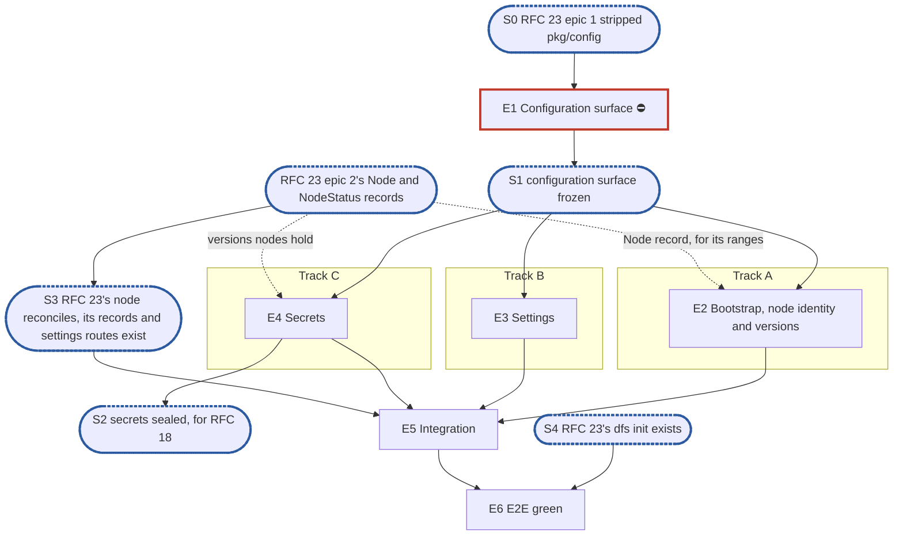

# RFC 13 — configuration v2: implementation plan

**Scope.** [RFC 13, configuration](../rfcs/rfc-13-configuration.md), its lifecycle on one node:
- the host's bootstrap, its loading and the node's identity;
- settings records, their scopes and the effective value across an override;
- validation, done twice by one rule set, and the bound-setting refusal;
- the binding classes, as a library the node's reconcile calls;
- the single-node version gate;
- sealed secrets, their versions and their rotation;
- RFC 13 §8's series.

What each setting means, its default and its validator stay with the component that reads it
(RFC 13 §1.1). This plan builds the machinery every component declares into, and is its one owner:
RFC 23's and RFC 18's plans consume it. Related RFCs, with how far each is in scope:

- **Only the parts RFC 13 cannot work without:**
  - [RFC 16](../rfcs/rfc-16-metadata-store.md): the `Setting` and `Secret` records, the settings
    generation, the installation's active versions and a node's ranges (§2.3, §3,
    §4.6).
- **Constraints only:**
  - [RFC 23](../rfcs/rfc-23-control-plane.md) and its plan (#4050): the node, its reconcile, its
    node-status records, the API's settings routes and `dfs init` are that plan's, and call this
    one;
  - [RFC 18](../rfcs/rfc-18-identity.md) and its plan: identity reads sealed NT hashes, keytabs and
    the machine password, and declares the `identity.*` section;
  - [RFC 20](../rfcs/rfc-20-adapters.md): `pkg/adapter/settings` is the template every section
    follows;
  - [RFC 25](../rfcs/rfc-25-observability.md): RFC 13 §8's series.
- **Out:**
  - the provisioning file (RFC 13 §2.4) and the backup location's record (RFC 13 §2.5, with
    RFC 26);
  - the scratch paths of RFC 13 §2.2, which no v1 component reads;
  - the namespace key table (RFC 13 §7's material bullets, RFC 5's);
  - a change of a store's endpoint or credential, refused until it can be proven (D9);
  - the call that raises an active version (RFC 13 §5.5), while each format has one version;
  - the cluster rules (RFC 13 §5's two-step restart value, §5.4 and §5.5 across nodes).

**Tracks.** A, B and C, with no owner.

**Programme.** #3119, route B, on `feat/storage-v2`, and the v1.0 MVP issue #4053; roadmap epic
#3984. It owns the bootstrap, settings and secrets pieces RFC 23's plan had first placed in its
epics 1 to 4; that plan now consumes them (its D6, D10 and O11), and RFC 18's plan waits on its
secrets.

**Divergence from the planning skill.** There is no test-foundations epic, by the user's standing
decision for these plans. The leak check (`pkg/block/journal/journaltest/prof`, `internal/prof`
after #4000) and the KV fault wrapper (`pkg/metadata/kv/kvtest`) exist. The §1.5 instruction, copied
verbatim, says epic issues exist before "E2's pull request": that is the skill's red-suite epic,
which this plan does not have, so the clause binds no epic here.

**Naming.** v1 is today's configuration:
- `pkg/config`'s full server file and its environment overrides;
- the v1 control plane's settings tables, which RFC 23's plan deletes;
- `pkg/block/middleware/encryption/keyprovider` where it sits.

v2 is RFC 13's lifecycle. No user-visible name carries a version.

**Transition policy.** Fresh installs only (#3119, route B). A v1 key in the host file is refused at
start and names the record that replaced it.

**Defaults used from the skill's inputs:**
- output path: `docs/internals/planning/rfc-13-config-plan.md`;
- dashboards: none.

**RFC amendments.** None in this pull request. The ones this plan relies on land with the plans that
need them:
- the adapter `port` row and the `node-id` files, in #4050;
- a settings delete with `expect`, on `ControlPlane` and `ControlPlaneTx`, and the `Secret` view,
  in RFC 16 §3, in #4050, which edits that block;
- `identity.netbios_name`, the directory fields and the two secret references on a user, in the
  RFC 18 plan's pull request.

## 1. Introduction

### 1.1 What we are building

RFC 13's "Start here" describes the result:
- a host file holds only the bootstrap;
- every setting is a record in the metadata store;
- a change is validated where it is written and again where it is used, and takes effect as its
  class says;
- no secret value is ever a setting.

What replaces what:

| v1 | v2 | Fate |
| --- | --- | --- |
| `pkg/config` (full server file, environment overrides, warnings on unknown keys) | `pkg/bootstrap`, the bootstrap only, unknown keys refused (D8) | stripped by RFC 23's plan's epic 1; renamed in epic 1, finished in epic 2 |
| `pkg/config/renamed_keys.go` (renamed keys warned) | the refused v1 keys, each naming its replacement: `database.*`, `controlplane.*`, `admin.*`, `kerberos.*`, `ldap.*`, `identity.machine_sid`, `gc.*`, `snapshot.*`, `integrity.*`, `metadata.*`, `blockstore.*` but the journal path, and their `DITTOFS_*` forms | reworked in epic 2 |
| `pkg/metadata/kvstore/settings.go` (`Settings`, `PutSetting`, `CFGGEN`, `Setting.Schema`) | the same, with a delete and a newer schema refused; `expect` is RFC 23's plan's (its epics 1 and 2) | extended in epic 3 |
| `KindSEC` reserved, no code | `Secret` records with versions and sealing | built in epic 4 |
| `pkg/block/middleware/encryption/keyprovider` | `pkg/keyprovider`, unchanged | moved in epic 4 (D5) |

**Dependency limits.** Sealing uses `keyprovider` (AES-256-GCM, key IDs, retired keys, a local key
file or KMIP) unchanged. A component's settings struct and validator live in that component's own
leaf settings package.

### 1.2 How the plan is organised

- Epic 1 declares the surface and renames `pkg/config` to `pkg/bootstrap`.
- Three middle epics on three tracks:
  - Track A: the bootstrap, the node identity and the version gate;
  - Track B: settings, validation and classes;
  - Track C: secrets.
- The integration epic wires the library into RFC 23's node and API, once they exist (S3).
- The E2E green epic runs RFC 13 §9's single-node rows end to end, once `dfs init` exists (S4).

RFC 13's suites paragraph puts its single-node rows in `unit`, and the rows needing a backup
location's lock in `integration`, which are out. No suite keeps a `known.yaml`, so each test lands
green with the epic that makes it pass.

### 1.3 What epic 1 must deliver

- **`pkg/bootstrap`**, renamed from what RFC 23's plan's epic 1 leaves of `pkg/config`, with RFC 13
  §2.2's facts (but its scratch paths) as `Bootstrap`'s fields, and its loader's signature.
- **`pkg/settings`' types:**
  - the binding classes;
  - a section, declared from a component's typed settings with its scope, its override and a class
    per key;
  - the table, the snapshot and the effective-value read;
  - the write-path check and its errors. Whether the scope holds content is an input to the check,
    which its caller reads in the write's transaction, so `pkg/settings` declares no store
    interface.
- **`pkg/secrets`' provider:** RFC 13 §7's `SecretProvider`, with each version's number.
- **The kvstore views' signatures:** the settings delete, and secrets.

It declares no internal interface. `keyprovider.KeyProvider` already exists.

### 1.4 The test catalogue and its components

There is no test-foundations epic (see the header).

**The catalogue.** RFC 13 §9's rows, each landing in the epic named under its **Done when:** line.
Out of scope, each named in O1:
- the provisioning file's and the backup location's rows;
- the cluster rows;
- "§2.2 scratch paths";
- "§5.2 same content" and "§5.2 backup location credential";
- "§7 rotation"'s wrapping-key half, which needs the reseal pass (§4.3);
- the namespace key rows: "§7 namespace keys", "§7 chunk-ID key", "§7 key table" and "§5.1 encryption bound";
- the engine's and the remote tier's own validator rows: "§5.3 recorded" and "§6 block target range".

**Scenarios from other sources:**
- a v1 key in the host file refuses the start and names its replacement (#3119, route B), in epic 2;
- a key in the node's table missing from Appendix B fails a unit test (D3), in epic 5;
- a live setting written through the API reaches the component that reads it, and a restart-class
  one lands in the restart-pending set (RFC 23 §2.3), in epic 5.

**The known-failure mechanism.** None.

**The test components:**
- the leak check;
- `kvtest`'s fault wrapper, for a commit that fails after a secret is sealed;
- `keyprovider`'s local provider, which is real, over two key files, one per role.

### 1.5 General rules for each epic

> **Instruction for whoever expands an epic into its detailed description and subtasks,
> human or AI:**
>
> - **Creating an epic from this plan: use the `epic-breakdown` skill.** Whenever the user
>   asks to create an epic from this plan, or to expand, detail or break one down, run the
>   `epic-breakdown` skill (`.claude/skills/epic-breakdown/SKILL.md`) on this plan and that
>   epic, rather than writing the epic document freehand. It extracts the RFC's MUST and
>   MUST NOT into numbered requirements, estimates each subtask in man-days and suggests
>   the pull requests. A human doing it by hand follows the same skill.
> - **Epic and subtask, nothing else.** The units of work are the epic and its subtasks,
>   with subtask ids `<e>.<n>` (`subtask 4.3`, or `T4.3` for short), assigned by the epic
>   document. No other word names
>   them: not task, ticket, story, step or phase, in headings, tables, ids or prose.
> - **The epic stands alone for what to build.** Its requirements, subtasks and decisions
>   are in the epic document itself, which never refers to this plan for them or says "see
>   the plan": the RFC sections it implements, the interfaces it builds on, the
>   subtasks, and a short legend of the names it borrows from this plan (E1, E2, S1, the
>   integration epic, …). It cites the numbered rules below, without copying them, in a
>   table of how each applies: each row names its rule by number and bold title, which
>   says what the rule requires, and the table links this §1.5 with a full link (the
>   plan's path and the section's anchor) and the `CLAUDE.md` sections that hold a rule,
>   so the epic reads alone and its reader can still open each rule's text in one click.
> - **The epic document records decisions, not progress, like this plan.** It has no
>   status fields, no checkboxes to tick and no sections to keep up to date as the work
>   goes on. It is revised through a pull request only when a decision changes.
> - **Subtasks are not pull requests.** A subtask is ideally up to 5 man-days. The owner
>   ships subtasks as they see fit, one pull request each or several together; the epic
>   document only suggests a grouping, each suggested pull request ideally up to 15
>   man-days. Cut and group by logic, readability, dependencies and a deliverable that can
>   be named, not to hit a number.
> - **Every subtask states how it meets each rule that applies to it.** A rule that does
>   not apply is named, with the reason.
> - **In the issue tracker, only when someone asks for issues,** following `epic-breakdown`
>   Step 6, their one description. Issues point at the documents and copy nothing. The
>   epic issues exist before E2's pull request lands, because each red test's
>   `known.yaml` entry names one; subtask issues come once their epic document has
>   merged. The release an epic ships in is set by the RFC's roadmap epic that its epic
>   issue sits under, never in a document and never on the epic issue on its own: the epic
>   issue and its subtask issues copy that roadmap epic's milestone, and an epic changes
>   release only by moving under the roadmap epic of the other release.


1. **Independent unit tests.** Each epic carries its own unit tests. They build on the leak check,
   `kvtest`'s fault wrapper, `keyprovider`'s local provider over key files under `t.TempDir()`, the
   implementation of an epic they depend on once it has landed, and only the test doubles
   `CLAUDE.md`'s "Writing tests" allows: the in-memory KV that RFC 16's KV suite holds, and an
   injected clock. Epic 1 declares no internal interface for a test to stand in for (rule 12).
2. **Fuzz every decoder of untrusted bytes** (`CLAUDE.md`, "Writing tests", the Fuzz paragraph,
   which states the property). For this RFC:
   - the bootstrap file;
   - a setting's value, decoded strictly over its section's defaults;
   - the `Secret` record's codec and the sealed envelope.
3. **Observability follows RFC 25.** Each epic owns the series of RFC 13 §8 for what it builds:
   - settings: `config_refused_total`, `config_bound_refusals_total` and
     `config_generation_lag_seconds`, which RFC 23's node feeds from the positions it reconciles and
     reads for its `config_generation_behind` condition;
   - secrets: `config_secrets_behind`;
   - versions: `format_active_version`, `format_supported_range`.

   The provisioning series are out with the file. No label carries a record or a secret (RFC 13
   §8). No exception applies.
4. **Profiling.** Every test runs under the leak check, and fails on a goroutine, descriptor or heap
   growth left behind. RFC 13 names no allocation budget, so there is no allocations-per-operation
   assertion.
5. **Public interface and internals** (`CLAUDE.md`, "Verifying a change"). Tests cover the library
   and the behaviour it enables, under `-race`, at the layer that consumes a value. For example, a
   live change is proven by the component running the new value, not by the snapshot holding it; a
   sealed secret is proven by the other role's key failing to open it.
6. **Known failures shrink** (`CLAUDE.md`, "Writing tests", "By kind"). No suite RFC 13 names keeps
   a `known.yaml`, so no test lands red. Should a later epic register a cell with one, a red test
   that turns green leaves its suite's `known.yaml` in the same change, since RFC 29 §4.7 fails a run
   whose known failure passes.
7. **v2 ignores v1.** Nothing imports v1's server configuration, which RFC 23's plan's epic 1 strips
   first. What stays is kept in place and named:
   - `pkg/config`'s viper loading, its path search, its decode hooks and its `mapstructure` decoder
     configuration, renamed into `pkg/bootstrap`;
   - `renamed_keys.go`'s `checkRenamedKeys` and its table, extended with the refused keys. It sees
     only the file's keys, so refusing their `DITTOFS_*` forms is new code: a scan of the
     environment;
   - `keyprovider`, moved unchanged.
8. **Real dependencies for properties of those dependencies**, as `CLAUDE.md`'s "Writing tests"
   says. For this RFC:
   - sealing runs on real key files, one per role;
   - "a commit that fails after sealing leaves no secret behind" runs on Badger under `t.TempDir()`,
     with the commit faulted;
   - the node identity's copies are real files in real journal directories.
9. **Code comment conventions** (`CLAUDE.md`, "Code comments"). RFC 13's notes go at the code site
   that implements them: the `decision:` note of §7 (two wrapping keys). D9's refusal carries a
   `decision:` note of its own.
10. **A test must be able to fail** (`CLAUDE.md`, "Writing tests"), and nothing else would catch the
    change it guards: not the compiler, not the diff, not a later epic's tests.
11. **A symbol is exported only if RFC 13's interfaces use it, or a component declares through it.**
    `pkg/bootstrap`, `pkg/settings` and `pkg/secrets` export what the node, the API and each
    component's settings package call. All of it is frozen at S1.
12. **Each subtask creates only what it declares.** No empty package and no stub without a caller.
    A package, an option or a test helper lands with its first consumer.

## 2. Epics at a glance

| # | Epic | Content | Subtasks | Man-days | Track | Blocks |
| --- | --- | --- | --- | --- | --- | --- |
| E1 ⛔ | The configuration surface | `pkg/config` renamed to `pkg/bootstrap`, `Bootstrap`, `pkg/settings`' types, `pkg/secrets`' provider, the kvstore views' signatures | 4 | 4 | team | every epic |
| E2 | Bootstrap, node identity and versions | the loader, refused v1 keys and environment names, `--config`, the roles flag, the node identity, initialise-if-empty, the single-node version gate | 6 | 5.5 | A | E5 |
| E3 | Settings | a delete, sections and the table, the effective value, the write check, the bound and format-version refusals, classes and the diff, the series | 6 | 9.5 | B | E5 |
| E4 | Secrets | `keyprovider` moved, `Secret` records, envelope sealing, versions, rotation, deletion | 5 | 6 | C | E5; RFC 18's plan (S2) |
| E5 | Integration | the node's table, reconcile and the API's settings routes on this library, Appendix B's check | 4 | 5 | team | E6 |
| E6 | E2E green | RFC 13 §9's single-node rows through the API | 4 | 4.5 | team | — |
| | **Total** | | **29** | **34.5** | | |

**Plan estimate: 29 subtasks, 34.5 man-days.**

The skill's estimate for RFC 13's 1,178 lines is 3 middle epics (`round(1178 / 400)`), and this plan
has 3.

**Legend.** ⛔ is a blocker. "team" is an epic that belongs to no track. "Partly" means the dependent
epic starts before the blocker lands and needs it for its remaining pieces (§3.3).

## 3. Synchronisation points, blockers and the split

### 3.1 Dependency graph



### 3.2 Synchronisation points

- **S0, before this plan.** RFC 23's plan's epic 1 has stripped `pkg/config` of v1's server sections.
  Unblocks epic 1, which renames what is left to `pkg/bootstrap`.
- **S1, the configuration surface frozen.** `pkg/bootstrap`, `pkg/settings` and `pkg/secrets` build
  with stub bodies. Unblocks epics 2, 3 and 4.
- **S2, secrets sealed.** A `Secret` seals, resolves and versions under each role's key. This is the
  RFC 18 plan's S0, so it unblocks identity's NT hashes, keytab and machine password.
- **S3, outside this plan.** RFC 23's plan's S2 (the node starts and reconciles), its epic 2's
  `Node` and `NodeStatus` records and its epic 4's settings routes exist. Unblocks epic 5.
- **S4, outside this plan.** RFC 23's plan's `dfs init` exists (its epic 5). Unblocks epic 6.

### 3.3 Blockers

| Epic | Blocks | Why |
| --- | --- | --- |
| E1 ⛔ | every epic | Every epic builds on the frozen surface. |
| E2, E3, E4 | E5 | Integration wires all three into the node and the API. |
| E4 | RFC 18's plan (S2) | Identity seals and resolves its secrets here. |
| E5 | E6 | E2E green runs the wired server. |
| RFC 23's epic 2 (outside) | E2 and E4, partly | The version gate adds a node's ranges to RFC 23's `Node` record, and `Prune` reads the versions a node holds from its `NodeStatus`. Everything else in both epics starts at S1. |
| RFC 23's S2, epics 2 and 4 (outside, S3) | E5 | Integration wires this library into RFC 23's reconcile and settings routes. |
| RFC 23's epic 5 (outside, S4) | E6 | The initialisation and upgrade rows run `dfs init`. |

### 3.4 Splitting the work

- **Track A** takes epic 2 at S1, the smallest middle epic. Once it is done it starts epic 5's table
  and Appendix B check, which need no RFC 23 piece.
- **Track B** takes epic 3 at S1, the largest.
- **Track C** takes epic 4 at S1. Its S2 is on RFC 18's critical path, so it starts with the move,
  the record and sealing.
- **The team converges** at epic 1 and at epic 5.

## 4. Implementation decisions

### 4.1 Directory layout

```text
pkg/bootstrap/              renamed from pkg/config: Bootstrap, Load, refused keys,          E1, E2
                            node identity, initialise-if-empty
pkg/settings/               sections, table, snapshot, Get, Check, Diff, versions, metrics   E1, E3, E2 (versions)
pkg/secrets/                Provider: Seal, Resolve, Prune, Delete; envelope                 E1, E4
pkg/keyprovider/            moved from pkg/block/middleware/encryption/keyprovider           E4
pkg/metadata/entity/        + Secret; Installation's active versions; ranges on RFC 23's Node E2, E4
pkg/metadata/kvstore/       settings: expect, delete, newer schema refused; secrets (SEC)    E3, E4
internal/node/settings.go   the one settings table, naming every declared section           E5
```

### 4.2 Decisions

**D1. A setting is one record per key.** There is one `Setting` record per (scope, key), as kvstore
has today and as RFC 23's plan's generic `dfsctl setting` command assumes. A component's typed
settings are decoded from its rows over its defaults. This is the user's decision.
- **Prior art (from memory).** CockroachDB's `system.settings` and Consul's KV hold one row per key.
- **Applied by** epic 3.

**D2. A component declares its section; the node lists them in one table.** Each component's leaf
settings package exports its typed struct, its defaults and `Validate`. `internal/node` holds one
`settings.Table` literal naming each section with its scope, its override and a class per key. The
API's write check and reconcile both read that table. This is the user's decision.
- **Prior art (from memory).** CockroachDB registers settings from `init()`; the table here does
  the same job with no global state.
- **Applied by** epics 3 and 5.

**D3. Appendix B is checked against the table.** A unit test parses RFC 13 Appendix B and compares
it with the node's table, by key, scope and class. A key declared in the table that Appendix B lacks,
or holds with another scope or class, fails it. An Appendix B section no component has declared yet
is reported, not failed (O4). It also runs RFC 13 §9's "§3 scope forms" row.
- **Prior art.** None found.
- **Applied by** epic 5.

**D4. A secret is sealed as an envelope.** Each version gets a fresh data key, which seals the value
with AES-GCM, using the role, the reference and the version as additional data. `keyprovider`
wraps that data key under the role's key. A sealed value moved onto another record, role or version
fails to open. This is the user's decision.
- **Prior art (from memory).** Vault's barrier binds each entry to its path the same way.
- **Applied by** epic 4.

**D5. `keyprovider` moves to `pkg/keyprovider`**, unchanged but for the move, so secrets and the
transform chain share it without one importing the other's middleware tree. Its importers on
`feat/storage-v2` move with it:
- `pkg/block/middleware/encryption/decorator.go`, `decorator_test.go` and `policy.go`;
- `pkg/block/middleware/encryption/README.md`, whose relative `keyprovider/` link breaks;
- `pkg/block/middleware/ordering_test.go`;
- `docs/guide/encryption.md` and `docs/internals/encryption-design.md`;
- `test/scenarios/12-smb-encryption-roundtrip-s.sh`;
- `test/harness/run/gojson_test.go`, which holds the path as a string, so no compiler catches it.

The v1 runtime's importers go with RFC 23's plan's epic 1.
- **Prior art.** None found.
- **Applied by** epic 4.

**D6. Secrets are their own package, `pkg/secrets`,** beside `pkg/settings`. A component that holds
a secret reference imports only it.
- **Prior art (from memory).** Kubernetes keeps Secrets apart from ConfigMaps.
- **Applied by** epic 4.

**D7. The bootstrap file keeps its path,** `~/.config/dittofs/config.yaml`, with `--config` naming
another, through the existing viper loader, renamed into `pkg/bootstrap`. An unknown key (the
decode's `Metadata.Unused`, refused after the v1 keys among them are named, since `ErrorUnused`
fails before `Unused` is filled), a v1 key (`checkRenamedKeys`), or a `DITTOFS_*`
name that is no bootstrap key refuses the start. The last is a new scan of the environment, since
viper reads only the names bound from the struct and ignores the rest. This is the
user's decision; RFC 23's plan's D6 points here.
- **Prior art (from memory).** etcd and PostgreSQL keep a host file of the same scope.
- **Applied by** epic 2.

**D8. Packages are named after RFC 13's own words.** `pkg/bootstrap` is the host file, what a node
needs before it reaches the store. `pkg/settings` is the records in the store. `pkg/config` goes
away, so "config" no longer names two things. A component's settings package is named `settings`
too: `pkg/adapter/config` became `pkg/adapter/settings` in RFC 20's epic 2 breakdown (#4000, O5).
This is the user's decision.
- **Prior art.** None found.
- **Applied by** epics 1 and 2.

**D9. A change of a remote store's endpoint or credential is refused until it can be proven.**
RFC 13 §5.2 allows one only once the store's capability check (RFC 4 §4.11) finds the namespace's
claim (RFC 27 §2.1) at the new location. Neither exists on `feat/storage-v2`, and a check without
the claim would pass any reachable bucket, so the write path refuses the change, naming RFC 13
§5.2, and fails closed. The MVP (#4053) has no remote store, so it loses nothing. The code site
carries a `decision:` note naming the rule and its overturn: both pieces built. RFC 23's plan's
credential rotation (its epic 3's runner kind) and its proven endpoint (its epic 4) wait with it,
in O1.
- **Prior art.** None found.
- **Applied by** epic 3.

### 4.3 Knowingly simple implementations

Each carries a `ponytail:` marker at the code site:

- **Reconcile re-reads every setting when the generation moves.** One prefix scan per move.
  - *Ceiling:* the scan's cost at the settings count of 10⁴ shares.
  - *Upgrade path:* read only the records above the reconciled position, with an index by position
    (RFC 23 §13 item 5).
  - *Epic:* 3.
- **The version gate is one comparison per format.** On one node, a start refuses when an active
  version, or a namespace's block format version, lies outside the binary's range, and nothing
  else. No call raises a version, since each format has one so far: a test raises one by writing
  the `Installation` record through kvstore.
  - *Ceiling:* a second node, or a format's second version.
  - *Upgrade path:* the raise call (RFC 13 §5.5), when a format gains a version; its refusal while
    a registered node lags, with RFC 15.
  - *Epic:* 2.
- **The cross-component rule is not built.** RFC 13 §6's example relates `adapters.smb.pending_timeout`
  to `migration.freeze_timeout`, which does not exist yet.
  - *Ceiling:* none until the second setting exists.
  - *Upgrade path:* a rule field on a section naming the settings it relates.
  - *Epic:* 3, as a marker only.
- **A secret's old version is pruned by its rotation's owner, once its retention ends.** On one node
  a credential's ends when this node resolves the new version, so "every node reports it" is this
  node and `config_secrets_behind` counts this node's. The signing key's ends as RFC 23 §5.3 says,
  and RFC 23's plan's epic 5 prunes it.
  - *Ceiling:* a second node.
  - *Upgrade path:* prune once every node's status reports the version (RFC 13 §7), with RFC 15.
  - *Epic:* 4.
- **No reseal pass.** A role key rotates by making the next key current and keeping the old one in
  `keyprovider`'s retired keys, so every existing secret still opens. "§7 rotation"'s wrapping-key
  half waits with it (O1).
  - *Ceiling:* an old role key can never leave the bootstrap.
  - *Upgrade path:* the reseal pass of RFC 13 §7, when an operator must remove a role key.
  - *Epic:* 4.
- **One passphrase variable for every key file.** `keyprovider`'s local provider reads
  `DITTOFS_ENCRYPTION_PASSPHRASE`, so two roles kept in passphrase-protected files share one.
  - *Ceiling:* two roles cannot have distinct passphrases.
  - *Upgrade path:* a per-role passphrase variable in the provider's configuration.
  - *Epic:* 4.

### 4.4 Code sketch

The sketch is illustrative: its signatures come from the cited RFC sections or existing code, and the
epic documents decide the final names.

The start: the host file, the node's identity, then the node RFC 23's plan builds (D7; A2 in #4050).

```go
func start(ctx context.Context, configFlag string) error {
	b, err := bootstrap.Load(configFlag) // "" is ~/.config/dittofs/config.yaml (D7)
	if err != nil {
		return err
	}
	id, err := bootstrap.NodeID(b) // every journal directory's node-id copy agrees, or b's override (A2)
	if err != nil {
		return err // no copy and no override refuses; dfs init wrote the copies (InitNodeID)
	}
	n, err := node.New(ctx, b, id) // RFC 23's plan; refuses outside the active versions (epic 2, §4.3)
	if err != nil {
		return err
	}
	return n.Serve(ctx)
}

// pkg/bootstrap, the renamed pkg/config.Load (epic 2).
func Load(path string) (*Bootstrap, error) {
	v := viper.New()
	setupViper(v, path)
	if _, err := readConfigFile(v); err != nil {
		return nil, err
	}
	if err := checkEnviron(os.Environ()); err != nil {
		return nil, err // a DITTOFS_* name that is no bootstrap key: viper never sees it (D7)
	}
	var md mapstructure.Metadata
	var b Bootstrap
	if err := v.Unmarshal(&b, viper.DecodeHook(decodeHooks()),
		func(dc *mapstructure.DecoderConfig) { dc.Metadata = &md }); err != nil {
		return nil, err
	}
	if err := checkRenamedKeys(md.Unused); err != nil {
		return nil, err // a v1 key, naming the record that replaced it (transition policy)
	}
	if len(md.Unused) > 0 {
		// D7's unknown-key refusal. Not ErrorUnused itself: it fails the decode
		// before md.Unused is filled, so no v1 key could be named.
		return nil, unknownKeys(md.Unused)
	}
	return &b, b.Validate() // the roles flag: both roles or refused (RFC 13 §2.2)
}
```

A section, declared by its component and listed once in the node's table (D2):

```go
// internal/node/settings.go: the one table, read by Check and by reconcile.
var Settings = settings.Table{
	settings.Of[adaptersettings.SMB]("adapters.smb",
		metadata.ScopeInstallation, settings.NoOverride, // "installation, per adapter" (RFC 13 Appendix B)
		adaptersettings.DefaultSMB(),
		settings.Classes{"port": settings.Restart}), // every key not named is live (settings.SMB's decision note)
	settings.Of[adaptersettings.NFS]("adapters.nfs", /* the same */),
	// ...every other component's section (epic 5; identity.* is RFC 18's plan's)
}

// pkg/settings.
func Of[T interface{ Validate() error }](prefix string, scope, override metadata.SettingScopeKind,
	def T, classes Classes) Section
```

The write path: the API's settings route checks inside RFC 16's `Write`, so a related setting it
reads conflicts with a concurrent change (epic 5).

```go
func (h *settingsRoutes) put(ctx context.Context, meta metadata.WriteMeta, s metadata.Setting, expect uint64) error {
	return h.cp.Write(ctx, meta, func(tx metadata.ControlPlaneTx) error {
		if err := node.Settings.Check(tx, s, h.holdsContent); err != nil {
			return err // config_refused_total; bound ones also config_bound_refusals_total
		}
		return tx.PutSetting(s, expect) // raises CFGGEN; a stale expect is ErrGenerationMismatch
	})
}

// pkg/settings (epic 3), in this order.
func (t Table) Check(tx metadata.ControlPlaneTx, s metadata.Setting, holds HoldsContent) error {
	sec, key, err := t.lookup(s.Key, s.Scope) // unknown key, wrong scope, newer Schema (RFC 13 §2.3)
	if err != nil {
		return err
	}
	if err := sec.decodeValidate(tx, s); err != nil {
		return err // strict decode over the defaults and the wider row, then the component's Validate
	}
	if sec.class(key) == Bound {
		if has, err := holds(tx, s.Scope); err != nil || has {
			return refuseBound(s, err) // RFC 13 §5.1
		}
	}
	if storeLocation(s.Key) {
		// decision: D9. Refused until the capability check finds the claim
		// (RFC 13 §5.2); withdraw when both are built.
		return ErrUnproven
	}
	return t.checkFormatVersion(s) // a namespace's block format past this node's range (RFC 13 §5.4)
}
```

Reconcile, when `CFGGEN` moved: each change takes its class's path (RFC 23 §2.3, epic 5).

```go
func (n *Node) reconcileSettings(ctx context.Context) error {
	cur, err := settings.Read(ctx, n.cp, node.Settings, n.id) // ponytail: one prefix scan per move (§4.3)
	if err != nil {
		return err
	}
	for _, ch := range settings.Diff(n.settings, cur) {
		switch ch.Class {
		case settings.Live, settings.Bound: // a bound change got here only past Check's refusal
			if err := n.reconfigure(ch.Section, cur); err != nil {
				return err
			}
		case settings.Restart:
			if !n.rebuild(ch.Section, cur) { // an adapter's port: a new adapter (settings.SMB's note)
				n.restartPending(ch.Key)
			}
		case settings.NextWrite: // nothing to apply: the next write reads cur
		}
	}
	n.settings = cur
	return n.reportGeneration(ctx, cur.Generation) // NodeStatus.Settings (RFC 16 §2.4)
}

func (n *Node) reconfigure(section string, cur settings.Snapshot) error {
	switch section {
	case "adapters.smb":
		smb, err := settings.Get[adaptersettings.SMB](cur, section, n.id) // installation row, then the override
		if err != nil {
			return err
		}
		return n.adapters.SMB.Reconfigure(smb)
	// ...one case per section with live keys
	}
	return nil
}
```

Secrets: two role keys from `pkg/keyprovider` (D5), an envelope per version (D4), versions through
RFC 16 §3's `Secret`, `PutSecret` and `PruneSecret` (epic 4).

```go
type Provider struct {
	cp   metadata.ControlPlane
	keys map[Role]keyprovider.KeyProvider // protocol and storage, each from its bootstrap key location
}

func (p *Provider) Seal(ctx context.Context, role Role, ref metadata.SecretRef, value []byte) (metadata.SecretRef, error) {
	cur, err := p.cp.Secret(ctx, ref, 0) // version 0: the current one (RFC 16 §3, #4050)
	if err != nil && !errors.Is(err, metadata.ErrNotFound) {
		return ref, err
	}
	next := cur.Version + 1
	dk := freshKey()                                 // one data key per version (D4)
	sealed := gcmSeal(dk, value, aad(role, ref, next)) // AAD = role‖ref‖version: moved, it fails to open
	wrapped, keyID, err := p.keys[role].Wrap(ctx, dk)
	if err != nil {
		return ref, err
	}
	s := metadata.Secret{ID: ref, Version: next, KeyID: keyID, Value: envelope(wrapped, sealed)}
	return ref, p.cp.PutSecret(ctx, s, cur.Version) // raises CFGGEN, so every node resolves it again
}

func (p *Provider) Resolve(ctx context.Context, role Role, ref metadata.SecretRef) ([]byte, error) {
	s, err := p.cp.Secret(ctx, ref, 0)
	if err != nil {
		return nil, err
	}
	wrapped, sealed := open(s.Value)
	dk, err := p.keys[role].Unwrap(ctx, wrapped, s.KeyID) // a retired key ID still opens: no reseal (§4.3)
	if err != nil {
		return nil, err
	}
	return gcmOpen(dk, sealed, aad(role, ref, s.Version))
}

// Prune is called by the rotation's owner once its retention ends: on one node, once this
// node reports the new version in NodeStatus.Secrets (§4.3).
func (p *Provider) Prune(ctx context.Context, ref metadata.SecretRef, held uint64) error {
	return p.cp.PruneSecret(ctx, ref, held) // every version below held
}
```

## 5. The epics in detail

### Epic 1 — The configuration surface ⛔

**Epic 1 estimate: 4 subtasks, 4 man-days.**

The three packages' exported surfaces and the kvstore views' signatures, frozen for the epics that
fill them in.

**Owns:** RFC 13 §2.2's facts (but its scratch paths), §5's classes and §7's provider, as
declarations; RFC 16's `Setting` and `Secret` signatures.

**Done when:** `pkg/config` is gone and `pkg/bootstrap` builds in its place, with every importer;
the three packages and the views compile with stub bodies.

**Expected content:**
- `pkg/config` renamed to `pkg/bootstrap` (D8), and `Bootstrap` holding RFC 13 §2.2's facts but its
  scratch paths.
- `pkg/settings`' types: classes, section, table, snapshot, `Get`, `Check` with its holds-content
  input, and their errors.
- `pkg/secrets`' provider (RFC 13 §7).
- The kvstore settings view's delete, and the secrets view.

### Epic 2 — Bootstrap, node identity and versions

**Epic 2 estimate: 6 subtasks, 5.5 man-days.**

A host's file loads, refuses what is not bootstrap, and gives the node its identity. A node starts
only where its versions overlap the installation's.

**Owns:** RFC 13 §2.2 (but its scratch paths), the roles flag included; the node identity of RFC
23's plan's A2; RFC 13 §5.4's join refusal and §5.5, on one node.

**Done when:** RFC 13 §9's rows "§2.2 no host override" and "§5.5 version gate" (its single-node
part: the old binary refuses after a raise, which the test writes through kvstore, §4.3) pass;
the §1.4 scenario assigned to epic 2 passes.

**Expected content:**
- `Load` on the renamed loader: the default path and `--config`, unknown keys refused from
  `Metadata.Unused` once the v1 keys among them are named (D7).
- The refused v1 keys, through `checkRenamedKeys` and its table (§1.1's list), and the scan of the
  environment that refuses their `DITTOFS_*` forms and any other non-bootstrap name (D7).
- The roles flag on `Bootstrap`, and `Load` refusing a value other than both roles (RFC 13 §2.2,
  RFC 15 §2.2).
- The node identity: `InitNodeID` writes the `node-id` file in every journal directory for `dfs
  init`, and `NodeID` reads every copy at start, refusing unless all agree, or takes the file's
  override.
- Initialise-if-empty, a development and test option, off by default (RFC 13 §2.2).
- The version gate (§4.3 above), over the installation's active versions and each namespace's
  block format version, with `format_active_version` and `format_supported_range`.

### Epic 3 — Settings

**Epic 3 estimate: 6 subtasks, 9.5 man-days.**

Settings are rows at their scope. A component's effective value is read through one call. A write is
checked by the component's own rules, and a change is classified for reconcile.

**Owns:** RFC 13 §2.1, §2.3, §3, §4.2, §5, §5.1 and §6; RFC 13 §5.2 as D9's refusal; RFC 13 §5.4's
refusal to advance, on one node.

**Done when:** RFC 13 §9's rows "§6 unknown field" and "§2.3 schema" pass; "§6 refused" and "§6 one
validator" pass at the library's layer, on a section declared in the test.

**Expected content:**
- The kvstore settings view: a delete, raising `CFGGEN` in its transaction as `PutSetting` does,
  and a newer `Setting.Schema` refused (the field exists).
- `settings.Of` and the table: a section from a component's typed settings, defaults and
  `Validate` (D2).
- The snapshot and `Get`: the installation value, then the narrower override, decoded strictly over
  the defaults, then `Validate`.
- `Check` for the write path: unknown key, wrong scope, newer schema, `Validate`, the bound refusal
  (RFC 13 §5.1) on its holds-content input, D9's refusal, and a namespace's block format version
  past this node's range (RFC 13 §5.4) on the key RFC 4's plan declares.
- `Diff` and the classes: live, restart, next write, bound.
- `config_refused_total`, `config_bound_refusals_total` and `config_generation_lag_seconds`.

### Epic 4 — Secrets

**Epic 4 estimate: 5 subtasks, 6 man-days.**

A secret is a sealed record under its role's wrapping key. It rotates as a new version, the old one
is pruned, and every version goes with the record that names it.

**Owns:** RFC 13 §7 (but its material bullets, RFC 5's, and the reseal pass, §4.3 above); RFC 13
§2.2's wrapping-key row; RFC 16's `Secret` record.

**Done when:** RFC 13 §9's rows "§7 role keys" and "§7 user secrets" pass, the second with a
`Secret` written through the kvstore view and removed by kvstore's `DeleteUser`, so it needs no
RFC 18 piece, and without its restart clause, which runs with RFC 23's plan's resumable deletion
(its epic 3); "§7 rotation" (its credential half, on one node) passes.

**Expected content:**
- `keyprovider` moved to `pkg/keyprovider`, with its importers (D5).
- The `Secret` record, its codec and its fuzz target.
- Envelope sealing (D4) and `Resolve` under each role's key.
- The secrets view: every `Secret` write and delete raises `CFGGEN` in its transaction (RFC 13 §5).
- Versions: a rotation writes a new version, and `Prune`, called by the rotation's owner, drops the
  old one (§4.3 above), counted by `config_secrets_behind`.
- `Delete`, which every version goes with. `DeleteUser` does not call it: kvstore deletes the
  user's `SEC` rows itself, in the transaction that deletes the user record (RFC 16 §3), and this
  epic adds that to today's `DeleteUser`.

### Epic 5 — Integration

**Epic 5 estimate: 4 subtasks, 5 man-days.**

RFC 23's node reads its settings through this library, its API writes through it, and the first
sections are declared.

**Owns:** RFC 13 §8 as a whole; RFC 13 Appendix B's check (D3).

**Done when:** RFC 13 §9's row "§3 scope forms" passes; the §1.4 scenarios assigned to epic 5 pass.

**Expected content:**
- `internal/node/settings.go`, the one table, with the adapters' section and every other section
  declared by then (the `identity.*` section is RFC 18's plan's).
- RFC 23's reconcile on `settings.Diff` and `Get` (RFC 23 §2.3).
- RFC 23's settings routes on `Check`, and its secret writes on `pkg/secrets`.
- D3's Appendix B test.

### Epic 6 — E2E green

**Epic 6 estimate: 4 subtasks, 4.5 man-days.**

RFC 13 §9's single-node rows run against a server `node.New` builds, through the API.

**Owns:** RFC 13 §9, its single-node rows.

**Done when:** these RFC 13 §9 rows pass in `unit`:
- "§5.1 bound", for the bound settings the node's table declares, but the chain's encryption (RFC
  5, O1) and a remote store's bucket and prefix (D9);
- "§5.1 share binding", whose refusal RFC 23's plan's share routes build (its epic 4), since a
  share's namespace is a field of the share record, not a setting;
- "§6 refused" and "§6 one validator", for every declared setting;
- "§7 no secret out";
- "§2.2 explicit initialisation";
- "§5.5 dead node" (single-node part);
- "§5 propagation" (single-node part).

**Expected content:**
- The bound rows, with content written through a share.
- The §6 rows over every section the node's table declares.
- "No secret out" over a full test run's answers, exports and logs.
- "§2.2 explicit initialisation", its pieces owned where they are built: initialise-if-empty in epic
  2; the journal `format` file's installation ID by RFC 1's journal `Init`, which RFC 23's plan's
  `dfs init` calls; a lost store or journal reported by RFC 23's plan's start step 1.
- Propagation and the single-node upgrade rows, with RFC 23's plan's `dfs init`.

## 6. Risks and open points

- **O1. Deferred scope.**
  - The provisioning file (RFC 13 §2.4) waits for its plan; RFC 23's plan defers it too.
  - The backup location's record (RFC 13 §2.5) and "§5.2 backup location credential" wait for
    RFC 26.
  - The scratch paths of RFC 13 §2.2 and "§2.2 scratch paths" wait for their first reader: RFC 26's
    backups (`backups.spill_path`), RFC 1's salvage export (`salvage.path`) and RFC 25's event spool
    (`events.path`).
  - A store endpoint or credential change and "§5.2 same content" wait for RFC 4 §4.11's capability
    check and RFC 27's claim (D9), with RFC 23's plan's credential rotation and proven endpoint.
  - The call that raises an active version waits for a format's second version (§4.3).
  - "§7 rotation"'s wrapping-key half waits for the reseal pass (§4.3).
  - The namespace key table, "§5.1 encryption bound", "§7 namespace keys", "§7 chunk-ID key" and "§7
    key table" wait for RFC 5's plan.
  - "§5.3 recorded" is the engine's validator row (RFC 8), and "§6 block target range" the remote
    tier's (RFC 4): their plans run them, through this plan's table.
  - The cluster rules (RFC 13 §5's two-step value, §5.4 and §5.5 across nodes, the two-node rows of
    §9) wait for RFC 15.
- **O2. RFC 23's plan consumes this one.** Its D6 and D10 point here, and its epics 1 to 5 keep only
  their own pieces: the strip of `pkg/config`, the node, the API's routes and `dfs init`.
- **O3. The RFC 18 plan's S0 is this plan's S2.** Identity's NT hashes, keytab and machine password
  wait for epic 4.
- **O4. The components' sections.** Each component's settings package and its Appendix B rows are
  its own plan's. Epic 5 wires the sections declared by then; D3 reports every other Appendix B
  section until its plan declares it.
- ~~**O5. `pkg/adapter/config` becomes `pkg/adapter/settings`** (D8).~~ Settled: #4000 renames it,
  beside A1's `Port` field (its D20).
- **O6. Estimates least certain.** Epic 3's write check, where the newer-schema refusal and the
  delete meet the existing settings view's transaction, and the transaction RFC 23's plan builds.

### 6.1 Deferral ledger

What this plan knowingly does not build. Each row indexes the section that defers it.

| Deferred | Why | Owner | Trigger | Issue |
| --- | --- | --- | --- | --- |
| The provisioning file (RFC 13 §2.4) and its series (header, O1, §1.4) | no plan takes it; RFC 23's plan defers it too | unowned | a plan takes RFC 13 §2.4 | — |
| The backup location's record (RFC 13 §2.5); "§5.2 backup location credential" (header, O1, §1.4) | it needs backups | RFC 26 | RFC 26's plan | — |
| The scratch paths of RFC 13 §2.2; "§2.2 scratch paths" (header, O1, §1.4) | no v1 component reads them | RFC 26, RFC 1 and RFC 25 plans | the first reader: backups' spill, salvage export or the event spool | — |
| A remote store's endpoint or credential change, refused; "§5.2 same content" (D9, O1, §1.4) | needs the capability check (RFC 4 §4.11) and the claim (RFC 27 §2.1) | RFC 4 and RFC 27; RFC 23 plan (#4050) for its credential rotation and proven endpoint | both pieces built | — |
| The call that raises an active version, `raise-format` (RFC 13 §5.5) (header, §4.3's `ponytail:`, O1) | each format has one version | unowned | a format gains a second version | — |
| "§7 rotation"'s wrapping-key half and its reseal pass (§4.3's `ponytail:`, O1, §1.4) | a retired role key keeps every secret open | unowned | an operator must remove a role key | — |
| The namespace key table; "§5.1 encryption bound", "§7 namespace keys", "§7 chunk-ID key", "§7 key table" (header, O1, §1.4) | RFC 13 §7's material bullets are RFC 5's | RFC 5 plan | RFC 5's plan | — |
| "§5.3 recorded" and "§6 block target range" (O1, §1.4) | the engine's and the remote tier's validator rows, through this plan's table | RFC 8 plan; RFC 4 plan | their epics declare the keys | — |
| The cluster rules: §5's two-step restart value, §5.4 and §5.5 across nodes, the two-node §9 rows; a lagging node refusing the raise (header, §4.3's `ponytail:`, O1, §1.4) | single node only | RFC 15 | a second node | — |
| Pruning an old secret version once every node's status reports the new one (§4.3's `ponytail:`) | one node prunes on its own resolve | RFC 15 | a second node | — |
| Reconcile reading only records above its position, with an index by position (§4.3's `ponytail:`) | one prefix scan per generation move | unowned | the scan shows at the settings count of 10⁴ shares | — |
| The cross-component rule, RFC 13 §6's example (§4.3's `ponytail:`) | its second setting, `migration.freeze_timeout`, does not exist | unowned | that setting is declared | — |
| A per-role passphrase variable for key files (§4.3's `ponytail:`) | `keyprovider` reads one variable | unowned | two roles need distinct passphrases | — |
| Appendix B sections no component has declared (D3, O4) | each section is its component's plan's | each component's plan | that plan declares the section | — |

## 7. RFC coverage

| RFC section | Epic(s) |
| --- | --- |
| RFC 13 Start here, In short | — (explanatory) |
| RFC 13 §1, §1.1 | — (scope) |
| RFC 13 §2.1 | E3 |
| RFC 13 §2.2 | E1 (surface), E2; wrapping keys E4; scratch paths O1 |
| RFC 13 §2.3 | E3 |
| RFC 13 §2.4 | out, O1 |
| RFC 13 §2.5 | out, O1 |
| RFC 13 §3 | E3; D3 (E5) |
| RFC 13 §4, §4.1 | — (a rule for components, no code) |
| RFC 13 §4.2 | E3 (defaults through `Of`) |
| RFC 13 §5 | E3 (classes, diff); E5 (reconcile); two-step value O1 |
| RFC 13 §5.1 | E3; E6 (rows) |
| RFC 13 §5.2 | E3 (D9's refusal); the proof O1 |
| RFC 13 §5.3 | the engine's (RFC 8); the node's table carries its keys (E5) |
| RFC 13 §5.4 | E3 (refusal to advance), E2 (join refusal), single node; cluster O1 |
| RFC 13 §5.5 | E2 (single node); the raise call and cluster O1 |
| RFC 13 §6 | E3; E6 (rows); cross-component rule §4.3 above |
| RFC 13 §7 | E4; material bullets RFC 5's, O1; reseal and wrapping-key rotation §4.3 above, O1 |
| RFC 13 §8 | E2, E3, E4 (series); E5 (as a whole); provisioning series O1 |
| RFC 13 §9 | E2, E3, E4, E5, E6 (rows); out rows §1.4, O1 |
| RFC 13 §10 | — (edits already applied) |
| RFC 13 §11 | — (open in their own RFCs) |
| RFC 13 Appendix A | — (non-normative) |
| RFC 13 Appendix B | each component's plan; D3 (E5) |
| RFC 16 §2.3, §3, §4.6 (settings, secrets, versions) | E1 (signatures), E2, E3, E4 |
