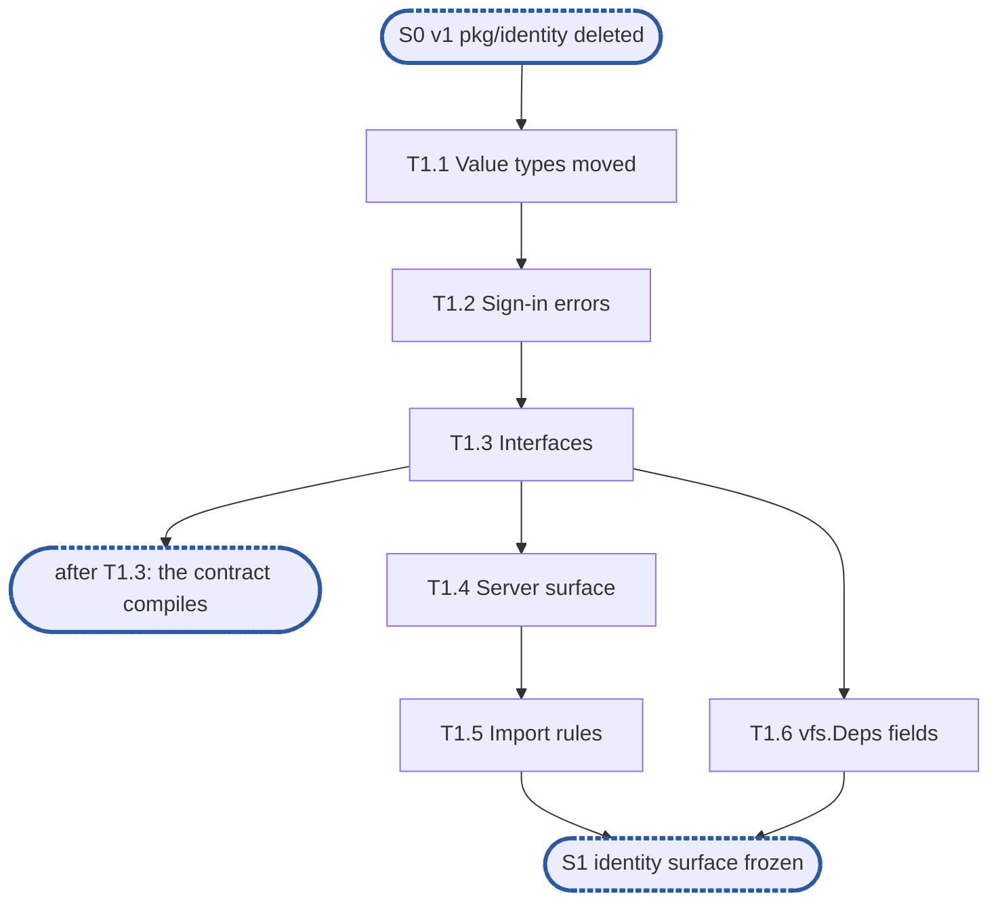

# Epic 1: identity v2 contract and the server's surface

**Sources:** [RFC 18](../rfcs/rfc-18-identity.md) §2.6 and §2.7 as declarations, the interfaces
of §3.1, §4.1, §6.1 and §8.1 (without `TokenVerifier`), and §9.1's ID11, in the version of
pull request #4058; [RFC 17](../rfcs/rfc-17-vfs.md) §2.3 (`vfs.Deps`), §3.0 (aliases) and
§4.3 (errors); [RFC 20](../rfcs/rfc-20-adapters.md) §2.3 and §7.1 (the import test);
[RFC 16](../rfcs/rfc-16-metadata-store.md) §3, for `SharePolicy` only.
**Track:** the team.
**Epic 1 estimate: 6 subtasks, 5.5 man-days.**
**Depends on:** **S0**: RFC 23's plan's epic 1 has deleted v1's `pkg/identity`, whose path
this epic reuses, with its importers. Whether #4059's S1 (`pkg/secrets` frozen) is also needed
is Q4 in §9.
**Blocks:** E2, E3 and E4, which start at **S1**, the identity surface frozen, and through
them every later epic.

---

## 1. Goal

Epic 1 declares identity's contract and the server every later epic fills in, so that the
three tracks can start at once against signatures that no longer move.

**At the end of the epic:**

- `pkg/identity` holds the value types `pkg/vfs` declares today, moved, plus `Caller`, the two
  new errors, the four interfaces and `NewHashes`'s signature;
- `pkg/vfs` aliases the moved types, and every importer builds unchanged;
- `internal/identity` builds a `*Server` with `New`, `Apply`, `Start` and `Stop`, its other
  methods stubbed behind final signatures;
- `vfs.Deps` carries `Identity`, `Auth` and `Names`;
- the import rules RFC 18 §2.7 states are checked, each by a check that reports its seeded
  violation.

### 1.1 In scope

The move of the value types; `ErrLogonFailure` and `ErrUnknownPrincipal`; the interfaces
`Authenticator`, `Identities`, `Resolver` and `APISignIn` with the types their signatures
name; `internal/identity`'s `Deps`, `New`, `State`, `Apply`, `Start`, `Stop`; the three
`vfs.Deps` fields; the import checks; `internal/identity/**` in the `e2e` suite's `kerberos`
cell's `paths:`.

### 1.2 Out of scope

- Every body behind the server's stubs: `SignIn` (E4, E5, E7), `Spell` and `Find` (E2, E6),
  `Resolve` (E3), `VerifyPassword`, `Account` and `NewHashes`'s body (E2).
- `Identity.Key()`, the proof key and `Evidence`'s digest (RFC 18 §7.1): E3, with the caller
  cache that is their first consumer (D3).
- `Scheme.Stored()` (RFC 18 §4.1): E2, with the index rows it reports on (D3).
- Routing `*vfs.Filesystem`'s `SignIn`, `Spell` and `Find` through the new fields, and
  admission's resolution through `Deps.Identity`: E3 and E4, at S2.
- `Apply` refusing an invalid setting and keeping the last applied (RFC 18 §2.6): the first
  epic that declares a setting, E2, since epic 1's `State` holds none that can be invalid.
- Identity's settings, secret versions, logon sink and tracer as `Deps` or `State` fields: the
  first epic that reads each (D4, pending Q4).
- `TokenVerifier`, `TokenClaims` and `IssuerKeys` (RFC 18 §8.2): deferred, the plan's deferral
  ledger row "OpenID Connect's `TokenVerifier`".
- `identitytest`'s in-memory directory and domain controller: E6 and E7.
- Rebuilding `internal/vfs/authz.Caller` on `identity.Caller`: E3.

### 1.3 Names used here

- **E1**, this epic.
- **E2**, principals and accounts: the `Minter`, well-known principals, `Spell`, `Find`,
  `NewHashes`, `APISignIn`.
- **E3**, resolution: `admit`'s resolver moved into identity, the `State`'s generation, the
  proof key and admission's caller cache.
- **E4**, local NTLMv2 sign-in.
- **E5**, Kerberos and the PAC.
- **E6**, the directory.
- **E7**, NETLOGON and the machine account.
- **E8**, the integration epic: identity composed into the node.
- **S0**, before the plan: v1's `pkg/identity` deleted by RFC 23's plan's epic 1, and #4059's
  `pkg/secrets` surface frozen.
- **S1**, the identity surface frozen: what this epic delivers.
- **S2**, NTLM sign-in and resolution in `vfs`: E3 and E4 done.

## 2. How the general rules apply

The rules are those of
[the RFC 18 plan's §1.5](rfc-18-identity-plan.md#15-general-rules-for-each-epic), cited by
number and title and not copied.

| Rule | Subtasks | How |
| --- | --- | --- |
| rule 1, independent unit tests ([`CLAUDE.md`, "Writing tests"](../../../CLAUDE.md#writing-tests)) | T1.1, T1.2, T1.4, T1.5 | no test double: the lifecycle tests use the memory KV store and the leak check; the import checks walk the repository's own files |
| rule 2, fuzz every decoder of untrusted bytes | none | epic 1 decodes nothing |
| rule 3, observability follows RFC 25 | T1.4 | `Deps` takes the metrics registry and the logger; epic 1 owns none of RFC 18 §9.2's series and opens no span, since its methods are stubs |
| rule 4, profiling | T1.4 | the lifecycle tests run under the leak check, which is how R11 and R14 are proven |
| rule 5, public interface and internals ([`CLAUDE.md`, "Verifying a change"](../../../CLAUDE.md#verifying-a-change)) | T1.4, T1.5 | R10 is checked by the handed store still serving after `Stop`, not by a flag; each import rule by the check that reports its seeded violation |
| rule 6, known failures shrink | none | no suite RFC 18 names keeps a `known.yaml`; nothing lands red |
| rule 7, v2 ignores v1 | T1.1, T1.6 | the types move from `pkg/vfs`, which is v2; nothing of v1's `pkg/identity` is read or kept, its path reused only after S0 |
| rule 8, real dependencies for properties of those dependencies | none | no external system is reached |
| rule 9, code comment conventions ([`CLAUDE.md`, "Code comments"](../../../CLAUDE.md#code-comments)) | T1.3, T1.4, T1.6 | RFC 18 §2.6's `decision:` (identity is one component, not part of `vfs`) at `Server`; D2, D4, D6 and D7's markers at their sites |
| rule 10, a test must be able to fail | all | R7, R15 and R16 are held by the compiler, named as such; R1's surface by the compiler where E2 to E4 consume it; every other row by a test that fails on its assertion |
| rule 11, a symbol is exported only if RFC 18's interfaces use it | T1.1, T1.3, T1.4 | `Key`, `Stored` and `TokenVerifier` are left out (D3, §1.2); `internal/identity` exports only what `internal/node` and the API call |
| rule 12, each subtask creates only what it declares | all | no empty package; the stub bodies behind final signatures are the one exception the Design principles allow, and the `vfs.Deps` fields are the seam S1 freezes (D7) |

## 3. Requirements and invariants

Every obligation RFC 18 and the related RFCs place on this epic, numbered so that subtasks and
tests can cite them. Sources are RFC 18 unless named.

**The contract and its packages**

| # | Requirement | Kind | Source | Subtasks |
| --- | --- | --- | --- | --- |
| R1 | The contract is `pkg/identity`: the value types `Identity`, `ProofKind`, `Protection`, `Claims`, `Evidence`, `Keys`, `SignInStep`, `SignInResult`, `Caller`, `Spelling`, `Scheme`, `SID`, `NTLMAuthenticate`; the errors; the interfaces of §3.1, §4.1, §6.1 and §8.1; and `NewHashes` | invariant | §2.7 | T1.1, T1.2, T1.3 |
| R2 | `pkg/identity` is a leaf importing metadata types only | invariant | §2.7 | T1.1, T1.5 |
| R3 | `pkg/vfs` aliases the value types an adapter needs, so an adapter imports `pkg/vfs` alone and neither identity package | invariant | §2.7; RFC 17 §3.0; RFC 20 §2.3 | T1.1, T1.5 |
| R4 | Adapters map, squash and grant nothing; every spelling goes through `vfs.Service`'s `Spell` and `Find`, held by RFC 20 §7.1's import test (ID11) | invariant | §9.1 ID11; RFC 20 §7.1 | T1.5 |
| R5 | Only `internal/node` imports the server, `internal/identity` | invariant | §2.7 | T1.5 |
| R6 | Only `internal/identity/directory` imports LDAP | invariant | §2.7 | T1.5 |
| R7 | `Authenticator` is the same shape as `vfs.Principals.SignIn`, so the filesystem passes it through | invariant | §3.1 | T1.3, T1.6 |
| R8 | `ErrLogonFailure` and `ErrUnknownPrincipal` are declared once, in `vfserr`, and `vfs.Errors()` returns both, so an adapter's error table that does not map them fails its totality check | MUST | §3.1, §4.1; RFC 17 §4.3; RFC 20 §7.3 | T1.2 |
| R9 | `Evidence` holds no key, and `Keys` travel beside an `Identity`, never in it | invariant | §3.1 | T1.1 |

**The server's surface and lifecycle**

| # | Requirement | Kind | Source | Subtasks |
| --- | --- | --- | --- | --- |
| R10 | The identity server is built from one `Deps`, builds no other component and closes nothing it was handed | invariant | §2.6 | T1.4 |
| R11 | `New` takes no settings and starts nothing | invariant | §2.6 | T1.4 |
| R12 | `Apply` delivers `State` as one snapshot, swapped in whole, so no reader sees part of one `Apply` and part of another | invariant | §2.6 | T1.4 |
| R13 | The first `Apply` comes before `Start`: a `Start` with no `State` applied is refused | invariant | §2.6 | T1.4 |
| R14 | `Stop` drops every in-memory table and leaves no goroutine | invariant | §2.6 | T1.4 |
| R15 | `*Server` implements `Authenticator`, `Identities`, `Resolver` and `APISignIn` (`TokenVerifier` deferred) | invariant | §2.6 | T1.4 |
| R16 | Each consumer is handed only the interface it calls: `vfs.Deps.Identity` a `Resolver`, `vfs.Deps.Auth` an `Authenticator`, `vfs.Deps.Names` an `Identities`; the API an `APISignIn` | invariant | §2.6; RFC 17 §2.3; §8.1 | T1.3, T1.6 |

Which test or enforcer holds each row is in its subtask's **Tests**. R1, R7, R15 and R16 are
held by the compiler: E1's interface assertions (T1.4, T1.6) and the consumers E2 to E4 build.

## 4. Decisions this epic takes

- **D1, the moved types keep their `pkg/vfs` names.** `pkg/vfs` aliases each moved type under
  the name it has today (`type Identity = identity.Identity`), so its importers do not change.
  The one rename is RFC 18's `Service`, which `pkg/vfs` keeps as `SignInService`: `vfs.Service`
  is the filesystem's interface. The `ponytail:` in `pkg/vfs/types.go` that asks for this move
  goes with it. Prior art: RFC 17 §3.0 aliases the store's and open state's types the same way;
  Go's own `golang.org/x/net/context` became an alias of `context` (from memory).
- **D2, the errors live in `vfserr`, and `pkg/identity` re-exports them.** `ErrLogonFailure`
  and `ErrUnknownPrincipal` are declared in `pkg/vfs/vfserr` beside every other service error,
  and `pkg/identity` and `pkg/vfs` re-export the same values, so an error identity returns
  reaches an adapter's table unmapped. `pkg/identity` imports `vfserr`, which imports only the
  standard library, so R2 holds. A `decision:` note at the re-export says why. Prior art:
  RFC 17 §4.3 moved the engine's errors into `vfserr` for the same reason.
- **D3, a method or field lands with its first consumer.** `Identity.Key()`, `ProofKey` and
  `Evidence`'s unexported digest land in E3 with the caller cache; `Scheme.Stored()` in E2
  with the index rows. Adding a method or an unexported field later breaks no caller, so
  nothing migrates. Prior art: none found.
- **D4, `Deps` and `State` hold only what exists and is read.** Epic 1's `Deps` is the store,
  the clock, the metrics registry and the logger; its `State` holds the principals
  generation. Each later epic adds the field it is the first to read: the secret provider,
  the settings and the NTLM revision (E2), the keytab's versions (E5), the machine password's
  (E7), the logon sink (E4), the tracer (E4, for `identity.authenticate`). A field added to a
  struct only `internal/node` and tests build costs no migration. This departs from RFC 18
  §2.6's `Deps` and from the plan's S0, so it is **pending the user's answer** (Q4). Prior
  art: RFC 17 §2.3's `vfs.Deps` grew its fields the same way on `feat/storage-v2`.
- **D5, the store reaches identity as one `*kvstore.Store`.** RFC 18 §2.6 names RFC 16 §3's
  views `metadata.Principals`, `Records` and `Minter`; on `feat/storage-v2` no package
  declares them, and the store's views are concrete (`kvstore.Principals`). `Deps.Meta` takes
  `*kvstore.Store`, as `vfs.Deps.Meta` does under RFC 17 §2.3's rule (a concrete type where
  there is one implementation). **Pending the user's answer** (Q1). Prior art: RFC 17 §2.3.
- **D6, `SharePolicy` is declared in `entity` as RFC 16 §3 states it.** `Resolver.Resolve`
  takes it, so the type must exist at S1; the read that fills it is E3's. RFC 18's `metadata.`
  prefix is `entity` on this branch, where the store's value types live. **Pending the user's
  answer** (Q2). Prior art: RFC 16 §3.
- **D7, the stubs answer `ErrUnavailable`.** Every stubbed method of `*Server`, and
  `NewHashes`, returns `ErrUnavailable`: one of the three errors RFC 18 §3.1 allows `SignIn`,
  never "unknown principal" (§4.1) and never a session, so a premature wiring fails closed.
  Each carries a `ponytail:` naming the epic that fills it. The three `vfs.Deps` fields carry a
  `decision:` note: read by nothing until E3 and E4, they are the seam S1 freezes. Prior art:
  `internal/vfs/shares.go`'s `errUnsigned` fails closed the same way today.
- **D8, `NewHashes`'s types.** RFC 18 §8.1 names `PasswordHashes` and `NTLMSetting` without
  shapes. Epic 1 declares `PasswordHashes{Password, NTHash []byte}`, `NTHash` nil when none is
  owed, and `NTLMSetting{On bool; Revision uint64}`, the revision the API's conditional write
  compares (§8.1's comment). E2 and RFC 23's plan's epic 5 pin both. **Pending the user's
  answer** (Q3). Prior art: none found.

## 5. Target tree

```text
pkg/identity/
  identity.go       T1.1  Identity, ProofKind, Protection, Claims, Evidence, SID
  signin.go         T1.1  SignInStep, SignInResult, Keys, Service, NTLMAuthenticate
                    T1.3  Authenticator
  names.go          T1.1  Scheme, Spelling
                    T1.3  Identities, FindOpts
  errors.go         T1.2  ErrLogonFailure, ErrUnknownPrincipal, re-exported from vfserr
  resolve.go        T1.3  Resolver, Caller, ReadOnlyCause
  api.go            T1.3  APISignIn, NewHashes, PasswordHashes, NTLMSetting
  identity_test.go  T1.1  no key in an Identity
  arch_test.go      T1.5  the leaf rule, R5 and R6, with seeded violations in testdata/arch
pkg/vfs/types.go            T1.1  the moved declarations become aliases
pkg/vfs/vfserr/vfserr.go    T1.2  the two errors
pkg/vfs/errors.go           T1.2  their aliases, in Errors()
pkg/metadata/entity/        T1.3  SharePolicy (D6)
internal/identity/
  server.go         T1.4  Deps, Clock, State, Server, New, Apply, Start, Stop
  stubs.go          T1.4  SignIn, Spell, Find, Resolve, VerifyPassword, Account
  server_test.go    T1.4  the lifecycle
internal/vfs/filesystem.go  T1.6  Deps.Identity, Auth, Names
internal/adapter/adaptertest/testdata/imports/  T1.5  seeded imports of both identity packages
test/suites.yaml            T1.5  internal/identity/** in the e2e kerberos cell's paths
```

## 6. Subtasks

### T1.1 Value types into `pkg/identity`, aliased by `pkg/vfs`

**Subtask T1.1 estimate: 1 man-days.**

- **Track:** the team. **Depends on:** S0.
- **Covers:** R1, R2, R3, R9.
- **Deliverables:** `pkg/identity` with `Identity`, `ProofKind` and its constants,
  `Protection` and its constants, `Claims`, `Evidence`, `SID` (an alias of `sid.SID`),
  `SignInStep`, `SignInResult`, `Keys`, `Service` with `ServiceNFS`, `ServiceCIFS`,
  `ServiceHost`, `NTLMAuthenticate`, `Scheme` with its constants, and `Spelling`, moved from
  `pkg/vfs/types.go` with their comments brought to RFC 18 §3.1, §4.1 and §6.1's wording.
  `pkg/vfs` aliases each (D1). Consumed by T1.3, by every adapter through `pkg/vfs`, and by
  E2 to E7.
- **Acceptance criteria:**
  - `go build ./...` and `go vet` pass with no importer of `pkg/vfs` changed.
  - `pkg/identity` imports only the standard library, `entity` and `pkg/auth/sid`.
- **Tests:** in `pkg/identity`: a reflection walk over `Identity`, recursively, that fails on
  any field of type `Keys` or of a byte-slice type (catches a session key added to the
  identity, R9). The leaf rule is T1.5's. No test double.

### T1.2 The two sign-in errors

**Subtask T1.2 estimate: 0.5 man-days.**

- **Track:** the team. **Depends on:** T1.1.
- **Covers:** R1, R8.
- **Deliverables:** `vfserr.ErrLogonFailure` and `vfserr.ErrUnknownPrincipal`; their aliases
  in `pkg/vfs` and in `vfs.Errors()`; their re-export in `pkg/identity` with D2's `decision:`
  note. Consumed by T1.3's interface comments, by T1.4's stubs (D7), by E2 to E7, and by
  every adapter's error table.
- **Acceptance criteria:**
  - `errors.Is(identity.ErrLogonFailure, vfs.ErrLogonFailure)`, as one value.
  - `vfs.Errors()` returns both.
- **Tests:** `pkg/vfs`'s existing `Errors()` test gains both in its expected list (catches
  an error left out of `Errors()`, which would let an adapter's table skip it, R8); the
  `vfstest` suite's neutral-error check then accepts a `SignIn` answering either. No test
  double.

### T1.3 The interfaces and the types their signatures name

**Subtask T1.3 estimate: 1 man-days.**

- **Track:** the team. **Depends on:** T1.2.
- **Covers:** R1, R7, R16.
- **Deliverables:**
  - `Authenticator{ SignIn(ctx, SignInStep) (SignInResult, error) }` (§3.1), consumed by
    `vfs.Deps.Auth` (T1.6) and implemented by `*Server` (T1.4);
  - `Identities{ Spell(ctx, entity.Principal, Scheme) (Spelling, error); Find(ctx, Spelling,
    FindOpts) (entity.Principal, error) }` and `FindOpts{ Mint bool }` (§4.1), consumed by
    `vfs.Deps.Names`;
  - `Resolver{ Resolve(ctx, Identity, entity.SharePolicy, readOnly bool) (*Caller, error) }`,
    `Caller` with every field §6.1 lists, and `ReadOnlyCause` with `NotNarrowed`, `Grant`,
    `Share` (§6.1), consumed by `vfs.Deps.Identity` and by E3;
  - `entity.SharePolicy` as RFC 16 §3 declares it (D6), consumed by `Resolver`;
  - `APISignIn{ VerifyPassword(ctx, name string, password []byte) (entity.Principal, error);
    Account(ctx, entity.Principal) (entity.User, error) }` (§8.1), consumed by RFC 23's plan's
    epic 5;
  - `NewHashes(u entity.User, password []byte, ntlm NTLMSetting) (PasswordHashes, error)`
    with D8's types and D7's stub body, consumed by E2 and RFC 23's plan's epic 5.
- **Acceptance criteria:**
  - Each signature is RFC 18's, with `metadata.` read as `entity.` (D6).
  - Each interface's comment states its error contract as §3.1, §4.1 and §8.1 do.
- **Tests:** none of its own: declarations only, held by the compiler through T1.4's and
  T1.6's assertions (rule 10).

### T1.4 The server's surface and lifecycle

**Subtask T1.4 estimate: 1.5 man-days.**

- **Track:** the team. **Depends on:** T1.3.
- **Covers:** R10, R11, R12, R13, R14, R15.
- **Deliverables:** `internal/identity`: `Deps{ Meta *kvstore.Store; Clock Clock; Metrics
  *metrics.Registry; Logger *slog.Logger }` (D4, D5); `Clock{ Now() time.Time }`, the
  package's own subset; `State{ Generation uint64 }` (D4); `New(Deps) (*Server, error)`;
  `Apply(State) error`, swapping an `atomic.Pointer`; `Start(ctx) error`; `Stop(ctx) error`;
  the stubbed `SignIn`, `Spell`, `Find`, `Resolve`, `VerifyPassword` and `Account` (D7);
  `var _` assertions for the four interfaces; RFC 18 §2.6's `decision:` at `Server`.
  Consumed by E2 to E7, which fill the stubs, and E8, which composes it.
- **Acceptance criteria:**
  - `New` refuses a `Deps` with no store, and starts no goroutine.
  - `Start` before any `Apply` is refused; after one it succeeds.
  - `Stop` leaves no goroutine, and the store it was handed still serves.
- **Tests:** at the lifecycle `internal/node` will call, over the memory KV store, each
  under the leak check: `New` then `Stop` with no `Start` (catches work started in `New`,
  R11); `Start` with no `Apply` (catches a server that runs with no `State`, R13); `Stop`
  then a read through the handed store (catches a server that closes what it was handed,
  R10); `Start`, `Stop` and the leak check (catches a goroutine left behind, R14); concurrent
  `Apply` calls and a reader of the current `State`, through an `export_test.go` accessor,
  under `-race` (catches a `State` written field by field, R12). No test double: the memory KV
  store is the real implementation RFC 16's suite holds.

### T1.5 The import rules

**Subtask T1.5 estimate: 1 man-days.**

- **Track:** the team. **Depends on:** T1.4.
- **Covers:** R2, R3, R4, R5, R6.
- **Deliverables:**
  - `pkg/identity/arch_test.go`, walking the module as `internal/vfs/arch_test.go` does:
    `pkg/identity` imports only the standard library, `entity`, `pkg/auth/sid` and `vfserr`;
    no package but `internal/node` and `internal/identity`'s own imports `internal/identity`;
    no package but `internal/identity/directory` imports `github.com/go-ldap/ldap/v3`. Seeded
    violations of each in its `testdata/arch`;
  - seeded imports of `pkg/identity` and `internal/identity` from an adapter in
    `internal/adapter/adaptertest/testdata/imports`, with their lines in
    `TestImportCheckReportsEachSeededViolation`;
  - `internal/identity/**` in `test/suites.yaml`'s `e2e` `kerberos` cell's `paths:`.
- **Acceptance criteria:**
  - Each check reports each of its seeded violations, once, and nothing in the repository.
- **Tests:** the seeded-violation tests are the tests: removing a rule, or widening one so
  it allows the seed, fails them on their assertion (catches a check that cannot fail, R2 to
  R6). No test double.

### T1.6 `vfs.Deps`' three identity fields

**Subtask T1.6 estimate: 0.5 man-days.**

- **Track:** the team. **Depends on:** T1.3.
- **Covers:** R7, R16.
- **Deliverables:** `vfs.Deps.Identity identity.Resolver`, `Auth identity.Authenticator`,
  `Names identity.Identities` (RFC 17 §2.3), each with D7's `decision:` note; `var _
  identity.Authenticator = (*Filesystem)(nil)`, which holds R7 since `*vfs.Filesystem`
  implements `vfs.Principals.SignIn`. Consumed by E3 (admission and `Find`'s routing) and E4
  (`SignIn`).
- **Acceptance criteria:**
  - `internal/vfs` and its tests build with the fields unset; no behaviour changes.
- **Tests:** none of its own: the compiler holds R7 and R16 (rule 10).

## 7. Order of work



Checkpoint after T1.3: the contract compiles and E2 to E4 can read its signatures. S1 is
reached once T1.5 and T1.6 have landed.

## 8. Suggested pull requests

| PR | Subtasks | Man-days | After | Why together |
| --- | --- | --- | --- | --- |
| 1 | T1.1, T1.2, T1.3 | 2.5 | — | the contract: moved types, errors and interfaces, one review of `pkg/identity` |
| 2 | T1.4, T1.5, T1.6 | 3 | PR 1 | the server, its seams and the rules that keep them apart; its merge is S1 |

A suggestion only: one pull request per subtask works as well.

## 9. Open points

Pull request #4058, which holds the plan and RFC 18's amendments, is open with changes
requested. This document cites its version; a change there that touches §2.6, §2.7, §3.1,
§4.1, §6.1 or §8.1 needs this document revised. The plan's link in §2 resolves once it merges.

**Pending the user's answer** (each written in place as recommended):

- **Q1, `Deps`' store field** (D5). (a) `Meta *kvstore.Store`, as `vfs.Deps` does
  (recommended: one implementation, RFC 17 §2.3's rule, and it compiles today); (b)
  `Principals`, `Records`, `Mint` as RFC 16 §3's interfaces, which someone must first declare
  in a `metadata` package, an RFC 16 deliverable no plan owns yet; (c) the concrete views
  (`kvstore.Principals`, …), of which `Records` and `Minter` do not exist until E2. (a) or (c)
  needs RFC 18 §2.6's `Deps` amended.
- **Q2, the policy `Resolve` takes** (D6). (a) `entity.SharePolicy` declared now, as RFC 16
  §3 states it (recommended: E3 needs its versions for the cache key); (b)
  `entity.ExportPolicy`, which exists, changed to `SharePolicy` by E3, changing a frozen
  signature.
- **Q3, `NewHashes`'s types** (D8): the shapes above, or RFC 18 §8.1 amended first with its
  own.
- **Q4, `Deps` and `State` grown per epic** (D4). (a) as D4 (recommended: epic 1 then needs
  only v1's deletion, not #4059's S1, and nothing is declared before it is read); (b) every
  field RFC 18 §2.6 names, at S1, after #4059's S1 lands. (a) changes the plan's S0 and §1.3.

**RFC text epic 1 depends on, to raise on #4058 or after it:**

- RFC 17 §4.3 lists no `ErrLogonFailure` or `ErrUnknownPrincipal`, though RFC 18 §3.1 and
  §4.1 return them through `vfs.Service`; an amendment names both, and RFC 21's and RFC 22's
  error tables (RFC 20 §4.5) gain their rows.
- `Keys.Session`'s rule (the AP-REP's acceptor subkey, else the authenticator's, else the
  ticket's session key) is in the plan but not in RFC 18 §3.1 (open review thread at the
  plan's O3). T1.1's comment on `Keys` cites it once RFC 18 carries it.
- RFC 18 §4.1 says the server sets `FindOpts.Mint`; it is the filesystem, from
  `Call.Identity.Proof`, that does, since `vfs.Principals.Find` takes a `Call`. Wording only;
  E3 routes it.
- `rfc-20-adapters-design.md` describes `pkg/identity` and `pkg/identity/ldap` as the plan
  does not (open review thread on the plan's minor list).
- RFC 18 §2.6's `Deps` has no tracer, while §9.2 names spans; D4 has E4 add one.

**Open review threads on #4058 that do not touch epic 1**, for the epics they belong to: the
logon throttle's key and its §10 row (E4); a first mint's name collision and the mint's
re-run bound (E2, E6); a pass-through guest reply (E7); resolution under steady generation
raises (E3); the PAC signature type and duplicate buffers (E5); the offline join's
delegation exposure (E7); the deferral ledger's rows and format, and the estimates of E2, E3
and E7 (the plan).
