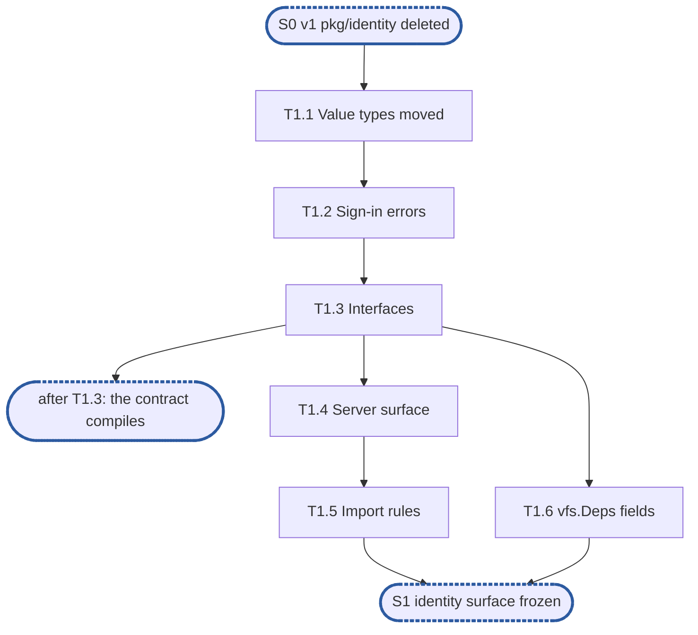

# Epic 1: identity v2 contract and the server's surface

**Sources:** [RFC 18](../rfcs/rfc-18-identity.md) §2.6 and §2.7 as declarations, the interfaces
of §3.1, §4.1, §6.1 and §8.1 (without `TokenVerifier`), and §9.1's ID11, as pull request
#4058 merged them (83232b441); [RFC 17](../rfcs/rfc-17-vfs.md) §2.3 (`vfs.Deps`), §3.0 (aliases) and §4.3 (errors);
[RFC 20](../rfcs/rfc-20-adapters.md) §2.3, §7.1 (the import test) and §7.3 (error-table
totality); [RFC 16](../rfcs/rfc-16-metadata-store.md) §3, for `SharePolicy` only.
**Track:** the team.
**Epic 1 estimate: 6 subtasks, 5.25 man-days.**
**Depends on:** **S0**: RFC 23's plan's epic 1 has deleted v1's `pkg/identity`, whose path
this epic reuses, and `pkg/auth/sid/mapper.go`, with their importers. Nothing of #4059 is
needed (D4).
**Blocks:** E2, E3 and E4, which start at **S1**, the identity surface frozen, and through
them every later epic.

---

## 1. Goal

Epic 1 declares identity's contract and the server every later epic fills in, so that the
three tracks can start at once against signatures that no longer move.

**At the end of the epic:**

- `pkg/identity` holds the value types `pkg/vfs` declares today, moved, plus `Caller`, the
  four interfaces and `NewHashes`'s signature, and re-exports the two new errors;
- `pkg/vfs` aliases the moved types, and every importer builds unchanged;
- `internal/identity` builds a `*Server` with `New`, `Apply`, `Start` and `Stop`, its other
  methods stubbed behind final signatures;
- `vfs.Deps` carries `Identity`, `Auth` and `Names`;
- the import rules RFC 18 §2.7 states are checked, each by a check that reports its seeded
  violation.

### 1.1 In scope

The move of the value types; `ErrLogonFailure` and `ErrUnknownPrincipal` in `vfserr`; the
interfaces `Authenticator`, `Identities`, `Resolver` and `APISignIn` with the types their
signatures name; `internal/identity`'s `Deps`, `New`, `State`, `Apply`, `Start`, `Stop`; the
three `vfs.Deps` fields; the import checks; `internal/identity/**` in the `e2e` suite's
`kerberos` cell's `paths:`.

### 1.2 Out of scope

- Every body behind the server's stubs: `SignIn` (E4, E5, E7), `Spell` and `Find` (E2, E6),
  `Resolve` (E3), `Lookup`, `VerifyPassword`, `Account` and `NewHashes`'s body (E2).
- Refusing a forwarded `Identity` that is inconsistent with itself as `ErrInvalid` (RFC 18
  §2.6): E3, in `Resolve`.
- `Identity.Key()` and the proof key (RFC 18 §7.1): E3, with the caller cache that is their
  first consumer (D3).
- `Scheme.Stored()` (RFC 18 §4.1): E2, with the index rows it reports on (D3).
- Routing `*vfs.Filesystem`'s `SignIn`, `Spell` and `Find` through the new fields, and
  admission's resolution through `Deps.Identity`: E3 and E4, at S2.
- `Apply` refusing an invalid setting and keeping the last applied (RFC 18 §2.6): E2, the
  first epic that declares a setting, since epic 1's `State` holds none that can be invalid.
- The directory client dialling lazily, so a down directory does not fail `Start` (RFC 18
  §2.6): E6.
- Every other `Deps` and `State` field RFC 18 §2.6 names, the tracer among them, each with
  the first subtask that reads it, as §2.6 says (D4).
- `HoldJoinCredential(id, cred) (release func())`, which keeps the online join's administrator
  credential in memory under the operation's ID: called by RFC 23's plan's epic 4 (its T4.11,
  whose D13 declares it), built in E7. The plan's §3 sketch gains the return value.
- `TokenVerifier`, `TokenClaims`, `IssuerKeys` and `Deps.Issuers` (RFC 18 §8.2): deferred, the
  plan's deferral ledger row "OpenID Connect's `TokenVerifier`".
- `identitytest`'s in-memory directory and domain controller: E6 and E7.
- Rebuilding `internal/vfs/authz.Caller` on `identity.Caller`: E3.

### 1.3 Names used here

- **E1**, this epic.
- **E2**, principals and accounts: the `Minter`, well-known principals, `Spell`, `Find`,
  `NewHashes`, `APISignIn`.
- **E3**, resolution: `admit`'s resolver moved into identity, the serial `Apply` raises, which
  each `Caller` is stamped with, the proof key and admission's caller cache.
- **E4**, local NTLMv2 sign-in.
- **E5**, Kerberos and the PAC.
- **E6**, the directory.
- **E7**, NETLOGON and the machine account.
- **E8**, the integration epic: identity composed into the node.
- **S0**, before the plan: v1's `pkg/identity` and `pkg/auth/sid/mapper.go` deleted, with
  their importers, by RFC 23's plan's epic 1.
- **S1**, the identity surface frozen: what this epic delivers.
- **S2**, NTLM sign-in and resolution in `vfs`: E3 and E4 done.

## 2. How the general rules apply

The rules are those of
[the RFC 18 plan's §1.5](rfc-18-identity-plan.md#15-general-rules-for-each-epic), cited by
number and title and not copied.

| Rule | Subtasks | How |
| --- | --- | --- |
| rule 1, independent unit tests ([`CLAUDE.md`, "Writing tests"](../../../CLAUDE.md#writing-tests)) | T1.1, T1.2, T1.4, T1.5 | no test double: the lifecycle tests use the memory KV store and the leak check, `prof.Watch` (`internal/prof`); the import checks walk the repository's own files |
| rule 2, fuzz every decoder of untrusted bytes | none | epic 1 decodes nothing |
| rule 3, observability follows RFC 25 | T1.4 | `Deps` takes the metrics registry and the logger; epic 1 owns none of RFC 18 §9.2's series and opens no span, since its methods are stubs, so `Deps.Tracer` arrives with E3's `identity.resolve` span, the first that reads it (D4) |
| rule 4, profiling | T1.4 | the lifecycle tests run under `prof.Watch` (`internal/prof`), which is how R11 and R14 are proven |
| rule 5, public interface and internals ([`CLAUDE.md`, "Verifying a change"](../../../CLAUDE.md#verifying-a-change)) | T1.4, T1.5 | R10 is held by the type: `*kvstore.Store` has no `Close`, so the server cannot close what it was handed; each import rule by the check that reports its seeded violation |
| rule 6, known failures shrink | none | no suite RFC 18 names keeps a `known.yaml`; nothing lands red |
| rule 7, v2 ignores v1 | T1.1, T1.6 | the types move from `pkg/vfs`, which is v2; nothing of v1's `pkg/identity` is read or kept, its path reused only after S0 |
| rule 8, real dependencies for properties of those dependencies | none | no external system is reached |
| rule 9, code comment conventions ([`CLAUDE.md`, "Code comments"](../../../CLAUDE.md#code-comments)) | T1.2, T1.4, T1.6 | RFC 18 §2.6's `decision:` (identity is one component, not part of `vfs`) at `Server`; D2, D4 and D7's markers at their sites |
| rule 10, a test must be able to fail | all | R7, R15 and R16 are held by the compiler, R10 by `*kvstore.Store` having no `Close`, R3 and R4 by RFC 20's existing import test, each named as such; every other row by a test that fails on its assertion |
| rule 11, a symbol is exported only if RFC 18's interfaces use it | T1.1, T1.3, T1.4 | `Key`, `Stored` and `TokenVerifier` are left out (D3, §1.2); `internal/identity` exports only what `internal/node` and the API call; `Deps` and `State` gain fields after S1, as the rule and RFC 18 §2.6 allow (D4) |
| rule 12, each subtask creates only what it declares | all | no empty package; the stub bodies behind final signatures are the one exception the Design principles allow, and the `vfs.Deps` fields are the seam S1 freezes (D7) |

## 3. Requirements and invariants

Every obligation RFC 18 and the related RFCs place on this epic, numbered so that subtasks and
tests can cite them. Sources are RFC 18 unless named.

**The contract and its packages**

| # | Requirement | Kind | Source | Subtasks |
| --- | --- | --- | --- | --- |
| R1 | The contract is `pkg/identity`: the value types `Identity`, `ProofKind`, `Protection`, `Claims`, `Evidence`, `Keys`, `SignInStep`, `SignInResult`, `Caller`, `Spelling`, `Scheme`, `SID`, `NTLMAuthenticate`; the interfaces of §3.1, §4.1, §6.1 and §8.1; and `NewHashes` | invariant | §2.7 | T1.1, T1.3 |
| R2 | `pkg/identity` is a leaf importing metadata types only | invariant | §2.7 | T1.1, T1.5 |
| R3 | `pkg/vfs` aliases the value types an adapter needs, so an adapter imports `pkg/vfs` alone and neither identity package | invariant | §2.7; RFC 17 §3.0; RFC 20 §2.3 | T1.1, T1.5 |
| R4 | Adapters map, squash and grant nothing; every spelling goes through `vfs.Service`'s `Spell` and `Find`, held by RFC 20 §7.1's import test (ID11) | invariant | §9.1 ID11; RFC 20 §7.1 | T1.5 |
| R5 | Only `internal/node` imports the server, `internal/identity` or any package under it, besides identity's own packages and `pkg/vfs/vfstest/memory`, which imports `internal/identity/identitymem` alone (E3's T3.6); `_test.go` files are not checked, since `*vfs.Filesystem`'s tests use the real server | invariant | §2.7; §10 "Who stands in for what" | T1.5 |
| R6 | Only `internal/identity/directory` imports LDAP; `internal/auth/netlogon`, which S0 leaves and whose `join.go` imports it, is exempt by a `decision:` until E7 moves it into `internal/identity/netlogon` and removes the exemption | invariant | §2.7 | T1.5 |
| R7 | `Authenticator` is the same shape as `vfs.Principals.SignIn`, so the filesystem passes it through | invariant | §3.1 | T1.3, T1.6 |
| R8 | `ErrLogonFailure` and `ErrUnknownPrincipal` are `vfserr`'s, and `vfs.Errors()` returns both; the adapter rows that map them are the RFC 21 and RFC 22 plans' (the plan's deferral row) | MUST | §2.7; RFC 17 §4.3; RFC 20 §7.3 | T1.2 |
| R9 | `Evidence` holds no key, and `Keys` travel beside an `Identity`, never in it | invariant | §3.1 | T1.1 |

**The server's surface and lifecycle**

| # | Requirement | Kind | Source | Subtasks |
| --- | --- | --- | --- | --- |
| R10 | The identity server is built from one `Deps`, builds no other component and closes nothing it was handed | invariant | §2.6 | T1.4 |
| R11 | `New` takes no settings and starts nothing | invariant | §2.6 | T1.4 |
| R12 | `Apply` delivers `State` as one snapshot, swapped in whole, so no reader sees part of one `Apply` and part of another | invariant | §2.6 | T1.4 |
| R13 | The first `Apply` comes before `Start`: a `Start` with no `State` applied is refused | invariant | §2.6 | T1.4 |
| R14 | `Stop` leaves no goroutine; dropping the in-memory tables is owed by the first epic that keeps one (E4's T4.4 throttle) | invariant | §2.6 | T1.4 |
| R15 | `*Server` implements `Authenticator`, `Identities`, `Resolver` and `APISignIn` (`TokenVerifier` deferred) | invariant | §2.6 | T1.4 |
| R16 | Each consumer is handed only the interface it calls: `vfs.Deps.Identity` a `Resolver`, `vfs.Deps.Auth` an `Authenticator`, `vfs.Deps.Names` an `Identities`; the API an `APISignIn` | invariant | §2.6, §8.1; RFC 17 §2.3 | T1.3, T1.6 |

Which test or enforcer holds each row is in its subtask's **Tests**. R1, R7, R15 and R16 are
held by the compiler: E1's interface assertions (T1.4, T1.6) and the consumers E2 to E4 build.

## 4. Decisions this epic takes

- **D1, the moved types keep their `pkg/vfs` names.** `pkg/vfs` aliases each moved type under
  the name it has today (`type Identity = identity.Identity`), so its importers do not change.
  The one rename is RFC 18's `Service`, which `pkg/vfs` keeps as `SignInService`: `vfs.Service`
  is the filesystem's interface. The `ponytail:` in `pkg/vfs/types.go` that asks for this move
  goes with it. Prior art: RFC 17 §3.0 aliases the store's and open state's types the same way;
  Go's own `golang.org/x/net/context` became an alias of `context` (from memory). `SID` aliases
  `sid.SID`, a standard-library-only codec, so `pkg/auth/sid` is the one non-metadata import
  besides `vfserr` (D2).
- **D2, `pkg/identity` re-exports `vfserr`'s two errors.** RFC 18 §2.7 and RFC 17 §4.3 place
  `ErrLogonFailure` and `ErrUnknownPrincipal` in `pkg/vfs/vfserr`; `pkg/identity` and `pkg/vfs`
  re-export the same values, so E2 to E7 write `identity.ErrLogonFailure` and an error identity
  returns reaches an adapter's table unmapped. `vfserr` imports only the standard library, so
  R2 holds. A `decision:` note at the re-export says why. Prior art: RFC 17 §4.3 moved the
  engine's errors into `vfserr` for the same reason.
- **D3, a method or field lands with its first consumer.** `Identity.Key()` and `ProofKey`
  land in E3 with the caller cache, which keeps no digest in `Evidence` (E3's D4);
  `Scheme.Stored()` in E2 with the index rows. Adding a method or an unexported field later breaks no caller, so
  nothing migrates. Prior art: none found.
- **D4, `Deps` and `State` hold only what exists and is read.** RFC 18 §2.6 calls its
  sketch the composed shape, each field added with the first code that reads it; D4 applies
  that rule to epic 1. Epic 1's `Deps` is `Store`, `Clock`, `Metrics` and `Logger`; its
  `State` is `{Generation uint64}`, the principals generation. Each later field arrives with
  the first subtask that reads it, and each later epic's document names the field it adds;
  `Deps.Issuers` is deferred with `TokenVerifier`. `Generation` is the one field E1 adds before its
  reader (E3's T3.3), so `Apply` has a value to swap and R12 and R13 can be tested. The serial
  E3 stamps callers with is the server's, raised by `Apply`, not a `State` field (E3's D2). A
  field that lands after S1 is never required by `New`: while it is unset, a method that needs
  it answers `ErrUnavailable` (fail closed), as D7's stubs do, so no earlier caller of `New`
  changes. A field added to a struct only
  `internal/node` and tests build costs no migration, and epic 1 then waits on nothing of
  #4059. Prior art: RFC 17 §2.3's `vfs.Deps` grew its fields the same way on
  `feat/storage-v2`.
- **D5, withdrawn:** RFC 18 §2.6 now declares the store field as `Store *kvstore.Store`, the
  choice D5 made.
- **D6, `SharePolicy` is declared in `entity` as RFC 16 §3 states it.** `Resolver.Resolve`
  takes it, so the type must exist at S1; the read that fills it is E3's. RFC 18's `metadata.`
  prefix is `entity` on this branch, where the store's value types live. Prior art: RFC 16 §3.
- **D7, the stubs answer `ErrUnavailable`.** Every stubbed method of `*Server`, and
  `NewHashes`, returns `ErrUnavailable`: one of the three errors RFC 18 §3.1 allows `SignIn`,
  never "unknown principal" (§4.1) and never a session, so a premature wiring fails closed.
  Each carries a `ponytail:` naming the behaviour that replaces it (an epic's ID never goes in
  a comment). The three `vfs.Deps` fields carry a
  `decision:` note: read by nothing until E3 and E4, they are the seam S1 freezes. Prior art:
  `internal/vfs/shares.go`'s `errUnsigned` fails closed today, but with `ErrAccess`, which §3.1
  does not allow; E4's T4.3 removes it.
- **D8, withdrawn:** RFC 18 §8.1 now gives `PasswordHashes` and `NTLMSetting` the shapes D8
  chose.
- **D9, withdrawn:** RFC 18 §8.1 as merged declares `Lookup(ctx, name) (Principal, error)`
  and `VerifyPassword(ctx, p, password) error`, the shape D9 chose from #4050's A7, so the API
  counts an attempt against the principal before checking it (RFC 23 §5.3).

## 5. Target tree

```text
pkg/identity/
  identity.go       T1.1  Identity, ProofKind, Protection, Claims, Evidence, SID
  signin.go         T1.1  SignInStep, SignInResult, Keys, Service, NTLMAuthenticate
                    T1.3  Authenticator
  names.go          T1.1  Scheme, Spelling
                    T1.3  Identities, FindOpts
  errors.go         T1.2  ErrLogonFailure, ErrUnknownPrincipal, re-exported from vfserr
  resolve.go        T1.3  Resolver, Caller, ReadOnlyCause
  api.go            T1.3  APISignIn, NewHashes, PasswordHashes, NTLMSetting
  identity_test.go  T1.1  no key in an Identity
  arch_test.go      T1.5  the leaf rule, R5 and R6, with seeded violations in testdata/arch
pkg/vfs/types.go            T1.1  the moved declarations become aliases
pkg/vfs/vfserr/vfserr.go    T1.2  the two errors
pkg/vfs/errors.go           T1.2  their aliases, in Errors()
pkg/metadata/entity/        T1.3  SharePolicy (D6)
internal/identity/
  server.go         T1.4  Deps, Clock, State, Server, New, Apply, Start, Stop
  stubs.go          T1.4  SignIn, Spell, Find, Resolve, Lookup, VerifyPassword, Account
  server_test.go    T1.4  the lifecycle
internal/vfs/filesystem.go  T1.6  Deps.Identity, Auth, Names
test/suites.yaml            T1.5  internal/identity/** and pkg/identity/** in the e2e kerberos cell's paths
```

## 6. Subtasks

### T1.1 Value types into `pkg/identity`, aliased by `pkg/vfs`

**Subtask T1.1 estimate: 1 man-days.**

- **Track:** the team. **Depends on:** S0.
- **Covers:** R1, R2, R3, R9.
- **Deliverables:** `pkg/identity` with `Identity`, `ProofKind` and its constants,
  `Protection` and its constants, `Claims`, `Evidence`, `SID` (an alias of `sid.SID`),
  `SignInStep`, `SignInResult`, `Keys`, `Service` with `ServiceNFS`, `ServiceCIFS`,
  `ServiceHost`, `NTLMAuthenticate`, `Scheme` with its constants, and `Spelling`, moved from
  `pkg/vfs/types.go` with their comments brought to RFC 18 §3.1, §4.1 and §6.1's wording,
  `Keys.Session`'s chain among them (NTLM's exported session key; for Kerberos the acceptor's
  subkey, else the authenticator's, else the ticket's session key, kept whole). `pkg/vfs`
  aliases each (D1). Consumed by T1.3, by every adapter through `pkg/vfs`, and by E2 to E7.
- **Acceptance criteria:**
  - `go build ./...` and `go vet` pass with no importer of `pkg/vfs` changed.
  - `pkg/identity` imports only the standard library, `entity`, `pkg/auth/sid` and `vfserr`.
- **Tests:** in `pkg/identity`: a reflection walk over `Identity`, recursively, that fails on
  any field of type `Keys` or of a byte-slice type (catches a session key added to the
  identity, R9). The leaf rule is T1.5's. No test double.

### T1.2 The two sign-in errors

**Subtask T1.2 estimate: 0.5 man-days.**

- **Track:** the team. **Depends on:** T1.1.
- **Covers:** R8.
- **Deliverables:** `vfserr.ErrLogonFailure` and `vfserr.ErrUnknownPrincipal`, with RFC 17
  §4.3's meanings; their aliases in `pkg/vfs` and in `vfs.Errors()`; their re-export in
  `pkg/identity` with D2's `decision:` note. Consumed by T1.3's interface comments, by T1.4's
  stubs (D7), by E2 to E7, and by every adapter's error table.
- **Acceptance criteria:**
  - `errors.Is(identity.ErrLogonFailure, vfs.ErrLogonFailure)`, as one value.
  - `vfs.Errors()` returns both.
- **Tests:** `pkg/vfs`'s existing `Errors()` test gains both in its expected list (catches
  an error left out of `Errors()`, which would let an adapter's table skip it, R8); the
  `vfstest` suite's neutral-error check then accepts a `SignIn` answering either. No test
  double.

### T1.3 The interfaces and the types their signatures name

**Subtask T1.3 estimate: 1 man-days.**

- **Track:** the team. **Depends on:** T1.2.
- **Covers:** R1, R7, R16.
- **Deliverables:**
  - `Authenticator{ SignIn(ctx, SignInStep) (SignInResult, error) }` (§3.1), consumed by
    `vfs.Deps.Auth` (T1.6) and implemented by `*Server` (T1.4);
  - `Identities{ Spell(ctx, entity.Principal, Scheme) (Spelling, error); Find(ctx, Spelling,
    FindOpts) (entity.Principal, error) }` and `FindOpts{ Mint bool }` (§4.1), which the
    filesystem sets from the call's proof (E3 routes it), consumed by `vfs.Deps.Names`;
  - `Resolver{ Resolve(ctx, Identity, entity.SharePolicy, readOnly bool) (*Caller, error) }`,
    `Caller` with every field §6.1 lists, and `ReadOnlyCause` with `ReadOnlyNotNarrowed`,
    `ReadOnlyGrant`, `ReadOnlyShare` (§6.1's `NotNarrowed`, `Grant`, `Share`, prefixed as Go
    names an enum's values, like `ProofNone`), consumed by `vfs.Deps.Identity` and by E3;
  - `entity.SharePolicy` as RFC 16 §3 declares it (D6), consumed by `Resolver`;
  - `APISignIn{ Lookup(ctx, name string) (entity.Principal, error); VerifyPassword(ctx,
    entity.Principal, password []byte) error; Account(ctx, entity.Principal) (entity.User,
    error) }` (§8.1), consumed by RFC 23's plan's epic 5;
  - `NewHashes(u entity.User, password []byte, ntlm NTLMSetting) (PasswordHashes, error)`,
    `PasswordHashes{ Password, NTHash []byte }` and `NTLMSetting{ On bool; Revision uint64 }`
    (§8.1), with D7's stub body, consumed by E2 and RFC 23's plan's epic 5.
- **Acceptance criteria:**
  - Each signature is RFC 18's, with `metadata.` read as `entity.` (D6).
  - Each interface's comment states its error contract as §3.1, §4.1 and §8.1 do.
- **Tests:** none of its own: declarations only, held by the compiler through T1.4's and
  T1.6's assertions (rule 10).

### T1.4 The server's surface and lifecycle

**Subtask T1.4 estimate: 1.5 man-days.**

- **Track:** the team. **Depends on:** T1.3.
- **Covers:** R10, R11, R12, R13, R14, R15.
- **Deliverables:** `internal/identity`: `Deps{ Store *kvstore.Store; Clock Clock; Metrics
  *metrics.Registry; Logger *slog.Logger }` (RFC 18 §2.6, D4); `Clock{ Now() time.Time }`, the
  package's own subset, to which E2's T2.6 adds `After`; `State{ Generation uint64 }` (D4); `New(Deps) (*Server, error)`;
  `Apply(State) error`, swapping an `atomic.Pointer`; `Start(ctx) error`; `Stop(ctx) error`;
  the stubbed `SignIn`, `Spell`, `Find`, `Resolve`, `Lookup`, `VerifyPassword` and `Account`
  (D7); `var _` assertions for the four interfaces; RFC 18 §2.6's `decision:` at `Server`.
  Consumed by E2 to E7, which fill the stubs, and E8, which composes it.
- **Acceptance criteria:**
  - `New` refuses a `Deps` with no store, and starts no goroutine.
  - `Start` before any `Apply` is refused; after one it succeeds.
  - `Stop` leaves no goroutine; the store it was handed has no `Close`, so R10 is held by the
    type.
- **Tests:** at the lifecycle `internal/node` will call, over the memory KV store, each
  under `prof.Watch`: `New` with a nil `Store`, refused (catches a server built with nothing to
  read); `New` then `Stop` with no `Start` (catches work started in `New`,
  R11); `Start` with no `Apply` (catches a server that runs with no `State`, R13); `Start` then `Stop` (catches a goroutine left behind, R14); concurrent
  `Apply` calls and a reader of the current `State`, through an `export_test.go` accessor,
  under `-race`, the only run in which it can fail (catches an unsynchronised write of `State`; with one field, R12's "part of one
  `Apply` and part of another" cannot happen here, so E2's T2.4, where `State` gains `Settings`,
  owes the snapshot test: concurrent `Apply`s of matched `{Generation, Settings}` pairs and a
  reader asserting each `Settings` belongs to its `Generation`). No test double: the memory KV
  store is the real implementation RFC 16's suite holds.

### T1.5 The import rules

**Subtask T1.5 estimate: 0.75 man-days.**

- **Track:** the team. **Depends on:** T1.4.
- **Covers:** R2, R3, R4, R5, R6.
- **Deliverables:**
  - `pkg/identity/arch_test.go`, walking the module as `internal/vfs/arch_test.go` does:
    `pkg/identity` imports only the standard library, `entity`, `pkg/auth/sid` and `vfserr`;
    no non-test package but `internal/node` and identity's own packages imports
    `internal/identity` or any package under it, except `internal/identity/identitymem`, whose one
    importer E3's T3.6 restricts to `pkg/vfs/vfstest/memory`; `internal/node` is the package
    alone, so `internal/node/nodetest` imports nothing under `internal/identity` (a `node_test`
    test hands the node identity's in-memory seams through `nodetest.WithNew` and
    `internal/node`'s `export_test.go`, E8's D4); `_test.go` files are not checked, since `*vfs.Filesystem`'s tests use
    the real server (RFC 18 §10). `pkg/vfs/vfstest/memory`, the verified in-memory
    `vfs.Service`, needs the real server too once E3's T3.6 makes `vfs.New` require it; it
    reaches it through `internal/identity/identitymem` (E3's T3.6), one of identity's own
    packages, and passes the value it returns as `vfs.Deps`' three fields without naming
    `internal/identity`;
    no package but `internal/identity/directory` imports `github.com/go-ldap/ldap/v3`, with
    `internal/auth/netlogon` exempt by a `decision:` at the check, since S0 leaves it and its
    `join.go` imports LDAP. E7 removes the exemption when it moves the package into
    `internal/identity/netlogon`, where `join.go`'s LDAP calls go through
    `internal/identity/directory` or R6 fails. Seeded
    violations of each in its `testdata/arch`, among them a non-test `internal/vfs` file
    importing `internal/identity` and a non-test package importing
    `internal/identity/directory`, `internal/node/nodetest` among them;
  - `internal/identity/**` and `pkg/identity/**` in `test/suites.yaml`'s `e2e` `kerberos`
    cell's `paths:`, so a change to the server or the contract runs the Kerberos cell.
- **Acceptance criteria:**
  - Each check reports each of its seeded violations, once, and nothing in the repository.
- **Tests:** the seeded-violation tests are the tests: removing a rule, or widening one so
  it allows the seed, fails them on their assertion (catches a check that cannot fail, R2,
  R5, R6). R3 and R4 are already held by RFC 20 §7.1's import test: its allowlist refuses any
  module package but its listed ones, and `TestImportCheckReportsEachSeededViolation` already
  seeds an adapter importing `pkg/identity`, so no new seed is added. No test double.

### T1.6 `vfs.Deps`' three identity fields

**Subtask T1.6 estimate: 0.5 man-days.**

- **Track:** the team. **Depends on:** T1.3.
- **Covers:** R7, R16.
- **Deliverables:** `vfs.Deps.Identity identity.Resolver`, `Auth identity.Authenticator`,
  `Names identity.Identities` (RFC 17 §2.3), each with D7's `decision:` note; `var _
  identity.Authenticator = (*Filesystem)(nil)`, which holds R7 since `*vfs.Filesystem`
  implements `vfs.Principals.SignIn`. Consumed by E3 (admission and `Find`'s routing) and E4
  (`SignIn`).
- **Acceptance criteria:**
  - `internal/vfs` and its tests build with the fields unset; no behaviour changes.
- **Tests:** none of its own: the compiler holds R7 and R16 (rule 10).

## 7. Order of work



Checkpoint after T1.3: the contract compiles and E2 to E4 can read its signatures. S1 is
reached once T1.5 and T1.6 have landed.

## 8. Suggested pull requests

| PR | Subtasks | Man-days | After | Why together |
| --- | --- | --- | --- | --- |
| 1 | T1.1, T1.2, T1.3 | 2.5 | — | the contract: moved types, errors and interfaces, one review of `pkg/identity` |
| 2 | T1.4, T1.5, T1.6 | 2.75 | PR 1 | the server, its seams and the rules that keep them apart; its merge is S1 |

A suggestion only: one pull request per subtask works as well.

## 9. Open points

Sources: RFC 18 as #4058 merged it (83232b441).

**Decisions other epic documents ask of this surface**, each pending the user's answer in that
document, with its recommendation:

- **`Resolver.Current() uint64` (E3's D3).** Admission needs the current `State`'s serial to
  refuse a stale caller (RFC 18 §7.2), and `Resolver` declares only `Resolve`. Recommended
  there: add the method, amending RFC 18 §6.1. If it is agreed before S1, T1.3 declares it and
  T1.4 stubs it; otherwise E3's T3.3 adds it to the frozen surface, whose only implementer is
  `*Server`.
- **`ProofKind` and `Protection`: identity's own, or aliases of `entity`'s.** `pkg/vfs` declares
  both today, and `entity` (`control.go`) declares its own with the same values for the share
  policy. T1.1 moves `pkg/vfs`'s, so E3's `Resolve` compares an
  `Identity`'s proof against `SharePolicy`'s across two types. Aliasing `entity`'s instead keeps
  R2 (a metadata type) and removes the conversion. Recommended: alias `entity`'s.
- **A stopped server answering `ErrUnavailable`.** T1.4's `Stop` ends the server's goroutines
  and leaves its methods answering from the store, so E8's node test cannot see whether the node
  stops identity after its callers (E8's R4). If every method of a stopped `*Server` answers
  `ErrUnavailable`, which E2 to E7 then keep as they fill the stubs, that test can hold the order.
  Recommended: add it to T1.4 as an acceptance criterion and a test, at about 0.25 man-days, once
  agreed.
- **`State.NTLM`, the `identity.ntlm` revision (E2's D6).** Recommended there: it lands with its
  first reader, and RFC 18 §2.6 names that reader or drops the field.

**Where the plan and the RFCs disagree, or leave a gap:**

- **The tracer's epic.** The plan's §1.3 gives `Deps.Tracer` to epic 4. E3's T3.1 opens
  `identity.resolve`, the first span identity opens in the order of work, so by rule 12 and
  RFC 18 §2.6 the field arrives there (D4), and E4 reads it. RFC 18 §2.6's comment on the field
  names only §9.2's `identity.authenticate` span; it should name `identity.resolve` too.
- **Two `ReadOnlyCause` types.** `entity` already declares one, with `NotNarrowed`,
  `NarrowedByShare` and `NarrowedByClient` (`pkg/metadata/entity/names.go`), meaning a cause
  other than the grant; T1.3's `identity.ReadOnlyCause` also counts the grant and folds share and
  client rule into `ReadOnlyShare`. Unlike `ProofKind`, it cannot be aliased; the chokepoint
  reads `entity`'s, so E3's T3.6, which rebuilds `authz.Caller`, maps one onto the other, and
  E3's §9 holds the question. RFC 18 §6.1's field comment still lists
  `NotNarrowed`, `Grant` and `Share`; the RFC's next fold renames them to T1.3's prefixed names.
- **The estimate.** The plan's figure for epic 1 is 6 subtasks, 6 man-days; this document's is
  6 subtasks, 5.25 man-days.
