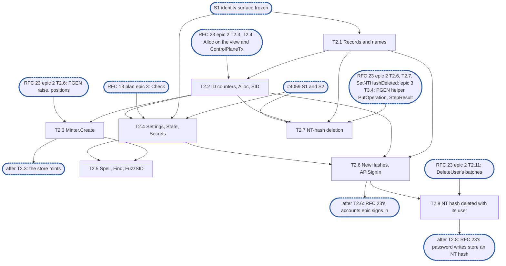

# Epic 2: identity v2 principals and accounts

**Sources:** [RFC 18](../rfcs/rfc-18-identity.md) §2.1 to §2.3, §2.4's API-only accounts and machine
record, §2.5's group records, §2.6's settings, `Apply` and `Deps.Secrets`, §3.5's NT-hash rules and
NTLM-off deletion, §3.7's marked-deleted account, §4.1 (but its mint, §1.2), §4.4, §4.6, §8 and
§8.1, §9.1's ID2, ID3, ID4 and ID5, §9.2's `identity_unmapped_total`, §10's "name case", "no local
password for a directory user" (its `NewHashes` half), its Fuzz and Unit paragraphs, and §12 item 1,
as pull request #4058 merged them (83232b441); [RFC 16](../rfcs/rfc-16-metadata-store.md) §2.2
(root's fixed ID, uid and gid 0 and 65534), §2.3 (`User`'s `Password` and `NTHash`, the machine
record), §3 (`Minter.Create`, `Alloc`, `MintBatch`, `ControlPlane.PutUser`
and `PutGroup`, and `DeleteUser`'s secret deletion) and §4.2's `NX‖kind‖name`, `PGEN`, `CFGGEN`,
`IN` and `IDS‖kind` rows; [RFC 13](../rfcs/rfc-13-configuration.md) §7's "a user's secrets go with
the user"; [RFC 23](../rfcs/rfc-23-control-plane.md) §4.1 and §4.6, for the
`identity.nt-hash-delete` operation; RFC 13 Appendix B's `identity.id_range`, `identity.ntlm` and
`identity.netbios_name` rows; RFC 23's epic 2 document (pull request #4326), D2, T2.3 and T2.4,
which declare `entity.Alloc` on `PutUser` and `PutGroup` and refuse an ID until this epic's
counters land, T2.2 (`Installation.NTLMOff`, its R54), T2.6 (positions and the `PGEN` raise), and
D8 and T2.11 (`DeleteUser`'s mark, batches and secret deletion); RFC 23's epic 3 document (pull
request #4336), D7 and T3.4 (the runner's `StepResult`, `Step` and `Progress`).
**Track:** C.
**Epic 2 estimate: 8 subtasks, 14.25 man-days.**
**Depends on:** **S1**, epic 1's identity surface frozen. **#4059's S1 and S2**: `pkg/settings`
and `pkg/secrets` frozen, with `Seal` taking the kind, the owner and `secrets.Meta`, the kvstore
secrets view (`Secret`, `PutSecret`, `PruneSecret`) on the view and on `ControlPlaneTx`, and
secrets sealed and resolved under each role's key (T2.4, T2.6, T2.7). **The RFC 13 plan's epic
3**, for T2.4 only: its `Check`, which runs the identity section's check against the ID counters
(D1). **RFC 23's plan's epic 2**
(#4326), partly: T2.2 waits for its T2.3 and T2.4 (`entity.Alloc` on `PutUser` and `PutGroup`,
on the view and on `ControlPlaneTx`, refused until T2.2 lands, its D2); T2.3 for its T2.6 (the
once-per-transaction `PGEN` raise and the records' `Position`); T2.8 for its T2.11 (`DeleteUser`'s
mark and batches, whose last batch deletes the secrets the record references, its D8); T2.7 for
its T2.6 (the `PGEN` helper) and T2.7 (`PutOperation`), and for `ControlPlaneTx.SetNTHashDeleted`,
which #4336 added to RFC 23's epic 2; everything else starts before it. **RFC 23's plan's
epic 3**, for T2.7 only: its T3.4, whose `internal/node/step` types the step returns. RFC 23's
plan's epic 1 (#4314, D1) deletes v1 first, which S1 already waits on.
**Blocks:** **E6**, whose T6.2 is identity's one mint path over T2.3's `Create`, and which also
waits for T2.4 (T6.3, T6.5; T6.9 reads the range), T2.2 and T2.5 (T6.9) and T2.6's `Clock.After`
(T6.5); **E5**, whose T5.9 mints machines through E6's T6.2, and which waits for T2.4 (T5.2), T2.2
(T5.7, the domain SID) and T2.1 (T5.9, `Machine`); **E3**, partly, whose T3.10 needs root (T2.1;
anonymous already exists) and whose `ntlm_off` refusal reads the `NTLM` key of T2.4's
`State.Settings`; **E4**, partly, whose local check reads T2.1's `NTHash`, finds a user by name
through T2.5's `Find`, signs in against T2.6's `NewHashes` and resolves through T2.4's
`Deps.Secrets`, and whose routing reads T2.4's `identity.netbios_name`; and RFC 23's plan's epic
5, which builds its accounts on T2.6's `NewHashes` and `APISignIn`, and whose password writes (its
T5.7 and T5.10), the first code to store an NT hash, wait for T2.8; and RFC 23's plan's epic 4,
whose user and group creates (its T4.10) draw IDs through `Alloc` from T2.2's counters.

---

## 1. Goal

Epic 2 gives identity its principals and the accounts behind them: the store allocates every ID
once, names are unique the way Windows and directories compare them, spellings map both ways, and
a password is derived and checked, and while NTLM is off it is never kept as an NT hash.

**At the end of the epic:**

- root is the well-known principal `0x0D`, uid and gid 0 and 65534 are held by rule, and a
  `Machine` record exists as RFC 16 §2.3 shapes it;
- user and group names are unique under simple Unicode case folding, and a local name with `@` is
  refused;
- uids, gids and RIDs come from three counters that only rise, inside the transaction that writes
  the record, through `Alloc` on `Minter.Create` and behind RFC 23's plan's `entity.Alloc` on
  `PutUser` and `PutGroup`, whose refusal of an ID this epic replaces;
- `Minter.Create` writes a batch whole or not at all;
- `Spell` and `Find` answer the stored schemes, `qualified` and the well-known SIDs, and `FuzzSID`
  runs in `unit`;
- `NewHashes`, `Lookup`, `VerifyPassword` and `Account` have bodies;
- `State` carries identity's settings, `Apply` refuses an invalid one, and `Deps` takes the secret
  provider;
- turning NTLM off runs `identity.nt-hash-delete`, which leaves no NT hash in the store, and
  deleting a user deletes its NT hash with its password hash.

### 1.1 In scope

`entity`'s root ID, `PrincipalMachine`, `SchemeDir`, `User.Password` and `User.NTHash`; kvstore's
refusals of a well-known principal, of uid and gid 0 and 65534, of a malformed machine record, of a
SID change and of a file principal without its uid or gid and SID; the name fold and the `@` rule;
the `IDS‖0x04` (uid), `IDS‖0x05` (gid) and `IDS‖0x06` (RID) counters and the installation's domain SID; the allocation
behind `Alloc` on `PutUser` and `PutGroup`; `Minter.Create`; identity's settings section,
`State.Settings`, `Apply`'s refusal and `Deps.Secrets`; `Scheme.Stored()`, `Spell` and `Find`;
`FuzzSID`; `NewHashes`, `Lookup`, `VerifyPassword` and `Account`; `NTHash` among the secrets
`DeleteUser` deletes; the `identity.nt-hash-delete` step, its progress and its store call.

### 1.2 Out of scope

- Identity's one mint path (RFC 18 §4.1's re-runs on `ErrExist`, "a re-run that binds none fails
  `ErrUnavailable`") and `identity_mints_total`: E6's T6.2; E5's T5.9 mints through it. This epic
  has no caller for it, and gives it `Create`.
- `Minter.Rename` and `Minter.SetEmail`, and `identity_mints_unnamed_total`: E6, which decides a
  name is held or given up (RFC 18 §5.1). T2.3 writes the `Unnamed` mark E6 sets.
- `User.Email`: RFC 23's plan's epic 2 adds it with `Role`, `NotBefore` and `MustChange` (its
  T2.2, D12); E6's `SetEmail` is its first identity reader.
- `entity.Alloc` on `PutUser` and `PutGroup`, its signatures on the view and on
  `ControlPlaneTx`, and their callers: RFC 23's plan's epic 2 (its D2, T2.3 and T2.4).
- Minting a machine principal: E5. Minting a directory principal, the directory's `qualified`
  domain, and a SID of the directory's domain asked of the directory first, where `FindOpts.Mint`
  matters: E6. Setting `FindOpts.Mint` from the call's proof is the filesystem's, E3's T3.2
  (RFC 18 §4.1). In this epic `Find` never mints, and reads no `FindOpts`.
- The password set's write, which seals both hashes and puts them inside the API's conditional
  `Write` with `tx.PutSecret`, and the pruning of the replaced versions: RFC 23's plan's epic 5,
  its T5.7 and R37 (D5).
- The refusal of `identity.ntlm` turned back on, and the write that sets `Installation.NTLMOff.Off`:
  RFC 23 §4.1, built by RFC 23's plan's epics 4 and 7. "NTLM off"'s password-set half: RFC 23's
  plan's epic 5, T5.7's API test (a change held across an NTLM-off is refused and resealed with no
  NT hash); E8 keeps the end-to-end row.
- The group closure, the cap, squash and grants: E3. "An API role grants nothing on files" (RFC
  18 §8) is resolution's, E3's.
- `identity.netbios_name` against the directory record's NetBIOS domain: E6.
- Registering the deletion's step in `node.New`, and the runner's own resume across a restart: E8, and RFC 23's plan's epic 3 (its T3.4, R52).
- `State.NTLM`, the `identity.ntlm` revision (RFC 18 §2.6): no code of this epic reads it (D6, §9).
  The on-or-off value is another thing: it is the `NTLM` key of T2.4's `State.Settings`, which E3's
  T3.10 reads to refuse `Secret` callers.
- An API sign-in emitting no logon event (RFC 18 §8.1): E4, which adds the logon sink and must not
  call it from `VerifyPassword`.
- The `owner` scheme and `identity.nfs4_domain`: deferred with the NFS side, the RFC 18 plan's
  deferral ledger row "NFSv4 owner strings (RFC 18 §4.5) and `FuzzOwnerString`".
- The `oidc` scheme: deferred with `TokenVerifier`, the ledger row "OpenID Connect's
  `TokenVerifier` (RFC 18 §8.2) and §10's token rows".

### 1.3 Names used here

- **E1**, the contract and the server's surface: `pkg/identity`, `internal/identity`'s lifecycle.
- **E2**, this epic.
- **E3**, resolution: the `Resolver`, the serial `Apply` raises, which each `Caller` is stamped
  with, admission's caller cache.
- **E4**, local NTLMv2 sign-in.
- **E5**, Kerberos and the PAC, which mints machine principals.
- **E6**, the directory, which mints directory principals.
- **E8**, the integration epic: identity composed into the node, and the rows several epics meet in.
- **S0**, before RFC 18's epics: v1's identity deleted by RFC 23's plan's epic 1.
- **S1**, the identity surface frozen, which E1 delivers.
- **S2**, in RFC 18's numbering, NTLM sign-in and resolution in `vfs` (E3 and E4); this document
  does not depend on it.
- **#4059's S1 and S2** are the RFC 13 plan's own points, not RFC 18's: S1, its configuration
  surface frozen (`pkg/settings`, `pkg/secrets`); S2, secrets sealed and versioned.

## 2. How the general rules apply

The rules are those of
[the RFC 18 plan's §1.5](rfc-18-identity-plan.md#15-general-rules-for-each-epic), cited by
number and title and not copied.

| Rule | Subtasks | How |
| --- | --- | --- |
| rule 1, independent unit tests ([`CLAUDE.md`, "Writing tests"](../../../CLAUDE.md#writing-tests)) | all | every test runs on the memory KV store and, for kvstore's rows, on Badger under `t.TempDir()`; secrets through #4059's real `pkg/secrets` provider over `keyprovider`'s local provider with key files in `t.TempDir()`; the only doubles are the injected clock, `pkg/metadata/kv/kvtest`'s fault wrapper and pause hooks set from `export_test.go` |
| rule 2, fuzz every decoder of untrusted bytes | T2.5 | `FuzzSID` over `sid.DecodeSID`, which reads SIDs off the wire; nothing else this epic decodes comes from a client |
| rule 3, observability follows RFC 25 | T2.5 | `identity_unmapped_total{scheme}` at `Find`, its label from a closed set; `identity_mints_total` goes with the mint path (§1.2) |
| rule 4, profiling | all | every identity and kvstore test runs under the leak check; T2.6's bounded hashing is checked to leave no waiter behind |
| rule 5, public interface and internals ([`CLAUDE.md`, "Verifying a change"](../../../CLAUDE.md#verifying-a-change)) | T2.2, T2.3, T2.6, T2.7, T2.8 | ID rules are proven by the second write refused or the record read back, not by a counter's value; `VerifyPassword` by the answer the API would get; both deletions by no NT-hash `Secret` left in the store |
| rule 6, known failures shrink | none | no suite this epic touches keeps a `known.yaml`; nothing lands red |
| rule 7, v2 ignores v1 | T2.2, T2.6 | the domain SID's three lines are lifted from `pkg/auth/sid/mapper.go`'s history, which S0 deletes; the NT hash is computed with `golang.org/x/crypto/md4` as RFC 18 §3.5 states it |
| rule 8, real dependencies for properties of those dependencies | none | no external system is reached |
| rule 9, code comment conventions ([`CLAUDE.md`, "Code comments"](../../../CLAUDE.md#code-comments)) | T2.1, T2.2, T2.4, T2.5, T2.6, T2.7 | RFC 18's `decision:` notes of §2.1 (root) at root's ID, §2.3 (a missing uid is allocated) at `Alloc`, §3.5 (NTLM on by default) at the setting's default, §4.4 (a deleted principal is the null SID) at `Spell`, §8 (one `User` record) at `Account`; D1's, D3's and D8's `decision:` markers, D2's and D4's `ponytail:` markers, and the NT-hash cost marker at `NewHashes`; epic 1's stub `ponytail:` markers removed from each body this epic fills |
| rule 10, a test must be able to fail | all | each R-row's test is named in its subtask with the bug it catches; R24's purity, R27's constant-time compare and R33's single writer are held by the code's shape, each named as such |
| rule 11, a symbol is exported only if RFC 18's interfaces use it | T2.1, T2.2, T2.4, T2.5 | the exports are `entity`'s and kvstore's fields and methods RFC 16 declares, `Scheme.Stored()` (RFC 18 §2.2), `entity.FoldPrincipalName` and `entity.PrincipalUserPart` (D2), `ControlPlaneTx.IDHighWater` and `pkg/settings`' `CheckTx` option (D1), identity's settings struct, `Deps.Secrets`, and the deletion's step and progress, typed by `internal/node/step` |
| rule 12, each subtask creates only what it declares | all | each deliverable names its consumer; `SchemeDir` lands with `Stored()` and `NewHashes`, `Rename` and `SetEmail` with E6, the mint path with E6's T6.2 |

## 3. Requirements and invariants

Every obligation RFC 18 and the related RFCs place on this epic, numbered so that subtasks and
tests can cite them. Sources are RFC 18 unless named. The rows keep RFC 16's `ErrInvalid`; kvstore
spells it `merrs.NewInvalidArgumentError`, as RFC 23's plan's epic 2 does (its D2).

**Principals and their records**

| # | Requirement | Kind | Source | Subtasks |
| --- | --- | --- | --- | --- |
| R1 | Root is the well-known principal with the fixed ID `0x0D`, beside anonymous's `0x0C`; a well-known principal is never created, so no write stores a record for one | invariant | §2.1; RFC 16 §2.2 | T2.1, T2.3 |
| R2 | uid and gid 0 are root's and 65534 anonymous's, held by rule and never as `PX` rows: a `PutUser`, `PutGroup` or `Minter` write naming either is refused `ErrInvalid`, and neither is ever allocated | MUST NOT | §2.1, §2.3 item 3; RFC 16 §2.2 | T2.1, T2.2, T2.3 |
| R3 | A machine principal is a `User` record of kind `Machine` with no `Name`, so no `NX‖` row, one `krb` spelling, and no `Primary`, `Password` or `NTHash` | invariant | §2.4; RFC 16 §2.3 | T2.1, T2.3 |
| R4 | A user's credentials are two references: `Password`, sealed under the storage key, and `NTHash`, sealed under the protocol key, zero while `identity.ntlm` is off, for a directory principal and for an API-only account | invariant | §3.5; RFC 16 §2.3 | T2.1, T2.6, T2.7 |
| R5 | Every user with a file spelling has a uid and a SID, every group a gid and a SID; a principal with no file spelling holds no uid, gid or SID at all | invariant | §2.3 item 4, §2.4, §2.5, §4.4, §9.1 ID3 | T2.2 |
| R6 | Every stored spelling is unique in its scheme, a SID among users and groups together and a `krb` name among users and machines, and a write that would give a second principal a held spelling fails; the kind decides the scheme of a number, so uid 1500 and gid 1500 do not collide | MUST | §2.2 | T2.1 |

**Names**

| # | Requirement | Kind | Source | Subtasks |
| --- | --- | --- | --- | --- |
| R7 | User and group names are compared under simple Unicode case folding and are unique under it within their kind; a user and a group may share a name | MUST | §4.6, §12 item 1; RFC 16 §4.2 `NX‖kind‖name` | T2.1 |
| R8 | A local user or group name never holds `@`: a creation or rename naming one is refused `ErrInvalid` | MUST NOT | §4.6 | T2.1 |
| R9 | §10's "name case" row: two users whose names differ only in case, the second refused as a duplicate; a local user named `bob@example.com`, refused | test row | §10 | T2.1 |

**IDs**

| # | Requirement | Kind | Source | Subtasks |
| --- | --- | --- | --- | --- |
| R10 | A uid, gid or RID the installation allocates is drawn from a counter per scheme that only rises, inside the transaction that writes the record, and is never allocated again, even after its principal is deleted | MUST NOT | §2.3 item 2, §9.1 ID2; RFC 16 §4.2 `IDS‖kind` | T2.2, T2.3 |
| R11 | A uid or gid is allocated from `identity.id_range` (default 1 000 000 to 1 999 999 999), skipping one any principal holds; a change of the range applies to the next allocation and moves no existing ID: the next value is `max(counter+1, Range.Lo)`, `ErrNoSpace` when it passes `Range.Hi`, and the settings write refuses `ErrInvalid`, before it commits, a range whose `Hi` is at or below the uid or gid counter's high-water mark (`Range.Hi <= counter`, D1) | MUST | §2.3 item 4, §2.6; RFC 16 §4.2 `IDS‖kind`; RFC 13 Appendix B | T2.2, T2.4 |
| R12 | A missing uid or gid is never filled with a default: the write names the IDs the store allocates (`Alloc`), on `Minter.Create` and on `PutUser` and `PutGroup` alike; a zero ID it does not name is refused `ErrInvalid`, never read as "allocate one"; `Alloc` applies only to a create, and a later put allocates nothing | MUST NOT | §2.3 item 4; RFC 16 §3; RFC 23's plan's epic 2, D2 | T2.2, T2.3 |
| R13 | A SID never changes once the principal has one | MUST NOT | §2.3, §9.1 ID4 | T2.2 |
| R14 | A local principal's SID is the installation's domain SID followed by a RID from the RID counter; the domain SID is `S-1-5-21-a-b-c`, `a`, `b` and `c` the installation ID's first twelve bytes as three little-endian 32-bit numbers, derived, never stored; a RID is never derived from a uid | invariant | §4.4 | T2.2 |

**Minting**

| # | Requirement | Kind | Source | Subtasks |
| --- | --- | --- | --- | --- |
| R15 | `Minter.Create` writes one batch in one transaction: it never overwrites a record, allocates the IDs each record's `Alloc` names inside it, raises the principals generation once whatever the batch holds, and fails whole with `ErrExist`, writing nothing, when another principal holds a row any record would write | MUST | §2.2, §2.6, §4.1; RFC 16 §3, §4.2 `PGEN` | T2.3 |
| R16 | A record marked `Unnamed` writes no name-index row, so a held name never fails the batch | invariant | §4.1; RFC 16 §3 | T2.3 |

**Spellings**

| # | Requirement | Kind | Source | Subtasks |
| --- | --- | --- | --- | --- |
| R17 | `Spell` returns p's spelling in a scheme, or `ErrUnknownPrincipal`; `Find` returns the principal holding a spelling, or `ErrUnknownPrincipal`; `Scheme.Stored()` says which schemes have index rows, `Find` reads only those, and `Spell` derives the others | invariant | §2.2, §4.1 | T2.5 |
| R18 | A lookup error other than "not found" reaches the caller as that error, never as `ErrUnknownPrincipal` | MUST | §4.1, §9.1 ID5 | T2.5 |
| R19 | `qualified` spells a local principal `<NetBIOS name>\<name>` from `identity.netbios_name`, and a name in that form maps back by name; a principal minted without a name has no name spelling, so `qualified` answers it unmapped | invariant | §4.1, §4.6 | T2.5 |
| R20 | Well-known SIDs map to §2.1's well-known principals both ways, and root's and anonymous's uid and gid to root and anonymous | invariant | §2.1, §4.4 | T2.5 |
| R21 | A SID with no principal behind it is `ErrUnknownPrincipal` from `Find`; `Find` never returns an API-only account | invariant | §2.4, §4.4 | T2.5 |
| R22 | An unmapped uid, gid or SID is counted in `identity_unmapped_total{scheme}`, labelled by scheme only | invariant | §9.2 | T2.5 |
| R23 | `FuzzSID` never panics, never allocates past the input's size times a constant, and decode∘encode is the identity on what decodes | test row | §10 Fuzz | T2.5 |

**Accounts**

| # | Requirement | Kind | Source | Subtasks |
| --- | --- | --- | --- | --- |
| R24 | `NewHashes` is pure, reading and writing nothing; it derives the argon2id password hash and, only while `ntlm` is on and the user holds file spellings and is not a directory principal, the NT hash; for a directory principal it fails `ErrInvalid`; it is the one place the NT-hash rule is applied | MUST | §3.5, §8.1, §10 "no local password for a directory user", §10 Unit | T2.6 |
| R25 | `Lookup` resolves a name to its account's principal by the user part, without its domain or realm, folded as §4.6 folds names; the zero principal for a user part with no account; it reads the store only, never queries a directory, never mints | MUST | §8.1 | T2.6 |
| R26 | `VerifyPassword` fails `ErrLogonFailure` alike for a wrong password, the zero principal, a disabled or deleted account, one marked deleted whose deletion is still running, and an account with no password, and `ErrUnavailable` when the store cannot answer | MUST | §3.7, §8.1 | T2.6, T2.8 |
| R27 | `VerifyPassword` compares in constant time, and the zero principal does the same work as a wrong password, a verification against a fixed dummy hash | MUST | §8.1 | T2.6 |
| R28 | `Account` returns p's current record, `ErrLogonFailure` if disabled, deleted or marked deleted | MUST | §3.7, §8.1 | T2.6, T2.8 |

**Settings and NTLM off**

| # | Requirement | Kind | Source | Subtasks |
| --- | --- | --- | --- | --- |
| R29 | `Apply` refuses a `State` holding an invalid setting and keeps the last applied | invariant | §2.6 | T2.4 |
| R30 | `identity.netbios_name` is at most 15 bytes of `[A-Z0-9-]`, default `DITTOFS`; `identity.ntlm` defaults on; `identity.id_range` as R11 | MUST | RFC 13 Appendix B; §3.5 | T2.4 |
| R31 | Turning NTLM off deletes every stored NT hash, as an operation in bounded batches | MUST | §3.5; RFC 23 §4.1, §4.6 | T2.7 |
| R32 | The deletion records each step durably and makes each idempotent, so a restart resumes it from its record | MUST | RFC 23 §4.6 | T2.7 |
| R33 | The deletion's last step sets `Installation.NTLMOff.Deleted` in the transaction that ends it, through its `End` calling RFC 23's `ControlPlaneTx.SetNTHashDeleted(op)`, and nothing else of identity writes `NTLMOff` | invariant | RFC 16 §2.3, §4.2 `IN`; RFC 23 §4.1; RFC 23 epic 3's R52 | T2.7 |
| R35 | `Apply` swaps `State` whole now that it holds `Settings` beside `Generation`: no reader sees one `Apply`'s `Generation` with another's `Settings` (epic 1's R12, which one field could not test) | invariant | §2.6 | T2.4 |
| R36 | The deletion can fail: a record it cannot decode, which no retry heals, fails the operation and leaves `NTLMOff.Deleted` zero, so a second turn-off starts a new deletion | invariant | RFC 23 §4.1, §12; RFC 23 epic 3's D7 (`ErrStepFailed`) | T2.7 |

**Deleting a user**

| # | Requirement | Kind | Source | Subtasks |
| --- | --- | --- | --- | --- |
| R34 | `DeleteUser`'s last transaction, the one that deletes the user record, deletes every version of each `Secret` the record names, `NTHash` as well as `Password`, so no NT hash outlives its user | MUST | RFC 13 §7; RFC 16 §3 `DeleteUser` | T2.8 |

Which test or enforcer holds each row is in its subtask's **Tests**.

## 4. Decisions this epic takes

- **D1, `Alloc` carries the range, pending the user's answer (§9).** RFC 16 §3's `Alloc` names
  the IDs to allocate but not where `identity.id_range` comes from, and kvstore cannot decode
  identity's settings section without importing `internal/identity`. RFC 23's plan's
  `entity.Alloc` (its D2) gains `Range entity.IDRange{Lo, Hi uint32}`, set by the caller from the
  range it read: identity's minting callers from `State.Settings`, the API from `pkg/settings`. A
  zero range with `UID` or `GID` set is refused with `merrs.NewInvalidArgumentError`; a range
  with no free ID left refuses the write `ErrNoSpace`,
  as `IDS‖shard` does; the RID counter starts at 1000, above Windows' reserved RIDs. The next
  uid or gid is `max(counter+1, Range.Lo)`, skipping held IDs, and `Alloc` answers `ErrNoSpace`
  when it passes `Range.Hi`. Since the counters never rewind (R10), a range with
  `Range.Hi <= mark`, a counter's high-water mark, could never allocate again: its next value,
  `mark+1` at least, is past `Hi`. The settings write refuses such a range `ErrInvalid` before
  it commits, so the operator sees the refusal: the identity section's check, which
  `pkg/settings`' `Check` runs inside the write's transaction, reads both marks through
  `ControlPlaneTx.IDHighWater`, a tracked read (T2.4). A create that commits between that read
  and the write's commit raises a counter the write read, so the write conflicts and retries
  against the raised mark. The check is advisory against a create that read the previous range
  before the commit: that create still allocates from the previous range, and can raise a counter
  past the new `Hi` before the node applies the new range; the next create then gets
  `ErrNoSpace`, as from an exhausted range, and widening the range ends it. Making it exact would
  take `Alloc` carrying the settings generation it read its range at, so that every create
  conflicts with every setting change. `Apply` does not check the marks again: a later read could
  refuse a range the write committed, which would leave the API's range, read from `pkg/settings`,
  and identity's minting callers' `State.Settings` apart. `decision:` marker at the check. The
  alternative, kvstore reading the setting's raw row in the write's transaction, couples the store
  to a section's encoding. Needs an RFC 16 §3 amendment. `decision:` marker at `Alloc`. Prior art:
  Samba's `idmap_tdb` takes its range from the caller's configuration (from memory).
- **D2, the name fold is the minimum of each rune's simple-fold orbit.** The `NX‖user` and
  `NX‖group` key is the name with each rune replaced by the smallest rune `unicode.SimpleFold`
  cycles through, so two names equal under `strings.EqualFold` share a key and the Kelvin sign
  folds with `k`; the row's value keeps the name as written (RFC 16 §4.2). Not `entity.FoldUpcase`,
  the share-name fold. Go's fold tables follow the Unicode version each release ships, so a stored
  key could drift: a `ponytail:` at `FoldPrincipalName` names that ceiling, and a toolchain upgrade that
  changes a fold needs a re-key of `NX‖user` and `NX‖group`. Prior art: Go's `strings.EqualFold` is
  simple Unicode case folding; Windows compares account names case-insensitively (from memory).
  It is `entity.FoldPrincipalName`, exported beside `entity.FoldShareName`, whose precedent
  `kvstore/keys.go` already calls, so E6's T6.7 cache keys import it from `entity`. Beside it,
  `entity.PrincipalUserPart(name string) string` strips a `DOMAIN\` prefix and an `@realm`
  suffix, then folds; `Lookup` (T2.6) and E4's throttle key both call it, so a spelling one
  strips and the other does not cannot map to a second throttle pair.
- **D3, a record's shape is checked on every write.** kvstore refuses, with
  `merrs.NewInvalidArgumentError`, on `Minter.Create` and on
  `PutUser` and `PutGroup`, a well-known principal, a `Machine` record with a `Name`, a scheme other
  than `krb`, a `Primary`, a `Password` or an `NTHash`, and a file principal without its uid or gid
  and SID, so no path writes a shape R1, R3 or R5 forbids. An absent `ProtocolIDs` entry is not a
  zero one: only an entry present with value zero is refused. `decision:` marker at the check.
  Prior art: none found.
- **D4, the NT-hash deletion's store call, pending the user's answer (§9).** RFC 16 §3 declares no
  call that lists or deletes secrets by kind, RFC 18 §2.6 says the `Minter`'s are identity's only
  writes, and RFC 16 says the `Minter` never overwrites. The deletion needs one call:
  `DropNTHashes(ctx, after entity.SecretRef, n int) (next entity.SecretRef, dropped int, done
  bool, err error)`, deleting every version of up to `n` `Secret`s of kind nt-hash after `after`,
  returning how many it deleted, and zeroing each owner's
  `User.NTHash`, raising its `Generation` so a `PutUser` holding the old one is refused, in one
  `kv.Update` that raises `PGEN` once through RFC 23's epic 2 T2.6 helper, writing each record's
  `Position` (its R28), and raises `CFGGEN`. The end is not a kvstore call: the step's `End` calls
  RFC 23's `ControlPlaneTx.SetNTHashDeleted(op)`, which sets `NTLMOff.Deleted` in the transaction
  that ends the operation (RFC 23 epic 3's R52). `n` is 256, a constant under the KV's
  per-transaction limit, with a `ponytail:` naming it. The step adds `dropped`, not `n`, to the
  count its cursor holds, so a short last batch counts what it held; a turn re-fed after a
  crash drops nothing already dropped and adds that zero, so the count never doubles, but the
  batch committed before the crash goes uncounted. Progress has `Total` -1 and is advisory, so a
  `ponytail:` at the step names that ceiling rather than storing the count in the batch's
  transaction. It needs amendments to RFC 16 §3 and RFC 18
  §2.6. Prior art: RFC 16 §3's `DeleteUser`, whose batches resume from a mark the same way.
- **D5, the password set's write stays the API's.** RFC 18 §8.1 makes `NewHashes` pure and says
  the API writes the result with the record, conditional on the `identity.ntlm` revision. RFC 23's
  plan's epic 5 does so in its T5.7: it seals both hashes with #4059's `Seal` before its `Write`,
  puts them with `tx.PutSecret`, prunes the previous versions of both with `tx.PruneSecret` (its
  R37) and updates the user with `tx.PutUser`, an update that names no `Alloc` (R12). Identity
  exports no password-set helper (rule 11). Prior art: none found.
- **D6, `Deps.Secrets` and `State.Settings` keep RFC 18 §2.6's names, with the types that exist.**
  `Deps.Secrets` is `SecretProvider`, an interface `internal/identity` declares with the one method
  it calls, #4059's `Resolve`, which `*secrets.Provider` implements; `State.Settings` is
  `identity.Settings`, the section's struct, since RFC 18 §2.6's `config.Identity` names a package
  that RFC 13's plan does not build. Both land in T2.4, the epic's first subtask that needs the
  provider built: `Apply` reads `State.Settings`, and T2.5 and T2.6 read `netbios_name` and
  `Deps.Secrets`. `New` does not require `Secrets`: while it is unset, `VerifyPassword` answers
  `ErrUnavailable` (fail closed), as epic 1's D4 rules, so no earlier caller of `New` changes.
  E5's T5.10 adds `Prune` and `Versions` to `SecretProvider`, for its keytab.
  The section is one struct, so its `NTLM` key lands with it; its first reader is E3's T3.10, which refuses
  `Secret` callers while it is off, and E4's sign-in. `State.NTLM`, the revision, is a separate
  field with no reader in this epic or in E3: the conditional write that uses it is the API's
  (D5), which reads the setting itself, so it lands with its first reader, as epic 1's D4 rules,
  pending the user's answer (§9). Prior art: RFC 17 §2.3's `vfs.Deps` grew the same
  way.
- **D7, `SchemeDir` lands here, written by E6.** `Scheme.Stored()` names it and `NewHashes` tells a
  directory principal by its `dir` spelling, so the scheme's constant lands with them; E6 writes
  the rows. `oidc` is left out of `Stored()` and the entity enum until OpenID Connect sign-in
  lands, with a `ponytail:` at `Stored()`. Prior art: none found.
- **D8, the hashing bound applies to `VerifyPassword` only.** Concurrent argon2id verifications are
  bounded to `GOMAXPROCS` per node, a call waiting at most 5 s on the injected clock and then
  answering `ErrUnavailable`; T2.6 adds `After` to epic 1's `Clock` for that wait, and E6's T6.5
  waits on it too. `NewHashes` is pure (R24) and a package function, so a bound there
  would be a global semaphore; `VerifyPassword` is the path an unauthenticated burst reaches. A
  password set is an authenticated API call RFC 23's throttle and roles bound. `decision:` marker
  at the semaphore. Prior art: Keycloak bounds its hashing threads at sign-in (from memory).
- **D9, `Spell` answers a deleted principal `ErrUnknownPrincipal`.** RFC 18 §4.4 shows a deleted
  principal over SMB as the null SID; `Spell` keeps §4.1's contract and the adapter maps the error
  to `S-1-0-0`, as RFC 19 §5.1 passes `ErrUnknownPrincipal` through. RFC 18 §4.4's `decision:`
  goes at `Spell`. Root has no SID in RFC 18 §2.1 or RFC 22 §16.3's list, so `Spell(root, SID)` is
  `ErrUnknownPrincipal` until RFC 22 names one (§9). Prior art: Windows shows an unresolvable SID
  rather than a name (from memory).
- **D10, argon2id at m = 19 MiB, t = 2, p = 1, in the PHC string form,** with a 16-byte salt from
  `crypto/rand` and the parameters in the encoded hash, so a later change re-hashes at the next
  password set; `VerifyPassword` parses the string with a decoder of its own, so `pkg/identity`
  exports nothing more. Prior art: one of the OWASP Password Storage Cheat Sheet's argon2id
  configurations (from memory).
- **D11, `Find` of `qualified` maps by name; of a deferred scheme, `ErrInvalid`.** RFC 22's `lsarpc`
  name lookups go through `Find`, and §4.1 forbids an adapter deriving one spelling from another,
  so `Find` splits `DOMAIN\name` itself and maps a local principal by name when `DOMAIN` is
  `identity.netbios_name`, ASCII letters folded; another domain is E6's, `ErrUnknownPrincipal`
  until then. `owner` and `oidc` answer `ErrInvalid` while they are deferred, with a `decision:`
  naming the deferral. Prior art: Windows' `LsaLookupNames` accepts `DOMAIN\name` (from memory).

## 5. Target tree

```text
pkg/metadata/entity/
  id.go             T2.1  RootPrincipal (0x0D), WellKnown up to 0x0D, PrincipalMachine
  fold.go           T2.1  FoldPrincipalName and PrincipalUserPart (D2), beside FoldShareName
  control.go        T2.1  User.Password, User.NTHash (User.Secret renamed), SchemeDir (D7)
                    T2.2  IDRange, Alloc.Range (D1)
pkg/metadata/kvstore/
  users.go          T2.1  shape checks (D3), the @ rule, cross-kind uniqueness
                    T2.2  the allocation behind Alloc on PutUser and PutGroup, SID immutable
                    T2.8  NTHash among the references DeleteUser's last batch deletes (R34)
  alloc.go          T2.2  IDS‖0x04 uid, IDS‖0x05 gid, IDS‖0x06 RID; the installation's domain SID
                    T2.4  ControlPlaneTx.IDHighWater (D1)
  minter.go         T2.3  Minter, Create
  nthash.go         T2.7  DropNTHashes (D4)
  codecs.go         T2.1  User's two references, the machine record
  kvstoretest/principals.go  T2.1–T2.3  the conformance rows
pkg/auth/sid/
  sid_fuzz_test.go  T2.5  FuzzSID, seeds in testdata/fuzz/FuzzSID
pkg/identity/
  names.go          T2.5  Scheme.Stored
  hashes.go         T2.6  NewHashes's body
  hashes_test.go    T2.6  the table test
internal/identity/
  settings.go       T2.4  Settings, its defaults and Validate, the section's registration and its
                          CheckTx against the ID marks (D1)
  server.go         T2.4  SecretProvider, Deps.Secrets, State.Settings, Apply's refusal
pkg/settings/
  table.go          T2.4  the CheckTx option, run by Check after Validate (D1)
                    T2.6  Clock.After (D8)
  names.go          T2.5  Spell, Find
  account.go        T2.6  Lookup, VerifyPassword, Account, the hashing semaphore
  ntlmoff.go        T2.7  NTHashDeleteStep, NTHashDeleteProgress
```

## 6. Subtasks

### T2.1 Principal records and names

**Subtask T2.1 estimate: 1.5 man-days.**

- **Track:** C. **Depends on:** S1.
- **Covers:** R1, R2, R3, R4, R6, R7, R8, R9.
- **Deliverables:**
  - `entity.RootPrincipal`, `WellKnown()` accepting `0x01` to `0x0D`, with RFC 18 §2.1's
    `decision:` on root; `entity.PrincipalMachine`; `entity.SchemeDir` (D7); `User.Secret` renamed
    `User.Password` and `User.NTHash` added, with kvstore's codec; `NTHash`'s deletion with its
    user is T2.8's (R34), which lands before the first code that stores an NT hash;
  - in `PutUser` and `PutGroup`: D3's shape checks but the file-principal one (T2.2's), uid or gid
    0 or 65534 refused, a name holding `@` refused, and the fold `entity.FoldPrincipalName` (D2) keying `NX‖user`
    and `NX‖group`, the value keeping the name as written;
  - `entity.PrincipalUserPart` beside the fold (D2), for T2.6's `Lookup` and E4's throttle key.
  - `PrincipalMachine` named `machine` in `principalKinds`, so `PrincipalKind.MarshalText` and
    `Principal.MarshalText` accept a machine principal.
  Consumed by T2.2, T2.3, T2.5 to T2.8, by E3's T3.10 (root; anonymous already exists), E4 (`NTHash`), E5 (`Machine`) and E6.
- **Acceptance criteria:**
  - Root's ID is fifteen zero bytes then `0x0D`.
  - A lookup by name finds the record under any case of it, and reads back the name as written.
- **Tests:** in kvstore's conformance suite, on the memory KV and Badger: a `Special`-kind user
  refused (R1); uid 0 and 65534 on a user, gid 0 and 65534 on a group, each refused, no `PX` row
  written (catches root impersonated through the uid index, R2); a machine record with a name,
  with a `uid`, with a `Password`, each refused, one with only its `krb` row accepted (R3); a
  user's `Password` and `NTHash` round-tripping through the codec, a record without `NTHash`
  decoding it zero (R4); a group holding a user's SID, and a second user holding another's `krb`
  name, each refused, and uid 1500 beside gid 1500 accepted (R6); §10's "name case" row, `Alice`
  then `aLICE` refused, `bob@example.com` refused on create and on rename (R7, R8, R9); `Kelvin`
  with U+212A in place of `K` colliding with `kelvin` (catches an ASCII-only or `ToLower` fold, R7);
  a group `finance` beside a user `finance`, both accepted (catches a fold across kinds, R7); in
  `entity`, a machine principal round-tripping through `MarshalText` and `ParsePrincipal`
  (catches `PrincipalMachine` left out of `principalKinds`, R3); in `entity`, `PrincipalUserPart`
  of `alice`, `ALICE`, `CORP\alice` and `Alice@CORP.EXAMPLE` each equal to
  `FoldPrincipalName("alice")` (catches a form left unstripped or unfolded, D2). No test double.

### T2.2 The ID counters and the domain SID: the allocation behind RFC 23's `Alloc`

**Subtask T2.2 estimate: 1.75 man-days.**

- **Track:** C. **Depends on:** T2.1. RFC 23's plan's epic 2's T2.3 and T2.4 (`entity.Alloc` on
  `PutUser` and `PutGroup`, on the view and on `ControlPlaneTx`, its D2).
- **Covers:** R2, R5, R10, R11, R12, R13, R14.
- **Deliverables:**
  - `IDS‖0x04` (uid), `IDS‖0x05` (gid) and `IDS‖0x06` (RID), RFC 16 §4.2's kinds beside
    `numbers.go`'s 0x07 (shard) and 0x08 (node epoch), each read and raised in the transaction that writes the
    record, as `kvstore/numbers.go`'s shard counter is, never reserved in ranges; a uid or gid drawn
    from `Alloc.Range`, skipping one a `PX` row shows held and 0 and 65534; a RID appended to the
    installation's domain SID, derived from `Installation`'s ID with the three lines lifted from
    `pkg/auth/sid/mapper.go`'s history (R14);
  - the allocation behind `entity.Alloc` on `PutUser` and `PutGroup`, replacing RFC 23's plan's
    epic 2 refusal of an `Alloc` naming an ID (its D2) and its refusal test; the signatures and
    their callers are its T2.3's, so no caller changes here;
  - `entity.IDRange` and `Alloc.Range` (D1), with RFC 18 §2.3's `decision:` at `Alloc`; `Alloc`
    with an update (`expect` non-zero) refused with `merrs.NewInvalidArgumentError`, since RFC 16
    §3 applies it only to a create (§9);
  - kvstore refusing a SID change, and a file principal without its uid or gid and SID (D3).
  Consumed by T2.3, by RFC 23's plan's epic 4 (T4.10, the API's user and group writes), and by E6's T6.9
  (a SID-less directory entry's local SID).
- **Acceptance criteria:**
  - Two creates naming `Alloc{UID: true}` get different uids, both inside the range.
  - No `Alloc` naming an ID is refused for lack of counters: RFC 23's refusal and its test are
    gone.
- **Tests:** in kvstore's conformance suite, on the memory KV and Badger: create a user with an
  allocated uid and RID, delete it, create another: no uid or RID repeated (catches a counter read
  from the highest live row, R10); an operator-assigned uid at the counter's next value is skipped,
  while a gid of that value is not (R11); a range spanning 65534 allocates past it (R2); a range
  change between two creates: the second drawn from the new range, the first unchanged (R11);
  the range `[1 000 000, 1 000 001]` and two creates drawing both, then a third: `ErrNoSpace` and
  nothing written (catches a next value allowed past `Hi`, R11, D1); a
  write refused by a held name, then the next create: its ID is the one the refused write would
  have had (catches allocation outside the transaction, R10); a user holding a uid, no SID and no
  `Alloc.RID`, refused, and one holding a SID, no uid entry and no `Alloc.UID`, refused (R12, R5);
  an API-only account with no uid, gid or SID, and a machine record with only its `krb` row, each
  accepted (catches a check that refuses every user without a uid, which would block the bootstrap
  administrator, R5, RFC 18 §2.4); an update
  carrying `Alloc`, refused (R12); a SID changed on update, refused (R13); each of a user with a uid
  and no SID, with a SID and no uid, a group with no gid and a group with no SID, refused (R5); the
  allocated SID read back equal to `S-1-5-21-a-b-c-RID` computed in the test from the installation
  ID (catches a byte-order error, R14). No test double.

### T2.3 `Minter.Create`

**Subtask T2.3 estimate: 1.5 man-days.**

- **Track:** C. **Depends on:** T2.2. RFC 23's plan's epic 2's T2.6 (the once-per-transaction
  `PGEN` raise and the records' `Position`).
- **Covers:** R1, R2, R3, R10, R12, R15, R16.
- **Deliverables:** kvstore's `Minter` with `Create(ctx, MintBatch) error` (RFC 16 §3), one `kv.Update`
  over the existing `claim` and `reindex`: users and groups with their `PX‖` and, unless `Unnamed`,
  `NX‖` rows, D3's shape checks, each `Alloc` drawn through T2.2, one `PGEN` raise through RFC 23's
  T2.6, each record's `Position` written from the raised value, and `ErrExist` with nothing written
  when any row is held or any record exists; a record naming an API `Role` refused with
  `merrs.NewInvalidArgumentError`, so a mint never makes an enabled admin without the `UA‖` key
  RFC 23's `PutUser` keeps for one (its D18; its D3 holds every write path to one set of checks);
  the `Minter` view on `*kvstore.Store`. Consumed by E6's T6.2, the mint path, through which E5's
  T5.9 mints.
- **Acceptance criteria:**
  - A batch of one user and 300 groups commits in one transaction, raises `PGEN` by one, and every
    record it wrote carries that value as its `Position`.
  - No record of a refused batch is readable.
- **Tests:** in kvstore's conformance suite, on the memory KV and Badger: a batch of two users and
  two groups with `Alloc`: four distinct in-range IDs and distinct RIDs (R15, R10); a batch whose
  last group holds a SID another principal holds: `ErrExist`, none of its records, rows or counters
  written (catches a partial batch, R15); a batch naming an existing `PrincipalID`: `ErrExist`, the
  record unchanged (catches an overwrite, R15); `PGEN` read before and after a 300-group batch
  differs by one (catches a raise per record, R15); an `Unnamed` group whose name a local group
  holds: minted, found by SID, not by name (R16); a batch naming uid 0, a machine with a name, and
  a `Special`-kind record, each `ErrInvalid` (R1, R2, R3); a batch with uid 0 written and no
  `Alloc.UID`, refused rather than allocated (R12); the 300-group batch's records each read back
  with the raised `PGEN` as `Position` (catches a position left zero, RFC 23's R27); a user minted
  with `Role` admin, refused, and `EnabledAdmins` unchanged (catches an admin outside the index).
  No test double.

### T2.4 Identity's settings, `State` and `Deps.Secrets`

**Subtask T2.4 estimate: 1.75 man-days.**

- **Track:** C. **Depends on:** S1, T2.2. #4059's S1 and S2; the RFC 13 plan's epic 3, whose
  `Check` calls the section's `CheckTx` (D1).
- **Covers:** R11, R29, R30, R35.
- **Deliverables:** `internal/identity.Settings{IDRange entity.IDRange; NTLM bool; NetBIOSName
  string}` with RFC 13 Appendix B's defaults and `Validate`, declared through `pkg/settings`'s `Of`,
  with RFC 18 §3.5's `decision:` (NTLM on by default) at the default; `State.Settings`; `Apply`
  refusing a `State` whose settings fail `Validate` and keeping the last applied;
  `ControlPlaneTx.IDHighWater() (uid, gid uint32, err error)`, a tracked read of T2.2's `IDS‖0x04`
  and `IDS‖0x05` counters; `pkg/settings`' `CheckTx[T](func(entity.ControlPlaneTx, T) error)`
  option on `Of`, which `Check` runs after `Validate` inside the write's transaction; and the
  identity section's `CheckTx`, refusing `ErrInvalid` an `identity.id_range` with `Hi` at or below
  either mark, with D1's `decision:` marker (D1); `SecretProvider`
  and `Deps.Secrets` (D6). Consumed by T2.5 (`identity.netbios_name`), T2.6 (`Deps.Secrets`), E3's T3.10 (the `NTLM` key),
  E4, E6's T6.3 and T6.5, E6's T6.9 (the range) and E8, which lists the section in the node's
  table. Later keys join the section: `identity.keytab` from E5's T5.2 and `DirectoryStaleGrace`
  from E6's T6.7.
- **Acceptance criteria:**
  - A settings write of an `identity.id_range` whose `Hi` is at or below the uid or gid counter's
    high-water mark is refused `ErrInvalid` and commits nothing (D1).
- **Tests:** over the memory KV store, under the leak check: `Apply` of a valid `State`, then of one
  with `NetBIOSName` `"dittofs.lab"`, then reading the current `State` through `export_test.go`:
  the first kept (catches an invalid setting applied, R29); a section with no rows yields `NTLM`
  on, `NetBIOSName` `DITTOFS` and the default range (R30); `Validate` table: 16 bytes, lower case,
  `_`, empty, each refused, `DITTOFS` and `NAS-01` accepted; an `IDRange` with `Lo > Hi` refused
  (R30, R11); uids allocated through T2.2 until the uid counter reaches 1 000 006, then each of
  these written through `pkg/settings`' `Check` and `PutSetting` in one `Write`: `[1000, 2000]`
  refused `ErrInvalid`, `CFGGEN` unchanged and the next create drawing 1 000 007 (catches a
  lowered range committed, which leaves every later `Alloc` `ErrNoSpace`, R11, D1);
  `[1 000 000, 1 000 006]` refused (catches `Hi < mark` written for `Hi <= mark`, D1);
  `[1 000 000, 1 000 007]` committed; the gid counter alone at or past `Hi`: refused (catches a
  check of the uid counter only); a `State` with a range below the marks, applied by `Apply`
  (catches a second check at `Apply`, which would split the two range sources, D1);
  concurrent `Apply`s of matched `{Generation, Settings}` pairs, each `Settings`
  naming its `Generation` in `NetBIOSName`, and a reader through `export_test.go` asserting every
  `State` it reads is one of the pairs (catches `State` written field by field, R35; it can fail
  without `-race`). No test double.

### T2.5 `Spell`, `Find` and `FuzzSID`

**Subtask T2.5 estimate: 2.25 man-days.**

- **Track:** C. **Depends on:** T2.3, T2.4.
- **Covers:** R17, R18, R19, R20, R21, R22, R23.
- **Deliverables:** `Scheme.Stored()` (true for `UID`, `GID`, `SID`, `Krb`, `Dir`, `UserName`,
  `GroupName`; D7); `Spell` and `Find`'s bodies over the store's `Principals` view and the `Records`
  view's group read RFC 16 §3 names: the stored schemes through `PX‖` and `NX‖`, `qualified` both
  ways (D11), the well-known SIDs of `pkg/auth/sid/wellknown.go` and root's and anonymous's uid and
  gid; `ErrUnknownPrincipal` for a miss, any other error unchanged; an API-only account and a
  machine never found by name; `identity_unmapped_total{scheme}`; RFC 18 §4.4's null-SID
  `decision:` at `Spell` (D9); epic 1's stub markers on `Spell` and `Find` removed; `FuzzSID` over
  `sid.DecodeSID`. Consumed by E3's T3.2, which routes `vfs.Service`'s `Spell` and `Find` through
  `vfs.Deps.Names`, by E4 (a local user by name) and by E6 (the directory's schemes).
- **Acceptance criteria:**
  - `Spell(root, UID)` is 0 and `Find` of SID `S-1-1-0` is everyone.
- **Tests:** at `Server`, over the memory KV store, table-driven over the schemes: each stored
  spelling of a user and a group round-trips through `Find` and `Spell` (R17); `qualified` of alice
  is `DITTOFS\alice`, after an `Apply` naming `NAS01` it is `NAS01\alice` (catches a name read at
  `New`, R19), and `Find` of `nas01\ALICE` is alice (R19); an `Unnamed` group, written through
  T2.3's `Create`: `qualified` `ErrUnknownPrincipal` (R19); well-known SIDs and uid 0 and 65534 both
  ways (R20); an unknown domain SID, and an API-only account by name: `ErrUnknownPrincipal` (R21);
  through `kvtest`'s fault wrapper failing the `PX‖` read: the injected error, not
  `ErrUnknownPrincipal` (catches an outage read as "nobody", R18); `identity_unmapped_total` read
  from the registry after an unknown uid: `uid` 1 (R22). `FuzzSID`, seeded with well-known and domain
  SIDs: no panic, a decoded SID's encoded size at most the input's length, and re-encoding decodes
  to the same SID; crashers committed under `testdata/fuzz/FuzzSID` (R23). Doubles: `kvtest`'s
  fault wrapper (kind 3).

### T2.6 `NewHashes` and the API's sign-in interface

**Subtask T2.6 estimate: 2 man-days.**

- **Track:** C. **Depends on:** T2.1, T2.2, T2.4.
- **Covers:** R4, R24, R25, R26, R27, R28.
- **Deliverables:**
  - `NewHashes`'s body: argon2id per D10 and the NT hash, MD4 over the password's UTF-16LE form,
    only while `ntlm.On` and the user holds a uid and no `dir` spelling; `ErrInvalid` for a directory
    principal; a `decision:` at `NewHashes` that an NT hash undoes argon2id for its user while NTLM
    is on, overturned by turning NTLM off;
  - `Lookup`, finding by name the user part T2.1's `entity.PrincipalUserPart` gives (D2); `VerifyPassword`, resolving `User.Password` through `Deps.Secrets` with the `password` kind
    and the user's owner, verifying with argon2 and `subtle.ConstantTimeCompare`, and against a dummy
    hash computed at `New` for the zero principal and a disabled, deleted or password-less account;
    `Account`; D8's semaphore, waiting on `After`, which T2.6 adds to epic 1's `Clock` (E6's T6.5
    waits on it too); RFC 18 §8's `decision:` at `Account`; epic 1's stub markers removed.
  Consumed by RFC 23's plan's epic 5 through `APISignIn` and `NewHashes`, and by E4, whose tests
  seed users with `NewHashes`; `Clock.After` by E6's T6.5.
- **Acceptance criteria:**
  - The password hash is the PHC string `$argon2id$v=19$m=19456,t=2,p=1$…`.
  - `Lookup` of `alice`, `ALICE`, `CORP\alice` and `alice@CORP.EXAMPLE` gives one principal, and
    leaves `PGEN` unchanged.
  - A `nil` `Secrets` makes `VerifyPassword` answer `ErrUnavailable` (fail closed); `New` does not
    require it, so no earlier caller changes.
- **Tests:**
  - RFC 18 §10's Unit table, in `pkg/identity`: (NTLM on, file user) → both hashes, the NT hash
    equal to MS-NLMP §4.2.2.1.2's published value for `Password`; (NTLM off, file user) → no NT
    hash; (NTLM on, API-only account) → no NT hash; (NTLM on, directory principal) → `ErrInvalid`
    (R24, R4); two calls with one password give different salts and both verify (catches a fixed
    salt). R24's purity is held by the function's shape: it takes no store and no provider.
  - At `Server`, over the memory KV store with #4059's provider over `keyprovider`'s local
    provider, users seeded through `NewHashes` and a sealed `Secret`: the four spellings above, and
    `Lookup("nobody")` the zero principal (R25); a wrong password, the zero principal, a disabled
    user and one with no password, each `ErrLogonFailure` (R26; the deleted and marked-deleted
    cases are T2.8's, since only RFC 23's T2.11 makes the mark); through `kvtest`'s
    fault wrapper failing the user's read, then the secret's read: `ErrUnavailable` each (catches an
    outage answered as a wrong password, R26); the zero principal's call reaching the argon2id
    verification, observed through an `export_test.go` hook that delivers the hash verified
    (catches a short-cut for an unknown name, R27; the comparison itself is held by
    `subtle.ConstantTimeCompare`, rule 10); `Account` of a user disabled in the store with no
    `Apply` since: `ErrLogonFailure` (catches an `Account` answering from the last `Apply`, R28);
    the semaphore's slots held through the hook and the injected clock advanced past 5 s:
    `ErrUnavailable`, no goroutine left (D8); a `New` built without `Secrets`: `VerifyPassword` of
    alice with her right password, `ErrUnavailable` (catches a nil provider answered as a wrong
    password or a panic, D6).
  - Doubles: `kvtest`'s fault wrapper (kind 3), the injected clock (kind 1).

### T2.7 The `identity.nt-hash-delete` step

**Subtask T2.7 estimate: 2.5 man-days.**

- **Track:** C. **Depends on:** T2.1, T2.2. #4059's S1 and S2; RFC 23's plan's epic 2's T2.6
  (the `PGEN` raise and `Position`, for each user `DropNTHashes` zeroes) and T2.7 (`PutOperation`),
  its `ControlPlaneTx.SetNTHashDeleted` (added by #4336), and its epic 3's T3.4 (the runner's
  `StepResult`); RFC 16 §3's amendment (D4).
- **Covers:** R4, R31, R32, R33, R36.
- **Deliverables:** kvstore's `DropNTHashes` (D4), with its `ponytail:` on the batch size;
  identity's step and progress as methods on `*Server` typed by RFC 23's leaf package
  `internal/node/step` (its epic 3 D7): `NTHashDeleteStep(ctx, op entity.Operation)
  (step.StepResult, error)`, its cursor `op.Step`, holding the last `entity.SecretRef` dropped and
  the count dropped so far, to which each turn adds `DropNTHashes`' `dropped` (D4), its `End`, set with `Done`, calling `tx.SetNTHashDeleted(op.ID)`; a
  record `DropNTHashes` cannot decode returned wrapping RFC 23's `ErrStepFailed`, which fails the
  operation and leaves `Deleted` zero, and every other error plain, so the runner retries it;
  `NTHashDeleteProgress(next []byte) apiv1.Progress`, the count read from the cursor, decoded as
  the step encodes it with the same `entity.SecretRef`, with `Total` -1. Consumed by E8's T8.10, which puts both in the runner's table in `node.New`, by
  RFC 23's plan's epic 4, whose settings route starts the operation, and by E8's "NTLM off" row.
- **Acceptance criteria:**
  - After the loop below ends, no `Secret` of kind nt-hash exists and every user's `NTHash` is
    zero, while their `Password` is untouched.
  - `NTLMOff.Deleted` names the operation, and the step's `End` is the one writer of `NTLMOff` in
    identity (R33's single writer, held by the code's shape and named as such, rule 10).
- **Tests:** calling the step in a loop over the memory KV store and Badger, NT hashes sealed
  through #4059's provider, feeding each turn's `Next` back in as `op.Step` and committing the last
  turn's `End` through `ControlPlane.Write`: 600 users, run to `done`: none left, `NTLMOff.Deleted` set,
  each turn's progress at most 256 more than the last, and the last counting 600 (catches a short
  last batch counted as `n`, R31, R33); `kvtest`'s fault wrapper
  failing the third batch's commit: an error, and the turn retried with the same cursor completes;
  the third turn's input cursor fed again after that turn committed, the store reopened first (a
  crash before the runner recorded `Next`): the turn succeeds with `dropped` 0, the run ends with
  none left, the last progress counting 512, the crashed batch's 88 not counted twice, and no
  user's `Password` touched (catches a step that fails or double-counts on a batch already
  dropped, R32, D4); a `User` record holding bytes its codec refuses:
  the step's error wraps `ErrStepFailed`, and `NTLMOff.Deleted` stays zero (catches a deletion
  that can never fail, so RFC 23 §4.1's second turn-off has nothing to finish, R36); a `PutUser` holding a generation read before a batch zeroed
  its `NTHash`: refused, the reference stays zero (catches a stale reference written back, R4); a
  `Done` turn whose `End` is not committed: `NTLMOff.Deleted` still zero (catches a completion
  written by the step itself rather than by `End`, R33). The runner's own resume and its commit of
  `End` with `succeeded` are RFC 23's epic 3 T3.4's tests (its R52). Doubles: `kvtest`'s fault
  wrapper (kind 3).

### T2.8 A deleted user leaves no NT hash, and signs in nowhere

**Subtask T2.8 estimate: 1 man-days.**

- **Track:** C. **Depends on:** T2.6. RFC 23's plan's epic 2's T2.11 (`DeleteUser`'s mark
  and batches, its D8).
- **Covers:** R26, R28, R34.
- **Deliverables:** `User.NTHash` added to the references whose every version the last batch of
  RFC 23's plan's `DeleteUser` deletes, in the transaction that deletes the record (its T2.11,
  D8), beside `Password`; `VerifyPassword`'s and `Account`'s deleted and marked-deleted cases,
  moved here from T2.6 because only T2.11 makes the mark. Consumed by every caller of
  `DeleteUser`, by RFC 23's plan's epic 5, whose password writes wait for it, and by E4, whose
  sign-in tests need no marked user (its R14).
- **Acceptance criteria:**
  - No build stores an NT hash that `DeleteUser` leaves behind. `NewHashes` is pure and stores
    nothing (R24), and the first code that stores an `NTHash` is RFC 23's plan's epic 5's password
    write, its T5.7 (pull request #4338), with its T5.10's `reset-admin` writing the NT hash as
    T5.7 does; both wait for this subtask, so it lands before the first stored NT hash. Until then
    only tests seal one.
- **Tests:**
  - In kvstore's conformance suite, on the memory KV and Badger: a user's `Password` and `NTHash`
    sealed through #4059's provider, each at two versions, then `DeleteUser` run to completion
    through RFC 23's `ContinueDelete`: no version of either `Secret` left (catches a reference
    list holding `Password` only, or a deletion of the current version only, R34).
  - At `Server`, over the memory KV store with #4059's provider: `VerifyPassword` and `Account` of
    a deleted user and of one marked deleted through `ControlPlaneTx.DeleteUser` whose batches have
    not run, each `ErrLogonFailure` (catches `Account` returning a marked record to an API token
    issued before the delete, R26, R28, RFC 18 §3.7).
  - Doubles: none.

## 7. Order of work



Checkpoints: after T2.3 the store mints a batch, so E5 and E6 can build their mints on it; after
T2.6 RFC 23's plan's epic 5 has its sign-in interface, and E4 its `NewHashes`, without waiting for
RFC 23's user deletion; after T2.8 RFC 23's plan's epic 5's password writes may store an NT hash.

## 8. Suggested pull requests

| PR | Subtasks | Man-days | After | Why together |
| --- | --- | --- | --- | --- |
| 1 | T2.1, T2.2, T2.3 | 4.75 | — | principals in the store: the records, the name fold, allocation and `Create`, one review of kvstore |
| 2 | T2.4, T2.5 | 4 | PR 1 | identity's settings and the naming it serves |
| 3 | T2.6 | 2 | PR 2 | the accounts RFC 23's plan's epic 5 and E4 wait for |
| 4 | T2.7 | 2.5 | PR 1 | the NT-hash deletion, once RFC 23's `StepResult` and `SetNTHashDeleted` land; may be open beside PR 2 and PR 3 |
| 5 | T2.8 | 1 | PR 3 | the NT hash's deletion with its user and the marked-deleted sign-in cases, once RFC 23's plan's epic 2's T2.11 lands, and before RFC 23's plan's epic 5's password write |

A suggestion only: one pull request per subtask works as well.

## 9. Open points

The sources are RFC 18 as #4058 merged it (83232b441), whose text in the sections cited here is
the version this document was written against. RFC 18 §8.1 declares `Lookup` and the
principal-based `VerifyPassword`, which epic 1 freezes.

The plan's figure for this epic is 8 subtasks, 13 man-days; this document's is 8 subtasks,
14.25 man-days: the mint path goes to E6's T6.2 (below); the allocation behind RFC 23's
`entity.Alloc` on `PutUser` and `PutGroup` comes in (T2.2), which RFC 23's plan's epic 2 refuses
until it lands (its D2), as does `NTHash` among the secrets `DeleteUser` deletes, which the plan lists
nowhere (T2.8, R34); `Installation.NTLMOff` is RFC 23's plan's epic 2's (its T2.2, R54); and the
deletion's step can fail on a record it cannot decode (T2.7, R36); and the settings write refuses a range at or below a counter's high-water mark inside its
transaction, through a `CheckTx` option `pkg/settings` gains (T2.4, D1).

**Pending the user's answer** (the recommended option is written in place):

- **Where `Alloc`'s range comes from (D1).** RFC 16 §3's `Alloc` is silent, and so are the RID
  counter's start and an exhausted range. Recommended: a `Range` field set by the caller, the next
  value `max(counter+1, Range.Lo)`, `ErrNoSpace` on exhaustion, the settings write refusing a range at or
  below a counter's high-water mark in its own transaction, and RIDs from 1000, in an RFC 16 amendment. Alternative: kvstore reads the setting's
  row in the write's transaction.
- **The NT-hash deletion's store calls (D4).** RFC 16 §3 has no call that drops secrets by kind,
  RFC 18 §2.6 says the `Minter`'s are identity's only writes, and zeroing `User.NTHash` overwrites a
  record. Recommended: `DropNTHashes`, with amendments to RFC 16 §3 and RFC 18 §2.6; the end is
  the step's `End` calling RFC 23's `ControlPlaneTx.SetNTHashDeleted(op)`.
- **The mint path (§1.2).** The RFC 18 plan gives this epic RFC 18 §4.1, but nothing here mints:
  machines are E5's and directory principals E6's. Recommended: the re-run loop and
  `identity_mints_total` are E6's T6.2, and E5's T5.9 mints through it; this epic delivers
  `Create`.
- **`State.NTLM` (D6).** No code of this epic or of E3 reads the revision; epic 1's document
  first assigned it here and now leaves it to this answer. Recommended: it lands with its first
  reader, and RFC 18 §2.6 says who that is, or drops it.

**Where the plans and the RFCs disagree:**

- **`FindOpts.Mint`.** The plan's list for this epic has `Find` set it; RFC 18 §4.1, as A16
  amends it, makes it the filesystem's to set, which E3's T3.2 does (§1.2).
- **The hashing bound (D8).** The RFC 18 plan's D10 bounds `NewHashes` too; R24 makes it pure, so
  the bound holds `VerifyPassword` only.
- **An API-only account given a file spelling.** RFC 18 §2.4 allocates the spellings it lacks "in
  the same transaction", but RFC 16 §3 applies `Alloc` only to a create. T2.2 follows RFC 16 and
  refuses `Alloc` on an update; RFC 18 §2.4 or RFC 16 §3 needs an amendment.
- **`Alloc` on an update (R12).** R12 refuses `Alloc` on an update where RFC 16 §3 says it
  allocates nothing. The refusal is the stricter reading, and the amendment D1 asks for should
  state it.
- **A cancelled deletion.** RFC 18 §10's "NTLM off" row turns NTLM on "after it is cancelled", while
  RFC 23 §4.1 says a deletion has no cancel. T2.7 builds no cancel; the row needs mending.
- **`DeleteUser`'s secrets (R34).** RFC 16 §3 deletes "every version of the secret it names",
  singular, from before `User` held two references; RFC 13 §7 says each `Secret`, the NT hash
  among them. R34 follows RFC 13, and RFC 16 §3's comment needs the plural.
- **Root's SID (D9).** Neither RFC 18 §2.1 nor RFC 22 §16.3 gives root one (Samba uses
  `S-1-22-1-0`, from memory); an RFC 22 amendment, or a decision that root has none.
- **`State.Settings`' type (D6).** RFC 18 §2.6 names `config.Identity`, which no plan builds.
- **The user's uid and gid flags.** The RFC 18 plan's §1.1 table maps `dfsctl user create
  --host-uid` and `--host-gid` to "rebuilt by RFC 23's plan"; RFC 23's plan's epic 6 rebuilds them
  as `--uid` and `--gid` (its T6.5), the uid and gid T2.2 allocates when absent. The row should name
  the new flags.

**Other:**

- `tx.PutSecret`, which the API's password write uses (D5), is #4059's secrets view on
  `ControlPlaneTx`; whichever of the RFC 13 plan's view changes and RFC 23's plan's epic 2 lands
  second adds the transaction form (#4326, D4).
- §12 item 1, whether case-insensitive uniqueness holds for every directory, stays open; T2.1's fold
  is the RFC's rule until a directory shows case-distinct names.
