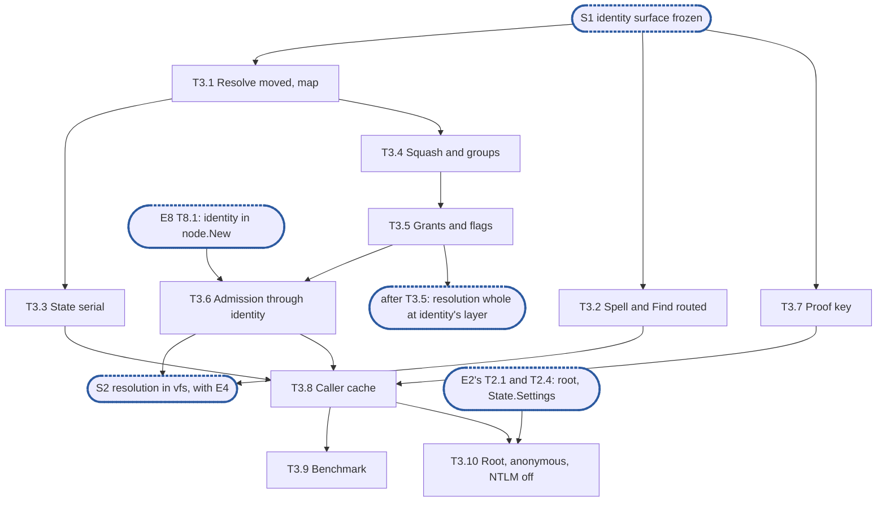

# Epic 3: identity v2 resolution

**Sources:** [RFC 18](../rfcs/rfc-18-identity.md) §2.5's closure and cap, §2.6's forwarded
`Identity` and `State`, §3.1's binding and §3.7 at resolution, §3.5's NTLM-off refusal at
resolution, §6.1 to §6.5, §7.1, §7.2 and §7.3's caller-cache row, §9.1's ID1, ID5, ID8, ID10
and ID14 and the resolver's halves of ID6, ID7 and ID13, §9.2's resolution refusals and
`identity.resolve` span, and §10's rows named in §3 below, as pull request #4058 merged them
(83232b441) and #4455 amended them (57682e9e7); [RFC 17](../rfcs/rfc-17-vfs.md) §2.3 and §4.9 (admission and its caller
cache); [RFC 16](../rfcs/rfc-16-metadata-store.md) §3 (`Principals.Grant`,
`SharePolicy`) and §4.2's `S‖id‖gv`; [RFC 23](../rfcs/rfc-23-control-plane.md)
§3.2, for one scenario.
**Track:** A.
**Epic 3 estimate: 10 subtasks, 16 man-days.**
**Depends on:** **S1**: E1's `pkg/identity` (`Identity`, `Evidence`, `Caller`,
`ReadOnlyCause`, `Resolver`, `Identities`, `FindOpts`), `entity.SharePolicy`, `internal/identity`'s
`Server` with `Apply` and a stubbed `Resolve`, and `vfs.Deps`' `Identity` and `Names`. **E2,
partly**: T3.10 alone waits, for E2's T2.1 (root as a well-known principal; anonymous already exists) and
T2.4 (`State.Settings`, whose `NTLM` key it reads); T3.2's routing lands before E2's T2.5 fills
`Spell` and `Find`, and answers what they answer. **RFC 23's plan's epic 2 (#4326)**: its T2.3
landed on `feat/storage-v2` with #4477: `SetGrant`, `DeleteGrant` and a user's or group's
deletion move `S‖id‖gv`, and `ShareIndex.Share` returns it as `Share.GrantVersion`, so T3.6
reads it and writes none. No subtask reads `PGEN`, and each test hands `Apply` its `State`. **E8, partly**: T3.6 waits for its T8.1 (E8's D1), which composes
identity in `node.New` and applies its first `State`, since T3.6 makes `vfs.New` refuse a `Deps`
without `Identity`. Each later `PGEN` is applied by E8's T8.2 (its R6). Until then a running
node's `State` does not move on a disable, so a caller with a zero `Fresh`, a local principal's,
is never cached and resolves on every call (D6); a cached `Ticket` caller outlives a disable
until its ticket's `Expires`, a ceiling that holds only once E5 signs one in.
**Blocks:** **S2**, with E4: admission resolves through identity (T3.6) and `Spell` and `Find`
reach it (T3.2). E5, whose PAC's deny-only SIDs reach T3.4's groups; E6, whose "mint burst" row
resolves through `Resolve` and whose directory groups and TTL join T3.4 and T3.8; E4's T4.5 and E6's T6.7, whose spans read
T3.1's `Deps.Tracer`; E7, whose
pass-through caller is resolved here; E8, which composes the `State` whose every `Apply` T3.3's
serial counts.

---

## 1. Goal

Every call admitted to a share is resolved by identity's `Resolver` into the `Caller` it acts
as there, and admission caches that caller under a key that provably holds everything the
caller was derived from.

**At the end of the epic:**

- `internal/identity`'s `Resolve` runs RFC 18 §6.1's five steps for proof kinds `None`,
  `Secret` and `Ticket`, refusing an inconsistent forwarded `Identity` as `ErrInvalid`;
- `internal/vfs/admit/resolve.go` is gone: admission calls `vfs.Deps.Identity`, and
  `*vfs.Filesystem`'s `Spell` and `Find` call `vfs.Deps.Names`;
- `Identity.Key()` digests every field of the `Identity` but `Client`, and a reflection test
  fails when a field is added without it;
- admission's caller cache serves a caller only under the `State` it was built under, keyed
  on every input of `Resolve`, single-flight, bounded and fresh;
- a disable, a membership change or `identity.ntlm` turned off reaches every cached caller at
  the next `Apply`, and a caller with no `Expires` is never cached, so a local principal's
  disable reaches its next call with no `Apply` at all (D6).

### 1.1 In scope

The resolver moved and completed: map, squash, the group closure with its cap and deny-only
principals, grants, flags; the `State`'s serial and a stale resolution resolved once more;
`Identity.Key()`; admission's caller cache; RFC 16 §3's `Grant` read, and the `SharePolicy` built from `ShareIndex.Share`'s read with
the `GrantVersion` the cache keys on, which RFC 23's plan's epic 2's T2.3 returns (#4477); `Spell` and `Find` routed to `Names`; the refusals
counter and the `identity.resolve` span; the cache's benchmark.

### 1.2 Out of scope

- The `Claimed` proof kind's mapping, its groups, root by a claimed uid 0 and `ManageGIDs`
  (RFC 18 §4.3, §6.3's `Claimed` row): the RFC 18 plan's deferral ledger rows "uid and gid
  mapping and the mints a claimed uid triggers" and "`ManageGIDs`"; until then `Resolve`
  refuses `Claimed` (D7).
- The directory's groups in the closure, a directory answer's 5-minute bound on
  `Caller.Fresh`, and the `directory_unavailable` refusal (RFC 18 §5, §6.3, §7.1): E6.
- Binding a PAC to the record a `krb` row selected, by the SID the row is linked for (RFC 18
  §3.4, §4.2): E5's sign-in. Resolution never reads the `krb` row (D8).
- A deny-only principal matched by a file's deny entries at the chokepoint (RFC 19 §2.3): no
  epic of RFC 18's plan; #4564 owns it, and D9 keeps the gap closed meanwhile.
  E5's breakdown pull request does not merge while that issue has no assignee (§9).
- The API's account check under the generation (RFC 18 §7.2, §8.1): E2's `Account`.
- Composing identity in the node and applying its first `State`: E8's T8.1, which T3.6 waits
  for. Applying each later `PGEN` the reconcile reads: E8's T8.2 (its R6).
- Rows over SMB, "disable takes effect", "squash drops SIDs", "deny-only SIDs", "`none` is
  stored" and "no file spelling" among them: E9. "admin needs proof" and "deny-only lookup
  error" are held here (T3.5 and T3.6 for the first, T3.4 for the second, R14, R19) and by E5's
  T5.7 for the PAC's half; E8 cites them and builds no row of its own.
- The `lookup_cap` refusal and RFC 18 §7.3's per-address and per-node `Claimed` caps: the
  deferral ledger row "uid and gid mapping and the mints a claimed uid triggers".
- Charging the caller cache to RFC 24's pool: the deferral ledger row "Caches charged to RFC
  24's connection-state pool, not fixed counts".

### 1.3 Names used here

- **E1**, the contract and the server's surface: `pkg/identity`, `internal/identity`'s
  `Server`, `vfs.Deps`' three identity fields.
- **E2**, principals and accounts: the `Minter`, well-known principals with root's fixed ID,
  `Spell`, `Find`, `identity.ntlm`, the API's account checks.
- **E3**, this epic.
- **E4**, local NTLMv2 sign-in, whose `identity.authenticate` span reads the `Deps.Tracer`
  T3.1 adds (E1's D4).
- **E5**, Kerberos and the PAC.
- **E6**, the directory.
- **E7**, NETLOGON and the machine account.
- **E8**, the integration epic: identity composed into the node, its `State` from reconcile;
  its T8.1 composes identity in `node.New` and applies its first `State`, and its T8.2 each later
  `PGEN`.
- **E9**, E2E green: RFC 18 §10's Tier 2 rows over SMB.
- **S1**, the identity surface frozen: what E1 delivers.
- **S2**, NTLM sign-in and resolution in `vfs`: E3 and E4 done.
- **RFC 23's plan's epic 2**, store records (#4326): its T2.3, landed with #4477, moves
  `S‖id‖gv` in `SetGrant`, `DeleteGrant` and each principal deletion that drops a grant.

## 2. How the general rules apply

The rules are those of
[the RFC 18 plan's §1.5](rfc-18-identity-plan.md#15-general-rules-for-each-epic), cited by
number and title and not copied.

| Rule | Subtasks | How |
| --- | --- | --- |
| rule 1, independent unit tests ([`CLAUDE.md`, "Writing tests"](../../../CLAUDE.md#writing-tests)) | all | identity's tests drive `Resolve` over the memory KV store, the store's errors and delays from `pkg/metadata/kv/kvtest`'s fault wrapper, the clock injected; `vfs`'s use the real identity server (RFC 18 §10, "Who stands in for what"); T3.1's and T3.2's recording wrappers pass every call through to the real store or server, as `CLAUDE.md` allows when the call reaching a dependency is the requirement |
| rule 2, fuzz every decoder of untrusted bytes | none | resolution decodes nothing; `Key()` encodes, and T3.7 tests its encoding against collisions |
| rule 3, observability follows RFC 25 | T3.1, T3.4, T3.10 | `identity_resolution_refusals_total` with `disabled`, `store_unavailable` (T3.1), `group_cap`, `anonymous_missing` (T3.4) and `ntlm_off` (T3.10); the `identity.resolve` span on a miss (T3.1); no label or attribute carries a name or SID |
| rule 4, profiling | T3.8 | the cache's tests, single flight included, run under the leak check; RFC 18 names no allocation budget |
| rule 5, public interface and internals ([`CLAUDE.md`, "Verifying a change"](../../../CLAUDE.md#verifying-a-change)) | T3.4, T3.5, T3.6, T3.8 | a squash proven by a refused file read, a `none` grant by a refused call, a disable by the next call refused, `identity.ntlm` off by an NTLM caller's next call refused; the key's completeness at the cache, its consumer |
| rule 6, known failures shrink | none | no suite RFC 18 names keeps a `known.yaml`; every test lands green |
| rule 7, v2 ignores v1 | T3.1, T3.6 | `internal/vfs/admit/resolve.go`, which is v2, is copied into `internal/identity` by T3.1 and rewritten on RFC 18's types, and T3.6 deletes the original once admission calls `Deps.Identity`; nothing of v1's `pkg/identity` is read |
| rule 8, real dependencies for properties of those dependencies | none | no external system: the store is the memory KV that RFC 16's suite holds, and T3.5's grant read gains rows in that suite |
| rule 9, code comment conventions ([`CLAUDE.md`, "Code comments"](../../../CLAUDE.md#code-comments)) | T3.1, T3.3, T3.4, T3.5, T3.6, T3.7, T3.8 | RFC 18's notes at their sites: §2.5's `decision:` and `ponytail:` (T3.4), §6.2's two `decision:` notes (T3.4, T3.5), §6.4's `decision:` and `ponytail:` (T3.5), §7.2's `ponytail:` (T3.8); this document's D1 to D10 markers at theirs |
| rule 10, a test must be able to fail | all | every R row is held by a test named in its subtask that fails on its assertion, or by the compiler where named |
| rule 11, a symbol is exported only if RFC 18's interfaces use it | T3.3, T3.7 | `ProofKey` and `Identity.Key()` are RFC 18 §6.1's; `Resolver.Current` is the one addition, decided (D3), with RFC 18 §6.1's amendment owed (§9); the cache and its key stay unexported in `internal/vfs` |
| rule 12, each subtask creates only what it declares | all | T3.6 consumes the `GrantVersion` RFC 23's plan's epic 2's T2.3 returns (#4477); `Grant`'s shape with T3.5; `Deps.Tracer` with T3.1's span |

## 3. Requirements and invariants

Every obligation RFC 18 and the related RFCs place on this epic, numbered so that subtasks and
tests can cite them. Sources are RFC 18 unless named.

**Mapping and its refusals**

| # | Requirement | Kind | Source | Subtasks |
| --- | --- | --- | --- | --- |
| R1 | A forwarded `Identity` inconsistent with itself, evidence with a principal at a proof kind below `Secret` or none at `Secret` or above, is refused `ErrInvalid` | MUST | §2.6; §10 "forwarded identity" | T3.1 |
| R2 | A `Secret` or `Ticket` identity maps to the principal sign-in bound its evidence to, re-reading that principal's record on every resolution, and never maps the name again | MUST NOT | §3.1, §6.1 | T3.1 |
| R3 | A `None` identity is the share's `Anonymous` | invariant | §6.1, §6.2 | T3.1, T3.4 |
| R4 | A disabled or deleted principal is refused `ErrAccess` at resolution on every call, whatever evidence its connection holds | MUST | §3.7, §6.1 | T3.1 |
| R5 | A store error is never read as "no such principal" and never yields anonymous or a default grant: it is `ErrUnavailable` | invariant | §6.1, §9.1 ID5 | T3.1, T3.4 |
| R6 | A call that names no share runs the map step alone, under no share's policy, and acts as `Mapped` | invariant | §6.1 | T3.1, T3.6 |
| R7 | Resolution reads the proof kind, the evidence and the claims, never the protection, and applies to every protocol alike | invariant | §6.1, §6.2 | T3.5 |

**Squash and groups**

| # | Requirement | Kind | Source | Subtasks |
| --- | --- | --- | --- | --- |
| R8 | `Squash` `none` replaces nothing, `root` a caller mapped to root, `all` every caller; `None` callers and principals with no file spelling are the share's `Anonymous` whatever the setting | invariant | §6.2 | T3.4, T3.10 |
| R9 | A squashed caller carries no group, SID or name of the principal it replaced: its groups are the `Anonymous` principal's closure, `DenyOnly` empty, its flags false | MUST | §6.1, §6.2, §6.3, §9.1 ID7 | T3.4 |
| R10 | A deleted `Anonymous` fails closed: a call the policy would squash is refused | invariant | §6.1, §6.2 | T3.4 |
| R11 | A `Secret` or `Ticket` caller's groups are the closure of its store memberships unioned with the groups of its evidence's verified SIDs, sorted | invariant | §6.1, §6.3, §2.5 | T3.4 |
| R12 | The closure is computed whole or the resolution fails: a failed read is `ErrUnavailable`; a cycle is no error, each group visited once | MUST | §2.5, §6.3, §9.1 ID8; §10 "group cap" | T3.4 |
| R13 | A principal in more than 1 024 groups is refused `ErrAccess`, with the count logged, never resolved with fewer | MUST | §2.5, §6.1; §10 "group cap" | T3.4 |
| R14 | Each of the evidence's `DenyOnly` SIDs maps to a principal in the caller's `DenyOnly`, never in `Groups`, and adds none of its groups; a lookup error mapping one fails the resolution; one no principal holds stays unmapped | MUST | §6.1, §6.3, §3.4, §9.1 ID8 | T3.4 |

**Grants and flags**

| # | Requirement | Kind | Source | Subtasks |
| --- | --- | --- | --- | --- |
| R15 | Share access is the first of: the caller's own principal's grant, `none` included; the widest grant naming one of its groups; the authenticated-users grant for an authenticated caller; the everyone grant; else `none` | invariant | §6.4 | T3.5 |
| R16 | A grant of `none` is a grant, distinct from no grant: a caller's own `none` refuses where a group grant would admit | MUST | §6.4, §9.1 ID14; RFC 16 §3 (`Grant`) | T3.5 |
| R17 | A claimed or `None` identity is squashed before its grant is read, for the squashed principal; a proven one's grant is read for `Mapped` with its own groups, before the squash, which then sets `Principal`, `Groups` and the flags to the `Anonymous` principal's and keeps that grant as `Access`, `none` included | invariant | §6.2 | T3.5 |
| R18 | `Access` is the level found, narrowed to read where admission narrowed the call, and `ReadOnly` records which narrowed it: `NotNarrowed`, `Grant`, `Share` or `Client` | invariant | §6.1, §6.4 | T3.5 |
| R19 | `Authenticated`, `Admin` and `Privileged` follow §6.5's table; `Admin` is set only from the grant and only for a proof of `Secret` or above, never by a uid, a group, a SID such as `S-1-5-32-544` or a role | MUST NOT | §6.5, §2.5, §9.1 ID6 | T3.5 |
| R20 | A deny-only principal never matches a share grant | invariant | §3.4, §9.1 ID13 | T3.5 |
| R21 | RFC 18 §10's **Unit** row: resolution's five steps as one table-driven test over proof kind, squash, grant and no file spelling, against the in-memory metadata store | test row | §10 | T3.5 |

**The `State` and staleness**

| # | Requirement | Kind | Source | Subtasks |
| --- | --- | --- | --- | --- |
| R22 | A resolution reads the `State` once, before its first store read, and stamps `Caller.Built` with it | invariant | §2.6, §7.2 | T3.3 |
| R23 | A call whose own resolution went stale while it ran resolves once more under the current `State`, and is served that second caller whatever was applied meanwhile | invariant | §7.2; §10 "steady raises" | T3.3, T3.8 |
| R24 | While `identity.ntlm` is off, every `Secret` identity is refused, from the `Apply` that delivers the setting, with no principal change, and no cached caller serves an established NTLM session | MUST | §3.5, §7.1 | T3.3, T3.10 |

**The caller cache**

| # | Requirement | Kind | Source | Subtasks |
| --- | --- | --- | --- | --- |
| R25 | There is one cache of resolved callers, admission's; identity keeps none | invariant | §7.1; RFC 17 §4.9 | T3.1, T3.8 |
| R26 | The key holds the proof key, `Identity.Key()`: a collision-resistant digest of every field of the `Identity` but `Client`, the proof kind, the protection, the bound principal, the verified name, each SID with whether it is deny-only, and every claimed uid and gid | MUST | §6.1, §7.1, §9.1 ID1 | T3.7 |
| R27 | The key holds the share, `ExportPolicy.Version` and the share's grant-list version, read on every call | MUST | §6.4, §7.1; RFC 16 §3, §4.2 (`S‖id‖gv`); RFC 17 §4.9 | T3.6, T3.8 |
| R28 | The key holds the `State` the caller was built under; a caller stamped with an older one is neither stored nor served | MUST | §7.1, §7.2 | T3.3, T3.8 |
| R29 | The key holds the client's address where a client rule or netgroup decided the call | MUST | §7.1; RFC 17 §4.9 | T3.8 |
| R30 | A key that cannot be shown to include the whole value is replaced: adding a field to `Identity` or `Evidence` is an edit to `Key()`, and adding one to `Caller` an edit to the key; a digest stands in for a key only as a collision-resistant hash of the whole key | MUST | §7.1 | T3.7, T3.8 |
| R31 | Concurrent misses of one key share one resolution | invariant | §7.1 | T3.8 |
| R32 | No entry is served after `Caller.Fresh`; a caller built from evidence with an `Expires` is served no later than that `Expires` | invariant | §7.1 | T3.8 |
| R33 | Past its bound, the least recently used entry is evicted, and the eviction counted | invariant | §7.3 | T3.8 |
| R34 | A disabled or deleted principal is refused on every call admitted after the first `State` that follows the change, and no caller resolved under an older `State` is cached; RFC 18 §10's "in-flight disable" | invariant | §9.1 ID10; §10 "in-flight disable" | T3.8 |

**Wiring and observability**

| # | Requirement | Kind | Source | Subtasks |
| --- | --- | --- | --- | --- |
| R35 | Admission's step 4 is `Resolve` through `vfs.Deps.Identity`, `*vfs.Filesystem` its only caller, with the share's policy read in one snapshot | invariant | §2.6, §6.1; RFC 17 §2.3, §4.9; RFC 16 §3 (`SharePolicy`) | T3.6 |
| R36 | `*vfs.Filesystem`'s `Spell` and `Find` pass through to `vfs.Deps.Names`, `FindOpts.Mint` set only for a call whose `Identity` is `Secret` or above | invariant | §2.6, §4.1, §4.4 | T3.2 |
| R37 | The grant-list version a cache entry is keyed on is read before the grants that entry was built from, so no older grant is cached under a newer version | MUST | RFC 16 §3 (`Grant`), §4.2 (`S‖id‖gv`) | T3.8 |
| R38 | A new share is reachable by nobody until an operator grants it: an NTLM user on a share with no grant is refused | test row | RFC 23 §3.2 | T3.6 |
| R39 | A well-known principal, anonymous or root, has no user record: resolution reads none for it, so neither is refused as disabled or deleted | invariant | RFC 16 §3 (`User`); §2.1 | T3.10 |
| R40 | Each refusal counts in `identity_resolution_refusals_total{reason}`: `disabled`, `group_cap`, `store_unavailable`, `anonymous_missing`, `ntlm_off` | invariant | §9.2 | T3.1, T3.4, T3.10 |
| R41 | A miss opens `identity.resolve`, a child of the service-call span, with the proof kind, the outcome and the principal's ID, never a name or SID | invariant | §9.2 | T3.1 |
| R42 | A share whose policy names no `Anonymous` squashes to the well-known anonymous principal, and a `None` caller on a call that names no share, whose zero policy names none, maps to it too | invariant | §6.2, §6.1 (the installation's defaults), §2.1 | T3.10 |

Which test holds each row is in its subtask's **Tests**. R1 is §10's "forwarded identity" unit
row; R12 and R13 its "group cap"; R23 its "steady raises"; R34 its "in-flight disable".

## 4. Decisions this epic takes

- **D1, the cache holds resolution's result alone, keyed on every input of `Resolve`.**
  Admission runs its steps 1 to 3 on every call, as it does today, and caches step 4: the
  key is the proof key, the whole `SharePolicy` value (share, squash, `Anonymous` and both
  versions), so no policy edit that forgets a version is missed, the narrowing cause step 3
  produced, the client's address
  when the policy has a client rule, and the `State`'s serial (D2). RFC 17 §4.9 lets a cache
  hold steps 1 to 4 if it keys on the netgroups' and the share list's versions too; caching
  step 4 alone keys on step 3's output instead, so neither version is an input. A `decision:`
  marker at the key says so. Prior art (from memory): Samba builds a session's token once and
  re-checks the share's access at each tree connect.
- **D2, the `State` carries a serial, and `Caller.Built` is it.** `Apply` raises a serial
  when the applied `State` differs from the current one, and keeps it for an equal one, so a
  once-a-second reconcile empties nothing. The principals generation alone would not do:
  `identity.ntlm` turned off changes no principal, and RFC 18 §3.5 has it reach cached
  callers. The serial is `State.Serial` (RFC 18 §2.6), set by `Apply`, not the node, under one
  lock across its load of the current `State`, the compare, the serial and the store, so two
  concurrent `Apply`s, the reconcile's and a writer's, never give two differing `State`s one
  serial: serials strictly increase. `State.Generation` stays the principals generation RFC 18 §2.6 declares and E1's T1.4 adds.
  A `decision:` marker at `Apply`. Prior art (from memory): etcd's revision, raised per change
  and not per read.
- **D3, admission reads the current serial through `Resolver.Current()`, decided (§9).**
  RFC 18 §7.2 says a caller stamped with an older `State` is neither stored nor
  served, but `Resolver` declares only `Resolve`, so admission has no way to learn the current
  `State`. `Current() uint64` is one atomic load. Changing it once E5 to E7 build on the
  frozen surface costs every implementer of `Resolver`, `*Server` alone today, so RFC 18 §6.1
  and S1 are amended now, while it has one consumer (§9). A `decision:` marker at `Current()`.
  Prior art: none found.
- **D4, `Key()` digests the whole `Identity` on each call, through an encoding of its own.**
  SHA-256 over a hand-written, length-prefixed encoding of every field but `Client`: each
  fixed-width field written as itself, each string and slice with its length first, and a
  principal's `Kind` and `ID` as raw bytes. Not `encoding/json`: `entity.Principal.MarshalText`
  answers `ErrSyntax` for a `Kind` with no name, the zero one among them, and a `None`
  identity's evidence carries the zero principal, so `Key()` would have no value to return. A
  field added to `Identity` or `Evidence` is therefore an edit to `Key()`, which T3.7's
  reflection test enforces (R30). No digest is kept in `Evidence`: an unexported field set at sign-in is lost when the value crosses a node
  channel, and recomputing costs microseconds. A `ponytail:` marker names the upgrade: compute
  the evidence's digest once at sign-in, as RFC 18 §3.1's sketch does, when a profile shows
  `Key()` in admission's cost. Prior art (from memory): Linux's sunrpc auth cache hashes the
  whole credential.
- **D5, a call naming no share resolves with the zero `SharePolicy`.** `Resolve` sees a zero
  share, runs the map step alone (RFC 18 §6.1) and answers a `Caller` with `Mapped` set; it
  replaces `admit.Mapped` for a client record's owner. A `decision:` marker at the branch.
  Prior art: none found.
- **D6, a caller with a zero `Caller.Fresh` is never cached.** T3.1 sets `Fresh` to the
  evidence's `Expires` when it has one; E6 lowers it to a directory answer's TTL. A local
  principal's evidence has no `Expires` (NTLM's is zero, RFC 18 §3.1), so its only clock would
  be the `State`, and until E8's T8.2 no running node hands `Apply` a new one: a cached local
  caller would outlive a disable for as long as it stayed in the cache, unbounded on an
  under-full cache. Such a caller resolves on every call instead, as admission does today, so a
  disable reaches its next call. A cached `Ticket` caller is bounded by its ticket's `Expires`
  until T8.2, and by the next `State` after it. A `ponytail:` marker at the store names the
  upgrade: cache a zero-`Fresh` caller, bounded by the `State`, once T8.2 applies each `PGEN` and
  T3.9's per-call figure for local callers shows in admission's cost. Prior art: none found.
- **D7, `Claimed` is refused `ErrAccess`**, never anonymous, until the NFS side lands, with a
  `ponytail:` marker naming RFC 18 §4.3's mapping as the upgrade; an inconsistent forwarded
  identity is still `ErrInvalid` (R1). `vfs`'s tests that admit a claimed identity move to a
  proven one. Prior art: none found.
- **D8, the `krb` row's linked SID reaches the key through the evidence and the `State`.**
  Sign-in (E5) binds a PAC to the SID the row is linked for, so the evidence's first SID is
  that SID and `Key()` covers it (R26); relinking the row is a spelling write, which raises
  the generation and so the serial (D2). Resolution never reads the row (R2), so the key
  carries no field of its own for it. A `decision:` marker at `Key()`. Prior art: none found.
- **D9, a caller holding a deny-only principal is refused at admission until the chokepoint
  matches them, decided (§9).** `entity.Identity`, the chokepoint's input,
  has no deny-only field, and dropping `Caller.DenyOnly` there would let an ACL's deny entry
  naming the group miss: fail-open. Refusing is fail-closed, and reachable only once E5 sets
  `Evidence.DenyOnly`. A `decision:` marker at the conversion names the withdrawal: RFC 19
  §2.3's deny match, owned by #4564. Prior art
  (from memory): Windows' restricted token keeps deny-only groups in the token the access
  check reads.

- **D10, deny-only principals do not count toward the group cap.** RFC 18 §2.5 caps "groups",
  and a deny-only principal is in `DenyOnly`, never `Groups` (§6.3); counting it would refuse a
  restricted token for denies it carries. Both are still mapped whole or the call fails (ID8).
  A `decision:` marker at the cap; overturned if §2.5 is read to cap the token's SIDs. Prior
  art (from memory): Windows' 1 024-SID token limit counts every SID, deny-only included,
  which this departs from because the cap here guards a list resolution builds, not a token.

## 5. Target tree

```text
internal/identity/
  resolve.go          T3.1  Resolve: forwarded check, map, its refusals (rewritten from internal/vfs/admit's)
                      T3.4  squash, the closure, its cap, deny-only principals
                      T3.5  grants and flags
                      T3.10 root and anonymous as well-known principals; ntlm_off
  resolve_test.go     T3.1, T3.4, T3.5, T3.10
  server.go           T3.1  Deps.Tracer, the refusals counter
                      T3.3  Apply's serial, Current, a stale resolution resolved once more
pkg/identity/
  key.go              T3.7  ProofKey, Identity.Key()
  key_test.go         T3.7  the reflection and collision tests
  resolve.go          T3.3  Resolver.Current (D3)
internal/vfs/
  admission.go        T3.6  step 4 through Deps.Identity
  callers.go          T3.8  callerKey, the cache
  callers_test.go     T3.8
  callers_bench_test.go  T3.9
  authz/authz.go      T3.6  Caller rebuilt on identity.Caller
  clients.go          T3.6  a client record's owner through Resolve (D5)
  opens.go            T3.6  a delete-on-close marker's admission through Deps.Identity
  shares.go           T3.2  Spell and Find through Deps.Names
internal/vfs/admit/resolve.go     T3.6  removed
internal/identity/identitymem/    T3.6  the real server over a given store, for vfstest/memory
pkg/vfs/vfstest/memory/memory.go  T3.6  Deps.Identity, Auth and Names from identitymem
pkg/identity/arch_test.go         T3.6  only vfstest/memory imports identitymem, with its seed
pkg/metadata/kvstore/
  principals.go       T3.5  Grant as RFC 16 §3 declares it
  shares.go           T3.6  consumes ShareIndex.Share's Share.GrantVersion (RFC 23 epic 2's T2.3, #4477)
  kvstoretest/        T3.5  rows for the grant read
```

## 6. Subtasks

### T3.1 `Resolve` moved into identity, with its map step

**Subtask T3.1 estimate: 2.5 man-days.**

- **Track:** A. **Depends on:** S1.
- **Covers:** R1, R2, R3, R4, R5, R6, R25, R40, R41.
- **Deliverables:** `internal/vfs/admit/resolve.go` copied into `internal/identity` and
  rewritten there, the original kept until T3.6, since `vfs`'s admission, opens and client
  records still call it and `vfs` may not import `internal/identity` (E1's T1.5); filling E1's stubbed `(*Server).Resolve(ctx, identity.Identity,
  entity.SharePolicy, narrowed identity.ReadOnlyCause) (*identity.Caller, error)`, as #4455 amended
  RFC 18 §6.1: the forwarded check first
  (R1), then the map step over the store's `Principals` view: evidence's principal for
  `Secret` and `Ticket`, the share's `Anonymous` for `None`, `Claimed` refused (D7); a
  disabled or deleted user refused `ErrAccess`; a zero share stops after the map step (D5);
  `Fresh` from `Expires` (D6). `Deps.Tracer`, the first code that reads it (E1's D4), and the
  `identity.resolve` span; `identity_resolution_refusals_total` with `disabled` and
  `store_unavailable`. `admit.Check` stays in `internal/vfs/admit`; no table of callers is
  kept in identity (R25). Consumed by T3.3, T3.4, T3.6, E5, E6, E7; `Deps.Tracer` also by E4's
  T4.5 and E6's T6.7.
- **Acceptance criteria:**
  - `Resolve` of an `Identity` whose evidence names a principal at `Claimed`, or none at
    `Ticket`, is `ErrInvalid` before any store read.
  - A disabled user, and a deleted one, are `ErrAccess` whatever their evidence.
  - A store error on the user read is `ErrUnavailable`, never a caller.
- **Tests:** at `Resolve`, over the memory KV store: §10's "forwarded identity" unit row,
  both inconsistent shapes, with the store wrapped by `kvtest`'s fault wrapper set to fail
  every read, so a check placed after a read fails the assertion on the error (R1); a
  disabled and a deleted user each refused (R4); `kvtest` failing the user read gives
  `ErrUnavailable` and a nil `Caller` (catches an error mapped to anonymous, R5); a user
  renamed after sign-in still resolves by the bound principal (catches a map by name, R2);
  a zero share answers `Mapped` and no grant read, held by the fault wrapper failing grant
  reads (R6); the counter's value per reason after each refusal (R40); two `Resolve` calls of
  one identity both reach the store's user read, through a pass-through wrapper that records
  each call, allowed because the call reaching the store is the requirement (catches a table of
  callers kept in identity, R25). R41's span is checked with OpenTelemetry's in-memory span
  recorder, a sink of outputs.
- **Rules:** rule 7 (the copy; T3.6 deletes the original), rule 9 (D5, D6, D7's markers).

### T3.2 `Spell` and `Find` routed to `Names`

**Subtask T3.2 estimate: 0.5 man-days.**

- **Track:** A. **Depends on:** S1.
- **Covers:** R36.
- **Deliverables:** `*vfs.Filesystem`'s `Spell` and `Find` call `vfs.Deps.Names`, `Find` with
  `FindOpts{Mint: c.Identity.Proof >= vfs.ProofSecret}`; `errUnsigned` stays for `SignIn`
  until E4. Consumed by S2 and RFC 22's plan.
- **Acceptance criteria:**
  - `Find` reaches identity with `Mint` true for `Secret` and `Ticket`, false for `None` and
    `Claimed`.
- **Tests:** at `vfs.Service`'s `Find`, against the real identity server behind a wrapper that
  records each `FindOpts` and passes the call through (the call reaching identity is the
  requirement): one case per proof kind (catches `Mint` set from the wrong field, R36). The
  answers themselves are E2's `Find`'s tests.

### T3.3 The `State`'s serial and a stale resolution

**Subtask T3.3 estimate: 1.25 man-days.**

- **Track:** A. **Depends on:** T3.1.
- **Covers:** R22, R23, R24, R28.
- **Deliverables:** `Apply` raising a serial when the `State` differs, under one lock across
  its load, compare, serial and store (D2), D2's marker; `Resolver.Current() uint64` in
  `pkg/identity` and on `*Server`, one load of the current `State`'s serial (D3); `Resolve`
  loading the `State` once before its first read, stamping `Built` with that `State`'s serial,
  never a second load, and, when the current serial moved
  during the call, resolving once more and answering the second caller. Consumed by T3.8, T3.10
  and E8.
- **Acceptance criteria:**
  - `Apply` of an equal `State` keeps `Current()`; any change raises it.
  - Two concurrent `Apply`s of differing `State`s store distinct serials, the later the greater.
  - A `Resolve` overtaken by an `Apply` answers a caller stamped with the newer serial.
- **Tests:** at `Resolve`: an `Apply` of an equal `State` leaves `Current()` unchanged, one
  with a raised generation raises it (catches a serial raised per `Apply` or never, R28); §10's
  "one serial per `State`", its `Apply` half: two differing `State`s applied concurrently, many
  times over under `-race`, the two stored `State`s carrying distinct serials, the later the
  greater (catches the load, compare and store outside one lock, which gives two `State`s one
  serial, R28); a
  `State` differing only in a setting needs E2's `State.Settings`, so T3.10's test holds that
  case (R24); bob's user read run by a fault wrapper (kind 3) on the `view` itself, outside any
  transaction so no retry re-reads it, which runs the real read, returning bob enabled, and
  holds that answer until released; meanwhile bob is disabled and `Apply` raises the serial:
  released, the call is refused `ErrAccess` (catches a `State` read after the store reads, or
  a stale caller answered: removing the re-resolve, or reading the `State` after the store
  reads, fails on the assertion, R22, R23). The cache's half of R23 and R28 is T3.8's.

### T3.4 Squash, the group closure and its cap

**Subtask T3.4 estimate: 2 man-days.**

- **Track:** A. **Depends on:** T3.1.
- **Covers:** R3, R5, R8, R9, R10, R11, R12, R13, R14, R40.
- **Deliverables:** squash per RFC 18 §6.2's table for `none` and `all` (root's row is
  T3.10's); the closure of the store's memberships, `kvstore`'s existing cycle-safe walk
  (`groupsOf`), unioned with the closures of the
  principals the evidence's SIDs map to, each group once; `DenyOnly` mapped apart; the
  1 024-group cap on `Groups`, deny-only principals not counted (D10), with
  the count logged; the `group_cap` and `anonymous_missing` reasons;
  §2.5's `decision:` and `ponytail:` notes and §6.2's two `decision:` notes. Consumed by
  T3.5.
- **Acceptance criteria:**
  - A squashed caller's `Groups` equal the `Anonymous` principal's closure, `DenyOnly` is
    empty and every flag false.
  - A principal in 1 025 groups, and a closure whose nested read fails, are refused.
  - A membership cycle resolves, each group listed once.
- **Tests:** at `Resolve` over the memory KV store: §10's "group cap", 1 025 groups refused
  and none resolved with fewer, a nested read failed by the fault wrapper refusing the call,
  a cycle resolved (R12, R13), `identity_resolution_refusals_total{reason="group_cap"}` read
  as 1 after the cap's refusal (R40), the refusal's log line read from a `slog` handler that keeps
  what it is given, holding the count (R13); alice in `Accounts`, inside `Finance`, with an
  evidence SID mapping to `Payroll`, inside `Ops`: `Groups` is exactly those four, sorted
  (R11); `Squash = all` on a caller whose evidence SIDs map to
  `Finance` gives no `Finance` in `Groups` (catches a squash keeping SIDs, R9); a deleted
  `Anonymous` refuses a squashed call, the `anonymous_missing` count read as 1 (R10, R40); a
  deny-only SID no principal holds: the call resolves, with no error and nothing added to
  `DenyOnly` or `Groups` (catches an unmapped deny-only SID refused or mapped, R14); a deny-only SID mapping to `Finance` puts it in
  `DenyOnly` and none of `Finance`'s parents in `Groups`, and a fault on the `sid` index while
  mapping it refuses the call (catches a deny dropped, R14). The file-level half of R9 is
  T3.6's test.

### T3.5 Grants and flags

**Subtask T3.5 estimate: 2.5 man-days.**

- **Track:** A. **Depends on:** T3.4.
- **Covers:** R7, R15, R16, R17, R18, R19, R20, R21.
- **Deliverables:** `kvstore.Principals.Grant(ctx, share, p) (ShareAccess, bool, error)` as
  RFC 16 §3 declares it, the caller's own grant alone, a stored `none` answering `(none,
  true)`, with its `kvstoretest` row; the grant step reading one grant per principal, own
  then each group, then the defaults (§6.4's `ponytail:`), for `Mapped` before a proven
  caller's squash; `Access` and `ReadOnly`; the flags; §6.4's `decision:`; the moved resolver's `decision:` on a squashed caller's `none` grant brought onto the new `Grant`;
  every test asserting access through groups or defaults on `Grant` (`kvstoretest/auth.go:152`,
  `controlplane.go:173-189` and `324-341`, `races.go:185`, `principals_test.go`'s
  `TestGrantResolution`) rewritten, own-grant cases reading `(a, ok)` and effective-access cases
  going through `Files.Authorize`. Consumed by T3.6.
- **Acceptance criteria:**
  - A proven caller's own `none` grant refuses on a share whose group grant admits it.
  - `Admin` is set only for a `Secret` or `Ticket` caller whose grant says `admin`.
  - A deny-only `Finance` never admits through a `Finance` grant.
- **Tests:** RFC 18 §10's **Unit** table at `Resolve`, one table over proof kind (`None`,
  `Secret`, `Ticket`) × squash (`none`, `all`) × grant (own, own `none`, two groups granted
  `read` and `read-write`, authenticated, everyone, none, each at `read` and at
  `read-write`) × narrowing cause × no file spelling, asserting every `Caller` field, `ReadOnly`'s
  four causes among them, the two groups answering `read-write`, each case with
  protection varied to show nothing changes (R7, R15, R17, R18, R19, R21); an own `none`
  under a group's `read-write` (ID14, R16); an evidence SID `S-1-5-32-544` mapping to a
  group that holds no grant leaves `Admin` false, while the same caller's own `admin` grant
  sets it, and does not at `None` (R19); a share whose only grant names a group
  the caller holds deny-only refuses it (R20). The `kvstoretest` row stores `none` and
  removes it, on Badger and the memory KV (catches `none` stored as no grant).

### T3.6 Admission resolves through identity

**Subtask T3.6 estimate: 1.75 man-days.**

- **Track:** A. **Depends on:** T3.5; E8's T8.1 (identity in `node.New`). RFC 23's plan's epic 2's T2.3, the `S‖id‖gv` writer, landed with #4477.
- **Covers:** R6, R27, R35, R38; D9's refusal.
- **Deliverables:** the `SharePolicy` admission hands `Resolve`, built from the share and
  policy `ShareIndex.Share` reads in one view, keyed on the `entity.Share.GrantVersion` that read
  returns (RFC 23's plan's epic 2's T2.3, #4477; `shareIn` reads `S‖id‖gv` in the same view), so no call
  makes a second read and T3.6 adds no `Principals` method; `S‖id‖gv` as RFC 23's plan's epic 2 writes it (T2.3 for `SetGrant` and
  `DeleteGrant` and in each principal deletion), already on `feat/storage-v2`; admission's
  step 4 calling `vfs.Deps.Identity.Resolve`, `vfs.New` refusing a `Deps` without it;
  `internal/vfs/admit/resolve.go` deleted, its last callers moved (T3.1 copied it);
  `authz.Caller` rebuilt on `identity.Caller`, converted to `entity.Identity` for the
  chokepoint, carrying `Caller.Group` (zero for every caller this epic resolves, since `Claimed`
  is refused, D7) and the narrowing cause, folded onto `entity`'s three (`ReadOnlyGrant` to
  `NotNarrowed`, the share and client causes one to one, §9), D9's refusal and marker at the
  conversion, and a caller whose `Access` is
  `none` refused there too, since the chokepoint reads a zero `Access` as "read the grants"
  and would read the squashed principal's (the moved resolver's `decision:` keeps saying so); `clients.go` through `Resolve` (D5) and `opens.go`'s marker admission through
  `Resolve`; `vfs`'s tests that admit a claimed identity moved to proven ones (D7);
  `internal/identity/identitymem`, one function that builds the real identity server over a
  given `*kvstore.Store`, applies its first `State`, starts it and stops it when the test ends,
  so `pkg/vfs/vfstest/memory`, the adapters' verified in-memory `vfs.Service`, passes the value
  it returns as `Deps.Identity`, `Auth` and `Names`, as RFC 18 §10 "Who stands in for what"
  says, and never imports `internal/identity`: E1's T1.5 rule allows only `internal/node` and
  identity's own packages, `identitymem` among them; T1.5's
  `arch_test.go` gains the rule that no non-test package but `pkg/vfs/vfstest/memory` imports
  `identitymem`, with a seeded violation, so the helper is no way around that rule.
  Consumed by T3.8, S2, E5 to E9.
- **Acceptance criteria:**
  - `go build ./...` with `internal/vfs/admit/resolve.go` gone and `vfs`'s tests green on the
    real identity server.
  - `pkg/vfs/vfstest/memory` builds on the real identity server and imports no
    `internal/identity`.
- **Tests:** at `vfs.Service`, over the real identity server and memory store: a `Squash =
  all` caller whose evidence maps to `Finance` reads a file whose ACL grants `Finance` only:
  refused, `Squash = none` granted (catches a squash keeping SIDs at the chokepoint, rule 5,
  R9's consumer half); a disabled user's next call refused (R4's consumer); RFC 23 §3.2's
  scenario, an NTLM (`Secret`) user on a share with no grant refused (R38); a client record
  created by a call naming no share owned by the mapped principal (R6); a `Secret` caller whose
  evidence carries a deny-only SID mapping to `Finance`, on a file whose ACL denies `Finance`
  and allows everyone: refused at admission (catches D9's refusal removed, which lets the read
  through, fail-open); the arch test's seed of a non-test package importing `identitymem`
  reported.

### T3.7 The proof key

**Subtask T3.7 estimate: 0.5 man-days.**

- **Track:** A. **Depends on:** S1.
- **Covers:** R26, R30.
- **Deliverables:** `type ProofKey [32]byte` and `func (id Identity) Key() ProofKey` in
  `pkg/identity` (D4), with D4's `ponytail:` and D8's `decision:`. Consumed by T3.8.
- **Acceptance criteria:**
  - Changing any field of `Identity` but `Client`, at any depth, changes `Key()`;
    changing `Client` does not.
- **Tests:** in `pkg/identity`, a reflection walk over `Identity` and `Evidence`, recursively
  into slices and `Principal`, `time.Time`, `netip.Addr` and `SID` taken as leaves, that sets each field in turn to a non-zero value and asserts
  `Key()` moves, so a field added later fails until `Key()` covers it (R30); `Key()` of
  `Identity{}` and of a `None` identity, whose evidence holds the zero principal, each returns
  a value, and both differ from a `Ticket` one's (catches an encoding that refuses the zero
  principal, R26); a deny-only SID
  moved into `SIDs` changes `Key()` (catches a key that drops the deny-only bit, R26);
  two identities of one principal, one `Secret`, one `Ticket`,
  differ (ID1).

### T3.8 Admission's caller cache

**Subtask T3.8 estimate: 3 man-days.**

- **Track:** A. **Depends on:** T3.3, T3.6, T3.7.
- **Covers:** R23, R25, R27, R28, R29, R30, R31, R32, R33, R34, R37.
- **Deliverables:** `internal/vfs`'s `callerKey{proof identity.ProofKey; policy
  entity.SharePolicy; narrowed identity.ReadOnlyCause; client netip.Addr; built uint64}` with
  D1's marker; the cache: a map with a `container/list` LRU, bounded at 262 144 entries and
  2²⁴ group references (the bounds passed to its constructor, each eviction counted), misses
  through `x/sync/singleflight`'s `DoChan` on a context detached from the first caller's and
  bounded at RFC 18 §5.1's 20 seconds, each waiter keeping its own deadline, single-flighted
  on the key without the serial; looked up under `Current()`; an entry stored under its own
  `Built`, never a serial read before resolving, and only when that `Built` equals `Current()`
  and its `Fresh` is non-zero (D6), served only while `Built` equals `Current()` and before
  `Fresh`; D6's `ponytail:` at the store;
  errors never stored; §7.2's `ponytail:` at the cache and the fixed-count `ponytail:`
  naming RFC 24's pool. The `ponytail:` in `admission.go` that asks for this cache goes.
  Consumed by S2 and E6 (which lowers `Fresh`).
- **Acceptance criteria:**
  - Changing any input of `callerKey` misses.
  - After `Apply` delivers a disable, the disabled user's next call misses and is refused.
  - One resolution serves N concurrent misses of one key.
  - A caller with a zero `Fresh` is never stored.
- **Tests:** at admission through `vfs.Service`, over the real identity server and memory
  store, under the leak check and `-race`, a miss read from the span recorder's count of
  `identity.resolve` spans, every cached caller a `Ticket` one whose `Expires` lies past the
  test's end on the injected clock (D6): after a warm hit, each real input changed in turn misses, a
  `SetGrant` (grant-list version), a policy edit, a client rule turning the call read-only,
  another client address under a client rule, an `Apply` (serial) and another evidence, so an
  input dropped while the key is built fails (R27, R28, R29, R30); the warm caller's own grant
  set to `none`: its next call refused (R27 at the consumer, RFC 18 §6.4); two hosts admitted
  read-write by one client rule each miss once, since the address is in the key wherever a
  rule decided (R29); a grant written by an `export_test.go` hook in admission that fires
  after `Resolve` returns, its grant reads done, and before the entry is stored: the next call
  misses and sees the new grant (catches the version read after the grants, which would key
  the old grants under the new version and serve them, R37); §10's "in-flight disable", bob's
  user read run by the fault wrapper on the `view`, which runs the real read, returning bob
  enabled, and holds that answer until released; meanwhile the disable is written and its
  `State` applied; released: nothing stored, and bob's next call refused (R34); §10's "one
  serial per `State`", its cache half: a warm `Ticket` caller's resolution held by the same
  wrapper after its `State` load while a differing `State` is applied; released: nothing
  stored, and the next call misses (catches a caller stored under `Current()` without its
  `Built` compared, R28); the row's pass-through NTLM caller is E7's; §10's "steady raises" on the injected clock, the serial
  raised during every resolution: each call served after at most two, the second stored only
  when no raise came during it (R23); 32 calls of one key with the first resolution's `view`
  held until an `export_test.go` hook has reported all 32 waiting: one span, and a first
  caller cancelled mid-miss leaves the others served (R31); a `Ticket` caller past its
  `Expires` on the injected clock misses (R32); a cache of bound 2 evicts the least recently
  used and the eviction counter reads 1 (R33); a `Secret` caller, whose `Fresh` is zero, called
  twice: two spans, and with the user disabled between the calls and no `Apply`, the second
  refused (catches D6's gate removed, which serves the disabled user from the cache). R30's other half is the key holding `Resolve`'s
  arguments whole, built beside its one call, so a field added to `SharePolicy` is keyed with
  no edit. R25's identity half is T3.1's test.

### T3.9 The cache's benchmark

**Subtask T3.9 estimate: 1 man-days.**

- **Track:** A. **Depends on:** T3.8.
- **Covers:** none of its own; consumes T3.8, the evidence §7.2's `ponytail:` waits on.
- **Deliverables:** a benchmark in the `manual` tier: 10⁴ warm `Ticket` callers on 25 shares,
  the serial raised once a second through `Apply`, reporting store reads per second and p99 of
  admission, with `b.ReportAllocs()`, and the same for 10⁴ `Secret` callers, which D6 resolves
  per call. Consumed by §7.2's and D6's `ponytail:` markers, as the measurements that would
  overturn them.
- **Acceptance criteria:**
  - Runs under `dt` in the `manual` tier, setup outside the timed region.
- **Tests:** the benchmark is the deliverable; it asserts nothing (`CLAUDE.md`, "By kind",
  Benchmarks).

### T3.10 Root, anonymous and `identity.ntlm` in resolution

**Subtask T3.10 estimate: 1 man-days.**

- **Track:** A. **Depends on:** T3.8, T2.1, T2.4.
- **Covers:** R8, R24, R40, R39, R42.
- **Deliverables:** `Squash = root` replacing a caller mapped to E2's well-known root;
  root unsquashed `Privileged`; a share's `Anonymous` defaulting to the well-known anonymous
  (`entity.AnonymousPrincipal`, 0x0C) where its policy names none, the zero policy of a call
  that names no share included (§6.1's installation defaults); no user record read for a well-known principal; every
  `Secret` identity refused while `State.Settings`' `NTLM` key, `identity.ntlm`, is off, reason
  `ntlm_off`.
- **Acceptance criteria:**
  - A proven caller linked to root is squashed on a `root` share, and privileged on a `none`
    one.
  - An NTLM caller is refused at its next call once `Apply` turns `identity.ntlm` off, with no
    principal change.
- **Tests:** at admission over the real identity server: a `Ticket` caller bound to root on a
  `root` share acts as `Anonymous` and on a `none` share is privileged (R8); a `Secret`
  caller admitted, then `Apply` of a `State` differing only in `identity.ntlm`: `Current()`
  raised, its next call refused `ErrAccess` and the `ntlm_off` count 1, while a cached `Ticket`
  caller is still served, from a fresh resolution (catches an NTLM session outliving the setting,
  and a serial bound to the generation alone, R24, R40); a squashed
  call on a share whose `Anonymous` is the well-known one is served, the fault wrapper failing
  every user read of it (catches a user read for a principal that has none, R39); a `None`
  caller on a share whose policy names no `Anonymous`: `Principal` is anonymous (0x0C) and its
  access the everyone grant (catches a zero `Anonymous` left unresolved, R42); a `None` caller
  on a call that names no share: `Mapped` is anonymous (0x0C), not the zero principal (catches
  the default applied only to a share's policy, R42).

## 7. Order of work



Checkpoint after T3.5: RFC 18 §10's **Unit** table passes at `Resolve`. S2's resolution half
is reached once T3.2 and T3.6 have landed; the cache follows without changing what S2 exposes.

## 8. Suggested pull requests

| PR | Subtasks | Man-days | After | Why together |
| --- | --- | --- | --- | --- |
| 1 | T3.1, T3.2, T3.3 | 4.25 | — | the resolver in identity with its `State`, and `vfs`'s naming calls routed |
| 2 | T3.4, T3.5, T3.6 | 6.25 | PR 1, E8's T8.1 | the rest of resolution and admission calling it: one review of what a caller acts as |
| 3 | T3.7, T3.8, T3.9 | 4.5 | PR 2 | the key, the cache built on it and its measurement |
| 4 | T3.10 | 1 | PR 3, E2's T2.1 and T2.4 | what E2's principals and setting bring to resolution |

A suggestion only: one pull request per subtask works as well. T3.7 has no dependency in this
epic and can open beside PR 1.

## 9. Open points

The sources are RFC 18 as #4058 merged it (83232b441) and #4455 amended it (57682e9e7), whose
text in the sections cited here is the version this document was written against.

**Decided:**

- **How admission learns the current `State` (D3): (a), `Resolver.Current() uint64`.** RFC 18
  §7.2 requires it and §6.1's `Resolver` gives no way. `Current()` is one atomic load (`if
  e.built != fs.deps.Identity.Current() { miss }`). Rejected: moving the cache into identity,
  which moves the cache without owning freshness; and admission reading `PGEN` per call, which
  misses an `identity.ntlm`-only change (R24) and reads ahead of the `State` a resolution is
  stamped with. RFC 18 §6.1 and the surface S1 froze are amended now, while `Current()` has one
  consumer, in the RFC 18 fold below. Written in place in T3.3.
- **Deny-only principals at the chokepoint (D9): (a), refuse such a caller at admission.** A
  fail-open interim cannot ship. `entity.Identity` has no deny-only field, and RFC 19 §2.3's match
  had no owning epic: #4564, assigned with this merge, owns it, and E5's breakdown pull
  request, the first that sets `Evidence.DenyOnly`, does not merge while that issue has no
  assignee. Rejected: E3 adding the field and the match, about 1.5 man-days outside RFC 18; and
  E5 refusing a PAC carrying deny-only SIDs, which moves the same refusal to sign-in.
- **The local-disable ceiling (D6): a caller with a zero `Fresh` is never cached.** Until E8's
  T8.2, nothing hands `Apply` a new `State` on a running node, so neither D3 nor the serial
  fences a local disable, and the cache's bound counts entries, not time. A local caller
  resolves per call, the cost admission pays today, and T3.9 measures it for D6's `ponytail:`.
  A cached `Ticket` caller keeps the window of its ticket's `Expires` until T8.2.

**Where RFC 18's plan and the RFC disagree:**

- The plan's sketch stamps `Caller.Built` with `st.Generation` and keys the cache on an
  `identityGen()`; RFC 18 §3.5 and §7.1 need a `State` change with no principal change
  (`identity.ntlm`) to drop cached callers, so `Built` is D2's serial.
- RFC 18 §2.6 places the caller cache in the identity server; §7.1, RFC 17 §4.9 and the plan's
  D2 place it in admission. This document follows §7.1; §2.6's sentence needs an RFC 18 §2.6
  amendment.
- RFC 18 §7.1 says the cache holds the `Caller` "with the result of steps 1–3", resolution's
  map, squash and collect, so grants and flags would run per call; D1 caches all five with
  the grant-list version in the key, a superset the sentence should allow.
- The plan's key sketch holds `pol.Version`, `pol.GrantsVersion`, the generation and the
  ruled client; RFC 17 §4.9 adds the netgroups' and share list's versions for a cached
  steps 1 to 4. D1 caches step 4 alone and keys on step 3's output instead.
- The plan has E3 wait on RFC 23's plan's epic 2 for the `State`. Nothing here reads `PGEN`,
  so no subtask waits for its T2.6: T8.1, which T3.6 waits for, applies the first `State` before
  the cache exists, and E8's T8.2 each later `PGEN` (Depends on). Its T2.3, the `S‖id‖gv`
  writer, has landed (#4477).
- RFC 18 §3.1 computes `Evidence`'s digest at sign-in; D4 computes it in `Key()` with a
  `ponytail:`, since the sketch's signatures are indicative.
- The `krb` row bound to its linked SID (RFC 18 §4.2, A17) is E5's sign-in in the plan;
  this epic's share is the key's coverage of it (D8).

**Other:**

- RFC 18's plan has E8 check that `Resolve` refuses a Kerberos identity past its `Expires`
  (RFC 18 §3.8); RFC 18 §6.1 says an expired context never reaches resolution, the adapter
  refusing it. No R row here builds the refusal; one of the two texts needs to change.
- RFC 18 §9.2 makes caller-cache hits and misses admission's, and RFC 17 §4.9 names no metric
  for them, nor §7.3 for the eviction count; T3.8 counts both under names RFC 17 should state.

- RFC 18 §6.3 unions "the groups of the evidence's verified SIDs" without saying whether each
  one's store closure joins them; T3.4 adds it, so a deny naming a parent group still
  matches. An RFC 18 sentence would settle it.

**The RFC 18 fold, opened with this merge or right after it:** one RFC 18 pull request that
takes the six RFC 18 points above (§2.6's cache location, §7.1's "steps 1–3", §3.8's expiry
refusal, the cache-metric names, §6.3's SID-group closure, §3.1's digest timing) and §6.1's
`Current()` (D3), so E4 to E9 cite RFC text that matches this document. RFC 16 §3 needs no fold:
on `develop` since #4455 it declares `GrantVersion` on `Share` (`S‖id‖gv`), builds `SharePolicy`
from one `ShareIndex.Share` read with `SharePolicy.GrantVersion` a copy of `Share.GrantVersion`,
and has no `Principals.SharePolicy`.

- Two `ReadOnlyCause` types: `entity` declares one (`NotNarrowed`, `NarrowedByShare`,
  `NarrowedByClient`, a cause other than the grant), and `identity.ReadOnlyCause` has
  `ReadOnlyNotNarrowed`, `ReadOnlyGrant`, `ReadOnlyShare` and, since #4455, `ReadOnlyClient`. It
  cannot be aliased as `ProofKind` can, and `entity` cannot import identity, so both survive and
  T3.6's conversion to `entity.Identity` maps one onto the other: `ReadOnlyGrant` to
  `NotNarrowed`, since the store reads a read-only grant itself, and the share and client causes
  one to one. E1's T1.3 declares the fourth value, a follow-up #4455 lists.
- `Deps.Tracer`: the plan's §1.3 gives it to epic 4. T3.1's `identity.resolve` span is the first
  code that reads it, so T3.1 adds it, as E1's D4 now says, and E4's span reads it.
- `S‖id‖gv` is kept on `feat/storage-v2` since #4477 (RFC 23's plan's epic 2's T2.3, which
  writes it alone); T3.6 reads it. RFC 23's epic 2's D20 and its T2.3 test reading a principal's
  access through its groups on `Grant` changed with #4336; that test is among those T3.5
  rewrites.
- The estimate is 10 subtasks, 16 man-days, against the plan's 7 subtasks, 12.5 man-days:
  3.5 man-days more for the grant read (T3.5) that `feat/storage-v2` lacks, with the
  `Grant` tests that assert effective access rewritten, the in-memory service's identity server (T3.6), moving `vfs`'s claimed-identity tests
  (D7), the serial (D2) and the benchmark as its own subtask. T3.8 is the least certain.
