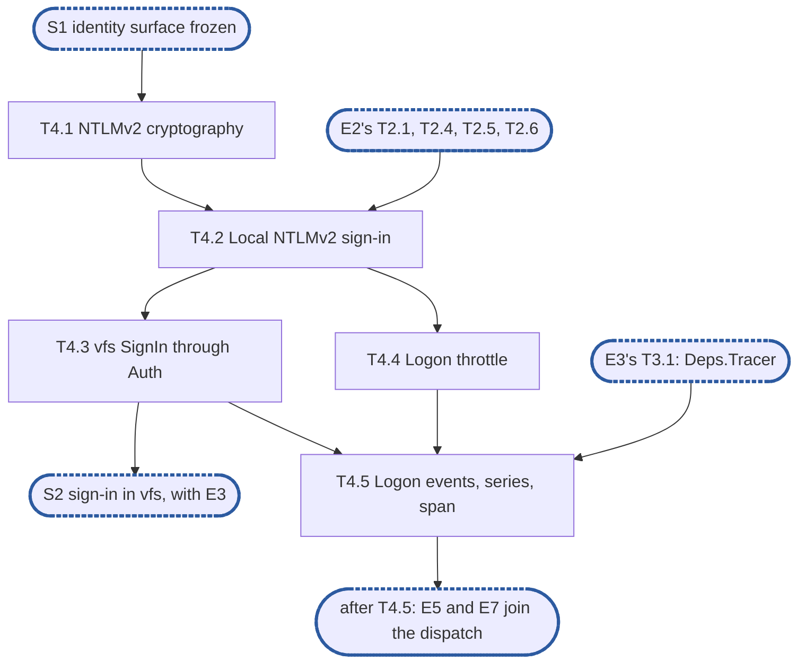

# Epic 4: identity v2 local NTLMv2 sign-in

**Sources:** [RFC 18](../rfcs/rfc-18-identity.md) §3.1 (the authenticator's contract, the
throttle, the logon event), §3.5's local half and its MIC and key rules, §3.6's refusal half,
§3.7's sign-in half, §3.8 at sign-in, §7.3's logon-throttle row, §8.1's rule that an API sign-in
emits no logon event, §9.1's ID5 (its sign-in half) and ID12 (at identity's layer), §9.2's
sign-in series and `identity.authenticate` span, and §10's rows "NTLM MIC" (its local half),
"NTLM domain" (its local and refusal halves), "logon throttle" (its local half), "no local
password for a directory user" (its sign-in half) and "pass-through" (its 24-byte clause), as
pull request #4058 merged them (83232b441); [RFC 17](../rfcs/rfc-17-vfs.md) §2.3 and §3.1
(`SignIn` passed straight through); [RFC 20](../rfcs/rfc-20-adapters.md) §4.4 (the NTLM wire
code and the null and guest sessions are `gss`'s); [RFC 25](../rfcs/rfc-25-observability.md)
§4.2's logon fields and §5.4; MS-NLMP 2.2.2.7, 3.1.5.1.2, 3.2.5.1.2, 3.3.2 and §4.2.4's
published NTLMv2 vectors.
**Track:** B.
**Epic 4 estimate: 5 subtasks, 7.5 man-days.**
**Depends on:** **S1**, epic 1's surface frozen: `SignInStep`, `NTLMAuthenticate`,
`SignInResult`, `Keys`, `Authenticator`, `*Server` with a stubbed `SignIn`, `vfs.Deps.Auth`.
**E2, partly**: T4.2 waits for E2's T2.1 (`User.NTHash` and the name fold), T2.4
(`State.Settings` with its `NTLM` and `NetBIOSName` keys, `Deps.Secrets`), T2.5 (`Find` by user
name) and T2.6 (`NewHashes`, whose NT hash T4.2's tests sign in against). T2.6 does not wait for
RFC 23's user deletion (#4326's T2.11) once its marked-deleted cases move to E2's T2.8 (#4316),
which waits for T2.11 and which RFC 23's password write waits for, so S2 does not; RFC 23's
epic 2 PR table names T2.8 rather than T2.6 in #4336. T4.1 starts at S1.
**E3, partly**: T4.5 reads the `Deps.Tracer` E3's T3.1 adds; T4.3 removes `errUnsigned` once
E3's T3.2 has routed `Spell` and `Find`.
**Blocks:** **S2**, with E3: `vfs.Service`'s `SignIn` answers an NTLM step (T4.3). **E5**, whose
Kerberos branch joins the dispatch, the throttle, the logon event and the series T4.2, T4.4
and T4.5 build. **E7, partly**: pass-through is a row of T4.2's domain table, and it reuses
T4.1's key exchange and MIC check keyed by the reply's `UserSessionKey`, T4.2's NTLMv1 refusal,
which sits before routing, and T4.4's throttle for the domain controller's count. **E6, partly**:
its T6.7 cache keys names with E2's `entity.FoldPrincipalName`, which T4.4's throttle reaches through `entity.PrincipalUserPart`. RFC 22's plan, whose S6a is this
epic's S2.

---

## 1. Goal

`SignIn` verifies an NTLMv2 response against a local user's NT hash, checks the MIC, unwraps
the session key and binds the evidence to that user's principal; every attempt is throttled
first and recorded once.

**At the end of the epic:**

- an NTLM AUTHENTICATE naming a local user, with an empty domain or the installation's NetBIOS
  name, signs in as that user with proof `Secret`, and the exported session key in `Keys`;
- every other domain is `ErrLogonFailure` with outcome `unknown_domain`, until E7 adds
  pass-through's row;
- MS-NLMP §4.2.4's published vectors pass through identity's code, and the NTLMv2 response
  decoder has a fuzz target;
- past 10 failures in 10 minutes for one user part and client address, attempts fail before the
  credential is read;
- each attempt emits one logon event, one count and one span, and none carries the credential;
- `*vfs.Filesystem`'s `SignIn` calls `vfs.Deps.Auth`.

### 1.1 In scope

The NTLMv2 cryptography lifted from `develop` and corrected; the NTLMv2 response decoder and its
fuzz target; `SignIn`'s dispatch and its NTLM branch; the domain table's local and refusal rows;
the local check against a sealed NT hash; the NTLM-off refusal at sign-in; the throttle;
`Deps.Logons` and the logon event; `identity_authentications_total`,
`identity_authentication_seconds` and the `identity.authenticate` span; `SignIn` routed through
`vfs.Deps.Auth`.

### 1.2 Out of scope

- Pass-through's row of the domain table, its "pass-through configured" predicate, the call to
  the domain controller and the domain controller's bad-password count: E7. T4.2's table is the
  one E7 adds the row to (D8).
- Kerberos's branch of `SignIn`, outcomes `replay` and `no_pac`, and a ticket's `Expires`: E5.
  Until E5, a Kerberos step keeps epic 1's `ErrUnavailable` stub.
- NEGOTIATE and CHALLENGE, parsing the AUTHENTICATE, SPNEGO and the `mechListMIC`: RFC 20 §4.4's
  `gss`, built by RFC 22's plan. The CHALLENGE's AV pairs, `MsvAvNbComputerName` from
  `identity.netbios_name` among them, and so "NTLM domain"'s first clause, the CHALLENGE
  advertising the installation's name: the RFC 18 plan's deferral ledger row "The CHALLENGE's
  AV pairs, `MsvAvNbComputerName` from `identity.netbios_name`, and the seam that hands `gss`
  those names".
- RFC 18 §3.6's first rule, null and guest sessions set up as anonymous with no key, and §3.8's
  re-authentication as null or guest keeping the first keys: `gss` and RFC 22's session code set
  them up without `SignIn` (RFC 20 §4.4; RFC 22's plan's S4), so nothing here can break them.
  This epic owns only §3.6's refusal: a failure never becomes one (R16, D3).
- Refusing calls on an established NTLM session once `identity.ntlm` is off: resolution, E3's
  T3.10. This epic refuses the sign-in.
- Replacing a session's identity in place, keeping its trees and opens, and ending it on a failed
  re-authentication: RFC 22's adapter. §10's "re-authentication" and "no map to guest" rows: E9.
- `identity_authentications_total`'s registration in the node's table: E8.
- RFC 25's `logon` stream itself: the deferral ledger row "RFC 25's `logon` stream; attempts are
  log lines".
- Charging the throttle to RFC 24's pool: the deferral ledger row "Caches charged to RFC 24's
  connection-state pool, not fixed counts".

### 1.3 Names used here

- **E1**, the contract and the server's surface: `pkg/identity`, `internal/identity`'s
  lifecycle, `vfs.Deps.Auth`, and the import rule that only `internal/node` imports the server.
- **E2**, principals and accounts: `Find`, `NewHashes`, `User.NTHash`, `State.Settings`,
  `Deps.Secrets`, the name fold.
- **E3**, resolution, whose T3.1 adds `Deps.Tracer`.
- **E4**, this epic.
- **E5**, Kerberos and the PAC.
- **E6**, the directory: the directory record whose NetBIOS domain and realm E7's row reads, and
  the directory cache whose keys fold with E2's `entity.FoldPrincipalName`.
- **E7**, NETLOGON and the machine account: pass-through.
- **E8**, the integration epic: identity composed into the node.
- **E9**, E2E green: RFC 18 §10's Tier 2 rows over SMB.
- **S1**, the identity surface frozen, which E1 delivers.
- **S2**, NTLM sign-in and resolution in `vfs`: E3 and E4 done.
- **S4**, **S4b** and **S6a**, RFC 22's plan's own points, not RFC 18's: S4 a guest session
  over loopback, set up with no `SignIn`; S4b a signed session, NTLM against `memory.New`'s
  `SignIn`; S6a local sign-in, which waits for S2.

## 2. How the general rules apply

The rules are those of
[the RFC 18 plan's §1.5](rfc-18-identity-plan.md#15-general-rules-for-each-epic), cited by
number and title and not copied.

| Rule | Subtasks | How |
| --- | --- | --- |
| rule 1, independent unit tests ([`CLAUDE.md`, "Writing tests"](../../../CLAUDE.md#writing-tests)) | all | NTLM messages from MS-NLMP §4.2.4's vectors and from `develop`'s client-side test builders, never stubbed; the memory KV store; #4059's real secret provider over `keyprovider`'s local provider with key files in `t.TempDir()`; users seeded through E2's `NewHashes`; doubles only the injected clock, `kvtest`'s fault wrapper, one `export_test.go` hook and a recording logon sink, a sink of outputs |
| rule 2, fuzz every decoder of untrusted bytes | T4.1 | `FuzzNTLMv2Response` over the NTLMv2 response decoder; the AUTHENTICATE's own decoder is `gss`'s |
| rule 3, observability follows RFC 25 | T4.5 | `identity_authentications_total` and `identity_authentication_seconds`, the `identity.authenticate` span; no label or attribute carries a name, an address or a credential |
| rule 4, profiling | all | every test runs under the leak check |
| rule 5, public interface and internals ([`CLAUDE.md`, "Verifying a change"](../../../CLAUDE.md#verifying-a-change)) | T4.2, T4.3, T4.4 | the NT hash is proven by a sign-in against a user seeded through `NewHashes`, its consumer; the key-exchange and MIC refusals at `SignIn`, not only at the functions; the throttle by a correct password refused; routing by `vfs.Service`'s `SignIn` |
| rule 6, known failures shrink | none | no suite this epic touches keeps a `known.yaml`; nothing lands red |
| rule 7, v2 ignores v1 | T4.1, T4.2 | the cryptography is lifted from `develop`'s `internal/adapter/smb/auth/ntlm.go` with its tests, its key exchange's fallback to the base key fixed (T4.1); `session_setup.go`'s advisory MIC check and retry across five domains are not carried over (T4.2) |
| rule 8, real dependencies for properties of those dependencies | none | no external system: NTLM is checked against published vectors |
| rule 9, code comment conventions ([`CLAUDE.md`, "Code comments"](../../../CLAUDE.md#code-comments)) | T4.1, T4.2, T4.4, T4.5 | RFC 18's `decision:` notes of §3.5 (an alternate UPN suffix) at the domain table and §3.6 (no map to guest) at `SignIn`'s error path; its `ponytail:` notes of §3.1 and §7.3 at the throttle; this document's `decision:` markers for D1 and D2 (T4.1), D3, D4 and D10 (T4.2), D5 (T4.4), and D7's `ponytail:` (T4.5); epic 1's stub marker on `SignIn` narrowed to the Kerberos branch |
| rule 10, a test must be able to fail | all | each R row's test is named with the bug it catches; R10's constant-time compare is held by `hmac.Equal` and R24 by the event's one emit site, each named as such |
| rule 11, a symbol is exported only if RFC 18's interfaces use it | T4.5 | `LogonSink`, `LogonEvent` and `LogLines`, which `internal/node` calls to fill `Deps.Logons`; the throttle imports E2's `entity.PrincipalUserPart`, so this epic exports no fold; the cryptography stays unexported |
| rule 12, each subtask creates only what it declares | all | `Deps.Logons` lands with T4.5, its first reader; the pass-through row with E7; no `State` field is added |

## 3. Requirements and invariants

Every obligation RFC 18 and the related RFCs place on this epic, numbered so that subtasks and
tests can cite them. Sources are RFC 18 unless named.

**The sign-in contract**

| # | Requirement | Kind | Source | Subtasks |
| --- | --- | --- | --- | --- |
| R1 | Before it returns, `SignIn` maps what it verified to a principal and sets `Evidence.Principal`: a local NTLM user by the record it verified against; the evidence's `Name` is the canonical local user name, its `SIDs` empty and its `Expires` zero for NTLM | MUST | §3.1 | T4.2 |
| R2 | Every error `SignIn` returns is `ErrLogonFailure`, `ErrInvalid` or `ErrUnavailable`, and a failed sign-in yields no identity, never a guest or anonymous one | MUST | §3.1, §3.6, §9.1 ID5 | T4.2 |
| R3 | `SignIn` reads only the store views and the secret provider, and a local NTLM sign-in writes nothing | invariant | §3.1 | T4.2 |
| R4 | An NTLM sign-in's result is an `Identity` with proof `Secret` and protection `None`, and the `Keys` beside it, never in it, carry the exported session key as `Session` | invariant | §3.1, §3.5 | T4.2 |

**Routing**

| # | Requirement | Kind | Source | Subtasks |
| --- | --- | --- | --- | --- |
| R5 | The message's domain is compared with ASCII letters folded only: empty with a user name that holds no `@`, or `identity.netbios_name`, is local; with no pass-through row, anything else is `ErrLogonFailure` counted `unknown_domain`; E7 adds the pass-through row | MUST | §3.5, §4.6 | T4.2 |
| R6 | A UPN under an alternate suffix, or a domain with a trailing dot, is `unknown_domain`, by §3.5's `decision:` note | invariant | §3.5 | T4.2 |

**NTLMv2 verification**

| # | Requirement | Kind | Source | Subtasks |
| --- | --- | --- | --- | --- |
| R7 | NTLMv1 and LM are refused: an `NtChallengeResponse` of 24 bytes is refused before any check, local or pass-through | MUST NOT | §3.5; §10 "pass-through" | T4.1, T4.2 |
| R8 | A local user is found by name, and its NT hash, a `Secret` of kind nt-hash, verifies the NTLMv2 response computed with the user and domain as the message names them (MS-NLMP 3.3.2), and with no other domain | MUST | §3.5 | T4.1, T4.2 |
| R9 | A directory principal is refused locally, since it has no local NT hash, and so is any user with none | MUST NOT | §3.5; §10 "no local password for a directory user" | T4.2 |
| R10 | The NTLMv2 proof is compared in constant time, and an unknown name costs the same work as a wrong password (this epic equalises the NTLMv2 computation; the secret's unwrap is D4's open point) | MUST | §3.5 | T4.1, T4.2 |
| R11 | When `MsvAvFlags` marks a MIC present, the MIC verifies over the exact NEGOTIATE, CHALLENGE and AUTHENTICATE bytes, keyed by the exported session key; a flagged MIC that is missing or zero fails | MUST | §3.5 | T4.1, T4.2 |
| R12 | The session base key is `HMAC_MD5(NTOWFv2, NTProofStr)`; with `NTLMSSP_NEGOTIATE_KEY_EXCH` the exported session key is the RC4 unwrap of `EncryptedRandomSessionKey` under it, else the base key | invariant | §3.5 | T4.1, T4.2 |
| R13 | A MIC or key failure, and a message asking for signing without key exchange, is `ErrLogonFailure` | MUST | §3.5 | T4.1, T4.2 |
| R14 | A `Disabled` principal fails sign-in with `ErrLogonFailure`, logon outcome `disabled`; one marked deleted is found by no name (RFC 23 epic 2's R39, R40), so it is a miss: `ErrLogonFailure`, outcome `logon_failure` | MUST | §3.7; RFC 23 epic 2's R39, R40 | T4.2, T4.5 |
| R15 | While `identity.ntlm` is off, NTLM sign-ins are refused, from the `Apply` that delivers the setting | MUST | §3.5 | T4.2 |

**Failures and re-authentication**

| # | Requirement | Kind | Source | Subtasks |
| --- | --- | --- | --- | --- |
| R16 | A session setup whose credential fails never becomes an anonymous or guest session: not for an unknown user, a wrong password, or a store or directory error | MUST NOT | §3.6, §9.1 ID5; RFC 20 §4.4 | T4.2 |
| R17 | A re-authentication, `SignInStep.Context` set, answers with the identity the new proof establishes and nothing of the context's evidence; a failed one answers no evidence, so the context ends | MUST | §3.8, §9.1 ID12 | T4.2 |

**The throttle**

| # | Requirement | Kind | Source | Subtasks |
| --- | --- | --- | --- | --- |
| R18 | Past 10 `ErrLogonFailure` results in 10 minutes for one (name, client address), the name being the user part without its domain or realm, folded as §4.6 folds a name, and the address an IPv6 address's /64 as RFC 23 §5.3 keys a source, every further attempt from that pair fails `ErrLogonFailure` before its credential is checked, until the window has passed with fewer | MUST | §3.1; RFC 23 §5.3 | T4.4 |
| R19 | No account is locked by failures: the count is per pair, so the same user from an address outside the pair's /64 (or another IPv4 address) still signs in | invariant | §3.1; RFC 23 §5.3 | T4.4 |
| R20 | Past its share, the throttle evicts its oldest pair, counted | bound | §7.3 | T4.4 |
| R30 | `Stop` drops the throttle's table, identity's first in-memory table (epic 1's R14 leaves the drop to the first epic that keeps one) | invariant | §2.6 | T4.4 |
| R21 | §10's "logon throttle" row, its local half: 10 wrong passwords then the right one refused, outcome `throttled`; 10 spread over `alice`, `ALICE`, `CORP\alice` and `alice@CORP.EXAMPLE`, the eleventh refused | test row | §10 | T4.4, T4.5 |

**Logon events and observability**

| # | Requirement | Kind | Source | Subtasks |
| --- | --- | --- | --- | --- |
| R22 | Each attempt emits one logon event: success or failure with its outcome, the mechanism, the name as presented, the principal on success, and the client address | MUST | §3.1; RFC 25 §4.2 | T4.5 |
| R23 | No logon event, log line, error text, label or span attribute carries the credential: no response, hash or session key | MUST NOT | §3.1; RFC 25 §5.4 | T4.5 |
| R24 | An API sign-in emits no logon event | MUST NOT | §8.1 | T4.5 |
| R25 | `identity_authentications_total{protocol, mechanism, outcome}` counts each attempt and `identity_authentication_seconds{mechanism}` times it | invariant | §9.2 | T4.5 |
| R26 | `identity.authenticate` is a child of the adapter's request span, with the proof kind, the outcome and the principal's ID as attributes, never a name, SID or hash | invariant | §9.2; RFC 25 §5.4 | T4.5 |

**Test rows and routing in `vfs`**

| # | Requirement | Kind | Source | Subtasks |
| --- | --- | --- | --- | --- |
| R27 | §10's "NTLM MIC" row, its local half: a corrupted MIC, and a zeroed one while `MsvAvFlags` marks it present, each `ErrLogonFailure` | test row | §10 | T4.2 |
| R28 | §10's "NTLM domain" row, its local and refusal halves: the NetBIOS name in another case verified locally; a domain matching nothing, and the name with `K` sent as the Kelvin sign U+212A, `ErrLogonFailure` with outcome `unknown_domain` | test row | §10 | T4.2, T4.5 |
| R29 | `*vfs.Filesystem` passes `vfs.Service`'s `SignIn` straight through to the `Authenticator` | invariant | §3.1; RFC 17 §3.1 | T4.3 |

Which test or enforcer holds each row is in its subtask's **Tests**.

## 4. Decisions this epic takes

- **D1, `MsvAvFlags` is read from the verified response, and nowhere else.**
  The flags travel in the NTLMv2 response's AV pairs, which `NTProofStr` authenticates; the
  adapter's decoded copy is not. Reading them where the proof covers them is what defeats the
  drop-the-MIC relay, which strips the MIC and the flag that announces it. The plan's A19 drops
  `AVFlags` from `NTLMAuthenticate`, so no decoded copy exists to read. `decision:` marker at
  the check. Prior art: Microsoft's fix for CVE-2019-1040; Samba's NTLMSSP server reads
  `MsvAvFlags` from the response's AV pairs (both from memory).
- **D2, the MIC is read from the AUTHENTICATE's bytes, and only when flagged.** When D1's flags
  mark a MIC, it is `Raw`'s 16 bytes at offset 72, zeroed there for the HMAC; a `Raw` shorter
  than 88 bytes, or a zero MIC, is a missing one and fails. A19 drops `NTLMAuthenticate.MIC`
  with `AVFlags`, so no second copy can disagree with the bytes the HMAC covers, and no
  separate answer for a disagreement exists. With no MIC flagged, bytes 72 to 88 are not read.
  `decision:` marker. Prior art: `develop`'s `authMicOffset` (checked); Samba's
  `NTLMSSP_MIC_OFFSET` (from memory).
- **D3, how a step is classified, pending the user's answer for the first point (§9).**
  - A step with neither or both of `NTLM` and `Kerberos`, or an AUTHENTICATE with no user name
    (the unclassified step), is `ErrInvalid` before the throttle, with no logon event and no
    count: it is no attempt of
    either mechanism, and null and guest sessions are `gss`'s to set up without `SignIn` (RFC 20
    §4.4; RFC 22's plan's S4), so one that reaches identity is a caller's bug, refused, never a
    session.
  - The throttle is asked next, before every refusal below: NTLM off, NTLMv1 and LM, and the
    malformed response. So the NTLM-off and NTLMv1 refusals are `ErrLogonFailure` results the
    throttle counts (D5), and a pair it refuses gets `throttled` whichever of them its attempt
    would have met: no mechanism the installation refuses lets a client try names uncounted.
  - An `NtChallengeResponse` of 24 bytes (NTLMv1), or empty with a user (LM only), is
    `ErrLogonFailure` before any credential check (R7).
  - A response that is not a well-formed NTLMv2 response (MS-NLMP 2.2.2.7: its header, or an AV
    pair list without `MsvAvEOL` or overrunning the buffer) is `ErrInvalid`, as `develop`
    answers `smb2.session.ntlmssp_bug14932` with `STATUS_INVALID_PARAMETER`. It is decided
    before the proof is computed, so `ErrInvalid` never depends on the password. Unlike the
    unclassified step it is an NTLM attempt by a named user, so it is recorded: one logon event
    and one `identity_authentications_total` count, outcome `invalid` (RFC 18 §9.2). Of the
    refusals after the throttle, it is the one D3 decides that does not count toward it (D5): it
    is decided before the proof, so it tells nothing of the password. A store or secret fault,
    `ErrUnavailable` (T4.2), does not count either (D5), so an outage never locks a right
    password out. From a pair the throttle already refuses, it is answered `throttled` like any
    other attempt.
  - Every failure once the proof has been computed (the proof, the key exchange, the MIC, a
    disabled user) is `ErrLogonFailure`, counted by the throttle, so no answer tells a right
    password from a wrong one.

  `decision:` marker at the classification. Prior art: Samba and Windows answer the malformed
  case `STATUS_INVALID_PARAMETER` (`develop`'s comment, checked).
- **D4, equal work is the NTLMv2 computation.** An unknown name, a user with no NT hash, a
  directory principal and a disabled one each compute the NTLMv2 proof against a
  dummy NT hash drawn at `New`, so the cryptographic work is a wrong password's. The store read
  and the secret's unwrap are not equalised: a miss skips the unwrap, which under a remote key
  provider is a round trip. A `decision:` marker names that ceiling; §9 raises it as an RFC
  question, since §3.5's "the same work" read strictly asks for a dummy unwrap too. Prior art:
  E2's `VerifyPassword` uses a dummy hash the same way (E2's R27); OpenSSH's fake password check
  for a missing user (from memory).
- **D5, the throttle's window and table.** Per pair, the times of the last 10 counted failures,
  on the injected clock; an attempt is refused while the oldest of 10 is under 10 minutes old.
  A throttled attempt is not counted, since counting it would keep a retrying client refused for
  ever, the lockout §3.1 rules out; a success does not reset the count. Every `ErrLogonFailure`
  result counts, NTLM off, NTLMv1, `unknown_domain` and `disabled` included; `ErrInvalid` and
  `ErrUnavailable` do not. A pair's key is the SHA-256 of the folded user part beside the unmapped client address
  (`netip.Addr.Unmap`), an IPv6 address cut to its /64 as RFC 23 §5.3 keys its sources, so an
  attacker's 64 KiB name costs 32 bytes, `::ffff:a.b.c.d` is `a.b.c.d`, and one host's /64
  cannot spread its failures over 2⁶⁴ pairs; a `decision:` marker at the key says so. The table holds 65 536 pairs, about 5 MiB with their times, a fixed count until RFC
  24's pool can be charged. `decision:` marker for the throttled-attempt rule; RFC 18's §3.1 and
  §7.3 `ponytail:` notes and a `ponytail:` on the fixed count at the table. Prior art: Samba
  counts only checked failures toward `bad password` (from memory).
- **D6, the throttle keys on E2's user part.** The pair's name is E2's
  `entity.PrincipalUserPart` (its D2, T2.1), which strips a `DOMAIN\` prefix and an `@realm`
  suffix and folds with `entity.FoldPrincipalName`, the fold that keys `NX‖user`; E2's `Lookup`
  calls the same function, so a spelling the store finds as one user is one pair and no second
  copy of the stripping or the fold can drift from it. E6's T6.7 folds its cache keys with
  `entity.FoldPrincipalName`. T4.2's local check finds the user through E2's `Lookup`, so the
  sign-in, `Lookup` and the throttle key resolve one presented string to one principal, and E2's
  R8 refuses `\` in a local name as it refuses `@`, so no stored name is split by the strip.
  Prior art: none found.
- **D7, logon events go to `Deps.Logons`, written as log lines without the presented name,
  pending the user's answer (§9).** `LogonSink` has RFC 25's method shape, `Logon(ctx,
  *LogonEvent)`, and `LogonEvent` holds RFC 25 §4.2's logon fields this epic has: the outcome,
  the flavour (RFC 18's mechanism), the name as presented, the principal on success, the
  protocol and the client address. RFC 25's `(*events.Sink).Logon` takes its own
  `events.LogonEvent`, so when it lands `internal/node` wraps it in a few lines, or the type
  moves into `pkg/events`; identity's emit site does not change. The node's sink until then is
  `LogLines`, one `Info` line per event. RFC 25 §5.4 bars a user name from any log line and its
  O13 bars the `logon` stream from the log, so the line carries everything but the name as
  presented, which only the stream may hold. `ponytail:` at `LogLines`, naming RFC 25's sink as
  the upgrade. A `nil` `Logons` makes `SignIn` answer `ErrUnavailable`, as epic 1's stubs do,
  where RFC 25's `nil` `*Sink` is a null sink: identity refuses rather than sign in unrecorded,
  and `New` does not refuse the `nil`, so earlier epics' tests build unchanged. A server built
  without `Logons` refuses NTLM from T4.5 on, so `node.New`'s does until E8's T8.2 hands the
  sink, and a node test that signs in over NTLM waits for T8.2 (RFC 23's epic 5's T5.7).
  `decision:` at that check. Prior art: Samba's `auth_json_audit` writes authentication events to a log of
  their own (from memory).
- **D8, E4's domain table has two rows; E7 adds the third.** The table is a function of the
  `State` and the message's user and domain, answering local or unknown; pass-through's row
  needs E6's directory record and E7's join state, which do not exist yet, so E7 adds it with
  its predicate. The NTLMv1 refusal runs before the table, so it covers E7's row unchanged.
  Prior art: none found.
- **D9, a missing `Auth` answers `ErrUnavailable` in `vfs`.** `vfs.New` does not refuse a
  `Deps` without `Auth`; `SignIn` then answers `ErrUnavailable`, so a filesystem built without
  identity fails closed. `pkg/vfs/vfstest/memory` is not one: E3's T3.6 hands it the real server
  through `internal/identity/identitymem` as `Auth`, so once T4.3 lands its `SignIn` signs in a
  user seeded in its store. Prior art: `errUnsigned` fails closed today, but with `ErrAccess`,
  which §3.1 does not allow; T4.3 removes it.
- **D10, a disabled user's outcome is `disabled` whatever the password.** The proof is computed
  against the dummy hash as for a miss (D4), and the answer is `ErrLogonFailure` either way;
  the outcome tells an operator the account, not the password, stopped the sign-in. `decision:`
  marker. Prior art: Windows logs a disabled account's logon as its own failure reason (from
  memory).

## 5. Target tree

```text
internal/identity/
  ntlm.go             T4.1  NTLMv2 response decoder, NTOWFv2, proof check, key exchange, MIC (lifted from develop)
  ntlm_test.go        T4.1  MS-NLMP §4.2.4 vectors, develop's MIC, key and malformed-response tests lifted
  ntlm_fuzz_test.go   T4.1  FuzzNTLMv2Response, seeds in testdata/fuzz/FuzzNTLMv2Response
  signin.go           T4.2  SignIn's dispatch, the domain table, the local check, the dummy NT hash
                      T4.4  the throttle's call before the credential
                      T4.5  one logon event, count, histogram and span per attempt
  signin_test.go      T4.2, T4.4, T4.5
  stubs.go            T4.2  SignIn's stub narrowed to the Kerberos branch
  throttle.go         T4.4  the throttle and its table
  logon.go            T4.5  LogonSink, LogonEvent, LogLines
  server.go           T4.5  Deps.Logons
  export_test.go      T4.2  the hook that delivers the NT hash a proof was computed with
internal/vfs/
  shares.go           T4.3  SignIn through Deps.Auth; errUnsigned removed once Spell and Find are routed
```

## 6. Subtasks

### T4.1 The NTLMv2 cryptography, lifted and checked against MS-NLMP's vectors

**Subtask T4.1 estimate: 1.5 man-days.**

- **Track:** B. **Depends on:** S1.
- **Covers:** R7, R8, R10, R11, R12, R13.
- **Deliverables:** in `internal/identity/ntlm.go`, unexported and pure, lifted from `develop`'s
  `internal/adapter/smb/auth/ntlm.go` with its tests; the signatures are indicative:
  - `parseNTLMv2(resp []byte) (proof [16]byte, blob []byte, avFlags uint32, err error)`, from
    `validateNTLMv2ClientChallenge`, now returning the `MsvAvFlags` pair it walks past (D1),
    `errNTLMv1` for 24 bytes or none, `errMalformed` per D3; `blob` is a sub-slice of `resp`, so
    it allocates nothing;
  - `ntowfv2(ntHash [16]byte, user, domain string) [16]byte`, from `ComputeNTLMv2Hash`;
  - `checkProof(key [16]byte, challenge [8]byte, proof [16]byte, blob []byte) (base [16]byte,
    ok bool)`, from `ValidateNTLMv2Response`, comparing with `hmac.Equal`;
  - `exportedKey(base [16]byte, flags uint32, encrypted []byte) ([16]byte, error)`, from
    `DeriveSigningKey`, refusing a key exchange whose key is not 16 bytes, where `develop` fell
    back to the base key, and signing without key exchange;
  - `checkMIC(key [16]byte, a *identity.NTLMAuthenticate, avFlags uint32) error`, from
    `VerifyAuthMessageMIC`, reading the MIC from `Raw` per D2.

  Consumed by T4.2, and by E7, which calls `exportedKey` and `checkMIC` with the reply's
  `UserSessionKey` as the base key. The wire code beside them (`BuildChallenge`,
  `ParseAuthenticate`, the `mechListMIC`) stays `gss`'s.
- **Acceptance criteria:**
  - MS-NLMP §4.2.4's NTLMv2 vectors pass: `NTOWFv2`, the session base key, the response's
    `NTProofStr`, and the random session key unwrapped from the published encrypted one.
  - No function reads or writes outside its arguments.
- **Tests:** pure functions in `internal/identity`:
  - the vectors above (catches an upper-cased domain, a reversed concatenation or a key derived
    from the wrong input, R8, R12);
  - `develop`'s tests lifted with the code: `TestVerifyAuthMessageMIC`, whose
    `buildSignedAuthenticate` computes the MIC independently of the code under test (a flipped
    byte in the MIC or the message refused), extended with the MIC zeroed while flagged, a `Raw`
    of 87 bytes while flagged, each refused, and no flag needing no MIC (R11, D2);
    `TestValidateNTLMv2Response`'s malformed cases (a wrong `RespType`, a pair list with no
    `MsvAvEOL`, the `ntlmssp_bug14932` pair overrunning the buffer), each `errMalformed`, and 24
    bytes `errNTLMv1` (R7); `TestDeriveSigningKey`, whose fallback case becomes a refusal of a
    15-byte key, beside signing without key exchange refused (catches `develop`'s fallback,
    R13);
  - `FuzzNTLMv2Response`: never panics; every AV pair the decoder walks lies inside `resp`; a
    plain reference walk written in the test accepts exactly the inputs the decoder accepts and
    reads the same `MsvAvFlags`; crashers committed under `testdata/fuzz/FuzzNTLMv2Response`.
    The zero-allocation check is a unit test over the seeds with `testing.AllocsPerRun`.

  R10's constant-time compare is held by `hmac.Equal` (rule 10). No test double.
- **Rules:** rule 7 (lifted, the key exchange's fallback fixed); rule 9 (D1's and D2's markers).

### T4.2 Local NTLMv2 sign-in

**Subtask T4.2 estimate: 2.75 man-days.**

- **Track:** B. **Depends on:** T4.1; E2's T2.1, T2.4, T2.5, T2.6.
- **Covers:** R1, R2, R3, R4, R5, R6, R7, R8, R9, R10, R11, R12, R13, R14, R15, R16, R17, R27,
  R28.
- **Deliverables:** `(*Server).SignIn`'s body, reading one `State` for the call:
  - D3's `ErrInvalid` for a step with neither or both mechanisms, or no user; a Kerberos step
    keeps epic 1's stub until E5;
  - for NTLM, in order: T4.4's throttle, asked here once T4.4 lands (D3); `State.Settings`'
    `NTLM` key off, `ErrLogonFailure` (R15); the NTLMv1
    refusal (R7); the malformed-response refusal (D3); the domain table (D8), ASCII letters
    folded, with RFC 18 §3.5's alternate-suffix `decision:` at it (R5, R6);
  - the local check: E2's `Lookup` (its T2.6), which finds the user by
    `entity.PrincipalUserPart` as D6's throttle key does; the user's record; a disabled,
    directory or NT-hash-less user, and a miss (a user marked deleted among them, since `Lookup`
    no longer finds it), verified against D4's dummy hash and
    refused; the NT hash resolved through `Deps.Secrets` as a `Secret` of kind nt-hash, and a
    `nil` `Secrets` answering `ErrUnavailable`; T4.1's `ntowfv2` with the user and domain as the
    message names them and no other domain, `checkProof`, `exportedKey` and `checkMIC`; a store
    or secret error `ErrUnavailable`;
  - the result: `Identity{Proof: Secret, Protection: None, Evidence: {Name: the stored name,
    Principal}, Client: step.Client}` and `Keys{Session: the exported key}`; on any error the
    zero result, with RFC 18 §3.6's `decision:` at the error path, and D3's, D4's and D10's
    markers;
  - an unexported outcome per path, which T4.5 records: `ok`; `logon_failure` for a wrong
    proof, a missing user or hash, NTLM off, NTLMv1 or LM, and a key or MIC failure; `disabled`;
    `invalid` for a malformed response, which T4.5 records though it is `ErrInvalid` (D3);
    `unavailable`; `unknown_domain`; the unclassified step has no outcome and returns before
    any is recorded;
  - the `export_test.go` hook that delivers the NT hash a proof was computed with;
  - `internal/identity/identitymem` (E3's T3.6) passing #4059's provider over `keyprovider`'s
    local provider, with its key files under the test's `t.TempDir()`, as `Deps.Secrets`, so
    `pkg/vfs/vfstest/memory`'s `SignIn` can resolve an NT hash (RFC 22's plan's S4b), by
    whichever of T4.2 and E3's T3.6 lands second.

  Consumed by T4.3, T4.4, T4.5, by E5 (the dispatch) and E7 (the table's third row).
- **Acceptance criteria:**
  - MS-NLMP §4.2.4's AUTHENTICATE, for user `User` and domain `Domain`, signs in a user `User`
    seeded with password `Password` through `NewHashes` under `identity.netbios_name` `DOMAIN`.
  - `SignIn` writes nothing on any path.
- **Tests:** at `Server.SignIn`, over the memory KV store, users seeded through `NewHashes` and
  sealed through #4059's provider, every case asserting that an error is one of the three and
  the result is zero (R2, and R17's failure half when `Context` is set):
  - the §4.2.4 AUTHENTICATE with its user rewritten `USER`, which NTOWFv2 upper-cases so the
    proof still verifies: bound to `User`'s principal, the evidence's `Name` `User` as stored, no
    SIDs, zero `Expires`, proof `Secret`, `Keys.Session` the vector's random session key (catches
    an NT hash `NewHashes` writes that NTLM cannot verify, and the name echoed as presented, R1,
    R4, R8, R12);
  - a response computed with an empty domain, sent naming `NAS01`: refused (catches a retry
    across domains, R8);
  - "NTLM domain", local and refusal: `nas01` against `NAS01` verified; an empty domain and
    `alice` verified; `OTHER`, refused; `alice@corp.example.com` with an empty domain, refused
    while no pass-through row exists; `KIOSK` sent with U+212A for `K`, refused (catches a
    Unicode fold, R5, R28); the alternate-suffix and trailing-dot forms refused (R6);
  - a 24-byte response for a known user while `kvtest`'s fault wrapper fails every read:
    `ErrLogonFailure`, not `ErrUnavailable` (catches a check after a read, R7); a malformed
    response and an empty user, `ErrInvalid` (D3);
  - a wrong password, an unknown user, a user seeded while NTLM was off (no NT hash), an
    API-only account, and a user with a `dir` spelling whose NT hash is written straight to the
    store, each `ErrLogonFailure` (catches a directory principal checked by absence alone, R9);
    a disabled user, `ErrLogonFailure` (R14; a marked-deleted user is the unknown-user case);
  - an unknown user's call reaching the NTLMv2 computation with the dummy hash, through the hook
    (catches a short-cut for a missing name, R10);
  - `kvtest`'s fault wrapper failing the user's read, then the secret's: `ErrUnavailable` and a
    zero result (catches an outage answered as a wrong password or a session, R2, R16);
  - the wrapper failing every write: a sign-in still succeeds (catches a write such as v1's
    `LastLogin`, R3);
  - "NTLM MIC", local half, with the right password: a corrupted MIC, a zeroed flagged one, and
    a flagged MIC on a `Raw` shorter than 88 bytes, each `ErrLogonFailure` (catches `develop`'s
    advisory check, and a right password told apart by its answer, R11, R27);
  - with the right password, a key exchange carrying a 15-byte key and a message asking for
    signing without key exchange: `ErrLogonFailure` and zero `Keys` (catches an `exportedKey`
    error dropped by its caller, R13);
  - `Apply` turning `identity.ntlm` off: the vector's sign-in refused; on again, accepted (R15);
  - `Context` set to alice's evidence with SIDs and an `Expires`, signing in as bob: bob's
    principal, no SIDs, zero `Expires` (catches the old evidence kept or merged, R17).

  Doubles: `kvtest`'s fault wrapper (kind 3); the hook set from `export_test.go`.
- **Rules:** rule 7 (`develop`'s domain retry and advisory MIC not carried over).

### T4.3 `vfs.Service`'s `SignIn` through `Deps.Auth`

**Subtask T4.3 estimate: 0.25 man-days.**

- **Track:** B. **Depends on:** T4.2.
- **Covers:** R29.
- **Deliverables:** `*vfs.Filesystem.SignIn` calling `fs.deps.Auth.SignIn` inside the
  `enter`/`done` gate it has today, its error unchanged; `ErrUnavailable` when `Auth` is `nil`
  (D9); `errUnsigned` and its `ponytail:` removed once E3's T3.2 has routed `Spell` and `Find`,
  by whichever lands second. Consumed by S2, RFC 22's plan (its S6a) and E8, which hands `Auth`
  the composed server.
- **Acceptance criteria:**
  - `vfs` holds `pkg/identity`'s `Authenticator`; only `internal/node` and test files import
    `internal/identity`, as epic 1's T1.5 check enforces.
- **Tests:** at `vfs.Service`, over the real identity server and the memory store, in a test
  file of `internal/vfs` (rule 5): the §4.2.4 step signs in as `User` (catches a `SignIn` still
  answering `errUnsigned`, R29); a filesystem with no `Auth`, `ErrUnavailable` (D9).

### T4.4 The logon throttle

**Subtask T4.4 estimate: 1.25 man-days.**

- **Track:** B. **Depends on:** T4.2.
- **Covers:** R18, R19, R20, R21, R30.
- **Deliverables:** `throttle` in
  `internal/identity`, keyed and sized as D5 says, the oldest pair evicted and counted in
  `identity_logon_throttle_evictions_total` (the name pending §9); `SignIn` asking it right after
  D3's unclassified step and before the NTLM-off, NTLMv1 and malformed-response refusals (D3),
  and counting each `ErrLogonFailure` but a throttled one, NTLM off and NTLMv1 included, with
  outcome `throttled`; RFC 18 §3.1's and §7.3's
  `ponytail:` notes and D5's markers. Consumed by T4.5, E5 (whose Kerberos branch asks it once the
  ticket decrypts, E5's D9) and E7.
- **Acceptance criteria:**
  - A throttled attempt reads neither the store nor the secret provider.
- **Tests:** at `Server.SignIn`, over the memory KV store, on the injected clock:
  - "logon throttle", local half: 10 wrong passwords for alice from one address, then the right
    one with `kvtest`'s fault wrapper failing every read: `ErrLogonFailure`, not
    `ErrUnavailable` (catches a throttle that still reads or checks the credential, R18, R21);
  - 10 24-byte NTLMv1 responses for alice from A, then the right password: refused, and the same
    with 10 attempts while `identity.ntlm` is off, then the right one once it is on (catches the
    throttle asked after the NTLMv1 or NTLM-off refusal, which leaves them uncounted, D3, D5);
    with alice throttled from A, a malformed response from A: `ErrLogonFailure`, not `ErrInvalid`
    (catches the malformed check run before the throttle, D3);
  - 10 failures spread over `alice`, `ALICE`, `CORP\alice` (refused `unknown_domain` here) and
    `alice@CORP.EXAMPLE`, then the right password as `alice`: refused (catches a spelling that
    resets the count, R21);
  - `alice`, `ALICE` and `NAS01\alice`, each sent as the user name with an empty domain and the
    right password: `Lookup` and `SignIn` give alice's principal for each, and the throttle's key,
    read through an `export_test.go` accessor, is one for all three (catches the sign-in finding
    the literal name, which makes one string two principals, D6);
  - 10 sign-ins for alice from A while `kvtest`'s fault wrapper fails the user's read, each
    `ErrUnavailable`, then the right password with the wrapper off: accepted (catches a store
    fault counted, D3, D5);
  - with alice throttled from A, alice from B signs in, and from A's IPv4-mapped IPv6 form is
    still refused (catches a per-account lockout, R19, and an unmapped key, D5);
  - the clock advanced so the oldest of 10 is 10 minutes old: the right password accepted;
    throttled attempts once a minute meanwhile do not delay that (catches throttled attempts
    counted, D5);
  - 65 537 distinct pairs: the first evicted, the eviction count 1, and its address no longer
    throttled (R20); a user field of 64 KiB is held at its key's size, read through an
    `export_test.go` accessor of the table's footprint (catches a key holding the name, D5);
  - two addresses in one IPv6 /64: one pair, the eleventh attempt from the second refused
    (catches a key on the whole IPv6 address, D5);
  - `Start`, the throttle filled for alice from A, `Stop`: the footprint accessor reads zero
    (catches a table kept across `Stop`, R30).

  Doubles: the injected clock (kind 1); `kvtest`'s fault wrapper (kind 3). The outcome
  `throttled` is asserted by T4.5's table.

### T4.5 Logon events, the sign-in series and the span

**Subtask T4.5 estimate: 1.75 man-days.**

- **Track:** B. **Depends on:** T4.3, T4.4; E3's T3.1.
- **Covers:** R14, R21, R22, R23, R24, R25, R26, R28.
- **Deliverables:** `Deps.Logons LogonSink`, its first reader (D7); `LogonSink{ Logon(ctx
  context.Context, e *LogonEvent) }`; `LogonEvent{ Time time.Time; Outcome, Mechanism, Protocol,
  Name string; Principal entity.PrincipalID; Client netip.Addr }`; `LogLines(*slog.Logger)
  LogonSink`, writing no `Name` (D7), with its `ponytail:`; `SignIn` emitting one event per
  attempt from one site, success or failure, with T4.2's and T4.4's outcome and the name as
  presented; `identity_authentications_total{protocol, mechanism, outcome}` with `protocol`
  `smb` for NTLM, `identity_authentication_seconds{mechanism}`; `identity.authenticate` from
  E3's `Deps.Tracer`, a child of the context's span, with the proof kind, the outcome and the
  principal's ID; a `nil` `Logons` answering `ErrUnavailable` (D7); `identitymem` passing
  `LogLines(Deps.Logger)` as `Logons`, so `pkg/vfs/vfstest/memory` keeps signing in (RFC 22's
  plan's S4b), by whichever of T4.5 and E3's T3.6 lands second. Consumed by E5 and E7, whose
  outcomes join, and by E8, which hands the node's sink and registers the series.
- **Acceptance criteria:**
  - `New` accepts a `Deps` without `Logons`, and `SignIn` then answers `ErrUnavailable`.
  - The event is emitted only from `SignIn`'s one site, so `VerifyPassword`, which never reaches
    it, emits none (R24, held by the code's shape, rule 10).
- **Tests:** at `Server.SignIn`, one table over every path of T4.2's and T4.4's tests, each row
  asserting four outputs, with a recording `LogonSink` and OpenTelemetry's in-memory span
  recorder, both sinks of outputs:
  - one event with the row's outcome (`throttled` for T4.4's eleventh attempt, `disabled` for a
    disabled user), `ALICE` as presented, the principal only on `ok`, and the client address
    (catches an attempt not recorded, or recorded twice, R14, R21, R22, R28);
  - `identity_authentications_total` with `protocol` `smb`, `mechanism` `ntlm` and the outcome,
    and the histogram's count, read from the registry (R25);
  - one `identity.authenticate`, its parent the context's span, its attributes exactly the proof
    kind, outcome and principal ID (catches a name or SID attribute, R26);
  - D3's unclassified step (neither or both mechanisms, or no user name): no event, no count;
  - a malformed response: one event and one count, outcome `invalid`, and after ten of them
    from one address the right password still signs in (catches a malformed response left
    unrecorded, or counted toward the throttle, D3, D5);
  - across the whole table, every event, `LogLines`' output, every `Deps.Logger` line at `Debug`,
    every error text and every span attribute, searched for the response, the MIC, the session
    key and the NT hash, and the log for the presented name: none found (catches a credential
    or name leaked, as `develop` logs an NT hash's prefix, R23, D7);
  - a `Deps` without `Logons`: `ErrUnavailable` (D7);
  - at `pkg/vfs/vfstest/memory`, `memory.New`'s `SignIn` with the §4.2.4 AUTHENTICATE signs in
    the §4.2.4 user seeded through `NewHashes` in the store it hands `identitymem` (catches
    `identitymem` left without `Secrets` or `Logons`, which would break RFC 22's plan's S4b),
    added by whichever of T4.5 and E3's T3.6 lands second.

## 7. Order of work



Checkpoints: after T4.3, `vfs.Service`'s `SignIn` answers a local NTLM user, S2's sign-in half;
after T4.5, every attempt is throttled and recorded, which E5's Kerberos branch and E7's
pass-through row inherit.

## 8. Suggested pull requests

| PR | Subtasks | Man-days | After | Why together |
| --- | --- | --- | --- | --- |
| 1 | T4.1 | 1.5 | — | the cryptography and its vectors, one review of the lifted code; open at S1 |
| 2 | T4.2, T4.3 | 3 | PR 1, E2's T2.1, T2.4, T2.5, T2.6 | a local user signs in through `vfs.Service`: S2's sign-in half |
| 3 | T4.4, T4.5 | 3 | PR 2, E3's T3.1 | every attempt throttled and recorded |

A suggestion only: one pull request per subtask works as well.

## 9. Open points

The sources are RFC 18 as #4058 merged it (83232b441), whose text in the sections cited here is
the version this document was written against.

The plan's figure for this epic is 6 subtasks, 8 man-days; this document's is 5 subtasks, 7.5
man-days. The re-authentication and anonymous rules are tests and one refusal inside T4.2 rather
than a subtask, and `develop`'s tests carry over; the vectors, which `develop` never ran, and the
logon sink come in.

**Pending the user's answer** (the recommended option is written in place):

- **Logon events while RFC 25's stream does not exist (D7).** The RFC 18 plan makes them log
  lines; RFC 25 §5.4 bars a user name from any log line and O13 bars the `logon` stream from the
  log. Options: (a) log lines without the presented name, one departure from O13, through
  `Deps.Logons` so RFC 25's sink replaces `LogLines` in the node; (b) the same lines through
  `Deps.Logger`, with no `Deps.Logons` until RFC 25's sink lands, which the independent design
  pass proposed; (c) build RFC 25's `logon` ring and spool now, outside this RFC. Recommended:
  (a), since RFC 18 §2.6 and epic 1's D4 name the field for this epic.
- **An AUTHENTICATE with no user name (D3).** RFC 20 §4.4 and RFC 22's plan's S4 have `gss` set
  up null and guest sessions without `SignIn`. Options: (a) `SignIn` refuses one `ErrInvalid`,
  and RFC 22's plan states that `gss` never sends one; (b) `SignIn` answers it with a `None`
  identity, which RFC 18 §3.1's `SignInResult`, "proof kind `Secret` or `Ticket`", rules out.
  Recommended: (a).

**Field ownership** (one rule: a field arrives with its first reader, and one epic adds it):

- `Deps.Logons` is added here (T4.5), its first reader; `New` does not refuse a `Deps` without
  it, and `SignIn` answers `ErrUnavailable` instead.
- `Deps.Tracer` is E3's T3.1's; T4.5 reads it. The plan's §1.3 gives it to epic 4.
- `Deps.Secrets` and `State.Settings` are E2's T2.4's; T4.2 reads the NT hash through the one and
  the `NTLM` and `NetBIOSName` keys of the other; a `nil` `Secrets` answers `ErrUnavailable`.
- `State.NTLM`, the `identity.ntlm` revision, has no reader here either: the sign-in refusal
  reads the `NTLM` key of `State.Settings`. It stays pending E2's D6; this epic adds no `State`
  field.
- The wiring imports nothing new: `vfs` holds `pkg/identity`'s interface, and only
  `internal/node` (E8) and identity's own packages build the server. `pkg/vfs/vfstest/memory`
  gets the real server as `Auth` from E3's T3.6, through `internal/identity/identitymem`. T4.2
  makes `identitymem` pass #4059's provider over `keyprovider`'s local provider as `Secrets`, and
  T4.5 makes it pass `LogLines(Deps.Logger)` as `Logons`, so RFC 22's plan's S4b, NTLM against
  `memory.New`'s `SignIn`, is met once T4.3, T4.5 and E3's T3.6 have all landed; whichever of
  T4.2, T4.5 and T3.6 lands later makes its `identitymem` change.

**Where the plan and the RFCs disagree, or leave a gap (RFC pull-request material):**

- **The vectors.** The plan's O7 lowers this epic because `develop`'s NTLM code "is already
  tested on MS-NLMP's vectors". It is not: its tests check self-consistency, the empty
  password's NT hash, a go-smb2-shaped blob and an independently built MIC. T4.1 adds the
  vectors.
- **The MIC on `develop` is advisory**, by a `ponytail:` in `session_setup.go` saying Samba
  clients' MICs did not verify against the bytes the server kept. RFC 18 §3.5 makes it fatal,
  and T4.2 does. If the cause is the bytes `gss` keeps, Samba clients will fail NTLM sign-in
  until RFC 22's plan keeps them exactly as sent; E9's rows are where that shows. A risk, not
  this epic's code.
- **Equal work (D4).** §3.5's "an unknown name costs the same work as a wrong password" does not
  say whether the secret's unwrap counts. This epic equalises the NTLMv2 computation; a strict
  reading needs a dummy sealed secret unwrapped on every miss. §3.5 should say which.
- **`NTLMAuthenticate.AVFlags` and `MIC`** (D1, D2): settled by the plan's A19, which drops both
  from RFC 18 §3.1 and has §3.5 and §10 name `NTResponse` and `Raw` as their sources.
- **The NTLMv2 response decoder** is identity's, while the plan's rule 2 and RFC 18 §10's Fuzz
  paragraph name only the AUTHENTICATE's decoder, as RFC 20's. §10 should list
  `FuzzNTLMv2Response`.
- **The throttle's eviction count** is required by RFC 18 §7.3 and named nowhere in §9.2;
  `identity_logon_throttle_evictions_total` is this document's name for it.
- **The throttle's client address.** RFC 18 §3.1's client address should read as RFC 23 §5.3's
  source, an IPv6 address by its /64, as D5 keys it (R18, R19).
- **A throttled attempt** is an `ErrLogonFailure` result; §3.1 does not say whether it counts
  toward the window. D5 says it does not; §3.1 should say so.
- **A malformed step** (neither or both mechanisms, no user) has no `mechanism` label in §9.2;
  D3 records no event for it. §3.1's "each attempt" should say whether it is one.
- **`identity_authentications_total`'s `protocol` label**: `SignInStep` carries no protocol.
  NTLM is `smb`; E5 derives Kerberos's from `Service`. §9.2 should say where it comes from.
- **RFC 25 §4.2's logon record names the client's ID**, which `SignInStep` does not carry; the
  event has the address only.
- **The plan's "anonymous and guest sessions" for this epic**: RFC 20 §4.4 makes them `gss`'s;
  this epic builds only the refusals (R16, D3).
- **A marked principal's outcome.** Settled: RFC 18 §3.7 gives a marked principal
  `logon_failure`, an unknown name's outcome, as RFC 23's epic 2 T2.11 states.
- **"no local password for a directory user"**: the plan gives the row to E8; E2 takes its
  `NewHashes` half and this epic its sign-in half (R9), which needs no directory.
- **The plan's §4.4 sketch** has `s.netlogon.SamLogonEx` return a `SignInResult`. A package
  `internal/identity/netlogon` cannot import `internal/identity` without a cycle, so E7's call
  returns the reply (session key, SIDs, flags, domain SID) and `SignIn` applies T4.1's
  `exportedKey` and `checkMIC` to it, keeping the MIC and key rules in one place.
- **Kerberos and the throttle**: §3.1 throttles before the credential, but a ticket's client name
  is known only once the ticket is decrypted. E5's D9 asks T4.4's throttle once the ticket
  decrypts under the service key, and its R45 counts Kerberos failures in this table.

**Review.** The surface was designed twice: an independent architect pass proposed the same
tree and no new `internal/identity` export but the logon types, which it would leave to RFC 25
(the first pending point). The adversarial pass's findings are in: the throttle's key bounded
by a hash, D2 reduced to reading `Raw` so no answer depends on the password, the missing-MIC,
domain-retry and key-exchange cases at `SignIn`, the leak search widened, and the outcome per
path stated. The simplification pass's cuts are in: `develop`'s tests lifted rather than
rewritten, the independent-client test dropped, T4.3 and T4.4 trimmed, T4.5's checks merged
into one table. Kept against it: a `nil` `Logons` answering `ErrUnavailable` rather than
defaulting, the rule every later `Deps` field follows.
