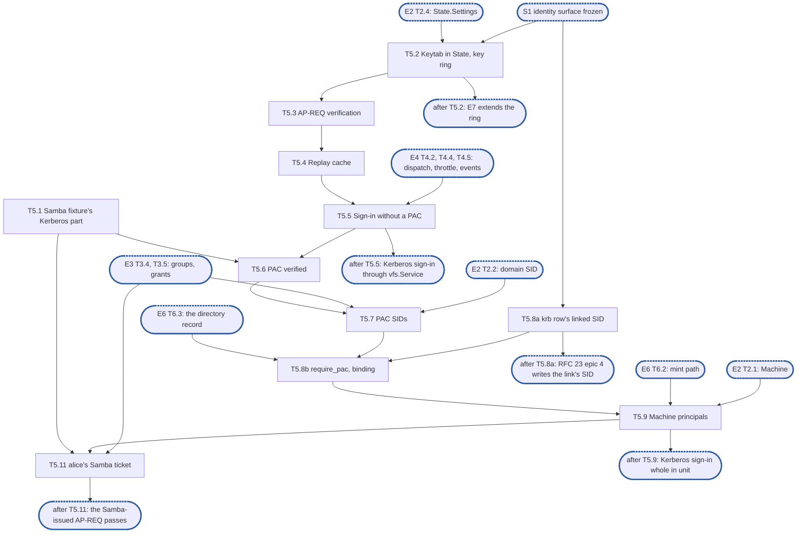

# Epic 5: identity v2 Kerberos and the PAC

**Sources:** [RFC 18](../rfcs/rfc-18-identity.md) §2.4's machine principals, §2.6's
`State.Keytab` and its `Apply` row, §3.1 for a Kerberos sign-in (its errors, its binding, its
`Keys`, its logon event), §3.3 for the imported keytab and the ticket's checks, §3.4, §3.7's
sign-in half and §3.8's expiry for Kerberos, §4.2 steps 1, 2 and 4 with its realm rule and the
`krb` row's linked SID, §7.3's replay-cache row, §9.2's Kerberos outcomes,
`identity_pac_sids_dropped_total` and `identity_mints_total{kind="machine"}`, and §10's rows
named in §3 below with its Fuzz paragraph, as pull request #4058 merged them (83232b441);
[RFC 16](../rfcs/rfc-16-metadata-store.md) §2.3's machine record, §3's `MintBatch` and §4.2's
`PX‖scheme‖id` row for the `krb` row's SID; [RFC 13](../rfcs/rfc-13-configuration.md) §7's
rollover, and Appendix B's `identity.directory` row; [RFC 22](../rfcs/rfc-22-smb.md) §4.1's
ticket addresses and §16.3's well-known SIDs a PAC may carry.
**Track:** B.
**Epic 5 estimate: 11 subtasks, 19.25 man-days.**
**Depends on:** **S1**: E1's `pkg/identity` (`SignInStep`, `SignInResult`, `Keys`, `Evidence`,
`Service`), `internal/identity`'s `Server` with `Deps{Store, Clock, Metrics, Logger}` and
`State{Generation}`. **E2, partly**: T5.2 waits for T2.4 (`State.Settings`, which the
`identity.keytab` key joins); T5.7 for T2.2 (the installation's domain SID, whose SIDs a PAC
loses); T5.9 for T2.1 (`entity.PrincipalMachine`), reaching T2.3's `Minter.Create` through E6's T6.2. **E3,
partly**: T5.7, T5.8b and T5.11 test at its `Resolve`, whose T3.4 maps the evidence's SIDs and
`DenyOnly` into the caller's groups and T3.5 reads the grants. **E4**: T5.5 joins the `SignIn`
dispatch of E4's T4.2, with T4.4's throttle and T4.5's `LogonSink`, `identity.authenticate` span
and `identity_authentications_total` series, and E4's re-authentication rule (E4's R17).
**E6, partly**: T5.8b adds `require_pac` to the `identity.directory` record E6's T6.3 declares,
and reads its schema and realm; T5.9 mints through E6's T6.2 mint path. T5.1 and T5.8a depend
on nothing but S1; T5.3 and T5.4 follow T5.2, which waits for E2's T2.4.
**Blocks:** **E7, partly**: the derived keytab joins T5.2's key ring and T5.3's key selection,
which E7 extends with the fallback across held derived keys (RFC 18 §3.3). **E8**: composes
`State.Keytab` from the node's reads of `Versions`, and runs the cross-epic clauses of "PAC bound
to the record" and "disabled directory account" on T5.8b and T5.9. **RFC 23's plan's epic 4**: its T4.11 writes T5.8a's `Linked`.

---

## 1. Goal

`SignIn` accepts an AES Kerberos ticket for a service name the keytab holds, verifies the PAC it
carries over the bytes the domain controller signed, binds the evidence to the one principal the
ticket's name maps to and its PAC agrees with, and mints a machine the first time one signs in.

**At the end of the epic:**

- the keytab arrives through `Apply` as `State.Keytab`, AES keys only, every version in force
  accepted, and the previous one dropped at the `Apply` after RFC 23's rotation prunes it (D13);
- an AP-REQ is verified on the injected clock: its keys AES, its service name held, its times
  and its authenticator within 5 minutes, its addresses, and its authenticator never replayed;
- a PAC is used only after its server signature verifies over the raw bytes, its first buffer
  of each type alone, its client name and time equal to the ticket's, its SIDs filtered and its
  deny-only SIDs kept apart;
- a Kerberos name maps by RFC 18 §4.2 steps 1, 2 and 4, a PAC is required in the directory's
  realm unless `require_pac` is false, and a `krb` row binds only the PAC whose user SID it was
  linked for;
- a machine's first sign-in mints its principal, linked for its PAC's user SID;
- `FuzzPAC` and `FuzzAPReq` run in `unit`, seeded with PACs captured from the Samba fixture;
- alice signs in with an AP-REQ captured from the fixture's domain controller, and her caller
  holds the PAC's groups.

### 1.1 In scope

The fixture's Kerberos part; `State.Keytab`, the key ring and the keytab check; AP-REQ
verification on gokrb5's decryption with identity's own checks; the replay cache; the Kerberos
branch of `SignIn` with RFC 18 §4.2's steps 1, 2 and 4; PAC decoding and verification and the
test realm that builds tickets and PACs; the PAC's SIDs; the `krb` row's linked SID and PAC
binding; `require_pac`; machine principals; the Samba-issued
ticket's sign-in, captured; `FuzzPAC` and `FuzzAPReq`.

### 1.2 Out of scope

- Keys derived from the machine password, their key version number, the fallback across held
  derived keys and the refusal of an imported key for a name the computer account holds (RFC 18
  §3.3): E7, on T5.2's key ring.
- RFC 18 §4.2's step 3, the directory's entry by name: E6. E6's T6.9 builds step 3; whichever of
  T5.5 and T6.9 lands second calls it between steps 2 and 4.
- A directory principal's enabled state read through the directory cache on every proof (RFC 18
  §3.4, §3.7): at resolution E6's T6.11; at a Kerberos sign-in E8's T8.5, through T6.11's cache
  read (E8's D6, pending).
- Identity's one mint path, its re-runs on `ErrExist` and `identity_mints_total`: E6's T6.2.
  T5.9 hands it the machine's batch.
- The `identity.directory` record, its schema, realm, NetBIOS domain and the `ad` realm's
  lower-case refusal: E6's T6.3. T5.8b adds `require_pac`, its first reader.
- An operator's `krb` link, which stores the SID the directory holds for the name, asked of the
  directory when written (RFC 18 §4.2): RFC 23 §3.5's user edit, which RFC 23's plan's epic 4
  builds in its T4.11, asking E6's T6.9 `KerberosLinkSID` through `Deps.Directory`, which E8
  fills; §10's "Linking a name the directory does not hold" clause runs there. T5.8a declares
  and stores the SID that write sets, and T5.8b reads it.
- Mapping the evidence's SIDs and `DenyOnly` to principals, the union with the store's
  memberships, and deny-only principals matching only deny entries (RFC 18 §3.4, §6.3, ID13):
  E3's T3.4 and E9's "deny-only SIDs".
- The `SignIn` dispatch, the throttle, the logon line, the `identity.authenticate` span and
  re-authentication in place (RFC 18 §3.1, §3.8): E4. T5.5 adds the Kerberos branch.
- Refusing every call but the release calls on a context past `Expires` (RFC 18 §3.1, §3.8): the
  adapter's, as RFC 18 §6.1 says, with no second check at `Resolve` (E8's D7, pending).
- The keytab's place in the node's `State`, read from `Versions` at each reconcile: E8. So is a
  live sign-in in `integration/ad-dc` through the node, the only package outside
  `internal/identity` that may import the server (RFC 18 §2.7). Moving the fixture's branches
  onto `feat/storage-v2` and the cell's place in its plan job's select: E6's T6.1 (§9).
- The cross-epic clauses of "PAC bound to the record" (a reused name through step 3) and
  "disabled directory account" (at sign-in): E8's T8.5, on this epic's binding. The clauses E8
  cites are held by this epic's own tests: "PAC bound to the record"'s client name (T5.6),
  "admin needs proof"'s PAC half and "deny-only lookup error"'s SID read
  (T5.7). The linked SID's reuse clause is §10's "PAC" row's, not "PAC bound to the
  record"'s, and T5.8b holds it. "deny-only SIDs", "binding", "re-authentication" and
  "expiry" over a protocol: E9, and "expiry" over NFS with the NFS side, the RFC 18 plan's
  deferral ledger row "RFC 18 §10's NFS rows and NFS halves".
- Kerberos over RPCSEC_GSS (RFC 18 §3.3's first line): the ledger row "`AUTH_SYS` and
  `AUTH_NONE`"'s NFS side, with RFC 21's plan.
- A Windows client's ticket and a Windows Server domain controller's PAC: the ledger row
  "Interop against a Windows Server domain controller".
- Charging the replay cache to RFC 24's pool: the ledger row "Caches charged to RFC 24's
  connection-state pool, not fixed counts".

### 1.3 Names used here

- **E1**, the contract and the server's surface: `pkg/identity`, `internal/identity`'s `Server`
  and lifecycle.
- **E2**, principals and accounts: the `Minter`, the machine kind, the installation's domain SID,
  `State.Settings`, `Deps.Secrets`.
- **E3**, resolution: `Resolve`, which maps the evidence's SIDs to groups.
- **E4**, local NTLMv2 sign-in: the `SignIn` dispatch this epic joins.
- **E5**, this epic.
- **E6**, the directory: step 3 of RFC 18 §4.2 (its T6.9), the mint path (T6.2) and the
  `identity.directory` record (T6.3), which T5.8b adds `require_pac` to.
- **E7**, NETLOGON and the machine account: the derived keytab.
- **E8**, the integration epic: identity composed into the node, and the rows several epics meet in.
- **E9**, E2E green: RFC 18 §10's Tier 2 rows over SMB.
- **S1**, the identity surface frozen, which E1 delivers.
- **RFC 23's plan's epic 4** is that plan's management API: its T4.11 serves the keytab secret
  route and the `krb` link's write.

## 2. How the general rules apply

The rules are those of
[the RFC 18 plan's §1.5](rfc-18-identity-plan.md#15-general-rules-for-each-epic), cited by
number and title and not copied.

| Rule | Subtasks | How |
| --- | --- | --- |
| rule 1, independent unit tests ([`CLAUDE.md`, "Writing tests"](../../../CLAUDE.md#writing-tests)) | T5.2 to T5.11 | tickets and PACs are made by T5.3's test realm with test keys, as a KDC makes them, and checked against PACs and an AP-REQ the Samba fixture issued (T5.6, T5.11); the store is the memory KV with `pkg/metadata/kv/kvtest`'s fault wrapper failing a call; the clock is injected; logon events land in E4's recording `LogonSink`, a sink of outputs; no other double |
| rule 2, fuzz every decoder of untrusted bytes | T5.3, T5.6 | `FuzzAPReq` over the AP-REQ decode (T5.3), `FuzzPAC` over the PAC's buffer walk and its buffers' decoders (T5.6), each with the property `CLAUDE.md` states and the PACs RFC 18 §10's Fuzz paragraph names |
| rule 3, observability follows RFC 25 | T5.5, T5.7, T5.9 | `identity_authentications_total`'s Kerberos outcomes (T5.5, `no_pac` in T5.8b), `identity_pac_sids_dropped_total{reason}` (T5.7), `identity_mints_total{kind="machine"}` (T5.9); no label or attribute carries a name, SID, ticket or address |
| rule 4, profiling | all but T5.1 | every test runs under the leak check; the replay cache's sweep (T5.4) leaves no goroutine, since it runs inside the call that inserts |
| rule 5, public interface and internals ([`CLAUDE.md`, "Verifying a change"](../../../CLAUDE.md#verifying-a-change)) | T5.5, T5.7, T5.8b, T5.11 | each check is proven at `SignIn`'s answer, a dropped SID by the grant it no longer gives at `Resolve`, a deny-only SID by the share grant it does not admit through, the integration ticket by the caller's groups |
| rule 6, known failures shrink | none | no suite RFC 18 names keeps a `known.yaml`; every test lands green |
| rule 7, v2 ignores v1 | T5.3, T5.4 | `develop`'s `internal/auth/kerberos` is lifted from history and rewritten: the AP-REP builder and the address rule kept; `VerifyAPREQ`, the best-effort PAC decode RFC 18 Appendix B names as fail-open, and the replay cache's `time.Now` and unbounded map replaced (D1, D5) |
| rule 8, real dependencies for properties of those dependencies | T5.1, T5.6, T5.11 | the fixture's Samba domain controller, in `integration/ad-dc`, issues the captured PACs (T5.1, T5.6) and the AP-REQ alice signs in with (T5.11), which `unit` then replays on the injected clock |
| rule 9, code comment conventions ([`CLAUDE.md`, "Code comments"](../../../CLAUDE.md#code-comments)) | T5.2 to T5.9 | RFC 18's `decision:` notes of §2.4 (machines minted on sight, T5.9), §3.3 (AES only, T5.2; an unknown user refused, T5.5) and §3.4 (only the server signature, T5.6); its `ponytail:` notes of §3.3 (the replay cache in memory, T5.4; the skew constant, T5.3); the replay cache's fixed-count `ponytail:` (T5.4); this document's D1 to D12 and D14 to D16 markers at their sites |
| rule 10, a test must be able to fail | all | every R row is held by a test named in its subtask, each with the bug it catches, or by what is named in its place |
| rule 11, a symbol is exported only if RFC 18's interfaces use it | T5.2, T5.3 | `internal/identity` exports `State.Keytab`, which `internal/node` fills (E8's T8.2); nothing outside `internal/node` and identity's tests imports it; `CheckKeytab` and `KeytabNames` in `pkg/identity`, which RFC 18 §2.7 lists (D3); the test realm is `identitytest`'s, the package RFC 18 §2.7 gives test helpers, and imports no `internal/identity` |
| rule 12, each subtask creates only what it declares | all | `State.Keytab` with T5.2, its first reader; `entity.ProtocolID`'s linked SID with T5.8a; the record's `require_pac` with T5.8b; the test realm with T5.3, its first consumer |

## 3. Requirements and invariants

Every obligation RFC 18 and the related RFCs place on this epic, numbered so that subtasks and
tests can cite them. Sources are RFC 18 unless named.

**The keytab**

| # | Requirement | Kind | Source | Subtasks |
| --- | --- | --- | --- | --- |
| R1 | The keytab is a `Secret` of kind keytab, loaded only through `Apply`: the versions in force are `State.Keytab`, current first, and a new version takes effect at the `Apply` that delivers it, with no restart | invariant | §2.6, §3.3 | T5.2 |
| R2 | The keytab holds AES128 and AES256 keys only, and a keytab import holding a DES or RC4 key is refused whole | MUST | §3.3; §10 "AES only" | T5.2; RFC 23 plan epic 4's T4.11 (the import's refusal at its keytab secret route, through `CheckKeytab`, D3) |
| R3 | Every keytab version `Apply` hands identity is accepted and a version it no longer hands is refused, a restart included, so tickets under the old and the new key are both accepted while the rotation keeps both, and a retired key is refused once the rotation prunes it (R4) | invariant | §3.3, §2.6; RFC 13 §7; §10 "keytab rollover" | T5.2 |
| R4 | Withdrawn: keeping the previous version for one maximum ticket lifetime, 10 hours plus the clock skew, and removing it then are RFC 23 §3.3's credential rotation, which deletes it with `tx.PruneSecret` inside an audited `Write` (D13). The report that the old key may be revoked at its service is the control plane's (RFC 13 §7), and RFC 23 §3.3 does not name it yet (§9) | — | §3.3; RFC 13 §7; RFC 16 §3 (`tx.PruneSecret`); RFC 23 §3.3 | RFC 23 §3.3's credential rotation; the revocation report pending the RFC 23 §3.3 amendment (§9) |

**The ticket**

| # | Requirement | Kind | Source | Subtasks |
| --- | --- | --- | --- | --- |
| R5 | A ticket is accepted only for a service name the keytab holds, compared with ASCII letters folded; a ticket for any other name, one whose service name was rewritten under the same key among them, is refused `ErrLogonFailure` | MUST | §3.3, §4.6; §10 "service name" | T5.3 |
| R6 | A ticket under DES or RC4, or one whose session key or authenticator subkey is not AES, is refused `ErrLogonFailure` | MUST | §3.3; §10 "AES only" | T5.3 |
| R7 | `SignIn` verifies the ticket's encryption, and its start and end times and the authenticator's time within a clock skew of 5 minutes, on the injected clock | MUST | §3.3; §10 "clock skew" | T5.3 |
| R8 | Over SMB, only a ticket's IPv4 and IPv6 addresses restrict it: a ticket with none is accepted from any address, and one with any is refused `ErrLogonFailure` unless `SignInStep.Client` is one of them; a NetBIOS address is ignored. "Over SMB" is the step's `Transport`, never its `Service`, so a `host/` ticket presented over SMB is checked too, and an unset `Transport` is refused `ErrInvalid` (D15) | MUST | §3.3; RFC 22 §4.1; §10 "ticket addresses" | T5.3 |
| R9 | An authenticator seen before is refused, counted with outcome `replay`, by a replay cache held in the node's memory | MUST | §3.3, §9.2; §10 "replay" | T5.4 |
| R10 | The replay cache holds each entry until its authenticator's time plus the clock skew, on the injected clock, so an authenticator stamped ahead cannot be replayed once its entry is gone | invariant | §7.3; §10 "replay" | T5.4 |
| R11 | The replay cache is bounded, and a sign-in that would need one more entry fails `ErrUnavailable`; an authenticator takes an entry only once R45's throttle has admitted its (name, client address), so a pair the throttle refuses takes none; one ticket client holds at most a sixty-fourth of the bound, and a sign-in past its share fails `ErrUnavailable` for that client alone (D5) | bound | §7.3, §3.1 | T5.4, T5.5 |
| R12 | `Keys.Session` is RFC 4121 §2's context key: the acceptor's subkey when the AP-REP sends one, else the authenticator's subkey, else the ticket's session key, kept whole; the AP-REP sends none, so `Keys.Subkey` is empty; `Keys.APRep` is the AP-REP; the evidence holds no key | invariant | §3.1 | T5.3 |

**The sign-in**

| # | Requirement | Kind | Source | Subtasks |
| --- | --- | --- | --- | --- |
| R13 | The evidence's `Name` is the ticket's client name and realm exactly as the ticket spells them, mapped once, at sign-in | invariant | §3.3, §3.1 | T5.5 |
| R14 | A Kerberos name maps, stopping at the first that answers: (1) the `krb` row for the name as the ticket spells it; (2) in one of the keytab's realms that is not the directory's realm where a PAC is required, the local user whose name equals the name's user part, compared as user names are, unless it is a directory principal or has no file spelling; (4) otherwise none. Step 3 is E6's | invariant | §4.2 | T5.5, T5.8b |
| R15 | A realm is compared as the KDC spells it, case and all | MUST | §4.2 | T5.5 |
| R16 | A name with a service part never matches step 2 or 3 | invariant | §4.2 | T5.5 |
| R17 | An authenticated user name that maps to no principal is refused `ErrLogonFailure`; a machine name is minted instead | MUST | §3.3, §4.2 | T5.5, T5.9 |
| R18 | A principal whose record is `Disabled` fails sign-in `ErrLogonFailure` with logon outcome `disabled`; one marked deleted fails as an unknown name's, outcome `logon_failure` | MUST | §3.7 | T5.5 |
| R19 | Before it returns, `SignIn` sets `Evidence.Principal` to the principal it mapped, and the evidence's `Expires` to the ticket's end time | MUST | §3.1 | T5.5 |
| R20 | A re-authentication on a context past `Expires` is admitted, and a successful one replaces the context's evidence, the new `Expires` with it | invariant | §3.8 | T5.5 |
| R21 | Every error a Kerberos sign-in returns is `ErrLogonFailure`, `ErrInvalid` for a malformed message, or `ErrUnavailable` for a keytab or store fault | MUST | §3.1 | T5.3, T5.5 |
| R22 | A Kerberos sign-in's logon event carries the mechanism, the name as presented, the outcome, the principal on success and the client address, and never the ticket or a key | MUST NOT | §3.1 | T5.5 |
| R23 | A Kerberos sign-in writes only the record a first sign-in mints, and the one exception R41 names: the `Linked` a machine minted without a PAC takes from its first verified PAC (D16) | invariant | §3.1 | T5.9 |
| R24 | `identity_authentications_total{protocol, mechanism, outcome}` counts each Kerberos attempt, mechanism `kerberos`, with this epic's outcomes `ok`, `logon_failure`, `disabled`, `invalid`, `unavailable`, `replay` and `no_pac` (`throttled` is E4's T4.4); no label carries a name or SID | invariant | §9.2 | T5.5, T5.8b |
| R45 | Past 10 `ErrLogonFailure` results in 10 minutes for one (name, client address), the name the user part without its realm, folded, every further Kerberos attempt from that pair fails `ErrLogonFailure` before its credential is checked and before its authenticator enters the replay cache, counted with NTLM's under one name | MUST | §3.1 | T5.5 |

**The PAC**

| # | Requirement | Kind | Source | Subtasks |
| --- | --- | --- | --- | --- |
| R25 | The PAC's server signature verifies under the service key that decrypted the ticket before any SID in it is used, computed over the PAC's bytes as received with both signature fields zeroed, never over a re-encoding, so a byte the decoder skips is still signed | MUST | §3.4; §10 "PAC" | T5.6 |
| R26 | The server signature's type is the keyed checksum of the service key's encryption type, `HMAC-SHA1-96-AES256` (16) or `HMAC-SHA1-96-AES128` (15), with a 12-byte value; any other type, an unkeyed one among them, fails | MUST | §3.4; §10 "PAC" | T5.6 |
| R27 | Of a buffer type that appears more than once, only the first is used | invariant | §3.4; §10 Fuzz | T5.6 |
| R28 | A PAC that does not verify fails the sign-in `ErrLogonFailure` | MUST | §3.4 | T5.6 |
| R29 | A PAC whose server signature verifies but which holds no logon-information buffer is treated as no PAC | invariant | §3.4; §10 "PAC" | T5.6 |
| R30 | The PAC's client name and authentication time equal the ticket's; a mismatch fails `ErrLogonFailure`, logs both principals and binds nothing | MUST | §3.4; §10 "PAC bound to the record" | T5.6 |
| R31 | The evidence's `SIDs` are the PAC's user SID first, then its group SIDs, its memberships, extra SIDs and resource groups, excluding any whose attributes mark them disabled | invariant | §3.4, §3.1 | T5.7 |
| R32 | A SID in the installation's own domain, in the built-in domain (`S-1-5-32-…`), naming a user rather than a group, of another domain of the forest, or well-known other than everyone, authenticated users and network, is dropped and counted in `identity_pac_sids_dropped_total{reason}` (`own_domain`, `builtin`, `user`, `other_domain`, `well_known`), and never fails the sign-in | invariant | §3.4, §9.2; RFC 22 §16.3; §10 "PAC" | T5.7 |
| R33 | A SID the PAC marks deny-only (`SE_GROUP_USE_FOR_DENY_ONLY`) is carried in the evidence's `DenyOnly`, never in `SIDs` | MUST | §3.4, §9.1 ID13 | T5.7 |
| R34 | The PAC supplies groups only: no PAC field enables a principal or changes its record | invariant | §3.4 | T5.7 |
| R35 | In the directory's realm, whatever the record's schema, a ticket without a PAC fails `ErrLogonFailure`, counted with outcome `no_pac`, unless the directory record's `require_pac` is false; there, §4.2's step 2 is skipped | MUST | §3.4, §4.2; RFC 13 Appendix B (`identity.directory`); §10 "PAC" | T5.8b |
| R36 | In any other keytab realm, and in the directory's when `require_pac` is false, a ticket without a PAC is accepted | invariant | §3.4; §10 "PAC" | T5.8b |
| R37 | Withdrawn: the `ad` realm's lower-case refusal is E6's R3, held by E6's T6.3 validator, which declares the realm | — | §4.2; RFC 13 Appendix B (`identity.directory`) | E6's T6.3 |

**Binding and machines**

| # | Requirement | Kind | Source | Subtasks |
| --- | --- | --- | --- | --- |
| R38 | A `krb` row is linked for a SID: beside its principal it stores the directory user SID the link was made for, or none, and an edit that moves the spelling keeps it | invariant | §4.2, §2.4; RFC 16 §4.2 (`PX‖scheme‖id`) | T5.8a; RFC 23 plan epic 4's T4.11 (the move) |
| R39 | The PAC's user SID equals the SID on the record §4.2 selected, or, when step 1's `krb` row selected it, the SID that row is linked for; a row linked for no SID binds no ticket that carries a PAC; a mismatch fails `ErrLogonFailure`, logs both principals and binds nothing, so a reused name is refused rather than bound to the wrong person; the one exception is a `Machine` record whose `krb` row is linked for no SID, which the first verified PAC links and binds (R41, D16), every later PAC checked against that SID | MUST | §3.4, §4.2; §10 "PAC", "PAC bound to the record" | T5.8b, T5.9 |
| R40 | A Kerberos name whose first component is a service name (`host`, `nfs`, `cifs`, or any name with a `/`), or whose user part ends in `$`, is a machine name | invariant | §2.4 | T5.9 |
| R41 | A machine name's first successful sign-in with no record mints it: a `User` record of kind `Machine` with its `krb` spelling, linked for its PAC's user SID if it had one, and nothing else, in one batch; one minted without a PAC is linked for the user SID of its first sign-in whose PAC verifies, once, and that sign-in binds it (D16) | MUST | §2.4, §4.1; RFC 16 §2.3, §3 (`MintBatch`) | T5.9 |
| R42 | A mint refused because another sign-in took the row is run again and binds the principal that took it; a re-run that binds none fails `ErrUnavailable`, writes nothing and logs both `PrincipalID`s | invariant | §4.1 | T5.9, on E6's T6.2 |
| R43 | Each machine minted counts in `identity_mints_total{kind="machine"}` | invariant | §9.2 | T5.9 |

**Fuzz**

| # | Requirement | Kind | Source | Subtasks |
| --- | --- | --- | --- | --- |
| R44 | `FuzzPAC` and `FuzzAPReq` never panic, never allocate past the input's size times a constant, and decode∘encode is the identity on what decodes; `FuzzPAC` includes PACs with no logon-information buffer and PACs repeating a logon-information, client-information or signature buffer, of which only the first is decoded | test row | §10 Fuzz | T5.3, T5.6 |

**The Samba ticket**

| # | Requirement | Kind | Source | Subtasks |
| --- | --- | --- | --- | --- |
| R46 | alice signs in with an AES ticket the fixture's Samba domain controller issued for an imported `cifs/` name, and her caller holds the PAC's groups | test row | the RFC 18 plan's epic 5 **Done when:** | T5.11 |

Which test holds each row is in its subtask's **Tests**. R14's step 3 and R39's directory
record are E6's and E8's to drive, on the rule this epic builds.

## 4. Decisions this epic takes

- **D1, an AP-REQ is verified on gokrb5's decryption, with identity's own checks.** gokrb5
  v8.4.4's `VerifyAPREQ` reads `time.Now` for the skew, keeps a replay cache of its own, and picks
  the key itself; RFC 18 §10's "clock skew" and "replay" run on the injected clock, the PAC's
  checksum must use the key that decrypted the ticket (R25), and E7 tries each held derived key
  when a key version number is unknown. So identity parses with `messages.APReq.Unmarshal`,
  selects the key from its own ring (D2), decrypts with `Ticket.Decrypt` and
  `APReq.DecryptAuthenticator`, and makes every check itself: the encryption types, the service
  name, the times, the authenticator's client against the ticket's, the addresses; the replay
  cache follows D9's throttle (D5). A `decision:` marker at the verifier. Prior art (from memory): Heimdal's
  `krb5_rd_req_ctx` takes its time and its replay cache from the caller's context.
- **D2, the key ring is built at `Apply`, one map from (service name folded, key version
  number, encryption type) to a key.** `Apply` parses each `State.Keytab` version with gokrb5's
  `keytab.Unmarshal` once, not per sign-in. A version holding a key that is not AES contributes
  no key, whole, and is logged: `Apply` still succeeds, since refusing the whole `State` would
  also stop a disable reaching resolution, and the import check (D3) is the gate. The keytab's
  realms, for R14's step 2, are the realms of the ring's names. A `decision:` marker at the
  parse. Prior art (from memory): Samba loads its keytab into a memory keytab at start and on
  change.
- **D3, a keytab import is checked by `identity.CheckKeytab(b []byte) error` in `pkg/identity`,
  settled in review as (a) (§9).** RFC 18 §3.3 refuses an import holding a DES or RC4 key
  whole, but names no place that refuses it, and only `internal/node` may import the server
  (§2.7), so the API's secret route cannot call `internal/identity`. A pure function beside
  `NewHashes` is reachable from the route, and RFC 18 §2.7 lists it. It parses MIT's
  keytab format itself rather than through gokrb5, since `pkg/identity` is a leaf whose code
  imports no gokrb5; `FuzzCheckKeytab` holds it to gokrb5's decoder, which `Apply` runs after it on
  each version. Only version 2 is accepted: version 1, the host-byte-order format no current tool
  writes, is refused. The route's call is RFC 23's plan's epic 4's: its T4.11 keytab secret route
  runs it in the keytab's pre-write step, through `KeytabNames`, which refuses what `CheckKeytab`
  refuses, before the seal, so R2's import refusal is met at the route. A
  `decision:` marker at `CheckKeytab` names the refusal whole, version 1's refusal, and the same
  check `Apply` runs on each version.
- **D4, a ticket's service name is checked twice.** The ticket's service name, which sits outside
  its encrypted part, must be one the ring holds under the selected key, compared with ASCII
  letters folded (R5), and its first component must be `SignInStep.Service`'s, so a `cifs/`
  ticket presented over NFS is refused. A `decision:` marker at the check. Prior art (from
  memory): MIT's `krb5_rd_req` with a server principal set refuses another name.
- **D5, the replay cache is a map with an expiry heap, bounded at 1 048 576 entries.** The key
  is the authenticator's client name and realm and a SHA-256 of the authenticator's ciphertext,
  as MIT keys its replay cache: the ticket's service name sits outside the encrypted parts, and an
  AD keytab holds every SPN of the computer account under one AES key, so a key on the service
  name, folded or not, would let a replay re-addressed to another SPN past the cache, while the
  ciphertext cannot change without the session key; an entry lives until the authenticator's time plus 5 minutes;
  an insert first drops expired entries from the heap's head, and a full cache refuses
  `ErrUnavailable`. One mutex, no goroutine. The order is: the authenticator decrypts, D9's
  throttle admits the (name, address) pair, then the insert; so a pair flooding failures takes at
  most the throttle's 10 entries per window. The throttle counts failures only, so the cache also
  caps each client: entries are counted per ticket client name and realm, which a flooder cannot
  vary without another ticket from the KDC, and a client holding a sixty-fourth of the bound
  (16 384 entries) is refused `ErrUnavailable`, outcome `unavailable`, while every other client
  still inserts; its count falls as its entries expire. A sixty-fourth because an entry lives at
  most 10 minutes (an authenticator 5 minutes ahead, plus the skew), so filling a share takes
  over 27 sign-ins a second from one principal, far past a client signing in per session, while
  the whole cache still fills only when 64 principals flood at once. `export_test.go` sets the
  bound and the share apart. A `ponytail:` marker names the fixed count and share, RFC 24's pool
  as their upgrade, and the ceiling: 64 ticket holders flooding together still fill the cache and
  refuse every client, each named in its logon events; a share that shrinks as the cache fills
  is the upgrade once such a flood is seen. Prior art (from memory): MIT krb5's replay cache keys
  on a hash of the authenticator and expires on its time plus the skew.
- **D6, the PAC is decoded by gokrb5, behind a bounds guard, and its checksum is checked by
  identity.** gokrb5's `PACType.Unmarshal` reads the header and buffer array and keeps the bytes
  as received; `ProcessPACInfoBuffers` decodes each type's first buffer and ignores later ones
  (MS-PAC 2.4), and fills `ZeroSigData` with both signature values zeroed. Three gaps are
  identity's: a guard before both calls refusing a buffer count or an offset and size outside the
  bytes, since gokrb5 allocates the count unchecked and slices the offsets unchecked; the
  checksum verified over `ZeroSigData` under the key T5.3 selected, with usage 17
  (`KERB_NON_KERB_CKSUM_SALT`) and its type pinned to that key's, which gokrb5 does not pin; and a
  PAC with no logon-information buffer, on which `ProcessPACInfoBuffers` returns an error after
  the server checksum is decoded, verified the same way and then read as no PAC. A `decision:`
  marker at the guard. Prior art (from memory): Heimdal's `krb5_pac_verify` zeroes the signature
  data in a copy and checksums the raw bytes.
- **D7, a group's deny-only bit is read before its enabled bit.** Windows writes a deny-only
  group with `SE_GROUP_USE_FOR_DENY_ONLY` set and `SE_GROUP_ENABLED` clear; reading "disabled"
  first would drop it and lose its denies, which R33 forbids. So a deny-only SID goes to
  `DenyOnly` whatever its enabled bit, and only a SID that is neither deny-only nor enabled is
  dropped as disabled. A `decision:` marker at the filter. Prior art (from memory): Windows'
  access check reads deny-only groups from the token whatever their enabled bit.
- **D8, the domain a PAC vouches for is its logon domain, and the filter's reasons run in one
  order.** The user's own SID is checked against R39, not this rule. Each group SID D7 kept is
  tried in this order, the first that answers deciding: (1) a well-known SID, any not under
  `S-1-5-21-…` or `S-1-5-32-…`, is kept if it is everyone (`S-1-1-0`), authenticated users
  (`S-1-5-11`) or network (`S-1-5-2`), else dropped `well_known` (`S-1-5-18` among them),
  RFC 22 §16.3's list; (2) `S-1-5-32-…` is `builtin`; (3) a SID under the installation's domain
  SID is `own_domain`; (4) one outside the PAC's `LogonDomainId` is `other_domain`; (5) a SID the
  store holds as a user is `user`, read through the `sid` index, whose error fails the sign-in
  `ErrUnavailable` rather than keeping or dropping the SID unread. So no SID has two reasons. A
  `decision:` marker at the filter. Prior art (from memory): Samba's `winbindd` filters a trusted domain's PAC SIDs
  by the logon domain.
- **D9, a Kerberos attempt is throttled under the ticket's client name, read once the ticket
  decrypts under the service key.** RFC 18 §3.1 throttles before the credential is checked, but a
  ticket's client name is inside its encrypted part; decrypting under the service key checks no
  credential of the user's, which the KDC already checked. A ticket that does not decrypt has no
  name and is refused uncounted by the throttle. The throttle runs before the replay cache's
  insert (D5). A `decision:` marker at the call. Prior art: none found.
- **D10, the test realm is `identitytest.Realm`.** It holds test AES keys for a realm and its
  service names, and builds AP-REQs and PACs as a KDC does: `Ticket(TicketOpts) []byte` and
  `Keytab() []byte`, thin over gokrb5's `messages.NewTicket`, `messages.NewAPReq` and the keytab's
  entries, and `PAC(PACOpts) []byte`, the only new encoding, since gokrb5 has none. It is no
  double: it issues real tickets, and its PACs are held by T5.6's test to the same verifier as
  PACs the Samba fixture issued. Its first consumer is T5.3; E8 and E9 build tickets with it. It
  imports gokrb5 and `pkg/identity` only, never `internal/identity`, which nothing outside that
  package and its tests imports. Prior art (from memory): MIT's `kdb5_util` test KDCs; gokrb5's
  own tests build tickets with `messages.NewTicket`. A `decision:` marker at `Realm` says why it
  is no double: real tickets, its PACs held to the captures.
- **D11, the `krb` row's SID is a field of `entity.ProtocolID`.** `ProtocolID` gains `Linked
  string`, the binary form of the directory user SID the spelling was linked for, the same form a
  `sid` spelling's `Value` uses, empty for none. A string rather than `sid.SID` keeps `ProtocolID`
  comparable, so `==` means the same scheme, value and link. Two spellings still share one `PX‖` row
  when their scheme and value agree, whatever their `Linked`, and a put that changes only the SID
  rewrites that row in place. It is set only on a `krb` spelling and encoded with the record's
  spellings and in the `PX‖krb` row's value after the principal, as RFC 16's row says. kvstore
  refuses it on another scheme, or when it is not a well-formed SID (revision 1, length matching its
  sub-authority count, at most 15), with `ErrInvalid` on write and as malformed on read. Sign-in
  reads it through the user record it reads anyway, comparing the PAC's user SID in binary form. It
  is its own subtask, T5.8a, so the API's link write waits on nothing but S1. A `decision:` marker
  at the field. Prior art: none found.
- **D12, the machine mint goes through identity's one mint path, E6's T6.2.** E2 leaves the path,
  its re-runs on `ErrExist` and `identity_mints_total`, to E6's T6.2 (its §1.2); E6's T6.2
  comes early in E6 and needs only E2's T2.3, while T5.9 is late in this epic, so E6 owns it and
  T5.9 hands it a plan that returns the machine's batch. T5.9's estimate is 0.5 man-days below the
  figure that built the path. A `decision:` marker at T5.9's call to `mint`. Prior art: none
  found.
- **D13, withdrawn: the keytab's retention and prune are RFC 23's, and its revocation report
  waits on an RFC 23 §3.3 amendment (§9).** RFC 23
  §3.3's credential rotation keeps the old keytab version for the retention, then deletes it with
  `tx.PruneSecret` inside an audited `Write`, and `apiv1`'s operation kinds hold no retire kind
  (`pkg/node/apiv1/opkind.go`), so a retire step in identity would be a second, unaudited path to
  the same deletion. Identity accepts whatever versions `Apply` hands it (T5.2); T5.10, which
  built that step, is removed with it.
- **D14, `require_pac` joins E6's record here, pending the user's answer (§9).** T5.8b reads the
  record's schema, realm and `require_pac`. E6's T6.3 declares the record, early in E6, with the
  schema, the realm and its `ad` lower-case refusal, which its `Validate` and `Apply` read first.
  Recommended: T5.8b adds `RequirePAC`, true unless set false, its first reader, and waits for
  T6.3; the record reaches T5.8b as E6's D2 decides (`State.Directory`, recommended). The
  alternative, T5.8b declaring schema, realm and `require_pac` itself, makes two epics declare one
  section. A `decision:` marker at `RequirePAC`'s default, true, names the fail-closed read of a
  missing row.
- **D15, `SignInStep` gains `Transport`, `TransportNFS` or `TransportSMB`, which the adapter
  sets.** R8's address check runs when `Transport` is `TransportSMB`, and a Kerberos attempt's
  `protocol` label is read from it. `verifyAPReq` returns `ErrInvalid` unless `Transport` is
  `TransportSMB` or `TransportNFS`, so a caller that leaves it at its zero value is refused rather
  than skipping R8. `Service` cannot stand in: RFC 18 §3.3 accepts `host/` tickets,
  and `Host` names no transport, so a `host/` ticket over SMB would skip R8, which RFC 22 §4.1
  forbids. A step naming no service is refused `ErrInvalid` too. Both amend RFC 18 §3.1's
  `SignInStep`, an amendment still pending (§9). A `decision:` marker at the check. Prior art:
  none found.
- **D16, the first verified PAC links a machine minted without one, an exception to R23.** Where a
  PAC-less ticket is accepted (a keytab realm other than the directory's, or `require_pac` false,
  T5.8b), a machine's first sign-in mints it with no `Linked` (R41). R39 would then refuse its
  every PAC-bearing ticket, and nothing else writes a machine's `Linked`, so the machine would be
  locked out for good. So a sign-in whose PAC verifies, on a `Machine` record whose `krb` row has
  no `Linked`, writes that row's `Linked` as the PAC's user SID in one batch conditioned on the row
  still holding none, and binds the machine; a sign-in that loses that race is checked against
  the winner's SID (R39). Its ceiling: whoever first presents a verified PAC under the machine's
  name claims the record, so a computer account deleted and recreated under the same name before
  that first PAC-bearing sign-in inherits the machine's files. It is bounded to `Machine` records,
  to an empty `Linked`, and to the window before the first verified PAC, and the KDC issues a
  ticket under a machine's name only to the account holding that name's key. Evidence that would
  overturn it: one realm seen issuing PAC-less and PAC-bearing tickets for one machine name to
  different accounts, which would make an operator link through the API the only way to set
  `Linked`. A `decision:` marker at the write. Prior art: none found.

## 5. Target tree

```text
internal/identity/
  keytab.go            T5.2   the key ring from State.Keytab, AES only (D2); the identity.keytab key
  server.go            T5.2   State.Keytab, Apply building the ring
  kerberos.go          T5.3   AP-REQ verification: key, etypes, service name, times, addresses (D1, D4)
                       T5.5   the Kerberos branch of SignIn, §4.2 steps 1, 2, 4, the evidence
                       T5.8b  PAC required in the directory's realm; binding to the linked SID
  aprep.go             T5.3   the AP-REP, lifted from develop's BuildMutualAuth
  replay.go            T5.4   the replay cache (D5), lifted from develop's and rewritten
  pac.go               T5.6   the bounds guard, gokrb5's decode, the server checksum, client info (D6)
                       T5.7   the SIDs, their filter and DenyOnly (D7, D8)
  machine.go           T5.9   machine names, their mint (D12) and their first PAC's link (D16)
  *_test.go            T5.2 to T5.9
  fuzz_test.go         T5.3   FuzzAPReq;  T5.6  FuzzPAC
  testdata/pac/        T5.6   PACs captured from the fixture, with their keytabs
                       T5.11  alice's captured AP-REQ, its keytab and the time it was made
  testdata/fuzz/       T5.3, T5.6  crashers, if any
pkg/identity/
  keytab.go            T5.2   CheckKeytab (D3); KeytabNames and KeytabName, each key's name and realm, which the API's keytab check reads (RFC 23's plan, T4.11)
  identitytest/realm.go  T5.3  Realm: test keys, Ticket, PAC, Keytab (D10)
pkg/metadata/entity/
  control.go           T5.8a  ProtocolID.Linked (D11)
pkg/metadata/kvstore/
  principals.go, codecs.go  T5.8a  Linked in the record and the PX‖krb value; refused on another scheme
  kvstoretest/         T5.8a  rows for Linked
test/integration/ad-dc/
  entrypoint.sh, fixture_test.go                         T5.1  service names on dittofs-svc, AES only
  pac_capture_test.go, capture-pacs.sh                   T5.1  the PAC capture
  pac_capture_test.go                                    T5.11 also writes alice's AP-REQ for cifs/
docs/guide/identity.md                                   T5.1  the fixture's service account, change the KDC at once
```

## 6. Subtasks

### T5.1 The Samba fixture's Kerberos part

**Subtask T5.1 estimate: 2 man-days.**

- **Track:** B. **Depends on:** none.
- **Covers:** none of its own; consumed by T5.6 (the captured PACs) and T5.11 (a ticket the
  fixture's domain controller issues for an AES-only service name), and it holds at the KDC the
  AES-only half of R2 and R6 that T5.11's ticket relies on.
- **Deliverables:** merged on `feat/storage-v2` as #4421 (after #4420), moved there from
  `test/ad-dc-kerberos` by E6's T6.1; the guide's list of what the suite checks is #4808. The part:
  the `cifs/` and `nfs/` service names moved off Administrator onto an account of their own,
  `dittofs-svc`, with `msDS-SupportedEncryptionTypes` `0x18`, so the exported keytab holds no RC4
  key (`entrypoint.sh`, `fixture_test.go`'s AES-only subtest); `capture-pacs.sh`, which runs
  `TestADPACCapture` with `DITTOFS_AD_DC_PAC_OUT` set and writes `tgt.pac` with `krbtgt.keytab` and
  `service.pac` with `service.keytab`; `docs/guide/identity.md`'s account of the fixture, and, once
  the keytab's rotation exists, its instruction to change the KDC at once when every node reports a
  new keytab version: RFC 13 §7 starts the old version's retention at the change at the KDC, which
  the rotation cannot observe (§9), so a KDC changed late can find its key pruned. The fixture's TLS
  part is E6's and its join part E7's.
- **Acceptance criteria:**
  - The KDC refuses a service ticket for the imported `cifs/` name under RC4 and issues one under
    AES256; Administrator holds no `cifs/` name.
  - Each captured PAC verifies under its ticket's key, and the TGT's holds `PAC_ATTRIBUTES_INFO`
    and `PAC_REQUESTOR`.
- **Tests:** `TestADFixture/service_names_on_an_AES-only_account` (catches the service names left
  on an account with RC4, which would let an NT hash forge a ticket the AES-only rows never see);
  `TestADPACCapture` (catches a capture that the newer buffer types are missing from, so T5.6's
  unknown-type handling would go untested), both in `integration/ad-dc`.
- **Rules:** rule 8 (a real domain controller). Rule 4 does not apply: the fixture runs no
  identity code.

### T5.2 The keytab in `State`, and its key ring

**Subtask T5.2 estimate: 1.5 man-days.**

- **Track:** B. **Depends on:** S1, T2.4.
- **Covers:** R1, R2, R3.
- **Deliverables:** `State.Keytab []secrets.Version`, current first (RFC 18 §2.6); `Apply`
  building D2's ring from it, a version with a key that is not AES contributing none;
  `identity.keytab`, the keytab's secret reference, a key of E2's `identity.Settings` declared
  through `pkg/settings` (§9: RFC 13 Appendix B has no row for it); `pkg/identity.CheckKeytab(b
  []byte) error`, its own parser, refusing a keytab that does not parse as version 2 (a version-1
  keytab is refused), holds no key, or holds any key that is not `aes128-cts-hmac-sha1-96` or
  `aes256-cts-hmac-sha1-96`, and `FuzzCheckKeytab` against gokrb5's decoder (D3); RFC 18 §3.3's
  AES-only
  `decision:`. `New` refuses no `State` or `Deps` for want of a keytab; while the ring holds
  no key (`State.Keytab` is empty, or D2 dropped every version as not AES), T5.5 answers a
  Kerberos step `ErrUnavailable`, as every field added after S1 answers while unset (E1's D4), and a ticket for a name a non-empty ring lacks is
  `ErrLogonFailure` (R5). Consumed by T5.3, T5.5, E7 (which adds derived keys to the ring)
  and E8 (which reads `Versions` into `State.Keytab`), and `CheckKeytab` by RFC 23's plan's
  secret route.
- **Acceptance criteria:**
  - A ticket under a key of either version of a two-version `State.Keytab` finds its key in the
    ring.
  - `CheckKeytab` refuses a keytab of one AES key and one RC4 key, whole.
- **Tests:** at `Apply` and T5.3's key selection, over the memory KV store: a `State` with
  versions 1 and 2, each one AES256 key of its own key version number: both keys found; the next
  `Apply` with version 2 alone: version 1's key gone (catches a ring kept across `Apply`, R1, R3);
  a version holding an AES key and an RC4 key contributes no key and `Apply` succeeds, the
  `State`'s `Generation` applied (catches a refusal of the whole `State`, or a partial version,
  R2, D2); `CheckKeytab` table: AES128 alone and AES256 alone accepted, RC4, DES and a mixed keytab
  refused, garbage refused `ErrInvalid` (R2). Keytabs built by T5.3's test realm, so T5.2 lands
  with T5.3 or builds them with gokrb5's `keytab.AddEntry`.

### T5.3 AP-REQ verification

**Subtask T5.3 estimate: 3.25 man-days.**

- **Track:** B. **Depends on:** T5.2.
- **Covers:** R5, R6, R7, R8, R12, R21, R44.
- **Deliverables:** `identitytest.Realm` (D10); `SignInStep.Transport` (D15); `verifyAPReq(st *state, b []byte, svc
  identity.Service, tr identity.Transport, client netip.Addr, now time.Time) (ticket, error)`: parse, select the key by
  the ticket's service name, key version number and encryption type (D2), decrypt the ticket and
  the authenticator, check that the ticket's, the session key's and the subkey's types are AES
  (R6), the service name (D4, R5), the start and end times and the authenticator's time within
  5 minutes of `now` (R7), the authenticator's client equal to the ticket's, and the addresses
  (R8, when `Transport` is SMB (D15), lifted from `develop`'s `ticketAllowsClientIP` without gokrb5's
  workaround); an unset `Transport` `ErrInvalid` (D15), and a step naming no service `ErrInvalid`;
  a parse error
  `ErrInvalid`, every refusal `ErrLogonFailure`; `Keys.Session` and `Keys.APRep`, the AP-REP
  lifted from `develop`'s `BuildMutualAuth`, with no subkey (R12); RFC 18 §3.3's `ponytail:` on
  the skew constant; D1's and D4's markers; `FuzzAPReq`. Consumed by T5.4, T5.5, T5.6 (the key that
  decrypted) and E7's T7.9: for a name the computer account holds whose key version number no held
  key carries, the key selection calls T7.9's fallback across the held derived keys, which T7.9
  adds.
- **Acceptance criteria:**
  - A ticket from the test realm for `cifs/nas.test` verifies with `SignInStep.Service` CIFS, and
    its `Keys.Session` is the authenticator's subkey when it has one, else the ticket's session
    key.
  - Every check named above refuses on its own case.
- **Tests:** at `verifyAPReq`, on the injected clock, with tickets from the test realm: §10's
  "clock skew", a start time 6 minutes ahead, an end time 6 minutes past and an authenticator 6
  minutes off each refused, each at 4 minutes accepted (catches a skew read from the wall clock or
  of the wrong width, R7); §10's "service name", a `cifs/nas.test` ticket whose service name is
  rewritten to `cifs/other.test` under the same key, and one for a name the ring lacks, each
  refused, and `CIFS.NAS.TEST`'s spelling accepted (catches an unchecked or byte-compared name,
  R5), a `cifs/` ticket presented as NFS refused (D4); §10's "ticket addresses", with `Transport`
  SMB, a ticket listing `192.0.2.1` from `192.0.2.1` then `192.0.2.2`, accepted then refused, one listing only a NetBIOS
  address and one listing none, each accepted from any address (catches addresses ignored or a
  NetBIOS entry treated as a restriction, R8); a `host/nas.test` ticket listing `192.0.2.1`, from
  `192.0.2.2` with `Transport` SMB: refused, and with `Transport` NFS: accepted (catches the SMB
  check keyed on `Service`, R8, D15); a `cifs/` ticket listing `192.0.2.1` from `192.0.2.2` with
  `Transport` unset: `ErrInvalid` (catches R8 failing open on the zero value, D15); §10's "AES only", tickets under RC4 and under DES,
  an AES ticket whose session key is RC4 and one whose authenticator subkey is RC4, each refused,
  AES128 and AES256 accepted (catches an RC4 ticket forged from an NT hash, R6); an authenticator
  naming another client refused; an AP-REQ with no subkey gives the ticket's session key, one with
  a subkey gives the subkey, and the AP-REP decrypts under the session key with the
  authenticator's time while `Keys.Subkey` stays empty (R12); truncated bytes `ErrInvalid`, and a
  ticket under a held key version number and type whose ciphertext was flipped `ErrLogonFailure`
  (catches a decryption failure answered as malformed, R7, R21). `FuzzAPReq`, seeded with the test
  realm's AP-REQs: no panic, the bytes allocated per decode, read from
  `runtime.MemStats.TotalAlloc` around it, at most the input's length times a constant, and a
  decoded AP-REQ re-marshalled with gokrb5's `Marshal` decodes to the same value (R44).
- **Rules:** rule 7 (`develop`'s code lifted and rewritten; `VerifyAPREQ` dropped, D1).

### T5.4 The replay cache

**Subtask T5.4 estimate: 1.5 man-days.**

- **Track:** B. **Depends on:** T5.3.
- **Covers:** R9, R10, R11.
- **Deliverables:** `develop`'s `replay.go` lifted and rewritten as D5's cache: keyed on the
  authenticator's client and a SHA-256 of its ciphertext (D5), each
  entry kept
  until the authenticator's time plus 5 minutes on the injected clock, bounded at 1 048 576, a
  full cache answering `ErrUnavailable`; a count per ticket client capping each at 16 384, a
  sixty-fourth of the bound, past which that client alone is answered `ErrUnavailable`, its count
  falling as its entries expire (D5); its insert returned for T5.5 to call once the
  authenticator has decrypted and D9's throttle has admitted the pair (D5), a replay
  `ErrLogonFailure` marked with outcome `replay`; RFC 18 §3.3's replay
  `ponytail:` and D5's fixed-count and share `ponytail:`. Consumed by T5.5.
- **Acceptance criteria:**
  - The same AP-REQ twice: the second refused with outcome `replay`.
  - An entry is dropped only once its authenticator's time plus the skew has passed.
  - A client past its share is refused while another client still inserts.
- **Tests:** at the insert, on authenticators `verifyAPReq` decrypted, on the injected clock:
  §10's "replay", the same AP-REQ twice, the
  second refused with outcome `replay` (R9); an authenticator stamped 4 minutes ahead, replayed 6
  minutes after it was first seen: refused (catches an entry kept from its arrival rather than its
  time, R10); once the clock passes its time plus the skew, the next insert leaves the cache's
  entry count, read through `export_test.go`, at one (catches a cache that never forgets, which
  the skew check would hide at `SignIn`, R10); a cache of bound 2 and share 2 holding two live entries:
  the third authenticator `ErrUnavailable`, and after the clock passes the first
  entry's time plus the skew the third is accepted (catches a full cache evicting a live entry,
  which would admit its replay, R11); 64 goroutines presenting one AP-REQ at once under `-race`:
  exactly one accepted (catches a lookup and an insert under two locks, which admits a replay
  that races its original, R9); a cache of bound 8 and share 2: `carol`'s third authenticator
  `ErrUnavailable` while `alice`'s first is accepted, and once `carol`'s first entry passes its
  time plus the skew, her next is accepted (catches a cache with no per-client cap, and a share
  never released, R11); the same AP-REQ again with its ticket's service name re-spelled
  `CIFS/NAS.TEST`, which the ring accepts: refused with outcome `replay` (catches a key on the
  unfolded name, R9, D5); the same AP-REQ re-addressed to `cifs/nas`, which the ring holds under
  `cifs/nas.test`'s key: refused with outcome `replay` (catches a key on the service name, R9, D5). The flood through `SignIn` is T5.5's test, where the order lives (R11).

### T5.5 Kerberos sign-in without a PAC

**Subtask T5.5 estimate: 2.25 man-days.**

- **Track:** B. **Depends on:** T5.4, T4.2, T4.4, T4.5.
- **Covers:** R11, R13, R14, R15, R16, R17, R18, R19, R20, R21, R22, R24, R45.
- **Deliverables:** the Kerberos branch of E4's `SignIn`: `verifyAPReq`, then D9's throttle call,
  then T5.4's replay insert (D5), then RFC 18 §4.2's step 1, the `krb` row through the store's `Principals` view by the name as
  the ticket spells it, and step 2, a local user by the user part under E2's fold in one of the
  ring's realms, not a directory principal and holding a uid; a name with a service part skipping
  step 2; step 4 refusing a user name `ErrLogonFailure` (machines are T5.9's); a disabled
  record refused with outcome `disabled`, a marked deleted one with `logon_failure`; `Evidence{Name, Principal, Expires}`; a
  re-authentication with `step.Context` past its `Expires` admitted, answered as E4's R17 answers
  one (the session's replacement in place is RFC 22's adapter); one `LogonEvent` per attempt with mechanism `kerberos`, the name as presented, the
  protocol (D15), the outcome, the principal on success and the client address; the Kerberos
  outcomes of `identity_authentications_total`; D15's marker; RFC 18 §3.3's `decision:` on an
  unknown user. A ticket with a PAC is refused here until T5.6 verifies it. Consumed by T5.6, T5.8b
  and T5.9, and by `vfs.Service`'s `SignIn` through E4's routing.
- **Acceptance criteria:**
  - A ticket for `backup@TEST.REALM`, with a `krb` row naming the local `backup`, binds `backup`;
    with no row, step 2 binds the local `backup`.
  - A ticket for `bob@TEST.REALM` with no `krb` row and no local `bob` is refused.
- **Tests:** at `SignIn` over the memory KV store, with the test realm's tickets carrying no PAC:
  a `krb` row for `alice@TEST.REALM` naming user `carol` binds `carol` though a local `alice`
  exists (catches step 2 before step 1, R14); a ticket for `alice@test.realm`, whose realm the ring
  holds only as `TEST.REALM`: step 2 does not match (catches a realm folded, R15); a local `alice`
  holding a `dir` spelling, and an API-only `alice`: neither bound by step 2 (R14);
  `cifs/alice@TEST.REALM` with a local `cifs`: no step-2 match (R16); `bob` unknown: refused,
  outcome `logon_failure` (R17); a disabled `alice`, and one marked deleted: each refused, outcome
  `disabled` (R18);
  `Evidence.Name` is `Alice@TEST.REALM` exactly as spelled, `Principal` the bound one, `Expires`
  the ticket's end time (R13, R19); a context whose `Expires` passed re-authenticates with a new
  ticket and holds the new `Expires` (R20); the store failing the `krb` read through `kvtest`'s
  fault wrapper: `ErrUnavailable`, never `ErrLogonFailure` (catches an outage read as an unknown
  name, R21); a `State` with no keytab version, and one whose only version holds an AES key and an RC4 key:
  each `ErrUnavailable`, no throttle count (catches an unconfigured keytab, or a ring D2 emptied,
  answered as a wrong ticket, R21); E4's recording `LogonSink`: one event per attempt, each field asserted, `Protocol`
  `smb` for a step whose `Transport` is SMB and `nfs` for one over NFS, and no field holding the ticket's bytes
  or a key (R22); the counter's value per (protocol, outcome) after each, `replay` among them
  (R24); 9 failures for unknown `bob@TEST.REALM` from `192.0.2.1` and one NTLM failure as
  `CORP\bob`, then a `krb` row naming `bob` added and a valid ticket presented: refused
  `throttled` with no store read, held by the fault wrapper failing every read; 20 tickets that
  do not decrypt, from `192.0.2.2`, then 10 failures for `bob` there: the 11th refused, not the
  first (catches a Kerberos failure the
  throttle misses, or one counted under no name, R45); a replay cache of bound 32 and share 16
  through `export_test.go`: unknown `bob@TEST.REALM` from `192.0.2.3` presenting one ticket with
  20 authenticators of distinct timestamps: the 11th onward refused `throttled`, the cache holding
  10 entries (catches the replay insert ahead of the throttle, R45); `carol@TEST.REALM`, a valid
  user, from `192.0.2.5` presenting one ticket with 40 authenticators of distinct timestamps: the
  first 16 accepted, the 17th onward `ErrUnavailable`, outcome `unavailable`; then `alice` from
  `192.0.2.4` signs in: accepted, where without the cap `carol` would have filled the cache (catches a cache with no per-client cap, which lets one ticket
  holder's successful sign-ins fill it and refuse every client, R11).
- **Rules:** rule 5 (each refusal at `SignIn`'s answer, the event at E4's sink); D9's marker.

### T5.6 The PAC verified

**Subtask T5.6 estimate: 2.5 man-days.**

- **Track:** B. **Depends on:** T5.5, T5.1.
- **Covers:** R25, R26, R27, R28, R29, R30, R44.
- **Deliverables:** `pac.go`: the PAC's raw bytes from the ticket's `AD-IF-RELEVANT`
  `AD-WIN2K-PAC` element; D6's bounds guard ahead of gokrb5's decode, which keeps the first buffer
  of each type; the server checksum over `ZeroSigData` under the key `verifyAPReq` selected, its
  type pinned to that key's (15 or 16, 12 bytes); `PAC_CLIENT_INFO`'s name and time against the
  ticket's client and authentication time; a verified PAC without a logon-information buffer read
  as none; RFC 18 §3.4's `decision:` on the KDC signature; the test realm's `PAC(PACOpts)`
  building logon information, client information and both signatures (D10); `testdata/pac/`
  holding T5.1's `tgt.pac`, `service.pac` and their keytabs; `FuzzPAC`; T5.5's refusal of a
  PAC-bearing ticket replaced. Consumed by T5.7 and T5.8b.
- **Acceptance criteria:**
  - Both captured PACs verify under their keytabs, and the TGT's `PAC_ATTRIBUTES_INFO` and
    `PAC_REQUESTOR` buffers pass as unknown types.
  - A PAC changed in one byte anywhere, padding included, fails.
- **Tests:** at `SignIn`, with the test realm's tickets: §10's "PAC" clauses on the signature, a
  corrupted server signature refused, a PAC changed only in padding between buffers refused
  (catches a checksum over a re-encoding, R25), a server signature of CRC32 over the same bytes,
  one of the AES128 type under an AES256 key, and one of the right type with a 16-byte value,
  refused (R26), each with outcome `logon_failure` (R28); a PAC whose signature verifies under a
  second held key but not the one that decrypted the ticket refused (catches the checksum tried
  against every key, R25); a PAC with no logon-information buffer for a user reached without a PAC
  requirement accepted as no PAC (R29); a `PAC_CLIENT_INFO` naming another client, and one with
  another time, refused, the log line naming both principals (R30); a PAC repeating its
  logon-information buffer with a second user SID: the first used (catches the last of a type
  winning, R27). At the decoder, the captured `service.pac` and `tgt.pac` verify under their
  keytabs, each decoded user SID equal to the one its capture recorded, and each flipped bit of
  `service.pac` refused (catches a verifier and a builder that agree only with each other).
  `FuzzPAC`, seeded with both captures, a PAC with no logon-information buffer and PACs repeating
  a logon-information, client-information or signature buffer: no panic, the bytes allocated
  bounded as in `FuzzAPReq`, a buffer count of `0xffffffff` in eight bytes refused without
  allocating, and a decoded PAC re-encoded by the test realm's builder decodes to the same
  buffers, of which only the first of a type (R44). Crashers committed under
  `testdata/fuzz/FuzzPAC`.
- **Rules:** rule 2 (`FuzzPAC`), rule 8 (the captures).

### T5.7 The PAC's SIDs

**Subtask T5.7 estimate: 1.5 man-days.**

- **Track:** B. **Depends on:** T5.6, T2.2, T3.4, T3.5.
- **Covers:** R31, R32, R33, R34.
- **Deliverables:** `Evidence.SIDs`, the user SID first, then the logon information's group
  memberships, extra SIDs and resource groups; `Evidence.DenyOnly`, D7's order; D8's filter with
  each dropped SID counted in `identity_pac_sids_dropped_total{reason}`; the well-known SIDs kept
  only for everyone, authenticated users and network (RFC 22 §16.3). No PAC field reaches a
  record. Consumed by T5.8b, by E3's resolution through the evidence, and by E7's T7.11, whose
  pass-through applies the same filter and counter to the domain controller's reply.
- **Acceptance criteria:**
  - A PAC carrying alice's SID, `Finance`, an `S-1-5-32-544`, a SID of the installation's domain,
    a SID of another domain and a deny-only `Payroll` gives `SIDs` alice then `Finance`,
    `DenyOnly` `Payroll`, and three drops counted by reason (`builtin`, `own_domain`,
    `other_domain`).
- **Tests:** at `Resolve` after `SignIn`, over the memory KV store, alice reached through a `krb`
  row, which binds before T5.8b's check exists and which T5.8b then links for the PAC's user SID:
  §10's "PAC" clause, a SID of the installation's own domain naming a local group with a share
  grant: the grant not given, `own_domain` 1 (catches an unfiltered PAC granting a local group,
  R32); a universal group's SID of a second domain: dropped, `other_domain` 1, and the sign-in
  succeeds (R32); `S-1-5-32-544` and `S-1-5-18`: `builtin` and `well_known`, each counted once, and
  `S-1-1-0`, `S-1-5-11` and `S-1-5-2` kept in `SIDs` (catches a well-known SID dropped as
  `other_domain`, or a reason that depends on which rule ran first, R32, D8); a SID the store
  holds as a user: `user` (R32); the `sid` index failing through `kvtest`:
  `ErrUnavailable` (D8); a group listed among the extra SIDs and one among the resource groups,
  each with a share grant: both granted (catches a decoder reading the memberships alone, R31); a
  group whose attributes clear `SE_GROUP_ENABLED`: absent from `SIDs`, and a deny-only group with
  that bit clear: present in `DenyOnly`, and a share whose only grant names it refuses alice
  (catches a deny dropped as disabled or folded into the groups, R31, R33); a PAC whose user is
  disabled in the store: still refused (R34).
- **Rules:** rule 5 (a dropped SID proven by the grant it no longer gives).

### T5.8a The `krb` row's linked SID

**Subtask T5.8a estimate: 0.75 man-days.**

- **Track:** B. **Depends on:** S1.
- **Covers:** R38.
- **Deliverables:** `entity.ProtocolID.Linked`, a `string` holding the SID's binary form so
  `ProtocolID` stays comparable, and kvstore's encoding of it in the record and the `PX‖krb` row's
  value, refused on another scheme or when malformed (D11), with `kvstoretest` rows; D11's marker.
  Consumed by T5.8b, T5.9 and RFC 23's plan's epic 4's T4.11, which writes it, so the API's link
  write need not wait for the PAC work.
- **Acceptance criteria:**
  - `Linked` round-trips through the record and the `PX‖krb` row.
- **Tests:** `kvstoretest`: `Linked` put, changed and cleared through `PutUser` and read back from
  the user record, the record sign-in reads it through (D11), while `ByProtocolID` still resolves
  the `krb` row; no lookup returns the row's own copy, so a kvstore package test reads the row.
  On a `uid` spelling refused `ErrInvalid` (catches a SID stored on a spelling no binding reads), a
  malformed SID, or one that is not a domain account's (everyone, a built-in group), refused
  `ErrInvalid` (catches a link no PAC can ever match), on the memory KV and Badger. A
  move keeping the SID is the writer's rule, held by RFC 23's plan's epic 4's T4.11 (its R44).
- **Rules:** rule 9 (D11's marker).

### T5.8b `require_pac` and the PAC bound to the record

**Subtask T5.8b estimate: 1.5 man-days.**

- **Track:** B. **Depends on:** T5.7, T5.8a, E6's T6.3.
- **Covers:** R14, R24, R35, R36, R39.
- **Deliverables:** `RequirePAC`
  added to E6's T6.3 `directory.Record`, true unless set false (D14, pending); in the directory's
  realm with `require_pac`
  true, a ticket without a PAC refused with outcome `no_pac` and step 2 skipped; the binding: the
  PAC's user SID against the record's `sid` spelling, or against the `krb` row's `Linked` when step
  1 selected it, a row with no `Linked` binding no PAC-bearing ticket, a mismatch logged with both
  principals. Consumed by T5.9, T5.11, E6 (which binds a directory entry's record by its SID) and
  E8.
- **Acceptance criteria:**
  - In the directory's realm, a PAC-less ticket for a directory user and one for `backup` are
    refused `no_pac` whether the schema is `ad` or `rfc2307`, and accepted with `require_pac`
    false.
  - A `krb` row linked for directory `backup`'s SID binds the local `backup` from a ticket whose
    PAC carries that SID, and refuses one carrying another.
- **Tests:** at `SignIn` over the memory KV store: §10's "PAC" clauses on the realm, in a keytab
  realm other than the directory's, a ticket with no PAC and one whose PAC has no
  logon-information buffer for a user in a store group: accepted, and that group applies at
  `Resolve` (R36); in the directory's realm, the same two tickets for a user and for `backup`: each
  refused, outcome `no_pac`, with schema `ad` and again `rfc2307` (catches a PAC-less ticket
  landing on a same-named local user, R35, R24); with `require_pac` false: accepted (R36); there,
  `backup`'s `krb` row linked for directory `backup`'s SID binds the local `backup`, and after
  directory `backup` is deleted and another created under the name, the new holder's PAC is
  refused, never bound to the local one (catches a link a reused name inherits, R39); a row with
  no `Linked` refusing a PAC-bearing ticket (catches an unlinked row binding whoever presents the
  name, R39); a local alice and a ticket whose PAC carries a SID other than her record's: refused
  (catches a binding checked on `krb` rows only, leaving step 2's match unbound, R39); a record
  with no `require_pac` row reads it true (catches a missing row read as false, which fails open,
  R35).
- **Rules:** rule 9 (D14's marker).

### T5.9 Machine principals

**Subtask T5.9 estimate: 1.25 man-days.**

- **Track:** B. **Depends on:** T5.8b, T2.1, E6's T6.2.
- **Covers:** R17, R23, R39, R40, R41, R42, R43.
- **Deliverables:** RFC 18 §2.4's machine-name test; step 4 minting a machine name through E6's
  T6.2 `mint` (D12), with a plan that looks the `krb` row up and returns one `MintBatch` holding a
  `User` of kind `Machine` with its `krb` spelling, `Linked` set to the PAC's user SID when the
  ticket carried one, nothing else, so a refused mint's re-run binds whoever took the row; a
  machine minted without a PAC linked by its first verified PAC (D16); RFC 18 §2.4's `decision:`
  and D16's marker. `identity_mints_total{kind}` is T6.2's. Consumed by T5.11, E8 and E9 ("no
  file spelling").
- **Acceptance criteria:**
  - `host/build01.test.realm@TEST.REALM`'s first ticket mints one machine and binds it; its second
    binds the same one.
  - A machine minted from a PAC-less ticket signs in with a PAC: bound and linked for its user SID.
- **Tests:** at `SignIn` over the memory KV store: `host/build01.test.realm`, `nfs/build01` and
  `BUILD01$` each minted on first sign-in, the record a `Machine` with one `krb` spelling and no
  name, uid, SID or secret, `identity_mints_total{kind="machine"}` 3 (R40, R41, R43); §10's "PAC"
  clause, a machine minted from a ticket with a PAC signs in again: bound, `Linked` its PAC's user
  SID (catches a machine mint that loses its SID, R41); in a keytab realm other than the
  directory's, `host/build02` minted from a PAC-less ticket, then a ticket whose PAC carries
  `S-1-5-21-1-2-3-1105`: bound to the same `PrincipalID`, its `krb` row's `Linked` that SID, the
  key count unchanged (catches a machine locked out once it presents a PAC, R41); then a PAC
  carrying `S-1-5-21-1-2-3-1106`: refused `ErrLogonFailure`, `Linked` still `…-1105` (catches a
  link every PAC rewrites, R39); two first PAC-bearing sign-ins of `host/build02` with different
  SIDs held at an `export_test.go` hook before the link's write, released together: one linked,
  the other refused (catches a link written unconditionally, R39); two first sign-ins of one machine held at
  an `export_test.go` hook before `Create`, released together: one record, both bound to it
  (catches a plan that does not look the row up again, R42); a user name with no record still
  refused, nothing written, the store's key count unchanged (R17, R23); an existing user's and an
  existing machine's successful sign-ins leave the key count unchanged (catches a write on success,
  R23); the batch failing through `kvtest` with a store error: `ErrUnavailable`, nothing written
  (R23). A re-run that binds none is T6.2's test (R42).
- **Rules:** rule 3 (`identity_mints_total`); rule 9 (D16's marker).

T5.10, the keytab's retention and prune, is removed: RFC 23 §3.3's credential rotation owns it
(D13). Its number is not reused.

### T5.11 alice's Samba ticket

**Subtask T5.11 estimate: 1.25 man-days.**

- **Track:** B. **Depends on:** T5.9, T5.1, T3.5.
- **Covers:** R46; consumes T5.1 to T5.9 against a ticket a real domain controller issued, the
  check that the verifier and the test realm do not agree only with each other.
- **Deliverables:** `TestADPACCapture` extended, with `develop`'s `TestADGroupSIDsFromPAC`'s
  ticket fetch lifted into it: with `DITTOFS_AD_DC_PAC_OUT` set, it also writes alice's AP-REQ
  for `cifs/`, built by gokrb5's client from the service ticket the domain controller issued,
  with `service.keytab`, the authenticator's time and alice's and her groups' SIDs read with
  `samba-tool`; the capture committed under `internal/identity/testdata/pac/`; a test in
  `internal/identity` replaying it. The live sign-in through the node is E8's (§1.2).
- **Acceptance criteria:**
  - alice's captured AP-REQ signs in, and her caller at `Resolve` holds the groups her PAC lists,
    as `develop`'s `TestADGroupSIDsFromPAC` checks.
- **Tests:** in `unit`, at `Resolve` after `SignIn`, the clock injected at the capture's time:
  `service.keytab` as `State.Keytab`, a `krb` row for `alice@<realm>` linked for her captured SID,
  since step 3 is E6's, and her groups' records seeded by SID; the sign-in succeeds,
  `Evidence.SIDs` holds alice's SID first, and the caller's groups include `Domain Users`, the
  fixture's `devs` and `engineering`, which `devs` is nested in (catches a verifier that accepts only what the test realm builds). In
  `integration/ad-dc`, `TestADPACCapture` itself, which fails when the domain controller stops
  issuing the AP-REQ the capture needs.
- **Rules:** rule 8.

## 7. Order of work



Checkpoints: after T5.8a, RFC 23's plan's epic 4 can write the `krb` link's SID; after T5.2, E7
can add derived keys to the ring; after T5.5, a Kerberos user signs
in through `vfs.Service`; after T5.9, every unit row of this epic passes; after T5.11, the Samba
domain controller's captured AP-REQ does.

## 8. Suggested pull requests

| PR | Subtasks | Man-days | After | Why together |
| --- | --- | --- | --- | --- |
| 1 | T5.1 | 2 | #4420 | the fixture's Kerberos part, merged on `feat/storage-v2` as #4421 |
| 2 | T5.8a | 0.75 | S1 | the field RFC 23's plan's epic 4's T4.11 writes, ahead of the PAC work |
| 3 | T5.2, T5.3, T5.4 | 6.25 | E2's T2.4 | the keytab and the AP-REQ's checks, the surface E7 builds on |
| 4 | T5.5, T5.6, T5.7 | 6.25 | PR 3, PR 1, E4's T4.5, E3's T3.5 | a Kerberos sign-in end to end, with its PAC verified and its SIDs filtered |
| 5 | T5.8b, T5.9, T5.11 | 4 | PR 4, PR 2, E6's T6.2 and T6.3 | who a ticket binds to, machines minted, and the Samba ticket that checks it all |

A suggestion only: one pull request per subtask works as well. PRs 1 and 2 have no dependency in
this epic and can open at once.

## 9. Open points

The sources are RFC 18 as #4058 merged it (83232b441), whose text in the sections cited here is
the version this document was written against.

**Settled in review:**

- **Where a keytab import is refused (D3): (a).** RFC 18 §3.3 refuses an import with a DES or RC4 key
  whole and names no site. Options: (a) `pkg/identity.CheckKeytab(b []byte) error`, a pure
  function the API's secret route calls, with RFC 18 §2.7 amended to list it (`if err :=
  identity.CheckKeytab(v); err != nil { return ErrInvalid }`, answered `400`); (b) `Apply` refuses the `State`, too late
  to refuse the write and, refusing the whole `State`, it would hold a disable back too; (c) an
  `APISignIn`-like interface method handed to the API. Settled as (a), written in place in T5.2;
  RFC 18 §2.7 lists `CheckKeytab` and `KeytabNames`. RFC 23's plan's epic 4's T4.11 keytab secret
  route runs the check before the seal, so R2's import refusal is met there, and so is epic 7's
  R27, the refusal of a key for a name the computer account holds, read through `KeytabNames`.

**Pending the user's answer:**

- **Who declares `require_pac` (D14).** The RFC 18 plan gives the record to E6, whose T6.3
  declares it with the schema, the realm and the `ad` realm refusal; `require_pac`'s first reader
  is T5.8b. Options: (a) T5.8b adds `RequirePAC` to T6.3's record and waits for T6.3, a cross-track
  wait the plan does not list, on a subtask early in E6; (b) T5.8b declares schema, realm and
  `require_pac` itself, so two epics declare one section. Recommended: (a), each field with its
  first reader and one declaration per section. Written in place in T5.8b.

**Gaps in RFC 18 and its related RFCs, for an RFC pull request:**

- RFC 13 Appendix B has no row for the keytab: RFC 16's `SecretOwner` says a keytab is owned by a
  setting's key, and RFC 18 §3.3 loads it through `Apply`, but no setting holds its reference.
  T5.2 declares `identity.keytab`; RFC 13 needs the row.
- RFC 18 §3.1 throttles before the credential is checked, and a ticket's client name is inside
  its encrypted part (D9). A sentence saying the name is read once the ticket decrypts would settle
  it.
- RFC 18 §3.4 excludes "any whose attributes mark them disabled" and keeps deny-only SIDs apart,
  without the order; Windows writes deny-only groups with the enabled bit clear (D7).
- RFC 18 §3.4's "a SID of another domain of the forest" names no reference domain: the PAC's
  logon domain (D8) or the directory's domain SID (E6). In the directory's realm the two should
  be equal, and nothing requires it. Nor does §3.4 order its drop reasons; D8 states one.
- RFC 18 §3.3 accepts tickets for "the service names its keytab holds" and does not say that a
  name's service must be the protocol's (D4).
- RFC 18 §7.3 refuses a sign-in when the replay cache is full and counts nothing; a full cache
  is visible only as outcome `unavailable`. §9.2 could name a series, as E3 asks for the caller
  cache's.
- RFC 18 §7.3 bounds the replay cache as a whole; D5 also caps each ticket client at a
  sixty-fourth of it, so one ticket holder cannot fill it. A §7.3 sentence would make the share
  the RFC's.
- RFC 18 §3.1's `SignInStep` has no transport, so §9.2's `protocol` label and RFC 22 §4.1's
  SMB-only address check have no source; D15 adds `Transport`, which the RFC 21 and RFC 22 plans'
  adapters set, and refuses a step naming no service `ErrInvalid`. T5.3 builds both ahead of the
  amendment, which is still to be made.
- RFC 23 §3.3 keeps the old version for the retention RFC 13 §7 names for a keytab (RFC 18
  §3.3's 10 hours plus the skew after the change at the KDC). The rotation cannot observe that
  event, so a rotation that starts the retention at the nodes' report prunes early, and a KDC
  changed later loses the only key still in use. RFC 23 §3.3 should say where the retention starts
  and how the rotation learns of the KDC change.
- RFC 13 §7 has the control plane report that an old keytab version may be revoked at its
  service; RFC 23 §3.3's rotation reports the nodes still holding the old version and deletes it,
  and names no revocation report. RFC 23 §3.3 should name it, at the prune, so the report has an
  owner (R4); until then no subtask in any epic makes it. For Marco to confirm against keeping
  it here, which would need the control plane's prune to reach identity.
- RFC 18 §3.3 says "each key a `Secret` of kind keytab", while §2.6's `State.Keytab` holds a
  keytab's versions; this document reads it as one `Secret` whose versions are whole keytabs.

**Where RFC 18's plan and this document differ:**

- The plan's D4 verifies with gokrb5's `VerifyAPREQ` and its PAC check off; D1 drops `VerifyAPREQ`,
  which reads `time.Now` and keeps its own replay cache, so the skew and replay rows could not run
  on the injected clock.
- The plan's §3.3 has E5 wait on E1 to E4 only. T5.8b also waits on E6's T6.3 (D14) and T5.9 on
  E6's T6.2 (D12).
- The plan gives E5 the keytab's prune and its revocation report. RFC 23 §3.3's credential rotation
  keeps and prunes the old version (D13), so T5.10 is removed; the report waits on the RFC 23 §3.3
  gap above. E2's D6 now gives `Prune` and `Versions` to E7's T7.12, whose §9 holds the open point
  on `Prune`'s shape.
- The plan gives taking `integration/ad-dc` out of the plan job's filter on `feat/storage-v2` to
  whichever of the fixture's three parts lands first. The built part was cut from `develop`,
  where no filter exists, and this epic records the outcome rather than assigning it: E6's T6.1
  took the move: once RFC 23's plan's epic 1 (#4334) had merged, it moved `test/ad-dc-network-tls` and
  this part's `test/ad-dc-kerberos`, stacked on it, onto `feat/storage-v2` as #4420 and #4421, and
  #4420 lifts the `V2` skip that dropped the cell from the plan job's select in `tests.yml`.
- The plan's **Done when:** runs alice's Samba-issued ticket in `integration/ad-dc`. A test there
  cannot reach `SignIn` before E8 composes the node, since only `internal/node` imports the
  server, so T5.11 replays a captured AP-REQ in `unit` and the live sign-in moves to E8, with
  the plan job's filter.
- The plan lists expiry "and the release calls past it" for E5. RFC 18 §6.1 has the adapter refuse
  an expired context; this epic sets `Expires` and admits a re-authentication past it (R19, R20),
  and E3's open point on the plan's `Resolve` check stands.
- The plan's expected content has "PAC bound to the record" in E8 and the binding in E5: T5.8b
  builds it and runs the "PAC" row's binding clauses; E8's T8.5 runs the row's reuse clause
  through E6's step 3 and cites this epic's tests for the rest (§1.2).

**Other:**

- The estimate is 11 subtasks, 19.25 man-days, against the plan's 10 subtasks, 21.5 man-days:
  less for the keytab's retention, which RFC 23's rotation owns (D13, T5.10's 2 man-days removed),
  for the PAC, which gokrb5 decodes behind a guard (D6), for the Samba ticket, replayed
  from a capture, and for the mint path, E6's T6.2 (D12, T5.9 down 0.5); more for the Kerberos
  throttle (R45), the test realm (D10), the replay cache's share per client (D5, T5.4 up 0.25) and a
  machine's link from its first PAC (D16, T5.9 up 0.25). T5.8's split into T5.8a and T5.8b moves no man-day.
  The fixture's 2 stays as the plan has it though it is built, since it has not merged. T5.3 is the least certain.
- `identity_mints_total` and the mint path's re-run are E6's T6.2 (D12), as E2's §1.2 names
  them.
- RFC 23's plan's epic 6 has no command that imports a keytab and no flag for a user's Kerberos
  name: both are RFC 23's plan's §6.1 deferral ledger row "The keytab import command"
  (`rfc-23-control-plane-plan.md`, merged with #4408), unowned; until that row's trigger brings them back, the keytab and the `krb` link are
  written through the API alone.
- The surface was designed twice. The independent architect pass proposed the same tree
  (gokrb5's decryption with identity's checks, a key ring at `Apply`, the PAC walked over raw
  bytes, `ProtocolID`'s linked SID, `State.Keytab` the only new server field) and these
  differences: `CheckKeytab` in `internal/identity`, not adopted, since RFC 18 §2.7 lets only
  `internal/node` import the server; `Apply` refusing the whole `State` on a bad keytab, not
  adopted (D2); the prune in RFC 23's operation, adopted later (D13); six subtasks, by
  merging the replay cache into T5.3 and mapping, binding and minting into one, not adopted, since
  the merged subtask would pass the 5 man-day ceiling and each part has rows of its own. Adopted:
  the `identity.directory` fields landing here only if E6 has not added them (D14), and the
  workflow filter in the target tree.
- The three review passes ran and their findings are in: from the adversarial pass, R45 (the
  Kerberos throttle) and R42's unbound re-run, the logon event asserted at E4's sink, the
  `protocol` label (D15), deleted records, a write on success, extra and resource-group SIDs, a
  flipped ciphertext, the signature's length, a replay test the
  skew check would hide, T5.7's order against T5.8b, and T5.11 kept off
  `internal/identity`'s import; from the correctness pass, R11's count dropped, R12's acceptor
  subkey, R5's §4.6 source, R24's `throttled`; from the simplification pass, gokrb5's PAC decode
  (D6), the thinner test realm, and T5.11 lifting `develop`'s ticket fetch. Kept against the
  simplification pass: the fixture's estimate, as asked, and §10 "PAC"'s padding and corrupted
  signature clauses beside the flipped-bit test, being the RFC's own rows;
- E3's D9 refuses a caller holding a deny-only principal at admission until RFC 19 §2.3's deny
  match has an owner; T5.7's deny-only SIDs reach that refusal, which T5.7's share-grant test
  exercises.

**Field ownership.** This epic adds `State.Keytab` (T5.2), `SignInStep.Transport` (T5.3, D15), the `identity.keytab` key to E2's
`identity.Settings` (T5.2), `entity.ProtocolID.Linked` (T5.8a), `RequirePAC` to E6's T6.3
`directory.Record` (T5.8b, pending D14). It adds no `Deps` field, and `New` refuses
nothing for want of a keytab, a Kerberos step answering `ErrUnavailable` while the ring holds no
key: the clock is E1's, `Deps.Secrets` E2's, `Deps.Tracer` E3's (T3.1), the logon sink E4's
(T4.5), the directory record and `State.Directory` E6's (T6.3, pending E6's D2) and the mint path
E6's (T6.2).
