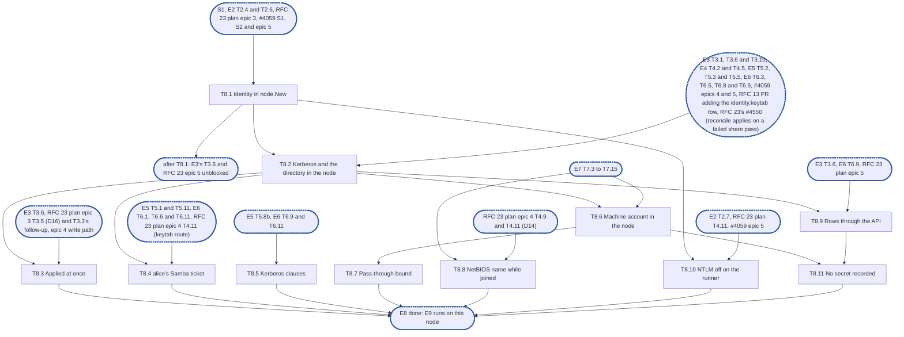

# Epic 8: identity v2 integration

**Sources:** [RFC 18](../rfcs/rfc-18-identity.md) §2.6's composition, start, stop and
reconfiguration, §3.4's and §3.7's enabled state of a directory account at sign-in, §5.1's
20-second bound for a pass-through sign-in, §5.5's NTLM and API rows, §9.1's ID6 and ID8, §9.2 as a
whole (series, conditions, spans), and §10's rows named in §3 below, as pull request #4058 merged
them (83232b441); [RFC 23](../rfcs/rfc-23-control-plane.md) §2.1 (identity at row 7 of `node.New`),
§2.2 (start steps 4 and 5, stop step 7), §2.3 (the principal and `Secret` rows), §2.4 (what a node
reports), §3.5 (the domain's actions) and §4.1 (the rule for turning `identity.ntlm` back on);
[RFC 13](../rfcs/rfc-13-configuration.md) §6, §7 (a new secret version resolved again and reported)
and Appendix B's `identity.*` rows; [RFC 25](../rfcs/rfc-25-observability.md) §3.9, §5.4 and §7.
**Track:** the team.
**Epic 8 estimate: 11 subtasks, 14.75 man-days.**
**Depends on:** **E2**: T2.4's `Settings`, `State.Settings` and `Deps.Secrets` and T2.6's
`APISignIn` (T8.1), T2.7's `identity.nt-hash-delete` step (T8.10). **E3**: T3.1's span, T3.6's
admission through identity and T3.10's resolution over the caller cache (T8.2, T8.3, T8.9). **E4**:
T4.2's local sign-in and T4.5's `Deps.Logons` (T8.2, T8.3, T8.9, T8.11). **E5**: T5.2's
`State.Keytab`, T5.5's Kerberos branch and T5.3's test realm (T8.2),
T5.8b's binding (T8.5), T5.1's fixture part and T5.11's ticket fetch (T8.4). **E6**: T6.3's record,
T6.5's `Deps.Directory`, T6.8's `Conditions` and T6.9's directory principals and `KerberosLinkSID`
(T8.2, T8.5, T8.9), T6.6 and T6.11's groups and resolution step (T8.4, T8.5)
and T6.1's fixture part, merged on `feat/storage-v2` (#4420 to #4422) with the cell selected there (T8.4). **E7**:
T7.3's in-memory domain controller, T7.4's `HoldJoinCredential`, T7.5's, T7.12's and T7.14's step
methods, T7.6's and T7.7's `NewDialer`, T7.9's `State.Machine` and `State.Join` (its D6,
settled (a)), T7.10's `Deps.DomainController` and `machine_account_unhealthy`, T7.11's pass-through,
T7.12's `machine_password_rotation_failed` and T7.14's and T7.15's `Installation.Join` (T8.6, T8.7,
T8.8, T8.11). **#4552** (merged on `feat/storage-v2`): `Installation.MachinePassword` and
`ControlPlaneTx.SetMachinePassword`, which E7's D5 writes (T8.6). **RFC 18 §2.6 as #4455 amended
it**: identity's `Store` interface, whose `ControlPlane()` view carries the control-plane `Write`
E7's D5 and D11 write through, and which the node's `*kvstore.Store` satisfies (T8.1).
**RFC 23's plan**: its epic 3's `node.New`, start and stop, reconcile's `apply`
and its T3.1's `internal/node/nodetest` with `WithNew` and `Harness.Node()`, the current node
after any `Restart` (D4) (T8.1), epic 3's T3.5 (D16), `Applied` with its `export_test.go` pause,
and its T3.3 follow-up, which fills `api.Deps.Applied` in `node.New` (T8.3); its epic 4's write path, which calls `Deps.Applied` (T8.3), and settings routes, with its D14's
`identity.ntlm` rule beside which T8.8's sits (T8.4, T8.8, T8.10); its epic 5's accounts (T8.9). **#4059** (the RFC 13 plan): its S1 and S2 (T8.1), its epic
4's version reads (T8.2) and its epic 5's
settings table and `apply` on `settings.Diff` (T8.1, T8.2, T8.10).
**Blocks:** **E9**, which runs the Tier 2 rows over SMB on the node composed here. **E3's T3.6**
and **RFC 23's plan's epic 5's T5.5**, which both need identity built in `node.New` (T8.1): T3.6
makes `vfs.New` refuse a `Deps` without it, and T5.5 builds `auth.Service` on the node's
`APISignIn` (D1); both list T8.1 among their dependencies. **RFC 23's plan's epic 5's T5.7**, whose
password write signs in over NTLM on the node and so waits for T8.2's `Deps.Logons`. **RFC 23's
plan's epic 7's T7.5**, whose "NTLM back on" row runs `identity.nt-hash-delete` on the step T8.10
registers, and its **T7.6**, whose R22 and R26 rows run over the node composed here, as do the
grant by directory name, `resolve-principal` and `test-directory`, which need identity in the node
(T8.1, T8.2) and the in-memory directory (D4, §9); RFC 23's plan's epic 6 tests only their
arguments and refusal.

---

## 1. Goal

Identity runs inside the node: `node.New` builds it once, hands its narrow interfaces to
`*vfs.Filesystem` and the management API, and reconcile hands it each new `State`. The rows of
RFC 18 §10 that no single epic can run, because they need two or more of sign-in, the directory,
pass-through, the API and the node at once, pass here; a row whose every clause another epic's
test already holds names that test instead of running again.

**At the end of the epic:**

- `node.New` builds identity at RFC 23 §2.1's row 7; `Start` applies its first `State` before it
  starts it, and `Stop` closes it after the filesystem and the API;
- every row of RFC 18 §2.6's reconfiguration table reaches identity through `Apply` within a
  second, and at once on the node that wrote the change;
- a refused identity setting is reported refused and never holds a disable back;
- the node reports identity's conditions, series and secret versions;
- a ticket the Samba domain controller issued signs in to the composed node in
  `integration/ad-dc`;
- RFC 18 §10's cross-epic rows pass, or name the tests of other epics that hold every clause;
- no log line, logon line or stored operation record holds a secret or an e-mail address across
  a local and a pass-through sign-in, an offline join and a rotation.

### 1.1 In scope

Identity's composition in `node.New` and its `State` from reconcile; the writer's at-once apply held
at identity; identity's sections in the node's settings table; identity's conditions, series and
secret versions in what the node reports; identity's runner steps and the API's identity fields
filled in `New`; a directory account's enabled state at Kerberos sign-in (D6); the
NetBIOS-name-while-joined check; the cross-epic clauses of RFC 18 §10's rows "PAC bound to the
record", "disabled directory account", "directory deadline", "mint conflict" and "NetBIOS name while
joined"; the API's refusal of a directory user's password (RFC 18 §3.5, §5.5); "NTLM off"'s deletion
on the node's runner; the secret-free capture; the API-created user's SMB sign-in; the live Samba
Kerberos sign-in.

### 1.2 Out of scope

- RFC 18 §10's Tier 2 rows over SMB, "NTLM off"'s cache-hit and fresh-sign-in halves among them:
  E9.
- "NTLM off"'s password-set half: RFC 23's plan's epic 5, whose T5.7 holds a password change
  across an NTLM-off commit over the real identity (D9). The turn-back-on rule's cases: RFC 23's
  plan's epic 4's T4.11, and its `202` and `409` through the route, that plan's epic 7's T7.5; an
  NTLM sign-in refused once the deletion has completed and NTLM is on again, until the password is
  set: that epic's T7.6 (its R26).
- The online join's administrator credential searched for in what the node writes: RFC 23's plan's
  epic 7's T7.6 (its R22), over the same harness and in-memory domain controller.
- The clauses other epics' tests already hold, named in §3's rows: "admin needs proof" (E3's T3.5
  and T3.6, E5's T5.7), "deny-only lookup error" (E3's T3.4, E5's T5.7), "NTLM without a domain
  controller" (E4's T4.2), "PAC bound to the record"'s client-name and local-against-directory
  clauses (E5's T5.6, E6's T6.9), "disabled directory account"'s and "directory deadline"'s
  resolution halves (E6's T6.11).
- "admin needs proof"'s `AUTH_SYS` half, and "expiry" over NFS: the RFC 18 plan's deferral
  ledger row "RFC 18 §10's NFS rows and NFS halves".
- `Resolve` refusing an identity past its `Expires`: RFC 18 §6.1 has the adapter refuse it, and
  E3's R32 holds a cached caller to it (D7, pending).
- The alert rows of identity's three conditions: RFC 25 §3.9's table names them, and no Go table
  holds them yet, so whoever builds one adds them (D8).
- The `identity.keytab` row of RFC 13 Appendix B, which T8.2's table check needs: an RFC 13 pull
  request, E5's open point.
- The adapters in the node: RFC 20's plan's epic 7. "roles grant nothing": the RFC 18 plan's
  deferral ledger row of that name.
- RFC 25's `logon` stream, which E4's `LogLines` stands in for: the deferral ledger row "RFC 25's
  `logon` stream; attempts are log lines".
- Interop with a Windows Server domain controller: the deferral ledger row of that name.

### 1.3 Names used here

- **E1**, the contract and the server's surface: `pkg/identity`, `internal/identity`'s lifecycle.
- **E2**, principals and accounts: settings, `NewHashes`, `APISignIn`, the NT-hash deletion step.
- **E3**, resolution: `Resolve`, admission through identity, the caller cache.
- **E4**, local NTLMv2 sign-in, the throttle and the logon sink.
- **E5**, Kerberos and the PAC: the keytab, the binding, the test realm.
- **E6**, the directory: its record, client, cache, outage condition and resolution step.
- **E7**, NETLOGON and the machine account: pass-through, the joins, the rotation, its two
  conditions, the in-memory domain controller.
- **E8**, this epic, the integration epic.
- **E9**, E2E green: RFC 18 §10's Tier 2 rows over SMB.
- **S1**, the identity surface frozen, which E1 delivers.
- **S3**, an SMB adapter serving through the node, outside RFC 18's plan; E9 waits for it.
- **RFC 23's plan's epics 3, 4, 5 and 7** are the node, the management API, accounts and sign-in,
  and that plan's integration epic.
- **#4059** is the RFC 13 configuration plan: its S1 and S2 freeze `pkg/settings` and
  `pkg/secrets`; its epic 3 builds the write check, epic 4 sealing and version reads, epic 5 the
  node's settings table.

## 2. How the general rules apply

The rules are those of
[the RFC 18 plan's §1.5](rfc-18-identity-plan.md#15-general-rules-for-each-epic), cited by
number and title and not copied.

| Rule | Subtasks | How |
| --- | --- | --- |
| rule 1, independent unit tests ([`CLAUDE.md`, "Writing tests"](../../../CLAUDE.md#writing-tests)) | all | Tier 1 rows run in `internal/identity`'s tests over the memory KV store, `identitytest`'s in-memory directory and domain controller (kind 2, each held by its suite), E5's test realm (real tickets), `kvtest`'s fault wrapper (kind 3) and the injected clock (kind 1); node rows run in `internal/node`'s `node_test` through `nodetest`, over Badger in memory, with the same doubles handed to the node by `export_test.go`'s constructor (D4) |
| rule 2, fuzz every decoder of untrusted bytes | none | E8 adds no decoder |
| rule 3, observability follows RFC 25 | T8.2, T8.6 | identity's series in the node's registry (R12), its three conditions in node status (R13), their alert rows RFC 25 §3.9's (R14); no label or attribute carries a name, SID, address or credential |
| rule 4, profiling | all | node tests are watched by `nodetest.Watch()`, identity tests by the leak check; no allocation budget |
| rule 5, public interface and internals ([`CLAUDE.md`, "Verifying a change"](../../../CLAUDE.md#verifying-a-change)) | all | each row is asserted where its value is consumed: a disable by the next call refused, a setting by the next sign-in, a condition by the node-status record, a series by the metrics listener's answer, a secret by a search of what the node wrote |
| rule 6, known failures shrink | none | no suite RFC 18 names keeps a `known.yaml`; nothing lands red |
| rule 7, v2 ignores v1 | T8.4 | the live sign-in replaces `develop`'s `TestADGroupSIDsFromPAC`, which drives v1's Kerberos code, on the reworked fixture |
| rule 8, real dependencies for properties of those dependencies | T8.4 | the Samba domain controller issues alice's ticket and serves the directory over verified TLS, on its own Docker network |
| rule 9, code comment conventions ([`CLAUDE.md`, "Code comments"](../../../CLAUDE.md#code-comments)) | T8.2, T8.5 | RFC 18 §2.6's `decision:` already sits at `Server` (E1); D2's and D6's markers at their sites; the writer's wait carries none (D3) |
| rule 10, a test must be able to fail | all | every row is held by a test named in its subtask, with the bug it catches, or by another epic's test named in the row; a clause another epic already tests is not run again |
| rule 11, a symbol is exported only if RFC 18's interfaces use it | T8.1, T8.2, T8.6 | `internal/identity` gains no export; `internal/node` keeps RFC 23's five and `Config`'s five fields, which its export pin holds; the dialer constructor and the test accessors are `export_test.go`'s (D4, D5) |
| rule 12, each subtask creates only what it declares | all | each runner step and API field is filled by the subtask that first runs it (D10); the directory's seam lands with T8.2 and the domain controller's with T8.6, their first users |

## 3. Requirements and invariants

Every obligation RFC 18 and the related RFCs place on this epic, numbered so that subtasks and
tests can cite them. Sources are RFC 18 unless named.

**Composition and reconfiguration**

| # | Requirement | Kind | Source | Subtasks |
| --- | --- | --- | --- | --- |
| R1 | `node.New` builds the identity server once, from one `Deps`, after the engine and before `*vfs.Filesystem`; identity closes nothing it was handed | invariant | §2.6; RFC 23 §2.1 | T8.1; E1's T1.4 holds the handed store left open |
| R2 | Each consumer is handed only the interface it calls: `*vfs.Filesystem` the `Resolver` as `vfs.Deps.Identity`, the `Authenticator` as `Auth` and `Identities` as `Names`; the management API `APISignIn`; the adapters nothing of identity | invariant | §2.6; RFC 23 §2.1 | T8.1 |
| R3 | No settings reach `New`: the node reads the records at start and hands identity its first `State` through `Apply` before `Start`, and starts identity after the engine | invariant | §2.6; RFC 23 §2.2 steps 4 and 5 | T8.1, its test in T8.2 |
| R4 | The node stops identity after `*vfs.Filesystem` and the management API, since a drain still delivers calls that resolve and the API checks an account on every call | invariant | §2.6; RFC 23 §2.2 stop steps 3, 6 and 7 | T8.1, in the identity slot of RFC 23's plan's epic 3's T3.3 `Stop` (its R21); no consumer sees a stopped identity (§9) |
| R5 | Reconfiguration reaches identity only through `Apply`, from reconcile: a principal, membership or protocol-ID change hands it the new principals generation; a keytab or machine password `Secret` version, the directory record, `identity.ntlm` and `identity.id_range` hand it a new `State`; none needs a restart | invariant | §2.6's table; RFC 23 §2.3; RFC 13 §7 | T8.2, T8.6 |
| R6 | A principal change is applied on a node within a second of its commit, the node reading the principals generation once a second | bound | §7.2; RFC 23 §2.3 | T8.2 |
| R7 | The node that wrote a change applies it at once rather than at its next read, so an operator's own next call sees it | invariant | §2.6 | T8.3 at identity; built and tested by RFC 23's plan's epic 3's T3.5 (its D16, R54) |
| R8 | `State` is one snapshot: the node builds the fields of one `Apply` from one read of the records, the one exception D2's retry, which pairs a new generation with the last settings identity accepted | invariant | §2.6 | T8.2, T8.6 (§9: no consumer-side test tells a split read apart) |
| R9 | `Apply` refuses an invalid setting and keeps the last applied; the node reports the record refused with its generation and error, and the refusal stops only what the record configures | MUST | §2.6; RFC 23 §2.3, §2.4; RFC 13 §6 | T8.2 |
| R10 | The node reports the version of each secret identity holds, the keytab's and the machine password's, so an old version is deleted only once every node holds the new one | MUST | RFC 23 §2.4; RFC 13 §7 | T8.2, T8.6 |
| R11 | Identity's sections, `identity` and `identity.directory`, are listed once in the node's settings table, each key with RFC 13 Appendix B's scope, class and write role | invariant | RFC 13 Appendix B; RFC 13 §6 | T8.1, T8.2 |

**Observability**

| # | Requirement | Kind | Source | Subtasks |
| --- | --- | --- | --- | --- |
| R12 | Identity's §9.2 series are registered in the node's metrics registry and served by its metrics listener, and no label carries a name, a SID or an address | invariant | §9.2; RFC 25 §5.4 | T8.2 |
| R13 | `directory_unreachable` and `machine_account_unhealthy` are this node's conditions and `machine_password_rotation_failed` the installation's, each in the node's node-status record while raised, and gone once cleared | invariant | §9.2; RFC 25 §3.9; RFC 23 §2.4 | T8.2, T8.6 |
| R14 | `directory_unreachable` alerts as a ticket and pages at 5 minutes once unhealthy; `machine_account_unhealthy` and `machine_password_rotation_failed` page at 5 minutes | invariant | RFC 25 §3.9, §7 | RFC 25 §3.9's rows, which E6's T6.8 and E7 name; no Go table holds them yet, so no test here (D8) |
| R15 | `identity.authenticate` and `identity.resolve` are children of the caller's span, and carry the proof kind, the outcome and the principal's ID only | invariant | §9.2 "Spans"; RFC 25 §5.4 | T8.2, which hands the node's tracer; held by E3's T3.1 and E4's T4.5 span tests |
| R16 | No log line, logon line or stored operation record carries a password, an NT hash, a key, a session key, an online join's administrator credential or a user's e-mail address | MUST NOT | §2.2, §3.1, §3.5; RFC 25 §5.4 | T8.11; the online join's administrator credential held by RFC 23's plan's epic 7's T7.6 (its R22) |

**Rows several epics meet in**

| # | Requirement | Kind | Source | Subtasks |
| --- | --- | --- | --- | --- |
| R17 | `Admin` is set only from a share grant, for a proof of `Secret` or above: a principal given a Kerberos name, with an `admin` grant, reads another user's mode-0600 file; `S-1-5-32-544` in a test PAC for a non-admin sets no `Admin` | test row | §9.1 ID6; §6.5; §10 "admin needs proof" | held by E3's T3.5 (the grant at each proof kind, `S-1-5-32-544` setting nothing), E3's T3.6 (the caller at the chokepoint) and E5's T5.7 (a built-in SID dropped from the PAC) |
| R18 | A PAC binds only the record its user SID names: a directory name reused after its holder's deletion is refused or minted anew through §4.2's step 3, never bound to the old principal; a local and a directory principal of one name in the directory's realm bind the directory one; a PAC whose client name differs from the ticket's is refused | test row | §3.4; §10 "PAC bound to the record" | T8.5 for the reused name through step 3; E6's T6.9 and E5's T5.6 for the other two clauses |
| R19 | A directory principal's enabled state is read through the directory cache on every proof: a Kerberos sign-in of a directory account the directory disables, or answers "no such entry" for, fails `ErrLogonFailure` with logon outcome `disabled`, and fails `ErrUnavailable` once the cache can answer neither fresh nor within the grace | MUST | §3.4, §3.7, §5.3 | T8.5 |
| R20 | A PAC keeps no disabled directory account in: disabled in the directory past the TTL, refused; the directory down past the TTL and the grace, refused; the entry deleted, refused with outcome `disabled` | test row | §10 "disabled directory account" | T8.5 at sign-in; E6's T6.11 at resolution |
| R21 | One pass-through sign-in's identity work, its directory queries, mints, wait for the secure channel and call to the domain controller, stops at 20 seconds with `ErrUnavailable`; an NTLM session's directory groups follow the directory past the TTL with no generation change | bound | §5.1; §10 "directory deadline" | T8.7 for the pass-through's share of the bound; E6's T6.11 for the groups and for a resolution's bound |
| R22 | A sign-in whose mint would take a row another principal holds fails, binds no principal and leaves the holder's record unchanged; two concurrent mints of one entry bind one principal | test row | §4.1; §10 "mint conflict" | T8.5 |
| R23 | A store error while mapping a PAC's deny-only SID fails the call; it is never resolved without the deny | test row | §9.1 ID8; §10 "deny-only lookup error" | held by E3's T3.4 (a `sid` fault while mapping a deny-only SID refuses the call) and E5's T5.7 |
| R24 | A directory principal holds no local password: the API refuses to set one and stores nothing, `NewHashes` refuses it `ErrInvalid` and a local NTLM sign-in naming one is refused | MUST NOT | §3.5, §5.5; §10 "no local password for a directory user" | T8.9 for the API's refusal (§3.5, §5.5); E2's T2.6 and E4's T4.2 for the row's two halves |
| R25 | With a directory and no pass-through, an NTLM sign-in for a user only in the directory is `ErrLogonFailure` and yields no session | test row | §5.5; §10 "NTLM without a domain controller" | held by E4's T4.2: a minted directory principal refused locally (its R9), an unminted one an unknown name |
| R26 | On a joined installation a settings change to `identity.netbios_name` is refused by the settings route and the name is unchanged | MUST | RFC 13 Appendix B (`identity.netbios_name`); §10 "NetBIOS name while joined" | T8.8 |
| R27 | Turning `identity.ntlm` on is refused `409` `operation_running` while `Installation.NTLMOff` records a turn-off and no completed `identity.nt-hash-delete`; once one completes, turning it on is accepted and no NT hash is stored | MUST | RFC 23 §4.1; §3.5; §10 "NTLM off" | T8.10 for the deletion on the node's runner; RFC 23's plan's epic 4's T4.11 for the rule's cases and its epic 7's T7.5 for the `202` and `409` through the route, E2's T2.7 for a deletion failed part way, and that plan's epic 7's T7.6 (its R26) for an NTLM sign-in refused after a completed deletion until the password is set |
| R28 | A password set held between `NewHashes` and its write across NTLM turned off has its write refused, and no `Secret` of kind nt-hash is stored | test row | §3.5; §10 "NTLM off" | held by RFC 23's plan's epic 5's T5.7 (D9) |

**Scenarios**

| # | Requirement | Kind | Source | Subtasks |
| --- | --- | --- | --- | --- |
| R29 | A user created through the API and given a password with `set-password` signs in by NTLM through the filesystem service and is admitted to a share granting it | test row | RFC 23 §3.5; §3.5; the MVP issue #4053 | T8.9 |
| R30 | A ticket the Samba domain controller issued signs in to the composed node over verified TLS to its directory, and the caller holds the groups its PAC and the directory give | test row | §3.3, §3.4; §10 "Suites" | T8.4 |
| R31 | A join, online or offline, keeps no idempotency record | MUST NOT | RFC 23 §3.5 | held by RFC 23's plan's epic 4's T4.11 (its R22) |

Which test or enforcer holds each row is in its subtask's **Tests**, or in the row when another
epic's test holds it.

## 4. Decisions this epic takes

- **D1, identity is composed early.** T8.1 needs only E2's T2.4 and T2.6 and RFC 23's plan's
  epic 3, and two pieces of work stop without it: E3's T3.6 makes `vfs.New` refuse a `Deps`
  without a `Resolver`, which breaks the `node.New` RFC 23's plan's epic 3 builds, and RFC 23's
  plan's epic 5 builds `auth.Service` in `node.New` over `APISignIn` from its T5.5 on. So T8.1
  lands first, ahead of the rest of this epic. RFC 23's plan's epic 5's T5.5 and that plan's X2
  name it (#4394), and E3's T3.6 lists it. The rest of E8 composes each later `Deps` and `State`
  field with its first user. Prior art: none found.
- **D2, a refused setting never holds a principal change back.** `State` is one value, so an
  identity setting `Apply` refuses would hold back the principals generation in the same `State`,
  and with it every disable. When `Apply` refuses, the node reports the record refused and applies
  again with the new generation, the new secret versions and the last settings identity accepted.
  A `decision:` marker at the retry. Prior art (from memory): Envoy keeps its last accepted
  configuration on a rejected xDS update; Kubernetes' kubelet keeps a last-known-good config.
- **D3, the writer's at-once apply is RFC 23's plan's epic 3's D16.** RFC 18 §2.6 wants an
  operator's own next call to see the change. That epic's T3.5 builds `Applied` (a wake of
  reconcile and a wait until the reconciled-through positions cover the counters read after the
  commit), its T3.3 follow-up fills `api.Deps.Applied` with it in `node.New`, and its epic 4's write adapter calls it; this epic builds none of it. T8.3
  holds the result at identity, the consumer. No marker here. Prior art: D16's.
- **D4, the node's tests hand it the directory's and the domain controller's dialers.** `New` calls
  an unexported `newNode(cfg, seams{})`, `seams` holding E6's `directory.Dialer` and the domain
  controller's dialer E7 declares, each nil for the production one; `export_test.go`'s
  `NewWithDialers(dir, dc)` returns a constructor over the in-memory ones, which `node_test` hands
  to `nodetest.WithNew` (RFC 23's plan's epic 3's T3.1). `Restart` calls the same constructor, so
  the seams survive it. `Config` keeps RFC 23's plan's epic 1's five fields and its export pin,
  which reads no `_test.go` file; `nodetest` imports nothing of identity. Prior art: Go's
  `export_test.go` convention.
- **D5, in-process rows reach the node's identity and filesystem through `export_test.go`.** The
  node exports `New`, `Start` and `Stop` only (RFC 23 §2.1's decision), and no adapter serves
  before S3. So `internal/node`'s `export_test.go` gives its tests `(*Node).Service() vfs.Service`,
  the value the adapters will be handed, `(*Node).Accounts() identity.APISignIn`, the value the API
  is handed; they compile only into the package's tests, and the export pin reads non-test files.
  A test reaches the node through `nodetest`'s `Harness.Node()`, the current node after any
  `Restart`, which RFC 23's plan's epic 3's T3.1 builds. Prior art: Go's `export_test.go`
  convention.
- **D6, the Kerberos branch reads a directory account's enabled state, pending the user's answer
  (§9).** RFC 18 §3.4 and §3.7 have the enabled state read "on every proof" and a disabled account
  fail sign-in with outcome `disabled`. E5's §1.2 leaves the enabled state to E6, and E6's T6.11
  reads it at resolution only, so no sign-in reads it. T8.5 adds the read to E5's Kerberos branch,
  through T6.11's cache read, once §4.2 has mapped a principal with a `dir` spelling. Pass-through
  needs none: the domain controller refuses a disabled account itself. A `decision:` marker at the
  read. E5's and E6's §1.2 name T8.5 for it. Alternative: E6 adds it beside T6.9's step 3, which
  E5's branch calls. Prior art (from
  memory): Samba's `winbindd` checks the account's state on each logon, not only at ticket issue.
- **D7, `Resolve` does not refuse an expired identity, pending the user's answer (§9).** RFC 18
  §6.1 says an expired context never reaches resolution, the adapter refusing it, and E3's R32
  serves no cached caller past `Expires`. Building a refusal at `Resolve` would amend §6.1; this
  epic builds none, and the "expiry" row stays the adapter's, over SMB in E9's "re-authentication"
  and over NFS deferred. Prior art: none needed.
- **D8, no Go table of alert rows is built here.** RFC 25 §3.9's table names identity's three
  conditions, and no Go table holds alert rows yet, so whoever builds one adds them. E8 holds the
  consumer's side: each condition reaches node status with RFC 25 §3.9's scope (T8.2, T8.6).
  Prior art: RFC 25 §3.9, "a component adding a condition adds a row".
- **D9, "NTLM off"'s password-set half is RFC 23's plan's epic 5's test.** Its T5.7 holds a
  password change after its `identity.ntlm` read while an NTLM-off commits, over the real identity,
  and asserts the write refused with no NT hash stored: the row whole, at its consumer. A second
  copy here could fail on nothing that one misses (rule 10). Should that test leave T5.7, T8.10
  takes it. Prior art: none needed.
- **D10, the node fills identity's runner steps and the API's identity fields, pending the user's
  answer (§9).** Only `internal/node` imports the server, so the step functions of E2 and E7 and
  the API's `Deps.Directory` and `Deps.Joins` are filled in `node.New` by this epic, each by the
  subtask that first runs it: `Deps.Directory` (E6's `KerberosLinkSID`) by T8.2, E7's kinds and `Deps.Joins` by T8.6, E2's
  deletion by T8.10. E2's and E7's methods are typed by `internal/node/step` (E7's D4) and
  join the runner's table, `operationSteps`, which `node.New` hands the runner, as they are, with
  no adapter. RFC 23's plan's
  epic 3 (its D7) and epic 4 (its D13) name this epic as the one that registers the steps and fills
  the fields. Prior art: none found.
- **D11, Tier 1 rows run in identity's tests, node rows in the node's.** A row RFC 18 §10 marks
  Tier 1 drives identity alone, so T8.5 and T8.7 are `internal/identity` tests over
  `identitytest`'s doubles; a row that needs the API, the runner or reconcile runs in
  `internal/node`'s `node_test` through `nodetest`. No marker. Prior art: RFC 18 §10's two tiers.

## 5. Target tree

```text
internal/node/
  identity.go           T8.1   identity built at row 7 from Deps{Store, Secrets, Clock, Metrics,
                               Logger}; handed to vfs.Deps and the API; the first State
                        T8.2   D2's retry; Deps.Logons, Tracer, Directory; State.Keytab,
                               State.Directory; api.Deps.Directory;
                               secret versions reported; the server added to the evaluator
                        T8.6   Deps.DomainController, State.Machine, State.Join, E7's four
                               kinds, api.Deps.Joins
                        T8.10  E2's identity.nt-hash-delete step
  node.go               T8.2   newNode and seams, the directory's dialer (D4)
                        T8.6   the domain controller's dialer in seams (D4)
  reconcile.go          T8.1   apply hands identity its first State at start step 4
                        T8.2   apply hands identity its State on a principals or settings move
  settings.go           T8.1   the identity section in the node's table
                        T8.2   the identity.directory section
  export_test.go        T8.1   (*Node).Service, (*Node).Accounts (D5)
                        T8.2   NewWithDialers (D4)
  identity_test.go      T8.1, T8.2, T8.3, T8.6, T8.9, T8.10, T8.11
internal/identity/
  kerberos.go (E5's)    T8.5   a directory principal's enabled state at sign-in (D6)
  integration_test.go   T8.5, T8.7   the Tier 1 clauses several epics meet in
internal/node/api/      T8.8   beside RFC 23 epic 4's ntlm.go: identity.netbios_name refused
                               while Installation.Join says joined, a tracked read
test/integration/ad-dc/
  node_signin_test.go   T8.4   alice's Samba ticket through the composed node
```

## 6. Subtasks

### T8.1 Identity in `node.New`, its first `State`

**Subtask T8.1 estimate: 1.5 man-days.**

- **Track:** the team. **Depends on:** S1. E2's T2.4 and T2.6; RFC 23's plan's epic 3 (`node.New`,
  start and stop, reconcile's `apply`, T3.1's `nodetest` with `WithNew` and `Harness.Node()`);
  #4059's S1 and S2 and its epic 5 (the settings table and Appendix B check).
- **Blocks:** E3's T3.6, which must land after it: the built `internal/node/node.go` builds
  `vfs.Deps` without identity, and T3.6 makes `vfs.New` refuse a `Deps` without a `Resolver` (D1);
  RFC 23's plan's epic 5's T5.5, which builds `auth.Service` on the `APISignIn` T8.1 hands it.
- **Covers:** R1, R2, R3, R4, R11.
- **Deliverables:**
  - in `node.New`, `identity.New(identity.Deps{Store, Secrets, Clock, Metrics, Logger})` at row
    7, `Store` the node's `*kvstore.Store`, which satisfies identity's `Store` (RFC 18 §2.6 as
    #4455 amended it), its `ControlPlane()` the write E7's D5 and D11 use, `Secrets` the node's #4059 provider and `Metrics` `Config.Metrics`; the server handed as
    `vfs.Deps.Identity`, `Auth` and `Names` and as the `APISignIn` RFC 23's plan's epic 5's
    `auth.Deps` takes. Consumed by E3's T3.6, RFC 23's plan's epic 5 and every later subtask;
  - `apply` building the first `State{Generation, Settings}` from one read, the principals
    generation and the `identity` section through `pkg/settings`, and calling `Apply` at start
    step 4; `Start` in RFC 23's plan's epic 3's identity slot after the engine; `Stop` in its stop
    slot. Consumed by T8.2, which applies each later move;
  - the `identity` section in `internal/node/settings.go`;
  - `export_test.go`'s accessors (D5). Consumed by every later node test.
- **Acceptance criteria:**
  - A node starts, and its `APISignIn` answers from identity rather than E1's stubs.
- **Tests:** in `node_test`, through `nodetest`, watched, on the injected clock:
  - a user seeded with `NewHashes`, then `Start`: `Accounts().VerifyPassword` with her password
    succeeds (catches the API handed E1's stub, which answers `ErrUnavailable`, or a `Deps`
    without `Secrets`, R1, R2);
  - #4059's Appendix B check over the node's table, which fails on a key the table lists with
    another class or write role (R11).
  - R2 is otherwise held by the compiler. R3's test needs a setting a sign-in reads, so it is
    T8.2's. R4 is the identity slot's place in RFC 23's plan's epic 3's `Stop`, whose T3.3 test
    reads the order; no consumer here sees a stopped identity, since E1's T1.4 leaves its methods
    answering from the store (§9).

### T8.2 Reconfiguration, Kerberos and the directory in the node

**Subtask T8.2 estimate: 3 man-days.**

- **Track:** the team. **Depends on:** T8.1. E3's T3.1, T3.6 and T3.10; E4's T4.2 and T4.5; E5's
  T5.2, T5.3 and T5.5; E6's T6.3, T6.5, T6.8 and T6.9; #4059's epic 4 (version reads) and epic 5
  (`apply` on `settings.Diff`, the secret-version report); the RFC 13 pull request adding the
  `identity.keytab` row to Appendix B, without which the table check fails on the `identity`
  section (§1.2, §9); for its disable refused one second later, reconcile running `apply` when its
  share pass fails, which RFC 23's #4550 raises (§9).
- **Covers:** R2, R3, R5, R6, R8, R9, R10, R11, R12, R13, R15.
- **Deliverables:** `apply` handing identity a new `State` on each move of the principals or
  settings generation; D2's retry and its `decision:`, the refused record in node status;
  `Deps.Logons` (E4's `LogLines` over `Config.Logger`, pending E4's D7), `Deps.Tracer` (the node's),
  `Deps.Directory` (`directory.DialTLS`, or the seam, D4); `newNode` and `seams` with the
  directory's dialer, `export_test.go`'s `NewWithDialers`, handed to T3.1's `nodetest.WithNew`;
  `State.Keytab` from the provider's versions of the `identity.keytab` reference, and
  `State.Directory` from the `identity.directory` section (pending E6's D2), both rebuilt when the
  settings generation moves, which a new `Secret` version raises; the keytab's current version, the
  one the node now holds, reported through #4059's slot (RFC 13 §7), which RFC 23 §3.3's credential rotation waits on
  before it prunes the previous version (E5's D13); `api.Deps.Directory`
  filled with E6's `KerberosLinkSID` (D10); the server added to the node's evaluator as a `Source`
  (`Evaluator.Add`, RFC 23's plan's epic 3's D4); the `identity.directory` section in the table.
  Consumed by T8.3, T8.4, T8.6, T8.9, and by RFC 23's plan's epic 5's T5.7 (`Deps.Logons`).
- **Acceptance criteria:**
  - A principal change, a keytab version or a directory record written while the node runs takes
    effect with no restart.
- **Tests:** in `node_test`, through `nodetest`, on the injected clock, the in-memory directory
  (kind 2) handed by `NewWithDialers`:
  - bob signs in through `Service()` and a call succeeds; bob disabled through kvstore's view: his
    next call still served before the clock moves (the control: admission's caller cache holds
    him), then the clock advanced one second and his next call refused (catches a principal change
    never applied, R5, R6);
  - `identity.netbios_name` written invalid straight to the store, past `Check`, then bob disabled
    and the clock advanced one second: the record in node status's refused set with its
    generation, and bob's next call refused (catches D2's retry missing, a refused setting holding
    a disable back, R9);
  - `identity.ntlm` written off, `nodetest`'s `Restart`, the clock not moved: bob's NTLM sign-in
    refused at the first attempt (catches a first `State` built from defaults before the records
    are read, R3);
  - a keytab of E5's test realm sealed as version 1 of `identity.keytab`: alice's ticket signs in
    through `Service()`; version 2 written and the clock advanced a second: a ticket under version 2
    signs in and node status reports version 2 (catches a keytab read at start only, R5, R10);
    `State.Keytab`, read through `export_test.go`, holds version 2 before version 1 (catches
    `Versions` handed on oldest first, which E5's T5.2 ring would resolve to the retired key on a
    key-version tie, since it takes the first version holding a key);
  - the `identity.directory` record written: `Find` of an unminted directory SID with `Mint`
    mints it (catches `State.Directory` never filled, R5);
  - bob signed in by NTLM, then `identity.ntlm` written off and the clock advanced a second: bob's
    next call refused (catches identity's settings delivered only at start, R5);
  - the in-memory directory stopped past the grace: node status holds `directory_unreachable`,
    node-scoped; restarted and probed: gone (catches the server never added to the evaluator,
    R13);
  - after one sign-in, the metrics listener's answer holds `identity_authentications_total` with
    `mechanism="kerberos"` and no label value holding alice's name or SID (catches identity's series
    on a registry the node does not serve, R12);
  - a user's `krb` link written through the API for alice's name: accepted, and the spelling read
    back raw linked for alice's entry SID (catches `Deps.Directory` left nil, which refuses every
    link `503`, R2);
  - a local `backup` given the `krb` name `backup@<realm>` through the API, linked for the
    directory entry's SID: a test-realm ticket for that name, its PAC carrying that SID, signs in
    through `Service()` as `backup`; the entry deleted and recreated with a new SID and the clock
    past the TTL: the same name's new ticket refused (catches `Deps.Directory` left nil, or a link
    the binding never reads, R2; RFC 23's plan's epic 7's §9 row).
  - R15 is held by E3's T3.1 and E4's T4.5 span tests; this subtask hands the tracer.
- **Rules:** rule 9 (D2's `decision:`).

### T8.3 A change applies at once on the node that wrote it

**Subtask T8.3 estimate: 0.5 man-days.**

- **Track:** the team. **Depends on:** T8.2. E3's T3.6; RFC 23's plan's epic 3's T3.5 (its D16:
  `Applied` and its `export_test.go` pause), its T3.3 follow-up, which fills `api.Deps.Applied` in
  `node.New`, and its epic 4's write path, which calls it.
- **Covers:** R7.
- **Deliverables:** a test in `internal/node`'s `identity_test.go`; nothing else (D3).
- **Acceptance criteria:**
  - A disable written through the API is refused at the caller's next call with the clock never
    moved.
- **Tests:** in `node_test`, through `nodetest`, the clock never advanced: bob signs in by NTLM
  through `Service()` and a call succeeds; a reconcile pass held by D16's pause after its counters
  read; bob disabled through the API while it is held: no answer while the pass is held; released,
  the answer returns, and bob's next call through `Service()` is refused (catches identity handed
  no new `State` by the pass `Applied` waited for, or a cached caller served past the generation the
  write raised, R7). The wake and the wait themselves are RFC 23's plan's epic 3's T3.5 tests (its
  R54). Doubles: D16's per-instance pause from `export_test.go`, a hook in the code under test; the
  injected clock (kind 1).

### T8.4 alice's Samba ticket through the node

**Subtask T8.4 estimate: 1.25 man-days.**

- **Track:** the team. **Depends on:** T8.2. E5's T5.1 and T5.11; E6's T6.1, T6.6 and T6.11; RFC
  23's plan's epic 4's settings route (T4.9) and keytab secret route (T4.11).
- **Covers:** R30.
- **Deliverables:** `test/integration/ad-dc/node_signin_test.go` (tag `ad_dc`): the fixture's DC
  started by `setupADDC` on its own Docker network; a node built by `nodetest`; the keytab
  `setupADDC` returns (`dittofs.keytab`) written as `identity.keytab`, and an `identity.directory`
  record naming `ldaps://dc1.dittofs.ad`, the fixture CA from `copyADCA` as its trust root and the
  DC's IP as its DNS server, through the node's API as an operator would; alice's AP-REQ for
  `cifs/dittofs.dittofs.ad`, from gokrb5's client as E5's T5.11 builds it, signed in through
  `Service()`. `develop`'s `TestADGroupSIDsFromPAC` deleted with it (rule 7). The fixture's branches
  on `feat/storage-v2` and the cell's place in its plan job's select are E6's T6.1's.
- **Acceptance criteria:**
  - The test runs in the `integration/ad-dc` cell on `feat/storage-v2`.
- **Tests:** alice signs in and `Evidence.SIDs` starts with her SID; her caller is admitted to a
  share whose only grant is `devs` (catches a verifier or binding that agrees only with the test
  realm); then a group created with `samba-tool` after her ticket was issued, alice added to it and
  the clock past the TTL: her caller is admitted to a share granting only that group, which no PAC
  of hers carries (catches a directory the node never reads, R30). No double: the domain controller
  is real.
- **Rules:** rule 8; the fixture's tests run one at a time, as its `adContainerName` `decision:`
  says. The record's DNS server reaching the DC's name is E6's dialer's to honour (§9).

### T8.5 Kerberos clauses across sign-in and the directory

**Subtask T8.5 estimate: 2 man-days.**

- **Track:** the team. **Depends on:** E5's T5.8b; E6's T6.9 and T6.11.
- **Covers:** R18, R19, R20, R22.
- **Deliverables:** in E5's Kerberos branch, once §4.2 has mapped a principal with a `dir`
  spelling, its enabled state read through T6.11's cache read: disabled or gone, `ErrLogonFailure`
  with outcome `disabled`; unanswerable, `ErrUnavailable` (D6), with its `decision:`;
  `internal/identity/integration_test.go`.
- **Acceptance criteria:**
  - A local principal's Kerberos sign-in sends no directory query.
- **Tests:** in `internal/identity`, over the memory KV store, the in-memory directory, E5's test
  realm and the injected clock, each through `SignIn`:
  - "PAC bound to the record"'s reuse clause: bob minted through step 3; deleted in the directory
    and recreated with a new SID, his PAC signs in: a new principal or refused, never the old
    `PrincipalID` (catches a reused name bound to the old person through step 3, R18);
  - "disabled directory account" at sign-in: alice signed in with a PAC, disabled in the directory,
    the clock past the TTL: her next sign-in `ErrLogonFailure`, outcome `disabled` at E4's sink; the
    directory down past TTL and grace: `ErrUnavailable`; the entry deleted: `ErrLogonFailure`,
    outcome `disabled` (catches the PAC keeping a disabled account in, R19, R20);
  - "mint conflict": alice minted, bob's entry given another SID and alice's `uidNumber`: his
    sign-in fails, bob bound to nothing, alice's record byte-equal; two concurrent sign-ins of one
    unminted entry, the first's mint commit held by a `FaultKV` delay until the second has read
    the entry: one principal (catches a lost mint bound to whoever holds the row, R22);
  - the acceptance criterion: a local principal with a `krb` link signs in through E5's test
    realm, over the in-memory directory wrapped in E6's `identitytest.FaultyDirectory` with no
    fault scheduled: accepted, and the wrapper's pass-through record of queries (E6's T6.4) holds
    none (catches the Kerberos branch querying the directory for every principal, R19).
  - Doubles: the in-memory directory (kind 2), `kvtest`'s `FaultKV` and `identitytest`'s
    `FaultyDirectory` (kind 3), the injected clock (kind 1); logon outcomes at E4's recording sink, a sink of outputs.
- **Rules:** rule 9 (D6's `decision:`).

### T8.6 The machine account in the node

**Subtask T8.6 estimate: 2.25 man-days.**

- **Track:** the team. **Depends on:** T8.2. E7's T7.3 (the in-memory domain controller), T7.4
  (`HoldJoinCredential`), T7.5, T7.12 and T7.14 (the four kinds), T7.6 and T7.7 (`NewDialer`), T7.9
  (`State.Machine`, `State.Join`), T7.10 (`Deps.DomainController`, `machine_account_unhealthy`) and
  T7.15 (the offline join). #4552 (`Installation.MachinePassword`, merged on `feat/storage-v2`);
  identity's `Store` with `ControlPlane()` as #4455 amended RFC 18 §2.6, which T8.1 fills and E7's
  D5 and D11 write through.
- **Covers:** R5, R8, R10, R13.
- **Deliverables:** `Deps.DomainController` filled with
  `netlogon.NewDialer((&net.Dialer{}).DialContext)` (E7's T7.6, T7.7), or the in-memory one through
  `seams` and `NewWithDialers` (D4); `State.Machine` from the provider's versions of
  `Installation.MachinePassword`, with their `KeyVersion` and `HandedOver`, and `State.Join` from
  `Installation.Join` (E7's D6, settled (a)), both rebuilt on a settings move; the machine password's
  versions reported; `JoinStep` and `JoinProgress`, `RotateStep` and `RotateProgress`,
  `ResolvePrincipalStep` and `ResolvePrincipalProgress`, `TestDirectoryStep` and
  `TestDirectoryProgress` in the runner's table, `operationSteps` in `node.New`, under
  `installation.join-domain`, `installation.rotate-machine-password`,
  `installation.resolve-principal` and
  `installation.test-directory` (`pkg/node/apiv1`'s `OpKind` values) as they are, typed by
  `internal/node/step` (E7's D4, D10 here), with no adapter: the runner fails the operation on a
  step's `*apiv1.Problem` and retries any other error; `api.Deps.Joins` filled from identity (D10).
  Consumed by T8.7, T8.11.
- **Acceptance criteria:**
  - None of the four kinds is reported refused in node status for want of a step.
- **Tests:** in `node_test`, through `nodetest`, the in-memory directory and domain controller
  (kind 2), on the injected clock:
  - an offline join through the API runs to joined, and a pass-through sign-in through `Service()`
    then succeeds (catches a kind with no step, or `State.Machine` or `State.Join` never filled,
    R5);
  - under E7's D6 (a), after the join, a ticket of E5's test realm under a key derived from the
    machine password signs in, and after `nodetest`'s `Restart` with no domain controller reachable
    it still does (catches `State.Join` left zero, which derives no key, R5, R8);
  - a rotation through the API: node status reports the new version, and a pass-through after it
    signs in (catches the machine password's versions never reported, R10);
  - a `resolve-principal` of a name the in-memory directory lacks: the operation `failed` with the
    step's problem as its error, at the first turn (catches a problem wrapped as a plain error,
    which the runner retries for ever, R5);
  - the domain controller failed: node status holds `machine_account_unhealthy`, node-scoped; a
    rotation failed: `machine_password_rotation_failed` installation-scoped, kept after `Restart`,
    gone once a rotation completes (catches a condition identity raises that the node never reads,
    R13);
  - an online join whose creating `Write` is refused by a `FaultKV` error on its commit: no
    credential is held under its ID afterwards, and an operation record of that ID then written
    through kvstore's view runs its step to `failed`, naming the missing administrator credential
    (catches a hold the refused write never released; RFC 23's plan's epic 4's T4.11 and E7's T7.4
    give this row here).
  - Doubles add `kvtest`'s `FaultKV` (kind 3).

### T8.7 The pass-through's share of the 20-second bound

**Subtask T8.7 estimate: 1 man-days.**

- **Track:** the team. **Depends on:** T8.6. E6's T6.11; E7's pass-through.
- **Covers:** R21.
- **Deliverables:** two tests in `internal/identity/integration_test.go`.
- **Acceptance criteria:**
  - The bound holds a pass-through sign-in whose own directory work is under 20 seconds.
  - The bound holds a sign-in whose directory queries alone pass 20 seconds.
- **Tests:** in `internal/identity`, over the memory KV store, the in-memory directory and domain
  controller and the injected clock:
  - a cold pass-through sign-in of a user in 3 groups, every directory query delayed 4 seconds
    through the fault wrapper: it succeeds with the domain controller answering at once (the
    control: the directory's share alone stays under the bound), and fails `ErrUnavailable` at 20
    seconds on the clock, nothing minted, with the domain controller's answer delayed 15 seconds
    (catches the pass-through's wait and call counted outside the bound, R21);
  - RFC 18 §10's "directory deadline" sign-in clause: a cold pass-through sign-in of a user in 300
    groups, each directory query delayed 4 seconds, the domain controller answering at once: it
    fails `ErrUnavailable` at 20 seconds on the clock, and nothing is minted (catches the deadline
    applied only to the secure-channel wait and the call, which lets the sign-in run for 20
    minutes, R21). E6's T6.11 holds a resolution's bound, not a sign-in's.
  - Doubles: the in-memory directory and domain controller (kind 2), the fault wrapper (kind 3),
    the injected clock (kind 1).

### T8.8 The NetBIOS name while joined

**Subtask T8.8 estimate: 0.75 man-days.**

- **Track:** the team. **Depends on:** E7's `Installation.Join`; RFC 23's plan's epic 4's
  settings route (T4.9) and its D14's `identity.ntlm` rule (T4.11).
- **Covers:** R26.
- **Deliverables:** a rule, a function of the write's transaction called by RFC 23's plan's
  epic 4's settings route beside its D14's `identity.ntlm` rule, so both rules over the
  `Installation` record live in the route, the one place that can read it (RFC 23 §4.1; §4.3's
  validators read only settings): a put or delete of `identity.netbios_name` reads
  `Installation.Join` as a tracked read in the write's transaction and is refused while it says
  joined, naming the join. The join's own write of the name is not a settings write and does not
  pass through it.
- **Acceptance criteria:**
  - The refusal names the joined state.
- **Tests:** the rule as a function of a transaction over the memory KV store's `Write`, as RFC 23's
  plan's epic 4's T4.11 tests D14's: "NetBIOS name while joined", a
  joined installation, a change refused and the name read back unchanged; not joined, accepted
  (R26); a join committing between the change's read and its commit, held by a `FaultKV` delay:
  the change's commit fails on its tracked read (catches a read that is not tracked). Doubles:
  `kvtest`'s `FaultKV` (kind 3), the injected clock (kind 1).

### T8.9 Rows through the node's API

**Subtask T8.9 estimate: 1 man-days.**

- **Track:** the team. **Depends on:** T8.2. E3's T3.6; E4's T4.2; E6's T6.9; RFC 23's plan's
  epic 5 (user writes, `set-password`).
- **Covers:** R24, R29.
- **Deliverables:** tests only, in `internal/node`'s `identity_test.go`.
- **Acceptance criteria:**
  - Each row passes through the API and `Service()` of one node.
- **Tests:** in `node_test`, through `nodetest`, the in-memory directory and the injected clock:
  - the #4053 scenario: alice created through the API, `set-password` run, a share granting her
    read-write; an NTLMv2 AUTHENTICATE computed from her password signs in through `Service()` and
    her open of a file is admitted (catches the API and the filesystem holding two identities, or
    an NT hash the API never writes, R29);
  - the API's refusal of a directory user's password: `set-password` on a minted directory user
    refused, and no `Secret` and no change to the record read back raw (catches the route storing a
    hash `NewHashes` refused, R24).

### T8.10 NTLM off on the node's runner

**Subtask T8.10 estimate: 0.5 man-days.**

- **Track:** the team. **Depends on:** T8.1. E2's T2.7; RFC 23's plan's epic 4's T4.11; #4059's
  epic 5 (the settings route).
- **Covers:** R27.
- **Deliverables:** E2's `NTHashDeleteStep` and `NTHashDeleteProgress`, already typed by
  `internal/node/step`, in the runner's table, `operationSteps` in `node.New`, under
  `identity.nt-hash-delete` as they are, with no adapter (D10). Consumed by RFC 23's plan's epic 7's T7.5.
- **Acceptance criteria:**
  - A turn-off's deletion runs to completion on the node's runner.
- **Tests:** in `node_test`, through `nodetest`, users with NT hashes sealed: `identity.ntlm` off
  through the API; the deletion run to completion on the node's runner; no `Secret` of kind
  nt-hash read back raw (catches the step missing from the node's table, which leaves the deletion
  pending and NTLM off for good, R27). The `202` and `409` through the route are RFC 23's plan's
  epic 7's T7.5, and an NTLM sign-in refused once NTLM is on again, until the password is set, its
  T7.6 (R26 there). Doubles: the injected clock (kind 1).

### T8.11 No secret in what the node records

**Subtask T8.11 estimate: 1 man-days.**

- **Track:** the team. **Depends on:** T8.6, T8.9. E4's T4.2 and T4.5.
- **Covers:** R16.
- **Deliverables:** one test in `internal/node`'s `identity_test.go`.
- **Acceptance criteria:**
  - The test reads every log line, logon line and operation record the run wrote.
- **Tests:** in `node_test`, through `nodetest`, the in-memory directory and domain controller, the
  node's logger writing to a buffer the test holds: a local and a pass-through NTLM sign-in, an
  offline join and a rotation, all through the API and `Service()`. First, a positive control: one
  logon line per sign-in and one operation record per join and rotation found (catches a sink or
  logger never wired, which would leave the search nothing to find). Then every log line, every
  `LogLines` line and every stored operation record, read raw through kvstore's view, searched for
  alice's password, her NT hash, the session keys `SignIn` returned, the machine passwords set and
  alice's e-mail address, each as bytes, hex and base64: none found (catches a step's `next` state,
  a log line or a logon line carrying one, R16). The online join's administrator credential is RFC
  23's plan's epic 7's T7.6 (R22 there), over the same harness and domain controller. Doubles: the
  in-memory directory and domain controller (kind 2), the injected clock (kind 1).

## 7. Order of work



Checkpoints: after T8.1, E3's T3.6 and RFC 23's plan's epic 5 can build on identity in the node;
after T8.2, a Kerberos user signs in to the composed node; after T8.6, the composed node joins and
passes through; after T8.11, E9 can start once S3 is reached.

## 8. Suggested pull requests

| PR | Subtasks | Man-days | After | Why together |
| --- | --- | --- | --- | --- |
| 1 | T8.1 | 1.5 | E2's T2.4 and T2.6, RFC 23's plan's epic 3, #4059's epic 5 | identity in the node, which E3's T3.6 and RFC 23's plan's epic 5 wait for |
| 2 | T8.2, T8.3, T8.4 | 4.75 | PR 1, E3's T3.6, E4, E5 (T5.3's test realm among it), E6, the RFC 13 PR adding the `identity.keytab` row, RFC 23's #4550 (reconcile applies on a failed share pass), RFC 23 plan epic 4 T4.11 (keytab route) | the node delivering every principal, Kerberos and directory change, checked against Samba |
| 3 | T8.5 | 2 | E5's T5.8b, E6's T6.11 | the Kerberos clauses in identity alone; may be open beside PR 2 |
| 4 | T8.6, T8.7, T8.8 | 4 | PR 2, E7, RFC 23's plan's epic 4's T4.9 and T4.11 | the machine account in the node and what pass-through and the join close |
| 5 | T8.9, T8.10, T8.11 | 2.5 | PR 4, RFC 23's plan's epics 4 and 5 | the rows through the API, and the capture over everything above |

A suggestion only: one pull request per subtask works as well.

## 9. Open points

The sources are RFC 18 as #4058 merged it (83232b441), whose text in the sections cited here is
the version this document was written against, and the open epic documents of RFC 18's epics 1
to 7 and RFC 23's plan's epics 3 to 5 and 7 (#4336 to #4338, #4343, #4394), with RFC 23's plan's
epic 1's export pin as #4334 ships it and that plan's follow-ups in #4408 (epic 3's D16, `WithNew`
and `Harness.Node()`).

**Pending the user's answer** (the recommended option is written in place). D1, D3 and D4 were
settled in review: T8.1 first, the writer's wait now RFC 23's plan's epic 3's D16, and the dialers
handed by `export_test.go`'s constructor. The in-memory directory for RFC 23's plan's epic 6 was
settled as (b) in #4408: under D4 it reaches the node only through `internal/node`'s
`export_test.go`, which a `clisuite` test under `cmd/dfsctl` cannot import, so that epic's T6.4 and
T6.6 test only the CLI's arguments and refusal, and the success paths run in its epic 7's T7.6.

- **A directory account's enabled state at sign-in (D6).** Options: (a) T8.5 adds it to E5's branch;
  (b) E6 adds it beside T6.9's step 3. Recommended: (a), which E5's and E6's §1.2 now name; under
  (b) both move it to E6.
- **Expiry at `Resolve` (D7).** Options: (a) no refusal at `Resolve`, as RFC 18 §6.1 says, and the
  RFC 18 plan's line dropped; (b) `Resolve` refuses an expired identity `ErrAccess` as a second
  gate, RFC 18 §6.1 amended. Recommended: (a); E3's open point asks the same.
- **E7's D6 and D11, as they reach T8.6.** Settled: E7's D6 is (a), so T8.6 fills
  `State.Join` from `Installation.Join`, and E7's D11 is (a), so identity creates the scheduled
  rotation itself and T8.6 does not.
- **Who fills identity's runner steps and API fields (D10).** Options: (a) E8, each with the
  subtask that first runs it, as RFC 23's plan's epics 3 and 4 now say; (b) E2 and E7 each
  edit `node.New` for their own. Recommended: (a), since only E8 composes identity.

**Where the RFC 18 plan and this document differ:**

- The figure here is 14.75 man-days over 11 subtasks, against the RFC 18 plan's 10.5 over 5. It
  holds work the RFC 18 plan's list does not name: the writer's at-once apply held at identity
  (T8.3, 0.5; RFC 23's plan's epic 3 builds it, D3), the
  enabled state at sign-in (in T8.5, 0.75), the NetBIOS check (T8.8, 0.75), the machine account's
  composition, the node's seams, `State.Join`, the four kinds registered with no adapter and the
  refused join's hold (T8.6, 2.25), the live Samba sign-in
  moved from E5 (T8.4, 1.25), and both halves of
  the `krb` link through the API (in T8.2, 0.5).
  It holds less of the rows: the review found every clause of "admin needs proof", "deny-only
  lookup error" and "NTLM without a domain controller", and the resolution halves of "disabled
  directory account" and "directory deadline", already tested by E3, E4, E5 and E6, so §3 names
  those tests instead. T8.6 is the least certain: it waits on E7's transport spike (its
  T7.1).
- The RFC 18 plan has E8 wait on E3, E5, E6 and E7; T8.1 waits only on E2 and RFC 23's plan's
  epic 3, and blocks E3's T3.6 and RFC 23's plan's epic 5's T5.5 (D1).
- "NTLM off"'s password-set half is RFC 23's plan's epic 5's test (D9); E2's document, which gives
  it to E8, is amended. The turn-back-on refusal's cases are that plan's epic 4's and epic 7's;
  T8.10 runs only what joins them, the deletion on the node's runner.
- The RFC 18 plan lists the machine account's alert rules here; no Go table holds alert rows yet
  (D8).
- The RFC 18 plan's "`identity.*` validators" for this epic: each section's validator is its
  declaring epic's (E2, E6); this epic adds none. Its NetBIOS-while-joined check reads the
  `Installation` record, so it is a rule in the settings route beside RFC 23 §4.1's (T8.8).
- The RFC 18 plan's §1.4 runs "admin needs proof" and "NTLM without a domain controller" in
  process here, as Tier 2 rows needing no adapter; their clauses are already held in `unit` by E3,
  E4 and E5, named in R17 and R25.

**Gaps in the RFCs and the other documents, as pull request material:**

- R4, identity stopped after its callers, is the slot's place in RFC 23's plan's epic 3's `Stop`.
  E1's T1.4 leaves a stopped server answering from the store, so no consumer sees the order; a
  stopped server answering `ErrUnavailable` would let a node test hold it.
- E5's §1.2 says "E8 holds the in-process check at `Resolve`", which D7 contradicts; E3's §1.2
  gives "admin needs proof" and "deny-only lookup error" to E8, which hands both back to E3's T3.4,
  T3.5 and T3.6 and E5's T5.7 (R17, R23). Both out-of-scope lines change.
- RFC 18 §10's "NTLM off" turns NTLM on "after it is cancelled", while RFC 23 §4.1 gives a deletion
  no cancel (also E2's open point).
- RFC 18 §3.4's "on every proof" for a directory account's enabled state names no owner between
  sign-in and resolution (D6).
- RFC 13 Appendix B has no `identity.keytab` row, so #4059's Appendix B check fails on the
  `identity` section once E5's key joins it (E5's open point; T8.2 waits on it).
- `State.NTLM`, the `identity.ntlm` revision in RFC 18 §2.6's sketch, has no reader in E2 to E4
  (E2's D6), so the node fills nothing for it; §2.6 should name its reader or drop it.
- Reconcile currently skips `apply` when its share pass fails, so a failing share holds every
  principal and settings change back; RFC 23's #4550 raises it. Should it stay, T8.2's disable
  refused one second later (RFC 18 §7.2) holds only while the share pass succeeds, and its test
  depends on that.
- R8, one snapshot per `Apply`, is the shape of `apply` and no test at a consumer tells one read
  from two inside one pass; it rests on the code and D2's marker.
- T8.4 needs E6's dialer to resolve the record's address through its DNS server, since the
  fixture's DC name resolves only on its Docker network; E6's T6.5 should say whether it does, or
  the test names the DC by its IP with the host name kept for verification.

**Field and import notes.** This epic adds no field to identity's `Deps` or `State`: it fills, in
`node.New` and `apply`, the fields their first readers added (`Secrets` and `Settings` E2's T2.4,
`Tracer` E3's T3.1, `Logons` E4's T4.5, `Keytab` E5's T5.2, `Directory` E6's T6.5 and T6.3,
`Machine` and `Join` E7's T7.9, `DomainController` E7's T7.10). A field the node has not filled yet
leaves its methods answering `ErrUnavailable`, so T8.1 can land before T8.2 and T8.6.
`internal/node` is the only non-test importer of `internal/identity`; `nodetest` imports nothing of
identity, the in-memory dialers reaching the node through `node_test`'s constructor (D4), so E1's
T1.5 needs no exception for it. This epic uses no `identitymem`, which stays
`pkg/vfs/vfstest/memory`'s.
