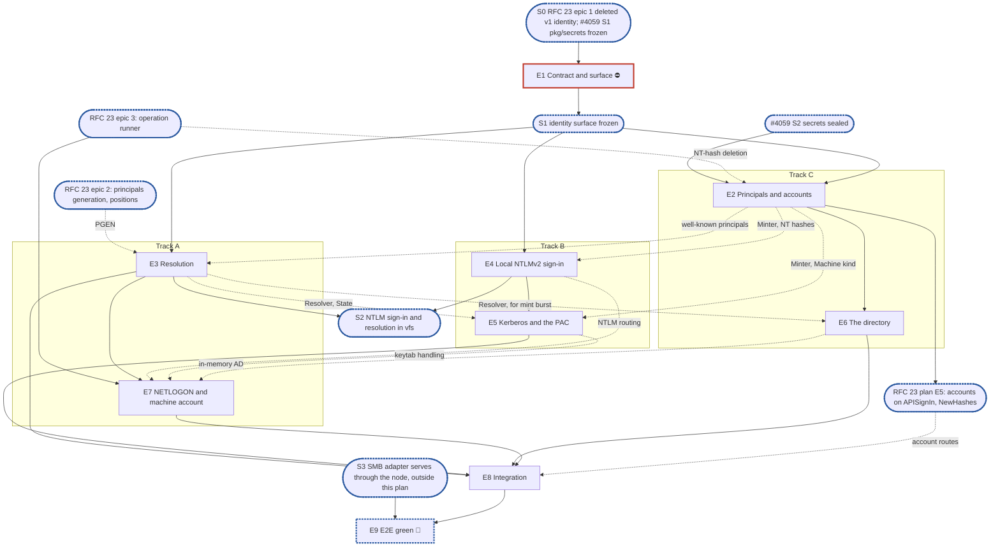

# RFC 18 — identity v2: implementation plan

**Scope.** [RFC 18, identity and authentication](../rfcs/rfc-18-identity.md), for SMB on one node:
- local NTLMv2;
- Kerberos with the PAC;
- an Active Directory directory, NETLOGON pass-through and the machine account;
- per-share resolution;
- the management API's sign-in interface (RFC 18 §8.1), which this plan builds and RFC 23's plan's
  accounts epic consumes.

Kerberos and Active Directory are required for v1 (#4053). Related RFCs, with how far each is in
scope:

- **Only the parts RFC 18 cannot work without:**
  - [RFC 16](../rfcs/rfc-16-metadata-store.md): the `Minter` with uid, gid and RID allocation, the
    well-known principals' fixed IDs (§2.2, §3), and a user's two secret references (A5);
  - [RFC 17](../rfcs/rfc-17-vfs.md) §4.9: admission's caller cache, keyed as RFC 18 §7.1 says, and
    `vfs.Deps`' `Identity`, `Auth` and `Names` (§2.3).
- **Constraints only:**
  - [RFC 13](../rfcs/rfc-13-configuration.md): secrets are sealed, versioned and rotated, and
    settings loaded and checked, by RFC 13's configuration-lifecycle plan (#4059, S0); the
    `identity.*` settings themselves, their struct, defaults and validators, are this plan's,
    each declared through #4059's `pkg/settings` by the first epic that reads it, and listed in
    the node's settings table in epic 8;
  - [RFC 23](../rfcs/rfc-23-control-plane.md): the node composes identity and hands it its `State`,
    the principals generation and positions come from its store epic, and the runner drives this
    plan's operations (RFC 23's plan, #4050);
  - [RFC 22](../rfcs/rfc-22-smb.md) and its plan (#3911): `gss` answers NEGOTIATE and CHALLENGE and
    hands RFC 18 an `NTLMAuthenticate` or an AP-REQ (RFC 18 §3.1);
  - [RFC 19](../rfcs/rfc-19-authorization.md): what a resolved caller may do to a file;
  - [RFC 25](../rfcs/rfc-25-observability.md): RFC 18 §9.2's series and conditions;
  - [RFC 29](../rfcs/rfc-29-test-harness.md): the rules every epic follows.
- **Out:** [RFC 21](../rfcs/rfc-21-nfs.md), NFS, is v1.1.

**Not built by this plan.** The user decided to defer the following, each in §6 O2:
- the NFS side of identity: `AUTH_SYS` and `AUTH_NONE` (RFC 18 §3.2), uid and gid mapping and the
  mints a claimed uid triggers (§4.3, §5.5), NFSv4 owner strings (§4.5), `ManageGIDs`;
- OpenID Connect's `TokenVerifier` (RFC 18 §8.2).

**Tracks.** A, B and C, with no owner.

**Programme.** #3119, route B, on `feat/storage-v2`, and the v1.0 MVP issue #4053. RFC 22's plan
(#3911, its §6.2 item 1) and RFC 20's plan (its risk 10) name the authenticator as having no owner;
this plan is that owner. Roadmap epic #4078.

**Divergence from the planning skill.** There is no test-foundations epic, by the user's standing
decision for these plans. The leak check (`pkg/block/journal/journaltest/prof`, `internal/prof` once
#4000 lands) and the KV fault wrapper (`pkg/metadata/kv/kvtest`) exist. The in-memory directory and
domain controller land in the epics that build their real counterparts, each held by its own
conformance suite. The §1.5 instruction, copied verbatim, says epic issues exist before "E2's pull
request": that is the skill's red-suite epic, which this plan does not have, so the clause binds no
epic here.

**Naming.** v1 is the identity code on `feat/storage-v2` today:
- `pkg/identity` and `pkg/identity/ldap`;
- `pkg/auth/sid`'s uid-to-SID mapper;
- `internal/auth/netlogon`;
- `internal/vfs/admit`'s minimal resolver.

v1's Kerberos and NTLM code is already gone from the branch; it remains on `develop`. v2 is RFC 18's
identity server. No user-visible name carries a version.

**Transition policy.** Fresh installs only (#3119, route B). Nothing migrates, so RFC 18 §11's
slices are superseded (A1). What v2 keeps of v1 is moved with `git mv` where it is still on the
branch, or lifted from `develop`'s history where it is not, and rewritten against RFC 18 in the epic
that needs it.

**Defaults used from the skill's inputs:**
- output path: `docs/internals/planning/rfc-18-identity-plan.md`;
- dashboards: none.

**RFC amendments in this pull request.** The user agreed to each:
- **A1. RFC 18 §11 is superseded by route B.** No shadow pass and no stored copy of uid-derived SIDs:
  an installation starts on v2. RFC 18 §11 gains a `decision:` note.
- **A2. RFC 13 Appendix B gains `identity.netbios_name`**, the installation's own NetBIOS name, which
  SMB's CHALLENGE advertises and NTLM's local-domain match reads (RFC 18 §3.5, §4.6). On a joined
  installation it is the computer account's name: a join writes it, and a change is refused while
  joined. The row also names where the CHALLENGE's DNS computer and domain names come from.
- **A3. The machine account** (RFC 18 §3.3, §3.5, §5.1, §9.2 and §10; RFC 13 §7 and Appendix B's
  `identity.directory`; RFC 16's `SEC‖id‖version` row; RFC 25 §3.9):
  - on a joined installation, the service names the computer account holds are keyed from the
    machine password, tagged with the account's key version number; every other name a node
    answers on keeps an imported keytab, and an imported key for a name the account holds is
    refused;
  - the machine password rotates in RFC 13 §7's order, sealed first and then set at the domain
    controller, resumably; a keytab's and a machine password's previous version is kept for
    RFC 18 §3.3's retention, a restart included, as RFC 13 §7 and RFC 16's row now say, and the
    management API's signing key's until the last access token it signed has expired (RFC 13 §7,
    RFC 16's `Secret.Version`, for RFC 23 §5.3);
  - an online join seals the password before it creates the account, and refuses an existing
    account unless the request takes it over;
  - an offline join takes a computer account an administrator created, with its password, refuses
    one that does not advertise AES, and reports which service names it holds; the handed-over
    password derives no Kerberos key, so its creator can forge no PAC the installation accepts;
  - the directory record may name a domain controller address and a DNS server, used instead of
    the domain's DNS service records;
  - the join's state, the secure channel's health and the last rotation are reported, with a
    `machine_account_unhealthy` condition whose two causes clear apart, registered in RFC 25 §3.9;
  - RFC 18 §10 gains the rows "AES only", "derived keytab", "online join", "offline join",
    "machine account health" and "NetBIOS name while joined".
- **A4. Kerberos is AES only** (RFC 18 §3.3): the keytab holds AES keys, an online join sets
  `msDS-SupportedEncryptionTypes` to `0x18`, an offline join refuses an account without both AES
  bits, and DES and RC4 tickets are refused.
- **A5. A user holds two secret references, one per wrapping key** (RFC 16 §2.3's `User`):
  `Password`, sealed under the `storage` key, and `NTHash`, sealed under the `protocol` key and zero
  while NTLM is off, as RFC 13 §7 seals each.

- **A6. Review fixes to RFC 18's Kerberos and PAC rules**: the PAC's server checksum is computed
  over the PAC's bytes as received, and only the first buffer of a type is used (§3.4); §10 gains
  the rows "clock skew" and "service name" for §3.3's two MUSTs that had none; NTLM routes a UPN
  sign-in and the directory's realm to pass-through, and counts an unknown domain apart (§3.5,
  §9.2).
- **A7. Second review's fixes** (RFC 18 §2.6, §3.4, §3.5, §4.6, §5.1 and §10; RFC 13 Appendix B;
  RFC 16 §2.3 and `SEC‖id‖version`; RFC 23 §3.3):
  - pass-through keys the MIC and the key exchange with the reply's `UserSessionKey`, refuses a
    missing or zero one, and checks the reply's `LogonDomainID`;
  - a join records one domain controller and resumes on it; the resume probe has three answers;
    the secure channel falls back to the previous password on any controller until the retention
    passes; the online join's administrator credential is never stored or logged;
  - identity's `State` carries the machine password's versions, with an `Apply` row;
  - a local user or group name never holds `@`; domain routing folds as §4.6 does, and an
    alternate UPN suffix is `unknown_domain` by a `decision:` note;
  - one resolution's directory queries stop at 20 seconds, below the request deadline;
  - `identity.netbios_name` is written upper-cased by a join and may not equal the directory's
    NetBIOS domain;
  - `Secret.Kind` gains a machine-password kind, and `Secret.Version`'s comment and RFC 23 §3.3's
    rotation bullet name the retention RFC 13 §7 keeps.
- **A8. Third review's fixes** (RFC 18 §2.6, §3.3, §3.4, §3.5, §4.4, §5.1 and §10; RFC 13
  Appendix B's `identity.directory`; RFC 16 §2.3's `Secret`; RFC 23 §3.3):
  - `Secret` gains `KeyVersion` and `HandedOver`; a version marked `HandedOver` derives no key, on
    any node and after a restart, and `State.Machine` holds the versions with both;
  - the offline join's closing rotation is the join's own last steps, so the join is done only once
    the rotation is confirmed; pass-through is refused until then, the previous-version fallback
    never uses the handed-over version, and §3.4's decision names the join's ceiling: the account's
    creator off the network path while the join runs;
  - a join, or a rotation's set or confirm, whose pinned domain controller goes unanswered for an
    hour fails, naming it; a join resumed without the administrator credential continues only if
    the account already accepts the sealed password;
  - the directory's domain SID is its domain object's `objectSid`, read by each new client;
  - the MIC is keyed by the exported session key, and the local session base key is
    `HMAC_MD5(NTOWFv2, NTProofStr)`; NTLM domains fold ASCII letters only;
  - `identity.netbios_name` and the directory record's NetBIOS domain are refused equal from either
    side, with a §10 row "NetBIOS name and domain";
  - a password set whose conditional write is refused deletes the NT hash it sealed;
  - RFC 23 §3.3's rotation bullet no longer says the old version is deleted before its retention.
- **A9. NTLM turned back on is refused while the NT-hash deletion runs** (RFC 18 §3.5 and §10's "NTLM
  off" row): the administrator retries once it has finished, so no hash the deletion has not reached
  becomes valid again. This is the user's decision.
- **A10. Fourth review's fixes** (RFC 18 §2.6, §3.1, §3.3, §3.4, §3.5, §4.6, §5.1, §7.3 and §10;
  RFC 13 Appendix B's `identity.netbios_name`; RFC 16 §2.3's `Secret`):
  - a key version number is written with its version and never changed: an unconfirmed one is
    reported, and the fallback to each held derived key verifies its tickets; `HandedOver` is bound
    into the sealed value's additional data;
  - "the previous version" is the newest confirmed one, and a rotation after a failed one sets the
    failed one's sealed version, so at most one unconfirmed version is in force;
  - a failed join leaves the installation not joined, `identity.netbios_name` written only at a
    join's last step and restricted to 15 bytes of `[A-Z0-9-]`;
  - the throttle keys on the name folded and qualified by its route; realms, NetBIOS names and
    service names compare with ASCII letters folded everywhere;
  - identity refuses a 24-byte `NtChallengeResponse`; the replay cache keeps an entry until its
    authenticator's time plus the skew;
  - §10 gains "ticket addresses", for §3.3's client-address MUST, and clauses in "logon throttle",
    "replay", "pass-through" and "machine account health";
  - `State` holds both secrets' versions in one shape, #4059's `secrets.Version`.
- **A11. One sign-in mints in one batch** (RFC 18 §2.6 and §4.1's mint, §10's new "mint burst" row;
  RFC 16 §3's `Minter`, whose `CreateUser` and `CreateGroup` become one batched `Create`): every
  principal a sign-in, lookup or resolution needs is minted in one transaction with one principals-
  generation raise, and `ErrExist` refuses the whole batch. This is the user's decision.

## 1. Introduction

### 1.1 What we are building

RFC 18's "Start here" and §2.6 describe the result: one identity server on every node, which signs
in, maps spellings, resolves a caller per share, and checks an API account; `*vfs.Filesystem` and
the management API call it, and the adapters reach it only through `vfs.Service`.

What replaces what:

| v1 | v2 | Fate |
| --- | --- | --- |
| `pkg/identity` (resolver, cache, link store) and `pkg/identity/ldap` | `pkg/identity`, RFC 18 §2.7's contract; `internal/identity/directory` | deleted by RFC 23's plan's epic 1 (§6 O4); the LDAP provider is lifted from history into `internal/identity/directory` in epic 6 |
| `pkg/auth/sid/mapper.go` (RID derived from a uid) | the RID counter (RFC 18 §2.3, §4.4) | deleted by RFC 23's plan's epic 1; `sid.go` and `wellknown.go` stay |
| `internal/auth/netlogon` | `internal/identity/netlogon` | left in place by RFC 23's plan's epic 1; moved with `git mv` in epic 7 |
| `internal/vfs/admit`'s minimal resolver | `identity.Resolver` (RFC 18 §6) | moved into identity and extended in epic 3 |
| `internal/vfs/shares.go`'s `SignIn`, `Spell` and `Find` stubs (`ErrAccess`) | calls into `vfs.Deps.Auth` and `Names` | replaced in epics 3 and 4 |
| config keys `kerberos.*`, `ldap.*`, `identity.machine_sid`; `DITTOFS_KERBEROS_*`, `DITTOFS_LDAP_*` | `identity.*` settings and `Secret` records (RFC 13 Appendix B, §7) | refused by the RFC 13 plan's bootstrap loader |
| `test/integration/ad-dc`'s tests importing `pkg/identity/ldap` and `internal/auth/netlogon` | the directory's and domain controller's suites against real AD | rewritten in epics 6 and 7 |
| `dfs netlogon test` | RFC 23's directory-test action and the secure channel's health in node status (§6 O5) | deleted with `cmd/dfs`'s v1 bodies by RFC 23's plan's epic 1 |
| `dfsctl idmap` and `dfsctl identity-provider` | `Spell`, `Find` and grants by principal (RFC 18 §4.1); the `identity.directory` record | deleted with `cmd/dfsctl`'s v1 bodies by RFC 23's plan's epic 1; not rebuilt |
| `feat/storage-v2`'s local user names holding `@` (`users.go` accepts `alice@corp`) | refused `ErrInvalid` (RFC 18 §4.6), so an NTLM name with `@` is never local | dropped in epic 2 |
| develop's join options `ou`, `spns`, `dns_host_name` | `ou` and `dns_host_name` as the online join's parameters (§6 O5); RFC 18 §3.3's fixed `cifs/` and `host/` names | `spns` dropped: another name keeps an imported keytab (RFC 18 §3.3) |
| squash modes `root_to_admin`, `all_to_admin` | `Squash` of `none`, `root` or `all` (RFC 18 §6.2), admin only from a share grant (ID6) | dropped |
| develop's `RootKeepsAdmin` bypass at the share gate (`CLAUDE.md` invariant 2) | admin only from a share grant (RFC 18 §6.5, ID6) | dropped |
| develop's SMB fallback to a guest session on a failed logon (`session_setup.go`) | `ErrLogonFailure` and no session (RFC 18 §3.6, "no map to guest") | dropped |
| develop's share `default_permission` | explicit grants, an everyone grant among them (RFC 18 §6.4) | dropped |
| develop's NTLM retry across five domain spellings | RFC 18 §3.5's domain table, one route per message | dropped |
| develop's resolver error TTL (10 s) | errors never cached (RFC 18 §5.4); O8 measures the cost | dropped |
| develop's foreign-SID→uid table (`handlers/sid_mappings.go`) | a directory SID minted as a principal (RFC 18 §4.4); another domain's SID is `ErrUnknownPrincipal` | dropped |
| develop's SID-keyed share grants with no local user (`models/sid_share_permission.go`) | a grant names a principal by ID; a directory SID resolves first through `resolve-principal` (RFC 23 §3.5) | dropped |
| develop's netgroups (`dfsctl netgroup`) | RFC 16's `Netgroup` records in a share's export policy (RFC 23 §3.2) | kept, by RFC 23's plan; NFS-side, so this plan builds nothing for them |
| `dfsctl netlogon status`, `dfsctl netlogon rotate` | the secure channel's health in node status; RFC 23's `rotate-machine-password` (§6 O5) | deleted with `cmd/dfsctl`'s v1 bodies by RFC 23's plan's epic 1 |
| develop's NFS RPCSEC_GSS Kerberos | RFC 18 §3.3 over RFC 21 §10 | deferred with the NFS side (§6 O2) |
| `docs/guide/identity.md` and `windows-ad-setup.md`: `msDS-SupportedEncryptionTypes` `0x1F`, an exported keytab with RC4 keys | `0x18` and AES keys only (A4); the join and the derived keytab (A3) | rewritten in epic 7 |

**Dependency limits.** Kerberos runs on `gokrb5`, NETLOGON on `go-msrpc`, LDAP on `go-ldap`, and
argon2id on `x/crypto`, all already in `go.mod`. On `feat/storage-v2` the only importer of
`jcmturner/gokrb5/v8` is the API's identity-provider handler, which RFC 23's plan's epic 1 deletes,
so epic 5 adds it back. The SMB wire side is RFC 22's (`gss`).

### 1.2 How the plan is organised

- Epic 1 declares the surface.
- Six middle epics on three tracks:
  - Track A: resolution, then NETLOGON and the machine account;
  - Track B: local NTLMv2 sign-in, then Kerberos and the PAC;
  - Track C: principals and accounts, then the directory.
- The integration epic composes identity into the node and runs the rows that need several middle
  epics together.
- The E2E green epic waits for an SMB adapter serving through the node.

RFC 18's suites paragraph puts Tier 1 and Tier 2 in `unit`, and the directory's and domain
controller's suites also against real AD in `integration/ad-dc`; the `e2e/cross-protocol` rows it
names are RFC 17's and RFC 19's. Epic 9 adds its Kerberos rows to the existing `e2e/kerberos` cell,
which the RFC does not name. None keeps a `known.yaml`, so each test lands green with the epic that
makes it pass.

### 1.3 What epic 1 must deliver

- **The contract, `pkg/identity`** (RFC 18 §2.7):
  - the value types `pkg/vfs` holds today, moved, with `pkg/vfs` aliasing them so adapters import
    `pkg/vfs` alone;
  - `Caller` (RFC 18 §6.1), which is new: the one there now, `internal/vfs/authz.Caller`, has
    another shape, and is rebuilt on the new one in epic 3;
  - the errors;
  - the interfaces of RFC 18 §3.1, §4.1, §6.1 and §8.1, without `TokenVerifier`;
  - `NewHashes`'s signature.
- **The server, `internal/identity`:** RFC 18 §2.6's `Deps`, `New`, `Apply`, `Start`, `Stop` and
  `State`, with stub bodies behind final signatures.
- **The seams it exposes:**
  - `vfs.Deps.Identity`, `Auth` and `Names`;
  - identity's `Deps`: the store views, the secret provider, the clock, the logger and the registry.

It declares no internal interface beyond RFC 18's own. It lands after RFC 23's plan's epic 1 has
deleted v1's `pkg/identity`, whose path it reuses.

### 1.4 The test catalogue and its components

There is no test-foundations epic (see the header).

**The catalogue.** RFC 18 §10's rows and invariants ID1 to ID14 (§9.1), each in exactly one epic's
**Done when:**, or split into halves each epic names ("NTLM MIC" and "NTLM domain" between epics 4
and 7, "NTLM off" between epics 8 and 9, "root" between epic 6 and the deferred NFS side). The Tier 2 rows run through the SMB adapter, so they land in the E2E green epic; Tier
1 rows that need several middle epics land in the integration epic. Two Tier 2 rows need no adapter,
and the integration epic runs them in-process against identity: "admin needs proof" (its Kerberos
and PAC halves) and "NTLM without a domain controller"; it also runs "NTLM off"'s password-set half
in-process, ahead of epic 9, and RFC 18 §3.8's expiry of a Kerberos identity at `Resolve`, whose
§10 row, "expiry", drives it over NFS and stays deferred.

Deferred with the NFS side or OpenID Connect (§6 O2): "one uid, two proofs", "client in the key",
"root" (its `AUTH_SYS` clauses; its directory clause is epic 6's), "error is not "unknown"",
"owner strings", "expiry", "`ManageGIDs`", "`AUTH_SYS` from the directory", "mint from a claim,
guarded", "lookup cap", "token checks", "key-set outage" and "unlinked subject"; the `AUTH_SYS` halves of "squash order follows the proof" and "admin needs
proof"; the NFS halves of "disable takes effect" and "no file spelling"; and `FuzzOwnerString`.
"roles grant nothing" is RFC 23 §12's row, run by RFC 23's plan.

**Scenarios from other sources:**
- a share with no grant admits no NTLM user (RFC 23 §3.2), in epic 3;
- an SMB sign-in by a user created through the API with `set-password` succeeds (#4053), in the
  integration epic;
- an AD user signs in over Kerberos and over NTLM pass-through on an installation joined offline
  and pointed at an explicit domain controller (develop's `windows-ad-setup.md`), in epic 7.

**The known-failure mechanism.** None. No suite RFC 18 names keeps a `known.yaml`.

**The test components:**
- the leak check, `pkg/block/journal/journaltest/prof` (`internal/prof` once #4000 lands);
- `pkg/metadata/kv/kvtest`'s fault wrapper, for the store errors §10's rows inject;
- `pkg/identity/identitytest`'s in-memory directory (epic 6) and domain controller (epic 7). Each
  lands with its real counterpart, held by the same conformance suite, which also runs against real
  AD in `integration/ad-dc`;
- NTLM messages built from MS-NLMP §4.2.4's published vectors (epic 4), and signed test PACs built
  with the test realm's keys (epic 5).

### 1.5 General rules for each epic

> **Instruction for whoever expands an epic into its detailed description and subtasks,
> human or AI:**
>
> - **Creating an epic from this plan: use the `epic-breakdown` skill.** Whenever the user
>   asks to create an epic from this plan, or to expand, detail or break one down, run the
>   `epic-breakdown` skill (`.claude/skills/epic-breakdown/SKILL.md`) on this plan and that
>   epic, rather than writing the epic document freehand. It extracts the RFC's MUST and
>   MUST NOT into numbered requirements, estimates each subtask in man-days and suggests
>   the pull requests. A human doing it by hand follows the same skill.
> - **Epic and subtask, nothing else.** The units of work are the epic and its subtasks,
>   with subtask ids `<e>.<n>` (`subtask 4.3`, or `T4.3` for short), assigned by the epic
>   document. No other word names
>   them: not task, ticket, story, step or phase, in headings, tables, ids or prose.
> - **The epic stands alone for what to build.** Its requirements, subtasks and decisions
>   are in the epic document itself, which never refers to this plan for them or says "see
>   the plan": the RFC sections it implements, the interfaces it builds on, the
>   subtasks, and a short legend of the names it borrows from this plan (E1, E2, S1, the
>   integration epic, …). It cites the numbered rules below, without copying them, in a
>   table of how each applies: each row names its rule by number and bold title, which
>   says what the rule requires, and the table links this §1.5 with a full link (the
>   plan's path and the section's anchor) and the `CLAUDE.md` sections that hold a rule,
>   so the epic reads alone and its reader can still open each rule's text in one click.
> - **The epic document records decisions, not progress, like this plan.** It has no
>   status fields, no checkboxes to tick and no sections to keep up to date as the work
>   goes on. It is revised through a pull request only when a decision changes.
> - **Subtasks are not pull requests.** A subtask is ideally up to 5 man-days. The owner
>   ships subtasks as they see fit, one pull request each or several together; the epic
>   document only suggests a grouping, each suggested pull request ideally up to 15
>   man-days. Cut and group by logic, readability, dependencies and a deliverable that can
>   be named, not to hit a number.
> - **Every subtask states how it meets each rule that applies to it.** A rule that does
>   not apply is named, with the reason.
> - **In the issue tracker, only when someone asks for issues,** following `epic-breakdown`
>   Step 6, their one description. Issues point at the documents and copy nothing. The
>   epic issues exist before E2's pull request lands, because each red test's
>   `known.yaml` entry names one; subtask issues come once their epic document has
>   merged. The release an epic ships in is set by the RFC's roadmap epic that its epic
>   issue sits under, never in a document and never on the epic issue on its own: the epic
>   issue and its subtask issues copy that roadmap epic's milestone, and an epic changes
>   release only by moving under the roadmap epic of the other release.

1. **Independent unit tests.** Each epic carries its own unit tests. They build on the test
   components (the leak check, `pkg/metadata/kv/kvtest`'s fault wrapper,
   `pkg/identity/identitytest`'s in-memory directory and domain controller once they land), on the
   implementation of an epic they depend on once it has landed, and only on the test doubles
   `CLAUDE.md`'s "Writing tests" allows: the in-memory KV that RFC 16's KV suite holds, the in-memory
   directory and domain controller held to their suites, and an injected clock. Tickets and PACs are
   made with the test realm's keys, as a KDC makes them, and NTLM messages from MS-NLMP's published
   vectors, never stubbed. Epic 1 declares no internal interface for a test to stand in for
   (rule 12).
2. **Fuzz every decoder of untrusted bytes** (`CLAUDE.md`, "Writing tests", the Fuzz paragraph,
   which states the property). For this RFC: `FuzzPAC`, `FuzzAPReq` and `FuzzSID`, as RFC 18 §10
   names them, and the NETLOGON reply decoder. The NTLM message decoder is RFC 20's and RFC 22's.
3. **Observability follows RFC 25.** Each epic owns the series of RFC 18 §9.2 for what it builds:
   - sign-in: `identity_authentications_total`, `identity_authentication_seconds`;
   - principals: `identity_mints_total`, `identity_unmapped_total`;
   - the PAC: `identity_pac_sids_dropped_total`;
   - resolution: `identity_resolution_refusals_total`;
   - the directory: `identity_directory_lookups_total`, `identity_directory_seconds` and the
     `directory_unreachable` condition;
   - the machine account: the `machine_account_unhealthy` condition.

   `config_generation_lag_seconds{kind="principals"}` is RFC 13's gauge, set by RFC 23's plan's
   epic 3, not here.

   Spans follow RFC 18 §9.2's "Spans". No label or attribute carries a name, a SID, an address or a
   credential (RFC 25 §5.4). No exception applies.
4. **Profiling.** Every test runs under the leak check, and fails on a goroutine, descriptor or heap
   growth left behind. RFC 18 names no allocation budget, so there is no allocations-per-operation
   assertion.
5. **Public interface and internals** (`CLAUDE.md`, "Verifying a change"). Tests cover the internal
   API and the behaviour it enables, under `-race`, at the layer that consumes a value. For example,
   a deny-only SID is proven by a refused file decision, not by `Caller.DenyOnly` being set; a
   disable is proven by the next call refused, not by the generation raised.
6. **Known failures shrink** (`CLAUDE.md`, "Writing tests", "By kind"). No suite RFC 18 names keeps
   a `known.yaml`, so no test lands red. Should a later epic register a cell with one, a red test
   that turns green leaves its suite's `known.yaml` in the same change, since RFC 29 §4.7 fails a run
   whose known failure passes.
7. **v2 ignores v1.** Nothing imports v1's identity code once RFC 23's control-plane epic 1 has deleted its
   importers. What v2 keeps is moved with `git mv` where it is still on the branch
   (`internal/auth/netlogon`, `internal/vfs/admit`'s resolver) or lifted from `develop`'s history
   (the NTLMv2 cryptography, the replay cache and AP-REQ handling, the LDAP provider), and rewritten
   against RFC 18 in the epic that needs it. Each fixes the fail-open paths RFC 18 Appendix B
   names. `pkg/auth/sid`'s codec and well-known SIDs stay where they are.
8. **Real dependencies for properties of those dependencies**, as `CLAUDE.md`'s "Writing tests"
   says. For this RFC:
   - LDAP filter escaping, ambiguous answers, paging, range retrieval, verified TLS and referrals are
     checked against real AD in `integration/ad-dc`, beside the in-memory directory;
   - pass-through, the secure channel, the join and the domain controller's bad-password count are
     checked against a real domain controller there too;
   - Kerberos uses real tickets from the test realm's keys.
9. **Code comment conventions** (`CLAUDE.md`, "Code comments"). RFC 18's notes go at the code site
   that implements them:
   - the `decision:` notes of §2.1, §2.3, §2.4, §2.5, §2.6, §3.3, §3.4, §3.5, §3.6, §4.4, §5.3, §6.2,
     §6.4 and §8;
   - the `ponytail:` notes of §2.2, §2.5, §3.1, §3.3, §3.5, §5.1, §5.2, §5.5, §6.4, §7.2 and §7.3.
10. **A test must be able to fail** (`CLAUDE.md`, "Writing tests"), and nothing else would catch the
    change it guards: not the compiler, not the diff, not a later epic's tests. "An adapter never
    imports identity" stays RFC 20's import test.
11. **A symbol is exported only if RFC 18's interfaces use it.** `pkg/identity` holds the contract;
    `internal/identity` exports only what `internal/node` and the management API call. All of it is
    frozen at S1.
12. **Each subtask creates only what it declares.** No empty package and no stub without a caller.
    A package, an option or a test helper lands with its first consumer.

## 2. Epics at a glance

| # | Epic | Content | Subtasks | Man-days | Track | Blocks |
| --- | --- | --- | --- | --- | --- | --- |
| E1 ⛔ | The contract and the server's surface | `pkg/identity` with the value types moved from `pkg/vfs`, the errors, the interfaces; `internal/identity`'s surface; `vfs.Deps`' three fields | 6 | 6 | team | every epic |
| E2 | Principals and accounts | the `Minter` on the store's ID counters, well-known principals with root's fixed ID, the `Machine` kind, the domain SID, names, `Spell` and `Find`, `NewHashes` with two secrets, `APISignIn`, NT-hash deletion | 7 | 11 | C | E6; partly E3, E4, E5; RFC 23's plan's E5 |
| E3 | Resolution | `admit`'s resolver moved into identity and completed: map, squash, groups, grant, flags; the `State`; the proof key and admission's caller cache | 7 | 11.5 | A | E7, E8; partly E5, E6 |
| E4 | Local NTLMv2 sign-in | `SignIn` for NTLMv2 against a local NT hash, the MIC, key exchange, the throttle, anonymous sessions, re-authentication | 6 | 9 | B | E5; partly E7 |
| E5 | Kerberos and the PAC | imported keytab through `Apply`, AES only, AP-REQ, the replay cache, PAC verification and binding, test PACs, machine principals | 8 | 16.5 | B | E8; partly E7 |
| E6 | The directory | the LDAP provider lifted, paging, `tokenGroups`, the directory cache with stale grace, directory mints, the domain SID, the in-memory directory and its suite | 7 | 18 | C | E8; partly E7 |
| E7 | NETLOGON and the machine account | the secure channel moved and hardened, pass-through, online and offline join, the derived keytab, rotation, identity's runner kinds, status, the in-memory domain controller | 11 | 25 | A | E8 |
| E8 | Integration | identity composed into the node, its `State` from reconcile, `identity.*` validators, the rows several epics meet in | 5 | 10 | team | E9 |
| E9 🔀 | E2E green | Tier 2 rows through SMB, `e2e/kerberos` | planned after S3 | planned after S3 | team | — |
| | **Total** | | **57** | **107** | | |

**Plan estimate: 57 subtasks, 107 man-days, not counting epic 9.**

The skill's estimate for RFC 18's 2,266 lines, with A1 to A11, is 6 middle epics (`round(2266 / 400)`),
as this plan has. Active Directory's two halves, the directory and NETLOGON, share no state beyond
the in-memory AD they are tested against, and splitting them keeps Track A busy after resolution.

**Legend.** ⛔ is a blocker; 🔀 waits on a synchronisation point. "team" is an epic that belongs to
no track. "Partly" means the dependent epic starts before the blocker lands (§3.3).

## 3. Synchronisation points, blockers and the split

### 3.1 Dependency graph



### 3.2 Synchronisation points

- **S0, before this plan.** Two things outside it must be true:
  - RFC 23's plan's epic 1 has deleted v1's `pkg/identity` and `pkg/auth/sid/mapper.go` with their
    importers, and left `internal/auth/netlogon` in place (§6 O4);
  - the secret provider's surface is frozen (RFC 13 §7): #4059's S1, its `pkg/secrets` surface,
    which epic 1's `Deps` names.

  Unblocks epic 1. Separately, #4059's S2, secrets sealed and versioned, unblocks epic 2, the first
  epic that seals; RFC 23's plan's epic 2 lands the principals generation and positions, which
  epic 3's `State` reads; and RFC 23's plan's epic 3 lands the operation runner (RFC 23 §4.6), which
  epic 7's kinds and epic 2's NT-hash deletion run on.
- **Merge order of the plans.** This plan merges after #4059, which provides `pkg/settings`,
  `pkg/secrets` and `Prune`, and after #4050, whose A5 adds the actions and `OpKind`s this plan's
  operations run as; merged first, RFC 18 would name operations RFC 23 does not have.
- **S1, the identity surface frozen.** `pkg/identity` holds the contract, `pkg/vfs` aliases it,
  `internal/identity` builds, and `vfs.Deps` has its three fields. Unblocks epics 2, 3 and 4.
- **S2, NTLM sign-in and resolution in `vfs`.** `*vfs.Filesystem`'s `SignIn`, `Spell` and `Find`
  call identity, and admission resolves through it. RFC 22's plan's session epic can then sign in
  for real, and the #4053 MVP's NTLM half is unblocked.
- **🔀 S3, an SMB adapter serving through the node.** This is outside this plan: RFC 20's plan's
  epic 7 and RFC 22's sessions and data path. Unblocks epic 9.

### 3.3 Blockers

| Epic | Blocks | Why |
| --- | --- | --- |
| E1 ⛔ | every epic | Every epic builds on the contract and the server's surface. |
| RFC 23's plan's epic 2 | partly E3 | The `State`'s generation is the principals generation that epic writes. E3 starts on squash, groups and grants before it lands. |
| RFC 23's plan's epic 3 | E7; partly E2 | The joins and the rotation are runner kinds (D8). E2's NT-hash deletion is one too; the rest of E2 does not wait. |
| #4059's S2 | E2 | E2 is the first epic that seals a `Secret`. |
| E2 | E6; partly E3, E4, E5; RFC 23's plan's E5 | The directory mints through E2's `Minter`. E5 mints machine principals through E2's `Minter` and `Machine` kind, and starts on the keytab and AP-REQ before they land. E4 verifies against E2's NT hashes, and starts on its throttle and MIC before they land. E3 starts on squash, groups and grants before the well-known principals land. RFC 23's plan's epic 5 builds its accounts directly on `APISignIn` and `NewHashes`, after this external synchronisation point. |
| E3 | E7, E8; partly E5, E6 | Pass-through maps by its verified user SID into a resolved caller. E5 binds a PAC to a record, and its deny-only SIDs reach E3's groups. E6's "mint burst" row resolves through E3's `Resolver`; the rest of E6 does not wait. |
| E4 | E5; partly E7 | Kerberos joins the `SignIn` E4 builds. Pass-through is a route of E4's NTLM domain table. |
| E5 | E8; partly E7 | The derived keytab is loaded through E5's keytab handling. |
| E6 | E8; partly E7 | NETLOGON's domain controller and the directory are one AD in the test fixture. |
| E7 | E8 | Integration's cross-epic rows sign in through pass-through. |
| RFC 23's plan's E5 | partly E8 | E8's scenario signs in a user created through RFC 23's account routes; its other rows do not wait. |
| E8 | E9 | E2E green runs the composed server. |

### 3.4 Splitting the work

- **Track A** takes epic 3 at S1, and is the plan's long pole: 36.5 man-days across epics 3 and 7. Squash, groups, grants and flags need only E1's types and the
  resolver it moves; the map step joins once epic 2's well-known principals land, and the `State`
  once RFC 23's plan's epic 2 lands the principals generation. Then it takes epic 7, which needs
  real AD in `integration/ad-dc` and the in-memory domain controller.
- **Track B** takes epic 4 at S1: the throttle, the MIC and key exchange first, and the NT-hash check
  once epic 2's hashes land. Then epic 5.
- **Track C** takes epic 2 at S1, then epic 6.
- **The team converges** at epic 1 and at epic 8. S2 is the point where RFC 22's plan and the #4053
  MVP pick up a real `SignIn`.

## 4. Implementation decisions

### 4.1 Directory layout

```text
pkg/identity/                   contract: value types, errors, interfaces, NewHashes (RFC 18 §2.7)    E1, E2
pkg/identity/identitytest/      in-memory directory and domain controller, with their suites          E6, E7
pkg/vfs/                        aliases pkg/identity's value types                                     E1
pkg/vfs/vfserr/                 + ErrLogonFailure, ErrUnknownPrincipal                                 E1
pkg/auth/sid/                   SID codec and well-known SIDs                                          —
internal/identity/              Server: SignIn, Spell, Find, Resolve, VerifyPassword, Account,         E1, E2–E5
                                Apply; ntlm, kerberos, pac, replay, throttle
internal/identity/directory/    the LDAP provider (only it imports go-ldap)                            E6
internal/identity/netlogon/     secure channel, pass-through, join, rotation (git mv)                  E7
internal/vfs/                   SignIn, Spell, Find through Deps; admission's caller cache            E3, E4
pkg/metadata/entity/            User.Secret renamed User.Password, + User.NTHash (A5), with the codec; User.Email; root's 0x0D; Machine     E2
pkg/metadata/kvstore/           + Minter on the IDS‖uid, gid and RID counters (RFC 16)                 E2
```

### 4.2 Decisions

**D1. The contract is `pkg/identity`, as RFC 18 §2.7 says.** This is the user's decision. The value
types move from `pkg/vfs` into it, and `pkg/vfs` aliases them, so adapters keep importing `pkg/vfs`
alone. Moving them creates no import cycle: they depend only on `entity`, `sid` and `netip`.
- **Prior art (from memory).** Samba keeps authentication in its own subsystem beside `smbd`.
- **Applied by** epic 1.

**D2. Resolution moves into identity, as RFC 18 §6.1 says.** This is the user's decision.
`internal/vfs/admit/resolve.go`, which already maps, squashes, grants and refuses a disabled
principal over the store's `Principals` view, is moved into `identity.Resolver` and completed rather
than rewritten. The caller cache is admission's (RFC 18 §7.1), keyed by `Identity.Key()`; admission
is uncached today (`internal/vfs/admission.go`'s `ponytail:`), and epic 3 builds it.
- **Prior art (from memory).** Windows builds an access token in LSA at sign-in, and the file server
  only checks it.
- **Applied by** epic 3.

**D3. A user's credentials are two sealed `Secret`s, one per wrapping key** (A5): the password's
argon2id hash under `storage`, and the NT hash under `protocol`, present only while NTLM is on. A
password set writes a new version of the password hash, and of the NT hash for a user that
holds file spellings and is not a directory principal (RFC 18 §3.5); turning NTLM off deletes every `NTHash`; deleting a user
deletes both (RFC 13 §7). This is the user's decision.
- **Prior art (from memory).** OWASP ranks argon2id first; RFC 13 §7's role split is Active
  Directory's separation of `unicodePwd` from the Kerberos keys.
- **Cost, as a `decision:` note at `NewHashes`.** The NT hash undoes argon2id for every user that
  holds one: it signs in over NTLM directly, so a copy of it with the `protocol` key, which every
  node holds, is the password. Overturned by turning NTLM off, which deletes it.
- **Applied by** epic 2.

**D4. Kerberos runs on `gokrb5`**, already a dependency: keytab parsing with several key versions,
matched by key version number, and AP-REQ decryption. Its PAC check is turned off
(`service.DecodePAC(false)`): v8.4.4's `ProcessPACInfoBuffers` always ends in a check that fails a
PAC with no logon-information buffer, which RFC 18 §3.4 accepts. So this plan decodes the PAC with
`gokrb5`'s types and verifies the server checksum itself over the raw PAC bytes with both
signature fields zeroed (MS-PAC 2.8.4), never over a re-encoding, uses the first buffer of each
type and ignores later ones (MS-PAC 2.4), compares
`PAC_CLIENT_INFO` with the ticket, and builds test PACs; the ticket and full-PAC checksums need the
KDC's key and stay unchecked, as RFC 18 §3.4's decision says.
- **Prior art (from memory).** Samba and sssd run on MIT or Heimdal; `gokrb5` is the Go equivalent.
- **Applied by** epic 5.

**D5. NETLOGON runs on `go-msrpc`**, already a dependency, as v1's secure channel did; the package
moves with `git mv`. It is hardened as MS-NRPC and its 2020 and 2022 fixes require:
`NetrServerAuthenticate3` with AES and Secure RPC only (`go-msrpc`'s default capabilities include
RC4, which is refused), and `NetrLogonSamLogonEx` at validation level SamInfo4 with its extra SIDs,
over an RPC binding sealed with the Netlogon secure channel (schannel), carried on a named pipe whose
SMB session authenticates with Kerberos as the machine account. That SMB session runs on
`go-msrpc`'s own Kerberos stack (`oiweiwei/gokrb5.fork`), which is held to AES only as `gokrb5` is
(A4). `NetrLogonSamLogonEx` carries no Netlogon authenticator, so pass-through calls on one channel
run concurrently; only setting the channel up is serialised, where v1 held its lock across the call.
A semaphore of 10 per node bounds them: a node holds one secure channel, `MaxConcurrentApi` cannot
be read from the controller, and 10 is Windows' default for it. A call waits at most 5 s for the
semaphore, and one that cannot take it by then answers `ErrUnavailable` rather than queueing at the
controller; the NETLOGON call itself is bounded at 5 s too. Both bounds sit well inside the 30 s
handshake timeout (RFC 20 §6.4), which closes the connection before any request deadline would
answer, so a pass-through sign-in that waits answers `ErrUnavailable` rather than being cut off. Three v1 behaviours change:
- v1 re-sends a logon after a transport error mid-call (`authenticator.go`), which counts a bad
  password twice toward lockout; v2 retries only a failure from before the request was sent;
- v1 accepts a reply with no `LogonDomainID` (`securechannel.go`); v2 refuses one that is not the
  directory's domain SID (RFC 18 §3.5), and its `UserSessionKey` keys the MIC (A7), where v1 left a
  zero key;
- v1 sets `MSV1_0_ALLOW_WORKSTATION_TRUST_ACCOUNT`, as Samba's `winbindd` does; v2 drops it, so a
  computer account such as `BUILD01$` cannot sign in to files by pass-through, as RFC 18 §2.4 keeps
  a machine off files for Kerberos. The logon level `NetlogonNetworkTransitiveInformation` is
  kept.

Its secret store is replaced by `Secret` records, and its join and rotation become RFC 23
operations.
- **Prior art (from memory).** Samba's `winbindd` holds the secure channel the same way.
- **Applied by** epic 7.

**D6. LDAP is v1's provider, lifted into `internal/identity/directory`,** the only package importing
`go-ldap`. It keeps v1's filter escaping, `LDAP_MATCHING_RULE_IN_CHAIN`, and LDAPS and StartTLS, and
drops v1's `InsecureSkipVerify` and `AllowPlaintext`, so both are verified; adds RFC 2696 paging, `tokenGroups` for a user's closure (which includes the primary group
`memberOf` omits), range retrieval for large `member` values, `objectGUID` as the entry ID, a
disabled account read from `userAccountControl` or `accountExpires`, and `mail` into `User.Email`
(RFC 18 §5.1); and refuses an ambiguous answer
where v1 took the first. The cache's single flight is `x/sync/singleflight`, as v1's.
- **Prior art (from memory).** sssd's AD provider reads `tokenGroups` and pages the same way.
- **Applied by** epic 6.

**D7. The first SMB user is created through the API.** There is no offline seeding command. Tests
seed users through the store and `NewHashes`, which is the code the API calls. This is the user's
decision.
- **Prior art.** None found.
- **Applied by** epics 2 and 8.

**D8. Identity's operations run on RFC 23's runner** (RFC 23 §4.6), which RFC 23's plan's epic 3
builds (its D8): a kind is one step function the runner calls with the operation, its parameters
and last recorded step included, returning the next. The kinds are #4050's A5 names:
`resolve-principal`, a wrapper of epic 6's `Find` with `FindOpts.Mint`; `test-directory`, a
wrapper of epic 6's test call; `join-domain`, online and offline; and `rotate-machine-password`,
all in epic 7; and `identity.nt-hash-delete`, NTLM-off's deletion of every NT hash, in epic 2. Their
routes are RFC 23's.
- **Prior art (from memory).** TrueNAS runs its AD join as a job.
- **Applied by** epics 2 and 7.

**D9. The store's ID counters are three `IDS‖kind` counters of their own,** uid, gid and RID, as
RFC 16's `IDS‖kind` row says: read and raised inside the `Minter` write's transaction, a uid or gid
drawn from `identity.id_range` and one a principal holds skipped. They are not `kvstore.NextID`'s,
which reserves ranges in a transaction of its own and refuses an in-transaction kind as it refuses
the shard counter. Unique protocol IDs stay `PutUser`'s existing claim and re-index; root's fixed ID
`0x0D` (RFC 16) joins `entity`'s well-known IDs, which stop at `0x0C` today; and user and group
names fold under simple Unicode case folding (RFC 18 §4.6, RFC 16's `NX‖kind‖name` row), a fold of
their own: the share-name fold, `entity.FoldUpcase`, is not Unicode case folding.
- **Prior art.** None found.
- **Applied by** epic 2.

### 4.3 Knowingly simple implementations

Each carries a `ponytail:` marker at the code site, beside RFC 18's own:

- **A claimed identity is refused** until the NFS side lands. With no `AUTH_SYS` consumer, the
  `Resolver` answers `ErrAccess` for proof kind `Claimed`, never anonymous; a forwarded identity that
  is inconsistent with itself is still `ErrInvalid`, as RFC 18 §2.6 says.
  - *Ceiling:* NFS.
  - *Upgrade path:* RFC 18 §4.3's mapping, with the NFS side (§6 O2).
  - *Epic:* 3.
- **Logon events are log lines.** RFC 25's `logon` stream is deferred with the event streams, so
  each attempt is one structured log line carrying RFC 18 §3.1's fields, and never a credential.
  - *Ceiling:* no export to a collector.
  - *Upgrade path:* RFC 25 §4's sink, with the same fields.
  - *Epic:* 4.
- **The caches are bounded by fixed counts**, not yet by RFC 24's connection-state pool: the caller
  cache 262 144 entries (10⁴ users on 25 shares), the directory cache 65 536, the logon throttle
  65 536 pairs, and the replay cache 1 048 576, sized as at least the peak AP-REQ rate times the
  skew window (1 000 a second over 10 minutes is 600 000). Each eviction or refusal is counted per
  table, as RFC 18 §7.3 says. In-flight directory queries are capped at 64 per node, the rest
  waiting under the 20 s bound.
  - *Ceiling:* memory under a hostile client is bounded by the count, not the pool; a peak above
    the replay cache's sizing refuses sign-ins `ErrUnavailable`, visible in its refusal counter.
  - *Upgrade path:* charging RFC 24's pool, once its plan lands.
  - *Epics:* 3, 4, 5, 6.
- **A machine password's rotation completes on this node.** "Every node reports the previous one"
  is this node.
  - *Ceiling:* a second node.
  - *Upgrade path:* the wait on node status, with the cluster rows; RFC 18 §12 item 2 measured then.
  - *Epic:* 7.
- **Pass-through's semaphore is a constant 10 per node** (D5).
  - *Ceiling:* a domain whose controllers raise `MaxConcurrentApi` gets no more than 10 calls at once
    from a node.
  - *Upgrade path:* a setting, when a deployment shows sign-ins answered `ErrUnavailable` with the
    controller below its own limit; the 5 s waits likewise.
  - *Epic:* 7.

### 4.4 Code sketch

The sketch is illustrative: its signatures come from the cited RFC 18 sections or from `pkg/vfs` on
`feat/storage-v2`, and the epic documents decide the final names.

**Composition.** The node builds one server and hands each consumer its interface (RFC 18 §2.6);
the adapters see none of them.

```go
// internal/node: RFC 23 §2.1 builds, §2.2 starts and stops.
ids, err := identity.New(identity.Deps{Principals: st, Records: st, Mint: st, Secrets: secrets,
	Logons: logLines, Clock: clk, Metrics: reg, Logger: log}) // Logons: §4.3's log-line sink
fs := vfs.New(vfs.Deps{ /* existing fields */
	Identity: ids, // Resolver, admission's step 4 (E3)
	Auth:     ids, // Authenticator behind vfs.Service.SignIn (E4, E5)
	Names:    ids, // Identities behind vfs.Service.Spell and Find (E6)
})
api := api.New(api.Deps{SignIn: ids /* APISignIn, §8.1 */})
ids.Apply(stateFromRecords(ctx, st)) // first State before Start (§2.6)
ids.Start(ctx)                       // dials no directory yet
// reconcile, once a second: ids.Apply(State{Generation: pgen, ...}) (§7.2)
// stop: fs and api first, then ids.Stop(ctx) (§2.6)
smb := smbadapter.New(fs) // reaches identity only through vfs.Service (RFC 20 §4.4)
```

**`SignIn` dispatch** (RFC 18 §3.1). The throttle runs before any credential check, and binding to a
principal before the result leaves.

```go
func (s *Server) SignIn(ctx context.Context, step SignInStep) (SignInResult, error) {
	st := s.state.Load() // one State for the whole call (§2.6)
	if s.throttle.Blocked(step.foldedName(), step.route(st), step.Client) { // §3.1: folded name and route, before the credential (E4)
		return s.logon(step, SignInResult{}, ErrLogonFailure)
	}
	var r SignInResult
	var err error
	switch {
	case step.NTLM != nil && !st.ntlmOn():
		err = ErrLogonFailure // §3.5
	case step.NTLM != nil:
		switch st.route(step.NTLM.Domain) { // §3.5's table, against identity.netbios_name (A2)
		case local:
			r, err = s.ntlmLocal(ctx, st, step) // NT hash Secret, MIC, constant time (E4)
		case passThrough:
			r, err = s.netlogon.SamLogonEx(ctx, step) // secure channel, maps by user SID (E7)
		default:
			err = ErrLogonFailure
		}
	case step.Kerberos != nil:
		r, err = s.kerberos(ctx, st, step)
	default:
		err = ErrInvalid
	}
	// r.Identity.Evidence.Principal is bound here or err is set (§3.1); a
	// re-authentication with step.Context set replaces the context's evidence (§3.8).
	return s.logon(step, r, err) // one log line per attempt, no credential (§4.3)
}

func (s *Server) kerberos(ctx context.Context, st *State, step SignInStep) (SignInResult, error) {
	// st.keys: imported keytab versions plus keys derived from the machine
	// password for the computer account's names, by kvno (A3, E7); AES only (A4).
	t, auth, err := s.krb.Verify(step.Kerberos, st.keys, step.Service) // gokrb5, PAC check off (D4)
	if err != nil {
		return SignInResult{}, err // skew, replay cache, DES or RC4: ErrLogonFailure
	}
	pac, err := pac.Verify(t, t.Key) // server checksum under the key that decrypted the ticket, never any held key; PAC_CLIENT_INFO (D4, E5)
	if err != nil {
		return SignInResult{}, ErrLogonFailure
	}
	p, err := s.mapKrb(ctx, st, t.CName, pac) // §4.2 steps 1, 2, 4 (E5); step 3 the directory's (E6)
	if err != nil {
		return SignInResult{}, err
	}
	return SignInResult{
		Identity: proved(ProofTicket, t.CName, p, pac.SIDs, pac.DenyOnly, t.EndTime),
		// Session is the authenticator's subkey, else the ticket's session key
		// (RFC 4121 §2), kept whole: SMB takes 16 or 32 bytes of it. The AP-REP
		// carries no subkey (O3).
		Keys: Keys{Session: subkeyOr(auth.Subkey, t.DecryptedEncPart.Key), APRep: s.krb.APRep(t, auth /* no subkey */)},
	}, nil
}
```

**Resolution per share** (RFC 18 §6.1, D2). Admission owns the one caller cache (§7.1); identity
keeps none.

```go
// internal/vfs admission, step 4 (RFC 17 §4.9).
key := callerKey{id.Key(), share, pol.Version, pol.GrantsVersion, s.identityGen(), clientIfRuled}
ch := s.callers.DoChan(key, func() (any, error) { // single flight per key (§7.1)
	ctx, cancel := context.WithTimeout(context.WithoutCancel(ctx), resolveBound) // not the first caller's ctx
	defer cancel()
	return s.deps.Identity.Resolve(ctx, id, pol, readOnly)
})
select { // each waiter keeps its own deadline
case r := <-ch:
	c, err = r.Val.(*Caller), r.Err
case <-ctx.Done():
	return nil, ctx.Err()
}

func (s *Server) Resolve(ctx context.Context, id Identity, p metadata.SharePolicy, ro bool) (*Caller, error) {
	st := s.state.Load() // read before any store read; stamps Built (§7.2)
	c := &Caller{Built: st.Generation}
	if err := id.consistent(); err != nil { // a forwarded identity inconsistent with itself: ErrInvalid (§2.6), first
		return nil, err
	}
	m, err := s.mapProof(ctx, st, id) // 1. map: evidence's bound principal; Claimed is
	if err != nil {                   //    ErrAccess (§4.3); Secret with NTLM off refused (§3.5)
		return nil, err
	}
	c.Mapped, c.Principal = m, squash(p, m, id.Proof) // 2. squash (§6.2)
	c.Groups, c.DenyOnly, c.Fresh, err = s.groups(ctx, st, c.Principal, id.Evidence) // 3. (§6.3)
	if err != nil {
		return nil, err // incomplete closure: ErrUnavailable
	}
	c.Access, c.ReadOnly = grant(p, c, ro) // 4. (§6.4)
	c.Authenticated, c.Admin, c.Privileged = flags(id, c, p) // 5. (§6.5)
	return c, nil
}
// A cached Caller whose Built is below the current Generation is neither stored
// nor served, so a PGEN raise reaches every node within a second (§7.2).
```

**Directory and machine account** (RFC 18 §3.5, §5; A3, D8). `Find` reads the directory through its
cache; join and rotation are kinds of RFC 23's runner, whose routes A5 in #4050 adds (§6 O5).

```go
func (s *Server) Find(ctx context.Context, sp Spelling, o FindOpts) (metadata.Principal, error) {
	if !s.directoryOwns(sp) { // a SID of the directory's domain asks the directory first (§4.4)
		return s.principals.BySpelling(ctx, sp)
	}
	e, err := s.dircache.Get(ctx, sp) // TTL, single flight, stale grace; errors never "not found" (§5.2–§5.4)
	if err != nil || !o.Mint {
		return metadata.Principal{}, orUnknown(err)
	}
	return s.mint.Directory(ctx, e) // minted once, in this call's one batch with one raise (§4.1, A11, E6)
}

// Runner kinds (D8, E7): one step function each, called by RFC 23's runner
// with the operation, its parameters and last recorded step, and returning
// the next (RFC 23's plan, D8). The parameters (online or offline, takeover,
// ou, dns_host_name, the handed-over password's Secret reference) are the
// operation's; the administrator credential is not, and lives only in this
// node's memory for the join (RFC 18 §3.5).
func (s *Server) joinDomain(ctx context.Context, op metadata.Operation) (next []byte, done bool, err error) {
	switch step := stepOf(op.Step); step {
	case 0: // pin one DC for every later step and a resume (RFC 18 §3.5); unanswered for an hour: fail, naming it
	case 1: // online: seal the password, a Secret version (RFC 13 §7), before the DC sees it
		// offline: verify the handed-over password, AES bits, report the names; stored marked HandedOver
	case 2: // online: create the account, cifs/ and host/ names, 0x18 (A4); skipped if the pinned DC
		// already accepts the sealed version; "could not ask" retries, never reads as "no";
		// no credential in memory (a restart, another node) and none accepted: fail, naming it
	case 3: // online: identity.netbios_name, upper-cased, [A-Z0-9-], at most 15 bytes (A2, A10); done
		// offline writes it after its rotation is confirmed, at the end of the default branch
		done = !offline(op)
	default: // offline only: rotateMachinePassword's steps, so the join is done once the rotation is confirmed
		var rotated bool
		if rotated, err = s.rotateStep(ctx, op, step); err != nil {
			return op.Step, false, err
		}
		done = rotated // the last rotation step confirmed the new password
	}
	return stepBytes(step + 1), done, nil
}

// rotateMachinePassword's steps, in RFC 18 §3.5's order:
//   wait until every node reports the previous version (§4.3: this node);
//   seal, tagged with one DC's kvno plus one; wait applied;
//   set at that DC, skipped if it already accepts the sealed version;
//   read that DC's kvno again to confirm the tag, never changed: a mismatch is reported (A10);
//   set or confirm unanswered for an hour: failed, naming the DC, its sealed version kept;
//   prune the previous version once the retention passes (A3).
// Node status: machine_account_unhealthy while the channel fails to every DC
// (cleared by a channel set up) or the last rotation failed (cleared only by a
// rotation completed) (RFC 18 §9.2, A3).
```

**The API sign-in interface** (RFC 18 §8.1). The API calls identity directly; a password set
writes both references in one record write (A5, D3).

```go
p, err := ids.VerifyPassword(ctx, name, password) // ErrLogonFailure alike for every refusal
u, err := ids.Account(ctx, p)                     // per call, under the generation (§7.2)

// A password set (RFC 23 §3.5).
h, err := identity.NewHashes(u, password, st.NTLM) // pure: argon2id hash, NT hash only while NTLM is on
if u.Password, err = secrets.Seal(ctx, storage, entity.SecretPassword, owner(u, "Password"), u.Password, h.Password, secrets.Meta{}); err != nil { // under storage (A5)
	return err
}
if h.NTHash != nil {
	if u.NTHash, err = secrets.Seal(ctx, protocol, entity.SecretNTHash, owner(u, "NTHash"), u.NTHash, h.NTHash, secrets.Meta{}); err != nil { // under protocol (A5)
		return err
	}
}
// A refused put deletes the NT hash version it sealed: NTLM-off's deletion
// may already have scanned past it (RFC 18 §3.5, E2).
err = store.PutUserIf(ctx, u, st.NTLM) // conditional on the ntlm revision still current (§3.5)
```

## 5. The epics in detail

### Epic 1 — The contract and the server's surface ⛔

**Epic 1 estimate: 6 subtasks, 6 man-days.**

This epic freezes the identity contract and the server every later epic fills in.

**Owns:** RFC 18 §2.6 and §2.7, as declarations; RFC 18 §3.1, §4.1, §6.1 and §8.1's interfaces.

**Done when:**
- `pkg/identity` and `internal/identity` compile, the server's bodies stubbed behind final
  signatures;
- `pkg/vfs` aliases the moved types, and every importer builds;
- RFC 18 ID11 holds by RFC 20's import test, with no adapter importing either identity package.

**Expected content:**
- Move the value types into `pkg/identity` (RFC 18 §2.7), and alias them in `pkg/vfs`.
- `ErrLogonFailure` and `ErrUnknownPrincipal` in `vfserr`, with their RFC 17 §4.3 mapping.
- The interfaces of RFC 18 §3.1, §4.1, §6.1 and §8.1 (without `TokenVerifier`), and `NewHashes`'s
  signature.
- `internal/identity`'s `Deps`, `New`, `Apply`, `Start`, `Stop` and `State`.
- `vfs.Deps.Identity`, `Auth` and `Names`.
- The import test's rows for the two identity packages.
- `internal/identity/**` added to the `e2e/kerberos` cell's `paths:` in `test/suites.yaml`, whose
  globs do not cover it.

### Epic 2 — Principals and accounts

**Epic 2 estimate: 7 subtasks, 11 man-days.**

The store mints principals and allocates their IDs once. Spellings map both ways. An account's
password and NT hash are derived, sealed and checked.

**Owns:**
- RFC 18 §2.1 to §2.3; §2.4's API-only accounts; §2.5's group records;
- RFC 18 §4.1, §4.4 and §4.6;
- RFC 18 §3.5's NT-hash rules and NTLM-off deletion;
- RFC 18 §8 and §8.1;
- RFC 16 §3's `Minter`; RFC 16 §2.3's `User` fields (A5's two references, `Email`), root's fixed ID
  and the `Machine` kind.

**Done when:**
- RFC 18 ID2 and ID3 hold;
- RFC 18 §10's row "name case" passes, with names that differ only under Unicode case folding;
- `NewHashes`'s table test, from RFC 18 §10's **Unit** paragraph, passes;
- `FuzzSID` runs in `unit`;
- RFC 16's suite covers the `Minter`'s allocation.

**Expected content:**
- The `Minter`'s batched `Create` (RFC 16 §3, A11): every record of one batch in one transaction, on
  the `IDS‖` uid, gid and RID counters, drawn from `identity.id_range` inside it (D9, RFC 18 §2.3),
  with one `PGEN` raise per batch and the whole batch refused on `ErrExist`.
- Root and anonymous among the well-known principals (RFC 18 §2.1): root's fixed ID added to
  `entity`'s, whose `WellKnown()` accepts only `0x01` to `0x0C` today.
- The `Machine` principal kind, which `entity.PrincipalKind` lacks today, and its record, for epic
  5's mints (RFC 16 §2.3); `User.Email`.
- The installation's domain SID (RFC 18 §4.4) and name uniqueness under simple Unicode case folding
  (RFC 18 §4.6, D9).
- `Spell` and `Find` over the stored schemes and the qualified name, with `FindOpts.Mint` set only
  for a proof of `Secret` or above (RFC 18 §4.1, §4.6).
- `NewHashes` and the two sealed secrets (D3, A5).
- `VerifyPassword` and `Account` (RFC 18 §8.1).
- NTLM-off's deletion of every NT hash, as the `identity.nt-hash-delete` runner kind (D8), scanning
  `Secret`s of kind nt-hash rather than users' references; a password set whose conditional write is
  refused deleting the NT hash version it sealed, which the scan may have passed (RFC 18 §3.5); and
  a password set's pruning of the previous NT hash version through #4059's `Prune`; and
  `identity.ntlm`'s validator refusing it turned on while the deletion runs, naming the operation,
  as RFC 23's `409` `operation_running` (RFC 18 §3.5, A9).
- `identity.ntlm` and `identity.netbios_name` declared, the first epic that reads them: the deletion
  reads the one, the `qualified` spelling (RFC 18 §4.6) the other.
- A local name holding `@` refused (RFC 18 §4.6).

### Epic 3 — Resolution

**Epic 3 estimate: 7 subtasks, 11.5 man-days.**

Admission resolves every call through identity's `Resolver`, and its caller cache keys on the whole
proof.

**Owns:** RFC 18 §2.5's closure and cap, §3.7's resolution half, §6.1 to §6.5, §7.1 and §7.2.

**Done when:**
- RFC 18 ID1 (two identities sharing a uid get different proof keys and never share an entry), ID5
  (a store error injected during resolution refuses, never anonymous), ID8, ID10 and ID14 (a `none`
  grant refuses where a group grant would admit) hold at the resolver's layer;
- RFC 18 §10's rows "in-flight disable" and "group cap" pass, and "forwarded identity"'s unit row;
- RFC 18 §7.1's "whole value" rule holds by a reflection test: changing each field of `Identity` and
  `Evidence` in turn, a deny-only SID moved into `SIDs` among them, changes `Key()`, and changing
  each input of `callerKey` changes it, so a field added later fails the test until the key covers
  it;
- resolution's five steps pass RFC 18 §10's **Unit** table over proof kind, squash, grant and no
  file spelling;
- the §1.4 scenario assigned to epic 3 passes.

**Expected content:**
- `admit/resolve.go` moved into `identity.Resolver` (D2), with proof kinds `Secret` and `Ticket`,
  and `Claimed` refused (§4.3 above).
- Squash, with the order that follows the proof (RFC 18 §6.2).
- The group closure, its cap and deny-only principals (RFC 18 §2.5, §6.3).
- Grants and the flags (RFC 18 §6.4, §6.5).
- Every `Secret` identity refused while `identity.ntlm` is off (RFC 18 §3.5, reason `ntlm_off`).
- The `State` and its generation, applied under `Apply` (RFC 18 §2.6, §7.2).
- `Identity.Key()` and admission's caller cache keyed as RFC 18 §7.1 says, with single-flight misses
  run on a context detached from the first caller's and bounded by RFC 18 §5.1's 20 s, each waiter
  keeping its own deadline (`DoChan`), so one client's disconnect fails no other; a resolution made
  stale by a raise re-resolves while it is stale, within RFC 18 §5.1's 20 s bound, a re-run
  minting nothing, so a burst converges once its sign-ins have each raised once (O8, A11).
- `vfs`'s `Spell` and `Find` routed to `Names`.

### Epic 4 — Local NTLMv2 sign-in

**Epic 4 estimate: 6 subtasks, 9 man-days.**

`SignIn` verifies NTLMv2 against a local NT hash and binds the evidence to its principal.

**Owns:** RFC 18 §3.1, §3.5's local half, §3.6, §3.7's sign-in half for NTLM, and §3.8 (but
expiry).

**Done when:**
- RFC 18 ID12 holds at identity's layer: a `SignIn` with `step.Context` set replaces the context's
  evidence, a failed one ends it; §10's "re-authentication" row is epic 9's, over SMB;
- RFC 18 §10's rows "NTLM MIC" (its local half) and "NTLM domain" (its local and refusal halves)
  pass, the
  cryptography checked against MS-NLMP §4.2.4's published vectors;
- `vfs.Service`'s `SignIn` answers an NTLM step.

**Expected content:**
- NTLM messages built from MS-NLMP's published vectors for the tests, including a MIC over exact
  NEGOTIATE, CHALLENGE and AUTHENTICATE bytes.
- Domain routing (RFC 18 §3.5's table, its local and refusal rows, the refusal counted
  `unknown_domain`), against `identity.netbios_name` (A2), ASCII letters folded (A8), with the
  alternate-suffix `decision:` note.
- NTLMv2 verification in constant time, with the same work for an unknown name, lifted from
  `develop` (rule 7); an `NtChallengeResponse` of 24 bytes refused before any check, local or
  pass-through (RFC 18 §3.5).
- The MIC, key exchange and the session key returned in `Keys`.
- The throttle, keyed on the folded name and its route (RFC 18 §3.1), and the logon events (§4.3
  above).
- Anonymous and guest sessions (RFC 18 §3.6), re-authentication (RFC 18 §3.8), and `vfs`'s `SignIn`
  routed to `Auth`.

### Epic 5 — Kerberos and the PAC

**Epic 5 estimate: 8 subtasks, 16.5 man-days.**

`SignIn` accepts AES Kerberos tickets for the keytab's service names, verifies and binds the PAC, and
mints machine principals.

**Owns:** RFC 18 §2.4's machine principals, §3.3 (the imported keytab, A4), §3.4, §3.7's sign-in
half for Kerberos, §3.8's expiry, and §4.2 steps 1, 2 and 4.

**Done when:**
- RFC 18 §10's rows "PAC", "replay", "clock skew", "service name", "ticket addresses", "keytab
  rollover" and "AES only" pass;
- `FuzzPAC` and `FuzzAPReq` run in `unit`.

**Expected content:**
- A test-PAC builder signing with the test realm's keys (D4).
- The keytab through `Apply`, its key versions as `gokrb5` holds them, and its rollover (RFC 18 §3.3),
  whose last step prunes the previous version through #4059's `Prune` once the retention passes.
- AES only: DES and RC4 tickets refused (A4).
- AP-REQ verification on `gokrb5` with its PAC check off, the PAC's server checksum verified here
  under the key that decrypted the ticket, never any other held key (D4); the clock skew and the
  replay cache lifted from `develop`, the cache keeping each entry until its authenticator's time
  plus the skew on the injected clock, where `develop` expires it five minutes after it was seen
  (RFC 18 §7.3); and a ticket's IPv4 and IPv6 addresses checked against `SignInStep.Client` (RFC 22
  §4.1's rule, which RFC 18 §3.3 applies).
- PAC verification, the server checksum over the raw bytes (D4), `FuzzPAC` seeded with a PAC that
  repeats its logon-information, client-information and signature buffers, `PAC_CLIENT_INFO`
  compared with the ticket, binding to the record, SID filtering,
  and deny-only SIDs carried apart (RFC 18 §3.4).
- Kerberos names mapped by RFC 18 §4.2 (step 3 is epic 6's).
- Machine principals minted on first sign-in (RFC 18 §2.4).
- Expiry, and the release calls past it (RFC 18 §3.8).
- `Keys.Session` as RFC 4121 §2's context key, with a test for an AP-REQ whose authenticator holds
  no subkey: the session key is the ticket's.

### Epic 6 — The directory

**Epic 6 estimate: 7 subtasks, 18 man-days.**

Identity reads users and groups from Active Directory over verified TLS. It caches the answers with a
stale grace, and mints each directory principal once.

**Owns:** RFC 18 §5.1 to §5.4; §5.5's SMB rows; §4.2 step 3; §7.3's directory rows.

**Done when:**
- RFC 18 ID4 and ID9 hold;
- RFC 18 §10's rows "stale grace", "directory TLS", "one query per key" (through
  `identity_directory_lookups_total`), "exact queries", "SID-less directory", "NetBIOS name and
  domain" and "mint burst" pass, the last in `unit` on the injected clock, through epic 3's
  `Resolver`;
- RFC 18 §10's row "root" passes its directory clause;
- the directory's suite passes against the in-memory directory in `unit` and against real AD in
  `integration/ad-dc`.

**Expected content:**
- v1's LDAP provider lifted into `internal/identity/directory`, and extended as D6 says.
- The directory cache: TTLs, single flight, the stale grace, errors never cached as "not found".
- Minting directory users and groups from the first answer, with renames and disables following the
  entry; every principal one sign-in, lookup or resolution needs collected and minted as one batch,
  with one raise, and on `ErrExist` the lookups re-run once and the rest minted in a second batch
  (RFC 18 §4.1, A11).
- Kerberos names resolved through the directory (RFC 18 §4.2 step 3), and a SID of the directory's
  domain asked of the directory first, minted only with `FindOpts.Mint` (RFC 18 §4.4).
- The directory's domain SID read from its domain object by each new client (RFC 18 §5.1, A8).
- The `identity.directory` validator, refusing a NetBIOS domain equal to `identity.netbios_name`,
  and `identity.netbios_name`'s refusing the record's, each a tracked read of the other (RFC 13 §6,
  A8).
- A test call that binds and looks up one entry, which epic 7's `test-directory` kind wraps (D8).
- The `directory_unreachable` condition.
- One resolution's directory queries stopped at 20 seconds (RFC 18 §5.1), tested with a fault
  wrapper that delays the in-memory directory.
- A PAC's SIDs looked up in pages, many SIDs per query, never one query each, so a PAC of 1 024
  SIDs costs a few round trips and fits RFC 18 §5.1's 20 s at WAN latency.
- In-flight directory queries capped per node (§4.3 above), so an outage holds a bounded number of
  calls, each ending at the 20 s bound.
- Benchmarks of a cold resolution of a user in 300 groups, alone and as 50 concurrent first
  sign-ins, through the delaying fault wrapper at 5 ms per query, a LAN domain controller's order
  of latency, and at 20 and 50 ms, a branch office's, with a PAC of 1 024 SIDs, each measuring
  latency (O8).
- The in-memory directory and its conformance suite.
- `integration/ad-dc` taken out of the plan job's filter in `.github/workflows/tests.yml`, once RFC
  23's plan's epic 1 has removed the tests that drive the old server; RFC 23's plan's epic 8 then no
  longer lists it. Until then the cell's rows in epics 6 and 7 run only outside CI.

### Epic 7 — NETLOGON and the machine account

**Epic 7 estimate: 11 subtasks, 25 man-days.**

NTLM sign-ins of directory users pass through to a domain controller over the installation's secure
channel. The installation joins the domain, online or offline, and rotates its machine password with
the keytab derived from it.

**Owns:** RFC 18 §3.5's pass-through half and the machine account (A3); §3.3's derived keytab;
§3.7's sign-in half for pass-through.

**Done when:**
- RFC 18 §10's rows "pass-through", "NTLM domain" and "NTLM MIC" (their pass-through halves),
  "logon throttle",
  "derived keytab", "online join", "offline join", "machine account health" and "rogue domain
  controller" pass, and "derived keytab" also in `integration/ad-dc`, since the in-memory domain
  controller agrees with whatever salt and key version number are written;
- the NETLOGON reply decoder's fuzz target (rule 2) runs in `unit`;
- the domain controller's suite passes in `unit` and in `integration/ad-dc`;
- the §1.4 scenario assigned to epic 7 passes in `integration/ad-dc`.

**Expected content:**
- `internal/auth/netlogon` moved to `internal/identity/netlogon`, and hardened as D5 says.
- `NetrLogonSamLogonEx` pass-through, mapped by the verified user SID, with its SIDs and extra SIDs
  used as a PAC's, its `UserSessionKey` keying the MIC and the key exchange, and its `LogonDomainID`
  checked (RFC 18 §3.5, D5), under D5's semaphore, with a test of 11 concurrent pass-throughs
  against a delayed domain controller: the 11th answers `ErrUnavailable` by its deadline.
- Domain-controller discovery from DNS, lifted from v1, or the directory record's explicit address
  and DNS server (A3).
- The online and the offline join as the `join-domain` runner kind (D8), pinned to one domain
  controller and failing once it goes unanswered for an hour, leaving the installation not joined,
  each writing `identity.netbios_name` upper-cased at its last step, refusing a name outside
  `[A-Z0-9-]` or past 15 bytes; the online join's refusal of an existing account unless taken over, and its resume
  without the administrator credential; the offline join's AES check, its report of the account's
  service names, and its closing rotation as its own last steps, the handed-over version marked
  `HandedOver` (RFC 18 §3.5, A8).
- `resolve-principal` and `test-directory` as runner kinds wrapping epic 6's `Find` and test call
  (D8).
- The machine password's versions in identity's `State` (RFC 18 §2.6), applied as a keytab's are,
  except that a version marked `HandedOver` derives no key and backs no previous-version fallback,
  and pass-through is refused until the offline join's rotation is confirmed (A8).
- The keys of the names the computer account holds derived from the machine password, tagged with
  its key version number, beside the imported keytab epic 5 loads for every other name (RFC 18
  §3.3).
- The password rotation as a resumable runner kind, in RFC 13 §7's order (RFC 18 §3.5, §4.3 above),
  sealing through #4059's `Seal` with `secrets.Meta{KeyVersion}` and the offline join's with
  `HandedOver` (O9); a rotation after a failed one setting its sealed version rather than sealing
  another; the fallback trying the versions in force newest first; its last step pruning the
  previous password version through #4059's `Prune` once RFC 18 §3.3's retention passes.
- The join's state and the channel's health in node status, and the `machine_account_unhealthy`
  condition with its two causes.
- The in-memory domain controller and its conformance suite.
- `docs/guide/identity.md` and `windows-ad-setup.md` rewritten for the join, telling the operator to
  keep an offline-joined account's creator off the network path while the join runs (RFC 18 §3.4's
  decision), AES only (`0x18`) and
  the derived keytab (A3, A4).
- The `integration/ad-dc` cell's identity rows (the two suites and the scenario) on the new code; the
  rows that drive a server stay RFC 23's plan's.

### Epic 8 — Integration

**Epic 8 estimate: 5 subtasks, 10 man-days.**

Identity runs inside the node, and the rows that need several middle epics together run here.

**Owns:** RFC 18 §2.6's composition and reconfiguration; RFC 18 §9.2 as a whole.

**Done when:**
- RFC 18 ID6 holds: an `S-1-5-32-544` in a test PAC for a non-admin sets no `Admin`;
- RFC 18 §10's rows "admin needs proof" (its Kerberos-name and PAC halves), "PAC bound to the
  record", "disabled directory account", "directory deadline", "mint conflict", "deny-only lookup
  error", "no local password for a directory user", "NTLM without a domain controller" and "NetBIOS
  name while joined" pass;
- the secret-free capture test below passes;
- "NTLM off"'s password-set half and its turn-back-on refusal pass in-process, and a Kerberos
  identity past its `Expires` is
  refused by `Resolve` (RFC 18 §3.8), as §1.4 says;
- `node.New` builds identity and hands it to `*vfs.Filesystem` and the API, and reconcile hands each
  new `State` to `Apply`;
- the §1.4 scenario assigned to integration passes.

**Expected content:**
- Identity composed in `node.New` (RFC 23 §2.1), with the keytab, the machine password's versions,
  the directory record and `identity.ntlm` in each `State`.
- The `identity.*` section listed in the node's settings table; each setting is declared through
  #4059's `pkg/settings`, with its default and validator, by the first epic that reads it:
  `identity.id_range`, `identity.ntlm` and `identity.netbios_name` in epic 2,
  `identity.directory` and `identity.directory_stale_grace` in epic 6, and the directory record's
  domain controller address and DNS server in epic 7.
- The cross-epic rows above, on the in-memory directory and domain controller.
- The `machine_account_unhealthy` alert rule (RFC 25 §3.9, §7).
- An SMB sign-in by a user created through the API, run in-process.
- One test that captures every log line, logon line and stored operation record across a local and
  a pass-through sign-in, an online and an offline join and a rotation, and finds in none of them a
  password, NT hash, key, session key, the administrator credential or a user's e-mail address
  (RFC 18 §2.2, §3.1, §3.5).
- The Tier 2 halves §1.4 lists as needing no adapter, run in-process: "NTLM off"'s turn-back-on
  refusal and its password set held
  across the change, and a Kerberos identity past its `Expires` refused by `Resolve` (RFC 18 §3.8).

### Epic 9 — E2E green 🔀

**Epic 9 estimate: planned after S3.**

This epic waits for an SMB adapter serving through the node (S3).

**Owns:** RFC 18 §10's Tier 2 rows, their SMB halves.

**Done when:**
- RFC 18 ID7 and ID13 hold;
- RFC 18 §10's rows "no map to guest", "squash drops SIDs", "squash order follows the proof" (its
  Kerberos half), "disable takes effect" (its SMB half), "binding", "re-authentication", "deny-only
  SIDs", "no file spelling" (its SMB half), "`none` is stored", "NTLM off" and "anonymous lookup"
  pass over SMB, in `unit`'s Tier 2 and in `e2e/kerberos`.

**Expected content:**
- The Tier 2 rows over SMB on the composed harness.
- The Kerberos rows in `e2e/kerberos` against a real KDC.

## 6. Risks and open points

- **O1. The roadmap epic** is #4078, beside #3984 (RFC 13) and #3985 (RFC 23); this plan's epic issues go under it.
- **O2. The deferred scope.** Each item waits for something:
  - the NFS side (`AUTH_SYS`, uid and gid mapping, owner strings, `ManageGIDs`, the mints a claimed
    uid triggers) waits for RFC 21's plan, with the RFC 18 §10 rows §1.4 lists;
  - `TokenVerifier` and RFC 18 §10's three token rows wait for OpenID Connect sign-in, which RFC 23's
    plan also defers;
  - the logon stream waits for RFC 25 §4 (§4.3 above).
- **O3. What RFC 22's plan (#3911) must settle**, raised in its review:
  - its sign-in tests replace its scripted `SignIn` with `vfstest.Memory`'s, as RFC 18 §10's "Who
    stands in for what" and RFC 20 §4.4 say, once this plan's S2 lands;
  - `Keys` stays RFC 18 §3.1's: `Keys.Session` is the context key RFC 4121 §2 names, the AP-REP's
    acceptor subkey (`Keys.Subkey`) when one is sent, else the authenticator's subkey when it holds
    one, else the ticket's session key, kept whole: SMB signs and runs AES-128 on its first 16
    bytes and AES-256 on all 32 (MS-SMB2 3.3.5.5.3's `FullSessionKey`);
  - two gaps that need an RFC 22 amendment there: the CHALLENGE's AV pairs (§4.1), `MsvAvTimestamp`
    among them and `MsvAvNbComputerName` equal to `identity.netbios_name` (A2), and the seam that
    hands `gss` those names, since `vfs.Principals` and `config.SMB` carry none; and `lsarpc`'s
    `OpenPolicy`, `LookupSids` and `OpenPolicy3` (opnums 6, 15, 130, §5.2), which `develop` serves
    for `smbcacls` and Windows 11.

  Settled by the RFCs, and raised on #3911 only for its plan to confirm: the `mechListMIC` is
  `gss`'s (RFC 20 §4.4), and an anonymous session holds no key (RFC 18 §3.6, RFC 22 §4.1).
- **O4. Settled:** RFC 23's plan (#4050) deletes `pkg/identity` whole in its epic 1 (its §1.1
  table); epic 6 lifts the LDAP provider from history (D6), and `internal/auth/netlogon` stays.
- **O5. Routes from RFC 23 (#4050).** RFC 23's amendment A5 in #4050 adds them, and that plan's
  epic 4 builds them:
  - `resolve-principal`, `test-directory`, `join-domain` (online and offline) and
    `rotate-machine-password` as RFC 23 §4.1 actions, each an operation with its own `OpKind`, the
    online join taking an explicit takeover of an existing account as a parameter (RFC 18 §3.5);
  - `identity.nt-hash-delete`, the `OpKind` NTLM-off's deletion runs as (D8);
  - the join's state on the installation's status, and the secure channel's health a node
    condition;
  - a grant by name or SID as two calls, `resolve-principal`, which mints the principal in its own
    transaction, then `PUT /shares/{id}/grants/{principal}` by ID (RFC 23 §3.5, §4.3).

  A5 also settles the rotation's order, sealing before setting at the domain controller, as RFC 18
  §3.5 orders it. One point stays open: `leave-domain` has no rule in RFC 18, so epic 7 builds its
  step only once RFC 18 states one. A user's `krb` spelling (RFC 18 §4.2) is a field of the user,
  written by RFC 23 §3.5's edit, in the same epic.
- **O6. One machine account, several nodes** (RFC 18 §12 item 2) is unmeasured, and matters only
  with a second node (§4.3 above).
- **O7. Estimates least certain.** Epic 7 depends on how much of v1's secure channel survives the
  hardening, and on the Kerberos client its named pipe needs. Epic 6 depends on real AD's group
  nesting.
- **O8. A cold sign-in's cost.** Settled by A11: a sign-in mints all its new principals in one
  batch with one `PGEN` raise, so a user in 300 groups costs one raise, not 300, and 50 concurrent
  first sign-ins cost 50. A resolution made stale by those raises re-resolves while stale, within
  the 20 s bound, and a re-run mints nothing, so a burst converges. Epic 6's "mint burst" row tests
  it in `unit`, green when epic 6 lands; its benchmarks measure latency only. A PAC's SIDs are looked
  up in pages (epic 6), and a directory error is never cached, where v1 kept one for 10 s; an
  outage is capped by RFC 18 §5.1's 20-second bound per resolution (A7) and the per-node in-flight
  cap, tested with a delaying fault wrapper.

- **O9. What this plan needs from #4059's `pkg/secrets`**, frozen at its S1, which this plan's S0
  names. #4059 provides each:
  - `Seal` taking the kind, the owner and a `secrets.Meta{KeyVersion, HandedOver}`, with
    `HandedOver` bound into the sealed value's additional data, for epic 7's rotation and offline
    join (RFC 18 §3.5, A10);
  - a read of every version in force, each opened with its number and `Meta`, as `secrets.Version`,
    for identity's `State` (RFC 18 §2.6), where `Resolve` returns only the current one;
  - no in-place correction of a sealed version: a key version number is never changed (A10).

### 6.1 Deferral ledger

What the plan knowingly does not build. Each row cites the section that defers it.

| Deferred | Why | Owner | Trigger | Issue |
| --- | --- | --- | --- | --- |
| `AUTH_SYS` and `AUTH_NONE` (RFC 18 §3.2) | NFS is v1.1 (header, O2) | RFC 21 plan | RFC 21's plan | — |
| uid and gid mapping and the mints a claimed uid triggers (RFC 18 §4.3, §5.5); until then a `Claimed` proof answers `ErrAccess` | header, O2, §4.3's `ponytail:` | RFC 21 plan | RFC 21's plan | — |
| NFSv4 owner strings (RFC 18 §4.5) and `FuzzOwnerString` | header, §1.4, O2 | RFC 21 plan | RFC 21's plan | — |
| `ManageGIDs` | header, O2 | RFC 21 plan | RFC 21's plan | — |
| RFC 18 §10's NFS rows and NFS halves | §1.4, O2 | RFC 21 plan | RFC 21's plan | — |
| OpenID Connect's `TokenVerifier` (RFC 18 §8.2) and §10's token rows | header, §1.4, O2; RFC 23's plan (#4050) defers it too | unowned | OpenID Connect sign-in planned | — |
| RFC 25's `logon` stream; attempts are log lines | §4.3's `ponytail:`, O2 | RFC 25 | RFC 25 §4's sink built | — |
| Caches charged to RFC 24's connection-state pool, not fixed counts | §4.3's `ponytail:` | RFC 24 plan | RFC 24's plan lands | — |
| A machine password's rotation waiting on every node; one machine account, several nodes (RFC 18 §12 item 2) | §4.3's `ponytail:`, O6 | unowned | a second node | — |
| "roles grant nothing" | §1.4: RFC 23 §12's row | RFC 23 plan (#4050) | its epic that runs RFC 23 §12 | — |

## 7. RFC coverage

| RFC section | Epic(s) |
| --- | --- |
| RFC 18 Start here | — (explanatory) |
| RFC 18 §1, §1.1 | — (scope) |
| RFC 18 §2.1, §2.2, §2.3 | E2 |
| RFC 18 §2.4 | E2 (API-only accounts), E5 (machine principals) |
| RFC 18 §2.5 | E2 (group records), E3 (closure, cap) |
| RFC 18 §2.6 | E1 (surface), E3 (`State`), E8 (composition) |
| RFC 18 §2.7 | E1 |
| RFC 18 §3.1 | E1 (interface), E4 |
| RFC 18 §3.2 | deferred, O2 |
| RFC 18 §3.3 | E5 (imported keytab, AES), E7 (derived keytab) |
| RFC 18 §3.4 | E5 |
| RFC 18 §3.5 | E2 (NT hashes, NTLM off), E4 (local), E7 (pass-through, machine account) |
| RFC 18 §3.6 | E4 |
| RFC 18 §3.7 | E3 (resolution), E4, E5, E7 (sign-in) |
| RFC 18 §3.8 | E4, E5 (expiry) |
| RFC 18 §4.1 | E1 (interface), E2 |
| RFC 18 §4.2 | E5 (steps 1, 2, 4), E6 (step 3) |
| RFC 18 §4.3 | deferred, O2 |
| RFC 18 §4.4 | E2, E6 (a directory-domain SID) |
| RFC 18 §4.5 | deferred, O2 |
| RFC 18 §4.6 | E2 |
| RFC 18 §5.1, §5.2, §5.3, §5.4 | E6 |
| RFC 18 §5.5 | E6 (the SMB rows); the claimed-uid mint deferred, O2 |
| RFC 18 §6.1 to §6.5 | E3 |
| RFC 18 §7.1, §7.2 | E3 |
| RFC 18 §7.3 | E3, E4, E5, E6 (each its tables) |
| RFC 18 §8, §8.1 | E2 |
| RFC 18 §8.2 | deferred, O2 |
| RFC 18 §9.1 | per epic's **Done when:** |
| RFC 18 §9.2 | each epic's series (rule 3), E8 (registered) |
| RFC 18 §10 | per epic's **Done when:**; E9 (Tier 2); NFS and token rows O2 |
| RFC 18 §11 | superseded, A1 |
| RFC 18 §12 | item 1: E2 ("name case"); item 2: O6 |
| RFC 18 Appendix A | — (non-normative) |
| RFC 18 Appendix B | rule 7 (fail-open fixes) |
| RFC 16 §2.3 (`User`, root's fixed ID, `Machine`), §3 (`Minter`), `IDS‖kind` | E2 |
| RFC 16 `SEC‖id‖version`, RFC 13 §7 (a keytab's retention) | E2, E5, E7 (each prunes its rotation's previous version through #4059's `Prune`: E2 an NT hash's at the password set that replaced it, E5 a keytab's and E7 a machine password's once RFC 18 §3.3's retention passes); the password hash and the signing key are RFC 23's plan's epic 5's |
| RFC 25 §3.9 (`machine_account_unhealthy`) | E7, E8 (alert rule) |
| RFC 17 §4.9 (caller cache) | E3 |
| RFC 13 Appendix B (`identity.*`) | E2, E6, E7 (each declares what it reads through #4059's `pkg/settings`), E8 (the node's table); A2, A3 |
