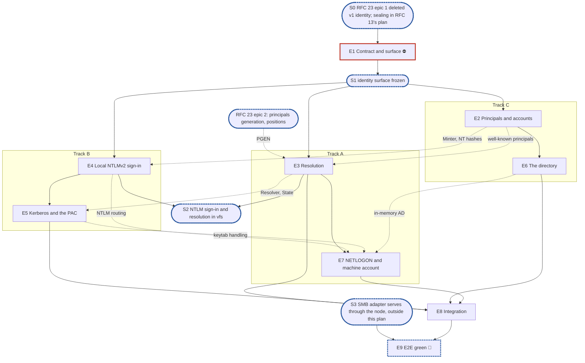

# RFC 18 — identity v2: implementation plan

**Scope.** [RFC 18, identity and authentication](../rfcs/rfc-18-identity.md), for SMB on one node:
- local NTLMv2;
- Kerberos with the PAC;
- an Active Directory directory, NETLOGON pass-through and the machine account;
- per-share resolution;
- the management API's sign-in interface (RFC 18 §8.1), which this plan builds and RFC 23's plan's
  accounts epic consumes.

Kerberos and Active Directory are required for v1 (#4053). Related RFCs, with how far each is in
scope:

- **Only the parts RFC 18 cannot work without:**
  - [RFC 16](../rfcs/rfc-16-metadata-store.md): the `Minter` with uid, gid and RID allocation, the
    well-known principals' fixed IDs (§2.2, §3), and a user's two secret references (A5);
  - [RFC 17](../rfcs/rfc-17-vfs.md) §4.9: admission's caller cache, keyed as RFC 18 §7.1 says, and
    `vfs.Deps`' `Identity`, `Auth` and `Names` (§2.3).
- **Constraints only:**
  - [RFC 13](../rfcs/rfc-13-configuration.md): secrets are sealed, versioned and rotated, and
    settings loaded and checked, by RFC 13's configuration-lifecycle plan (S0); the `identity.*`
    section itself, its struct, defaults and validator, is this plan's, declared in epic 8;
  - [RFC 23](../rfcs/rfc-23-control-plane.md): the node composes identity and hands it its `State`,
    the principals generation and positions come from its store epic, and the runner drives this
    plan's operations (RFC 23's plan, #4050);
  - [RFC 22](../rfcs/rfc-22-smb.md) and its plan (#3911): `gss` answers NEGOTIATE and CHALLENGE and
    hands RFC 18 an `NTLMAuthenticate` or an AP-REQ (RFC 18 §3.1);
  - [RFC 19](../rfcs/rfc-19-authorization.md): what a resolved caller may do to a file;
  - [RFC 25](../rfcs/rfc-25-observability.md): RFC 18 §9.2's series and conditions;
  - [RFC 29](../rfcs/rfc-29-test-harness.md): the rules every epic follows.
- **Out:** [RFC 21](../rfcs/rfc-21-nfs.md), NFS, is v1.1.

**Not built by this plan.** The user decided to defer the following, each in §6 O2:
- the NFS side of identity: `AUTH_SYS` and `AUTH_NONE` (RFC 18 §3.2), uid and gid mapping and the
  mints a claimed uid triggers (§4.3, §5.5), NFSv4 owner strings (§4.5), `ManageGIDs`;
- OpenID Connect's `TokenVerifier` (RFC 18 §8.2).

**Tracks.** A, B and C, with no owner.

**Programme.** #3119, route B, on `feat/storage-v2`, and the v1.0 MVP issue #4053. RFC 22's plan
(#3911, its §6.2 item 1) and RFC 20's plan (its risk 10) name the authenticator as having no owner;
this plan is that owner. Roadmap epic #4078.

**Divergence from the planning skill.** There is no test-foundations epic, by the user's standing
decision for these plans. The leak check (`pkg/block/journal/journaltest/prof`, `internal/prof` once
#4000 lands) and the KV fault wrapper (`pkg/metadata/kv/kvtest`) exist. The in-memory directory and
domain controller land in the epics that build their real counterparts, each held by its own
conformance suite. The §1.5 instruction, copied verbatim, says epic issues exist before "E2's pull
request": that is the skill's red-suite epic, which this plan does not have, so the clause binds no
epic here.

**Naming.** v1 is the identity code on `feat/storage-v2` today:
- `pkg/identity` and `pkg/identity/ldap`;
- `pkg/auth/sid`'s uid-to-SID mapper;
- `internal/auth/netlogon`;
- `internal/vfs/admit`'s minimal resolver.

v1's Kerberos and NTLM code is already gone from the branch; it remains on `develop`. v2 is RFC 18's
identity server. No user-visible name carries a version.

**Transition policy.** Fresh installs only (#3119, route B). Nothing migrates, so RFC 18 §11's
slices are superseded (A1). What v2 keeps of v1 is moved with `git mv` where it is still on the
branch, or lifted from `develop`'s history where it is not, and rewritten against RFC 18 in the epic
that needs it.

**Defaults used from the skill's inputs:**
- output path: `docs/internals/planning/rfc-18-identity-plan.md`;
- dashboards: none.

**RFC amendments in this pull request.** The user agreed to each:
- **A1. RFC 18 §11 is superseded by route B.** No shadow pass and no stored copy of uid-derived SIDs:
  an installation starts on v2. RFC 18 §11 gains a `decision:` note.
- **A2. RFC 13 Appendix B gains `identity.netbios_name`**, the installation's own NetBIOS name, which
  SMB's CHALLENGE advertises and NTLM's local-domain match reads (RFC 18 §3.5, §4.6). On a joined
  installation it is the computer account's name: a join writes it, and a change is refused while
  joined. The row also names where the CHALLENGE's DNS computer and domain names come from.
- **A3. The machine account** (RFC 18 §3.3, §3.5, §9.2; RFC 13 Appendix B's `identity.directory`):
  - on a joined installation the keytab is derived from the machine password, AES under the computer
    account's salt, with `cifs/` and `host/` for the short and the fully qualified name, and
    versioned with the password, so one rotation (domain controller first, then a new `Secret`
    version) changes both; a keytab is imported only on an installation that is not joined;
  - an offline join takes a computer account an administrator created, with its password;
  - the directory record may name a domain controller address and a DNS server, used instead of
    the domain's DNS service records;
  - the join's state, the secure channel's health and the last rotation are reported, with a
    `machine_account_unhealthy` condition.
- **A4. Kerberos is AES only** (RFC 18 §3.3): the keytab holds AES keys, a join sets
  `msDS-SupportedEncryptionTypes` to `0x18`, and DES and RC4 tickets are refused.
- **A5. A user holds two secret references, one per wrapping key** (RFC 16 §2.3's `User`):
  `Password`, sealed under the `storage` key, and `NTHash`, sealed under the `protocol` key and zero
  while NTLM is off, as RFC 13 §7 seals each.

## 1. Introduction

### 1.1 What we are building

RFC 18's "Start here" and §2.6 describe the result: one identity server on every node, which signs
in, maps spellings, resolves a caller per share, and checks an API account; `*vfs.Filesystem` and
the management API call it, and the adapters reach it only through `vfs.Service`.

What replaces what:

| v1 | v2 | Fate |
| --- | --- | --- |
| `pkg/identity` (resolver, cache, link store) and `pkg/identity/ldap` | `pkg/identity`, RFC 18 §2.7's contract; `internal/identity/directory` | deleted by RFC 23's plan's epic 1 (§6 O4); the LDAP provider is lifted from history into `internal/identity/directory` in epic 6 |
| `pkg/auth/sid/mapper.go` (RID derived from a uid) | the RID counter (RFC 18 §2.3, §4.4) | deleted by RFC 23's plan's epic 1; `sid.go` and `wellknown.go` stay |
| `internal/auth/netlogon` | `internal/identity/netlogon` | left in place by RFC 23's plan's epic 1; moved with `git mv` in epic 7 |
| `internal/vfs/admit`'s minimal resolver | `identity.Resolver` (RFC 18 §6) | moved into identity and extended in epic 3 |
| `internal/vfs/shares.go`'s `SignIn`, `Spell` and `Find` stubs (`ErrAccess`) | calls into `vfs.Deps.Auth` and `Names` | replaced in epics 3 and 4 |
| config keys `kerberos.*`, `ldap.*`, `identity.machine_sid`; `DITTOFS_KERBEROS_*`, `DITTOFS_LDAP_*` | `identity.*` settings and `Secret` records (RFC 13 Appendix B, §7) | refused by the RFC 13 plan's bootstrap loader |

**Dependency limits.** Kerberos runs on `gokrb5`, NETLOGON on `go-msrpc`, LDAP on `go-ldap`, and
argon2id on `x/crypto`, all already in `go.mod`. The SMB wire side is RFC 22's (`gss`).

### 1.2 How the plan is organised

- Epic 1 declares the surface.
- Six middle epics on three tracks:
  - Track A: resolution, then NETLOGON and the machine account;
  - Track B: local NTLMv2 sign-in, then Kerberos and the PAC;
  - Track C: principals and accounts, then the directory.
- The integration epic composes identity into the node and runs the rows that need several middle
  epics together.
- The E2E green epic waits for an SMB adapter serving through the node.

RFC 18's suites paragraph puts Tier 1 and Tier 2 in `unit`, the directory's and domain controller's
suites also against real AD in `integration/ad-dc`, and the kernel-client rows in
`e2e/cross-protocol`. None keeps a `known.yaml`, so each test lands green with the epic that makes
it pass.

### 1.3 What epic 1 must deliver

- **The contract, `pkg/identity`** (RFC 18 §2.7):
  - the value types `pkg/vfs` holds today, moved, with `pkg/vfs` aliasing them so adapters import
    `pkg/vfs` alone;
  - the errors;
  - the interfaces of RFC 18 §3.1, §4.1, §6.1 and §8.1, without `TokenVerifier`;
  - `NewHashes`'s signature.
- **The server, `internal/identity`:** RFC 18 §2.6's `Deps`, `New`, `Apply`, `Start`, `Stop` and
  `State`, with stub bodies behind final signatures.
- **The seams it exposes:**
  - `vfs.Deps.Identity`, `Auth` and `Names`;
  - identity's `Deps`: the store views, the secret provider, the clock, the logger and the registry.

It declares no internal interface beyond RFC 18's own. It lands after RFC 23's plan's epic 1 has
deleted v1's `pkg/identity`, whose path it reuses.

### 1.4 The test catalogue and its components

There is no test-foundations epic (see the header).

**The catalogue.** RFC 18 §10's rows and invariants ID1 to ID14 (§9.1), each in exactly one epic's
**Done when:**. The Tier 2 rows run through the SMB adapter, so they land in the E2E green epic; Tier
1 rows that need several middle epics land in the integration epic.

Deferred with the NFS side or OpenID Connect (§6 O2): "one uid, two proofs", "client in the key",
"root", "error is not "unknown"", "owner strings", "expiry", "`ManageGIDs`", "`AUTH_SYS` from the
directory", "mint from a claim, guarded", "lookup cap", "token checks", "key-set outage" and
"unlinked subject"; the `AUTH_SYS` halves of "squash order follows the proof" and "admin needs
proof"; the NFS halves of "disable takes effect" and "no file spelling"; and `FuzzOwnerString`.
"roles grant nothing" is RFC 23 §12's row, run by RFC 23's plan.

**Scenarios from other sources:**
- a share with no grant admits no NTLM user (RFC 23 §3.2), in epic 3;
- an SMB sign-in by a user created through the API with `set-password` succeeds (#4053), in the
  integration epic;
- an AD user signs in over Kerberos and over NTLM pass-through on an installation joined offline
  and pointed at an explicit domain controller (develop's `windows-ad-setup.md`), in epic 7.

**The known-failure mechanism.** None. No suite RFC 18 names keeps a `known.yaml`.

**The test components:**
- the leak check, `pkg/block/journal/journaltest/prof` (`internal/prof` once #4000 lands);
- `pkg/metadata/kv/kvtest`'s fault wrapper, for the store errors §10's rows inject;
- `pkg/identity/identitytest`'s in-memory directory (epic 6) and domain controller (epic 7). Each
  lands with its real counterpart, held by the same conformance suite, which also runs against real
  AD in `integration/ad-dc`;
- NTLM messages built from MS-NLMP §4.2.4's published vectors (epic 4), and signed test PACs built
  with the test realm's keys (epic 5).

### 1.5 General rules for each epic

> **Instruction for whoever expands an epic into its detailed description and subtasks,
> human or AI:**
>
> - **Creating an epic from this plan: use the `epic-breakdown` skill.** Whenever the user
>   asks to create an epic from this plan, or to expand, detail or break one down, run the
>   `epic-breakdown` skill (`.claude/skills/epic-breakdown/SKILL.md`) on this plan and that
>   epic, rather than writing the epic document freehand. It extracts the RFC's MUST and
>   MUST NOT into numbered requirements, estimates each subtask in man-days and suggests
>   the pull requests. A human doing it by hand follows the same skill.
> - **Epic and subtask, nothing else.** The units of work are the epic and its subtasks,
>   with subtask ids `<e>.<n>` (`subtask 4.3`, or `T4.3` for short), assigned by the epic
>   document. No other word names
>   them: not task, ticket, story, step or phase, in headings, tables, ids or prose.
> - **The epic stands alone for what to build.** Its requirements, subtasks and decisions
>   are in the epic document itself, which never refers to this plan for them or says "see
>   the plan": the RFC sections it implements, the interfaces it builds on, the
>   subtasks, and a short legend of the names it borrows from this plan (E1, E2, S1, the
>   integration epic, …). It cites the numbered rules below, without copying them, in a
>   table of how each applies: each row names its rule by number and bold title, which
>   says what the rule requires, and the table links this §1.5 with a full link (the
>   plan's path and the section's anchor) and the `CLAUDE.md` sections that hold a rule,
>   so the epic reads alone and its reader can still open each rule's text in one click.
> - **The epic document records decisions, not progress, like this plan.** It has no
>   status fields, no checkboxes to tick and no sections to keep up to date as the work
>   goes on. It is revised through a pull request only when a decision changes.
> - **Subtasks are not pull requests.** A subtask is ideally up to 5 man-days. The owner
>   ships subtasks as they see fit, one pull request each or several together; the epic
>   document only suggests a grouping, each suggested pull request ideally up to 15
>   man-days. Cut and group by logic, readability, dependencies and a deliverable that can
>   be named, not to hit a number.
> - **Every subtask states how it meets each rule that applies to it.** A rule that does
>   not apply is named, with the reason.
> - **In the issue tracker, only when someone asks for issues,** following `epic-breakdown`
>   Step 6, their one description. Issues point at the documents and copy nothing. The
>   epic issues exist before E2's pull request lands, because each red test's
>   `known.yaml` entry names one; subtask issues come once their epic document has
>   merged. The release an epic ships in is set by the RFC's roadmap epic that its epic
>   issue sits under, never in a document and never on the epic issue on its own: the epic
>   issue and its subtask issues copy that roadmap epic's milestone, and an epic changes
>   release only by moving under the roadmap epic of the other release.

1. **Independent unit tests.** Each epic carries its own unit tests. They build on the test
   components (the leak check, `pkg/metadata/kv/kvtest`'s fault wrapper,
   `pkg/identity/identitytest`'s in-memory directory and domain controller once they land), on the
   implementation of an epic they depend on once it has landed, and only on the test doubles
   `CLAUDE.md`'s "Writing tests" allows: the in-memory KV that RFC 16's KV suite holds, the in-memory
   directory and domain controller held to their suites, and an injected clock. Tickets and PACs are
   made with the test realm's keys, as a KDC makes them, and NTLM messages from MS-NLMP's published
   vectors, never stubbed. Epic 1 declares no internal interface for a test to stand in for
   (rule 12).
2. **Fuzz every decoder of untrusted bytes** (`CLAUDE.md`, "Writing tests", the Fuzz paragraph,
   which states the property). For this RFC: `FuzzPAC`, `FuzzAPReq` and `FuzzSID`, as RFC 18 §10
   names them, and the NETLOGON reply decoder. The NTLM message decoder is RFC 20's and RFC 22's.
3. **Observability follows RFC 25.** Each epic owns the series of RFC 18 §9.2 for what it builds:
   - sign-in: `identity_authentications_total`, `identity_authentication_seconds`;
   - principals: `identity_mints_total`, `identity_unmapped_total`;
   - the PAC: `identity_pac_sids_dropped_total`;
   - resolution: `identity_resolution_refusals_total`;
   - the directory: `identity_directory_lookups_total`, `identity_directory_seconds` and the
     `directory_unreachable` condition;
   - the machine account: the `machine_account_unhealthy` condition.

   Spans follow RFC 18 §9.2's "Spans". No label or attribute carries a name, a SID, an address or a
   credential (RFC 25 §5.4). No exception applies.
4. **Profiling.** Every test runs under the leak check, and fails on a goroutine, descriptor or heap
   growth left behind. RFC 18 names no allocation budget, so there is no allocations-per-operation
   assertion.
5. **Public interface and internals** (`CLAUDE.md`, "Verifying a change"). Tests cover the internal
   API and the behaviour it enables, under `-race`, at the layer that consumes a value. For example,
   a deny-only SID is proven by a refused file decision, not by `Caller.DenyOnly` being set; a
   disable is proven by the next call refused, not by the generation raised.
6. **Known failures shrink** (`CLAUDE.md`, "Writing tests", "By kind"). No suite RFC 18 names keeps
   a `known.yaml`, so no test lands red. Should a later epic register a cell with one, a red test
   that turns green leaves its suite's `known.yaml` in the same change, as "Design principles" in
   `.claude/skills/rfc-to-epic-plan/SKILL.md` says.
7. **v2 ignores v1.** Nothing imports v1's identity code once RFC 23's control-plane epic 1 has deleted its
   importers. What v2 keeps is moved with `git mv` where it is still on the branch
   (`internal/auth/netlogon`, `internal/vfs/admit`'s resolver) or lifted from `develop`'s history
   (the NTLMv2 cryptography, the replay cache and AP-REQ handling, the LDAP provider), and rewritten
   against RFC 18 in the epic that needs it. Each fixes the fail-open paths RFC 18 Appendix B
   names. `pkg/auth/sid`'s codec and well-known SIDs stay where they are.
8. **Real dependencies for properties of those dependencies**, as `CLAUDE.md`'s "Writing tests"
   says. For this RFC:
   - LDAP filter escaping, ambiguous answers, paging, range retrieval, verified TLS and referrals are
     checked against real AD in `integration/ad-dc`, beside the in-memory directory;
   - pass-through, the secure channel, the join and the domain controller's bad-password count are
     checked against a real domain controller there too;
   - Kerberos uses real tickets from the test realm's keys.
9. **Code comment conventions** (`CLAUDE.md`, "Code comments"). RFC 18's notes go at the code site
   that implements them:
   - the `decision:` notes of §2.1, §2.3, §2.4, §2.5, §2.6, §3.3, §3.4, §3.5, §3.6, §4.4, §5.3, §6.2,
     §6.4 and §8;
   - the `ponytail:` notes of §2.2, §2.5, §3.1, §3.3, §3.5, §5.1, §5.2, §5.5, §6.4, §7.2 and §7.3.
10. **A test must be able to fail** (`CLAUDE.md`, "Writing tests"), and nothing else would catch the
    change it guards: not the compiler, not the diff, not a later epic's tests. "An adapter never
    imports identity" stays RFC 20's import test.
11. **A symbol is exported only if RFC 18's interfaces use it.** `pkg/identity` holds the contract;
    `internal/identity` exports only what `internal/node` and the management API call. All of it is
    frozen at S1.
12. **Each subtask creates only what it declares.** No empty package and no stub without a caller.
    A package, an option or a test helper lands with its first consumer.

## 2. Epics at a glance

| # | Epic | Content | Subtasks | Man-days | Track | Blocks |
| --- | --- | --- | --- | --- | --- | --- |
| E1 ⛔ | The contract and the server's surface | `pkg/identity` with the value types moved from `pkg/vfs`, the errors, the interfaces; `internal/identity`'s surface; `vfs.Deps`' three fields | 6 | 6 | team | every epic |
| E2 | Principals and accounts | the `Minter` on the store's ID counters, well-known principals, the domain SID, names, `Spell` and `Find`, `NewHashes` with two secrets, `APISignIn`, NT-hash deletion | 7 | 9 | C | E6; partly E3, E4 |
| E3 | Resolution | `admit`'s resolver moved into identity and completed: map, squash, groups, grant, flags; the `State`; the proof key and admission's caller cache | 7 | 10.5 | A | E7, E8; partly E5 |
| E4 | Local NTLMv2 sign-in | `SignIn` for NTLMv2 against a local NT hash, the MIC, key exchange, the throttle, anonymous sessions, re-authentication | 6 | 8.5 | B | E5; partly E7 |
| E5 | Kerberos and the PAC | imported keytab through `Apply`, AES only, AP-REQ, the replay cache, PAC verification and binding, test PACs, machine principals | 8 | 14 | B | E8; partly E7 |
| E6 | The directory | the LDAP provider lifted, paging, `tokenGroups`, the directory cache with stale grace, directory mints, the in-memory directory and its suite | 7 | 12.5 | C | E8; partly E7 |
| E7 | NETLOGON and the machine account | the secure channel moved and hardened, pass-through, online and offline join, the derived keytab, rotation, status, the in-memory domain controller | 9 | 18 | A | E8 |
| E8 | Integration | identity composed into the node, its `State` from reconcile, `identity.*` validators, the rows several epics meet in | 6 | 10 | team | E9 |
| E9 🔀 | E2E green | Tier 2 rows through SMB, `e2e/kerberos` | planned after S3 | planned after S3 | team | — |
| | **Total** | | **56** | **88.5** | | |

**Plan estimate: 56 subtasks, 88.5 man-days, not counting epic 9.**

The skill's estimate for RFC 18's 2,047 lines is 5 middle epics (`round(2047 / 400)`); this plan
has 6. Active Directory's two halves, the directory and NETLOGON, share no state beyond the in-memory
AD they are tested against, and splitting them keeps Track A busy after resolution.

**Legend.** ⛔ is a blocker; 🔀 waits on a synchronisation point. "team" is an epic that belongs to
no track. "Partly" means the dependent epic starts before the blocker lands (§3.3).

## 3. Synchronisation points, blockers and the split

### 3.1 Dependency graph



### 3.2 Synchronisation points

- **S0, before this plan.** Two things outside it must be true:
  - RFC 23's plan's epic 1 has deleted v1's `pkg/identity` and `pkg/auth/sid/mapper.go` with their
    importers, and left `internal/auth/netlogon` in place (§6 O4);
  - secrets are sealed and versioned (RFC 13 §7): the RFC 13 configuration-lifecycle plan's S2,
    its secrets epic.

  Unblocks epic 1. Separately, RFC 23's plan's epic 2 lands the principals generation and positions,
  which epic 3's `State` reads.
- **S1, the identity surface frozen.** `pkg/identity` holds the contract, `pkg/vfs` aliases it,
  `internal/identity` builds, and `vfs.Deps` has its three fields. Unblocks epics 2, 3 and 4.
- **S2, NTLM sign-in and resolution in `vfs`.** `*vfs.Filesystem`'s `SignIn`, `Spell` and `Find`
  call identity, and admission resolves through it. RFC 22's plan's session epic can then sign in
  for real, and the #4053 MVP's NTLM half is unblocked.
- **🔀 S3, an SMB adapter serving through the node.** This is outside this plan: RFC 20's plan's
  epic 7 and RFC 22's sessions and data path. Unblocks epic 9.

### 3.3 Blockers

| Epic | Blocks | Why |
| --- | --- | --- |
| E1 ⛔ | every epic | Every epic builds on the contract and the server's surface. |
| RFC 23's plan's epic 2 | partly E3 | The `State`'s generation is the principals generation that epic writes. E3 starts on squash, groups and grants before it lands. |
| E2 | E6; partly E3, E4 | The directory mints through E2's `Minter`. E4 verifies against E2's NT hashes, and starts on its throttle and MIC before they land. E3 starts on squash, groups and grants before the well-known principals land. |
| E3 | E7, E8; partly E5 | Pass-through maps by its verified user SID into a resolved caller. E5 binds a PAC to a record, and its deny-only SIDs reach E3's groups. |
| E4 | E5; partly E7 | Kerberos joins the `SignIn` E4 builds. Pass-through is a route of E4's NTLM domain table. |
| E5 | E8; partly E7 | The derived keytab is loaded through E5's keytab handling. |
| E6 | E8; partly E7 | NETLOGON's domain controller and the directory are one AD in the test fixture. |
| E7 | E8 | Integration's cross-epic rows sign in through pass-through. |
| E8 | E9 | E2E green runs the composed server. |

### 3.4 Splitting the work

- **Track A** takes epic 3 at S1. Squash, groups, grants and flags need only E1's types and the
  resolver it moves; the map step joins once epic 2's well-known principals land, and the `State`
  once RFC 23's plan's epic 2 lands the principals generation. Then it takes epic 7, which needs
  real AD in `integration/ad-dc` and the in-memory domain controller.
- **Track B** takes epic 4 at S1: the throttle, the MIC and key exchange first, and the NT-hash check
  once epic 2's hashes land. Then epic 5.
- **Track C** takes epic 2 at S1, then epic 6.
- **The team converges** at epic 1 and at epic 8. S2 is the point where RFC 22's plan and the #4053
  MVP pick up a real `SignIn`.

## 4. Implementation decisions

### 4.1 Directory layout

```text
pkg/identity/                   contract: value types, errors, interfaces, NewHashes (RFC 18 §2.7)    E1, E2
pkg/identity/identitytest/      in-memory directory and domain controller, with their suites          E6, E7
pkg/vfs/                        aliases pkg/identity's value types                                     E1
pkg/vfs/vfserr/                 + ErrLogonFailure, ErrUnknownPrincipal                                 E1
pkg/auth/sid/                   SID codec and well-known SIDs                                          —
internal/identity/              Server: SignIn, Spell, Find, Resolve, VerifyPassword, Account,         E1, E2–E5
                                Apply; ntlm, kerberos, pac, replay, throttle
internal/identity/directory/    the LDAP provider (only it imports go-ldap)                            E6
internal/identity/netlogon/     secure channel, pass-through, join, rotation (git mv)                  E7
internal/vfs/                   SignIn, Spell, Find through Deps; admission's caller cache            E3, E4
pkg/metadata/entity/            + User.Password, User.NTHash (A5)                                      E2
pkg/metadata/kvstore/           + Minter on NextID's uid, gid and RID kinds (RFC 16)                   E2
```

### 4.2 Decisions

**D1. The contract is `pkg/identity`, as RFC 18 §2.7 says.** This is the user's decision. The value
types move from `pkg/vfs` into it, and `pkg/vfs` aliases them, so adapters keep importing `pkg/vfs`
alone. Moving them creates no import cycle: they depend only on `entity`, `sid` and `netip`.
- **Prior art (from memory).** Samba keeps authentication in its own subsystem beside `smbd`.
- **Applied by** epic 1.

**D2. Resolution moves into identity, as RFC 18 §6.1 says.** This is the user's decision.
`internal/vfs/admit/resolve.go`, which already maps, squashes, grants and refuses a disabled
principal over the store's `Principals` view, is moved into `identity.Resolver` and completed rather
than rewritten. The caller cache stays admission's (RFC 18 §7.1), keyed by `Identity.Key()`.
- **Prior art (from memory).** Windows builds an access token in LSA at sign-in, and the file server
  only checks it.
- **Applied by** epic 3.

**D3. A user's credentials are two sealed `Secret`s, one per wrapping key** (A5): the password's
argon2id hash under `storage`, and the NT hash under `protocol`, present only while NTLM is on. A
password set writes a new version of each; turning NTLM off deletes every `NTHash`; deleting a user
deletes both (RFC 13 §7). This is the user's decision.
- **Prior art (from memory).** OWASP ranks argon2id first; RFC 13 §7's role split is Active
  Directory's separation of `unicodePwd` from the Kerberos keys.
- **Applied by** epic 2.

**D4. Kerberos runs on `gokrb5`**, already a dependency: keytab parsing with several key versions,
AP-REQ decryption and PAC decoding. `gokrb5` verifies only the PAC's server checksum and neither
compares `PAC_CLIENT_INFO` with the ticket nor builds a PAC, so the binding checks and a test-PAC
builder are this plan's; the ticket and full-PAC checksums need the KDC's key and stay unchecked, as
RFC 18 §3.4's decision says.
- **Prior art (from memory).** Samba and sssd run on MIT or Heimdal; `gokrb5` is the Go equivalent.
- **Applied by** epic 5.

**D5. NETLOGON runs on `go-msrpc`**, already a dependency, as v1's secure channel did; the package
moves with `git mv`. It is hardened as MS-NRPC and its 2020 and 2022 fixes require:
`NetrServerAuthenticate3` with AES and Secure RPC only (`go-msrpc`'s default capabilities include
RC4, which is refused), `NetrLogonSamLogonEx` at validation level SamInfo4 with its extra SIDs, over a
named pipe authenticated with Kerberos as the machine account. Its secret store is replaced by
`Secret` records, and its join and rotation become RFC 23 operations.
- **Prior art (from memory).** Samba's `winbindd` holds the secure channel the same way.
- **Applied by** epic 7.

**D6. LDAP is v1's provider, lifted into `internal/identity/directory`,** the only package importing
`go-ldap`. It keeps v1's filter escaping, `LDAP_MATCHING_RULE_IN_CHAIN`, and LDAPS and StartTLS, both
verified; adds RFC 2696 paging, `tokenGroups` for a user's closure (which includes the primary group
`memberOf` omits), range retrieval for large `member` values, `objectGUID` as the entry ID, and a
disabled account read from `userAccountControl` or `accountExpires`; and refuses an ambiguous answer
where v1 took the first. The cache's single flight is `x/sync/singleflight`, as v1's.
- **Prior art (from memory).** sssd's AD provider reads `tokenGroups` and pages the same way.
- **Applied by** epic 6.

**D7. The first SMB user is created through the API.** There is no offline seeding command. Tests
seed users through the store and `NewHashes`, which is the code the API calls. This is the user's
decision.
- **Prior art.** None found.
- **Applied by** epics 2 and 8.

**D8. Join, rotation and NT-hash deletion are operations of RFC 23's runner** (RFC 23 §4.6), each
one runner kind with its steps here: the online and the offline join and the machine password's
rotation (epic 7), and NTLM-off's deletion of every NT hash (epic 2). Their routes are RFC 23's
(§6 O5).
- **Prior art (from memory).** TrueNAS runs its AD join as a job.
- **Applied by** epics 2 and 7.

**D9. The store's ID counters are `kvstore.NextID`'s,** with uid, gid and RID kinds added beside the
client, open and lock kinds; unique protocol IDs stay `PutUser`'s existing claim and re-index, the
well-known principals' fixed IDs stay `entity`'s, and case-folded names reuse the share-name folding.
- **Prior art.** None found.
- **Applied by** epic 2.

### 4.3 Knowingly simple implementations

Each carries a `ponytail:` marker at the code site, beside RFC 18's own:

- **A claimed identity is refused** until the NFS side lands. With no `AUTH_SYS` consumer, the
  `Resolver` answers `ErrAccess` for proof kind `Claimed`, never anonymous; a forwarded identity that
  is inconsistent with itself is still `ErrInvalid`, as RFC 18 §2.6 says.
  - *Ceiling:* NFS.
  - *Upgrade path:* RFC 18 §4.3's mapping, with the NFS side (§6 O2).
  - *Epic:* 3.
- **Logon events are log lines.** RFC 25's `logon` stream is deferred with the event streams, so
  each attempt is one structured log line carrying RFC 18 §3.1's fields, and never a credential.
  - *Ceiling:* no export to a collector.
  - *Upgrade path:* RFC 25 §4's sink, with the same fields.
  - *Epic:* 4.
- **The caches are bounded by fixed counts**, not yet by RFC 24's connection-state pool.
  - *Ceiling:* memory under a hostile client is bounded by the count, not the pool.
  - *Upgrade path:* charging RFC 24's pool, once its plan lands.
  - *Epics:* 3, 4, 5, 6.
- **A machine password's rotation completes on this node.** "Every node reports the previous one"
  is this node.
  - *Ceiling:* a second node.
  - *Upgrade path:* the wait on node status, with the cluster rows; RFC 18 §12 item 2 measured then.
  - *Epic:* 7.

## 5. The epics in detail

### Epic 1 — The contract and the server's surface ⛔

**Epic 1 estimate: 6 subtasks, 6 man-days.**

This epic freezes the identity contract and the server every later epic fills in.

**Owns:** RFC 18 §2.6 and §2.7, as declarations; RFC 18 §3.1, §4.1, §6.1 and §8.1's interfaces.

**Done when:**
- `pkg/identity` and `internal/identity` compile, the server's bodies stubbed behind final
  signatures;
- `pkg/vfs` aliases the moved types, and every importer builds;
- RFC 18 ID11 holds by RFC 20's import test, with no adapter importing either identity package.

**Expected content:**
- Move the value types into `pkg/identity` (RFC 18 §2.7), and alias them in `pkg/vfs`.
- `ErrLogonFailure` and `ErrUnknownPrincipal` in `vfserr`, with their RFC 17 §4.3 mapping.
- The interfaces of RFC 18 §3.1, §4.1, §6.1 and §8.1 (without `TokenVerifier`), and `NewHashes`'s
  signature.
- `internal/identity`'s `Deps`, `New`, `Apply`, `Start`, `Stop` and `State`.
- `vfs.Deps.Identity`, `Auth` and `Names`.
- The import test's rows for the two identity packages.

### Epic 2 — Principals and accounts

**Epic 2 estimate: 7 subtasks, 9 man-days.**

The store mints principals and allocates their IDs once. Spellings map both ways. An account's
password and NT hash are derived, sealed and checked.

**Owns:**
- RFC 18 §2.1 to §2.3; §2.4's API-only accounts; §2.5's group records;
- RFC 18 §4.1, §4.4 and §4.6;
- RFC 18 §3.5's NT-hash rules and NTLM-off deletion;
- RFC 18 §8 and §8.1;
- RFC 16 §3's `Minter`; A5's `User` fields.

**Done when:**
- RFC 18 ID2 and ID3 hold;
- RFC 18 §10's row "name case" passes;
- `FuzzSID` runs in `unit`;
- RFC 16's suite covers the `Minter`'s allocation.

**Expected content:**
- The `Minter` on `NextID`'s uid, gid and RID kinds, allocated inside its transaction (D9,
  RFC 18 §2.3).
- Root and anonymous among the well-known principals (RFC 18 §2.1), on `entity`'s fixed IDs.
- The installation's domain SID (RFC 18 §4.4) and case-folded name uniqueness (RFC 18 §4.6).
- `Spell` and `Find` over the stored schemes and the qualified name (RFC 18 §4.1, §4.6).
- `NewHashes` and the two sealed secrets (D3, A5).
- `VerifyPassword` and `Account` (RFC 18 §8.1).
- NTLM-off's deletion of every NT hash, as a runner kind (D8).

### Epic 3 — Resolution

**Epic 3 estimate: 7 subtasks, 10.5 man-days.**

Admission resolves every call through identity's `Resolver`, and its caller cache keys on the whole
proof.

**Owns:** RFC 18 §2.5's closure and cap, §3.7, §6.1 to §6.5, §7.1 and §7.2.

**Done when:**
- RFC 18 ID1 (two identities sharing a uid get different proof keys and never share an entry), ID5
  (a store error injected during resolution refuses, never anonymous), ID8, ID10 and ID14 (a `none`
  grant refuses where a group grant would admit) hold at the resolver's layer;
- RFC 18 §10's rows "in-flight disable" and "group cap" pass, and "forwarded identity"'s unit row;
- the §1.4 scenario assigned to epic 3 passes.

**Expected content:**
- `admit/resolve.go` moved into `identity.Resolver` (D2), with proof kinds `Secret` and `Ticket`,
  and `Claimed` refused (§4.3 above).
- Squash, with the order that follows the proof (RFC 18 §6.2).
- The group closure, its cap and deny-only principals (RFC 18 §2.5, §6.3).
- Grants and the flags (RFC 18 §6.4, §6.5).
- The `State` and its generation, applied under `Apply` (RFC 18 §2.6, §7.2).
- `Identity.Key()` and admission's caller cache keyed as RFC 18 §7.1 says, with single-flight misses.
- `vfs`'s `Spell` and `Find` routed to `Names`.

### Epic 4 — Local NTLMv2 sign-in

**Epic 4 estimate: 6 subtasks, 8.5 man-days.**

`SignIn` verifies NTLMv2 against a local NT hash and binds the evidence to its principal.

**Owns:** RFC 18 §3.1, §3.5's local half, §3.6 and §3.8 (but expiry).

**Done when:**
- RFC 18 ID12 holds: a re-authenticated context acts as its new principal, a failed one ends it;
- RFC 18 §10's rows "NTLM MIC" and "NTLM domain" pass, the cryptography checked against MS-NLMP
  §4.2.4's published vectors;
- `vfs.Service`'s `SignIn` answers an NTLM step.

**Expected content:**
- NTLM messages built from MS-NLMP's published vectors for the tests, including a MIC over exact
  NEGOTIATE, CHALLENGE and AUTHENTICATE bytes.
- Domain routing (RFC 18 §3.5's table, its local and refusal rows), against `identity.netbios_name`
  (A2).
- NTLMv2 verification in constant time, with the same work for an unknown name, lifted from
  `develop` (rule 7).
- The MIC, key exchange and the session key returned in `Keys`.
- The throttle and the logon events (§4.3 above).
- Anonymous and guest sessions (RFC 18 §3.6), re-authentication (RFC 18 §3.8), and `vfs`'s `SignIn`
  routed to `Auth`.

### Epic 5 — Kerberos and the PAC

**Epic 5 estimate: 8 subtasks, 14 man-days.**

`SignIn` accepts AES Kerberos tickets for the keytab's service names, verifies and binds the PAC, and
mints machine principals.

**Owns:** RFC 18 §2.4's machine principals, §3.3 (the imported keytab, A4), §3.4, §3.8's expiry, and
§4.2 steps 1, 2 and 4.

**Done when:**
- RFC 18 §10's rows "PAC", "replay" and "keytab rollover" pass;
- `FuzzPAC` and `FuzzAPReq` run in `unit`.

**Expected content:**
- A test-PAC builder signing with the test realm's keys (D4).
- The keytab through `Apply`, its key versions as `gokrb5` holds them, and its rollover (RFC 18 §3.3).
- AES only: DES and RC4 tickets refused (A4).
- AP-REQ verification on `gokrb5`, with the clock skew and the replay cache lifted from `develop`.
- PAC verification, `PAC_CLIENT_INFO` compared with the ticket, binding to the record, SID filtering,
  and deny-only SIDs carried apart (RFC 18 §3.4).
- Kerberos names mapped by RFC 18 §4.2 (step 3 is epic 6's).
- Machine principals minted on first sign-in (RFC 18 §2.4).
- Expiry, and the release calls past it (RFC 18 §3.8).

### Epic 6 — The directory

**Epic 6 estimate: 7 subtasks, 12.5 man-days.**

Identity reads users and groups from Active Directory over verified TLS. It caches the answers with a
stale grace, and mints each directory principal once.

**Owns:** RFC 18 §5.1 to §5.4; §5.5's SMB rows; §4.2 step 3; §7.3's directory rows.

**Done when:**
- RFC 18 ID4 and ID9 hold;
- RFC 18 §10's rows "stale grace", "directory TLS", "one query per key", "exact queries" and
  "SID-less directory" pass;
- the directory's suite passes against the in-memory directory in `unit` and against real AD in
  `integration/ad-dc`.

**Expected content:**
- v1's LDAP provider lifted into `internal/identity/directory`, and extended as D6 says.
- The directory cache: TTLs, single flight, the stale grace, errors never cached as "not found".
- Minting directory users and groups from the first answer, with renames and disables following the
  entry.
- Kerberos names resolved through the directory (RFC 18 §4.2 step 3).
- A test call that binds and looks up one entry, for RFC 23's directory-test action (§6 O5).
- The `directory_unreachable` condition.
- The in-memory directory and its conformance suite.

### Epic 7 — NETLOGON and the machine account

**Epic 7 estimate: 9 subtasks, 18 man-days.**

NTLM sign-ins of directory users pass through to a domain controller over the installation's secure
channel. The installation joins the domain, online or offline, and rotates its machine password with
the keytab derived from it.

**Owns:** RFC 18 §3.5's pass-through half and the machine account (A3); §3.3's derived keytab.

**Done when:**
- RFC 18 §10's rows "pass-through" and "logon throttle" pass;
- the domain controller's suite passes in `unit` and in `integration/ad-dc`;
- the §1.4 scenario assigned to epic 7 passes in `integration/ad-dc`.

**Expected content:**
- `internal/auth/netlogon` moved to `internal/identity/netlogon`, and hardened as D5 says.
- `NetrLogonSamLogonEx` pass-through, mapped by the verified user SID, with its SIDs and extra SIDs
  used as a PAC's.
- Domain-controller discovery from DNS, lifted from v1, or the directory record's explicit address
  and DNS server (A3).
- The online and the offline join as runner kinds (D8), each writing `identity.netbios_name`.
- The keytab derived from the machine password, `cifs/` and `host/` for the short and the fully
  qualified name, versioned with it (A3).
- The password rotation as a runner kind, domain controller first (§4.3 above).
- The join's state and the channel's health in node status, and the `machine_account_unhealthy`
  condition.
- The in-memory domain controller and its conformance suite.
- The `integration/ad-dc` cell's identity rows (the two suites and the scenario) on the new code; the
  rows that drive a server stay RFC 23's plan's.

### Epic 8 — Integration

**Epic 8 estimate: 6 subtasks, 10 man-days.**

Identity runs inside the node, and the rows that need several middle epics together run here.

**Owns:** RFC 18 §2.6's composition and reconfiguration; RFC 18 §9.2 as a whole.

**Done when:**
- RFC 18 ID6 holds: an `S-1-5-32-544` in a test PAC for a non-admin sets no `Admin`;
- RFC 18 §10's rows "admin needs proof" (its PAC half), "PAC bound to the record", "disabled
  directory account", "directory deadline", "mint conflict", "deny-only lookup error", "no local
  password for a directory user" and "NTLM without a domain controller" pass;
- `node.New` builds identity and hands it to `*vfs.Filesystem` and the API, and reconcile hands each
  new `State` to `Apply`;
- the §1.4 scenario assigned to integration passes.

**Expected content:**
- Identity composed in `node.New` (RFC 23 §2.1), with the keytab, the directory record and
  `identity.ntlm` in each `State`.
- The `identity.*` section declared: its settings struct, defaults and `Validate`, listed in the
  node's settings table (the RFC 13 plan's `pkg/settings`).
- The cross-epic rows above, on the in-memory directory and domain controller.
- RFC 23's accounts epic moved onto `APISignIn` and `NewHashes`.
- An SMB sign-in by a user created through the API, run in-process.

### Epic 9 — E2E green 🔀

**Epic 9 estimate: planned after S3.**

This epic waits for an SMB adapter serving through the node (S3).

**Owns:** RFC 18 §10's Tier 2 rows, their SMB halves.

**Done when:**
- RFC 18 ID7 and ID13 hold;
- RFC 18 §10's rows "no map to guest", "squash drops SIDs", "squash order follows the proof" (its
  Kerberos half), "disable takes effect" (its SMB half), "binding", "re-authentication", "deny-only
  SIDs", "no file spelling" (its SMB half), "`none` is stored", "NTLM off" and "anonymous lookup"
  pass over SMB, in `unit`'s Tier 2 and in `e2e/kerberos`.

**Expected content:**
- The Tier 2 rows over SMB on the composed harness.
- The Kerberos rows in `e2e/kerberos` against a real KDC.

## 6. Risks and open points

- **O1. The roadmap epic** is #4078, beside #3984 (RFC 13) and #3985 (RFC 23); this plan's epic issues go under it.
- **O2. The deferred scope.** Each item waits for something:
  - the NFS side (`AUTH_SYS`, uid and gid mapping, owner strings, `ManageGIDs`, the mints a claimed
    uid triggers) waits for RFC 21's plan, with the RFC 18 §10 rows §1.4 lists;
  - `TokenVerifier` and RFC 18 §10's three token rows wait for OpenID Connect sign-in, which RFC 23's
    plan also defers;
  - the logon stream waits for RFC 25 §4 (§4.3 above).
- **O3. What RFC 22's plan (#3911) must settle**, raised in its review:
  - its sign-in tests run on `vfstest.Memory`, which waits for this plan's S2;
  - who verifies and sends SPNEGO's `mechListMIC` (RFC 4178), keyed from `Keys.Session`;
  - `Keys.Session` is the authenticator's subkey when present, kept whole: SMB signs and runs
    AES-128 on its first 16 bytes and AES-256 on all 32 (MS-SMB2 3.3.5.5.3's `FullSessionKey`),
    and no AP-REP subkey is sent;
  - the CHALLENGE's AV pairs, `MsvAvTimestamp` among them, with `MsvAvNbComputerName` equal to
    `identity.netbios_name` (A2), or clients send no MIC and pass-through fails;
  - whether an anonymous session holds an all-zero key or none (RFC 18 §3.6);
  - `lsarpc`'s `OpenPolicy`, `LookupSids` and `OpenPolicy3` (opnums 6, 15, 130), which `develop`
    serves for `smbcacls` and Windows 11 and RFC 22 §5.2 leaves out.
- **O4. RFC 23's plan (#4050) deletes v1's `pkg/identity` root files but keeps `pkg/identity/ldap`**,
  which imports them, so its epic 1 would not build. It should delete `pkg/identity` whole; epic 6
  lifts the provider from history (D6). `internal/auth/netlogon` imports nothing of v1 and stays.
- **O5. Routes this plan needs from RFC 23's plan (#4050):** linking a Kerberos name to a user (its
  `krb` spelling, RFC 18 §4.2); granting an AD user or group by name or SID, through `Find` with
  `Mint`; the directory-test action; the join, offline join and rotation actions; and the join's
  status on the node resource.
- **O6. One machine account, several nodes** (RFC 18 §12 item 2) is unmeasured, and matters only
  with a second node (§4.3 above).
- **O7. Estimates least certain.** Epic 7 depends on how much of v1's secure channel survives the
  hardening, and on the Kerberos client its named pipe needs. Epic 6 depends on real AD's group
  nesting.

## 7. RFC coverage

| RFC section | Epic(s) |
| --- | --- |
| RFC 18 Start here | — (explanatory) |
| RFC 18 §1, §1.1 | — (scope) |
| RFC 18 §2.1, §2.2, §2.3 | E2 |
| RFC 18 §2.4 | E2 (API-only accounts), E5 (machine principals) |
| RFC 18 §2.5 | E2 (group records), E3 (closure, cap) |
| RFC 18 §2.6 | E1 (surface), E3 (`State`), E8 (composition) |
| RFC 18 §2.7 | E1 |
| RFC 18 §3.1 | E1 (interface), E4 |
| RFC 18 §3.2 | deferred, O2 |
| RFC 18 §3.3 | E5 (imported keytab, AES), E7 (derived keytab) |
| RFC 18 §3.4 | E5 |
| RFC 18 §3.5 | E2 (NT hashes, NTLM off), E4 (local), E7 (pass-through, machine account) |
| RFC 18 §3.6 | E4 |
| RFC 18 §3.7 | E3 |
| RFC 18 §3.8 | E4, E5 (expiry) |
| RFC 18 §4.1 | E1 (interface), E2 |
| RFC 18 §4.2 | E5 (steps 1, 2, 4), E6 (step 3) |
| RFC 18 §4.3 | deferred, O2 |
| RFC 18 §4.4, §4.6 | E2 |
| RFC 18 §4.5 | deferred, O2 |
| RFC 18 §5.1, §5.2, §5.3, §5.4 | E6 |
| RFC 18 §5.5 | E6 (the SMB rows); the claimed-uid mint deferred, O2 |
| RFC 18 §6.1 to §6.5 | E3 |
| RFC 18 §7.1, §7.2 | E3 |
| RFC 18 §7.3 | E3, E4, E5, E6 (each its tables) |
| RFC 18 §8, §8.1 | E2 |
| RFC 18 §8.2 | deferred, O2 |
| RFC 18 §9.1 | per epic's **Done when:** |
| RFC 18 §9.2 | each epic's series (rule 3), E8 (registered) |
| RFC 18 §10 | per epic's **Done when:**; E9 (Tier 2); NFS and token rows O2 |
| RFC 18 §11 | superseded, A1 |
| RFC 18 §12 | item 1: E2 ("name case"); item 2: O6 |
| RFC 18 Appendix A | — (non-normative) |
| RFC 18 Appendix B | rule 7 (fail-open fixes) |
| RFC 16 §2.3 (`User`), §3 (`Minter`) | E2 |
| RFC 17 §4.9 (caller cache) | E3 |
| RFC 13 Appendix B (`identity.*`) | E8 (validators); A2, A3 |
