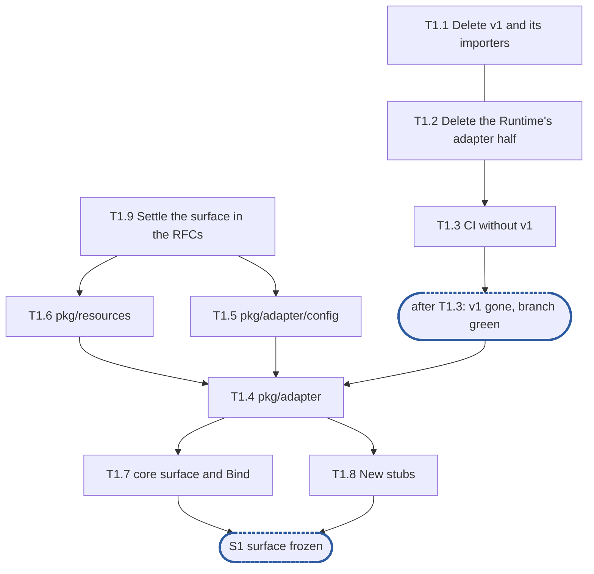

# Epic 1: adapters v2 delete v1, fix the surface

**Sources:** [RFC 20](../rfcs/rfc-20-adapters.md) §2.3 and §2.5 (layout, `pkg/` and
`internal/`), §3.4, §3.5's `Sidecar` and `Serving`, §3.6's settings, §3.7's `Deps.Watch`,
§4.2's and §4.3's type rows, §4.7's types, §6.8's `Buf` surface, Appendix B (what is deleted);
[RFC 24](../rfcs/rfc-24-resources.md) §2.5, §2.7, §2.8 and §3.1's surface;
[RFC 13](../rfcs/rfc-13-configuration.md) §4.2, §6 and Appendix B's adapter rows;
[RFC 17](../rfcs/rfc-17-vfs.md) §9's decision to delete rather than migrate.
**Track:** the team.
**Epic 1 estimate: 9 subtasks, 15.5 man-days.**
**Depends on:** nothing in this programme: `pkg/vfs`, `vfstest.Null` and `vfstest.Record`
exist on `feat/storage-v2`. The surface is written against RFC 20 as the review follow-ups
leave it (#3892 and #3903: a drain's refusal answered over SMB by an interim with no final,
a single-reply compound judged whole while draining), as RFC 20 now stands on
`feat/storage-v2`.
**Blocks:** every later epic. E2 builds `testproto` against the surface frozen here; E3, E4,
E5 and E6 fill its bodies; E7 wires it into the node.

---

## 1. Goal

Epic 1 deletes v1 from `feat/storage-v2` and fixes v2's surface with stub bodies, so that
every later epic builds against types that no longer move.

**At the end of the epic:**

- `internal/adapter/`, `pkg/adapter/`, `pkg/controlplane/runtime/adapters` and everything that
  only they served are gone; the branch builds, `go vet` passes with every build tag that still
  has files, and `unit`, `integration`, `lint-go` and `lint-repo` are green;
- the suites that need a served protocol are skipped by `tests.yml`'s V2 filter, and
  `required-tests.sh` passes on two surviving authorization gates;
- `pkg/adapter`, `pkg/adapter/config`, `pkg/resources`, `pkg/adapter/nfs`, `pkg/adapter/smb`
  and `internal/adapter/core` compile with RFC 20's signatures, each with a test that can fail;
- `core.Bind` works, and its test proves each closure of the `Invocation` sees the request
  its decoder produced;
- every place where RFC 20 left the frozen surface ambiguous has been settled by an RFC
  amendment before the surface is written (T1.9), so S1 freezes a surface the RFC states.

No adapter is served. Nothing a client can mount exists on the branch until RFC 21 and 22.

### 1.1 In scope

The deletion of v1 and of the control-plane surface that existed only for it; the CI changes
that keep the branch green without it; the public surface (`pkg/adapter`, `pkg/adapter/config`,
two `New`); `pkg/resources`' signatures; `core`'s §4.7 surface with stub bodies and a real
`Bind`; the RFC 20 and RFC 24 amendments the surface needs before it can be frozen.

### 1.2 Out of scope

- `testproto`, its stateful half, the import test and the leak checks: E2.
- The `NoGrace` kind and `ErrNoGrace` the follow-ups add to RFC 17: `pkg/vfs`'s, with RFC 17's
  plan and RFC 21; `core`'s surface does not name them.
- Every body of `Budget`, `Reservation`, `Buf` and `BufPool`; the reserved-bytes gauges and
  the 0-allocation gates on `Get` and `Release`: E3.
- `Server`'s states, accept, `Conn`, drain, `Reconfigure`'s body, health, TCP options, the
  sidecar runner; the nil-`Watch` behaviour (D9): E4.
- The pipeline, `NewOpTable`'s and `NewErrorTable`'s checks, `Map`, `Park`, middleware, the
  request context, RFC 20 §10's series and the resolve-once metrics call (D10); the
  `unit/adapter-allocs` cell and its fixed step (D7): E5 and E3.
- Each protocol's `wire/` and `protocol/`, and `New`'s real body: E6.
- `node.New`, the config loader, conditions and alert rules: E7.
- Everything RFC 21, RFC 22, RFC 18 and RFC 23 bring back (§9 lists what this epic adds).

### 1.3 Names used here

- **E1**, this epic.
- **E2**, epic 2, test foundations: `testproto` and its stateful half, the import test, the
  budget and goroutine leak checks.
- **E3**, epic 3, budgets and buffers: the bodies of `pkg/resources`.
- **E4**, epic 4, connections and lifecycle: `Server`, accept, `Conn`, drain, `Reconfigure`,
  health, TCP, the sidecar runner.
- **E5**, epic 5, dispatch: the pipeline, tables, compound runner, held and parked requests,
  middleware, error tables, observability.
- **E6**, epic 6, protocol scaffolds: `wire/`, `protocol/` and `New` for NFS and SMB.
- **E7**, epic 7, integration with the node.
- **E8**, epic 8, E2E green: the allocation cell checked and the deferral ledger handed over.
- **S1**, surface frozen: after E1, `core`'s §4.7 surface and the public packages no longer
  change without an RFC amendment.
- **S2**, `testproto` and the import test in CI, after E2.
- **S3**, `core` serves `testproto` end to end, after E4 and E5.
- **S4**, `internal/node` exists (RFC 23), outside this programme's epics.
- **The deferral ledger**: the list of everything RFC 20 or develop's v1 provides that the
  branch does not serve yet, each row naming the owner that brings it back.
- **The cutover**: the programme stage that wires v2 adapters into `dfs` and turns the
  protocol suites back on.

## 2. General rules for each epic

1. **Independent unit tests, under `-race`.** Each epic carries its own unit tests. It may use
   another epic's implementation once that has landed, `vfstest.Null` and `vfstest.Record`, and
   E2's `testproto` and leak checks. `core` is tested from `package core_test` on `testproto` and
   never through NFS or SMB; no `core` test imports a protocol package. Connections are real TCP
   over loopback, with real deadlines and socket options read back from the socket. Test at the
   layer that consumes a value (`CLAUDE.md`, "Verifying a change"): a setting is asserted on a
   connection accepted after `Reconfigure`, not on the snapshot.
2. **Fuzz tests where relevant.** Go native fuzzing on every decoder of bytes a peer sent: the
   NetBIOS and RPC record framers, the SMB2 header, the RPC call header and AUTH_SYS credential,
   `testproto`'s frame. Seeded with each package's golden vectors. The property: accepted or
   refused, never a panic, never an allocation past the protocol's cap (RFC 20 §5.2, A8).
3. **Observability follows RFC 25 and RFC 20 §10.** Every metric, span and log key lives in
   `core`; protocol code records none. The series are RFC 20 §10.1's that `core` produces here,
   through `pkg/metrics`, resolved once per protocol and operation at table build so the request
   path does an atomic add; the replay, translation, status-mapped and record series arrive with
   their producers. Spans through `Deps.Tracer`, logs through `Deps.Logger`.
4. **Leaks and allocations.** Every test that runs the pipeline ends with E2's leak checks. Hot
   paths carry allocation assertions (`testing.AllocsPerRun`): the header codecs of both
   protocols and `testproto`'s at 0, `BufPool.Get` and `Release` at 0, and the pipeline's
   allocations per request at or under a checked-in number that may only fall. Each gate is
   registered in the per-change `unit/adapter-allocs` cell by the subtask that writes it.
5. **v2 ignores v1.** v1 is deleted in epic 1; nothing is copied from it but what RFC 20
   Appendix B marks **keep**, lifted from `develop`'s history into its new place: the accept
   backoff and the sidecar group's reconcile here, the rest with RFC 21 and 22. The import test
   fails any import of a path v1 used that v2 does not.
6. **Nothing deferred is lost.** A subtask that leaves out part of an RFC 20 obligation, or
   anything develop serves, adds or keeps its row in the deferral ledger, naming the owner that
   brings it back.
7. **Code comment conventions** (`CLAUDE.md`, "Code comments"). A source comment describes the
   code's behaviour and references nothing outside it: no issue or pull request numbers, no CI,
   runner or OS names, no ids from planning documents (epics, subtasks, synchronisation points,
   decisions). A `ponytail:` marker records a knowingly simple implementation, naming its
   ceiling and the upgrade path. A `decision:` marker records deliberate behaviour, naming the
   rule, why it holds and the evidence that would overturn it. RFC 20's notes go at their code
   sites: no attribute cache, parked requests off the hold floor, `Addrs` live, `Pends` asked
   only for an error the service returned, a call in the service pending past the ceiling and the floor, context
   and attribute reads served while draining, a `ponytail:` for the uncharged replay copies, a drain's refusal answered by an interim with no final, the expired
   credential running only releases, a `ponytail:` for the cancel record's 5 s, `unwrap` on the reader, the cap of 64, one goroutine per request,
   `sync.Pool` per class, no self-probe. `pkg/resources`'s missing turns, `Reclaim`, `ShareCap`
   and `Split` each carry a `ponytail:` naming RFC 24.
8. **A test must be able to fail.** Keep a test only if a plausible change would make it fail and
   nothing else would catch that change. The import test proves it can by reporting its seeded
   violation; the budget leak check by failing a test that keeps a `Buf`.
9. **A symbol is exported only if RFC 20's interface uses it.** `pkg/adapter`,
   `pkg/adapter/config`, `pkg/resources` and the two `New` are the public surface. `core`'s
   exported symbols are those RFC 20 §4.7 names, frozen at S1; everything else in `core` is
   unexported. A symbol §4.7 does not name is added to §4.7 first, by a pull request to the RFC.
10. **Each subtask creates only what it declares.** No empty package and no stub without a
    caller: no empty `ops/`, `callbacks.go`, `gss/`, `translate/` or `dcerpc/`. A package, a stage
    or a test helper lands with its first consumer.

### 2.1 How the rules apply

| Rule | Subtasks | How |
| --- | --- | --- |
| 1 Unit tests | T1.4–T1.8 | each new package has a `_test.go` that can fail (§6 lists the bug each catches); no socket is opened, because no body that opens one exists yet |
| 2 Fuzz | none | no decoder of peer bytes exists in E1; the first is E2's `testproto` frame |
| 3 Observability | T1.6 | `core` records nothing until E5; `pkg/metrics` gains only the `Registry` alias `Deps.Metrics` names (D10) |
| 4 Leaks and allocations | none | no pipeline runs and no hot path exists; the `unit/adapter-allocs` cell lands with its first gate (D7) |
| 5 v2 ignores v1 | T1.1, T1.2, T1.4–T1.8 | nothing is copied from v1; the deletion pull request records the develop commit and the paths of the three code areas Appendix B keeps (D1) |
| 6 Nothing deferred is lost | T1.1, T1.2 | every operator- or client-visible removal maps to a deferral-ledger row; §9 adds the rows this breakdown found that the ledger lacked |
| 7 Comment conventions | T1.4–T1.8 | the markers rule 7 names for this surface are written in T1.6 (`ponytail:` for what RFC 24 leaves out) and T1.7 (`ReplayCache.Store`, `HoldCodec`); D-markers below name their own |
| 8 A test must be able to fail | T1.4–T1.8 | each test is listed with the change that makes it fail; the import-shape tests stand in for E2's import test until it lands |
| 9 Exported only if RFC 20 uses it | T1.4–T1.9 | T1.9 adds to RFC 20 every symbol the surface needs that §3.4–§3.6 and §4.7 do not name; T1.7's listing test fails on any other export |
| 10 Only what is declared | T1.4–T1.8 | at S1 a stub's caller may be a later epic of this programme that names it (D13); no package is created without a test, and none is created early |

## 3. Requirements and invariants

Every obligation RFC 20, RFC 24, RFC 13 and RFC 17 place on this epic, numbered so that
subtasks and tests can cite them. Where only part of an obligation is this epic's, the row says
which epic owns the rest.

**Deletion**

| # | Requirement | Kind | Source | Subtasks |
| --- | --- | --- | --- | --- |
| R1 | v1 is deleted outright on the branch, not migrated: `internal/adapter/`, `pkg/adapter/` and `pkg/controlplane/runtime/adapters` go in one change, and no allowlist of their imports is ever kept | MUST | RFC 17 §9 (decision); RFC 20 §7.1; owner decision | T1.1, T1.2 |
| R2 | Every importer of v1 outside the control plane is deleted with it: the start path in `cmd/dfs`, the identity-mapping config in `pkg/config`, the e2e files that no longer compile; the branch then builds | MUST | owner decision | T1.1 |
| R3 | The Runtime's adapter half is deleted: the Runtime's adapter fields and methods, the lifecycle service's `AdapterLoader`, the adapter health checks, the `/api/v1/adapters` routes and handlers, the settings watcher, the `grace.go` and `nfs_clients.go` handlers, the adapter cases of the API tests on `testruntime` (the rest move with it, D2), the harness fixture's adapter calls, and `dfsctl adapter`, `dfsctl grace`, `netgroup` and `client` | MUST | owner decision | T1.2 |
| R4 | `docs/guide/cli.md` is regenerated with `go run ./cmd/gendocs`, never edited by hand | MUST | owner decision; CLAUDE.md | T1.2 |
| R5 | `internal/vfs/arch_test.go` keeps its adapter clause: the service imports no adapter stays the service's own check | invariant | RFC 20 §7.1; owner decision | T1.1 |
| R6 | Nothing of v1 is carried into v2; what Appendix B marks **keep** is lifted later from develop's history, not now | invariant | RFC 20 Appendix B; rule 5 | T1.1, T1.2 |
| R7 | Every client- or operator-visible thing deleted has a deferral-ledger row naming the owner that brings it back | MUST | RFC 20 Appendix B ("feature parity, not a port"); rule 6, §6.2 | T1.1, T1.2 |

**Suites and CI**

| # | Requirement | Kind | Source | Subtasks |
| --- | --- | --- | --- | --- |
| R8 | `tests.yml`'s V2 filter gains `integration/kerberos`; the required job's fixed `dt run integration/kerberos` step is removed on the branch; `test/suites.yaml` stays as develop has it | MUST | owner decision | T1.3 |
| R9 | `test/required-tests.json` is repinned to `TestNoAnonymousPrincipalFailsClosed` and `TestAnUnmappedClaimedRootIsPrivileged` in `internal/vfs/admit`, so `required-tests.sh` neither loses its subject nor fails on an empty manifest | MUST | owner decision | T1.3 |
| R10 | `lint-go`'s `go vet -tags=` line keeps a tag only while a file behind it compiles | MUST | owner decision | T1.3 |
| R11 | A per-change cell vets the adapter packages with `GOOS=windows` and `GOOS=darwin` | MUST | owner decision | T1.7 |
| R12 | withdrawn: the cell and its fixed step land with their first gate in E3 (D7). Was: `unit/adapter-allocs` runs per change from a fixed `dt run unit/adapter-allocs` step in the unit job, as `unit/journal-index` does | MUST | owner decision | — |
| R13 | Every package epic 1 creates lands with a test that can fail, or `test/new-package-tests.sh` refuses it | MUST | owner decision, rule 8 | T1.4, T1.5, T1.6, T1.7, T1.8 |

**Package layout and imports**

| # | Requirement | Kind | Source | Subtasks |
| --- | --- | --- | --- | --- |
| R14 | The public surface is `pkg/adapter` (`Adapter`, `State`, `Health`, `ConnInfo`, `Sidecar`, `Serving`, `Deps`), the leaf `pkg/adapter/config`, and one constructor each in `pkg/adapter/nfs` and `pkg/adapter/smb`; nothing else adapter-specific is in `pkg/` | invariant | RFC 20 §2.5 | T1.4, T1.5, T1.8 |
| R15 | `pkg/adapter` imports nothing of the core but `pkg/vfs`, `pkg/metrics` and `pkg/resources` (and its own `pkg/adapter/config`), so neither the node nor `core` imports the other | invariant | §2.5, §2.3 | T1.4 |
| R16 | `pkg/adapter/config` is a leaf | invariant | §2.5 | T1.5 |
| R17 | Every line of implementation is under `internal/adapter/`; only `pkg/adapter/nfs` and `pkg/adapter/smb` import it, each its own protocol; no other package under `pkg/` imports `internal/adapter/`; an implementation package never imports a constructor package | MUST | §2.5, §7.1 | T1.7, T1.8 (T2.3 enforces) |
| R18 | `core` is one package, a file per concern, and imports no protocol | invariant | §2.5 (rule 1, layout, "not used") | T1.7 |
| R19 | A non-test file stays under 500 lines | SHOULD (adopted) | §2.5 | T1.4, T1.5, T1.6, T1.7, T1.8 |
| R20 | `pkg/resources` is one package, no subpackages, a leaf importing only the standard library and the metrics registry; `Budget`, `WaitBudget`, `Reservation`, `Budgets` in `budget.go`, `Buf`, `BufPool` in `buf.go` | invariant | RFC 24 §2.8; RFC 20 §2.5, §6.8 | T1.6 |
| R21 | The packages epic 1 creates under `internal/adapter/` import only §2.3's list (the tracing API `Deps.Tracer` names included), and none of what §2.3 forbids | MUST, MUST NOT | §2.3 | T1.4, T1.7 (T2.3 enforces) |

**Public surface: `pkg/adapter`**

| # | Requirement | Kind | Source | Subtasks |
| --- | --- | --- | --- | --- |
| R22 | `Adapter` has `Start(ctx) error`, `Reconfigure(ctx, config.Settings) error` (D15), `Stop(ctx) error`, `Health() Health`, `Connections() iter.Seq[ConnInfo]`; their behaviour is E4's | MUST | §3.4 | T1.4 |
| R23 | `ConnInfo` is `{Protocol string; Remote netip.AddrPort; Session string; Since time.Time}` (D17); `Connections()` is read from `core`'s registry, never written by protocol code (E4) | MUST | §3.4 | T1.4 |
| R24 | `Health` is `{State State; Conditions []string}` with `Ready() bool`, serving with no condition raised (D17); `State` is §3.1's `StateConfigured`, `StateServing`, `StateDraining`, `StateStopped`, with a `String`; an adapter whose `New` or `Start` failed has no `Health`, and the node raises `adapter_refused` from the error; E4 fills it | MUST | §3.4, §3.7 | T1.4 |
| R25 | `Deps` holds `VFS vfs.Service`, `Budgets *resources.Budgets`, `Metrics *metrics.Registry` (D10), `Tracer trace.Tracer`, `Logger *slog.Logger`, `Watch func(loop string) Loop`, `DialClient func(ctx context.Context, from netip.Addr, to netip.AddrPort) (net.Conn, error)`; `Loop` is `{Turn(); Idle(); Close()}`; only `VFS` and `Budgets` are required (`New` refuses a missing one by name), and each other field has a working zero value | MUST | §3.4 | T1.4 |
| R26 | A `Deps` field is an interface where it has two implementations and a concrete type where it has one; `Deps` carries no registry or service locator, and `Deps.VFS` is the adapter's only path to the service (A16's behaviour: E5) | invariant | §3.4, §2.5 ("not used"), §9 A16 | T1.4 |
| R27 | A nil `Watch` watches nothing, as in a test; RFC 25's `health.Loop` satisfies `Loop` as it is (accept loop's calls: E4) | MUST | §3.4, §3.7; RFC 25 §8.1 | T1.4 (the field); E4 T4.7 (the test, D9) |
| R28 | An adapter takes only the budgets it charges: `Deps` carries `Budgets`, never the open-state budget or the share cap | MUST | RFC 24 §2.7 | T1.4 |
| R29 | `Sidecar` has `Name() string`, `Adapters() []string`, `Sync(ctx, serving []Serving) error` (idempotent: E4); `Serving` is `{Adapter string; Listeners map[string]netip.AddrPort}`; no sidecar method takes the service | MUST | §3.5 | T1.4 |
| R30 | Only `Sidecar` is a type: an auxiliary service is no type, only more operation tables on its adapter's `core.Server` | invariant | §3.5 (decision) | T1.4, T1.7 |
| R31 | No base adapter type to embed and override, no capability discovered by type assertion, no service locator | invariant | §2.5 ("not used") | T1.4, T1.7 |

**Constructors**

| # | Requirement | Kind | Source | Subtasks |
| --- | --- | --- | --- | --- |
| R32 | `nfs.New(d adapter.Deps, s config.NFS) (adapter.Adapter, error)` and `smb.New(d adapter.Deps, s config.SMB) (adapter.Adapter, error)`, each a call into its implementation; they return the contract and the `*core.Server` behind it stays internal | MUST | §3.4, §2.5 | T1.8 (body: E6) |
| R33 | `New` validates the settings and fails on one it cannot apply, at configured, not at the first request; it opens nothing | MUST | §3.1, §3.4; RFC 23 §2.3 | T1.8 (E1: validation; E6: stages and tables) |
| R34 | Settings arrive in exactly two places, `New` and `Reconfigure`, as a plain struct validated once at `New`; no functional options | invariant | §3.4, §2.5 | T1.5, T1.8 |

**Settings: `pkg/adapter/config`**

| # | Requirement | Kind | Source | Subtasks |
| --- | --- | --- | --- | --- |
| R35 | Three shapes: `config.Adapter`, and `config.NFS` and `config.SMB` embedding it; `config.Settings` is `{Validate() error; Common() Adapter}`, which both implement, `Common` promoted from `Adapter`; `Reconfigure` refuses another protocol's shape or any other type (D15) | MUST | §3.4, §3.6 | T1.5 |
| R36 | Every field names its key with a `json:"…"` tag; every key is `adapters.<protocol>.<field>`; every adapter setting is live, RFC 13's table recording each one's class (D6, D28) | MUST | §2.5, §3.6; RFC 13 §5, Appendix B | T1.5 |
| R37 | `config.Adapter.Addrs` holds the listen addresses the node supplies from the host's bootstrap and the addresses it took over, never from the settings record (`json:"-"`); it is live, with §3.6's `decision:` marker at the field | MUST | §3.6 (and decision); RFC 13 §2.2; rule 7 | T1.5 |
| R38 | The adapter settings RFC 13 lists are fields with their stated defaults: `drain_timeout` 90 s, `idle_timeout` 15 min, `write_timeout` 60 s, `handshake_timeout` 30 s, `read_timeout` 30 s, `disabled_operations` none; NFS's `tls` (`config.TLS{Mode, CertFile, KeyFile, ClientCA}`, `mode` `off` by default, `opportunistic` or `require`; TLS 1.3 fixed); SMB's `dialects` (2.1 to 3.1.1), `pending_timeout` (10 min) and `recall_timeout` (60 s), read by SMB's `Hold` closures from the live settings rather than the connection's snapshot (D27). Not a field: `connection_limit` is node-wide, and the node hands each adapter its share (E4 enforces it, E7 hands it) | MUST | RFC 13 Appendix B; RFC 20 §3.6, §4.2, §6.4 | T1.5 |
| R39 | Every default is in `DefaultNFS` or `DefaultSMB`, stated in its RFC, or the setting is required; the code fills in no unreviewed default | MUST | RFC 13 §4.2; RFC 20 §3.6 | T1.5 |
| R40 | A value out of range or of the wrong type is refused with an error naming the field and the rule; never clamped, rounded or replaced by a default | MUST, MUST NOT | RFC 13 §6 | T1.5 |
| R41 | The validator is the component's own, `(NFS) Validate() error` and `(SMB) Validate() error`, run by `New`, by `Reconfigure` (E4) and by the control plane (E7, cutover), which has none of its own; it reads no file, and the rule relating `pending_timeout` to `migration.freeze_timeout` is the control plane's cross-component check | MUST | RFC 13 §6; RFC 20 §3.6 | T1.5 |
| R42 | `drain_timeout` is at least the break deadline (35 s) plus the request deadline (30 s); `recall_timeout` exceeds the break deadline | bound | RFC 20 §3.1, §3.6; RFC 13 Appendix B | T1.5 |
| R43 | withdrawn: every adapter setting is live, so there is no restart-only comparison or sentinel to supply; the first restart-only setting brings both (D6). Was: a restart-only change refused with a restart-required sentinel | MUST | — | — |
| R44 | A share's policy and its encryption requirement are not adapter settings: the shapes carry neither | invariant | §3.6 | T1.5 |

**Resources surface: `pkg/resources`**

| # | Requirement | Kind | Source | Subtasks |
| --- | --- | --- | --- | --- |
| R45 | `Budget` refuses at its ceiling: `NewBudget(name string, ceiling int64) *Budget`, `(*Budget).Reserve(n int64) (Reservation, error)`, `(*Budget).Reserved() int64`; `WaitBudget` waits, fair per key: `NewWaitBudget(name string, ceiling int64) *WaitBudget`, `(*WaitBudget).Reserve(ctx, key netip.Addr, n int64) (Reservation, error)`, `(*WaitBudget).Reserved() int64` | MUST | RFC 24 §2.5 | T1.6 (body: E3) |
| R46 | `Reservation` is a value from either budget, its fields unexported, so taking one allocates nothing; it is moved, never copied, and `(*Reservation).Release()` zeroes it (idempotent: E3) | MUST | RFC 24 §2.5 | T1.6 |
| R47 | `Budgets` is `{Receive, Reply *WaitBudget; Connection, Hold *Budget}`, the four budgets on the request path | MUST | RFC 24 §2.5, §2.3 | T1.6 |
| R48 | The budget and the allocator are kept apart: `Buf` and `BufPool` are distinct from `Budget`, `WaitBudget` and `Budgets`; `NewBufPool(b *WaitBudget) *BufPool`, so only receive and reply back buffers, and the pool reserves before it hands out bytes, never waiting in the allocator | invariant | RFC 20 §6.8; RFC 24 §2.5 | T1.6 |
| R49 | `Buf` exports only `B []byte`, the rest unexported (its class, reference count and `Reservation`); `(*BufPool).Get(ctx, key netip.Addr, n int) (*Buf, error)`, the key charging the client as `Reserve` does, one reservation of n's class plus the per-request overhead, `(*Buf).Retain() *Buf`, `(*Buf).Release()` | MUST | RFC 20 §6.8 | T1.6 (body: E3) |
| R50 | Four classes, ascending: small 4 KiB, directory 64 KiB, transfer 1 MiB, large 8 MiB | bound | RFC 24 §3.1; RFC 13 Appendix B | T1.6 |
| R51 | Nothing in `pkg/resources` has a lifecycle: no `Start` or `Close`, and `NewBudget` and `NewWaitBudget` start no goroutine; no adapter can replace or close a shared budget | invariant | RFC 24 §2.7 | T1.6 |
| R52 | What is not built (§4.1's turns, `Reclaim`, `ShareCap`, `Detect`, `Split`) is absent from the surface and carries a `ponytail:` naming RFC 24 | MUST | RFC 24 §2.5, §2.8; rule 7 | T1.6 |
| R53 | `Deps.Metrics` lets `core` resolve its series once per protocol and operation table, so the request path does an atomic add; the resolve-once call lands with its consumer in E5 (D10) | MUST | RFC 20 §3.4, §10.1; RFC 25 §8.2 | T1.6 |

**`core` surface**

| # | Requirement | Kind | Source | Subtasks |
| --- | --- | --- | --- | --- |
| R54 | `core`'s exported identifiers are exactly §4.7's (with `Handler` of §4.3 and the `Server` `NewServer` returns); everything else is unexported, and a protocol reaches nothing else | MUST | §4.7; rule 9 | T1.7 |
| R55 | `Protocol` is `{Framer() Framer; NewConn(c *Conn) Stages}`; `Framer` is `{HeaderLen() int; BodyLen(hdr []byte) (int, error)}` | MUST | §4.7 | T1.7 |
| R56 | `Stages` is a struct of fields: `Header` and `Router` required; `Security`, `Flow`, `Replay`, `Hold` nil for the default; `MaxPending int`; `OnClose func(ctx context.Context)`. A stage is a field present or nil, never discovered by type assertion (defaults: E4, E5) | MUST | §4.7, §2.5 | T1.7 |
| R57 | Stage interfaces with §4.7's signatures: `HeaderCodec{Decode, Encode, Chain}`, `Router{Route}`, `Security{Unwrap, Wrap}`, `FlowControl{Admit}`, `ReplayCache{Lookup, Store}` | MUST | §4.7 | T1.7 |
| R58 | `OpTable{Ops map[uint32]*Op; Errors *ErrorTable; Holds bool; ReadOp func(b []byte) (op uint32, n int, err error)}`, `ReadOp` set only on a compound row's `Members` and `NewOpTable(errs *ErrorTable, holds bool, ops ...*Op) *OpTable` (its checks, codes unique and ranges well formed: E5) | MUST | §4.7, §4.2 | T1.7 |
| R59 | `Op` carries §4.2's columns as data: `Code`, `Name`, `Versions Range`, `Needs`, `Cacheable`, `Role`, `Expired`, `Decode func(body []byte, v Version) (inv Invocation, n int, err error)` returning the bytes it consumed, `Members *OpTable` marking a compound row; per-protocol policy and version gating are columns, never handler checks (checks: E5) | MUST | §4.2, §4.7, §2.5 rule 2 | T1.7 |
| R60 | `Invocation` is a struct of closures `Bound`, `Resolve`, `Call`, `Encode`, `Role`, `Handle func() (vfs.Handle, bool)`, and `Count int`, the members a compound row's arguments count (0 elsewhere), not an interface; `Bind` produces it for every row but a compound row, whose `Decode` builds it directly; `Encode` accepts a nil reply | MUST | §4.7 | T1.7 |
| R61 | `Role uint8` with `RoleNone`, `RoleContext`, `RoleFlush`, `RoleRelease` in that order; `Op.Role` is what the operation always does, `Invocation.Role` decides per request: before `Resolve`, reading only the decoded arguments and the state an explicit stateid among them names, when a single-reply compound is judged whole while draining; after `Resolve`, and only while draining or on an expired credential, everywhere else; and a nil one leaves `Op.Role` alone (drain and expiry filters: E5) | MUST | §4.7, §3.1 | T1.7 |
| R62 | `Bind[Req, Rep any](dec, bound, resolve, role, handle, h Handler[Req, Rep], enc)` type-checks the codec pair against the handler and returns the row's `Decode`; `dec` is `func(b []byte, v Version, req *Req) (n int, err error)`, and `Decode` returns its `n`; the `Invocation` it returns hands `Bound`, `Resolve`, `Role`, `Call` and `Encode` the request `dec` decoded; a nil `resolve` means the operation names no wire ID, a nil `role` leaves `Invocation.Role` nil, a nil `handle` leaves `Invocation.Handle` nil | MUST | §4.7, §4.3 | T1.7 (body and test) |
| R63 | `Handler[Req, Rep any] func(ctx context.Context, r *core.Request, req *Req) (*Rep, error)` | MUST | §4.3 | T1.7 |
| R64 | `Version uint32`; `Range{First, Last Version}`, a closed span (`Range{0, 0}` is NFSv4.0 alone); `Needs uint8` ordered `NeedsNothing` < `NeedsNegotiated` < `NeedsSession` < `NeedsTree`, with `NeedsFH Needs = 1 << 7` or-ed; `Status uint32` | MUST | §4.7, §4.2 | T1.7 |
| R65 | `ErrorTable` is opaque; `ErrorRow{Err, Ops, Versions *Range, NoReply, Hold func(err error, start time.Time) time.Time, Status}`, `Hold` only in a table that Holds, which `NewOpTable` checks (E5); `NewErrorTable(fault Status, rows ...ErrorRow) *ErrorTable`; `(*ErrorTable).Map(err, op *Op, v Version) (s Status, reply bool)` (order, refusal of equal rows, totality helper: E5) ; `NoReply` means no final reply, and a table that holds answers it with an interim granting the request's credits (sending it: E5) | MUST | §4.7, §4.5 | T1.7 |
| R66 | `Call func(ctx context.Context, r *Request) error` and `Middleware func(next Call) Call` (the chain and its order: E5) | MUST | §4.7 | T1.7 |
| R67 | `Header` is `{Op() uint32; Version() Version; Next() int; Related() bool}`; `core` reads a header only through these | MUST | §4.7 | T1.7 |
| R68 | `Request` exports `Call vfs.Call`, `Version`, `Level Needs`, `Conn *Conn`, `State any`, the rest unexported; `(*Request).Park(cancel func()) (done func(err error), err error)` (semantics: E5) | MUST | §4.7 | T1.7 |
| R69 | `Conn` is opaque; a protocol reaches it only through `Send(h Header, msg *Buf, before uint64) error`, `Established()`, `Keep() (release func())`, `Settings() config.Settings` (D15), `Close(err error)` (bodies: E4, E5) | MUST | §4.7 | T1.7 |
| R70 | `HoldCodec` is `{Key(h) uint64; Interim(h, grant bool, after []Header, out *Buf) error; Final(h, grant bool) Header; Cancels(h) (key uint64, ok bool); Pends(h, err error) bool}` | MUST | §4.7 | T1.7 |
| R71 | `ErrParked` and core's refusals `ErrNotSupported`, `ErrVersion`, `ErrNotNegotiated`, `ErrNoSession`, `ErrNoTree`, `ErrNoFH`, `ErrTooLong`, `ErrExpired`, `ErrNotLast`, `ErrTooManyPending`, `ErrMoved`, `ErrDraining` are distinct sentinels; `Errors() []error` (body: T1.7) | MUST | §4.7 | T1.7 |
| R72 | `Dispatcher` is `{Dispatch(ctx, c *Conn, rec *Buf); Drain()}`, `ErrMoved` or `ErrDraining` decided per request (D16), the seam a connection's own tests stub | MUST | §4.7 | T1.7 |
| R73 | `NewServer(d adapter.Deps, s config.Settings, ls ...Listener) (*Server, error)`; `Listener{Network string; Port uint16; Protocol Protocol}`; `*Server` implements `adapter.Adapter` (bodies: E4) | MUST | §4.7, §3.4, §2.5 | T1.7 |
| R74 | Nothing in `core`'s surface names a dialect; nothing is looked up later: no registry, no global, no service in a context value | invariant | §4.7 | T1.7 |
| R75 | What SMB needs from `core` is in the frozen surface: a handshake and kept state, a session level and per-message protocol state, held and parked replies, a cancel, chained members each with its own header and offset, a per-request drain decision (proved by E2 T2.2) | MUST | §4.7; owner decision | T1.7 |
| R76 | The `*Buf` in `core`'s signatures is RFC 24's `resources.Buf` | MUST | RFC 20 §2.5 (patterns), §6.8 | T1.7 |

**Decisions and ponytails at the surface**

| # | Requirement | Kind | Source | Subtasks |
| --- | --- | --- | --- | --- |
| R77 | `ReplayCache.Store` carries §4.7's `ponytail:` on the copies charged to no pool | MUST | §4.7; rule 7 | T1.7 |
| R78 | `HoldCodec` carries §4.7's `ponytail:` on the cancel record's 5 s and its `decision:` that `Pends` is asked only for an error the service returned | MUST | §4.7; rule 7 | T1.7 |

## 4. Decisions this epic takes

- **D1, one deletion, its keep list recorded.** T1.1 and T1.2 ship together, since neither
  half builds alone (`grace.go` and `nfs_clients.go` import v1, and the start path builds
  through the Runtime's adapter half). Appendix B keeps three pieces of v1 for later epics:
  the accept backoff (`pkg/adapter/base.go`, for E4), NFS-over-TLS wiring
  (`pkg/adapter/nfs/adapter.go`, `connection.go`, `internal/adapter/nfs/rpc/parser.go`, for
  RFC 21's plan), and SPNEGO, NTLM and the GSS per-message code
  (`internal/adapter/smb/auth/{spnego,ntlm}.go`, `internal/adapter/nfs/rpc/gss/`, about 4.4k
  lines, for `gss`). The deletion pull request names develop's commit and these paths, so a
  later lift starts from a fixed point even if develop moves the files.
- **D2, `testruntime` moves, its non-adapter tests stay.** `internal/adapter/testruntime`
  builds a Runtime and imports no protocol. Its users outside v1 test share removal
  (`handlers/shares_remove_test.go`), share-grant projection
  (`pkg/controlplane/api/share_grant_projection_test.go`) and the start path's non-adapter
  half; deleting them would drop authorization coverage that has nothing to do with adapters.
  It moves to `internal/controlplane/runtimetest` with its own test, and only the adapter
  cases of `handlers/health_test.go` and `start_test.go` go.
- **D3, packages left with no importer go too.** After the deletion `pkg/discovery/mdns`,
  `pkg/discovery/wsd`, `pkg/auth`, `pkg/auth/kerberos`, `pkg/identity/kerberos`,
  `internal/auth/kerberos` and `internal/mfsymlink` have no production importer. They are
  deleted with v1, by the owner's choice of a clean slate: their consumers (the cutover's
  discovery sidecars, RFC 18's authenticator, RFC 22's Minshall–French symlinks) lift what they
  need from develop's history, as Appendix B's keep code is lifted. The Kerberos cases of
  `test/integration/ad-dc/ad_dc_integration_test.go` go with `internal/auth/kerberos`; its
  NETLOGON cases stay. Each package is a ledger row (§9), and D1's recorded commit covers them.
- **D4, the persisted adapter rows stay.** `NFSAdapterSettings`, `SMBAdapterSettings`,
  `AdapterConfig` and `ShareAdapterConfig` keep their models and store methods: deleting them
  needs a schema migration, and the cutover maps them onto `pkg/adapter/config`. Only their
  routes, the settings watcher and `EnsureDefaultAdapters`' call in the start path go.
- **D5, `pkg/apiclient` keeps what compiled tests still call.** The `e2e` build tag is vetted
  by `lint-go`, and e2e helpers call the adapter and netgroup client methods. Those methods
  stay (their routes answer 404 until the cutover); methods whose only callers were the
  deleted `dfsctl` commands go (`GraceStatus`, `ForceEndGrace`, `ListClients`,
  `DisconnectClient`, `ListSessions`, `ForceDestroySession`, and those with no caller today).
  `dfsctl share mount` stops calling `ListAdapterPorts` and uses each protocol's default port.
- **D6, no restart machinery.** Every adapter setting is live, and RFC 13 Appendix B records
  each one's class, so `pkg/adapter/config` has no restart tag, comparison or sentinel. A
  `decision:` marker at `Reconfigure` says the first restart-only setting brings a sentinel
  error and a one-field comparison there, and names the evidence (a setting a connection
  accepted after `Reconfigure` cannot pick up).
- **D7, the allocation cell lands with its first gate.** The `unit/adapter-allocs` cell and
  its fixed `dt run` step in the unit job would run nothing at S1. They land with E3's
  `BufPool` gate, the first test the cell runs. A cell with nothing behind it would be a
  switch with no subject.
- **D8, `New` validates before it stubs.** `nfs.New` and `smb.New` run the settings' validator
  and return its error, naming the field, for an invalid setting; for a valid one they return
  an error wrapping `errors.ErrUnsupported`. A stub that always failed would let "refuses
  invalid settings" pass for any input. A `decision:` marker is not needed: E6 replaces the
  second return.
- **D9, the nil-`Watch` test moves to its consumer.** `Deps` is data; "nil watches nothing"
  is behaviour of the accept loop that calls `Watch`, which is E4's (T4.7). `pkg/adapter`'s
  own test checks instead that it imports nothing under `internal/` and nothing but RFC 20
  §2.3's list (R15), the one property of that package a plausible change can break.
- **D10, `pkg/metrics` gains one alias in E1.** RFC 20 §3.4 types `Deps.Metrics` as
  `*metrics.Registry`, RFC 23's and RFC 25's name; the branch has `*metrics.Metrics`, whose
  `RegisterProvider` reads a snapshot per scrape and cannot resolve a counter at table build.
  T1.6 adds `type Registry = Metrics` with a `ponytail:` naming the upgrade: grow `Metrics`
  with RFC 25 §8.2's methods and rename it `Registry`, turning the alias around, since a
  separate struct would break every `*Metrics` holder. A ledger row goes to RFC 25. The resolve-once call has no consumer until E5
  (T5.9), so it lands there (rule 10).
- **D11, `core` names `*resources.Buf`.** RFC 20 §4.7 writes `*Buf`; `core`'s signatures use
  `*resources.Buf` and declare no alias, which would be a second exported name for one type.
  T1.9 states at the head of §4.7's sketch that its `Buf` is `resources.Buf`.
- **D12, the whole §4.7 surface lands now.** `conn.go`, `hold.go` and `server.go` are written
  in E1 with stub bodies rather than in E4 and E5, since S1 freezes the surface and E2's
  `testproto` needs `Conn.Keep`, `HoldCodec` and `Park` as types the day it starts. Later
  epics replace bodies, never signatures. A stub that returns an error returns one wrapping
  `errors.ErrUnsupported`; a stub that returns nothing else panics with "not implemented", so
  no zero value is mistaken for behaviour.
- **D13, rule 10 at S1.** A stub whose caller is a later epic of this programme, named in §1.2,
  is not speculative: its caller is scoped. A symbol no epic is scoped to call is not added.
- **D14, `core`'s exports are listed and checked.** A test in `core` parses its non-test files
  and compares the exported identifiers with a checked-in list copied from RFC 20 §4.7. It
  fails on an export §4.7 does not name, which is rule 9's check until E2's import test
  exists.
- **D15, settings are `config.Settings`.** `Reconfigure` and `NewServer` take
  `config.Settings{Validate() error; Common() Adapter}`, which `NFS` and `SMB` implement;
  `Reconfigure` refuses another protocol's shape or any other type. `Common`, `Validate` and
  `Conn.Settings` are how `core`, the control plane and a protocol read it (R35, R41, R69;
  RFC 20 §3.6). Each `New` keeps its typed parameter.
- **D16, the drain's target is per request.** `Stop(ctx)` keeps its signature and
  `Dispatcher.Drain()` takes no argument: while draining, `core` asks the service for each
  refused request whether its share has a gateway to move to (`ErrMoved`) or none
  (`ErrDraining`), since RFC 21 decides per share. The call is `vfs.Shares.MoveTarget`, named
  in RFC 17 by T1.9, since a method added to `vfs.Service` after S1 would break every
  implementation; core hands it the handle a request names (`Invocation.Handle`), and a
  single-reply compound is judged by every handle its members name (RFC 20 §4.7). Until RFC
  15's topology exists it answers none (§9). `Start` after `Stop` is refused and `Stop` is
  idempotent.
- **D17, `Health` reports named conditions.** `Health{State, Conditions}` with `Ready()`,
  `State` with `String()`, and `ConnInfo`, as R23 and R24 state them; `adapter_refused` is the node's, raised from the error `New` or `Start` returned.
- **D18, `core` builds its `BufPool`.** `resources.NewBufPool(b *WaitBudget) *BufPool` is added
  to RFC 24 §2.5, and `Get` takes the client's key as `WaitBudget.Reserve` does; each `Server`
  builds one over each of `Deps.Budgets`' receive and reply. `Deps` carries no
  allocator.
- **D19, the two gaps the review follow-ups leave.** `HoldCodec.Interim` is handed the later
  chain members' headers (R70), and `Invocation.Role` has two calling cases (R61); RFC 20 §4.7
  records the cost, the undecodable header and the unverified credits.
- **D20, four prior-art proposals add no surface:** RFC 20 §4.7's `decision:` records each and
  how its need is met.
- **D21, a compound row is split by one field, one count and one hook.** `Op.Decode` returns
  the bytes it consumed, `Op.Members` names a compound row's members' table,
  `Invocation.Count` the members its arguments count, and that table's `ReadOp` reads each
  member's operation code (R58–R60), so the runner checks the cap, decodes exactly `Count`
  members and refuses trailing bytes before any runs. A compound row's `Decode` is written by
  the protocol and builds its `Invocation` directly, to set `Count`; `Bind` produces every
  other row's. RFC 20 §4.7's `decision:` gives the reason.
- **D22, the open-unlinked hold stays, fed by a plain setter.** GC and the stranded-row
  reaper must not reclaim a file still open after its last link. The hold that keeps them off
  it is protocol-neutral (its dedup, stale-handle skip, fail-closed rule and payload hold), so
  it stays with its tests; only its feed changes, from the adapter-provider lookup T1.2 deletes
  to one setter on the Runtime. Nothing sets it on this branch, so it holds nothing; a
  `decision:` at the setter names the ceiling: a served protocol that keeps files open past
  their last link without setting it loses their data.
- **D23, the runtime's share-policy gates go.** `CheckShareAccess`, `CheckNetgroupAccess` with
  its memo, and `SquashMode.RootKeepsAdmin` have no caller once v1 is gone, and v2 admits
  through `internal/vfs/admit` (RFC 18, RFC 19). They are deleted with their tests, and this
  branch's `CLAUDE.md` stops describing them as the share gate; develop keeps the v1 text.
- **D24, the connection and mount registries go.** Nothing can add a record to them once v1 is
  gone, so the registries, their sweeper and the `/clients` and `/mounts` listings are deleted
  rather than left answering an empty list.
- **D25, the `require_kerberos` boot refusal goes.** It refused to boot when a share required
  Kerberos, Kerberos was off and an NFS adapter row was enabled. A fresh database no longer gets
  that row, so the refusal fired only on old databases, for a protocol nothing serves. It comes
  back with the NFS adapter.
- **D26, hold policy is a column of the error row.** `ErrorRow.Hold` returns a hold's deadline
  from each attempt's error and the hold's start, and `HoldCodec.Pends` takes the error, so a
  grace or unavailable error before the last chain member is covered too (R65, R70; RFC 20
  §4.6). RFC 17's `vfs.Grace{Until}` gives a grace hold its bound (§9). A deadline at or
  before the attempt answers at once; `HoldCodec.Key` never returns 0.
- **D27, a hold follows the live settings.** SMB's `Hold` closures read the adapter's live
  `pending_timeout` and `recall_timeout` (`adapters.smb.*`, formerly the top-level SMB pending
  keys), `config.SMB` fields, not the connection's snapshot; at arrival the clone-wait row's
  deadline is passed as `vfs.WithHold` (RFC 20 §4.6).
- **D28, the public surface is simplified for its users.** One key tree, `adapters.<protocol>.<field>`,
  with every field's key a `json` tag and each adapter's own copy of the common timeouts;
  defaults in `DefaultNFS` and `DefaultSMB` rather than struct tags; durations named
  `…Timeout` as Go names them; `Validate` and `Common` as methods; the waiting and refusing
  budgets as two types under `Budgets`; `Watch` returning a `Loop`; `Health.Ready()` derived
  rather than stored; TLS 1.3 fixed. Each removes a way to get the surface wrong (R35–R48).

## 5. Target tree

```text
.github/workflows/tests.yml          T1.3  V2 filter + integration/kerberos; fixed kerberos step gone; GOOS vet cell (T1.7)
test/required-tests.json             T1.3  two internal/vfs/admit gates
test/suites.yaml                     T1.3  lint-go vet tags without kerberos
docs/internals/rfcs/rfc-20-adapters.md  T1.9  S1 amendments (on feat/storage-v2)
docs/internals/rfcs/rfc-24-resources.md T1.9
docs/internals/rfcs/rfc-13-configuration.md T1.9  adapters.smb.dialects row
docs/internals/rfcs/rfc-23-control-plane.md T1.9  re-enabled adapter built anew
docs/internals/rfcs/rfc-17-vfs.md      T1.9  Shares.MoveTarget
docs/internals/rfcs/rfc-21-nfs.md      T1.9  fs_locations from MoveTarget
docs/guide/cli.md                    T1.2  regenerated
internal/
  adapter/                           T1.1  deleted, then recreated:
    core/                            T1.7
      protocol.go                    Protocol, Framer, Stages, HeaderCodec, Router, Security, FlowControl, ReplayCache, Header
      dispatch.go                    OpTable, Op, Invocation, Role, Bind, Handler, NewOpTable, Version, Range, Needs, Status, Request, Park, Call, Middleware
      errors.go                      ErrorTable, ErrorRow, NewErrorTable, Map, the sentinels, Errors
      conn.go                        Conn, Send, Established, Keep, Settings, Close, Dispatcher
      hold.go                        HoldCodec, ErrParked
      server.go                      Server, NewServer, Listener
      bind_test.go exports_test.go
                                     pipeline.go, compound.go, middleware.go: §2.5's other three, with their bodies in E4 and E5
  controlplane/runtimetest/          T1.2  moved from internal/adapter/testruntime (D2)
pkg/
  adapter/                           T1.1  deleted, then recreated:
    adapter.go deps.go               T1.4
    config/config.go                 T1.5
    nfs/nfs.go  smb/smb.go           T1.8
  resources/                         T1.6
    budget.go buf.go
  controlplane/runtime/adapters/     T1.2  deleted
  config/config.go                   T1.1  identity-mapping config deleted
cmd/dfs/commands/start.go            T1.1  adapter factory and builders deleted
cmd/dfsctl/commands/{adapter,grace,netgroup,client}/  T1.2  deleted
test/integration/kerberos/           T1.1  deleted
pkg/discovery/{mdns,wsd}/ pkg/auth/ pkg/identity/kerberos/  T1.1  deleted (D3)
internal/auth/kerberos/ internal/mfsymlink/                    T1.1  deleted (D3)
```

## 6. Subtasks

### T1.9 Settle the surface in the RFCs

**Subtask T1.9 estimate: 2.5 man-days.**

- **Track:** the team. **Depends on:** RFC 20 as it stands on `feat/storage-v2`, with #3892 and
  #3903's follow-ups; runs beside T1.1–T1.3.
- **Covers:** R54 (no export §4.7 does not name), R25, R36, R53, R76; it makes R22–R24 and
  R35–R37 checkable.
- **Deliverables:** one pull request to `feat/storage-v2` amending RFC 20
  (and RFC 24, RFC 13 and RFC 23 where named), settling each point the frozen surface cannot
  be written without:
  - D6's statement that every adapter setting is live, and no restart machinery;
  - D15's `config.Settings`, `Common`, `Validate`, `Conn.Settings`, and
    `Reconfigure`'s and `NewServer`'s new parameter;
  - D16's per-request service call for the drain's target, and `Drain()` with no argument;
  - D17's `State`, `Health` and `ConnInfo` fields;
  - D18's `NewBufPool` (RFC 24 §2.5) and `BufPool.Get`'s key;
  - D10's `Deps.Metrics` and D11's `*resources.Buf`;
  - D19's `Interim` parameter and `Invocation.Role`'s two cases;
  - D21's compound split, with `Bind`'s decoder returning its length;
  - D26's `ErrorRow.Hold` and `Pends(h Header, err error) bool`, and RFC 17's `vfs.Grace{Until}`;
  - D28's surface: the `adapters.<protocol>.<field>` key tree in RFC 13 and RFC 23, `DefaultNFS`
    and `DefaultSMB`, the `…Timeout` fields, `config.TLS` with TLS 1.3 fixed, `Budget` and
    `WaitBudget` under `Budgets` (RFC 24), `Loop`, `Health.Ready()`; `Validate` reading no
    file, and certificates loaded by `New` and `Reconfigure`;
  - RFC 17 amended too: `MoveTarget` on its `Shares` area (D16), and RFC 21 §7.4's
    `fs_locations` pointing at it;
  - RFC 13 Appendix B's `adapters.smb.dialects` row; RFC 23's re-enabled adapter built with
    `New`; `connection_limit` stated as the node's, no adapter field;
  - `Start` after `Stop` refused, and `Stop` idempotent, stated on the contract;
  - the text fixes: `Deps.Budgets` names four budgets, as RFC 24 §2.5 does; §3.6's table
    no longer applies a sidecar's enabled flag by `Reconfigure`, since §3.5 and RFC 23 apply it
    by `Sync`.

  The same pull request carries this epic document and the revision of `rfc-20-adapters-plan.md` that
  the breakdown implies: the allocation cell in epic 3 (D7), the nil-`Watch` test in epic 4
  (D9), the resolve-once metrics call in epic 5 (D10), and this subtask.
- **Acceptance criteria:**
  - Every symbol T1.4–T1.8 export appears in RFC 20 §3.4–§3.6 or §4.7, or RFC 24 §2.5, after
    the amendment.
  - Each point above is in the RFC's text, and D20's four are recorded as declined there.
- **Tests:** none of its own; T1.7's listing test (D14) is checked against the amended §4.7.
- **Rules:** rule 9 is this subtask's reason to exist; rule 7 does not apply (no code).

### T1.1 Delete v1 and its importers outside the control plane

**Subtask T1.1 estimate: 1.75 man-days.**

- **Track:** the team. **Depends on:** nothing. Ships with T1.2 (D1).
- **Covers:** R1, R2, R5, R6, R7.
- **Deliverables:**
  - `internal/adapter/` (840 files, 52 packages) and `pkg/adapter/` (88 files, 5 packages)
    deleted;
  - `cmd/dfs/commands/start.go`: `EnsureDefaultAdapters`' call, `SetAdapterFactory`, and
    `createAdapterFactory`, `createNFSAdapter`, `applyParsedSMBConfig`, `createSMBAdapter`;
    `smb_config_test.go`; `start_test.go`'s adapter cases;
  - `pkg/config`: `KerberosConfig.IdentityMapping`, `IdentityMappingConfig`,
    `StaticIdentity`, `BuildStaticMapper`, their defaults and validation test;
  - `test/e2e/cross_protocol_test.go`, `test/e2e/nlm_locking_test.go`,
    `test/integration/ad-dc/ad_dc_keytab_test.go`, and `test/integration/kerberos/` whole;
  - the packages D3 deletes, and the Kerberos cases of
    `test/integration/ad-dc/ad_dc_integration_test.go`;
  - `internal/vfs/arch_test.go` and `internal/vfs/testdata/arch/` untouched.
- **Acceptance criteria:**
  - Together with T1.2: `go build ./...` and `go vet -tags=<lint-go's tags> ./...` pass.
  - `dfs start` still starts the control plane, the API and metrics, and serves no protocol.
  - `internal/vfs/arch_test.go` still reports its seeded adapter violation.
- **Tests:** the existing `arch_test.go` (catches a deletion that broke the service's own
  check); the start path's remaining tests (catch a start path that fails without adapters).
- **Rules:** rule 5 by D1; rule 6 by the ledger rows in §9.

### T1.2 Delete the Runtime's adapter half and its API

**Subtask T1.2 estimate: 3 man-days.**

- **Track:** the team. **Depends on:** nothing. Ships with T1.1 (D1).
- **Covers:** R1, R3, R4, R6, R7.
- **Deliverables:**
  - `pkg/controlplane/runtime/adapters/` deleted;
  - `runtime.go`: the adapter aliases, fields (`adaptersSvc`, `settingsWatcher`,
    `adapterProviders`), the delegating adapter methods, `DisconnectClient`,
    `GetSettingsWatcher`, `GetNFSSettings`, `GetSMBSettings`, `Set/GetAdapterProvider` and its
    users in `internal/auth/netlogon/status.go`, `openhandle_hold.go`, `health.go` and the
    router; the mount registry's producers (`RecordMount`, `RemoveMount`, `RemoveAllMounts`);
  - the lifecycle service's `AdapterLoader` interface, field, check and calls, and its test
    fake; `AdapterChecker` and `InvalidateAdapterChecker`; the settings watcher and its tests;
  - routes: `/api/v1/adapters` and everything under it (settings, mounts, client sessions,
    `grace/end`, netgroups, the legacy identity-mappings duplicate), `GET /api/v1/grace` and
    `DELETE /api/v1/clients/{id}`; their handlers (`adapters.go`, `adapter_settings.go`,
    `grace.go`, `nfs_clients.go`, `netgroups.go`) and integration tests; readiness without the
    adapter and grace checks. The `/clients` and `/mounts` listings and their registries go (D24), the `/durable-handles` listing stays; the share-policy gates go (D23); the open-unlinked hold stays behind a setter (D22); the `require_kerberos` boot refusal goes (D25);
  - `dfsctl adapter`, `grace`, `netgroup` and `client`; `pkg/apiclient` as D5 says;
    `dfsctl share mount` on default ports (D5);
  - `test/harness/fixture/api.go`'s adapter calls and `check()`'s adapter listing;
  - `testruntime` moved to `internal/controlplane/runtimetest` with its test (D2);
  - `docs/guide/cli.md` regenerated with `go run ./cmd/gendocs`.
- **Acceptance criteria:**
  - `go test ./...` and `go test -tags=integration` over the control plane pass.
  - `TestDocsCommandReferences` passes: no doc names a deleted command.
  - The share-removal and grant-projection tests still run, on `runtimetest`.
  - The persisted adapter rows and their store methods are unchanged (D4).
- **Tests:** the moved share tests (catch a move that lost their Runtime setup); the harness
  plan tests (catch a fixture that still lists adapters); `TestDocsCommandReferences`
  (catches a stale `cli.md`).
- **Rules:** rule 6 by the ledger rows in §9 (the operator, `share mount`'s port discovery).

### T1.3 Keep the branch's CI green without v1

**Subtask T1.3 estimate: 1.25 man-days.**

- **Track:** the team. **Depends on:** T1.1, T1.2 (same pull request).
- **Covers:** R8, R9, R10.
- **Deliverables:**
  - `tests.yml`'s V2 filter gains `integration/kerberos`; the integration job's fixed
    `dt run integration/kerberos` step is removed on the branch; `test/suites.yaml`'s cells
    otherwise stay as develop has them;
  - `test/required-tests.json` pins `TestNoAnonymousPrincipalFailsClosed` and
    `TestAnUnmappedClaimedRootIsPrivileged` in `./internal/vfs/admit`;
  - `lint-go`'s `go vet -tags=` line loses `kerberos`, the one tag whose files are all
    deleted; every other tag keeps files.
- **What still runs, and why it stays green.** `dt plan` for the pr and merge tiers, through
  the V2 filter, keeps twelve cells; the nightly tier runs on develop's schedule only. Of
  those, `integration/kerberos` is the one whose subject the deletion removes, and it leaves
  here. The other eleven need no served protocol:
  - `lint-go`: `go vet` with the tags compiles the surviving e2e files, which is why D5 keeps
    their client methods; `golangci-lint`'s `unused` check fails on any unexported helper of
    the Runtime, the router or the start path that only the deleted code called, so T1.1 and
    T1.2 delete those too; `spec-citations`' known-wrong list is empty, so no entry stops
    matching; `required-tests.sh` runs on the new pins;
  - `lint-repo`: `go test ./test/harness/...` covers the fixture T1.2 edits; the new-package
    check sees no new package until T1.4;
  - `unit`, `unit/journal-index`, `unit/journal-plant`, `journal-conformance`,
    `engine-conformance`: no adapter in them;
  - `integration`: its adapter tests (`adapters_test.go`, `adapter_settings_test.go`,
    `netgroups_test.go` under the handlers, `checkers_test.go`, `settings_watcher_test.go`)
    go with their code in T1.2; the store's adapter-settings and netgroup tests and the
    share NFS-config handler test stay, since D4 keeps the store and the share route;
  - `integration/portmap`: tests the host's rpcbind and imports nothing of the module;
  - `operator`: its own module, built against its own client; nothing it compiles is deleted.

  Other workflows that run on the branch (`codeql`, `foundationdb`, `journal-platforms`,
  `secret-scan`, `assign-reviewers`) touch no adapter.
- **Acceptance criteria:**
  - On a pull request to `feat/storage-v2`, every cell the filter leaves runs green, and none
    names a deleted package.
  - `required-tests.sh` passes, and fails if either pinned test is renamed.
- **Tests:** the workflow run itself; a rename of one pinned test on a scratch branch shows
  `required-tests.sh` failing (checked once, not kept).
- **Rules:** rule 4's cell is not added here (D7).

### T1.4 `pkg/adapter`: the contract and `Deps`

**Subtask T1.4 estimate: 0.75 man-days.**

- **Track:** the team. **Depends on:** T1.9, T1.6 (`Deps` names `resources.Budgets`).
- **Covers:** R13, R14, R15, R19, R21–R31.
- **Deliverables:** `adapter.go` (`Adapter`, `State` with `String`, `Health` with `Ready`,
  `ConnInfo`, `Sidecar`, `Serving`, `Loop`), `deps.go` (`Deps`, with `Watch` and `DialClient`), signatures as RFC 20 §3.4, §3.5
  and T1.9 state them, `Health` and `ConnInfo` as D17; a `decision:` marker on `Adapter` saying it is an interface with one
  implementation because the node may not import `internal/` (RFC 20 §2.5).
- **Acceptance criteria:**
  - The package imports only `pkg/vfs`, `pkg/metrics`, `pkg/resources`, `pkg/adapter/config`,
    the tracing API and the standard library.
  - `Deps` carries `Budgets`, never the open-state budget or a share cap.
- **Tests:** an import-shape test parsing the package's files with `go/parser` and failing on
  any import outside that list or under `internal/` (catches a convenience import of `core`,
  which would create the cycle §2.5 forbids) (D9).
- **Tests (also):** `State.String` names each state, and `Health.Ready` is true only serving
  with no condition (catches a readiness that ignores a raised condition).
- **Rules:** rule 9: only the eight types, their two methods, `State`'s four constants and
  `Deps`' fields.

### T1.5 `pkg/adapter/config`: settings and their defaults

**Subtask T1.5 estimate: 2 man-days.**

- **Track:** the team. **Depends on:** T1.9.
- **Covers:** R13, R14, R16, R19, R34–R42, R44 (R43 withdrawn, D6).
- **Deliverables:** `config.go`: `Adapter`, `NFS`, `SMB`, `TLS` in the shape RFC 20 §3.6
  states: every field named by its `json` tag, under `adapters.<protocol>`; the RFC 13 adapter
  rows as fields (`DrainTimeout`, `IdleTimeout`, `WriteTimeout`, `HandshakeTimeout`,
  `ReadTimeout`, `DisabledOperations`, NFS's `TLS{Mode, CertFile, KeyFile, ClientCA}`, SMB's
  `Dialects{Min, Max}`, `PendingTimeout`, `RecallTimeout`; not the node's connection limit,
  R38); `Addrs` tagged `json:"-"` with §3.6's `decision:` marker; `DefaultNFS` and
  `DefaultSMB` holding every default; `Settings`, `Common` and the `Validate` methods (D15), run
  by `New`. `Validate` checks shapes and ranges, fills no default, refuses a zero value where
  one is required, and reads no file, since the control plane runs it where the certificates may
  not be; `New` and `Reconfigure` load them (E6 and RFC 21, E4). No restart machinery (D6).
- **Acceptance criteria:**
  - An out-of-range value is refused with an error naming the field and the rule, never
    clamped or replaced by a default.
  - A `drain_timeout` below the break deadline plus the request deadline (65 s), and a
    `recall_timeout` not above the break deadline, are refused.
  - A TLS `mode` other than `off` without `cert_file` and `key_file`, and a file set while
    `off`, are refused.
  - A record naming `Addrs` is refused as an unknown field.
  - A share's policy and encryption requirement are no fields here.
- **Tests:** `DefaultNFS()` and `DefaultSMB()` each pass `Validate`, and each default equals
  its RFC value (catches an unreviewed default, or defaults that do not validate); every field
  carries a `json` tag, read by reflection (catches a field added without its key); a table of
  invalid values, each refused naming its field (catches a clamp); 64 s refused and 65 s
  accepted for `drain_timeout` (catches the bound); the TLS mode rules (catch a `require`
  without a certificate); a decode over `DefaultSMB()` of a record naming one field keeps every
  other default (catches a loader that zeroes what the record omits).
- **Rules:** rule 7: the `Addrs` `decision:` and D6's at `Reconfigure` (E4); rule 9: only what
  RFC 20 §3.6 names.

### T1.6 `pkg/resources`: the budget and buffer surface

**Subtask T1.6 estimate: 1.25 man-days.**

- **Track:** the team. **Depends on:** T1.9.
- **Covers:** R13, R19, R20, R45–R52, R53 (as D10 settles it).
- **Deliverables:** `budget.go` (`Budget`, `NewBudget`, `WaitBudget`, `NewWaitBudget`, their
  `Reserve` and `Reserved`, `Reservation`, `Release`, `Budgets`), `buf.go` (`Buf`, `BufPool`, `NewBufPool` (D18), `Get`, `Retain`, `Release`, the four
  classes, unexported unless T1.9 names them), stub bodies per D12; `pkg/metrics`'
  `type Registry = Metrics` with its `ponytail:` naming the upgrade D10 states; a `ponytail:` naming RFC 24
  for each part left out (the fair-queue turns, `Reclaim`, `ShareCap`, `Detect`, `Split`).
- **Acceptance criteria:**
  - The package imports only the standard library and `pkg/metrics`, and has no `Start`,
    `Close` or goroutine.
  - `Reservation` is a value type, so taking one allocates nothing once E3 fills it.
- **Tests:** class sizes ascending and equal to RFC 24 §3.1's 4 KiB, 64 KiB, 1 MiB and 8 MiB
  (catches a reordered or resized class); an import-shape test as in T1.4 (catches an import
  that would stop `pkg/resources` being a leaf any component can take).
- **Rules:** rule 7: the `ponytail:` markers; rule 3: D10.

### T1.7 `internal/adapter/core`: the §4.7 surface and `Bind`

**Subtask T1.7 estimate: 2.5 man-days.**

- **Track:** the team. **Depends on:** T1.4, T1.5, T1.6.
- **Covers:** R11, R13, R17, R18, R19, R21, R30, R31, R54–R78.
- **Deliverables:** the six files of §5, named as RFC 20 §2.5 names them, with every §4.7 symbol (as amended by T1.9), their doc comments as RFC 20 states them after the review follow-ups (`ErrorRow.NoReply`, `HoldCodec.Interim`) and stub
  bodies per D12; `Conn.Settings` and `NewServer` taking `config.Settings` (D15);
  `var _ adapter.Adapter = (*Server)(nil)`; `Bind`'s body; the `ponytail:` on
  `ReplayCache.Store`'s uncharged copies, and on `HoldCodec` the cancel record's 5 s
  `ponytail:` and the `decision:` that `Pends` is asked only for an error the service
  returned; `ErrorRow.Hold` and `Pends(h Header, err error) bool` (D26); the per-change vet cell running `GOOS=windows` and `GOOS=darwin` `go vet` over
  `./pkg/adapter/...`, `./pkg/resources/...` and `./internal/adapter/...`.
- **Acceptance criteria:**
  - `core` imports no protocol package and nothing §2.3 forbids.
  - `Bind`'s `Invocation` hands `Bound`, `Resolve`, `Role`, `Call` and `Encode` the request its
    decoder filled; a nil `resolve` resolves nothing and succeeds; a nil `role` leaves
    `Invocation.Role` nil, so `Op.Role` decides alone; a decode error is returned and no
    `Invocation` is built.
- **Tests:** `bind_test.go` from `package core_test`, asserting pointer identity of the decoded
  request in each closure and the reply `Call` produced reaching `Encode` (catches a `Bind`
  that decodes twice or hands a copy), the nil `resolve` and nil `role` cases (catch a
  defaulted `Role` that would override `Op.Role` while draining), and the decode error (catches
  a garbage request reaching a handler); `exports_test.go` (D14), which fails on an export
  §4.7 does not name.
- **Rules:** rule 1: `core` is tested from `package core_test`, with no protocol; rule 9: D14.

### T1.8 `pkg/adapter/nfs.New` and `pkg/adapter/smb.New`

**Subtask T1.8 estimate: 0.5 man-days.**

- **Track:** the team. **Depends on:** T1.4, T1.5.
- **Covers:** R13, R14, R17, R19, R32, R33, R34.
- **Deliverables:** `nfs.New(d adapter.Deps, s config.NFS) (adapter.Adapter, error)` and
  `smb.New(d adapter.Deps, s config.SMB) (adapter.Adapter, error)`, behaving as D8 says.
- **Acceptance criteria:**
  - An invalid setting is refused with the validator's error, naming the field.
  - A valid one returns an error matching `errors.ErrUnsupported`, and opens nothing.
- **Tests:** one invalid setting per constructor refused naming its field, and one valid
  setting answered `errors.ErrUnsupported` (together they catch a stub that skips validation
  and a validator that refuses valid settings).
- **Rules:** rule 10: `New`'s caller is E7's `node.New` (D13).

## 7. Order of work



T1.9 and the deletion run in parallel. The surface waits for both: it is written against the
amended RFC, and `pkg/adapter` is recreated at the path the deletion frees.

## 8. Suggested pull requests

| PR | Subtasks | Man-days | After | Why together |
| --- | --- | --- | --- | --- |
| 1 | T1.9 | 2.5 | — | the RFC amendment, this document and the revision of `rfc-20-adapters-plan.md`, on `feat/storage-v2`; open beside PR 2 |
| 2 | T1.1, T1.2, T1.3 | 6 | — | the deletion builds only as a whole, and CI must stop running what it deleted in the same change |
| 3 | T1.6, T1.5, T1.4, T1.8, T1.7 | 7 | PR 1, PR 2 | the frozen surface, each package with its test; S1 when it merges |

A suggestion only: one pull request per subtask works as well, except that T1.1 and T1.2
cannot build apart.

## 9. Open points

**Deferral-ledger rows this breakdown adds** (missing from the ledger the epic inherits):

- `k8s/dittofs-operator` drives the adapter and settings API through its own client; it breaks
  against the branch until the cutover brings the API back. Owner: the cutover.
- `dfsctl share mount` no longer discovers a non-default port (D5). Owner: the cutover.
- The packages D3 deletes: discovery (the cutover's sidecars), Kerberos and `pkg/auth` (RFC
  18's plan), `internal/mfsymlink` (RFC 22's plan), each lifted from develop's history.
- `pkg/apiclient`'s adapter and netgroup methods kept for e2e helpers (D5). Owner: the cutover.
- `metrics.Registry` an alias of the branch's `Metrics` rather than RFC 25's registry (D10).
  Owner: RFC 25.
- `vfs.Grace{Until}` (D26), named in RFC 17 by T1.9. Owner: RFC 17's plan, before E5's T5.5.
- `vfs.Shares.MoveTarget` (D16), named in RFC 17 by T1.9, in `pkg/vfs`, `*vfs.Filesystem`,
  `vfstest.Null` and `vfstest.Record`. Owner: RFC 17's plan, before E4 calls it; until RFC
  15's topology exists it answers none.
- The open-unlinked hold's feed (D22): whatever tracks open files in v2 (RFC 17's opens,
  through the adapters) sets it before any protocol is served. Owner: the cutover.
- The share-policy gates (D23): flavor and Kerberos-level policy, the netgroup allowlist and
  root's admin bypass at the share gate are re-derived in `internal/vfs/admit`, develop's
  `export_auth_policy.go` and `share_permission.go` the reference. Owner: RFC 18's and RFC 19's
  plans.
- Netgroups can still be attached to a share's NFS config (D4 keeps the route) but no longer
  managed, since T1.2 deletes their routes and commands. Owner: RFC 23, with its records.
- The `require_kerberos` boot refusal (D25). Owner: RFC 21's plan, with the NFS adapter.
- The NFS lock grace period setting, which the start path no longer applies, though D4 keeps
  the row that holds it. Owner: RFC 21's plan.

**Settings v1 had that RFC 13 and RFC 20 do not.** develop's operators tune
`LeaseTime`, `GracePeriod`, `DelegationRecallTimeout`, `CallbackTimeout`, `LeaseBreakTimeout`,
`MaxDelegations`, `DirDelegBatchWindowMs`, `MaxClients`, read and write sizes, NFSv4.1 slot
limits, and SMB's signing, encryption, NTLM, guest and service-principal switches. RFC 13
Appendix B marks the NFSv4 lease period and the SMB break deadline fixed, so two of these are
a deliberate narrowing and the rest have no owner yet. T1.5 builds only RFC 13's rows; the RFC
21, RFC 22 and RFC 18 plans should each claim theirs before the cutover.

**Points left past S1**, since they change no frozen signature:
`Invocation`'s allocation count (five closures per request; E5's benchmark measures it, and
a generic struct behind an interface is the fallback); a restart-class change refusing
connections on its port for the whole drain (prior servers hand the listening socket over);
accept errors such as running out of descriptors backing off rather than raising
`adapter_listener_lost`.

