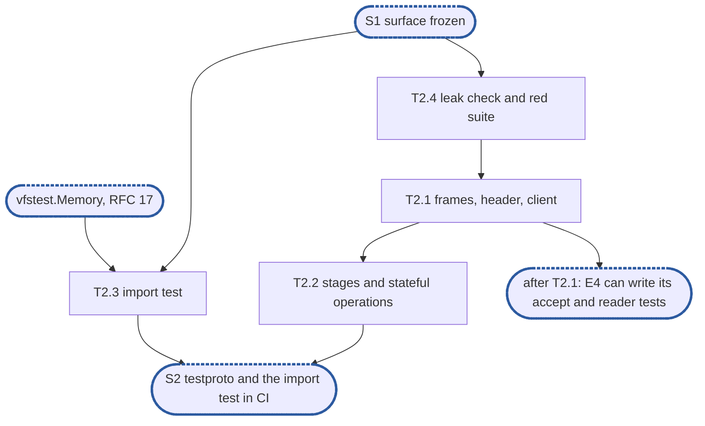

# Epic 2: adapters v2 test foundations

**Sources:** [RFC 20](../rfcs/rfc-20-adapters.md) §2.3 (imports), §2.5's `internal/` and `pkg/`
rules, its layout of `adaptertest` and its `wire` purity, §4.7 (the stages a protocol supplies,
and its closing sentence: the test-only protocol drives every symbol), §7 (the `core` layer),
§7.1 (imports), §9 A1 and A8, the suites paragraph; [RFC 29](../rfcs/rfc-29-test-harness.md)
§4.7 (known failures) and §4.11 (test doubles); `CLAUDE.md`, "Writing tests", as `develop` has it.
**Track:** the team.
**Epic 2 estimate: 4 subtasks, 10.25 man-days.**
**Depends on:** **S1, surface frozen**: E1's `internal/adapter/core` surface (RFC 20 §4.7, with
stub bodies and a working `Bind`), `pkg/adapter`'s `Deps`, `pkg/resources`' `Budgets`, `Buf` and
`BufPool`, and `pkg/vfs`' `Service` and error set. T2.3 also needs `vfstest.Memory` (§9).
**Blocks:** E3, which turns the budget and replay specifications green and registers `BufPool`'s
gate in the allocation cell this epic creates; E4 and E5, whose tests run `core` on `testproto`
over loopback, end with the leak check, and turn the end-to-end specification green; E6, whose
`wire` packages the import test holds pure and whose scaffold tests end with the leak check.

---

## 1. Goal

Epic 2 builds what every later adapter test stands on: a test-only protocol that compiles
against the frozen surface, the import test, the leak check, and, as red tests in a suite of
their own, the specifications that only a later epic's bodies can turn green.

**At the end of the epic:**

- `testproto` is a `core.Protocol`: its framer, header codec, stages and two operation tables
  compile against §4.7, its codec matches byte vectors written by hand from its own format, its
  frame decoder is fuzzed, and its header decode and encode allocate nothing;
- every §4.7 symbol a protocol implements or calls is referenced from `testproto`'s non-test
  code, and every other one is named with the epic whose test calls it;
- a client writes `testproto` records over any `net.Conn` and keeps the credit balance its
  replies grant;
- the import test runs in `unit`, reports each of its seeded violations and none of its seeded
  allowed imports, and finds no violation in the tree;
- `adaptertest.CheckLeaks` fails a test that leaves a goroutine, a descriptor or heap behind
  (through the profiler moved out of the journal's tree), or a budget charged;
- `unit/adapter-allocs` runs `testproto`'s gate per change, and `adapter-conformance` runs the
  red specifications, each listed in its `known.yaml` with the issue of the epic that turns it
  green.

Running `testproto` end to end through `core` is S3's, after E4 and E5: `NewServer`,
`NewOpTable`, `NewErrorTable` and every `Conn` method are stubs until then, which is why the one
end-to-end test written here lands red.

### 1.1 In scope

`internal/adapter/adaptertest/testproto` (format, codec, stages, operations, tables, client);
the import test and its seeds; the leak check and the profiler's move to `internal/prof`; the
`unit/adapter-allocs` cell with `testproto`'s gate; the `adapter-conformance` suite with its
`known.yaml` and three red specifications; deleting `core.Dispatcher`; moving two existing test
files to `vfstest.Memory`.

### 1.2 Out of scope

- The `core` behaviours `testproto` makes expressible (drain, holds, parks, chains, cancels,
  kept state, the handshake deadline, slow clients): each is a test of E4 or E5, the epic that
  writes the body; T2.2's table names which.
- `vfstest.Memory` and `vfstest.Faults`, and the fault that holds a call until the test releases
  it: RFC 17's (§9). `testproto`'s service calls reach whatever `Deps.VFS` holds; their first run
  on `Memory` and `Faults` is E4's, and `Create`'s one-call rule is read there from `Memory`'s
  record (E5's T5.5).
- The import test's entry-method call sites (§4.10) and 800-line allowlist (§2.5), and its rule
  for `translate`: RFC 21's and RFC 22's, with their first handlers (§9).
- `adaptertest/golden/` and the scripted client of RFC 20 §8.2: their first consumers are E6's
  `wire` tests (which read vectors through a helper inside each `wire` package) and RFC 21's and
  22's wire tests.
- The pipeline benchmark on `vfstest.Null`: E5's T5.10.

### 1.3 Names used here

- **E1**, epic 1, delete v1 and fix the surface: `core`'s §4.7 surface with stub bodies and a
  working `Bind`, and the public packages.
- **E2**, this epic.
- **E3**, epic 3, budgets and buffers: the bodies of `pkg/resources`.
- **E4**, epic 4, connections and lifecycle: `Server`, accept, `Conn`, drain, `Reconfigure`,
  health, TCP, the sidecar runner.
- **E5**, epic 5, dispatch: the pipeline, tables, compound runner, held and parked requests,
  middleware, error tables, observability.
- **E6**, epic 6, protocol scaffolds: `wire/`, `protocol/` and `New` for NFS and SMB.
- **S1**, surface frozen: after E1, `core`'s §4.7 surface and the public packages change only
  with an RFC amendment.
- **S2**, `testproto` and the import test in CI: after this epic.
- **S3**, `core` serves `testproto` end to end: after E4 and E5.
- **The deferral ledger**: the list of everything RFC 20 or develop's v1 provides that the
  branch does not serve yet, each row naming the owner that brings it back.

## 2. General rules for each epic

Each of the programme's ten general rules for an epic, and how it applies here or why it does not.

| Rule | Subtasks | How |
| --- | --- | --- |
| rule 1, independent unit tests, under `-race` ([`CLAUDE.md`, Writing tests](https://github.com/cubbit/dittofs/blob/develop/CLAUDE.md#writing-tests); [Verifying a change](../../../CLAUDE.md#verifying-a-change)) | all | `testproto` is not a double (D1); its service calls reach the `Deps.VFS` a test supplies, and every error, delay and hold comes from `vfstest.Faults` (D5). The client's test writes to one end of a loopback pair on `127.0.0.1:0` and reads the other; nothing waits on a timer |
| rule 2, fuzz tests where relevant | T2.1 | `FuzzFrame` over `Framer.BodyLen` and `HeaderCodec.Decode`, seeded with the hand-written vectors, crashers committed under `testdata/fuzz/FuzzFrame/` when found; the property is CLAUDE.md's: no panic, every length read inside the buffer, a length past the cap refused, and a decoded header re-encodes to bytes that decode to the same fields |
| rule 3, observability follows RFC 25 and RFC 20 §10 | T2.1, T2.2 | `testproto` is protocol code: it records no metric, span or log key, and takes no `Deps.Metrics`, `Tracer` or `Logger` |
| rule 4, leaks and allocations | T2.1, T2.4 | T2.4 writes the leak check; T2.1 writes `testproto`'s 0-allocation header gate and registers it in `unit/adapter-allocs`, which it creates (D12); the end-to-end specification ends with the leak check |
| rule 5, v2 ignores v1 | T2.3 | the import test fails a package at any path v1 used that v2 does not (D9) |
| rule 6, nothing deferred is lost | T2.2, T2.3 | §7.1's entry-method and file-size checks are existing ledger rows; §9 adds the `translate` clause and `Faults`' release-on-cue fault |
| rule 7, code comment conventions ([`CLAUDE.md`, Code comments](../../../CLAUDE.md#code-comments): `ponytail:` and `decision:` markers) | T2.1, T2.2, T2.3, T2.4 | the `decision:` markers of D1, D4, D5, D6, D7 and D8 at their code sites, the `ponytail:` markers of D10 and D16, each with an upgrade local to its file |
| rule 8, a test must be able to fail ([`CLAUDE.md`, Writing tests](https://github.com/cubbit/dittofs/blob/develop/CLAUDE.md#writing-tests); [Verifying a change](../../../CLAUDE.md#verifying-a-change)) | all | the import test reports one seeded violation per rule and no seeded allowed import (D9); each red specification fails today on the stub it names, and passes only once that stub has its body (D11) |
| rule 9, a symbol is exported only if RFC 20's interface uses it | T2.2 | nothing is added to `core` or the public packages; T2.2 removes `core.Dispatcher`, which §4.7 does not name (D18) |
| rule 10, each subtask creates only what it declares | T2.2, T2.4 | every operation and stage of `testproto` has a later test that calls it (T2.2's table); the profiler moves rather than a second one being written (D13) |

## 3. Requirements and invariants

Every obligation RFC 20, RFC 29 and the repository's test rules place on this epic, numbered so
that subtasks and tests can cite them. Where only part of an obligation is this epic's, the row
names the epic that owns the rest.

**The import test**

| # | Requirement | Kind | Source | Subtasks |
| --- | --- | --- | --- | --- |
| R1 | Every adapter package's non-test files import only the standard library, `pkg/vfs` (and its packages but `vfstest`), `pkg/adapter`, `pkg/adapter/config`, `pkg/resources`, `pkg/metrics`, `internal/tlsconfig`, their own adapter's packages and `core`, the tracing API `Deps.Tracer` names, and wire-format libraries that do no file I/O | MUST | RFC 20 §2.3, §7.1, §9 A1 | T2.3 |
| R2 | They never import a metadata store, the open-state tables, the content engine, the topology or routing code, `pkg/identity` or `internal/identity`, the configuration store, the health package, or another adapter: NFS's packages never import SMB's, nor SMB's NFS's | MUST NOT | §2.3, §7.1, A1 | T2.3 |
| R3 | The rule is enforced by a test that reads the import graph and fails naming the package and the forbidden import | MUST | §2.3, §7.1 | T2.3 |
| R4 | The test is seeded with deliberate violations in its own test data and must report them, so a check that silently matches nothing is caught | MUST | §7.1; rule 8 | T2.3 |
| R5 | No package under `pkg/` but `pkg/adapter/nfs` and `pkg/adapter/smb` imports anything under `internal/adapter/`, and each of the two imports only its own protocol's | MUST | §2.5, §7.1 | T2.3 |
| R6 | No implementation package imports a constructor package | MUST | §2.5, §7.1 | T2.3 |
| R7 | `pkg/adapter` imports nothing of the core but `pkg/vfs`, `pkg/metrics`, `pkg/resources` and `pkg/adapter/config`; `pkg/adapter/config` is a leaf | invariant | §2.5 | T2.3 |
| R8 | A `wire` package imports nothing but the standard library and `pkg/resources` | MUST | §2.5, §7.1 | T2.3 |
| R9 | The test starts with no allowlist: nothing is grandfathered in | invariant | §7.1 | T2.3 |
| R10 | `core`'s non-test files import no protocol, and its tests no protocol but `testproto`: never NFS's or SMB's | invariant | §2.5 (layout), §7; rule 1 | T2.3 |
| R11 | An adapter package's `_test.go` files may also import `pkg/vfs/vfstest`, `adaptertest` and its `testproto`, and the profiler `internal/prof`, and nothing else the list forbids; `adaptertest`'s own non-test files may import `internal/prof` | invariant | §7.1; D13 | T2.3 |
| R12 | `adaptertest` and `testproto` are imported by no non-test file outside themselves, and `pkg/vfs/vfstest` by no adapter non-test file | invariant | §7.1 ("no forbidden package reaches an adapter's build"), §2.5 (layout) | T2.3 |
| R13 | No package exists at a path v1 used that v2 does not: `pkg/controlplane/runtime/adapters`, `internal/adapter/{common,pool,testruntime,auth}`, `internal/adapter/nfs/rpc`, `internal/adapter/smb/{session,handlers}` | MUST | rule 5; owner decision | T2.3 |

**The test-only protocol**

| # | Requirement | Kind | Source | Subtasks |
| --- | --- | --- | --- | --- |
| R14 | `core` is proven on a test-only protocol in `adaptertest/testproto`, of length-prefixed frames, with an echo, a delay, an operation that panics and one that holds; the delay and the hold are a service call that `vfstest.Faults` delays or answers `ErrDelay`, never an operation of the protocol (D5) | MUST | RFC 20 §7, §2.5 (layout) | T2.1 |
| R15 | It has a handshake, session levels, kept state, held and parked requests, a cancel and chained messages, so every type of §4.7 is exercised: every §4.7 symbol a protocol implements or calls is referenced from its non-test code, and every other one is named with the epic whose test calls it | MUST | §7, §4.7 (closing sentence); E1's R75 | T2.2 |
| R16 | It is driven over a plain connection: a client writes its records to any `net.Conn` and keeps the credit balance the replies grant | MUST | §7; owner decision | T2.1 |
| R17 | `NewConn` runs at accept and returns the connection's stages, `Header` and `Router` always set; the `Hold` stage is set where a table `Holds` and nil elsewhere | MUST | §4.7 | T2.1, T2.2 |
| R18 | `HoldCodec.Key` never returns 0 | MUST | §4.7 | T2.2 |
| R19 | `HoldCodec.Interim` grants the request's credits when told to, else only what keeps the balance at one; for a `NoReply` row it also grants the credits of the `after` headers, summed and saturating at the connection's credit target rather than wrapping | MUST | §4.7 | T2.2 |
| R20 | `Security.Unwrap` resolves the IDs a related member inherits from `prev` before it checks the member, so the check never runs against an unresolved ID; `Wrap` transforms the reply in place | MUST | §4.7 | T2.2 |
| R21 | `ReplayCache`'s `Lookup` returns a fresh copy of a cached reply, charged to a reply reservation of its size under `ctx`; `Store` keeps its own clear copy | MUST | §4.7 | T2.2 (green with E3) |
| R22 | The protocol owns its sessions: one registry per `Protocol`, handed to each connection's stages at `NewConn`; a connection's `OnClose` drops its references to the sessions it carried | MUST | §4.7 ("Sessions span connections") | T2.2 |
| R23 | A compound row's `Decode` decodes the compound's own arguments, sets `Invocation.Count` and returns the bytes it took; its `Members` table reads each member's code with `ReadOp` | MUST | §4.7 | T2.2 |
| R24 | A `testproto` request accepted over loopback by a `core` server is answered, and the server leaks nothing when it stops | MUST | §7 (the `core` layer) | T2.1 (green with E4 and E5) |

**Codec, fuzzing and allocations**

| # | Requirement | Kind | Source | Subtasks |
| --- | --- | --- | --- | --- |
| R25 | `testproto`'s frame decoder has a native fuzz target: accepted or refused, never a panic, every length it reads inside the buffer | MUST | rule 2 | T2.1 |
| R26 | `BodyLen` refuses a length past the protocol's cap, so nothing is reserved or allocated for it | invariant | §9 A8 | T2.1 |
| R27 | Its header decode and encode allocate nothing per call | bound | rule 4 | T2.1 |
| R28 | Each allocation gate is registered in the per-change `unit/adapter-allocs` cell by the subtask that writes it, a non-race cell, since allocation gates skip under `-race` | MUST | rule 4; §6.10; the suites paragraph | T2.1 |

**Leak check and red specifications**

| # | Requirement | Kind | Source | Subtasks |
| --- | --- | --- | --- | --- |
| R29 | One call fails a test that leaves behind a goroutine it started, naming each with its stack; it polls the goroutines themselves, never a fixed sleep, with one backstop timeout; no new dependency | MUST | rule 4; `CLAUDE.md` "Writing tests" | T2.4 |
| R30 | The same call fails when any of `Deps.Budgets`' four budgets reads above zero, naming it | MUST | rule 4, rule 8; §6.8; §9 A18 | T2.4 (green with E3) |
| R31 | A test that can pass only once a later epic fills a stub lands red in the `adapter-conformance` suite, behind its own build tag, with one `known.yaml` entry giving its failure message and the issue of the epic that turns it green; that epic removes the entry; the suite is named in RFC 20's suites paragraph and its tag in `lint-go`'s vet line | MUST | RFC 29 §4.7, §4.9; owner decision | T2.4 |

## 4. Decisions this epic takes

- **D1, `testproto` is not a test double.** RFC 29 §4.11's three kinds are stand-ins for a
  collaborator of the code under test. `testproto` stands in for none: it is a third
  implementation of `core.Protocol`, an interface with two production implementations, and a
  `core` test's subject is `core`, with `testproto` its input, as an operation table is data.
  So none of the three kinds applies, and it needs no conformance suite. It is held honest
  three ways: its handlers are thin (decode, at most one service call, encode) and answer
  nothing in the service's place; every error, delay and hold a `core` test needs comes from
  the service the test supplies, `vfstest.Faults` around `vfstest.Memory`, kinds 3 and 2; and its
  codec and stages are verified against byte vectors written by hand and as state machines. A
  `decision:` marker on `Protocol` states this: withdraw it if a `core` test ever needs
  `testproto` to decide something the service would.
- **D2, a format of its own, written before the codec.** The package doc states the record
  (a 4-byte length, then one or more messages, each a fixed header and its arguments, chained by
  the header's `next` offset) and the header's fields, all big-endian: `next`, flags
  (`related`, `pend`, `reply`, `interim`), version, operation (32 bits, as `core.Header.Op`
  returns), message ID, session (all ones: inherited from the member before), tree, credits,
  sequence, status and a checksum, which `Append` computes keyed by the message's session (none
  for session 0). The cap is 1 MiB. T2.1's vectors are written by hand from that doc, so they are
  an oracle independent of the encoder.
- **D3, two tables, one per version.** Version 1 answers every error at once and carries the
  compound row, as NFSv4 does; version 2 `Holds`, as SMB does, and is the table chains, holds
  and parks run on. A connection negotiates the higher of the two it offers. Two tables are the
  least that gives E5 both `NoReply` behaviours (an interim where the table holds, nothing where
  it does not) and a `Versions` column to check. Stages are per connection and `NewConn` runs
  before negotiation, so a full `testproto` connection, which may reach version 2, sets `Hold`;
  a version-1 request on it is never keyed or held, since its table's `Holds` is false. `Bare`,
  which routes to version 1 only, leaves `Hold` nil (R17).
- **D4, the header points into the record.** `testproto`'s `Header` is a pointer to the header's
  bytes in the record (`(*header)(rec.B[off:off+headerLen])`, a slice-to-array-pointer
  conversion), so returning it as a `core.Header` allocates nothing (R27). It is valid while the
  record's `Buf` is retained, which `core` does for a request's life (RFC 20 §4.7's release-hook
  `decision:`). A `decision:` marker at the type names that bound: withdraw it if `core` ever
  releases a record before its request ends.
- **D5, delays, holds and transient errors come only from `vfstest.Faults`; the user chose this.**
  RFC 20 §7 gives the test protocol's delays to the fault wrapper, and RFC 29 §4.11 gives an
  error answer to a fault wrapper too. So `Create`, the operation that calls the service, is the
  delay (a `Faults` hold the test releases) and the hold (a `Faults` `ErrDelay` mapped to version
  2's hold row); `testproto` has no operation that sleeps or answers an error itself, and no
  hook through which a test completes a request. A `decision:` marker at the hold row says so. It
  depends on `Faults` gaining the fault that holds a call until the test releases it (§9).
- **D6, a parked request waits on the service.** `Park`'s handler calls `Request.Park` and,
  once parked, makes its service call, a `Create` of the name its arguments carry, under a
  context the `cancel` it handed `Park` cancels; `done` receives that call's result. A test
  parks a request by holding that `Create` in `Faults`, completes it by releasing the hold, and
  reads a withdrawal from the outcome: a cancelled park's reply carries the cancel status and
  `Memory` holds no file of that name, and a refused park makes no call at all. Nothing records
  which calls were made. A `decision:` marker at the handler says the waiter is the held call,
  not a lock wait: RFC 21's and 22's handler tests prove the service's own waits.
- **D7, tables built at the first `Route`.** `New` stores `Deps` and builds its tables with
  `sync.OnceValue` on the first route, so a test that starts a `Server` on `testproto` and routes
  nothing (E4's lifecycle and accept tests) does not need table construction. A `decision:`
  marker says a table check failing shows at the first request rather than at `New`, which a
  test protocol can afford.
- **D8, the error tables are not total.** They map `core`'s refusals, `vfs.ErrDelay` (with a
  bounded `Hold` in version 2) and `core.ErrDraining` (`NoReply`), each status named with the
  later test that reads it, and nothing else, so an unmapped service error, answered server
  fault and counted (E5's T5.7), is reachable. `ErrMoved` has no row: `MoveTarget` answers none
  until RFC 15's topology exists, so no test can reach it, and its row comes with the first that
  can. Totality is a protocol table's property (§7.3), RFC 21's and 22's. A `decision:` marker on
  the tables says so.
- **D9, one seed per rule, and seeded allowed imports.** §7.1 seeds one violation; a walk with
  several rules can lose one silently, so each rule gets its own seed, as
  `internal/vfs/arch_test.go` does, and each allowance (a `core` test importing `testproto`, an
  adapter test importing `vfstest`, `adaptertest` importing `internal/prof`) gets a seed the test
  must not report, so a rule written too wide fails too. A v1 path is checked by whether a
  package exists there, which also covers any import of it.
- **D10, the walk reads files, not packages.** The import test reuses
  `internal/vfs/arch_test.go`'s approach, `go/parser` with `ImportsOnly` over every `.go` file
  under the tree, `testdata` left out, rather than `go/packages`: standard library only, and
  build-tagged files are read whatever their tags, so an import behind a tag is not hidden. A
  `ponytail:` names the ceiling: a package's path is read from its directory, so a `replace` or a
  vendored copy would be missed; move to `go/packages`, inside the test alone, if the module ever
  has one.
- **D11, red specifications land in `adapter-conformance`.** A test that is the specification a
  later epic builds to lands now, red, rather than with that epic: the budget half of the leak
  check (E3), `ReplayCache`'s copy (E3) and one `testproto` request end to end (E4 and E5). Each
  sits behind the `adapter_conformance` build tag, is named `TestConformance…`, and has a
  `test/adapter/known.yaml` entry with `status: fail`, `fix: planned`, `category: feature`, a
  `reason`, the `message` its stub fails with, and `issue:` quoted. A stub that panics
  (`Reserved`) is turned into a failure by a deferred `recover` in the test, so one panic does not
  stop the cell's other tests. The suite is `engine-conformance`'s shape, `tier: pr`.
- **D12, the allocation cell lands here; the user chose this.** `testproto`'s header gate is the
  first allocation gate written, so `unit/adapter-allocs` and its fixed `dt run` step in the unit
  job, as `unit/journal-index` has, land with it in T2.1 rather than with `BufPool`'s in E3. E3's
  T3.3 adds its package to the cell's command.
- **D13, the leak check is the journal's profiler, moved; goroutine IDs, the user chose this.**
  `pkg/block/journal/journaltest/prof` already fails a test that leaves goroutines (compared by ID
  from `runtime.Stack`, polled to a backstop), descriptors or live heap behind, and says to move
  it out of the journal's tree once a package outside it needs one. T2.4 moves it to
  `internal/prof` (import path `github.com/cubbit/dittofs/internal/prof`), unchanged, with its
  tests, updating its importers and the engine's import test's allowlist entry; `CheckLeaks`
  calls `prof.Watch` and adds only the budget check, and `testproto`'s gate reads
  `prof.RaceEnabled`. Its ceiling, which goleak shares, is its own `decision:`: a watched test
  does not run in parallel.
- **D14, E1's two import-shape tests fold into the import test.** `pkg/adapter`'s
  `TestImportsOnlyTheContractsItNames` and `pkg/adapter/config`'s
  `TestImportsOnlyTheStandardLibrary` stood in for this test until it landed; R7 now holds both
  rules, each with its seed, so they are deleted rather than kept as a second copy that can drift.
  `pkg/resources`' `TestImportsOnlyStdlibAndMetrics` stays: its rule is RFC 24 §2.8's.
- **D15, two test files move to `vfstest.Memory`.** `pkg/adapter/nfs/nfs_test.go` and
  `pkg/adapter/smb/smb_test.go` import `internal/vfs` for a typed nil `*vfs.Filesystem`, which
  R11 forbids. They take `vfstest.Memory(t)`, the service RFC 20 §7.2 gives adapter tests;
  `vfstest.Null` is not used, since RFC 20 §7 keeps it for the allocation gate and the
  benchmarks. So the import test starts green with no allowlist (R9), and T2.3 waits for
  `Memory`.
- **D16, the coverage check reads names.** T2.2's test that every §4.7 symbol is referenced
  matches `core.<Name>` selectors and, for `Conn`'s and `Request`'s methods, the method names,
  with `go/parser` alone, against an exemption list in the test naming, for each symbol a
  protocol neither implements nor calls, the epic whose test calls it. A `ponytail:` names the
  ceiling: a method of another type with the same name counts; move to `go/types`, inside the
  test, if that ever hides a gap.
- **D17, what is settled here for good, what is deferred, and what either costs.** E4, E5 and E6
  write their tests against these, so each is designed now as final:
  - `adaptertest.CheckLeaks(t, b)` and `internal/prof`'s path: every pipeline test of E4, E5 and
    E6 calls the first and the journal's and engine's tests import the second, so a change means
    editing each of them;
  - `testproto.New(d adapter.Deps)`, `Bare`, the operation codes and statuses (typed as `core`'s
    `uint32` code and `core.Version`, so no test converts), `Msg`, `Reply`, `Append` and `Client`:
    every `core` test builds its requests and reads its replies through them;
  - the import test's lists, the allowed imports and the v1 paths, each one Go slice with a
    comment per entry: an entry is added by the change that needs it, with its reason;
  - the record and header layout (D2, D4): only `testproto`'s own vectors and fuzz seeds read the
    bytes, so a change costs those alone, but it is written as final, since E5's chain and
    compound tests depend on what it can say.
  What is deferred is additive and in one place: the import test's entry-method, 800-line and
  `translate` clauses are new cases and seeds (RFC 21 and 22); a golden-vector helper is E6's,
  inside each `wire` package; a new operation a later `core` test needs is a new row and new
  `Msg` fields. None changes a signature another epic calls.
- **D18, `core.Dispatcher` is deleted; the user chose this.** E1's `conn.go` exports a
  `Dispatcher` interface between the connection and the pipeline and says a connection's tests
  supply a stub. RFC 20 §4.7 says the pipeline is a concrete type with no interface between
  them and that a connection's tests run the real pipeline (E1's R72), and a stub is a banned
  double. T2.2 deletes it from `internal/adapter/core/conn.go` and its declaration from
  `internal/adapter/core/testdata/surface/core.golden`. The RFC needs no amendment, since §4.7
  never named it. Removing it after E4 has built the connection would mean reworking the
  connection's tests, so it is settled before any body exists.

## 5. Target tree

```text
internal/prof/                     T2.4  moved from pkg/block/journal/journaltest/prof, unchanged (D13)
internal/adapter/adaptertest/
  leak.go                          T2.4  CheckLeaks, budgetsHeld
  leak_conformance_test.go         T2.4  red: the budget check fails on a charged budget
  imports_test.go                  T2.3  the import test
  testdata/imports/                T2.3  one seed per rule and per allowance
  testproto/
    wire.go                        T2.1  the format (package doc), Framer, header, HeaderCodec, Append
    proto.go                       T2.1  Protocol, New, Bare, NewConn, Router, the tables, Negotiate, Echo, PutFH, Create, Panic
    client.go                      T2.1  Msg, Reply, Client
    stages.go                      T2.2  Security, FlowControl, ReplayCache, HoldCodec
    state.go                       T2.2  sessions, Session, Logoff, Tree, Park, Notify, Violate, the compound row
    wire_test.go                   T2.1  vectors, FuzzFrame, the header gate, the client
    proto_test.go                  T2.1  the rows' decoders, Panic
    stages_test.go                 T2.2  the stages as state machines, NewConn's stages
    state_test.go                  T2.2  the registry, the compound row's Decode, the coverage check
    conformance_test.go            T2.1, T2.2  red: one request end to end; ReplayCache's copy
internal/adapter/core/conn.go      T2.2  Dispatcher deleted (D18)
internal/adapter/core/testdata/surface/core.golden  T2.2  Dispatcher's entry deleted (D18)
pkg/block/journal/journaltest/prof/  T2.4  moved out; its importers and pkg/block/engine/imports_test.go updated
pkg/adapter/adapter_test.go        T2.3  import-shape test removed (D14)
pkg/adapter/config/config_test.go  T2.3  import-shape test removed (D14)
pkg/adapter/nfs/nfs_test.go        T2.3  vfstest.Memory for internal/vfs (D15)
pkg/adapter/smb/smb_test.go        T2.3  vfstest.Memory for internal/vfs (D15)
test/adapter/known.yaml            T2.4  the red specifications (D11)
test/suites.yaml                   T2.1  unit/adapter-allocs cell; T2.4  adapter-conformance suite, its tag in lint-go's vet line
.github/workflows/tests.yml        T2.1  unit/adapter-allocs' fixed step; T2.4  adapter-conformance in the branch's cell filter
docs/internals/rfcs/rfc-20-adapters.md  T2.4  the suites paragraph names adapter-conformance
docs/internals/testing.md          T2.4  regenerated by dt docs
```

The exported surface this epic adds or changes:

```go
package prof // moved: github.com/cubbit/dittofs/internal/prof, its exports unchanged
func Watch(tb testing.TB, opts Options)
type Options struct{ HeapSlack uint64 }
func LiveHeap() uint64
func Descriptors() (int, bool)
const RaceEnabled bool

package core // removed: no longer exported
// type Dispatcher interface { Dispatch(ctx context.Context, c *Conn, rec *resources.Buf); Drain() }

package adaptertest

// CheckLeaks, called first in a test, fails it at its end when a goroutine or
// descriptor opened since is still open, the live heap grew, or a budget of b
// (nil: none) still holds bytes.
func CheckLeaks(t testing.TB, b *resources.Budgets)

package testproto

func New(d adapter.Deps) *Protocol // reads d.VFS, and d.Budgets.Reply for ReplayCache's copies
type Protocol struct{ /* unexported */ }
func (p *Protocol) Framer() core.Framer
func (p *Protocol) NewConn(c *core.Conn) core.Stages
func (p *Protocol) Bare() core.Protocol // the same frames, Header and Router only, version 1

// The operation codes, typed as core.Op.Code and core.Header.Op are.
const (
	OpNegotiate uint32 = iota + 1 // NeedsNothing; the higher version both sides offer
	OpSession                     // NeedsNegotiated, Expired; Conn.Established, Conn.Keep when Msg.Keep
	OpLogoff                      // RoleRelease, Expired; ends the session and its keep
	OpTree                        // NeedsSession
	OpPutFH                       // NeedsTree, RoleContext; Invocation.Handle is Msg.Handle
	OpEcho                        // NeedsNothing; Invocation.Role is Msg.Role
	OpCreate                      // NeedsTree|NeedsFH, Cacheable; one vfs.Service.Create of Msg.Name
	OpPanic                       // its handler panics
	OpPark                        // version 2: Request.Park, then a Create of Msg.Name (D6)
	OpNotify                      // Conn.Send ahead of the reply keyed by Msg.Target
	OpViolate                     // Conn.Close
	OpCancel                      // never routed: HoldCodec.Cancels names the request keyed by Msg.Target
	OpCompound                    // version 1: the compound row, its members Msg.Members
)

// The statuses, one per error-table row, each named with the later test that reads it.
const (
	StatusOK             core.Status = iota
	StatusFault                      // unmapped error (E5 T5.7)
	StatusNotSupported               // core.ErrNotSupported (E5 T5.2)
	StatusVersion                    // core.ErrVersion (E5 T5.2)
	StatusNotNegotiated              // core.ErrNotNegotiated (E5 T5.2)
	StatusNoSession                  // core.ErrNoSession (E5 T5.2)
	StatusNoTree                     // core.ErrNoTree (E5 T5.2)
	StatusNoFH                       // core.ErrNoFH (E5 T5.2)
	StatusTooLong                    // core.ErrTooLong: a compound past its cap (E5 T5.4)
	StatusExpired                    // core.ErrExpired (E5 T5.2)
	StatusNotLast                    // core.ErrNotLast (E5 T5.4, T5.11)
	StatusTooManyPending             // core.ErrTooManyPending (E5 T5.11)
	StatusDelay                      // vfs.ErrDelay: at once in version 1, once its hold passes in version 2 (E5 T5.5)
	StatusCancelled                  // a parked or held request its client cancelled (E5 T5.5, T5.11)
)

type Msg struct {
	Op      uint32
	Version core.Version
	ID      uint64
	Session uint32 // all ones: inherited from the member before
	Tree    uint32
	Credits uint16 // charged by this message
	Seq     uint32
	Related bool
	Pend    bool       // HoldCodec.Pends answers true for this member
	Role    core.Role  // OpEcho: its per-request role
	Keep    bool       // OpSession: keep the connection past the idle timeout
	Expires time.Time  // OpSession: the credential's end
	Handle  vfs.Handle // OpPutFH
	Name    string     // OpCreate, OpPark
	Target  uint64     // OpNotify, OpCancel: the message ID of the request it names
	Payload []byte     // OpEcho
	Members []Msg      // OpCompound
}
type Reply struct {
	ID      uint64
	Status  core.Status
	Interim bool
	Credits uint16 // granted by this reply
	Body    []byte
}
func Append(b []byte, msgs ...Msg) []byte // one record, chained when several
type Client struct{ /* unexported */ }
func NewClient(c net.Conn) *Client
func (c *Client) Send(msgs ...Msg) error
func (c *Client) Recv() ([]Reply, error) // one record's replies, an interim included
// Balance is the credits every Reply received granted, interims included, less the
// credits every Msg sent charged; it starts at 1, the credit a connection opens with.
func (c *Client) Balance() int
```

## 6. Subtasks

### T2.4 The leak check and the red suite

**Subtask T2.4 estimate: 1.5 man-days.**

- **Track:** the team. **Depends on:** S1. First, since T2.1 and T2.2 read `prof` and land red
  specifications in the suite this registers.
- **Covers:** R29, R30, R31.
- **Deliverables:**
  - `pkg/block/journal/journaltest/prof` moved to `internal/prof` with its tests (D13); every
    importer's import line and `pkg/block/engine/imports_test.go`'s entry updated;
  - `leak.go`: `budgetsHeld(b *resources.Budgets) error`, naming each of `Receive`, `Reply`,
    `Connection` and `Hold` whose `Reserved` is above zero; `CheckLeaks(t, b)`, which calls
    `prof.Watch(t, prof.Options{})` and registers a `t.Cleanup` reporting `budgetsHeld`;
  - the `adapter-conformance` suite in `test/suites.yaml` (`format: go-json`, `cmd: go test -race
    -tags=adapter_conformance -run ^TestConformance ./internal/adapter/...`, `known:
    test/adapter/known.yaml`, `tier: pr`), in a component group named `adapters`; the tag on
    `lint-go`'s `go vet -tags=` line; the suite in `tests.yml`'s branch cell filter beside
    `engine-conformance`; RFC 20's suites paragraph naming it; `docs/internals/testing.md`
    regenerated with `test/harness/bin/dt docs`;
  - `leak_conformance_test.go`: `TestConformanceBudgetsHeldNamesACharged` and its
    `known.yaml` entry (`message: 'not implemented'`, `issue: "#3964"`).
- **Consumers:** every E4, E5 and E6 test that runs the pipeline (rule 4); E3, which turns the
  budget specification green and removes its entry; the end-to-end and replay specifications of
  T2.1 and T2.2.
- **Acceptance criteria:**
  - The moved profiler's tests pass at its new path, and no file names the old one.
  - `test/harness/bin/dt run adapter-conformance` grades the budget specification as its known
    failure, and fails the run if the test passes while its entry remains.
  - `dt docs --check` passes with the new suite.
- **Tests:** `prof`'s own tests, moved (they catch a goroutine, descriptor or heap check that
  never fails); the budget specification, a `Buf` reserved and kept past the check, asserting
  `budgetsHeld` names `Reply` (red until E3: catches a check that reads one budget, or none). Run
  with `test/harness/bin/dt run unit` and `test/harness/bin/dt run adapter-conformance`.
- **Rules:** rule 8: D11; rule 10: D13.

### T2.1 `testproto`: frames, header, client and the stateless operations

**Subtask T2.1 estimate: 3 man-days.**

- **Track:** the team. **Depends on:** T2.4.
- **Covers:** R14, R16, R17, R24, R25, R26, R27, R28.
- **Deliverables:**
  - `wire.go`: the format in the package doc (D2); `Framer` (`HeaderLen` 4, `BodyLen`
    refusing a length past 1 MiB); the header type of D4 and its `Op`, `Version`, `Next` and
    `Related`; the `HeaderCodec` (`Decode(rec, off)`, `Encode(h, s, out)`, `Chain(out, prev)`
    writing the reply at `prev`'s `next`); `Append`.
  - `proto.go`: `New`, `Protocol`, `Framer`, `NewConn`, `Bare` (D3); the `Router` choosing the
    table by the header's version; the two tables (D3, D7) and their error tables (D8); rows built
    with `core.Bind`: `Negotiate`, `Echo`, `PutFH`, `Create`, `Panic`, as §5's codes say;
    `decision:` markers for D1, D5, D7 and D8.
  - `client.go`: `Msg`, `Reply`, `Client`, `NewClient`, `Send`, `Recv`, `Balance` as §5 states
    its contract.
  - `unit/adapter-allocs` in `test/suites.yaml`, its command `go test` over
    `./internal/adapter/adaptertest/testproto/`, and its fixed `dt run` step in the unit job (D12).
  - `conformance_test.go`: `TestConformanceEchoEndToEnd`, a `core.NewServer` on `testproto` over
    `127.0.0.1:0`, one `Echo` sent by the client and its reply read, `CheckLeaks` clean after
    `Stop`; its `known.yaml` entry (`message: 'core: new server'`, `issue: "#3966"`, its reason
    naming E4's server and E5's pipeline).
- **Consumers:** E4's accept, reader, writer and sidecar-runner tests (T4.1–T4.4, T4.9: `Echo`,
  `Client`, `Bare` as the second listener); E5's T5.1 (nil stages over `Bare`, `Echo`'s role),
  T5.2 (`Versions`, `Needs`), T5.3 (the cap of 64 over `Bare`), T5.5 (`Create` held), T5.6
  (`Panic`), T5.10 (the benchmark over `Echo`).
- **Acceptance criteria:**
  - Each vector of the package doc decodes to the fields it was written from, and each field
    set encodes to its vector's bytes.
  - `BodyLen` refuses a length past the cap; `Decode` refuses a header that runs past the record,
    and a `next` that points backwards or past it.
  - `Decode` and `Encode` allocate nothing (`testing.AllocsPerRun`), skipped when
    `prof.RaceEnabled`, the gate running in `unit/adapter-allocs`, whose log on a pull request
    names it.
  - `Echo`'s `Decode`, through `Bind`, gives an `Invocation` whose `Role` returns `Msg.Role`;
    `PutFH`'s gives a `Handle` returning `Msg.Handle`; `Panic`'s `Call` panics.
  - The client writes exactly the bytes `Append` gives, and `Balance` follows §5's contract.
  - `NewConn` sets every stage on the full protocol, `Hold` included, and only `Header` and
    `Router` on `Bare`.
- **Tests:** the vectors, both directions (catches a field at the wrong offset or of the wrong
  width, which a round trip of `Append` and `Decode` would pass); `FuzzFrame` (catches a panic or
  a read past the buffer on a hostile length); the over-cap vector (catches a `BodyLen` that
  passes a length `core` would reserve for, R26); the header gate (catches a header that boxes a
  value into `core.Header`, D4); `Echo`'s and `PutFH`'s decoders through `Bind` (catch a role or
  handle read from the wrong argument, which every drain test of E4 and E5 would misread as a
  `core` bug); `Panic`'s `Call` under `recover` (catches a `Panic` that returns an error, under
  which E5's recovery test would pass without recovering anything); the client over a loopback
  pair, the read end compared with the vector, and the balance after a scripted reply sequence
  (catches an interim counted twice); `NewConn`'s stages (catches a `Bare` carrying `Flow`, under
  which E5's cap-of-64 test would not test the default, or a `Hold` missing on the full protocol,
  R17); the end-to-end specification (red until E4 and E5: it is S3's definition, R24). Run with
  `test/harness/bin/dt run unit`, `test/harness/bin/dt run unit/adapter-allocs` and
  `test/harness/bin/dt run adapter-conformance`.
- **Rules:** rule 2 and rule 4 as §2 says; rule 7: D1, D5, D7 and D8.

### T2.2 `testproto`'s stages and stateful operations

**Subtask T2.2 estimate: 3.75 man-days.**

- **Track:** the team. **Depends on:** T2.1.
- **Covers:** R15, R17, R18, R19, R20, R21, R22, R23.
- **Deliverables:**
  - `stages.go`, each stage set by `NewConn` on the full protocol and nil on `Bare`:
    - `Security`: once a session is set up, `Wrap` XORs the reply's body with the session's key
      and writes the checksum; `Unwrap` takes an inherited session from `prev`, checks the
      checksum, then reverses the XOR, so a reply wrapped twice no longer decodes;
    - `FlowControl`: the connection's granted credits; `Admit` charges the header's credits and
      refuses a message that would overdraw;
    - `ReplayCache`: a map from (session, sequence) to the clear reply `Store` copied; `Lookup`
      returns a fresh copy from a `BufPool` over `Deps.Budgets.Reply`, under `ctx`;
    - `HoldCodec`: `Key` the message ID with its top bit set, never 0; `Interim` granting the
      request's credits, or only what keeps the balance at one, and for `after` their sum capped
      at a credit target of 64; `Final`; `Cancels` for `OpCancel`, keyed by `Msg.Target`; `Pends`
      returning the message's `pend` flag.
  - `state.go`: the session registry, one per `Protocol`, `OnClose` dropping the connection's
    references; `Session`, `Logoff` and `Tree` setting `Request.Level` and `Request.State` through
    the `Router`, from `prev` for a related member; `Park` (D6), `Notify`, `Violate`; the
    compound row of version 1, its `Decode` reading a count and building the `Invocation`
    directly, `Members` the version-1 table with its `ReadOp`; `Stages.MaxPending` of 8;
    the `decision:` of D6.
  - `core.Dispatcher` deleted from `conn.go`, with its declaration in `core.golden` (D18).
  - `conformance_test.go`: `TestConformanceReplayLookupCopies` and its `known.yaml` entry
    (`message: 'resources: get'`, `issue: "#3964"`).
  - `state_test.go`'s coverage check (D16).
- **What each `core` behaviour is given, and where its test lands:**

  | `core` behaviour | What `testproto` gives it | Test lands in |
  | --- | --- | --- |
  | handshake deadline; kept state past the idle timeout | `Session` (`Established`, `Keep`), `Logoff` | E4 T4.7 |
  | `OnClose` on close | the registry | E4 T4.5 |
  | a message sent ahead of a named reply | `Notify` | E4 T4.4 |
  | session and tree levels; `Versions` | `Session`, `Tree`, D3's tables | E5 T5.2 |
  | drain decided per request; the expired-credential gate | `Echo`'s role, `PutFH`'s handle, `Session`'s expiry, `Logoff` | E5 T5.1, T5.2; E4 T4.5 |
  | chains: a related member's state, a bad checksum, a pending last member, a member before the last pending or answered `ErrNotLast`, a `NoReply` stop whose interim grants the later members' credits, replies wrapped once | version 2, `Msg.Related`, `Msg.Pend`, the stages, `Client.Balance` | E5 T5.4, T5.5 |
  | a single-reply compound judged whole while draining; the slot's sequence kept; a compound past its cap | the compound row, `PutFH`'s handle, `Echo`'s role, `ReplayCache` | E5 T5.4 |
  | holds past the ceiling and the floor, a cancel before and after its target | `Create` held by `Faults`, `OpCancel`, `HoldCodec` | E5 T5.5 |
  | parks refused before the last, past `MaxPending`, with the reply pool full; cancelled by the client and by a drain; racing a grant; already past an interim; a connection closed on a scripted violation | `Park` over a `Faults` hold, `Violate` | E5 T5.11 |
  | panic recovery | `Panic` | E5 T5.6 |

- **Acceptance criteria:**
  - Every exported identifier of `core` is referenced as `core.<Name>` in `testproto`'s non-test
    files, and every exported method of `Conn` and `Request` by name, but for those on the
    test's exemption list, each with the epic whose test calls it: `NewServer`, `Server` and its
    methods, `Listener` (E4's T4.1, T4.7), `Errors` and `ErrorTable.Map` (E5's T5.7), `Call` and
    `Middleware` (E5's T5.6), `Conn.Settings` (E6's T6.3 and T6.4, whose `NewConn` reads the
    snapshot's range).
  - A message with one byte changed is refused by `Unwrap`; a related member with an all-ones
    session is checked under `prev`'s session, and without `prev` is refused.
  - `Key` is never 0, also for message ID 0; `Interim` grants the request's credits with `grant`,
    one without it, and stops at 64 over `after`.
  - `Admit` refuses the charge that would overdraw and admits it once a grant arrives.
  - The compound row's `Decode` sets `Count` and returns the bytes it took; `ReadOp` returns each
    member's code and length, and refuses a code past the record.
  - Two connections carrying one session: the first's `OnClose` leaves it to the second, and the
    second's ends it.
- **Tests:** each stage alone, without a socket: the tampered byte (catches a check over the
  wrong span); a related member checked against its own all-ones ID (catches `prev` ignored,
  R20); `Key` of ID 0 (catches the 0 `Conn.Send` reserves for none, R18); `Interim` with and
  without `grant`, and `after` summing past 64 (catch a grant that ignores `grant`, and a
  wrap-around, R19); the overdraw (catches a counter that never refuses); the registry's two
  connections (catches a drop that ends a session another connection still carries, R22); the
  compound row's `Decode` on a count of three and on trailing bytes (catches a count read from
  the wrong field, R23); E1's `exports_test.go` against the edited `core.golden` (fails if
  `Dispatcher` comes back); the coverage check (catches an operation dropped from `testproto`
  that was the only caller of a §4.7 symbol, R15); the replay specification, a reply `Store`d,
  wrapped in place, then returned clear by `Lookup` twice (red until E3: catches a cache that
  hands out its own copy, R21). Run with `test/harness/bin/dt run unit` and
  `test/harness/bin/dt run adapter-conformance`.
- **Rules:** rule 1: nothing here answers in the service's place (D1, D6); rule 9: D18.

### T2.3 The import test

**Subtask T2.3 estimate: 2 man-days.**

- **Track:** the team. **Depends on:** S1 and `vfstest.Memory` (D15). Runs beside T2.1.
- **Covers:** R1–R13.
- **Deliverables:**
  - `imports_test.go` in `package adaptertest`: `violations(t, root) []string`, a `go/parser`
    walk with `ImportsOnly` over `root` (D10), each rule a case naming the file and the import;
    `TestImports` over the repository root; and `TestImportCheckReportsEachSeededViolation` over
    `testdata/imports/`, comparing with the sorted list of seeds expected;
  - `testdata/imports/`, in the repository's own paths, one seed per rule: a `core` file
    importing `pkg/metadata` (R2), a `core` file importing `internal/adapter/nfs` and a `core`
    test importing it (R10), an SMB file importing NFS (R2), an adapter file importing
    `pkg/identity` (R2), one importing `golang.org/x/sync/errgroup` (R1), a `wire` file importing
    `os` (R8), a `pkg/` package importing `core` (R5), `pkg/adapter/nfs` importing
    `internal/adapter/smb` (R5), an implementation importing `pkg/adapter/nfs` (R6),
    `pkg/adapter` importing `internal/adapter/core` and `pkg/adapter/config` importing
    `pkg/vfs` (R7), an adapter test importing `internal/vfs` (R11), a non-test file importing
    `testproto` (R12), and a directory at `internal/adapter/common` (R13); and one seed per
    allowance, which must not be reported: a `core` test importing `testproto` (R10), an adapter
    test importing `pkg/vfs/vfstest`, and an `adaptertest` file importing `internal/prof` (R11);
  - D14's two tests deleted; D15's two test files changed.
- **Consumers:** every later epic, whose packages it holds from their first commit; E6's `wire`
  packages (R8); E4's and E5's `core` tests, which import `testproto` (R10).
- **Acceptance criteria:**
  - Over the repository the test reports nothing.
  - Over `testdata/imports/` it reports each violation seed once, no allowance seed, and nothing
    else.
- **Tests:** the two above (the first catches a real import that breaks §2.3; the second catches a
  rule that silently matches nothing, and a rule written so wide it refuses an allowed import,
  R4). Run with `test/harness/bin/dt run unit`.
- **Rules:** rule 5: R13; rule 8: D9.

## 7. Order of work



At S2 `testproto` compiles against the frozen surface and is verified alone, and its end-to-end
specification is red; it first runs through `core` at S3, when E4 and E5 turn that specification
green.

## 8. Suggested pull requests

| PR | Subtasks | Man-days | After | Why together |
| --- | --- | --- | --- | --- |
| 1 | T2.4 | 1.5 | — | the profiler's move, the leak check and the red suite every later red test joins |
| 2 | T2.1, T2.2 | 6.75 | PR 1 | `testproto` whole, so its coverage check runs on the protocol it covers |
| 3 | T2.3 | 2 | — | the import test; open beside PR 1 and 2 once `vfstest.Memory` has landed |

A suggestion only: one pull request per subtask works as well.

## 9. Open points

- **`vfstest.Memory` and `vfstest.Faults` do not exist on the branch.** T2.3 needs `Memory` for
  D15; `testproto`'s service calls first run on both in E4. Deferral-ledger row: `Memory`,
  `Faults`, and `Faults`' fault that holds a call until the test releases it (an event, since a
  timed wait is forbidden), on which D5 and D6 rest; owner RFC 17's plan, before T2.3 and E4's
  first test. `vfstest.Null` is not a substitute: RFC 20 §7 keeps it for the allocation gate and
  the benchmarks.
- **Deferral-ledger row this breakdown adds:** the import test's clause that `translate` imports
  only neutral types (RFC 20 §2.3), with `translate`'s first package, owner RFC 21's and 22's
  plans.
- **Where this breakdown departs from the epic's first description,** for its owner to confirm:
  - the allocation cell and its fixed step move from E3's T3.3 to T2.1 (D12), and the budget
    check's failing test lands here red (D11), so E3's estimate falls by about 0.5 man-days;
  - no operation that waits a given time or answers `ErrDelay` itself, and no test hook that
    completes a request: delays, holds and parks wait on `vfstest.Faults` (D5, D6);
  - `core.Dispatcher` is deleted here, not by E4 (D18);
  - the journal's profiler moves to `internal/prof` and is the leak check's goroutine half (D13);
  - a red suite is registered, `adapter-conformance`, against "registers no red suite";
  - the total is 10.25 man-days against the first figure of 8: the client, D3's second table,
    the cell, the profiler's move, the red suite and its three specifications, and D18.
- **The least certain estimates:** T2.2 (the most pieces, and the compound row's `Decode` is the
  one written directly rather than through `Bind`) and T2.4 (the profiler's importers are spread
  over the journal's and engine's tests, and the suite touches the registry, the workflow, the
  RFC's paragraph and the generated testing doc).
