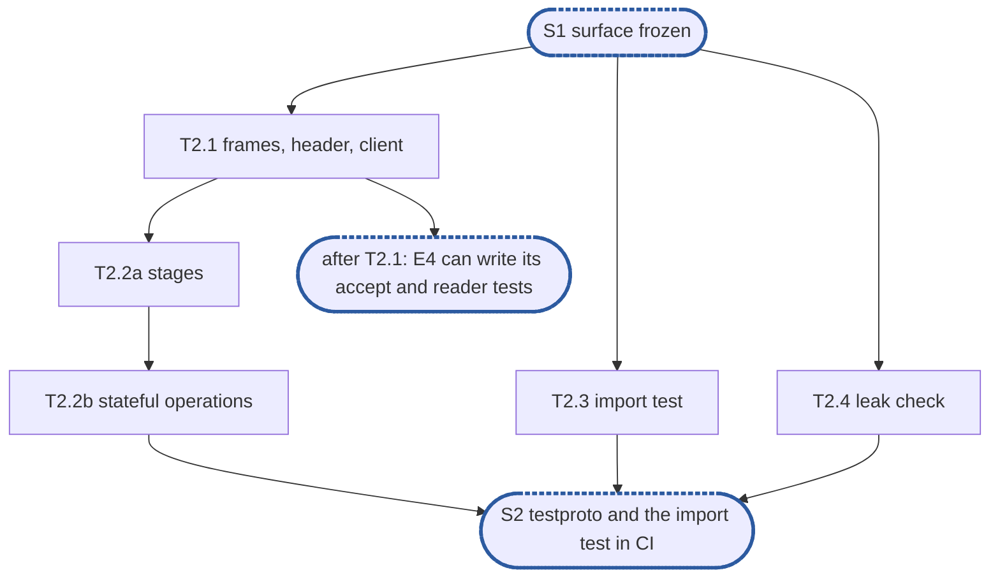

# Epic 2: adapters v2 test foundations

**Sources:** [RFC 20](../rfcs/rfc-20-adapters.md) §2.3 (imports), §2.5's `internal/` and `pkg/`
rules, its layout of `adaptertest` and its `wire` purity, §4.7's closing sentence (the test-only
protocol drives every symbol), §7 (the `core` layer), §7.1 (imports), §9 A1 and A8;
[RFC 29](../rfcs/rfc-29-test-harness.md) §4.11 (test doubles); `CLAUDE.md`, "Writing tests",
as `develop` has it.
**Track:** the team.
**Epic 2 estimate: 5 subtasks, 9.25 man-days.**
**Depends on:** **S1, surface frozen**: E1's `internal/adapter/core` surface (RFC 20 §4.7, with
stub bodies and a working `Bind`), `pkg/adapter`'s `Deps`, `pkg/resources`' `Budgets`, `Buf` and
`NewBufPool`, and `pkg/vfs`' `Service` and error set. Nothing in this epic runs a `core` body.
**Blocks:** E3, which writes the budget half of the leak check's failing test and registers
`BufPool`'s gate in the allocation cell this epic creates; E4 and E5, whose tests run `core` on
`testproto` over loopback and end with the leak check; E6, whose `wire` packages the import
test holds pure and whose scaffold tests end with the leak check.

---

## 1. Goal

Epic 2 builds what every later adapter test stands on, and nothing that runs before `core` has
bodies: a test-only protocol that compiles against the frozen surface, the import test, and the
leak check.

**At the end of the epic:**

- `testproto` is a `core.Protocol`: its framer, header codec, stages and two operation tables
  compile against §4.7, its codec matches byte vectors written by hand from its own format, its
  frame decoder is fuzzed, and its header decode allocates nothing;
- every §4.7 symbol a protocol implements or calls is referenced from `testproto`'s non-test
  code, so the surface is shown able to express what SMB needs before E4 and E5 fill it;
- a client writes `testproto` records over any `net.Conn` and keeps the credit balance its
  replies grant;
- the import test runs in `unit`, reports each of its seeded violations, and finds none in the
  tree;
- `adaptertest.CheckLeaks` fails a test that leaves a goroutine running, and (once E3 gives
  `Reserved` a body) one that leaves a budget charged;
- `unit/adapter-allocs` runs `testproto`'s gate per change.

Running `testproto` end to end through `core` is S3's, after E4 and E5. Until then no test
accepts a `testproto` connection: `NewServer`, `NewOpTable`, `NewErrorTable` and every `Conn`
method are stubs.

### 1.1 In scope

`internal/adapter/adaptertest/testproto` (format, codec, stages, operations, tables, client);
the import test and its seeded violations; the leak check; the `unit/adapter-allocs` cell with
`testproto`'s gate; moving two existing test files off a forbidden import.

### 1.2 Out of scope

- The `core` behaviours `testproto` makes expressible (drain, holds, parks, chains, cancels,
  kept state, the handshake deadline, slow clients): each is a test of E4 or E5, the epic that
  writes the body; T2.2b's table names which.
- `vfstest.Memory` and `vfstest.Faults`: RFC 17's (§9). `testproto`'s one service call reaches
  whatever `Deps.VFS` holds; its first run on `Memory` and `Faults` is E4's.
- The budget half's failing test: E3's T3.3, since `Budget.Reserved` panics until E3 (D11).
- The import test's entry-method call sites (§4.10) and 800-line allowlist (§2.5), and its rule
  for `translate`: RFC 21's and RFC 22's, with their first handlers (§9).
- `adaptertest/golden/` and the scripted client of RFC 20 §8.2: their first consumers are E6's
  `wire` tests (which read vectors through a helper inside each `wire` package) and RFC 21's and
  22's wire tests.
- The pipeline benchmark on `vfstest.Null`: E5's T5.10.

### 1.3 Names used here

- **E1**, epic 1, delete v1 and fix the surface: `core`'s §4.7 surface with stub bodies and a
  working `Bind`, and the public packages.
- **E2**, this epic.
- **E3**, epic 3, budgets and buffers: the bodies of `pkg/resources`.
- **E4**, epic 4, connections and lifecycle: `Server`, accept, `Conn`, drain, `Reconfigure`,
  health, TCP, the sidecar runner.
- **E5**, epic 5, dispatch: the pipeline, tables, compound runner, held and parked requests,
  middleware, error tables, observability.
- **E6**, epic 6, protocol scaffolds: `wire/`, `protocol/` and `New` for NFS and SMB.
- **S1**, surface frozen: after E1, `core`'s §4.7 surface and the public packages change only
  with an RFC amendment.
- **S2**, `testproto` and the import test in CI: after this epic.
- **S3**, `core` serves `testproto` end to end: after E4 and E5.
- **The deferral ledger**: the list of everything RFC 20 or develop's v1 provides that the
  branch does not serve yet, each row naming the owner that brings it back.

## 2. General rules for each epic

1. **Independent unit tests, under `-race`.** Each epic carries its own unit tests. It may use
   another epic's implementation once that has landed, `vfstest.Memory` and `vfstest.Faults`, and
   E2's `testproto` and leak checks. Every double is one of
   [RFC 29 §4.11](../rfcs/rfc-29-test-harness.md#4.11%20Test%20doubles)'s three kinds. `core` is tested from `package core_test` on `testproto` and
   never through NFS or SMB; no `core` test imports a protocol package. Connections are real TCP
   over loopback, with real deadlines and socket options read back from the socket. Test at the
   layer that consumes a value (`CLAUDE.md`, "Verifying a change"): a setting is asserted on a
   connection accepted after `Reconfigure`, not on the snapshot.
2. **Fuzz tests where relevant.** Go native fuzzing on every decoder of bytes a peer sent: the
   NetBIOS and RPC record framers, the SMB2 header, the RPC call header and AUTH_SYS credential,
   `testproto`'s frame. Seeded with each package's golden vectors. The property: accepted or
   refused, never a panic, never an allocation past the protocol's cap (RFC 20 §5.2, A8).
3. **Observability follows RFC 25 and RFC 20 §10.** Every metric, span and log key lives in
   `core`; protocol code records none. The series are RFC 20 §10.1's that `core` produces here,
   through `pkg/metrics`, resolved once per protocol and operation at table build so the request
   path does an atomic add; the replay, translation, status-mapped and record series arrive with
   their producers. Spans through `Deps.Tracer`, logs through `Deps.Logger`.
4. **Leaks and allocations.** Every test that runs the pipeline ends with E2's leak checks. Hot
   paths carry allocation assertions (`testing.AllocsPerRun`): the header codecs of both
   protocols and `testproto`'s at 0, `BufPool.Get` and `Release` at 0, and the pipeline's
   allocations per request at or under a checked-in number that may only fall. Each gate is
   registered in the per-change `unit/adapter-allocs` cell by the subtask that writes it.
5. **v2 ignores v1.** v1 is deleted in epic 1; nothing is copied from it but what RFC 20
   Appendix B marks **keep**, lifted from `develop`'s history into its new place: the accept
   backoff and the sidecar group's reconcile here, the rest with RFC 21 and 22. The import test
   fails any import of a path v1 used that v2 does not.
6. **Nothing deferred is lost.** A subtask that leaves out part of an RFC 20 obligation, or
   anything develop serves, adds or keeps its row in the deferral ledger, naming the owner that
   brings it back.
7. **Code comment conventions** (`CLAUDE.md`, "Code comments"). A source comment describes the
   code's behaviour and references nothing outside it: no issue or pull request numbers, no CI,
   runner or OS names, no ids from planning documents (epics, subtasks, synchronisation points,
   decisions). A `ponytail:` marker records a knowingly simple implementation, naming its
   ceiling and the upgrade path. A `decision:` marker records deliberate behaviour, naming the
   rule, why it holds and the evidence that would overturn it. RFC 20's notes go at their code
   sites: no attribute cache, parked requests off the hold floor, `Addrs` live, `Pends` asked
   only for an error the service returned, a call in the service pending past the ceiling and the floor, context
   and attribute reads served while draining, a `ponytail:` for the uncharged replay copies, a drain's refusal answered by an interim with no final, the expired
   credential running only releases, a `ponytail:` for the cancel record's 5 s, `unwrap` on the reader, the cap of 64, one goroutine per request,
   `sync.Pool` per class, no self-probe. `pkg/resources`'s missing turns, `Reclaim`, `ShareCap`
   and `Split` each carry a `ponytail:` naming RFC 24.
8. **A test must be able to fail.** Keep a test only if a plausible change would make it fail and
   nothing else would catch that change. The import test proves it can by reporting its seeded
   violation; the budget leak check by failing a test that keeps a `Buf`.
9. **A symbol is exported only if RFC 20's interface uses it.** `pkg/adapter`,
   `pkg/adapter/config`, `pkg/resources` and the two `New` are the public surface. `core`'s
   exported symbols are those RFC 20 §4.7 names, frozen at S1; everything else in `core` is
   unexported. A symbol §4.7 does not name is added to §4.7 first, by a pull request to the RFC.
10. **Each subtask creates only what it declares.** No empty package and no stub without a
    caller: no empty `ops/`, `callbacks.go`, `gss/`, `translate/` or `dcerpc/`. A package, a stage
    or a test helper lands with its first consumer.

### 2.1 How the rules apply

| Rule | Subtasks | How |
| --- | --- | --- |
| 1 Unit tests | all | every R-number has a test that can fail (§6 names the change each catches). `testproto` is not a double (D1); its service call reaches the `Deps.VFS` a test supplies, and no test here builds a service. No `core` server accepts a socket before S3; the client's test writes to one end of a loopback pair on `127.0.0.1:0` and reads the other |
| 2 Fuzz | T2.1 | `FuzzFrame` over `Framer.BodyLen` and `HeaderCodec.Decode`, seeded with T2.1's hand-written vectors, crashers committed under `testdata/fuzz/FuzzFrame/`; the property is CLAUDE.md's: no panic, every length read inside the buffer, nothing allocated for a length past the 1 MiB cap, and a decoded header re-encodes to bytes that decode to the same fields |
| 3 Observability | T2.1, T2.2b | `testproto` is protocol code: it records no metric, span or log key, and takes no `Deps.Metrics`, `Tracer` or `Logger` |
| 4 Leaks and allocations | T2.1, T2.4 | T2.4 writes the leak check; T2.1 writes `testproto`'s 0-allocation header gate and registers it in `unit/adapter-allocs`, which it creates (D12). No pipeline runs here, so no test of this epic ends with the leak check but its own |
| 5 v2 ignores v1 | T2.3 | the import test fails a package at any path v1 used that v2 does not (D9) |
| 6 Nothing deferred is lost | T2.3, T2.2b | §7.1's entry-method and file-size checks are existing ledger rows; §9 adds the `translate` clause and `vfstest.Memory` for `testproto`'s service call |
| 7 Comment conventions | T2.1, T2.2a, T2.2b, T2.3, T2.4 | the markers §4 lists: the `decision:` markers of D1, D4, D5, D6, D7, D8 and D13 at their code sites, the `ponytail:` markers of D10 and D16, each with an upgrade local to its file |
| 8 A test must be able to fail | all | the import test reports one seeded violation per rule (D9); the leak check's goroutine predicate is tested on a goroutine left blocked; its budget predicate's failing test is E3's (D11) |
| 9 Exported only if RFC 20 uses it | T2.1, T2.2b | nothing is added to `core` or the public packages; `testproto` and `adaptertest` are test-only packages, whose exports are §5's, each named with its consumer |
| 10 Only what is declared | all | each stage, operation and helper names its consumer in §6; a consumer may be a later epic's subtask that names it (as E1 settled for its stubs) |

## 3. Requirements and invariants

Every obligation RFC 20, RFC 29 and the repository's test rules place on this epic, numbered so
that subtasks and tests can cite them. Where only part of an obligation is this epic's, the row
names the epic that owns the rest.

**The import test**

| # | Requirement | Kind | Source | Subtasks |
| --- | --- | --- | --- | --- |
| R1 | Every adapter package's non-test files import only the standard library, `pkg/vfs` (and its packages but `vfstest`), `pkg/adapter`, `pkg/adapter/config`, `pkg/resources`, `pkg/metrics`, `internal/tlsconfig`, their own adapter's packages and `core`, the tracing API `Deps.Tracer` names, and wire-format libraries that do no file I/O | MUST | RFC 20 §2.3, §7.1, §9 A1 | T2.3 |
| R2 | They never import a metadata store, the open-state tables, the content engine, the topology or routing code, `pkg/identity` or `internal/identity`, the configuration store, the health package, or another adapter: NFS's packages never import SMB's, nor SMB's NFS's | MUST NOT | §2.3, §7.1, A1 | T2.3 |
| R3 | The rule is enforced by a test that reads the import graph and fails naming the package and the forbidden import | MUST | §2.3, §7.1 | T2.3 |
| R4 | The test is seeded with deliberate violations in its own test data and must report them, so a check that silently matches nothing is caught | MUST | §7.1; rule 8 | T2.3 |
| R5 | No package under `pkg/` but `pkg/adapter/nfs` and `pkg/adapter/smb` imports anything under `internal/adapter/`, and each of the two imports only its own protocol's | MUST | §2.5, §7.1 | T2.3 |
| R6 | No implementation package imports a constructor package | MUST | §2.5, §7.1 | T2.3 |
| R7 | `pkg/adapter` imports nothing of the core but `pkg/vfs`, `pkg/metrics`, `pkg/resources` and `pkg/adapter/config`; `pkg/adapter/config` is a leaf | invariant | §2.5 | T2.3 |
| R8 | A `wire` package imports nothing but the standard library and `pkg/resources` | MUST | §2.5, §7.1 | T2.3 |
| R9 | The test starts with no allowlist: nothing is grandfathered in | invariant | §7.1 | T2.3 |
| R10 | `core` and its tests import no protocol | invariant | §2.5 (layout), §7 | T2.3 |
| R11 | An adapter package's `_test.go` files may also import `pkg/vfs/vfstest` and `adaptertest`, and nothing else the list forbids | invariant | §7.1 | T2.3 |
| R12 | The test-only packages, `adaptertest`, `testproto` and `pkg/vfs/vfstest`, are imported by no non-test file outside themselves | invariant | §7.1 ("no forbidden package reaches an adapter's build"), §2.5 (layout) | T2.3 |
| R13 | That the service imports no adapter stays the service's own architecture check, which this epic leaves as it is | invariant | §7.1; RFC 17 §8 | T2.3 |
| R14 | No package exists at a path v1 used that v2 does not: `pkg/controlplane/runtime/adapters`, `internal/adapter/{common,pool,testruntime,auth}`, `internal/adapter/nfs/rpc`, `internal/adapter/smb/{session,handlers}` | MUST | rule 5; owner decision | T2.3 |

**The test-only protocol**

| # | Requirement | Kind | Source | Subtasks |
| --- | --- | --- | --- | --- |
| R15 | `core` is proven on a test-only protocol in `adaptertest/testproto`, of length-prefixed frames, with an echo, a delay, an operation that panics and one that holds; its delays and the error that holds come from the fault wrapper around the in-memory service, not from the protocol (D5) | MUST | RFC 20 §7, §2.5 (layout) | T2.1 |
| R16 | It has a handshake, session levels, kept state, held and parked requests, a cancel and chained messages, so every type of §4.7 is exercised: every §4.7 symbol a protocol implements or calls is referenced from its non-test code | MUST | §7, §4.7 (closing sentence); E1's R75 | T2.2a, T2.2b |
| R17 | It is driven over a plain connection: a client writes its records to any `net.Conn` and keeps the credit balance the replies grant | MUST | §7; owner decision | T2.1 |
| R18 | Its doubles are RFC 29 §4.11's only: its handlers make the one service call a real handler would, or none, and never answer in the service's place; a test supplies the service. It never uses a recording or canned fake, so it imports nothing of `pkg/vfs/vfstest` | MUST | rule 1; RFC 29 §4.11 | T2.1, T2.2b, T2.3 |
| R19 | `NewConn` runs at accept and returns the connection's stages; a stage a connection does not need is nil; a `Header` and a `Router` are always set | MUST | §4.7 | T2.1, T2.2a |
| R20 | The `Hold` stage of `Stages` is set where a table `Holds`; `HoldCodec.Key` never returns 0 | MUST | §4.7 | T2.2a |
| R21 | `HoldCodec.Interim` grants the request's credits when told to, else one; for a `NoReply` row it also grants the credits of the `after` headers, summed and saturating at the connection's credit target rather than wrapping | MUST | §4.7 | T2.2a |
| R22 | `Security.Unwrap` resolves the IDs a related member inherits from `prev` before it checks the member, so the check never runs against an unresolved ID; `Wrap` transforms the reply in place | MUST | §4.7 | T2.2a |
| R23 | `ReplayCache`'s `Lookup` returns a fresh copy of a cached reply, charged to a reply reservation of its size under `ctx`; `Store` keeps its own clear copy | MUST | §4.7 | T2.2a |
| R24 | The protocol owns its sessions: one registry per `Protocol`, handed to each connection's stages at `NewConn`; a connection's `OnClose` drops its references to the sessions it carried | MUST | §4.7 ("Sessions span connections") | T2.2b |
| R25 | A compound row's `Decode` decodes the compound's own arguments, sets `Invocation.Count` and returns the bytes it took; its `Members` table reads each member's code with `ReadOp` | MUST | §4.7 | T2.2b |

**Codec, fuzzing and allocations**

| # | Requirement | Kind | Source | Subtasks |
| --- | --- | --- | --- | --- |
| R26 | `testproto`'s frame decoder has a native fuzz target: accepted or refused, never a panic, never an allocation past the protocol's cap | MUST | rule 2; §9 A8 | T2.1 |
| R27 | Its decoder allocates nothing a length field claims before checking it against the bytes remaining and the cap | invariant | §9 A8 | T2.1 |
| R28 | Its header decode and encode allocate nothing per call | bound | rule 4 | T2.1 |
| R29 | Each gate is registered in the per-change `unit/adapter-allocs` cell by the subtask that writes it, in a non-race cell, since allocation gates skip under `-race` | MUST | rule 4; §6.10; suites paragraph | T2.1 |

**Leak check**

| # | Requirement | Kind | Source | Subtasks |
| --- | --- | --- | --- | --- |
| R30 | One call fails a test that leaves behind a goroutine it started, naming each leftover goroutine with its stack; it polls the goroutines themselves, never a fixed sleep, with one backstop timeout; no new dependency | MUST | rule 4; `CLAUDE.md` "Writing tests" | T2.4 |
| R31 | The same call fails when any of `Deps.Budgets`' four budgets reads above zero, naming it (E3's T3.3 proves it can fail) | MUST | rule 4, rule 8; §6.8; §9 A18 | T2.4 |

## 4. Decisions this epic takes

- **D1, `testproto` is not a test double.** RFC 29 §4.11's three kinds are stand-ins for a
  collaborator of the code under test. `testproto` stands in for none: it is a third
  implementation of `core.Protocol`, an interface with two production implementations, and a
  `core` test's subject is `core`, with `testproto` its input, as an operation table is data.
  So none of the three kinds applies, and it needs no conformance suite. It is held honest
  three ways instead: its handlers are thin (decode, at most one service call, encode), so
  nothing `core` is tested on is answered by `testproto` in the service's place; every error,
  delay and hold a `core` test needs comes from the service the test supplies, which is
  `vfstest.Faults` around `vfstest.Memory`, kinds 3 and 2 (R18); and its own codec and stages
  are verified against byte vectors written by hand from its package doc and as state machines
  (T2.1, T2.2a). The one input it takes from a test is a parked request's completion (D6). A
  `decision:` marker on `Protocol` states this and its ceiling: withdraw it if a `core` test
  ever needs `testproto` to decide something the service would.
- **D2, a format of its own, written before the codec.** The package doc states the record
  (a 4-byte length, then one or more messages, each a fixed header and its arguments, chained by
  the header's `next` offset) and the header's fields: `next`, flags (`related`, `pend`,
  `reply`, `interim`), version, operation, message ID, session (all ones: inherited from the
  member before), tree, credits, sequence, status and a checksum, which `Append` computes keyed by the
  message's session (none for session 0). T2.1's vectors are written
  by hand from that doc, so they are an oracle independent of the encoder.
- **D3, two tables, one per version.** Version 1 answers every error at once and carries the
  compound row, as NFSv4 does; version 2 `Holds`, as SMB does, and is the table chains, holds
  and parks run on. A connection negotiates the higher of the two it offers. Two tables are the
  least that gives E5 both `NoReply` behaviours (an interim where the table holds, nothing where
  it does not) and a `Versions` column to check.
- **D4, the header points into the record.** `testproto`'s `Header` is a pointer to the header's
  bytes in the record (`(*header)(rec.B[off:off+headerLen])`, a slice-to-array-pointer
  conversion), so returning it as a `core.Header` allocates nothing (R28). It is valid while the
  record's `Buf` is retained, which `core` does for a request's life (RFC 20 §4.7's release-hook
  `decision:`). A `decision:` marker at the type names that bound: withdraw it if `core` ever
  releases a record before its request ends.
- **D5, no wait or hold operation.** RFC 20 §7 gives the test protocol's delays to the fault
  wrapper, and RFC 29 §4.11 gives an error answer to a fault wrapper too. So the one operation
  that calls the service, `Create`, is the delay (a `Faults` delay held until the test releases
  it) and the hold (a `Faults` `ErrDelay` mapped to version 2's hold row); `testproto` has no
  operation that sleeps or fabricates a service error. A `decision:` marker at the hold row says
  so.
- **D6, a parked request completes on the test's cue.** `Park`'s operation registers no waiter
  in the service: it proves `core`'s `Park`, not the service's lock wait, which RFC 21's and 22's
  handler tests prove against `Memory`. The test completes it with `Protocol.Release(key, err)`,
  as a service callback would, and reads each withdrawal (the `cancel` `Park` was given, or a
  refused `Park`'s withdrawn waiter) from `Protocol.Cancelled()`, an output. A `decision:` marker
  at the handler states the ceiling: withdraw it if a `core` behaviour turns on what the
  service's waiter does.
- **D7, tables built at the first `Route`.** `New` stores `Deps` and builds its tables with
  `sync.OnceValue` on the first route, so a test that starts a `Server` on `testproto` and routes
  nothing (E4's lifecycle and accept tests) does not need table construction. A `decision:`
  marker says a table check failing shows at the first request rather than at `New`, which a
  test protocol can afford.
- **D8, the error tables are not total.** They map the rows `core`'s tests read (`core`'s
  refusals, `vfs.ErrExist`, `ErrDelay` with a bounded `Hold` in version 2, `ErrDraining` as
  `NoReply`, `ErrMoved`) and nothing else, so an unmapped service error, answered server fault
  and counted (E5's T5.7), is reachable. Totality is a protocol table's property (§7.3), RFC 21's
  and 22's. A `decision:` marker on the tables says so.
- **D9, one seeded violation per rule, and v1's paths by existence.** §7.1 seeds one
  violation; a walk with several rules can lose one rule silently, so each rule gets its own
  seed, as `internal/vfs/arch_test.go` does. A v1 path is checked by whether a package exists
  there, which also covers any import of it, since nothing can import a package that does not
  exist.
- **D10, the walk reads files, not packages.** The import test reuses
  `internal/vfs/arch_test.go`'s approach, `go/parser` with `ImportsOnly` over every `.go` file
  under the tree, `testdata` left out, rather than `go/packages`: standard library only, and
  build-tagged files are read whatever their tags, so an import behind a tag is not hidden. A
  `ponytail:` names the ceiling: a package's path is read from its directory, so a `replace`
  or a vendored copy would be missed; move to `go/packages` if the module ever has one.
- **D11, the budget half's failing test is E3's.** `Budget.Reserved` and `WaitBudget.Reserved`
  panic until E3, so `budgetsHeld` lands here, read by `CheckLeaks`, and its failing test, a
  `Buf` kept past the test's end, lands with E3's T3.3, where `Reserved` gets its body.
- **D12, the allocation cell lands here.** `testproto`'s header gate is the first allocation gate
  written, so `unit/adapter-allocs` and its fixed `dt run` step in the unit job, as
  `unit/journal-index` has, land with it in T2.1 rather than with `BufPool`'s in E3. E3's T3.3
  adds its package to the cell's command.
- **D13, the goroutine check compares goroutine IDs, not a count.** `CheckLeaks` reads
  `runtime.Stack(buf, true)` when it is called and keeps each goroutine's ID; at the test's end
  it reads it again, polling the condition until no goroutine absent from the first read is
  left or a 10 s backstop passes, and reports each one left with its stack. A count
  (`runtime.NumGoroutine`) would let one goroutine leaked and one exited cancel out, and could
  name nothing. The approach is `go.uber.org/goleak`'s, in the standard library, as the
  programme forbids a new dependency for it. A `decision:` marker names the ceiling, which
  goleak shares: a goroutine another test of the same binary starts meanwhile is reported, so a
  test that calls it does not call `t.Parallel`. Lifting that ceiling (ignoring goroutines whose
  creating frame is outside the test's own) changes `leak.go` alone, not `CheckLeaks`' signature
  or any caller.
- **D14, E1's two import-shape tests fold into the import test.** `pkg/adapter`'s
  `TestImportsOnlyTheContractsItNames` and `pkg/adapter/config`'s
  `TestImportsOnlyTheStandardLibrary` stood in for this test until it landed; R7 now holds both
  rules, so they are deleted rather than kept as a second copy that can drift. `pkg/resources`'
  `TestImportsOnlyStdlibAndMetrics` stays: its rule is RFC 24 §2.8's, and `pkg/resources` is
  not an adapter package.
- **D15, two test files move off `internal/vfs`.** `pkg/adapter/nfs/nfs_test.go` and
  `pkg/adapter/smb/smb_test.go` import `internal/vfs` for a typed nil `*vfs.Filesystem`, which
  R11 forbids. They use `vfstest.Null{}` instead, so the import test starts green with no
  allowlist (R9).
- **D16, the coverage check reads names.** T2.2b's test that every §4.7 symbol is referenced
  matches `core.<Name>` selectors and, for `Conn`'s and `Request`'s methods, the method names,
  with `go/parser` alone. A `ponytail:` names the ceiling: a method of another type with the same
  name counts; move to `go/types` if that ever hides a gap, a change inside the test alone.
- **D17, what is settled here for good, and what changing it would cost.** E4, E5 and E6 write
  their tests against these, so each is designed now as final rather than as a placeholder:
  - `adaptertest.CheckLeaks(t, b)`: every pipeline test of E4, E5 and E6 calls it, so a new
    signature means editing each of them;
  - `testproto.New(d adapter.Deps)`, `Bare`, `Release`, `Cancelled`, the operation codes, `Msg`,
    `Reply`, `Append` and `Client`: every `core` test builds its requests and reads its replies
    through them, so a rename or a changed field means editing E4's and E5's tests;
  - the import test's two lists, the allowed imports and the v1 paths, each one Go slice with a
    comment per entry: every later package lands under them, and an entry is added by the change
    that needs it, with its reason, never by a wildcard;
  - the record and header layout (D2, D4): only `testproto`'s own vectors and fuzz seeds read
    the bytes, so a change costs those and nothing in another epic, but the layout is still
    written as final, since E5's chain and compound tests depend on what it can say.
  `testproto` needs no symbol RFC 20 §4.7 does not name, so nothing here amends the frozen
  surface; the one surface question it raises is `core.Dispatcher` (§9).
- **D18, what is deferred, and why that costs no migration.** Each later addition is additive,
  in one place, and changes no signature another epic calls: the import test's entry-method,
  800-line and `translate` clauses are new cases in `violations` and new seeds (RFC 21 and 22);
  the budget half's failing test is a new test in E3 (D11); a golden-vector helper is E6's,
  inside each `wire` package, and touches nothing here; operations a later `core` test needs
  of `testproto` are new rows and new `Msg` fields, which leave every existing field and
  code as it is.

## 5. Target tree

```text
internal/adapter/adaptertest/
  leak.go                   T2.4  CheckLeaks, goroutines, leftSince, budgetsHeld
  leak_test.go              T2.4  the goroutine predicate's test
  imports_test.go           T2.3  the import test
  testdata/imports/         T2.3  one seeded violation per rule, in the repository's own layout
  testproto/
    wire.go                 T2.1  the format (package doc), Framer, header, HeaderCodec, Append
    proto.go                T2.1  Protocol, New, Bare, NewConn, Router, the two tables, Echo, PutFH, Create, Panic, Negotiate
    client.go               T2.1  Msg, Reply, Client
    stages.go               T2.2a Security, FlowControl, ReplayCache, HoldCodec
    state.go                T2.2b sessions, Session, Logoff, Tree, Park, Notify, Violate, the compound row, Release, Cancelled
    wire_test.go            T2.1  vectors, FuzzFrame, the client's bytes and balance
    norace_test.go race_test.go   T2.1  the header gate, skipped under -race
    stages_test.go          T2.2a the stages as state machines
    state_test.go           T2.2b the compound row's Decode, the surface coverage check
    testdata/fuzz/FuzzFrame/      T2.1  committed crashers
pkg/adapter/adapter_test.go        T2.3  import-shape test removed (D14)
pkg/adapter/config/config_test.go  T2.3  import-shape test removed (D14)
pkg/adapter/nfs/nfs_test.go        T2.3  vfstest.Null{} for internal/vfs (D15)
pkg/adapter/smb/smb_test.go        T2.3  vfstest.Null{} for internal/vfs (D15)
test/suites.yaml                   T2.1  unit/adapter-allocs cell
.github/workflows/tests.yml        T2.1  its fixed dt run step in the unit job
```

The exported surface this epic adds, all in test-only packages:

```go
package adaptertest

// CheckLeaks, called first in a test, fails it at its end when a goroutine started
// since is still running, or when a budget of b (nil: none) still holds bytes.
func CheckLeaks(t testing.TB, b *resources.Budgets)

package testproto

func New(d adapter.Deps) *Protocol                    // uses d.VFS and d.Budgets.Reply
type Protocol struct{ /* unexported */ }
func (p *Protocol) Framer() core.Framer
func (p *Protocol) NewConn(c *core.Conn) core.Stages
func (p *Protocol) Bare() core.Protocol               // the same frames, Header and Router only, version 1
func (p *Protocol) Release(key uint64, err error) bool // completes the parked request with key
func (p *Protocol) Cancelled() <-chan uint64          // keys whose waiter was withdrawn

// The operation codes, fixed once written: E4's and E5's tests name them.
const (
	OpNegotiate uint16 = iota + 1 // NeedsNothing; the higher version both sides offer
	OpSession                     // NeedsNegotiated, Expired; Conn.Established, optional Conn.Keep
	OpLogoff                      // RoleRelease, Expired; ends the session and its keep
	OpTree                        // NeedsSession
	OpPutFH                       // NeedsTree, RoleContext; Invocation.Handle
	OpEcho                        // NeedsNothing; Invocation.Role from its argument
	OpCreate                      // NeedsTree|NeedsFH, Cacheable; the one service call
	OpPanic                       // its handler panics
	OpPark                        // version 2: Request.Park, completed by Release
	OpNotify                      // Conn.Send ahead of the reply keyed Target
	OpViolate                     // Conn.Close
	OpCancel                      // never routed: HoldCodec.Cancels names its target
	OpCompound                    // version 1: the compound row
)

// The statuses, one per error-table row, fixed once written.
const (
	StatusOK core.Status = iota
	StatusFault          // the tables' fault status: an unmapped error
	StatusNotSupported   // core.ErrNotSupported
	StatusVersion        // core.ErrVersion
	StatusNotNegotiated  // core.ErrNotNegotiated
	StatusNoSession      // core.ErrNoSession
	StatusNoTree         // core.ErrNoTree
	StatusNoFH           // core.ErrNoFH
	StatusTooLong        // core.ErrTooLong
	StatusExpired        // core.ErrExpired
	StatusNotLast        // core.ErrNotLast
	StatusTooManyPending // core.ErrTooManyPending
	StatusMoved          // core.ErrMoved
	StatusExist          // vfs.ErrExist
	StatusDelay          // vfs.ErrDelay: at once in version 1, after its hold in version 2
)

type Msg struct {
	Op       uint16
	Version  uint8
	ID       uint64
	Session  uint32 // all ones: inherited from the member before
	Tree     uint32
	Credits  uint16
	Seq      uint32
	Related  bool
	Pend     bool      // HoldCodec.Pends answers true for this member
	Role     core.Role // Echo's per-request role
	Keep     bool      // Session: keep the connection past the idle timeout
	Expires  time.Time // Session: the credential's end
	Handle   vfs.Handle // PutFH
	Name     string     // Create
	Target   uint64     // Notify: the key of the reply it precedes
	Payload  []byte     // Echo
	Members  []Msg      // Compound
}
type Reply struct {
	ID      uint64
	Status  core.Status
	Interim bool
	Credits uint16
	Body    []byte
}
func Append(b []byte, msgs ...Msg) []byte // one record, chained when several
type Client struct{ /* unexported */ }
func NewClient(c net.Conn) *Client
func (c *Client) Send(msgs ...Msg) error
func (c *Client) Recv() ([]Reply, error)   // one record's replies
func (c *Client) Balance() int             // credits granted less credits charged
```

## 6. Subtasks

### T2.1 `testproto`: frames, header, client and the stateless operations

**Subtask T2.1 estimate: 2.75 man-days.**

- **Track:** the team. **Depends on:** S1.
- **Covers:** R15, R17, R18, R19, R26, R27, R28, R29.
- **Deliverables:**
  - `wire.go`: the format in the package doc (D2); `Framer` (`HeaderLen` 4, `BodyLen`
    refusing a length past 1 MiB with an error); the header type of D4 and its `Op`,
    `Version`, `Next` and `Related`; the `HeaderCodec` (`Decode(rec, off)`, `Encode(h, s, out)`,
    `Chain(out, prev)` writing the reply at `prev`'s `next`); `Append`.
  - `proto.go`: `New`, `Protocol`, `Framer`, `NewConn`, `Bare` (D3's version-1 table with only
    `Header` and `Router`); the `Router` choosing the table by the header's version; the two
    tables (D3, D7) and their error tables (D8); rows built with `core.Bind`: `Negotiate`
    (`NeedsNothing`), `Echo` (`NeedsNothing`, its `Invocation.Role` the argument's role),
    `PutFH` (`RoleContext`, `NeedsTree`, its `Invocation.Handle` the argument's handle),
    `Create` (`NeedsTree | NeedsFH`, `Cacheable`, one `vfs.Service.Create` on the current
    handle), `Panic` (its handler panics); `decision:` markers for D1, D5, D7 and D8.
  - `client.go`: `Msg`, `Reply`, `Client`, `NewClient`, `Send`, `Recv`, `Balance`.
  - `unit/adapter-allocs` in `test/suites.yaml`, its command `go test` over
    `./internal/adapter/adaptertest/testproto/`, and its fixed `dt run` step in the unit job (D12).
- **Consumers:** E4's accept, reader and writer tests (`Echo`, `Client`, `Bare` as the second
  listener); E5's T5.1 (nil stages over `Bare`, `Echo`'s role), T5.2 (`Versions`, `Needs`),
  T5.3 (the cap of 64 over `Bare`), T5.5 (`Create` held), T5.6 (`Panic`), T5.10 (the benchmark
  over `Echo`).
- **Acceptance criteria:**
  - Each vector of the package doc decodes to the fields it was written from, and each field
    set encodes to its vector's bytes.
  - `BodyLen` refuses a length past the cap before anything is allocated for it; `Decode`
    refuses a header that runs past the record, and a `next` that points backwards or past it.
  - `Decode` and `Encode` allocate nothing (`testing.AllocsPerRun`), the gate running in
    `unit/adapter-allocs` and skipped under `-race`.
  - `Echo`'s `Decode`, through `Bind`, gives an `Invocation` whose `Role` returns the role its
    arguments carry; `PutFH`'s gives a `Handle` returning the handle they carry.
  - The client writes exactly the bytes `Append` gives, and its balance moves by the credits
    each reply grants and each message charges.
  - On a pull request the `unit/adapter-allocs` cell runs and its log names the header gate
    (R29).
- **Tests:**
  - the vectors, both directions (catches a field at the wrong offset or of the wrong width,
    which a round trip of `Append` and `Decode` would pass);
  - `FuzzFrame` (catches a panic or an over-cap allocation on a hostile length);
  - the header gate (catches a header that boxes a value into `core.Header`, D4);
  - `Echo`'s and `PutFH`'s decoders through `Bind` (catch a role or handle read from the wrong
    argument, which every drain test of E4 and E5 would misread as a `core` bug);
  - the client over a loopback pair on `127.0.0.1:0`, the read end compared with the vector, and
    a balance after a scripted reply sequence (catches a balance that counts an interim twice).
- **Rules:** rule 2 and rule 4 as §2.1 says; rule 7: D1, D5, D7 and D8.

### T2.2a `testproto`'s stages

**Subtask T2.2a estimate: 1.5 man-days.**

- **Track:** the team. **Depends on:** T2.1.
- **Covers:** R16, R19, R20, R21, R22, R23.
- **Deliverables:** `stages.go`, each stage set by `NewConn` on the full protocol and nil on
  `Bare`:
  - `Security`: after a session is set up, `Wrap` XORs the reply's body with the session's key
    and writes a checksum over the message; `Unwrap` takes an inherited session from `prev`,
    then checks the checksum, then reverses the XOR. A second `Wrap` of the same bytes leaves
    them undecodable, so a reply wrapped twice is seen.
  - `FlowControl`: a counter of the credits granted on the connection; `Admit` charges the
    header's credits and refuses a message that would take it below zero.
  - `ReplayCache`: a map from (session, sequence) to the clear reply `Store` copied; `Lookup`
    returns a fresh copy from a `BufPool` over `Deps.Budgets.Reply`, under `ctx`.
  - `HoldCodec`: `Key` the message ID with its top bit set, never 0; `Interim` writing an
    interim header granting the request's credits, one, or (for `after`) their sum capped at a
    credit target of 64; `Final`; `Cancels` for `OpCancel`, naming its target's key; `Pends`
    returning the message's `pend` flag.
- **Consumers:** E5's T5.1 (each stage in §4.1's order), T5.4 (a related member's inherited
  session, a bad checksum refused, a chain wrapped once), T5.5 (credits for every interim and
  final), T5.7 and T5.4 (a cacheable reply replayed under a wrapping `Security`), T5.11 (a cancel
  before its target parks).
- **Acceptance criteria:**
  - A message with one byte changed is refused by `Unwrap`; a related member with all-ones
    session is checked under the session of `prev`, and without `prev` is refused.
  - A reply `Store`d, then wrapped in place, is returned clear by `Lookup`, twice.
  - `Key` is never 0, also for message ID 0; `Interim`'s sum over `after` stops at 64.
  - `Admit` refuses the charge that would overdraw and admits it once a grant arrives.
- **Tests:** each stage alone, without a socket: the tampered byte (catches a check that reads
  the wrong span); a related member checked against its own all-ones ID (catches `prev` ignored,
  R22); `Lookup` after an in-place wrap (catches a cache that hands out its own copy, R23); `Key`
  of ID 0 (catches the 0 `Conn.Send` reserves for none, R20); `after` headers summing past 64
  (catches a wrap-around, R21); the overdraw (catches a counter that never refuses); `NewConn`
  on the full protocol setting every stage and on `Bare` setting only `Header` and `Router`
  (catches a `Bare` that carries `Flow`, under which E5's cap-of-64 test would pass without
  testing the default, R19).
- **Rules:** rule 7: the cancel record's `ponytail:` and the `Pends` `decision:` are `core`'s,
  not repeated here; rule 10: each stage's consumer is named above.

### T2.2b `testproto`'s stateful operations

**Subtask T2.2b estimate: 2.25 man-days.**

- **Track:** the team. **Depends on:** T2.2a.
- **Covers:** R16, R18, R24, R25.
- **Deliverables:** `state.go`:
  - the session registry, one per `Protocol` (R24), and `OnClose` dropping the connection's
    references;
  - `Session` (`NeedsNegotiated`, `Expired`; calls `Conn.Established`; with `Keep` set, holds
    `Conn.Keep`'s release; sets the credential's end), `Logoff` (`RoleRelease`, `Expired`;
    releases the keep), `Tree` (`NeedsSession`), each setting `Request.Level` and
    `Request.State` through the `Router`, from `prev` for a related member;
  - `Park` (version 2: `Request.Park`; returns `core.ErrParked`; withdraws to `Cancelled` when
    refused or cancelled; completed by `Release`, D6), `Notify` (`Conn.Send` ahead of the
    reply keyed `Target`), `Violate` (`Conn.Close`);
  - the compound row of version 1 (R25): its `Decode` reading a count and building the
    `Invocation` directly, `Members` the version-1 table with its `ReadOp`; `Stages.MaxPending`
    of 8;
  - `state_test.go`'s coverage check (D16).
- **What each `core` behaviour is given, and where its test lands:**

  | `core` behaviour | What `testproto` gives it | Test lands in |
  | --- | --- | --- |
  | handshake deadline; kept state past the idle timeout | `Session` (`Established`, `Keep`), `Logoff` | E4 T4.7 |
  | `OnClose` on close; a scripted violation closes | the registry, `Violate` | E4 T4.5 |
  | a message sent ahead of a named reply | `Notify` | E4 T4.4 |
  | session and tree levels; `Versions` | `Session`, `Tree`, D3's tables | E5 T5.2 |
  | drain decided per request; the expired-credential gate | `Echo`'s role, `PutFH`'s handle, `Session`'s expiry, `Logoff` | E5 T5.1, T5.2; E4 T4.5 |
  | chains: a related member's state, a bad checksum, a pending last member, a member before the last pending or answered `ErrNotLast`, a `NoReply` stop whose interim grants the later members' credits, replies wrapped once | version 2, `Msg.Related`, `Msg.Pend`, T2.2a's stages, `Client.Balance` | E5 T5.4, T5.5 |
  | a single-reply compound judged whole while draining; the slot's sequence kept | the compound row, `PutFH`'s handle, `Echo`'s role, `ReplayCache` | E5 T5.4 |
  | holds past the ceiling and the floor, a cancel before and after its target | `Create` held by `Faults`, `OpCancel`, `HoldCodec` | E5 T5.5 |
  | parks refused before the last, past `MaxPending`, with the reply pool full; cancelled by the client and by a drain; racing a grant; already past an interim | `Park`, `Release`, `Cancelled` | E5 T5.11 |
  | panic recovery | `Panic` | E5 T5.6 |

- **Acceptance criteria:**
  - Every exported identifier of `core` is referenced as `core.<Name>` in `testproto`'s non-test
    files, and every exported method of `Conn` and `Request` by name, but for those a protocol
    neither implements nor calls, which the test lists with the reason for each: `NewServer`,
    `Server`, `Listener` (a test's), `Errors` (the totality helper's), `Call` and `Middleware`
    (`core`'s chain), `Dispatcher` (the connection's seam to the pipeline, §9).
  - The compound row's `Decode` sets `Count` from its arguments and returns the bytes it took;
    `ReadOp` returns each member's code and length, and refuses a code past the record.
- **Tests:** the registry: two connections carrying one session, the first's `OnClose` leaving it
  to the second and the second's ending it (catches a drop that ends a session another connection
  still carries, R24); the coverage check (catches an operation dropped from `testproto` that was the only
  caller of a §4.7 symbol, which would leave that symbol unproven at S3, R16); the compound row's
  `Decode` on a count of three and on trailing bytes (catches a count read from the wrong field
  or bytes miscounted, which E5's runner would then refuse as a decode error). The operations'
  behaviour is not tested here: it is `core`'s, run by the tests the table names.
- **Rules:** rule 1: `Park` and `Notify` call `core`; nothing here answers in the service's
  place (D1, D6); rule 6: `vfstest.Memory` for `Create`'s first run is a §9 row.

### T2.3 The import test

**Subtask T2.3 estimate: 2 man-days.**

- **Track:** the team. **Depends on:** S1. Runs beside T2.1.
- **Covers:** R1–R14.
- **Deliverables:**
  - `imports_test.go` in `package adaptertest`: `violations(t, root) []string`, a `go/parser`
    walk with `ImportsOnly` over `root` (D10), each rule a case naming the file and the import;
    `TestImports` over the repository root, failing on any violation; and
    `TestImportCheckReportsEachSeededViolation` over `testdata/imports/`, comparing with the
    sorted list of seeds;
  - `testdata/imports/`: one file per rule, in the repository's own paths: a `core` file
    importing `pkg/metadata` (R2), one importing `internal/adapter/nfs` (R10), an SMB file
    importing NFS (R2), a `wire` file importing `os` (R8), a `pkg/` package importing `core`
    (R5), `pkg/adapter/nfs` importing `internal/adapter/smb` (R5), an implementation importing
    `pkg/adapter/nfs` (R6), `pkg/adapter` importing `internal/adapter/core` (R7), a test file
    importing `internal/vfs` (R11), a non-test file importing `pkg/vfs/vfstest` (R12), an
    adapter file importing `pkg/identity` (R2), one importing a module outside the list, `golang.org/x/sync/errgroup` (R1), and a directory at `internal/adapter/common`
    (R14);
  - D14's two tests deleted; D15's two test files changed.
- **Consumers:** every later epic, whose packages it holds from their first commit; E6's `wire`
  packages (R8).
- **Acceptance criteria:**
  - Over the repository the test reports nothing.
  - Over `testdata/imports/` it reports each seed, once, and nothing else.
  - `internal/vfs/arch_test.go` is unchanged and still reports its adapter seed (R13).
- **Tests:** the two above (the first catches a real import that breaks §2.3; the second catches a
  rule that silently matches nothing, one per rule, R4).
- **Rules:** rule 5: R14; rule 8: D9.

### T2.4 The leak check

**Subtask T2.4 estimate: 0.75 man-days.**

- **Track:** the team. **Depends on:** S1.
- **Covers:** R30, R31.
- **Deliverables:** `leak.go`: `goroutines() map[uint64]string`, each running goroutine's ID
  and stack parsed from `runtime.Stack(buf, true)`; `leftSince(before map[uint64]string,
  backstop time.Duration) error`, polling `goroutines` until none absent from `before` is left
  (the caller's own excepted) and else naming each one left with its stack;
  `budgetsHeld(b *resources.Budgets) error`, naming each of `Receive`, `Reply`, `Connection` and
  `Hold` whose `Reserved` is above zero; `CheckLeaks(t, b)`, taking `goroutines()` and
  registering a `t.Cleanup` that calls both predicates and reports their errors with `t.Error`;
  D13's `decision:`.
- **Consumers:** every E4, E5 and E6 test that runs the pipeline (rule 4); E3's T3.3, which
  proves `budgetsHeld` fails.
- **Acceptance criteria:**
  - A goroutine left blocked on a channel makes `leftSince` return an error naming it by its
    stack; once the channel is closed it returns nil, without a fixed sleep in between.
  - A goroutine that was running before the snapshot is never reported.
- **Tests:** `leftSince` on a goroutine started after the snapshot and left blocked (catches a
  check that never fails), then after closing its channel (catches a single read taken before the
  goroutine could exit, which a timed sleep would hide), and on one started before the snapshot
  and still blocked (catches a check that reports every goroutine rather than the new ones); the
  predicate is asserted directly, so no fake `testing.TB` is needed. `goroutines`' parser is read
  by these three. `budgetsHeld`'s failing test is E3's (D11).
- **Rules:** rule 8: D11.

## 7. Order of work



T2.3 and T2.4 need nothing of `testproto` and run beside it. At S2 `testproto` compiles against
the frozen surface and is verified alone; it first runs through `core` at S3.

## 8. Suggested pull requests

| PR | Subtasks | Man-days | After | Why together |
| --- | --- | --- | --- | --- |
| 1 | T2.3, T2.4 | 2.75 | — | the boundary checks every later package lands under; open beside PR 2 |
| 2 | T2.1, T2.2a, T2.2b | 6.5 | — | `testproto` whole, so its coverage check runs on the protocol it covers |

A suggestion only: one pull request per subtask works as well.

## 9. Open points

- **`vfstest.Memory` and `vfstest.Faults` do not exist on the branch.** `testproto`'s `Create`
  calls whatever `Deps.VFS` holds, and this epic runs it on no service, so it does not wait for
  them; E4's first test does. Deferral-ledger row: `Memory`, `Faults` and `Faults`' delay held
  until the test releases it (an event, since rule 1 and `CLAUDE.md` forbid a timed wait), owner
  RFC 17's plan, before E4's first test. `vfstest.Null` is not a substitute: nothing may assert on
  its answers (RFC 20 §7).
- **`vfstest.Record` still exists,** a recording fake RFC 29 §4.11 bans; `testproto` and the
  leak check never use it. RFC 17's plan deletes it.
- **`core.Dispatcher` contradicts RFC 20 §4.7.** E1's `conn.go` exports a `Dispatcher` interface
  between the connection and the pipeline, and says a connection's own tests supply a stub; §4.7
  says the pipeline is a concrete type with no interface between them, and that a connection's
  tests run the real pipeline (E1's R72), and a stub is a banned double. T2.2b's coverage check
  lists it as not a protocol's. E4, which writes the connection, should drop it from `core` and
  its golden file, or RFC 20 should name it.
- **Rule 4's header gate and the `Header` interface.** A header returned by value as a
  `core.Header` is boxed, which allocates; `testproto` meets the gate with a pointer into the
  record (D4), and E6's two header codecs face the same choice.
- **Deferral-ledger row this breakdown adds:** the import test's clause that `translate` imports
  only neutral types (RFC 20 §2.3), with `translate`'s first package, owner RFC 21's and 22's
  plans.
- **Where this breakdown departs from the epic's first description,** for its owner to confirm:
  - the allocation cell and its fixed step move from E3's T3.3 to T2.1 (D12), so E3's estimate
    falls by about 0.25 man-days;
  - no operation that waits a given time, and no operation that answers `ErrDelay` itself: both
    come from `vfstest.Faults` (D5);
  - S2 as first stated ("`testproto` runs over a `net.Conn`") cannot hold before E4 and E5: at S2
    the client writes records over a real connection and `testproto` compiles and is verified
    alone, and E1's R75 ("proved by E2 T2.2") is proved at S2 as expressibility, by the coverage
    check, and as behaviour at S3;
  - the stateful half is split into T2.2a and T2.2b, and the total is 9.25 man-days against the
    first figure of 8, the difference being the client, D3's second table, the cell and D13's
    goroutine IDs.
- **Pending the user's answer.** Each is written above with the recommended option in place:
  - the goroutine check by goroutine IDs from `runtime.Stack`, rather than a count or a new
    `goleak` dependency (D13, T2.4);
  - `core.Dispatcher` removed from `core` by E4, rather than named in RFC 20 §4.7 (the point
    above; T2.2b's exemption list);
  - delays and holds from `vfstest.Faults`, with no waiting or self-holding operation (D5,
    T2.1);
  - the allocation cell in T2.1 rather than E3's T3.3 (D12).
- **The least certain estimates:** T2.1 (the format and its vectors are new, and the client's
  balance must match T2.2a's `HoldCodec` before either has a consumer) and T2.2b (the compound
  row's `Decode` is the one piece written directly rather than through `Bind`).
