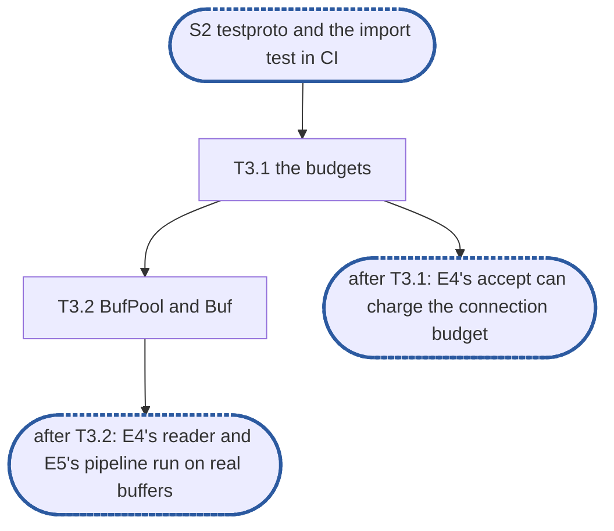

# Epic 3: adapters v2 budgets and buffers

**Sources:** [RFC 24](../rfcs/rfc-24-resources.md) §2.5 (memory is reserved before it is used),
§2.7's lifecycle bullets and failure rows, §3.1 (buffer classes), and §8's B1 for its allocation
target; [RFC 20](../rfcs/rfc-20-adapters.md) §5.3 (no copies on the data path, the rule on
reuse), §6.8 (buffer pools, in code), §6.10's non-race cell for allocation gates, and §9's A18.
Cited, not owned: RFC 24 §2.3 (which budget waits and which refuses) and RFC 20 §4.7's note on
a reserve that does not wait.
**Track:** A.
**Epic 3 estimate: 2 subtasks, 5 man-days.**
**Depends on:** **S2, `testproto` and the import test in CI**: E1's `pkg/resources` surface
(`Budget`, `WaitBudget`, `Reservation`, `Budgets`, `Buf`, `BufPool`, with stub bodies), E2's
`adaptertest.CheckLeaks`, its `adapter-conformance` suite with the seven specifications this
epic turns green, and its `unit/adapter-allocs` cell.
**Blocks:** E4, whose accept charges the connection budget and whose reader takes a receive
buffer before a body; E5, whose pipeline reserves the reply, parks and holds; both start on
E1's stubs and finish on these bodies.

---

## 1. Goal

Epic 3 gives `pkg/resources` its bodies: a budget is a counter of reserved bytes that refuses
or waits at its ceiling, and a `Buf` is a pooled buffer of one of four classes, reserved before
it is taken and returned with its reservation at its last release.

**At the end of the epic:**

- every stub of `pkg/resources` has its body, and no exported symbol has changed;
- the allocation gates on a reservation and on a `Get` and `Release` pair run per change in
  `unit/adapter-allocs`;
- the seven budget and replay specifications of `adapter-conformance` pass, and their entries
  are gone from `test/adapter/known.yaml`.

### 1.1 In scope

The bodies of `Budget`, `WaitBudget`, `Reservation`, `BufPool` and `Buf` in `pkg/resources`;
their unit, model and allocation tests; the `known.yaml` entries they turn green; `pkg/resources`
added to the `unit/adapter-allocs` cell's command.

### 1.2 Out of scope

- Turns at the receive and reply budgets (RFC 24 §4.1: deficit round robin over client keys,
  the three-quarter cap) and the per-key count they read; `Reclaim`; `ShareCap`; `Detect` and
  `Split`: the deferral ledger's row "RFC 24's turns, `Reclaim`, `ShareCap`, `Detect`, `Split`",
  owner the RFC 24 plan.
- RFC 24 §10's series, the count of releases past zero, §8's M1, B2 and B3, and B1 with
  waiters queued and at 8 and 64 cores: the deferral-ledger row this document's pull request
  adds (D7 for the series).
- Who charges what, and when: the connection budget at accept, the receive buffer at frame and
  the reader's wait (E4); the reply reservation, `Park`, and a held request's charge moved to
  the hold budget, with the method E5 adds to `*Buf` for it (E5). A reservation released when
  a handler panics is E5's recovery; RFC 24 §9's R3 fuzz of the frame stage is E4's.
- Logging a budget above zero after the adapters stop (RFC 24 §2.7): E7, with the node.

### 1.3 Names used here

- **E1**, epic 1, delete v1 and fix the surface: the public packages, `pkg/resources` among
  them, with stub bodies.
- **E2**, epic 2, test foundations: `testproto`, the import test, the leak check, the
  `adapter-conformance` suite and the `unit/adapter-allocs` cell.
- **E3**, this epic.
- **E4**, epic 4, connections and lifecycle: `Server`, accept, `Conn`'s reader and writer,
  drain.
- **E5**, epic 5, dispatch: the pipeline, held and parked requests, the replay check.
- **E6**, epic 6, protocol scaffolds: `wire/`, `protocol/` and `New` for NFS and SMB, with each
  protocol's largest record.
- **E7**, epic 7, integration with the node: `internal/node` builds the budgets and hands them
  to every adapter.
- **S1**, surface frozen: after E1, the public packages and `core`'s surface change only with
  an RFC amendment.
- **S2**, `testproto` and the import test in CI: after E2.
- **The deferral ledger**: the list of everything RFC 20 or develop's v1 provides that the
  branch does not serve yet, each row naming the owner that brings it back.
- **The RFC 24 plan**: the implementation plan RFC 24 does not have yet; the ledger names it as
  the owner of what this epic leaves out of RFC 24.

## 2. How the general rules apply

Each of the programme's ten general rules for an epic
([`rfc-20-adapters-plan.md` §1.5](rfc-20-adapters-plan.md#15-general-rules-for-each-epic)),
cited by number and title, and how it applies here or why it does not.

| Rule | Subtasks | How |
| --- | --- | --- |
| rule 1, independent unit tests, under `-race` ([`CLAUDE.md`, Writing tests](../../../CLAUDE.md#writing-tests); [Verifying a change](../../../CLAUDE.md#verifying-a-change)) | all | the package is tested alone, in `package resources` as E1's tests are, since two tests read what is unexported (D4's switch and a class's `New`); no double is needed or used; a test that needs a `Reserve` to be waiting runs in a `testing/synctest` bubble and never sleeps |
| rule 2, fuzz tests where relevant | none | does not apply: nothing here decodes bytes a peer sent. Sequences of reserve, release and cancel are T3.1's model test |
| rule 3, observability follows RFC 25 and RFC 20 §10 | none | does not apply to RFC 20 §10: its series are `core`'s. RFC 24 §10's are D7's |
| rule 4, leaks and allocations | T3.1, T3.2 | every test ends with its budgets at zero; T3.1 adds the reservation gate and T3.2 the `BufPool.Get` and `Release` gate, each at 0, to `unit/adapter-allocs`, whose command T3.1 extends with `./pkg/resources/` |
| rule 5, v2 ignores v1 | T3.2 | nothing is lifted from v1's buffer pool, which RFC 20 Appendix B does not mark keep |
| rule 6, nothing deferred is lost | T3.1 | the ledger rows named in §1.2 |
| rule 7, code comment conventions ([`CLAUDE.md`, Code comments](../../../CLAUDE.md#code-comments)) | T3.1, T3.2 | the `ponytail:` markers of D1, D3, D5 and D7 and the `decision:` markers of D2, D4, D6, D8, D9 and D10 at their code sites; RFC 24 §3.1's `ponytail:` at the 8 KiB overhead; the package's `ponytail:` for what is absent and `BufPool`'s for `sync.Pool` per class kept; E1's comments that promise turns or a per-key count rewritten to what the bodies do |
| rule 8, a test must be able to fail ([`CLAUDE.md`, Writing tests](../../../CLAUDE.md#writing-tests)) | all | each test names the change that fails it (§6); the seven specifications fail today on the stubs and pass only on the bodies |
| rule 9, a symbol is exported only if RFC 20's interface uses it | all | no exported symbol is added, renamed or removed: the bodies fill E1's signatures |
| rule 10, each subtask creates only what it declares | all | no per-key count, no metric and no `Reclaim` lands without its reader (D3, D7); the two poison files land with `Buf.Release`, which calls them |

## 3. Requirements and invariants

**Budgets**

| # | Requirement | Kind | Source | Subtasks |
| --- | --- | --- | --- | --- |
| R1 | A `Budget` is a counter, not an allocator: `Reserve` charges n bytes, or refuses at once when they would take the count past the ceiling; it never waits, and it decides from the count alone, never from the heap | MUST | RFC 24 §2.5, §2.3 | T3.1 |
| R2 | `Reserved` is the bytes reserved now on either kind of budget: the sum of the reservations taken and not yet released | MUST | RFC 24 §2.5 | T3.1 |
| R3 | A `Reservation` is a value from either kind of budget, so taking one allocates nothing: a `Reserve` and `Release` pair on a `WaitBudget` with no waiter allocates nothing, the part of B1 no later work is needed for | bound | RFC 24 §2.5, §8 (B1) | T3.1 |
| R4 | `Release` returns the reservation's bytes to its budget, then zeroes the `Reservation`, so a second `Release` does nothing, on either kind | MUST | RFC 24 §2.5; RFC 20 §4.7 | T3.1 |
| R5 | A release past zero panics in tests and clamps to zero in production, on either kind; in production the clamp is logged at Error with the budget's name, at most once per budget (D7, which also says where the count of them comes from) | MUST | RFC 24 §2.7; D7 | T3.1 |
| R6 | A `WaitBudget`'s `Reserve` charges n bytes for key; when they do not fit under the ceiling it waits within `ctx`, holding nothing. A release grants the next waiter on the releasing goroutine: the waiter's bytes are charged before `Release` returns, and no budget starts a goroutine | MUST | RFC 24 §2.5, §2.3, §2.7 | T3.1 |
| R7 | Under a `ctx` already past its deadline or cancelled, `Reserve` tries once: it takes the charge when it fits and no waiter is ahead of it, and otherwise refuses at once without waiting | MUST | RFC 24 §2.5; RFC 20 §4.7 | T3.1 |
| R8 | Every reservation is released on every path: a `Reserve` whose `ctx` ends while it waits is refused and leaves nothing reserved (the path through a panic is the caller's, §1.2) | MUST | RFC 24 §2.5 | T3.1 |

**Buffers**

| # | Requirement | Kind | Source | Subtasks |
| --- | --- | --- | --- | --- |
| R9 | Buffers come in four classes, small 4 KiB, directory 64 KiB, transfer 1 MiB and large 8 MiB, and a request draws the smallest class whose capacity (D5) holds it | MUST | RFC 24 §3.1 | T3.2 |
| R10 | Each class holds its size plus the protocol's headers (D5 says how much, and for which classes) | MUST | RFC 24 §3.1 | T3.2 |
| R11 | A buffer larger than the largest class's capacity (D5) is not pooled, and is charged its exact size (D6 reads RFC 24 §3.1's "its protocol uses" as the pool's own largest class) | MUST | RFC 24 §3.1 | T3.2 |
| R12 | `Get` takes one reservation for key, of n's class's capacity plus the per-request overhead of 8 KiB, before it takes any bytes; it waits in the budget, never in the allocator | MUST | RFC 20 §6.8; RFC 24 §2.5, §3.1 | T3.2 |
| R13 | `Get` returns a `Buf` with one reference, whose `B` has its class's capacity and the record's or reply's length (D8: the n asked) | MUST | RFC 20 §6.8 | T3.2 |
| R14 | Each class has one free list, a `sync.Pool` of `*Buf`; this epic's gate holds a `Get` on a class with a free buffer, and the `Release` that returns it, at no allocation, in the non-race cell | bound | RFC 20 §6.8, §6.10 | T3.2 |
| R15 | `Retain` adds a borrower; a pooled buffer returns to its pool, with its reservation, only at its last borrower's `Release`, so it is never reused while a borrower holds it, no byte a holder has is uncharged, and an idle pool holds zero reserved bytes | invariant | RFC 20 §5.3, §6.8, §9 A18; RFC 24 §2.5 | T3.2 |
| R16 | Under the race detector, `Release` fills the buffer with a poison byte | MUST | RFC 20 §6.8 | T3.2 |
| R17 | A second `Release` past zero panics | MUST | RFC 20 §6.8 | T3.2 |

What already holds, and is not numbered again here: `pkg/resources` is a leaf with no lifecycle,
`NewBufPool` takes a `WaitBudget` only, and a `Reservation` has a field for its key (E1's
requirements, held by its import test and the compiler; the key's reader is the turns', D3).
What other epics own of these sections: who holds a reference and when (RFC 20 §5.3's two
bullets, §6.8's "Who holds a reference", "Reading" and "Writing") is E4's and E5's; "each
`Server` builds its own" is E4's; every pipeline test ending at zero is E2's `CheckLeaks`,
called by E4's and E5's tests.

## 4. Decisions this epic takes

- **D1, a `WaitBudget` grants in arrival order.** Waiters queue under the budget's one mutex,
  each woken through a channel of its own, and a release grants from the head while the head's
  bytes fit. Nothing passes a waiter: a `Reserve` that would fit while another waits queues
  behind it, so a large reservation is not starved by small ones. Without RFC 24 §4.1's turns
  one busy address can take the whole budget while others wait their place. `ponytail:` on
  `WaitBudget`, naming RFC 24 §4.1 as the upgrade; the key is already in `Reserve`'s signature
  and in the `Reservation`, so the turns change no caller. Prior art:
  `golang.org/x/sync/semaphore`'s `Weighted`, which queues in arrival order and lets nothing
  pass its head (from memory); it is not imported, since the package is a leaf over the
  standard library.
- **D2, a charge that can never fit is refused at once.** A `WaitBudget.Reserve` of more bytes
  than the ceiling returns an error without waiting, whatever its context: it could never be
  granted, and under D1 it would hold every waiter behind it. The error matches no context
  error, so a caller reads it as a fault of configuration and not as a delay to retry.
  `decision:` at the check; overturned if a caller is found that must queue a charge larger
  than its budget. `Weighted` waits for its context instead (from memory).
- **D3, no per-key count.** RFC 24 §2.5 has a release lower its key's count "which §4.1's cap
  reads". The cap is the turns', so nothing would read the count: the `Reservation` keeps the
  key it was given and no count is kept. `ponytail:` beside the key field, naming the turns as
  what adds it. No prior art sought: it is the absence of a counter.
- **D4, "in tests" is `testing.Testing()`, read once.** Each budget holds it, read at its
  construction. A release that takes a budget's count below zero panics when it is true and
  clamps the count to zero otherwise, and the count is clamped before the panic, so a test
  that recovers reads zero. One in-package test turns it off on the budgets it builds, and
  gives them its own logger, through `export_test.go`, to run the production branch; no
  package variable is swapped. A
  double release through one `Reservation` cannot get there (R4); a copy released twice can,
  and is found only once the count would go negative. `decision:` at the clamp. Prior art: the
  standard library added `testing.Testing` for this use.
- **D5, header room.** RFC 24 §3.1 gives each class "its size plus the protocol's headers"
  without a figure, RFC 20 §6.8 says `cap` "is the class size", and NFS's largest record is
  1 MiB of data plus its headers, which RFC 24 §9's R6 charges the transfer class. **The
  directory, transfer and large classes, which carry a payload, are their size plus 4 KiB of
  header room, and are charged it; the small class, which carries headers only, has none.** So
  a 1 MiB `WRITE` with its headers draws the transfer class and is charged 1 MiB plus 4 KiB
  plus the 8 KiB overhead, a charge exact for its buffer as RFC 24 §2.5 asks, and a small
  request is still charged RFC 24 §3.1's 12 KiB. Room inside the 8 KiB overhead would
  under-charge every buffer by 4 KiB. The headers before a payload fit with room to spare: an
  NFSv4 `WRITE` compound (`SEQUENCE`, `PUTFH` with a 128-byte handle, `WRITE`, `GETATTR`) or
  an SMB2 `WRITE` with a transform header is a few hundred bytes. `ponytail:` at the constant:
  4 KiB, fixed, the same for every protocol, and a cost figure, not a limit. `Get` draws the
  smallest class that holds the record, so a record past a class's size plus 4 KiB, such as a
  `READ` reply with a large `GETATTR`, draws the next class and costs more; it never fails.
  Make it the protocol's own figure when a protocol's records are shown to pass it often
  enough to matter. Prior art: the Linux kernel's RPC server sizes its largest message as the
  payload plus one page (from memory). T3.2 amends RFC 24 §3.1 and RFC 20 §6.8's comment with
  the figure.
- **D6, past the largest class.** A `Get` for more than the large class's capacity reserves
  exactly n plus the overhead, allocates exactly n, and its last `Release` drops the bytes
  rather than pooling them. `decision:` at the branch: RFC 24 §3.1's rule, read against the
  pool's own largest class, since `NewBufPool` is told no protocol. No prior art found for a
  pool that charges what it does not keep.
- **D7, no series is exported here; a release past zero is logged.** `NewBudget` and
  `NewWaitBudget` take a name and a ceiling and no registry, and nothing on the branch builds
  the budgets but tests. **This epic exports no metric; the node, which builds the budgets and
  is the only place that knows each one's name and ceiling, registers the two gauges over
  `Reserved` in E7**, which fits RFC 24 §10's pool label; **the wait histogram, the refusal
  counter and the count of releases past zero come with the RFC 24 plan**, which settles how
  a budget reaches a registry. Neither an exported function RFC 24 does not name nor a change
  to the frozen `NewBudget` is worth its cost for gauges nothing reads before E7. Until the
  counter exists, a release past zero in production would clamp with no trace and hide an
  accounting bug, so **the clamp logs at Error with the budget's name, at most once per
  budget**, through `slog`'s default logger, since a budget is given none. `ponytail:` at the
  log: it stands in for RFC 24 §10's counter, which replaces it. No prior art sought: the
  question is who owns the registration.
- **D8, `Get` returns `B` at the length asked.** RFC 20 §6.8 has `len` "the record's or
  reply's", and `Get` is told that length: `len(B) == n`, zeroed, so a holder that sends
  `B` short of what it wrote sends zeros and never its last holder's bytes (`ponytail:` at
  the clear: hand the bytes out as they are to a caller that fills `B` whole, when a profile
  shows the clear). A caller that fills by appending cuts to `B[:0]` first, as `testproto`'s
  replay stage does. E4's reader and E5's encoders
  build on this. `decision:` at the cut. Prior art: `make([]byte, n)`; a pool that returned
  zero length would make every reader cut it up to n.
- **D9, the pool keeps its own slice of a buffer's bytes.** A holder may cut or reassign `B`,
  so the last `Release` poisons and pools the bytes `Get` took, not whatever `B` holds by
  then. `decision:` at the field. No prior art sought.
- **D10, the count is of borrowers beyond the first, so a literal `Buf` is one reference.**
  Codec tests build `&resources.Buf{B: ...}`, and `core` releases what it is handed. With the
  unexported count at zero meaning one holder, a literal behaves as a buffer from `Get` does:
  `Retain` and `Release` pair on it, its last `Release` frees nothing, having no pool and no
  reservation, and one more panics (R17). A `Retain` after the last `Release` would bring
  the count back to zero and read as one holder of a buffer the pool may already have handed
  out, so it panics as well, in tests and in production, as R17's release does. Both panics
  hold only while the buffer sits released: once the pool hands it out again, a stale `Retain`
  or `Release` cannot be told from the new holder's, and R16's poison read under the race
  detector is what catches the stale holder. `decision:` at the field. No prior art found.

## 5. Target tree

```text
pkg/resources/
  budget.go              T3.1: Budget, WaitBudget, Reservation
  budget_test.go         T3.1: unit tests, the model test, the reservation gate
  buf.go                 T3.2: BufPool.Get, Buf.Retain, Buf.Release
  buf_test.go            T3.2: unit tests, the poison read, the Get and Release gate
  poison_race.go         T3.2: the fill, built under the race detector
  poison_norace.go       T3.2: nothing, built without it
  resources_test.go      E1's class and import tests, kept
test/adapter/known.yaml  T3.1: 6 entries removed; T3.2: 1
test/suites.yaml         T3.1: ./pkg/resources/ added to unit/adapter-allocs
docs/internals/rfcs/rfc-24-resources.md   T3.1: §2.5's expired context (R7); T3.2: §3.1's header room (D5)
docs/internals/rfcs/rfc-20-adapters.md    T3.1: §4.7's non-waiting reserve (R7); T3.2: §6.8's comment on cap (D5)
```

No exported symbol changes: the bodies fill the signatures of RFC 24 §2.5 and RFC 20 §6.8 as
E1 froze them. The gates skip under the race detector and the poison read without it, each on
`prof.RaceEnabled`, as `testproto`'s gate does.

## 6. Subtasks

### T3.1 The budgets: `Budget`, `WaitBudget`, `Reservation`

**Subtask T3.1 estimate: 3 man-days.**

- **Track:** A. **Depends on:** S2.
- **Covers:** R1, R2, R3, R4, R5, R6, R7, R8.
- **Deliverables:** in `budget.go`, the bodies of `Budget.Reserve`, `WaitBudget.Reserve`, both
  `Reserved` and `Reservation.Release`: each budget's count under its one mutex; on a
  `WaitBudget` the queue of waiters and the grant made by the releasing goroutine (D1), the
  check for a charge past the ceiling (D2), the key kept (D3); the switch and the clamp of D4,
  and the clamp's log, once per budget (D7).
  A `Reserve` whose context ends takes the lock, and either leaves the queue with nothing
  reserved or, where a release granted it first, returns that grant to the budget, which may
  wake the next waiter. The markers of D1 to D4 and D7, and E1's comments on `WaitBudget`,
  `Reserve` and `Release` that say "fair per key", "its turn" and "its key's count" rewritten
  to arrival order. `Reserve`'s comment that it "tries once and refuses at once" under an
  expired context rewritten as R7 reads, and the same sentence in RFC 24 §2.5 and RFC 20 §4.7
  amended with it.
  `./pkg/resources/` added to `unit/adapter-allocs`' command in `test/suites.yaml`. Six
  entries removed from `test/adapter/known.yaml`: the four subtests of
  `TestConformanceBudgetsHeldNamesEachCharged` and the two of
  `TestConformanceCheckLeaksReadsBudgets`.
- **Consumers:** T3.2's `Get`; E4's accept (the connection budget); E5's reply reservation,
  holds, and `Park`, which reserves under a context already past its deadline; E2's
  `CheckLeaks`.
- **Acceptance criteria:**
  - On a `Budget`, a `Reserve` that fits raises `Reserved` by n; one that would pass the
    ceiling returns an error and leaves `Reserved` where it was; one that lands exactly on the
    ceiling fits.
  - On either kind, `Release` lowers `Reserved` by the reservation's bytes once: a second
    `Release`, and a `Release` of the zero `Reservation`, change nothing.
  - On either kind, a copy of a `Reservation` released after its original, with nothing else
    reserved, panics in the test binary and leaves `Reserved` at zero; with D4's switch off it
    returns, leaves `Reserved` at zero and logs one Error record that names the budget; a
    second release past zero on the same budget logs nothing, and the first on another budget
    logs its own.
  - On a `WaitBudget` with room and no waiter, `Reserve` returns at once and allocates
    nothing. With waiters queued, a `Reserve` that would fit still queues behind them.
  - A waiting `Reserve` is granted in arrival order; one release that frees room for several
    waiters grants each that fits, in order, and stops at the first that does not. When
    `Release` returns, `Reserved` already counts every waiter it granted.
  - Under a context already past its deadline or cancelled, `Reserve` returns at once: the
    reservation when it fits and nobody waits, otherwise an error matching the context's.
  - A waiting `Reserve` whose context is cancelled returns an error matching the context's,
    `Reserved` unchanged, and the waiters behind it are granted as if it had never queued.
  - A `Reserve` of more than the ceiling returns at once, under any context, an error that
    matches no context error.
- **Tests:** in `budget_test.go`, at the package's own layer, which is where `core` consumes
  it. The ceiling's edge on a `Budget` (catches an off-by-one, and a refusal that still
  charges). The double release and the zero value, on both kinds (catch a `Release` that does
  not zero). The copy released twice, on both kinds, with the switch on and off (catches a
  count left below zero, and a clamp that is missing in production); with it off, the records
  read through a `slog` handler the test installs (catches a clamp with no log, a log that
  names no budget, one record per release, and one budget's log silencing another's). Grant
  order and one
  release granting several, in a `synctest` bubble that waits until every `Reserve` is blocked
  before it releases (catches a grant out of order, one that passes the head, and a release
  that wakes only one waiter). `Reserved` read on the line after `Release`, equal to the
  ceiling with one waiter of the freed size queued (catches a grant handed to another
  goroutine, R6). The expired context, with and without room (catches a `Reserve` that waits,
  and one that refuses with room). The cancelled waiter in the middle of the queue (catches a
  waiter left queued, and bytes granted to it and lost). The cancel racing the grant, many
  rounds under `-race`, ending at zero (catches the grant lost when both happen). The charge
  past the ceiling (catches the wait D2 forbids, and an error a caller would retry). A model
  test over several goroutines with a small ceiling, random sizes and random cancellations,
  asserting `Reserved` never passes the ceiling, every successful `Reserve` is released, and
  the budget ends at zero with no waiter (catches a leak on any path, R8). The gate: `Reserve`
  and `Release` on a `WaitBudget` with no waiter at 0 allocations (catches a waiter or a
  channel made before the fast path, and a `Reservation` that escapes to the heap). The six
  specifications (catch a `Reserved` that reads another budget's count). No test double. Run
  with `test/harness/bin/dt run unit`, `unit/adapter-allocs` and `adapter-conformance`.
- **Rules:** rule 1: no test sleeps; a wait ends on a release or a cancel the test makes.

### T3.2 `BufPool` and `Buf`

**Subtask T3.2 estimate: 2 man-days.**

- **Track:** A. **Depends on:** T3.1.
- **Covers:** R9, R10, R11, R12, R13, R14, R15, R16, R17.
- **Deliverables:** in `buf.go`, the bodies of `Get`, `Retain` and `Release`: the class chosen
  by D5, the reservation taken first and for the class's capacity plus the 8 KiB overhead, a
  `sync.Pool` of `*Buf` per class, `B` cut to the length asked (D8), the pool's own slice of
  the bytes (D9), the count of D10, the unpooled path of D6; `poison_race.go` and
  `poison_norace.go`; the markers of D5, D6, D8, D9 and D10, RFC 24 §3.1's `ponytail:` at the
  overhead, and E1's comment that `cap` is the class size rewritten. RFC 24 §3.1 and RFC 20
  §6.8's comment amended with D5's figure. One entry removed from `test/adapter/known.yaml`:
  `TestConformanceReplayLookupCopies`.
- **Consumers:** E4's reader and writer, E5's pipeline and replay check, `testproto`'s replay
  stage (already written against `Get`).
- **Acceptance criteria:**
  - `Get` of n returns `len(B) == n` and `cap(B)` equal to the capacity of the smallest class
    that holds n with its header room, and `Reserved` rises by that class's capacity plus 8 KiB: 12 KiB for the small class; at
    each class's edge, one byte more draws the next class.
  - `Get` past the largest class charges n plus 8 KiB exactly, and its last `Release` pools
    nothing.
  - With the budget full, a `Get` under a cancelled context returns the error with nothing
    reserved, and a blocked `Get` has taken no buffer from its class.
  - After `Retain`, the first `Release` changes neither `Reserved` nor the bytes; the last
    lowers `Reserved` by the whole charge.
  - One `Release` more than the holders panics, on a buffer from `Get` and on a literal; so
    does a `Retain` after the last `Release`.
  - Under `-race`, a slice of `B` kept across the last `Release` reads as the poison byte
    throughout, also when the holder reassigned `B` before releasing.
- **Tests:** in `buf_test.go`. The class table with its edges, asserting `len(B)`, `cap(B)`
  and the charge at each (catches a class chosen without the room, a charge that forgets the
  overhead or the room, and a buffer of the wrong capacity under the right charge). The unpooled path, read on
  the large class's `New`, which the in-package test wraps with a counter: after an oversized
  buffer's release, the next large `Get` still calls it (catches an oversized buffer pooled
  into the large class). It skips on `prof.RaceEnabled`, as the gates do: under the race
  detector `sync.Pool` drops one `Put` in four at random, so the mutant would pass one run in
  four there. `Get` blocked on a full budget in a `synctest` bubble, with the same
  counter unchanged until the grant and after a cancel (catches a buffer taken before its
  reservation, R12, and a reservation kept on the error path). Retain and release, reading
  `Reserved` and the bytes after each (catches a reservation or a poison at the first release,
  R15). The extra release, on both kinds of `Buf` (catches a silent double free, and a literal
  that panics on its holder's one release). The `Retain` after the last release, on both
  kinds (catches a released buffer revived as held). The poison read, run only under the race detector
  (catches a `Release` that leaves the bytes, and one that poisons what `B` was reassigned
  to). The gate: a `Get` and `Release` pair per pooled class at 0 allocations, with collection
  off for the measurement so the free list is not emptied under it (catches a free list that
  is not reused, and a `Buf` allocated per `Get`). The replay specification. No test double.
- **Rules:** rule 5: nothing is taken from v1's pool.

## 7. Order of work



One path: the buffers reserve from the budgets, so there is no order to choose.

## 8. Suggested pull requests

| PR | Subtasks | Man-days | After | Why together |
| --- | --- | --- | --- | --- |
| 1 | T3.1 | 3 | none | both kinds of budget and the one `Release` they share, with the six leak specifications green |
| 2 | T3.2 | 2 | PR 1 | the buffers over the budgets, with the replay specification green and D5's two RFC sentences |

A suggestion only: the two could ship as one pull request as well.

## 9. Open points

- **Against the epic's first description, and where T3.3's work went.** That description had
  three subtasks at 5.5 man-days: budgets, buffers, and a T3.3 holding the gauges, the model
  test, the allocation gate, the cell's command and the specifications. Here each subtask
  carries its own tests, so the model test, the cell's command and the six leak specifications
  are T3.1's, the `Get` and `Release` gate and the replay specification are T3.2's, and the
  gauges are D7's. The id T3.3 is not used again. The total is 5 man-days: E2 already built
  the cell and wrote the specifications, and the gauges are out.
- **Least certain:** T3.1's figure, for the cancel racing the grant and the queue's behaviour
  under the model test.
