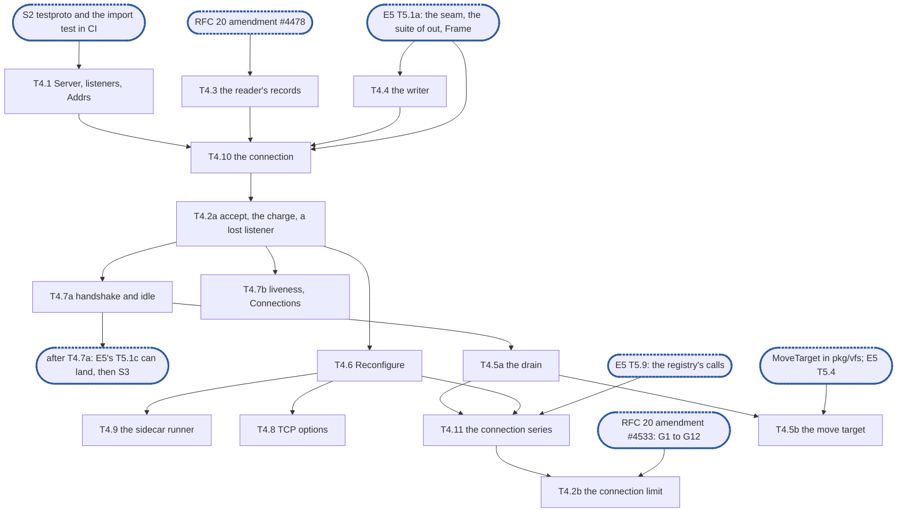

# Epic 4: adapters v2 connections and lifecycle

**Sources:** [RFC 20](../rfcs/rfc-20-adapters.md) §3.1 (the four states, the drain, abandon at
the deadline, auxiliary listeners all or none), §3.2 (a connection's lifecycle), §3.3 (the
writer's ordered send), §3.4
(`Adapter`, `Deps.Watch`, `Health`, `ConnInfo`), §3.5 (sidecars), §3.6 (`Reconfigure`, the
settings snapshot, `port`), §3.7 (health and liveness), §4.7's `Framer` as the RFC 20 amendment
#4478 states it, `Conn`'s bodies but `Send`'s, `NewServer` and `Listener`, §5.3 and §6.8 (who
holds a buffer, reading, writing), §6.1, §6.2, §6.4, §6.5's close and drain halves, §6.6's
coalesced sends, §6.7, §6.9's connection and registry rows, §10.1's connection, close and byte
series, §10.3's close logs, and §9's A10, A11, A14, A19 and A20;
[RFC 24](../rfcs/rfc-24-resources.md) §2.6 (the order, and the reader's exemption), §3.2
(receive at frame, records in fragments), §4.4 (connections), §5.1's connection and writer rows,
§6.1 (goroutines), §9's R3, R6 and R10, §10's closes at accept;
[RFC 25](../rfcs/rfc-25-observability.md) §3.5 (liveness). Cited, not owned: RFC 20 §4.1 and
§6.3 (the pipeline and the cap of 64, epic 5's), §6.10 (epic 5's pipeline benchmark),
[RFC 13](../rfcs/rfc-13-configuration.md) Appendix B (each setting's class), RFC 17 §3's
`MoveTarget`, and the epic 5 document's D1 (the seam between a connection and its pipeline),
D2, D9, D23 and D24.
**Track:** B.
**Epic 4 estimate: 14 subtasks, 27 man-days.**
**Depends on:** **S2**: E1's surface (`Server`, `Conn`, `Listener` and `NewServer` with stub
bodies, `pkg/adapter`, `pkg/adapter/settings`), E2's `testproto` with its stateful half,
`adaptertest.CheckLeaks` and the `adapter-conformance` suite with its end-to-end
specification. **E3**, the bodies of `pkg/resources`, merged (#4177, #4178). **E5's T5.1a**
(the pipeline's functions the epic 5 document's D1 names, the suite of `out`, `Framer.Frame`,
`Stages.Errors`) and **T5.9** (`Stages.Protocol`, and the registry's `Spec`, `Counter` and
`Gauge`), for the subtasks that name them; **T5.4** for T4.5b. **The RFC 20 amendment, #4478**,
for T4.3. **RFC 17's plan**, for `vfs.Shares.MoveTarget` (T4.5b). **The RFC 20 amendment
#4533**, which settles the gaps of §9, G1 to G12, for the parts of the subtasks that name them.
**Blocks:** E5's T5.1c, with which S3 is reached, and T5.10; E6's T6.3b and T6.4b, and through
them the RFC 22 plan's SMB scaffold point; E7, which starts, reconfigures and stops adapters,
reads their health and connections and drives the sidecar runner.

---

## 1. Goal

Epic 4 gives `core` the adapter's life and its connections: the four states and the listeners,
accept and its limits, one reader and one writer per connection joined to epic 5's pipeline,
the close, the drain, `Reconfigure` with its settings snapshot, the handshake and idle
deadlines, health and liveness, the TCP options and the connection series; and, in
`internal/sidecar`, the runner the node drives.

**At the end of the epic:**

- a `core.Server` on `testproto` binds every listener on each of its addresses or none, accepts
  over loopback, frames each record within the receive budget, hands it to the pipeline and
  writes its replies, and `TestConformanceEchoEndToEnd` is gone from `test/adapter/known.yaml`;
- with E5's T5.1c, S3 holds: every case of `testproto`'s stateful half runs through a real
  connection;
- `Stop` drains, abandons what runs at the deadline, and leaves every budget at zero;
  `Reconfigure` adds and removes addresses with no restart; a connection keeps the settings it
  was accepted with;
- a connection that never completes its handshake, or stays idle with nothing kept, is closed;
  one that cannot be charged, or passes the node's connection limit, is closed before any byte
  is read;
- `Health`, liveness through `Deps.Watch`, `Connections` and RFC 20 §10.1's connection, close
  and byte series answer from `core`; every accepted socket carries RFC 20 §6.7's options;
- the sidecar runner syncs each sidecar in the order RFC 20 §3.5 states, and a failing one
  fails only itself.

### 1.1 In scope

`server.go`, `accept.go`, `conn.go`, `reader.go`, `writer.go`, `reconfigure.go` and the TCP
files in `internal/adapter/core`, with their tests; the bodies of `Server`'s methods, of
`NewServer`, and of `Conn`'s `Settings`, `Established`, `Keep` and `Close`; `Framer.BodyLen`'s
last-fragment flag and `Framer.MaxRecord`, as the RFC 20 amendment #4478 states them, in `core`,
`core.golden` and `testproto`'s framer; `pkg/adapter`'s port sentinel, `ErrPortChanged`, with `adapter.golden` (G9, T4.6); the connection series beside T5.9's in `metrics.go`; the
three edits to epic 5's `pipeline.go` this document names, each by one subtask: the link's
`idle` (T4.7a), the drain's call of `MoveTarget` (T4.5b) and the pipeline's own closes made
tellable (T4.11); `internal/sidecar`; the end-to-end entry's `message` and then its removal in
`test/adapter/known.yaml`. The edits §9 proposes to the program's implementation plan, the RFCs
and other epic documents are made by other pull requests.

### 1.2 Out of scope

- The pipeline and every stage it runs, the request goroutines, `Conn.Send`'s body, the cap of
  64, the reply reservation and a status's wait for its buffer: E5, across the seam the epic 5
  document's D1 fixes. This epic calls D1's functions and builds the writer behind `out`.
- Each protocol's session registry, the per-session cleanup wait before a reconnect, and
  `Disconnect` at a session's last channel, with its hand-off to `Deps.Retry` when it still
  fails at `OnClose`'s end (RFC 20 §3.2): the registry's, which a `Protocol` owns (RFC 20
  §3.2, §4.7: "the per-session cleanup wait of §3.2 lives in the registry"), so the RFC 21 and
  RFC 22 plans'; `testproto`'s registry is E2's. `core` calls `OnClose` (T4.10).
- `core`'s datagram listener, and NLM and NSM over UDP: the deferral ledger's rows "`core`'s
  datagram listener" and "MOUNT, NLM, NSM, `SM_NOTIFY`; NLM and NSM over UDP". `NewServer`
  refuses a listener on another network than TCP until then (T4.1).
- NFS over TLS and `Conn.StartTLS`: the ledger's row "NFS-over-TLS"; meanwhile `Validate`
  refuses a TLS mode other than off, so `Reconfigure` loads no file (G7, #4533).
- What the node does with an adapter (building it, the order of start and stop, reconcile,
  `adapter_refused`, the condition registry, every budget checked at zero after the adapters
  stop, the retrier behind `Deps.Retry`): E7. The concrete sidecars, mDNS, WS-Discovery, the port mapper and rpcbind
  registration: the ledger's row "concrete sidecars"; each sidecar's own idempotent `Sync`
  is its contract (RFC 20 §3.5).
- The pipeline benchmark and its allocation gate, which run this epic's reader and writer:
  E5's T5.10. End-to-end benchmarks and soaks: the ledger's row "end-to-end benchmark".

### 1.3 Names used here

- **E1**, epic 1, delete v1 and fix the surface: `core`'s exported types with stub bodies.
- **E2**, epic 2, test foundations: `testproto`, the import test, the leak check, the
  `adapter-conformance` suite and the `unit/adapter-allocs` cell.
- **E3**, epic 3, budgets and buffers: the bodies of `pkg/resources`.
- **E4**, this epic.
- **E5**, epic 5, dispatch: the pipeline, its stages, the compound runner, held and parked
  requests, the series of the request path. Its subtasks are named by id (T5.1a, T5.1c, …).
- **E6**, epic 6, protocol scaffolds: `wire/`, `protocol/` and `New` for SMB and NFS.
- **E7**, epic 7, integration with the node: `internal/node` builds, starts, reconciles and
  stops adapters and drives the sidecar runner. Planned after S4.
- **S1**, surface frozen: after E1, `core`'s exported surface changes only with an amendment
  of RFC 20 §4.7.
- **S2**, `testproto` and the import test in CI: after E2.
- **S3**, `core` serves `testproto` end to end: after this epic's T4.1, T4.3, T4.4, T4.10,
  T4.2a and T4.7a and E5's T5.1c.
- **S4**, `internal/node` exists: RFC 23's plan's S2.
- **Track B**: the line of work this epic is on. Tracks A and C carry E3 and E5, and E6.
- **The deferral ledger**: the list of everything RFC 20 or develop's v1 provides that the
  branch does not serve yet, each row naming the owner that brings it back.
- **The RFC 17, RFC 21, RFC 22 and RFC 23 plans**: the implementation plans of the filesystem
  service, NFS, SMB and the control plane. Their subtasks are named with their prefix ("the RFC
  22 plan's T3.2"), never by a bare id.
- **Seam**: the split of `core` between this epic and E5, which the epic 5 document's D1 fixes:
  `link`, `out`, `withDefaults`, `newShared`, `newPipeline`, `serve`, `drain`, `wait`, `close`.
- **Loopback test**: a test in `package core_test` that starts a `core` server on `testproto`
  over `127.0.0.1:0`, drives it with `testproto.Client`, and ends with `CheckLeaks`.
- **Pipe test**: a test in `package core_test` that hands a connection one end of a `net.Pipe`
  through `hooks_test.go`, in a `testing/synctest` bubble where time decides, and ends with
  `CheckLeaks`.
- **G1 to G12**: the RFC gaps of §9, each with its recommendation, which a subtask's
  **Waits for** names; none is settled here: the RFC 20 amendment #4533 settles each.

## 2. How the general rules apply

Each of the program's ten general rules for an epic
([`rfc-20-adapters-plan.md` §1.5](rfc-20-adapters-plan.md#15-general-rules-for-each-epic)),
cited by number and title, and how it applies here or why it does not.

| Rule | Subtasks | How |
| --- | --- | --- |
| rule 1, independent unit tests, under `-race` ([`CLAUDE.md`, Writing tests](../../../CLAUDE.md#writing-tests); [Verifying a change](../../../CLAUDE.md#verifying-a-change)) | all | every test is in `package core_test`, or `package sidecar_test`, and imports no protocol but `testproto`. Connections are real TCP over loopback with real deadlines, short ones where a deadline is the subject, and socket options read back from the accepted socket; where only time decides, a pipe test in a `synctest` bubble. The timers this epic arms run on the server's clock (D3). A setting is asserted on a connection accepted after the change, never on the snapshot. Doubles: `vfstest.Faults` around `memory.New` (kind 3) for `MoveTarget`'s answers; a listener that fails `Accept` on cue (kind 3, T4.2a); a sidecar that fails its `Sync` on cue (kind 3, T4.9). A protocol or a sidecar declared in a test file is an input, not a double |
| rule 2, fuzz tests where relevant | T4.10 | the record cut reads a peer's bytes: `FuzzConnection` drives a connection with arbitrary record headers, fragments, `testproto` messages, `Panic` among them, and closes at random points, and holds RFC 24's R3 and R6: no panic, the cap held, nothing reserved past it, every budget at zero after. `testproto`'s `FuzzFrame` gains the fragment bit with T4.3 |
| rule 3, observability follows RFC 25 and RFC 20 §10 | T4.11, T4.2a, T4.7b | T4.11 resolves the connection, close and byte series once per server and records them with an atomic add; `adapter_listener_lost` is a condition (T4.2a) and liveness goes through `Deps.Watch` (T4.7b), both RFC 25 §3's; closes are logged through `Deps.Logger`. No span: RFC 20 §10.2's spans are per request, E5's. Protocol code records nothing |
| rule 4, leaks and allocations | all loopback and pipe tests | every loopback and pipe test ends with `CheckLeaks` over all four budgets. No gate of this epic's own: the reader's and writer's cost per request is inside E5's T5.10 gate, which runs over loopback on them. A change to the connection code after T5.10 reports that benchmark's allocations and its mutex and block profiles (RFC 20 §6.9) |
| rule 5, v2 ignores v1 | T4.2a, T4.3, T4.9 | the accept backoff is lifted from develop's `pkg/adapter/base.go`, which RFC 20 Appendix B marks keep; the frame deadline, also keep, is written again as `read_timeout` (T4.3); nothing of v1's sidecar group carries over (D9) |
| rule 6, nothing deferred is lost | T4.1, T4.6, T4.5b, T4.11 | the ledger rows §1.2 cites; §9 proposes the rows G7 and G8 need, and the close-reasons row leaving the ledger with T4.11 |
| rule 7, code comment conventions ([`CLAUDE.md`, Code comments](../../../CLAUDE.md#code-comments)) | all | each decision of §4 leaves the marker it names at its code site. Of RFC 20's notes the rule lists, two are this epic's: `Addrs` live, at `Reconfigure` (T4.6), and no self-probe, at `Health` (T4.7b) |
| rule 8, a test must be able to fail ([`CLAUDE.md`, Writing tests](../../../CLAUDE.md#writing-tests)) | all | each test in §6 names the change that fails it. The end-to-end specification's `message` follows its first failure (T4.1) until T4.2a turns it green and removes its entry |
| rule 9, a symbol is exported only if RFC 20's interface uses it | T4.3, T4.6 | `core` gains `Framer.BodyLen`'s `last` and `Framer.MaxRecord`, as the amendment #4478 states them, with `core.golden` (T4.3); `pkg/adapter` gains the port sentinel, `ErrPortChanged`, as #4533 names it (G9, T4.6), with `adapter.golden`. Every other symbol is unexported; G1 and G8's recommendations would add surface only through their amendments |
| rule 10, each subtask creates only what it declares | all | each file lands with its first consumer; `internal/sidecar` lands with its tests, as RFC 20 §2.5 places it, and is driven by E7; no hook in `hooks_test.go` lands before the test that reaches through it |

## 3. Requirements and invariants

`Source` cites RFC 20 unless it names another RFC or document.

**States and listeners**

| # | Requirement | Kind | Source | Subtasks |
| --- | --- | --- | --- | --- |
| R1 | An adapter moves through configured, serving, draining and stopped, by `Start` and `Stop`; `Health` reports the state, and is ready only while serving with no condition raised | MUST | §3.1, §3.4, §3.7 | T4.1, T4.2a |
| R2 | While configured no socket is open, `NewServer` opens nothing, and a setting the adapter cannot apply fails there, not at the first request: a listener on a network `core` serves no listener for is refused | MUST | §3.1, §3.4; the deferral ledger's row "`core`'s datagram listener" | T4.1 |
| R3 | `NewServer` refuses a listener naming no service, an empty one or one twice, and two listeners naming the same `Socket` or the same network and nonzero port | MUST | §4.7 (`NewServer`) | T4.1 |
| R4 | `Start` succeeds only once every listener is bound on each of the settings' `Addrs` at its port; a partial bind is a failed start that closes what it opened, and its error names what failed | MUST | §3.1, §3.4, §4.7 (`NewServer`, `Listener`) | T4.1 |
| R5 | `Start` after `Stop` is refused; `Stop` is idempotent, a second call returning once the adapter is stopped | MUST | §3.4 | T4.1, T4.5a |
| R6 | `Addrs` is every address each listener is bound on now, one `Socket` per service it names on its network, each address as the settings name it with the port bound there, a port of 0 resolved and `0.0.0.0` reported as itself; a fresh map the caller owns, slices included; an address `Reconfigure` added present and one it removed gone; empty before `Start` and after `Stop` | MUST | §3.4 (`Addrs`), §4.7 (`Listener`) | T4.1, T4.6 |

**Accept**

| # | Requirement | Kind | Source | Subtasks |
| --- | --- | --- | --- | --- |
| R7 | Each connection is charged its fixed cost, 64 KiB as RFC 24 proposes, its read buffer included, to the connection-state budget at accept; one that cannot be charged is closed at once, before any byte is read | MUST | §3.2; RFC 24 §4.4 | T4.2a |
| R8 | A connection past the node's `connection_limit`, or from an address already holding a quarter of it, is closed at accept, before any byte is read, never left in the listen backlog; such an address is named in a log line at warning at most once a minute | MUST | §3.2, §6.4; RFC 24 §4.4, §10 | T4.2b |
| R9 | One address opening connections in a loop is held at a quarter of the limit, and another address still connects | test row | RFC 24 §9 R10 | T4.2b |
| R10 | An `Accept` error the listener can recover from is retried after a backoff from 10 ms doubling to 1 s; failing for 60 s raises `adapter_listener_lost`, derived from current evidence and cleared when it no longer holds | MUST | §6.4, §3.7; RFC 25 §3.4 | T4.2a |
| R11 | Each accept loop reports a turn through `Deps.Watch`, or reports idle through an accept deadline that wakes it at least every 30 s; a nil `Watch` watches nothing; a connection's reader is not watched | MUST | §3.4 (`Deps.Watch`), §3.7; RFC 25 §3.5 | T4.7b |

**The connection**

| # | Requirement | Kind | Source | Subtasks |
| --- | --- | --- | --- | --- |
| R12 | A connection loads the settings snapshot once, at accept, and `Conn.Settings` returns it, from which `NewConn` reads its protocol's shape; a settings change never alters a connection already accepted | MUST | §3.6, §4.7 (`Conn.Settings`), A20 | T4.10, T4.6 |
| R13 | Each connection has one reader, which frames records and hands each to the pipeline's `serve`, and one writer, which serialises replies onto the socket; the pipeline's work for a request runs on neither | MUST | §6.1; the epic 5 document's D1 | T4.10 |
| R14 | The stages `NewConn` returns are filled by `withDefaults` at accept; stages it refuses close the connection before it reads | MUST | §4.7 (`Stages`); the epic 5 document's D1 | T4.10 |
| R15 | A close, by the client, a deadline, a protocol violation (`Conn.Close`), the drain or a `Reconfigure` that removes the connection's address, cancels the context of every request in progress, ends every hold and park as on a closed connection with their replies dropped, and runs `OnClose` only once nothing runs, in the epic 5 document's D1 order: the reader stopped, the connection's context cancelled, the pipeline's `close`, its `wait`, `OnClose`, the writer stopped | MUST | §3.2, §4.7 (`Conn.Close`), §6.5; the epic 5 document's D1 | T4.10 |
| R16 | `Conn.Close` is idempotent and never waits for the goroutine that called it, so a handler and the reader may call it | MUST | §4.7 (`Conn.Close`); the epic 5 document's D1 | T4.10 |
| R17 | Each `Server` builds its own buffer pools, over the receive budget for requests and the reply budget for replies, and hands the reply pool to `newShared`; `Deps` carries no allocator | invariant | §6.8; the epic 5 document's D1 | T4.10 |
| R18 | A slow client costs only its own connection: a reply it does not read waits in its connection's writer, never in a worker; that connection is not read once its writer is at its bound, and closes past the write deadline | MUST | §6.1, A10 | T4.10, T4.4 |
| R19 | No wait is entered while holding a reservation later in RFC 24 §2.6's order: the reader waits for receive room and for its writer holding no record, and at flow control holding only the record it has framed, RFC 24 §2.6's one exemption | MUST NOT | RFC 24 §2.6 | T4.10 |
| R20 | Every goroutine is one RFC 24 §6.1 lists: a connection's reader and writer, an admitted request, a fixed loop per bound socket; none for a waiting reader or a closing connection | MUST NOT | RFC 24 §6.1 | T4.10, T4.2a |
| R21 | The connection registry is a map under a read-write mutex, never held across a service call | invariant | §6.9, §6.6 | T4.10 |
| R22 | Every pipeline test ends with every budget at zero; a fuzz of the frame stage with random cancellations and panics asserts the same | test row | RFC 24 §9 R3; §6.8 | T4.10 |

**Reading**

| # | Requirement | Kind | Source | Subtasks |
| --- | --- | --- | --- | --- |
| R23 | The reader learns a record's length from its header and refuses a length past the protocol's cap before reserving anything; the connection closes | MUST | §4.1's frame row, §5.2; RFC 24 §3.2 | T4.3 |
| R24 | The reader reserves the record's charge from the receive budget before it reads the body | MUST | RFC 24 §3.2; §4.1's frame row, §6.3 | T4.3 |
| R25 | At the receive ceiling the reader waits: the connection is not read until room frees, nothing is refused and no answer is owed | MUST | RFC 24 §3.2; §4.1's frame row | T4.3 |
| R26 | Each connection reads through one small-class buffer: a record that fits in what was read is copied into a receive buffer of its class (D7); for a larger one the part read is copied and the rest read straight into it | invariant | §6.8 (Reading), as D7 and G12 settle it | T4.3 |
| R27 | When a record's first header does not mark it the last, the reader reserves the class that holds the protocol's cap (`Framer.MaxRecord`) before it reads the first fragment, never grows that reservation, counts the fragments, and closes the connection, its reservation released, on a fragment that would take the record past the cap or a record past the fragment count | MUST | RFC 24 §3.2; §4.7 (`Framer.BodyLen`, `Framer.MaxRecord`, as amended) | T4.3 |
| R28 | The rest of a record arrives within `read_timeout` of its first byte, a record in fragments within the frame deadline from its first fragment's header, or the connection closes and the record's reservation is released | MUST | §6.4; RFC 24 §3.2 | T4.3 |
| R29 | A record in three fragments whose first is 1 KiB charges the receive budget the class holding the cap before the first fragment's body is read, and a fragment past the cap closes the connection with the reservation released; a fuzz over record marks and fragment sequences leaks no reservation and holds the cap | test row | RFC 24 §9 R6 | T4.3, T4.10 |

**Writing**

| # | Requirement | Kind | Source | Subtasks |
| --- | --- | --- | --- | --- |
| R30 | The writer sends whole messages, never interleaves two and transforms none; it frames each with `Framer.Frame` and writes the header and the message together; a failed write closes the connection | MUST | §6.2; §4.7 (`Framer.Frame`, as amended) | T4.4 |
| R31 | A message handed with `before` goes out ahead of the reply of that key still queued; every other message goes out as it completes | MUST | §6.2, §3.3; the epic 5 document's D1 | T4.4 |
| R32 | The writer's queue is bounded by the connection's flow-control bound, counting every message `out` takes; `out` never blocks its caller, also past the bound, takes the message's reference whatever it returns and fails only once the connection is closed; at the bound the reader stops reading until the queue falls below it | MUST | §6.1, §6.2; RFC 24 §5.1; the epic 5 document's D1 | T4.4, T4.10 |
| R33 | On each wake the writer drains every queued message into one gathered write | invariant | §6.6 (coalesced sends), §6.9 | T4.4 |
| R34 | A message not written within `write_timeout` closes the connection | MUST | §6.4 | T4.4 |
| R35 | A buffer holding a reply is never reused before the writer has sent it: the writer holds its reference from queueing until the bytes are on the socket, and releases it once sent or discarded | invariant | §5.3, §6.8 | T4.4 |

**Handshake and idle**

| # | Requirement | Kind | Source | Subtasks |
| --- | --- | --- | --- | --- |
| R36 | A connection that has not called `Conn.Established` within `handshake_timeout` of accept is closed | MUST | §6.4, §4.7 (`Conn.Established`); RFC 13 Appendix B | T4.7a |
| R37 | A connection with no request and no held state is closed after `idle_timeout`; `Conn.Keep` passes it over until every release it returned is called | MUST | §6.4, §4.7 (`Conn.Keep`) | T4.7a |

**Drain and stop**

| # | Requirement | Kind | Source | Subtasks |
| --- | --- | --- | --- | --- |
| R38 | While draining no new connection is accepted and open connections are still read; every connection's pipeline is told the adapter drains, one built after that before its first record | MUST | §3.1; the epic 5 document's D1 | T4.5a |
| R39 | Draining ends when nothing is left or at the drain deadline, whichever is first; at the deadline a request still running is abandoned, its context cancelled and its reply not sent | MUST | §3.1, §3.4 (`Stop`), §6.4, §6.5, A11 | T4.5a |
| R58 | A request abandoned at the drain deadline is never answered with an error the client would treat as final | MUST NOT | §3.1, §6.5 | T4.5a |
| R40 | Once stopped, every connection is closed and its state dropped | MUST | §3.1 | T4.5a |
| R41 | A request refused while draining gets `ErrMoved` when the service's `MoveTarget` names another gateway node for the share of the handle it names (`Invocation.Handle`), and `ErrDraining` otherwise; a compound's refused members get `ErrMoved` only when it names at least one handle and every one names a share with a target | MUST | §3.1, §3.4 (`Stop`), §4.7 | T4.5b |

**Reconfigure**

| # | Requirement | Kind | Source | Subtasks |
| --- | --- | --- | --- | --- |
| R42 | `Reconfigure` refuses the other protocol's shape, any other type, and settings `Validate` refuses; a refusal leaves the adapter as it was | MUST | §3.4 (`Reconfigure`), §3.6 | T4.6 |
| R43 | `Reconfigure` refuses a changed `port` with a sentinel error, comparing that field alone | MUST | §3.6 | T4.6 |
| R44 | `Reconfigure` opens the listeners of an added address, all or none, before the snapshot changes, and closes a removed address's listeners and every connection accepted on them after; the other addresses serve on | MUST | §3.1 (`Reconfigure`), §3.6 | T4.6 |
| R45 | The TLS certificate files are loaded by `Reconfigure` before the snapshot swap, so an unloadable one is refused there | MUST | §3.6 | T4.6 |
| R46 | `core`'s tests show on `testproto` over the in-memory service that an open connection keeps its settings, a new one gets the new ones, a removed address's connections close, and a bind that fails changes nothing | test row | §3.6 | T4.6 |

**TCP**

| # | Requirement | Kind | Source | Subtasks |
| --- | --- | --- | --- | --- |
| R47 | Nagle's algorithm is off (`TCP_NODELAY`) on every connection | MUST | §6.7, A14 | T4.8 |
| R48 | The send and receive buffers are left to the kernel's autotuning | MUST NOT | §6.7, A14 | T4.8 |
| R49 | Keepalive is on with 15 s idle and 3 probes 5 s apart, and `TCP_USER_TIMEOUT` equals the write deadline where the platform has it; the backlog and address reuse are Go's defaults | MUST | §6.7 | T4.8 |
| R50 | A unit test asserts `TCP_NODELAY`, the keepalive values and, on Linux, `TCP_USER_TIMEOUT` on an accepted connection | test row | §6.7 | T4.8 |

**Health and connections**

| # | Requirement | Kind | Source | Subtasks |
| --- | --- | --- | --- | --- |
| R51 | `Connections` lists the connections open now, read from `core`'s connection registry and never written by protocol code, each with its `Protocol`, `Remote`, `Session` and `Since` | MUST | §3.4 (`Connections`, `ConnInfo`) | T4.7b |

**Observability**

| # | Requirement | Kind | Source | Subtasks |
| --- | --- | --- | --- | --- |
| R52 | The reader and writer count connections and bytes: `adapter_connections{protocol, state}`, `adapter_connection_closes_total{protocol, reason}`, `adapter_bytes_total{protocol, direction}`, each resolved once per server and recorded with an atomic add | MUST | §10.1, §6.9 | T4.11 |
| R53 | A close's `reason` is from a closed set that holds `pool`, `limit` and `per_address` for a connection closed at accept and `reply_wait` for one whose status found no reply buffer within 30 s | MUST | §10.1; RFC 24 §10 | T4.11, T4.2b |
| R54 | `Conn.Close`'s error is logged and counted; a misbehaving client is logged once per connection, not once per request | MUST | §4.7 (`Conn.Close`), §10.3 | T4.11 |
| R55 | No metric carries a client, principal, share or path label | MUST NOT | §10.1; RFC 25 §2.4 | T4.11 |

**Sidecars**

| # | Requirement | Kind | Source | Subtasks |
| --- | --- | --- | --- | --- |
| R56 | A sidecar is synced with those of its `Adapters` now serving, each `Serving` built from the adapter's `Addrs`: after the adapter is serving, before a `Reconfigure` that removes an address (that address left out), again after every `Reconfigure` returns whatever it returned, and before the adapter starts draining; with none to stop it; a disabled one with the empty set | MUST | §3.5, §3.6 | T4.9 |
| R57 | A failing sidecar fails only itself: it raises `sidecar_failed` naming it, and the adapters keep serving and stay ready | MUST | §3.5, §3.7, A19 | T4.9 |

What other epics and plans own of these sections: the pipeline's stages and their refusals,
the cap of 64, the reply reservation, the status's 30 s wait and `Conn.Send` (E5); `vfs.Callbacks`, the callback deadline and `Deps.DialClient` (the RFC 21 and RFC 22 plans, the program's §6.2); each
protocol's framer, its record cap and its fragment count (E6, RFC 21 and RFC 22); the session
registry and its cleanup wait (the protocols' plans); `New` binding on `port` (E6); building a
new adapter on a `port` change, the node's order of `New`, `Start`, `Reconfigure` and `Stop`,
`adapter_refused` and the conditions' registry (E7); each sidecar's own `Sync` (the cutover).
What already holds and is not numbered again: `Health.Ready`'s derivation and `State`'s names
(E1's `pkg/adapter`); `Validate`'s rules (E1's `pkg/adapter/settings`); the shape refusals of
`Deps` (E1's `New`).

What enforces the rows with no test of their own: R20's "none for a waiting reader or a
closing connection" through `adaptertest.CheckLeaks`'s goroutine check, and R21 through RFC 20 §6.9's
mutex profile, which shows a lock held across a service call; R17's "no
allocator in `Deps`", the compiler, since `Deps` has no such field.

## 4. Decisions this epic takes

- **D1, a listener is bound by its address's family, and `Addrs` reports the settings'
  address.** Each listener is bound on each address of `Addrs` with `tcp4` for an IPv4 address
  and `tcp6` for an IPv6 one, and `Addrs` reports that address with the port the socket bound.
  Go binds a wildcard on `tcp` as a dual-stack IPv6 socket, which reports `[::]` and would
  collide with a second listener on `::` at the same port; on `tcp6` it sets `IPV6_V6ONLY`.
  Checked in Go 1.26's source: `favoriteAddrFamily` in `src/net/ipsock_posix.go` returns
  `AF_INET6`, not V6-only, for a wildcard on `tcp`, and V6-only for a network ending in `6`.
  `decision:` at the bind. Overturned if a deployment needs one dual-stack socket per wildcard.
- **D2, a connection has two goroutines, and the reader runs its teardown.** `Conn.Close`
  records the error, stops the reader's read (a read deadline in the past), cancels the
  connection's context and calls the pipeline's `close`, and returns; the reader, once out of
  its loop, calls `wait`, `OnClose`, stops the writer, releases the connection's charge and
  unregisters it. So a close from a handler or from the reader never waits on itself, and no
  third goroutine runs per closing connection (RFC 24 §6.1). Prior art: `net/http`'s
  `conn.serve`, the connection's reading goroutine, closes it in a deferred call (checked in
  Go 1.26's `src/net/http/server.go`). `decision:` at `Conn.Close`.
- **D3, the timers this epic arms run on the server's clock.** The handshake and idle timers,
  the accept backoff and its 60 s, the accept deadline and the drain deadline are armed through
  the clock in `shared` (the epic 5 document's D24), which a loopback test advances once an
  event it can wait on has happened. A socket's read and write deadlines are the socket's own:
  tested with short real deadlines over loopback, or on a `net.Pipe` in a `synctest` bubble.
  `decision:` at the server's use of the clock. Prior art: RFC 29 §4.11's first kind of double.
- **D4, `testproto`'s record gains a fragment flag.** RFC 20's amended `Framer` lets a header
  say its body does not end the record. `testproto`'s length prefix keeps its 31 low bits as
  the fragment's length and **its top bit set means more fragments follow**, so every record
  written today ends with its first header and every vector stands; `MaxRecord` is 1 MiB, its
  body cap, in at most 4 fragments. RFC 5531 §11's record mark sets that bit on the *last*
  fragment instead (checked: "bit value 1 implies the fragment is the last fragment"); the
  inversion is `testproto`'s alone. `decision:` at `testproto`'s framer.
- **D5, the writer's queue is a slice and a wake.** `out` inserts under the connection's mutex
  (ahead of its key's reply for a `before`) and wakes the writer; the writer takes every queued
  message per wake into one `net.Buffers`, `Frame`'s header before each body; a channel closed
  when the queue falls below its bound releases a paused reader. The bound is 64 messages,
  RFC 20 §6.3's cap, which for `testproto`'s credit target is the flow-control bound too, and
  for every protocol as #4533 settles G4. `ponytail:` at the bound, naming RFC 24 §5.1's
  upgrade, the connection's flow-control bound. Prior art: E5's recorder in `out_test.go`, held to the same suite.
- **D6, one accept loop per bound socket, a fixed loop.** It accepts, charges, and builds the
  connection on its own goroutine, then starts the connection's two; its accept deadline is
  10 s, inside RFC 25 §3.5's 30 s. The backoff is develop's, lifted. Prior art: `net/http`'s
  `Server.Serve` retries an `Accept` error that reports itself temporary after a delay from
  5 ms doubling to 1 s (checked in Go 1.26's `src/net/http/server.go`); Go's `syscall.Errno`
  reports `EMFILE` and `ENFILE` temporary (checked in `src/syscall/syscall_unix.go`).
  `decision:` at the loop's deadline.
- **D7, a record cut from the read buffer is copied into a buffer of its own.** A record is
  handed to `serve` as one `*resources.Buf` holding its own reservation, and a `Buf` cannot be
  a slice of another, so a record that fits in what was read is copied into a receive buffer
  of its class, at most 4 KiB. `decision:` at the cut, overturned if `Buf` gains sub-slices; the copy is against RFC 20 §6.8's "cut from it", which G12 puts to the RFC.
  No prior art sought: the constraint is `Buf`'s.
- **D8, the pipeline tells its connection when nothing runs.** The idle timeout needs the
  moment the last request ends, which only the pipeline knows; `wait` blocks for it, and a
  goroutine per connection to call it is what D2 avoids. T4.7a adds `idle func()` to `link`,
  which the pipeline calls each time nothing runs, is held, is parked or waits for a status's
  buffer any more: the moment `wait` returns. T4.7a owns that change to E5's `pipeline.go`;
  §9 lists it for the epic 5 document. `decision:` at the field. No prior art sought: it is the
  seam's.
- **D9, the sidecar runner wraps the adapter calls it orders.** RFC 20 §3.5's order is Syncs
  around an adapter's start, reconfigure and drain, so `sidecar.Runner` takes those calls:
  `Start`, `Reconfigure` and `Stop` on a named `adapter.Adapter`, each with its Syncs, and
  `SetEnabled`; `Failed` names the sidecars whose last `Sync` failed, which E7's node raises
  as `sidecar_failed`. Each `Sync` runs under the caller's context; a failure leaves the others
  synced. v1's `pkg/adapter/sidecar.Group` on develop starts and stops services one by one and
  is not lifted: RFC 20's `Sidecar` is synced with a set. `decision:` at the runner.

## 5. Target tree

```text
internal/adapter/core/
  server.go             T4.1: Server, NewServer, Start, Stop, Addrs, Health; T4.10: the pools,
                        newShared, the registry, Stop closing connections; T4.5a: the drain
  accept.go             T4.2a: the accept loop, the charge, the backoff, a lost listener;
                        T4.7b: the accept deadline and Deps.Watch; T4.2b: the connection limit
  conn.go               T4.10: Conn's fields, Settings, Close, the teardown; T4.7a: Established,
                        Keep, the handshake and idle timers (Send's body: E5's T5.1c)
  reader.go             T4.3: the record cut, fragments, the frame deadline; T4.10: the loop
  writer.go             T4.4: the writer
  reconfigure.go        T4.6: Reconfigure
  tcp.go  tcp_linux.go  tcp_other.go     T4.8: the socket options
  protocol.go           T4.3: Framer's BodyLen and MaxRecord, as amended
  metrics.go            T4.11: the connection series, beside T5.9's
  pipeline.go           E5's; T4.7a: link's idle; T4.5b: drainErr asks MoveTarget;
                        T4.11: the pipeline's closes made tellable
  hooks_test.go         each subtask's hooks, with the test that reaches through them
  server_test.go  accept_test.go  conn_test.go  reader_test.go  writer_test.go
  reconfigure_test.go  drain_test.go  tcp_test.go  tcp_linux_test.go  fuzz_test.go
  testdata/fuzz/FuzzConnection/         T4.10: the crashers, kept as seeds
  testdata/surface/core.golden          T4.3: Framer
internal/adapter/adaptertest/testproto/
  wire.go  wire_test.go                 T4.3: the fragment flag, MaxRecord (D4)
  conformance_test.go                   T4.3: BodyLen's three results
internal/adapter/core/out_test.go       E5's; T4.3: its reader of BodyLen's three results
pkg/adapter/
  adapter.go                            T4.6: the port sentinel, ErrPortChanged (G9)
internal/adapter/core/testdata/surface/adapter.golden   T4.6: the port sentinel
internal/sidecar/
  runner.go  runner_test.go             T4.9
test/adapter/known.yaml                 T4.1: the end-to-end entry's message; T4.2a: removed
```

Symbols this epic adds outside `core`'s unexported code: `Framer.BodyLen(hdr []byte) (n int,
last bool, err error)` and `Framer.MaxRecord() (bytes, fragments int)`, as the amendment #4478
states them (T4.3); the port sentinel, `adapter.ErrPortChanged`, as #4533 settles G9 (T4.6); in
`internal/sidecar`, `Runner`, `New(ss ...adapter.Sidecar) *Runner`, `(*Runner).Start(ctx,
name string, a adapter.Adapter) error`, `(*Runner).Reconfigure(ctx, name string, a
adapter.Adapter, next settings.Settings) error`, `(*Runner).Stop(ctx, name string, a
adapter.Adapter) error`, `(*Runner).SetEnabled(ctx, sidecar string, on bool) error` and
`(*Runner).Failed() []string` (T4.9, D9), internal to the module. The unexported surface
inside `core`: `writer` with `out(msg *resources.Buf, key, before uint64) error`, the record
cut over a connection's read buffer, `serveConn(nc net.Conn, l *bound)`, the registry, and
`link.idle func()` (D8).

## 6. Subtasks

### T4.1 `Server`: states, listeners and `Addrs`

**Subtask T4.1 estimate: 2.5 man-days.**

- **Track:** B. **Depends on:** none. S2 holds, so it can start now.
- **Waits for:** G5 (#4533), for `Stop` on a configured adapter and `Start` on one that is not.
- **Covers:** R1 (the states), R2, R3, R4, R5 (with no connection), R6 (but `Reconfigure`'s
  addresses).
- **Deliverables:** in `server.go`: `Server`'s fields (its `Deps`, listeners, state, the
  settings snapshot in an `atomic.Pointer` as RFC 20 §3.6 sketches it, the bound sockets and a
  mutex); `NewServer`'s refusals of R3, and of a listener on another network than TCP with an
  error wrapping `errors.ErrUnsupported` and a `decision:` withdrawn by the ledger's datagram
  listener (R2); `Start` binding each listener on each address by its family (D1), all or none;
  `Stop` closing the listeners and moving to stopped, idempotent; `Addrs`; `Health`'s state.
  `TestConformanceEchoEndToEnd`'s `message` in `test/adapter/known.yaml` follows its new first
  failure, the reply's read past its backstop (`i/o timeout`), since nothing accepts yet.
  Consumed by every later subtask; by E6's `New` and E7.
- **Acceptance criteria:**
  - `NewServer` refuses each malformed set of R3 and a `udp` listener, naming the listener, and
    opens nothing; a valid set returns a configured server whose `Addrs` is empty.
  - `Start` with `Addrs` `127.0.0.1` and `::1` and two listeners at port 0 binds four sockets;
    `Addrs` reports each service of each listener under its `Socket`, each address with a
    nonzero port. One with `0.0.0.0` reports `0.0.0.0:<port>`, and a dial to `::1` at that port
    is refused.
  - A listener whose port the test holds fails `Start`, naming it and the address; the other
    listener's sockets are closed (a dial is refused) and the state is configured.
  - Mutating the map `Addrs` returned, and a slice in it, leaves the next call's answer as it
    was.
  - `Stop` after `Start` closes every socket, empties `Addrs` and reports stopped; a second
    `Stop` returns nil; `Start` after `Stop` is refused; `Health().Ready()` holds only while
    serving.
- **Tests:** loopback tests in `server_test.go`, no connection served, each ending with
  `CheckLeaks`. The refusals (catch a check left out, which E6's `New` would pass to a server
  that binds one port twice). The two addresses and the wildcard (catch a bind on `tcp`, under
  which the wildcard is reported `[::]` or its port answers IPv6; skipped where `::1` cannot be
  bound). The held port (catches a partial bind left open, R4). The mutated map (catches the
  server's own map handed out). `Stop` twice and `Start` after `Stop` (catch a second `Stop`
  that errors and a stopped server started again, R5).
- **Rules:** rule 7: D1's `decision:`, and the `udp` refusal's; rule 8: the end-to-end entry's
  `message`.

### T4.3 The reader's records

**Subtask T4.3 estimate: 2.5 man-days.**

- **Track:** B. **Depends on:** none. The RFC 20 amendment #4478 merged first, since it states
  `BodyLen`'s `last` and `MaxRecord` (rule 9).
- **Waits for:** G10 (#4533), for whether the frame deadline runs while the reader waits for
  receive room.
- **Covers:** R23, R24, R25, R26, R27, R28, R29 (its named case).
- **Deliverables:** in `protocol.go`, `Framer.BodyLen`'s three results and `MaxRecord`, with
  `core.golden`; `testproto`'s framer with D4's flag and `MaxRecord`, its vectors and
  `FuzzFrame` extended to fragments, its conformance test and, if E5's T5.1a has landed, the
  suite of `out`'s reader moved to three results. In `reader.go`, the record cut: one 4 KiB read
  buffer per connection, charged within the connection's cost (R7), from which it returns each
  framed record as a receive `Buf` of its class: the length from `BodyLen`, a length past the
  cap an error before any reservation, the reservation taken from the receive pool under the
  connection's context before the body is read (a wait there reads nothing more), a record that
  fits copied out of the read buffer (D7), a larger one its part read copied and the rest read
  with `io.ReadFull`, fragments as R27 states, and the frame deadline of R28 through the
  socket's read deadline. Consumed by T4.10's reader loop.
- **Acceptance criteria:**
  - Records of 0, 40, 4,000, 5,000 and 1 MiB bytes, written by a client one by one, and a
    burst of 100 small ones in one write, come out whole and in order, the receive budget
    charged each record's class while it is held.
  - A header claiming 1 MiB and one byte returns an error and the receive budget is never
    charged.
  - With the receive budget held full, a header is read and nothing past it; the cut is still
    waiting after the test has written the body; once the test frees room the record comes out.
  - A record in three fragments whose first is 1 KiB charges the class holding 1 MiB before the
    first body is read, keeps that one charge, and comes out whole; a fragment that takes the
    record past 1 MiB, and a fifth fragment, each return an error with the reservation released.
  - With `read_timeout` 100 ms, a record whose body stops after half returns an error at the
    deadline with its reservation released; a connection that sends nothing is not timed out.
- **Tests:** in `reader_test.go`, through `hooks_test.go`, on a loopback pair the test opens,
  each ending with `CheckLeaks`. The sizes and the burst (catch a cut from the wrong offset, a
  part read lost when the rest is read, and a burst served as one record). The over-cap header
  (catches a reservation made before the cap check, R23). The full budget (catches a cut that
  refuses or reads on at the ceiling, R25). The fragments (catch a reservation grown per
  fragment, a count not kept, and a total past the cap accepted, R27, R29). The stalled body and
  the silent connection (catch no frame deadline, and one armed between records, R28).
  `testproto`'s vectors (catch the flag read inverted, which would make every record a first
  fragment).
- **Rules:** rule 2: `FuzzFrame`'s fragments; the fuzz of the connection is T4.10's; rule 7:
  D4's and D7's `decision:`; rule 9: `core.golden`.

### T4.4 The writer

**Subtask T4.4 estimate: 2.5 man-days.**

- **Track:** B. **Depends on:** T5.1a. Its suite of `out` and `Framer.Frame`.
- **Waits for:** nothing: G4 (#4533) settles a protocol's own bound and a gathered write's deadline, and
  neither changes `testproto`'s case.
- **Covers:** R18 (the writer's half), R30, R31, R32 (`out` and the bound), R33, R34, R35.
- **Deliverables:** `writer.go`: `writer`, built over a `net.Conn`, the protocol's `Framer`,
  `write_timeout` from the connection's snapshot and `Conn.Close`; its `out` with D1's signature
  (the epic 5 document's), D5's queue of 64 messages, its goroutine framing and writing each
  wake's messages in one `net.Buffers` under a write deadline, releasing each message once sent,
  closing on a failed or late write and releasing what is queued; its stop, which the teardown
  calls last. Consumed by T4.10, which hands `out` to `newPipeline` and reads the bound.
- **Acceptance criteria:**
  - The writer passes the suite of `out` (`testOut`).
  - With the peer holding the first write, nine more messages queued go out in one gathered
    write.
  - With the peer reading nothing and `write_timeout` 1 s, `Conn.Close` is called at 1 s and
    not before, and every queued message is released.
  - A write to a peer that has closed calls `Conn.Close` with the write's error.
- **Tests:** pipe tests in `writer_test.go`. `testOut` on the writer (catches an `out` that
  blocks past the bound, keeps a reference, fails before the close, or ignores `before`, R31,
  R32, R35). The gathered write, read from a batch hook in `hooks_test.go` (catches one write
  per message, R33). The silent peer, in a `synctest` bubble (catches no write deadline, or one
  armed once per connection, R34). The closed peer (catches a failed write left unclosed).
- **Rules:** rule 7: D5's `ponytail:` at the bound.

### T4.10 The connection

**Subtask T4.10 estimate: 3.5 man-days.**

- **Track:** B. **Depends on:** T4.1, T4.3, T4.4, T5.1a.
- **Waits for:** G3 (#4533), for the context `OnClose` runs under.
- **Covers:** R12, R13, R14, R15, R16, R17, R18, R19, R20 (the connection's goroutines), R21,
  R22, R29 (the fuzz), R32 (the reader's pause).
- **Deliverables:** in `server.go`, the receive and reply pools of each `Server` and
  `newShared` over the reply pool (R17), and the registry of open connections, which `Stop`
  now closes, each torn down before it returns. In `conn.go`, `Conn`'s fields and
  `serveConn(nc, l)`: the snapshot loaded, `NewConn`, `withDefaults` (a refusal closes the
  connection before it reads, logged at error), `newPipeline` with the connection's `link`
  (its context, the remote address, the writer's `out`, `Conn.Close`), the writer and the
  reader started; `Conn.Settings`; `Conn.Close` and the teardown as D2 orders them, `OnClose`
  run under a context of its own that the close does not cancel and that ends 30 s from the
  close, on the server's clock (D3; RFC 20 §4.7). A `Disconnect` still failing then is handed to
  `Deps.Retry` by the protocol's registry, not by `core` (§1.2), and the retrier is E7's: this
  subtask neither calls nor builds it. In `reader.go`, the loop: wait while the writer is at its bound, holding no record (R19), cut
  the next record (T4.3), hand it to `serve`. `FuzzConnection`. A hook in `hooks_test.go`
  hands the server a socket, which T4.2a's accept loop does in production. Consumed by T4.2a,
  T4.7a and every later subtask; E5's T5.1c.
- **Acceptance criteria:**
  - An `Echo` over `Bare` and over the full protocol is answered on its connection.
  - A client that sends `Echo` and reads nothing over a pipe connection: once 64 replies wait,
    the client's next write does not complete, the receive budget holds no record, and a
    second connection is served meanwhile; once the client reads, both drain.
  - `testproto`'s `Negotiate` on a server whose snapshot caps the version at 1 picks 1, read
    through `Conn.Settings`.
  - Stages without `Errors`, from a protocol declared in the test, close the connection with
    nothing read or written.
  - A client close with an `Echo` waiting for its reply reservation (the reply budget held
    full): the `Echo`'s context is cancelled, no reply is sent, `OnClose` runs only after
    `wait` has returned, and every budget is at zero.
  - Two connections carrying one `testproto` session: the first's close leaves the session to
    the second, and the second's ends it.
  - `Violate`, which calls `Conn.Close` from its handler, returns, and the connection closes.
  - `Stop` with three connections open returns once each is closed and torn down.
  - An `OnClose` declared in the test finds its context live after the connection's close, and
    ended 30 s from the close.
- **Tests:** loopback tests in `conn_test.go`, and pipe tests where the writer must be held,
  each ending with `CheckLeaks`. The `Echo`s (catch a record handed to `serve` with its length
  prefix, and a reply never framed). The silent client (catches a reader that reads on past
  the writer's bound, and one paused holding a record's charge, R18, R19, R32). `Negotiate`
  (catches `Settings` read from the server's current snapshot, not the connection's, R12). The
  stages without `Errors` (catch a connection served with nothing to answer its refusals,
  R14). The client close, with an `OnClose` declared in the test that reads `wait` under an
  ended context (catches `OnClose` run before what runs has ended, a reply sent after the close,
  and a reservation kept, R15). The two connections (catch `OnClose` run twice or not at all).
  `Violate` under a backstop deadline (catches a `Conn.Close` that waits for its caller, R16).
  `Stop` (catches connections left open by `Stop`). The `OnClose` context, the clock advanced
  by the test (catches the connection's context handed on, which the close has cancelled, and a
  context with no end). `FuzzConnection`, over a pipe connection
  (a panic; a reservation left after the connection ends; a record past the cap charged; R22,
  R29).
- **Rules:** rule 2: `FuzzConnection`; rule 7: D2's `decision:`.

### T4.2a Accept: the loop, the charge and a lost listener

**Subtask T4.2a estimate: 1.75 man-days.**

- **Track:** B. **Depends on:** T4.10.
- **Waits for:** G6 (#4533), for which `Accept` errors are retried.
- **Covers:** R1 (`adapter_listener_lost` in `Health`), R7, R10, R20 (the accept loops).
- **Deliverables:** `accept.go`: one accept loop per bound socket, started by `Start` and ended
  by `Stop` (D6); each accepted socket charged 64 KiB from the connection-state budget, closed
  at once when refused, else handed to `serveConn`, the charge released by the teardown; the
  backoff lifted from develop's `pkg/adapter/base.go`; a listener failing 60 s marked lost,
  which `Health` reports as `adapter_listener_lost` until its next accepted connection; the
  backoff and the 60 s on the server's clock (D3). `TestConformanceEchoEndToEnd` now passes:
  its entry leaves `test/adapter/known.yaml` once CI shows it passing. Consumed by T4.7a, T4.5a,
  T4.6, T4.7b, T4.8 and T4.2b; E5's T5.1c.
- **Acceptance criteria:**
  - `TestConformanceEchoEndToEnd` passes and its entry is gone.
  - With the connection-state budget 1 byte short of a connection's charge, a dial is closed
    with nothing read and the budget is unchanged; with room for two, two connections hold
    128 KiB, released when they close.
  - Over a listener that fails `Accept` with `EMFILE` on cue: after one failure, a connection
    is accepted 10 ms after the fault is released; after 5 s of failures, within 1 s of it.
  - `Health` reports `adapter_listener_lost` after 60 s of failures and not at 59 s, and clears
    it at the next accepted connection.
- **Tests:** loopback tests in `accept_test.go`; the failing listener (kind 3) with the
  server's clock. The budget short by a byte (catches the charge skipped or taken after a read,
  R7). The two connections (catches a charge never released). The release after one failure,
  and after 5 s (catch a fixed 1 s delay and a backoff past its 1 s cap, R10). The 59 s and
  60 s (catch the condition raised at the first failure, never raised, or latched, R10).
- **Rules:** rule 5: the backoff lifted; rule 8: the end-to-end entry removed.

### T4.7a The handshake and idle deadlines: `Established` and `Keep`

**Subtask T4.7a estimate: 1.75 man-days.**

- **Track:** B. **Depends on:** T4.2a.
- **Covers:** R36, R37.
- **Deliverables:** in `conn.go`, the handshake timer armed at accept for `handshake_timeout`
  from the snapshot; `Conn.Established` disarming it, idempotent; the idle timer, armed when
  nothing runs (the `link`'s `idle`, D8), no record is partly read and no `Keep` is held, and
  closing at `idle_timeout`; `Conn.Keep`, its release idempotent; both timers on the server's
  clock. In `pipeline.go`, `link.idle` and its call (D8). Consumed by E5's T5.1c (`Session`
  calls `Established`); E6's T6.4b (the first routed call); T4.5a.
- **Acceptance criteria:**
  - A `Bare` connection is closed at `handshake_timeout`; a full-protocol one that sends
    `Session` stays open past it.
  - A connection whose last reply went out is closed at `idle_timeout` after it; an `Echo`
    waiting for its reply reservation longer than `idle_timeout`, then answered, leaves the
    connection open until `idle_timeout` after its reply.
  - A `Session` with `keep` set holds the connection open past `idle_timeout`; `Logoff`
    releases it, and the connection closes `idle_timeout` later; a release called twice leaves
    a second `Keep` holding.
- **Tests:** loopback tests in `conn_test.go`, the clock advanced by the test. The `Bare`
  connection (catches no handshake deadline, R36). The `Session` (catches `Established` that
  does not disarm it). The waiting `Echo` (catches an idle timer that runs from the last record
  read, which would close the connection at once once a long request ends, R37). The kept
  session (catches `Keep` ignored by the idle timer). The double release (catches a release that
  counts twice).
- **Rules:** rule 7: D8's `decision:`.

**Checkpoint after T4.7a:** E5's T5.1c can land, and with it S3.

### T4.5a The drain

**Subtask T4.5a estimate: 2.5 man-days.**

- **Track:** B. **Depends on:** T4.7a.
- **Waits for:** G3 (#4533), for the drain deadline and how long `Stop` waits for `OnClose`.
- **Covers:** R5 (with connections), R38, R39, R40.
- **Deliverables:** in `server.go`, `Stop`: draining, the accept loops ended and the listeners
  closed; `drain` on every connection's pipeline, and on one being built, before its first
  record; waiting until nothing runs on any connection, through each `link.idle` (D8), or the
  drain deadline (D3), the earlier of `Stop`'s context deadline and `drain_timeout` (RFC 20
  §3.1); then every connection closed, abandoning what runs, and torn down; stopped once every
  `OnClose` has returned, at most 30 s past the drain deadline, never waiting for what a
  protocol's registry handed to `Deps.Retry` (RFC 20 §3.2, §3.4); a concurrent or later `Stop`
  returning once stopped. Consumed by T4.9, T4.5b, E7.
- **Acceptance criteria:**
  - An `Echo` waiting for its reply reservation as `Stop` begins is answered once the test frees
    room before the deadline, and `Stop` then returns.
  - With room never freed and a drain deadline of 200 ms, `Stop` returns at it, the `Echo` gets
    no reply, its connection is closed, and every budget is at zero.
  - While draining, a dial is refused and `Health` reports draining, not ready.
  - On two connections, an `Echo` whose role is none sent after the drain began is refused as
    the table answers the drain's error, and one whose role is release is answered.
  - Two concurrent `Stop` calls both return after stopped; every `OnClose` has run by then.
  - With `drain_timeout` at 200 ms and `Stop`'s context ending at 100 ms, the drain ends at
    100 ms; with an `OnClose` declared in the test that returns only when its context ends,
    `Stop` returns 30 s after the drain deadline.
- **Tests:** loopback tests in `drain_test.go`, the clock advanced by the test. The answered
  `Echo` (catches a drain that closes connections at once). The deadline (catches a drain with
  no deadline, under which `Stop` never returns, and an abandoned request answered, R39). The
  dial (catches a listener left accepting, R38). The two connections (catch `drain` told to one
  pipeline only). The concurrent `Stop` (catches a second call that returns before the
  teardowns, R5, R40). The two deadlines (catch a drain deadline read from one of them only).
  The slow `OnClose` (catches a `Stop` that returns before `OnClose` has, or waits past its
  30 s).
- **Rules:** rule 1: no sleep; the deadline is the clock's.

### T4.6 `Reconfigure`

**Subtask T4.6 estimate: 2.5 man-days.**

- **Track:** B. **Depends on:** T4.2a.
- **Waits for:** #4533, which settles G7, for the TLS files; G9, for the sentinel's name and package; G5, for
  `Reconfigure` while configured, draining or stopped.
- **Covers:** R6 (the added and removed addresses), R12 (across a change), R42, R43, R44, R45,
  R46.
- **Deliverables:** `reconfigure.go`: the other shape refused; `Validate`; the changed `port`
  refused with the sentinel (G9) in `pkg/adapter`, with `adapter.golden`; no TLS file loaded,
  since `Validate` refuses a mode other than off until `StartTLS` (G7); an added address's listeners bound all or none before the snapshot swap and
  their accept loops started; a removed address's listeners and their connections closed after;
  the `decision:` RFC 20 §3.6 states for `Addrs` being live. Consumed by T4.9; E6's T6.4b (the
  range read from a connection's snapshot); E7.
- **Acceptance criteria:**
  - `settings.SMB` handed to a `testproto` server, a `Settings` `Validate` refuses, and a
    changed `Port` are each refused, the last matching the sentinel, and `Addrs` and an open
    connection's settings are unchanged.
  - A change of `MaxVersion` from 2 to 1: a connection open before negotiates 2, one accepted
    after negotiates 1.
  - Adding `::1` binds it before `Reconfigure` returns, reported by `Addrs`; a held port on an
    added address fails it with nothing changed.
  - Removing `127.0.0.2`'s address closes its listener and its connections, while a connection
    on `127.0.0.1` is answered; `Addrs` no longer reports it.
- **Tests:** loopback tests in `reconfigure_test.go`. The refusals (catch a check left out, and
  a snapshot swapped before a refusal, R42, R43). `MaxVersion` (catches a snapshot read live by
  an open connection, R12, R46). The added address and the held port (catch a swap before the
  bind, and a partial bind kept, R44, R46). The removed address (catches its connections left
  open, or the others closed, R44). Each removal address is skipped where the loopback has no
  second address to bind.
- **Rules:** rule 6: the TLS row as G7 settles it; rule 7: `Addrs` live; rule 9: the sentinel.

### T4.7b Liveness and `Connections`

**Subtask T4.7b estimate: 1.25 man-days.**

- **Track:** B. **Depends on:** T4.2a.
- **Waits for:** G8 (#4533), for `ConnInfo`'s `Protocol` and `Session`.
- **Covers:** R11, R51.
- **Deliverables:** in `accept.go`, each accept loop registered with `Deps.Watch` at bind and
  closed at unbind, reporting `Turn` per accepted connection and `Idle` at its 10 s accept
  deadline (D6), nothing with a nil `Watch`; in `server.go`, `Connections` from the registry;
  the `decision:` RFC 20 §3.7 states for no self-probe, at `Health`. Consumed by E7, which
  reports both.
- **Acceptance criteria:**
  - A `Watch` declared in the test sees one loop per bound socket, a `Turn` per connection,
    an `Idle` at each 10 s of no connection, and each loop closed by `Stop`; a nil `Watch`
    serves as before.
  - `Connections` lists each open connection with its remote address and accept time, and no
    longer one that closed.
- **Tests:** loopback tests in `accept_test.go` and `conn_test.go`. The `Watch` with the clock
  advanced (catches an accept loop that blocks in `Accept` with no deadline, failing liveness
  while idle, R11). `Connections` (catches a registry entry left after a close).

### T4.9 The sidecar runner

**Subtask T4.9 estimate: 2 man-days.**

- **Track:** B. **Depends on:** T4.6.
- **Waits for:** G11 (#4533), for retrying a failed `Sync`.
- **Covers:** R56, R57.
- **Deliverables:** `internal/sidecar/runner.go`, D9's `Runner`: each sidecar synced with
  the `Serving` of those of its adapters now serving, built from their `Addrs`, in R56's order
  around each adapter's `Start`, `Reconfigure` and `Stop`; a disabled sidecar synced with the
  empty set; `Failed`. Consumed by E7.
- **Acceptance criteria:**
  - Over two `testproto` servers named `nfs` and `smb` and a sidecar declared in the test that
    serves `nfs` alone: after `Start`, it holds `nfs`'s addresses; before a `Reconfigure` that
    removes an address it no longer holds that address, and after it holds what `Addrs`
    reports; after one `Reconfigure` refused, it holds what `Addrs` reports; before `Stop`, it
    holds nothing.
  - Disabled, it holds nothing; enabled again, `nfs`'s addresses.
  - A sidecar whose `Sync` fails on cue is named by `Failed`, the other sidecar is synced, and
    both servers report ready.
- **Tests:** in `runner_test.go`, on real `core` servers over loopback, the failing `Sync` given
  by a fault wrapper (kind 3). The order, read from what the sidecar holds at each adapter call
  through a hook the call passes (catches a Sync after the removal, which advertises an address
  no longer served, and none before the drain, R56). The disabled sidecar (catches it synced
  with the serving set). The failing one (catches a failure that stops the others or the
  adapters, R57).
- **Rules:** rule 5: D9, nothing lifted; rule 10: the package lands with its tests, E7 drives it.

### T4.8 TCP options

**Subtask T4.8 estimate: 1 man-days.**

- **Track:** B. **Depends on:** T4.6.
- **Covers:** R47, R48, R49, R50.
- **Deliverables:** in `tcp.go`, the listener's `net.ListenConfig` with `KeepAliveConfig`
  `{Enable: true, Idle: 15 s, Interval: 5 s, Count: 3}` and no buffer size set; Go leaves
  `TCP_NODELAY` on (checked: `TCPConn.SetNoDelay`'s "The default is true"), which `tcp.go`
  states; in `tcp_linux.go`, `TCP_USER_TIMEOUT` set on each accepted socket to `write_timeout`
  in milliseconds, through `syscall.RawConn` and a constant of 18, since Go 1.26's `syscall`
  declares it on `linux/arm64` but not on `linux/amd64` (checked in `zerrors_linux_*.go`) and
  `golang.org/x/sys` is outside RFC 20 §2.3's list; `tcp_other.go` sets nothing more. The GOOS
  vet cell builds both. Consumed by the accept loop (T4.2a).
- **Acceptance criteria:** on a socket the server accepted, read back with `getsockopt`:
  `TCP_NODELAY` 1; `SO_KEEPALIVE` 1, the idle time 15 s, the interval 5 s and the count 3; on
  Linux `TCP_USER_TIMEOUT` equal to `write_timeout`, a change of which applies to a connection
  accepted after `Reconfigure`.
- **Tests:** `tcp_test.go` and `tcp_linux_test.go`, reading the accepted socket through a hook
  (catch an option not set, keepalive left at Go's 15 s, 15 s and 9, and `TCP_USER_TIMEOUT` read
  from the snapshot of the server rather than the connection). Linux's option names and values
  checked in `include/uapi/linux/tcp.h`, its unit in `net/ipv4/tcp.c` (milliseconds).

### T4.11 The connection series and close reasons

**Subtask T4.11 estimate: 1.5 man-days.**

- **Track:** B. **Depends on:** T4.5a, T4.6, T5.9.
- **Waits for:** G2 (#4533), for the reasons, the `state` values, the label of a connection closed at
  accept and each reason's log level.
- **Covers:** R52, R53 (`pool` and `reply_wait`), R54, R55.
- **Deliverables:** in `metrics.go`, `adapter_connections`, `adapter_connection_closes_total`
  and `adapter_bytes_total`, through T5.9's registry calls, resolved once per server and label;
  counted at accept, in the reader and writer, and at the teardown with the reason of its
  error; the pipeline's own closes, at decode, unwrap, the walk and the wiring, given errors
  the reason can tell apart, in `pipeline.go`; one log line per close. This brings back
  develop's `dittofs_client_connections_active{protocol}`. Consumed by E7's alert rules and
  dashboards.
- **Acceptance criteria:** for each reason G2 settles, a loopback test causing that close finds
  the series under that reason moved by one and the others unchanged; the gauge returns to its
  level when connections close; bytes in and out equal what the client sent and read, framing
  included; no series carries an address.
- **Tests:** loopback tests in `conn_test.go`, one per reason (catch a close counted under
  another reason or not at all, and a gauge not decremented, R52, R53); the byte counts (catch a
  header left uncounted); a scan of the registry's series for a label holding an address
  (catches a remote address used as a label, R55).
- **Rules:** rule 3.

### T4.2b The connection limit

**Subtask T4.2b estimate: 1 man-days.**

- **Track:** B. **Depends on:** T4.11.
- **Waits for:** G1 (#4533), for where the limit comes from and whether it spans both adapters.
- **Covers:** R8, R9, R53 (`limit`, `per_address`).
- **Deliverables:** in `accept.go`, the node's limit and the per-address quarter checked at
  accept as G1 settles them, a connection past either closed before any byte is read and
  counted, the address named at warning at most once a minute. Consumed by E7.
- **Acceptance criteria:** with a limit of 8, one address holds two connections and its third
  is closed; a second address still connects; past 8 in all, every new one is closed; one
  warning per minute names the address.
- **Tests:** loopback tests in `accept_test.go`, clients on `127.0.0.1` and `127.0.0.2`
  (catch the quarter not applied, applied to the node rather than the address, and a closed
  connection counted under the wrong reason, R8, R9).

### T4.5b The move target

**Subtask T4.5b estimate: 0.75 man-days.**

- **Track:** B. **Depends on:** T4.5a, T5.4. `vfs.Shares.MoveTarget` in `pkg/vfs`, the RFC 17
  plan's (the ledger's row).
- **Covers:** R41.
- **Deliverables:** in `pipeline.go`, `drainErr` asking `Deps.VFS`'s `MoveTarget` about the
  handle a refused request names, or every handle a refused compound's members name, and its
  `decision:` withdrawn. Consumed by E5's drain paths and the protocols' tables.
- **Acceptance criteria:** while draining, over `vfstest.Faults` around `memory.New` naming a
  target for one share: a refused `PutFH` of a handle in it gets `ErrMoved`'s row, one in
  another share `ErrDraining`'s; a compound naming handles in both gets `ErrDraining`'s.
- **Tests:** loopback tests in `drain_test.go`, the target given by `vfstest.Faults` (kind 3)
  (catch `ErrMoved` answered without asking, asked once per compound for one handle only, and
  given to a compound one of whose handles has no target, R41).

## 7. Order of work



**What can start now.** T4.1 (S2 holds). T4.3 once the amendment #4478 merges, and on its
branch before. T4.4 once E5's T5.1a merges (#4487, stacked on #4456, itself on #4444), and on its branch before.
The parts of T4.1 and T4.3 that wait for a gap (G5, G10) once the RFC 20 amendment #4533,
which settles G1 to G12, merges, and on its branch before; so does every later subtask's.
Nothing else: every later subtask builds on the connection, T4.10, which needs all three.

**What E5 and E6 wait on.**

| Waiting subtask | E4 subtasks it needs | Why |
| --- | --- | --- |
| E5's T5.1c | T4.1, T4.3, T4.4, T4.10, T4.2a, T4.7a | a server started on a listener, accept calling the seam's functions, the reader calling `serve`, the writer behind `out`, `Conn.Settings` (`Negotiate`), `Conn.Established` (`Session`), `Conn.Close` in D1's order |
| E5's T5.10 | as T5.1c | it follows T5.1c, over the same loopback connection |
| E6's T6.3b | T4.1, T4.3, T4.4, T4.10, T4.2a, and S3, so T4.7a | `Start` binding at `Port`, `Addrs`, `Stop`, the reader with `BodyLen`'s `last` and `MaxRecord`, the writer calling `Frame` |
| E6's T6.4b | as T6.3b, and T4.6 | `Conn.Established` at the first routed call, `Conn.Settings`, `Reconfigure` (the range read from a connection's snapshot) |

**The critical path to S3** is T4.1 (or T4.3, or T4.4, whichever lands last), T4.10, T4.2a and
T4.7a: the six subtasks total 14.5 man-days, of which T4.10, T4.2a and T4.7a, 7 man-days, are
serial after the three blockers, so the chain itself is 9.5; the three blockers can run on two people. E4's part of S3 is then
ready before E5's own path to T5.1c (T5.4, T5.8, T5.5b, T5.5c, T5.11), so S3 is E5's to reach.
**Least certain:** T4.10, the most interacting part (the teardown's order, the reader's pause,
the fuzz); T4.5a, for the drain's end across connections; T4.3, for the fragments and the
deadline's interplay with the receive wait (G10).

## 8. Suggested pull requests

| PR | Subtasks | Man-days | After | Why together |
| --- | --- | --- | --- | --- |
| 1 | T4.1 | 2.5 | none | the server's states and listeners, with nothing accepted; open at once |
| 2 | T4.3 | 2.5 | #4478 | the record cut and the `Framer` change; beside PR 1 |
| 3 | T4.4 | 2.5 | T5.1a | the writer, held to the suite of `out`; beside PR 1 and PR 2 |
| 4 | T4.10, T4.2a, T4.7a | 7 | PR 1, PR 2, PR 3 | one connection end to end: the end-to-end specification green, and E4's part of S3 |
| 5 | T4.5a, T4.6 | 5 | PR 4 | what the node calls while serving and stopping: the drain and `Reconfigure` |
| 6 | T4.7b, T4.9 | 3.25 | PR 5 | what the node reads and drives: liveness, `Connections`, the sidecar runner |
| 7 | T4.8, T4.11 | 2.5 | PR 5, T5.9 | the socket's options and the connection series |
| 8 | T4.2b | 1 | PR 7, #4533 | the connection limit, once its carrier is settled |
| 9 | T4.5b | 0.75 | PR 5, T5.4, `MoveTarget` | the drain's move target, once the service names one |

A suggestion only: one pull request per subtask works as well.

## 9. Open points

**RFC gaps.** None is settled here; each subtask that needs one names it under **Waits for**.
Each recommendation is for Lucian to accept, change or refuse, by an amendment of the RFCs
named. Lucian accepted each, and the RFC 20 amendment #4533 writes them into RFC 20, RFC 24 and
RFC 13; for G3 it adds `Deps.Retry`, the node's retrier, to which a `Disconnect` still failing
at `OnClose`'s end is handed (RFC 20 §3.2).

- **G1, the connection limit's carrier and scope.** RFC 20 §3.6 says the node "hands each
  adapter its share" of `connection_limit`, and RFC 24 §4.4 states a node's limit and a quarter
  of it per address, but neither `adapter.Deps` nor `settings.Adapter` carries it, and RFC 13's
  table states it once as live and once as restart-only. Without a carrier the per-address
  quarter cannot span NFS and SMB. **Recommendation:** one node-wide count in `pkg/resources`,
  carried in `Budgets` beside the connection-state budget, which every adapter's accept takes
  and releases, the node setting its limit live and the quarter at least one; RFC 20 §3.4 and
  §3.6, RFC 24 §2.5 and §4.4 amended, RFC 13's two rows made to agree on live. Blocks T4.2b.
- **G2, the connection series.** RFC 20 §10.1's `reason` is "a closed set that includes"
  `pool`, `limit`, `per_address` and `reply_wait`, and names no other; `state` has no values;
  a connection closed at accept has no stages, so no `Stages.Protocol` to label it; and §10.3
  gives no level per close. **Recommendation:** the reasons `pool`, `limit`, `per_address`,
  `client` (the peer closed or reset), `read_timeout`, `handshake`, `idle`, `write_timeout`,
  `write` (a failed write), `frame` (a framing error), `decode`, `unwrap`, `walk`, `wiring`,
  `violation` (`Conn.Close` from protocol code), `reply_wait`, `drain` (closed at the drain's
  end), `removed` (its address removed) and `stop`; `state` `handshake` until `Established`,
  then `established` (`net/http`'s `ConnState` names a connection's states likewise, `new`,
  `active`, `idle`, `hijacked` and `closed`, checked in Go 1.26's `server.go`); `NewServer` calls
  `NewConn(nil)` once per listener to read the label and run `withDefaults`, so a wiring fault
  fails at configured, which RFC 20 §4.7's `NewConn` comment then allows; debug for `client`,
  `idle`, `drain`, `removed` and `stop`, warning once per connection for the others, error for
  `wiring`. RFC 20 §4.7, §10.1 and §10.3 amended. Blocks T4.11, and through it T4.2b.
- **G3, the end of `Stop`.** RFC 20 §3.4 makes `Stop`'s context deadline the drain deadline,
  and §6.4 has `drain_timeout` end the drain, without saying which wins; `OnClose` takes a
  context the RFC does not name, the connection's being cancelled by then; and §3.1's stopped
  state needs every `OnClose` run, which may call the service (`Disconnect`, repeated until it
  succeeds, §3.2) after the drain deadline. **Recommendation:** the drain ends at the earlier of
  the two; `OnClose` runs under a context the connection's close does not cancel, bounded by the
  request deadline (30 s, RFC 17 §4.3); `Stop` returns once every `OnClose` has returned, so at
  most 30 s past the drain deadline. RFC 20 §3.1, §3.4 and §4.7's `Stages.OnClose` amended.
  Blocks T4.10 (the context) and T4.5a.
- **G4, the writer's bound and deadline.** RFC 24 §5.1 bounds the writer's queue by "the
  connection's flow-control bound", which `FlowControl` does not expose, so `core` cannot read
  an SMB connection's credits; and RFC 20 §6.4's write timeout is "per message", while §6.6
  sends a wake's messages in one write. **Recommendation:** a fixed 64 messages for every
  protocol, the default cap, bytes bounded by the reply budget as §5.1 says of queues of bytes,
  with a `ponytail:`; the deadline armed per gathered write, `write_timeout` from its start.
  RFC 24 §5.1 and RFC 20 §6.4 amended. `testproto`'s case is unchanged either way, so T4.4 is
  not blocked; the RFC 22 plan's credits are.
- **G5, the lifecycle's edges.** RFC 20 does not say what `Stop` does on a configured adapter,
  `Start` on a serving or draining one, or `Reconfigure` while configured, draining or stopped,
  nor whether `Reconfigure` returns before a removed address's connections are torn down.
  **Recommendation:** `Stop` on a configured adapter moves it to stopped; `Start` other than from
  configured is refused naming the state; `Reconfigure` while configured replaces what `Start`
  will bind, and is refused while draining or stopped; it returns once the removed listeners
  are closed and their connections torn down, so the node's `Sync` after it advertises nothing
  stale. RFC 20 §3.1 and §3.4 amended. Blocks parts of T4.1 and T4.6.
- **G6, which `Accept` errors are retried.** RFC 20 §6.4 retries "an Accept error the listener
  can recover from, such as no file descriptor left", and §3.7 raises `adapter_listener_lost`
  for "a listener whose socket failed while serving", without saying what happens to an error
  that is not recoverable. **Recommendation:** every error but the listener's own close is
  retried with the backoff; the 60 s run from the first failure with no accept since; the
  condition clears at the next accepted connection. RFC 20 §6.4 amended. Blocks T4.2a.
- **G7, TLS files at `Reconfigure`.** RFC 20 §3.6 has `Reconfigure` load the TLS certificate
  files before the swap, but `core`'s `Reconfigure` reads only `Common()` and knows no
  protocol's shape; and E6 (its D6) has `nfs.New` load the files and refuse a mode it cannot serve
  until `Conn.StartTLS`. **Recommendation:** until `StartTLS` (the RFC 21 plan, the ledger's TLS
  row), `settings.NFS`'s `Validate` refuses a mode other than off, which replaces E6's D6: `New`
  then loads no file, since there is none to load; with `StartTLS`, the RFC 21 plan states how
  `Reconfigure` loads them.
  RFC 20 §3.6 and §5.5 amended, the ledger's row reworded. Blocks R45's part of T4.6.
- **G8, `ConnInfo`'s `Protocol` and `Session`.** `ConnInfo.Protocol` is "nfs" or "smb", which
  no `core` field holds; `Session` is "the protocol's session the connection carries", which
  `Conn` offers no call to name, and §3.4 says protocol code never writes the registry.
  **Recommendation:** `Protocol` is the first service the connection's listener names;
  `Session` stays empty until the RFC 21 and RFC 22 plans add a `Conn` call that names it with
  their sessions, a ledger row. RFC 20 §3.4 amended. Blocks T4.7b.
- **G9, the port sentinel.** RFC 20 §3.6 has `Reconfigure` refuse a changed `port` "with a
  sentinel error" and names none; the node, which may not import `core` (the import test),
  matches it. **Recommendation:** `adapter.ErrPortChanged` in `pkg/adapter`, named in RFC 20
  §3.4 and §3.6. Blocks R43's part of T4.6.
- **G10, the frame deadline and the receive wait.** RFC 20 §6.4 runs `read_timeout` from a
  request's first byte, and RFC 24 §3.2 counts a record's fragments from its first header, but
  RFC 24 §3.2 also has the reader wait at the receive ceiling with "no deadline of its own",
  for as long as the requests holding the pool run. A deadline that ran through that wait
  would close a connection for the node's lack of memory. **Recommendation:** the deadline runs
  from the record's first byte, stops while the reader waits for receive room, and runs a full
  `read_timeout` once the reservation is granted. RFC 20 §6.4 and RFC 24 §3.2 amended. Blocks
  the deadline's part of T4.3.
- **G11, a sidecar that failed.** RFC 20 §3.5 has a failing sidecar raise `sidecar_failed`,
  and RFC 25 derives a condition from current evidence, but nothing says whether a failed
  `Sync` is tried again, so a recovered sidecar would stay failed until the serving set next
  changes. **Recommendation:** the runner retries a failed sidecar's `Sync` with the last set,
  on a backoff from 1 s doubling to 30 s, until it succeeds, and names it in `Failed` until
  then. RFC 20 §3.5 amended. Blocks the retry's part of T4.9.
- **G12, a record cut from the read buffer, against a buffer that cannot be a slice.** RFC 20
  §6.8 says "a record that fits in what was read is cut from it", while `serve` takes one
  `*resources.Buf` holding its own reservation and a `Buf` cannot be a slice of another, so D7
  copies a small record into a receive buffer of its class. The RFC's rule and the code's
  shape disagree. **Recommendation:** RFC 20 §6.8 amended to say the record is copied into a
  buffer of its class, since `Buf` has no sub-slices; the alternative, sub-slices on `Buf`,
  would change RFC 24 §2.5's ownership rules instead. Blocks nothing: T4.3 reads it as D7
  states, and the `decision:` at the cut is overturned if `Buf` gains sub-slices.

**For the epic 5 document, and its architect's confirmation.** D8 adds `link.idle` to D1's
seam, owned by T4.7a. T4.11 makes the pipeline's own closes tellable (decode, unwrap, the
walk, the wiring), owned by T4.11. `TestConformanceEchoEndToEnd` turns green with T4.2a, which
removes its `known.yaml` entry, not with T5.1c, whose other loopback tests stand. The
epic 2 document's table names T4.4 for `Notify`'s order, which T5.1c's loopback test now
holds (T4.4 holds `before` through the suite of `out`), and T4.5 for `OnClose` on close, now
T4.10's.

**Findings for other documents, not edited here.** RFC 20 §5.3 and §6.8 send a `READ`'s reply
as a header buffer and the service's buffer in one gathered write, but `Invocation.Encode`
writes into one `Buf` and `out` takes one: the RFC 21 and RFC 22 plans' `READ` needs a surface
for the second buffer, which the writer of T4.4 can take additively. The program's epic 4
description puts "cleanup keyed by session before a reconnect of that session is served" in
T4.5, while RFC 20 §4.7 places that wait in the protocol's session registry (§1.2 here). The
program's rule 5 names "the sidecar group's reconcile" as kept, which Appendix B does not mark
keep (D9).

**Edits proposed to the program's implementation plan**, by its own pull request: epic 4's
estimate line and §2 row, 14 subtasks and 27 man-days, and the program's total; its
description, which gains the connection (T4.10), the series (T4.11) and the splits, and loses
the session cleanup wait; the ledger's row "close reasons for the pipeline's own closes" leaving
once T4.11 lands, since what an epic builds is not a row (`CLAUDE.md`, Deferral ledgers); the
ledger's TLS row reworded for G7 and a new row for G8 once each is settled; the `MoveTarget` row's trigger naming T4.5b.

**Against the program's figure.** The program gave epic 4 9 subtasks and 20 man-days, leaving
the seam work and the series unpriced. The cited ids keep their work, split by letter where
part waits on something the rest does not: T4.2 (the accept loop now; the limit on G1), T4.5
(the drain now; the move target on `MoveTarget`), T4.7 (the deadlines S3 needs; liveness and
`Connections` after). T4.10 (the connection, about 3.5 man-days) and T4.11 (the series, 1.5)
are new; T4.3 gains the `Framer` change and `testproto`'s fragments; T4.9 gains the order
around each adapter call. Cited work moved: the connection-state charge, from T4.2 to T4.2a;
`adapter_listener_lost` in `Health`, from T4.7 to T4.2a; `OnClose` on close, from T4.5 to
T4.10; the reader's pause at the writer's bound, from T4.4 to T4.10; `Notify`'s order over
loopback, from T4.4 to E5's T5.1c.
