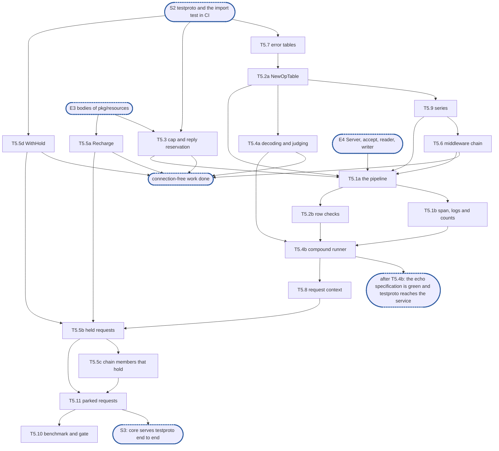

# Epic 5: adapters v2 dispatch

**Sources:** [RFC 20](../rfcs/rfc-20-adapters.md) §3.1's drain filter, §4.1 (one pipeline), §4.2
(the operation table), §4.3's compound runner and reply budget, §4.5 (error tables: the type and
its mapping), §4.6 (held requests), §4.7's pipeline, runner, middleware, `Park` and `HoldCodec`,
§4.8's table selection, §6.3 (the cap of 64, the reply reservation), §6.4's request deadline,
§6.5's client cancel, §6.6, §6.9's request rows, §6.10's pipeline row, §10, and §9's A4, A6,
A7, A15, A16 and A17; [RFC 24](../rfcs/rfc-24-resources.md) §3.3, §3.4, §4.3 and §6.1's rule on held
requests; [RFC 17](../rfcs/rfc-17-vfs.md) §5.9's `WithHold`. Cited, not owned: RFC 20 §4.4's
expired-credential check, §5.3, §5.5's note on the reader and §6.8 (who holds a buffer), §6.1;
RFC 17 §4.3 (errors and their kinds); [RFC 25](../rfcs/rfc-25-observability.md) §8.2 (the
registry's calls); [RFC 22](../rfcs/rfc-22-smb.md) §6.3 (the re-run backoff).
**Track:** A.
**Epic 5 estimate: 17 subtasks, 30 man-days.**
**Depends on:** **S2, `testproto` and the import test in CI**: E1's frozen surface of `core`,
E2's `testproto` with its stateful half, `adaptertest.CheckLeaks`, the `adapter-conformance`
suite and its end-to-end specification, the `unit/adapter-allocs` cell. **E3**: the bodies of
`pkg/resources`, which every subtask that reserves needs. **E4**: `Server`, accept, the reader
and the writer of `Conn`, for every test that sends a reply; eight subtasks need none of it
(§7).
**Blocks:** E4's drain, close and cancellation tests, which run this pipeline; S3, which for
this epic is T5.11, and through it E6's `New`; RFC 17's clone wait, which reads `vfs.WithHold`.

---

## 1. Goal

Epic 5 gives `core` its request path: one pipeline that takes a framed record from a connection
and hands the writer a reply, the operation and error tables it reads, the compound runner, the
requests it holds and parks, the middleware around every handler, and the metrics, spans and
logs of all of it.

**At the end of the epic:**

- `NewErrorTable`, `ErrorTable.Map`, `NewOpTable`, `Request.Park` and `Conn.Send` have their
  bodies, and `core` has its pipeline, runner, hold table and middleware chain, all unexported;
- with E4, a `testproto` request over loopback is framed, checked, run against `memory.New` and
  answered, and `TestConformanceEchoEndToEnd` is gone from `test/adapter/known.yaml`, which is
  then empty of this epic's entries;
- every chained, compound, held, parked, cancelled and draining case `testproto`'s stateful
  half scripts is asserted over loopback, each test ending with `adaptertest.CheckLeaks`;
- `pkg/metrics` resolves a series once, `core` records RFC 20 §10.1's series the request path
  produces, and the pipeline's allocations per request are gated in `unit/adapter-allocs`;
- `pkg/vfs` has `WithHold`, and `*resources.Buf` can move its charge to the hold budget.

### 1.1 In scope

The bodies of `NewErrorTable`, `Map`, `NewOpTable`, `Park` and `Conn.Send`; `pipeline.go`,
`compound.go`, `middleware.go` and `metrics.go` in `internal/adapter/core`, and the hold table
in `hold.go`; `Stages.Errors`, `OpTable.Protocol`, `Op.MaxMembers`, `ErrDecode` and
`ErrCancelled`, with their RFC amendments; the three registry calls in `pkg/metrics`;
`Buf.Recharge` in `pkg/resources`; `WithHold` and its reader in `pkg/vfs`; the RFC sentences
§4's decisions amend; the pipeline benchmark and its gate; the edits to the programme's deferral
ledger and coverage table that §9 lists.

Nine changes to `testproto`, each made by the subtask whose tests need it:

1. `Stages.Errors` set on both stage sets, and `Route` returning its table with its refusal
   where it has chosen one (T5.1a, D6).
2. `Decode` of a header returning the header with its error when its fixed fields decoded and
   its `next` is bad (T5.1a, D6).
3. Each table's `Protocol` set to `testproto` (T5.9, D18).
4. The compound row's `MaxMembers` set to 8 (T5.4a, D10).
5. `Create`'s row given a `resolve` that refuses with `ErrNoSession` once its session has
   ended (T5.5b).
6. The hold row's bound read from a value a test sets on the `Protocol`, `HoldFor` its default
   (T5.5b).
7. `Park`'s reply carrying its name, its encoder refusing a name that does not fit the buffer
   it is handed with an error a new row maps (T5.11, D26).
8. A row for `ErrDecode`, with a status of its own, in every table (T5.7, D7); the row that
   names `context.Canceled` naming `ErrCancelled` instead (T5.2a, D17).
9. The reply to a message `Unwrap` refused encoded under no session, and the client accepting
   it unsealed (T5.1a, D6).

### 1.2 Out of scope

- `Server`, listeners, accept and its limits, the reader, the writer and its queue, the read,
  write, idle and handshake deadlines, `Conn`'s fields, `Established`, `Keep` and `Settings`,
  the drain's deadline, asking the service for a draining request's move target: E4. D1 is the
  seam between the two epics.
- **`Conn.Close`'s body: E4.** It orders the reader's stop, the context's cancelling, the
  pipeline's close, `OnClose` and the writer's stop, and all but one of those are E4's. T5.11
  owns the pipeline's close that it calls (§9).
- `adapter_connections`, `adapter_connection_closes_total` and `adapter_bytes_total`: E4, whose
  accept, reader and writer count them; the ledger's row
  "`dittofs_client_connections_active{protocol}`", retargeted, and the row beside it (§9).
- Each protocol's error-table rows, its totality test and the helper that test calls (D5): the
  ledger's row "each protocol's error-table rows and its totality test (RFC 20 §7.3), with the
  helper it calls".
- An NFSv4.1 session's reply budget (`ca_maxresponsesize`, RFC 20 §4.3) and the bound by a
  quarter of the slots on calls waiting under `WithHold` (D11, D16): the ledger's row
  "RPCSEC_GSS context table and window; NFSv4.1 slots and reply cache", which now names both.
- `vfs.WithRequestID`: the ledger's row "`vfs.WithRequestID` (RFC 17 §4.7), set from the
  protocol's retry identity". A single node sets no request ID.
- `adapter_translation_refused_total`, `adapter_record_decode_failures_total` and
  `adapter_record_replays_total`: the ledger's new row of that name, owners the RFC 21 and
  RFC 22 plans. The conditions and alert rules of RFC 20 §10.1: E7.
- Checking a `Spec`'s name and labels against RFC 25 §2: the ledger's row "`metrics.Registry`
  an alias of `pkg/metrics`' `Metrics`".
- The one-call rule read per handler and handler tests: the ledger's row "handler tests on
  `memory.New` and `vfstest.Faults` (§7.2)". Codecs: the row "operation codecs, their golden
  vectors". Turns at the reply budget: the row "RFC 24's turns, `Reclaim`, `ShareCap`,
  `Detect`, `Split`".
- Fuzzing a decoder: nothing here decodes a peer's bytes; `testproto`'s frame is E2's, the
  frame cut is E4's.

### 1.3 Names used here

- **E1**, epic 1, delete v1 and fix the surface: `core`'s exported types with stub bodies.
- **E2**, epic 2, test foundations: `testproto`, the import test, the leak check, the
  `adapter-conformance` suite and the `unit/adapter-allocs` cell.
- **E3**, epic 3, budgets and buffers: the bodies of `pkg/resources`.
- **E4**, epic 4, connections and lifecycle: `Server`, accept, `Conn`'s reader and writer,
  drain, `Reconfigure`. Track B. It has no breakdown document yet.
- **E5**, this epic.
- **E6**, epic 6, protocol scaffolds: `wire/`, `protocol/` and `New` for NFS and SMB.
- **E7**, epic 7, integration with the node.
- **S1**, surface frozen: after E1, `core`'s exported surface changes only with an amendment
  of RFC 20 §4.7.
- **S2**, `testproto` and the import test in CI: after E2.
- **S3**, `core` serves `testproto` end to end: after E4 and this epic's T5.11, the one
  subtask this document means wherever it says S3. T5.10's gate comes after it.
- **Track A, B, C**: the three lines of work through the middle epics. This epic is track
  A's. The programme's split lets track C, while it waits for S3, take three of this epic's
  subtasks that need only E1's types and `testproto`: T5.6, T5.7 and T5.9. Each says so.
- **The deferral ledger**: the list of everything RFC 20 or develop's v1 provides that the
  branch does not serve yet, each row naming the owner that brings it back.
- **The RFC 21 plan, the RFC 22 plan**: the implementation plans of the NFS and SMB protocol
  RFCs, which own the rows the ledger gives them.
- **Loopback test**: a test in `package core_test` that starts a `core` server on `testproto`
  over `127.0.0.1:0`, drives it with `testproto.Client`, and ends with `CheckLeaks`.
- **Needs E4**: a field each subtask of §6 carries beside **Depends on**, since E4 has no
  subtask ids to name yet: what of E4 must have landed before the subtask can.

## 2. How the general rules apply

Each of the programme's ten general rules for an epic
([`rfc-20-adapters-plan.md` §1.5](rfc-20-adapters-plan.md#15-general-rules-for-each-epic)),
cited by number and title, and how it applies here or why it does not.

| Rule | Subtasks | How |
| --- | --- | --- |
| rule 1, independent unit tests, under `-race` ([`CLAUDE.md`, Writing tests](../../../CLAUDE.md#writing-tests); [Verifying a change](../../../CLAUDE.md#verifying-a-change)) | all | every test is in `package core_test` and imports no protocol but `testproto`. What sends a reply is asserted by a loopback test, on E4's real `Conn`; a part that takes and returns values is tested alone through `hooks_test.go` (D2). Errors, delays and holds come from `vfstest.Faults` over `memory.New`. Time is an input (D24): no test sleeps |
| rule 2, fuzz tests where relevant | none | does not apply: nothing here decodes bytes a peer sent (§1.2). The runner's member loop is driven by `testproto`'s `ReadOp` and rows, fuzzed in E2 |
| rule 3, observability follows RFC 25 and RFC 20 §10 | T5.9, T5.6, T5.1b, T5.5b | T5.9 resolves every series once per table; each later subtask records its own through it and reads it back in its tests; spans are T5.1b's (request) and T5.6's (operation), a held request's attempts T5.5b's; `testproto` records nothing |
| rule 4, leaks and allocations | all loopback tests, T5.10 | every loopback test ends with `adaptertest.CheckLeaks` over all four budgets; T5.10 checks in the pipeline's allocations per request and registers the gate in `unit/adapter-allocs` |
| rule 5, v2 ignores v1 | all | nothing is lifted: RFC 20 Appendix B marks none of v1's dispatch keep |
| rule 6, nothing deferred is lost | T5.7, T5.4b, T5.5b, T5.9 | the ledger rows §1.2 cites, each as §9's list of edits to the ledger leaves it |
| rule 7, code comment conventions ([`CLAUDE.md`, Code comments](../../../CLAUDE.md#code-comments)) | all | each decision of §4 leaves the marker it names at its code site; RFC 20's notes go at theirs. As `decision:`: parked requests off the hold floor, `Pends` asked only for an error the service returned, a call in the service pending past the ceiling and the floor, context and attribute reads served while draining, a drain's refusal answered by an interim with no final, the expired credential running only releases. As `ponytail:`: the cancel record's 5 s, `unwrap` on the reader (in `serve`, D8), the cap of 64, one goroutine per request |
| rule 8, a test must be able to fail ([`CLAUDE.md`, Writing tests](../../../CLAUDE.md#writing-tests)) | all | each test in §6 names the change that fails it; the end-to-end specification fails today and passes only on E4's and this epic's bodies |
| rule 9, a symbol is exported only if RFC 20's interface uses it | T5.7, T5.2a, T5.1a, T5.4a, T5.5a, T5.9 | `core` gains three exported fields, `Stages.Errors` (D6), `OpTable.Protocol` (D18) and `Op.MaxMembers` (D10), and two errors, `ErrDecode` (D7) and `ErrCancelled` (D17); `pkg/resources` gains one method, `Buf.Recharge`, each with its RFC amendment and its golden file in `testdata/surface`; everything else in `core` is unexported. `pkg/vfs` and `pkg/metrics` are outside RFC 20's surface: their additions are RFC 17 §5.9's and RFC 25 §8.2's |
| rule 10, each subtask creates only what it declares | all | no totality helper (D5), no session reply budget (D11), no request ID, no series this epic does not record; a part built before the pipeline names the subtask that wires it |

## 3. Requirements and invariants

`Source` cites RFC 20 unless it names another RFC.

**The pipeline**

| # | Requirement | Kind | Source | Subtasks |
| --- | --- | --- | --- | --- |
| R1 | Every request passes the stages in §4.1's order: decode header, unwrap, admit, replay check, decode args, resolve IDs, the call, map error, encode, wrap, send. There is one implementation, parameterised per protocol by its stages; no protocol writes its own | MUST NOT | §4.1, §4.7, §9 A4 | T5.1a |
| R2 | A request refused before the call reaches no service operation; where its arguments decoded, its `Encode` still runs, handed no reply, and encodes the status alone | invariant | §4.1, §4.7 | T5.1a, T5.2b |
| R3 | A header or arguments that do not decode are answered with the protocol's own answer for them, and the request does not run (D6 says what a header must have decoded to be answered, D7 how the answer is forced to exist) | MUST | §4.1 | T5.7, T5.1a |
| R4 | A message `Unwrap` refuses is answered as the connection's table maps the refusal, a `NoReply` row included, and the connection is kept; closing it is the protocol's, through `Conn.Close` | MUST | §4.1, §4.7 | T5.1a |
| R5 | A reply `Lookup` returns is wrapped and sent, and nothing runs; an error it returns is mapped by the table; `nil, nil` runs the request. The encoded reply of a row marked `Cacheable` is handed to `Store` before `Wrap` | MUST | §4.1, §4.7 | T5.1a, T5.4b |
| R6 | A nil stage takes its default, filled once at accept so the pipeline never checks for nil: `Security` passes messages unchanged, `Replay` checks nothing, `Flow` is the fixed cap of 64 | MUST | §4.7 | T5.1a, T5.3 |
| R7 | `Hold` is required where a table holds and nil elsewhere: a nil one cancels nothing, and a table that holds is never run without it (D25) | MUST | §4.7 | T5.1a |
| R8 | The table is chosen by `Route` from the decoded header, before any argument is decoded; a version or dialect selects a table or a row, never a branch in a handler | invariant | §4.8, §4.7, §9 A17 | T5.1a, T5.2b |
| R9 | Requests decoded on one connection run concurrently, and their replies are sent as each completes, in any order; nothing serialises them beyond the members of one compound | MUST NOT | §6.1, §6.6 | T5.4b |
| R10 | Each admitted request runs on a goroutine of its own, with no worker pool; the reader blocks in `Admit` | invariant | §6.9, §6.6 | T5.1a |
| R11 | A request's goroutine never waits on a client: it hands its reply to the connection's writer and ends | MUST NOT | §6.1 | T5.1a |
| R12 | No lock of the adapter is held across the service call: the table the pipeline keeps per connection is locked for the lookup only | invariant | §6.6, §6.9 | T5.5b |
| R13 | The pipeline reaches the service only through the `Deps.VFS` its server was built with; nothing looks the service up while serving | invariant | §9 A16, §4.7 | T5.4b |
| R14 | Every pipeline test ends with every budget's reserved bytes at zero | test row | RFC 24 §9 (R3); §6.8 | T5.1a, T5.2b, T5.4b, T5.8, T5.5b, T5.5c, T5.11 |

**Tables and row checks**

| # | Requirement | Kind | Source | Subtasks |
| --- | --- | --- | --- | --- |
| R15 | `NewOpTable` builds a table and checks it: codes unique, ranges well formed, and no `ErrorRow.Hold` unless the table holds | MUST | §4.7 | T5.2a |
| R16 | An operation the table lacks is answered `ErrNotSupported` by the pipeline, before argument decoding | MUST | §4.2, §4.7 | T5.2b |
| R17 | An operation the operator switched off by name is answered as one the table lacks; no handler checks the setting | MUST | §4.2 | T5.2b |
| R18 | An operation outside its row's `Versions` is answered `ErrVersion`; the handler does not run | MUST | §4.2, §4.7 | T5.2b |
| R19 | A row's `Needs` is checked against the request's `Level` before the handler runs: the ordered precondition answers `ErrNotNegotiated`, `ErrNoSession` or `ErrNoTree`, a missing current filehandle `ErrNoFH`. No handler checks a precondition its row carries | MUST | §4.2, §4.7, §9 A15 | T5.2b |
| R20 | A request whose `Evidence` has expired is refused `ErrExpired` after `Resolve`, unless its row is marked `Op.Expired` or its role is `RoleRelease`. `RoleFlush` does not exempt a request from the expiry check, although the drain filter serves it | MUST | §4.4, §4.7 | T5.2b |
| R21 | `Invocation.Role` is called only while draining or on an expired credential, after `Resolve`; where it is nil `Op.Role` decides | MUST | §4.7 | T5.2b, T5.1a |

**Admission and the reply reservation**

| # | Requirement | Kind | Source | Subtasks |
| --- | --- | --- | --- | --- |
| R22 | Where a protocol supplies no `Flow`, a connection has at most 64 requests in flight, counted at admit; at the cap it is not read until a request completes | bound | §6.3, §6.9; RFC 24 §3.4 | T5.3, T5.1a |
| R23 | Once its arguments are decoded, a request reserves its reply bound from the reply pool before the service is called | MUST | RFC 24 §3.3; §4.2, §6.3 | T5.3, T5.1a |
| R24 | A reply reservation's wait ends at the call's deadline with an `ErrDelay` naming `DelayResources`, which the adapter builds itself and the table answers at once | MUST | RFC 24 §3.3; §6.3, §4.1 | T5.3 |
| R25 | A reply's reservation is released on every path: with the reply once the writer has sent or discarded it, and at once where no reply goes out | MUST | RFC 24 §3.3; §4.7 | T5.1a |

**Error tables**

| # | Requirement | Kind | Source | Subtasks |
| --- | --- | --- | --- | --- |
| R26 | `Map` takes the most specific row that matches, in a total order: a row whose `Err` is a typed value before one whose `Err` is a sentinel; then a row naming `Ops` and `Versions`, `Ops` alone, `Versions` alone, neither | MUST | §4.7, §4.5 | T5.7 |
| R27 | A row's `Err` is matched with `errors.Is`: a sentinel matches its whole class, a typed value its own kind only | MUST | §4.5, §4.7; RFC 17 §4.3 | T5.7 |
| R28 | `NewErrorTable` refuses two rows equal in that order that can match the same error, operation and version | MUST | §4.7 | T5.7 |
| R29 | An error with no row is answered the protocol's server-fault status, logged at error and counted in `adapter_unmapped_errors_total` | MUST | §4.5, §9 A7, §10.1 | T5.7, T5.1b |
| R30 | A `NoReply` row sends no final reply and frees the reply reservation; in a table that holds, an interim grants the request's credits, holds nothing and counts toward neither the pending ceiling nor the hold floor | MUST | §4.7, §4.6, §3.1 | T5.7, T5.1a |
| R31 | Expected refusals are logged at debug, unexpected errors at error | MUST | §4.5, §10.3 | T5.1b |

**The drain filter**

| # | Requirement | Kind | Source | Subtasks |
| --- | --- | --- | --- | --- |
| R32 | While draining, what a request does to state decides whether it runs: `RoleContext`, `RoleFlush` and `RoleRelease` are served, `RoleNone` gets the drain's error, `ErrMoved` or `ErrDraining`, decided per request (which of the two: E4, D23) | MUST | §3.1, §4.7 | T5.1a |
| R33 | A request already handed to the service when the drain begins runs to its answer, and its reply is sent | MUST | §3.1 | T5.4b |
| R34 | A request whose context was cancelled by a closed connection or the drain's deadline is never answered: its reply is dropped, and no error is encoded for it | MUST NOT | §3.1, §6.5 | T5.8 |

**The compound runner**

| # | Requirement | Kind | Source | Subtasks |
| --- | --- | --- | --- | --- |
| R35 | A compound runs as a sequence of handlers, one per operation, each its own service call; the runner keeps nothing between them but the compound state in the `Request`, and holds no lock across two | invariant | §4.3, §9 A6 | T5.4b |
| R36 | A compound past its protocol's operation cap is refused `ErrTooLong` before any of its operations is decoded or run | MUST | §4.3, §4.7 | T5.4a, T5.4b |
| R37 | The runner decodes exactly `Count` members, each's code read with `ReadOp` and its arguments with that row's `Decode`, moving on by the bytes each returned; bytes left after the last are the compound's decode error, before any member runs | MUST | §4.7 | T5.4a |
| R38 | Outside a drain, a member that does not decode, or names a code its table lacks, is answered with that error once the members before it have run; the runner stops at the first failure, and the reply ends there | MUST | §4.3, §4.7 | T5.4a, T5.4b |
| R39 | Each operation's reply bound is reserved before it runs, not after (a session's own reply budget: the RFC 21 plan, D11) | MUST | §4.3; RFC 24 §3.3 | T5.4b |
| R40 | A chain's members come from one record, each with its header at its own offset; `Decode`, `Unwrap`, `Admit` and `Lookup` run per member, and so does everything from the row checks to the encoding | MUST | §4.7 | T5.4b |
| R41 | `Unwrap` and `Route` are handed the member before a related one, so the IDs it inherits are resolved before its check and its handles carry over | MUST | §4.7 | T5.4b |
| R42 | A related member after one that failed is answered with the same status and reaches no service call | MUST | §4.3 | T5.4b |
| R43 | A chain's replies are joined with `HeaderCodec.Chain`, and `Wrap` is called once on the joined record | MUST | §4.7 | T5.4b |
| R44 | A chain member whose row is `NoReply` stops the chain: the members after it do not run; those before it stay applied and are answered, chained with the refused member's interim, and no final reply follows | MUST | §4.7 | T5.4b |
| R45 | That interim is handed the headers of the members after it, the only part of them decoded, in a slice taken from a `sync.Pool`; a later header that does not decode ends the list there | MUST | §4.7 | T5.4b |
| R46 | While draining, a single-reply compound is judged whole before any operation runs: each operation's role is `Op.Role`, or `Invocation.Role` over its decoded arguments, called before `Resolve`; an operation that does not decode counts as refused | MUST | §4.7, §3.1 | T5.4a, T5.4b |
| R47 | If any operation of it would be refused with a `NoReply` row, the compound runs nothing, answers nothing, and nothing is handed to `Store`, so a retransmission runs | MUST | §4.7 | T5.4b |
| R48 | The runner reads whether it is draining once per single-reply compound, before its first operation; a compound that began while serving runs whole | MUST | §4.7 | T5.4b |
| R49 | The drain error of a compound's refused members is decided once, from every filehandle its members' `Invocation.Handle` name, handed over together (the asking of `MoveTarget`: E4, D23) | MUST | §4.7, §3.1 | T5.4a |

**Held requests**

| # | Requirement | Kind | Source | Subtasks |
| --- | --- | --- | --- | --- |
| R50 | A held request is a record and a timer: it holds no worker and no goroutine between attempts | MUST NOT | §4.6, §6.9; RFC 24 §6.1 | T5.5b |
| R51 | A held request keeps its receive buffer from frame until its final answer, across every re-drive (D12) | invariant | §5.3, §6.8, §4.7 | T5.5b |
| R52 | Every call carries `vfs.WithHold`. In a table that holds, it is the deadline of the row that maps `ErrDelay` of `DelayClone`, evaluated at arrival with the hold's start at now, and none where no row maps it; elsewhere it is the request's remaining deadline (D16) | MUST | §4.6; RFC 17 §5.9 | T5.5d, T5.5b |
| R53 | A request still unanswered a short interval after it reached the service, or answered an error whose row has a `Hold`, gets its interim from the adapter's own timer | MUST | §4.6 | T5.5b |
| R54 | The interim of a hold is handed no headers; only a `NoReply` row's interim is | MUST | §4.7 | T5.5b |
| R55 | Each attempt re-runs the held `Invocation`'s `Resolve` and `Call` with the same decoded arguments, under a fresh 30 s attempt deadline inside the hold's bound | MUST | §4.6, §6.4 | T5.5b |
| R56 | How long a request is held is its row's `Hold`, evaluated on each attempt's error from the hold's start: a deadline at or before the attempt's time answers `Status` now, and a row without `Hold` is answered at once. The closure is called afresh on each attempt, so a held request follows the live settings | MUST | §4.6, §4.7 | T5.5b |
| R57 | Held requests are counted per connection against a floor of 256 requests and 32 MiB, a parked request not among them; past the floor a hold reserves the call's whole receive charge from the hold pool and only then releases the receive reservation | MUST | §4.6; RFC 24 §4.3 | T5.5a, T5.5b |
| R58 | A request neither the floor nor the hold pool can take, whose hold starts on an error the service returned, is answered at once, holds nothing and is counted in `adapter_hold_refusals_total` | MUST | §4.6, §6.3, §10.1 | T5.5b |
| R59 | Every request pending on a connection, held past its interim or parked, counts toward `Stages.MaxPending`; it is checked when a hold starts on an error the service returned and in `Park`, and past it the request is answered `ErrTooManyPending` at once | MUST | §4.6, §4.7 | T5.5b, T5.11 |
| R60 | A call the interim timer finds still in the service is never refused: it goes pending past the ceiling, and past the floor with the hold pool full keeping its receive reservation; its interim then withholds its credits and its final reply grants the rest | MUST | §4.6, §4.7; RFC 24 §4.3 | T5.5b |
| R61 | Every request of a table that holds is keyed by `HoldCodec.Key`; its interim passes `Security.Wrap`, and its final reply goes out under `Final`'s header | MUST | §4.7 | T5.5b |
| R62 | A held call holds no reply reservation between attempts; each re-run takes one as a new call would | MUST | RFC 24 §4.3 | T5.5b |
| R63 | `Cancels` is asked after `Unwrap`, so an unverified cancel ends no hold; a cancel gets no reply | MUST | §4.7, §6.5 | T5.5b |
| R64 | A client's cancel ends a hold between attempts, and the request is answered: the connection is live, so a final response is always sent. A running attempt is not cancelled: it finishes and answers with its own result | MUST | §6.5, §4.6 | T5.5b |
| R65 | A cancel that finds no hold or park with its key is remembered, and a request with that key that holds or parks meanwhile ends as cancelled | MUST | §4.7 | T5.5b |
| R66 | A cancel is remembered for at most 5 s, and at most `MaxPending` of them per connection, the oldest dropped first | bound | §4.7 | T5.5b |
| R67 | A held request keeps its request span across its re-drives, with one child per attempt | MUST | §10.2 | T5.5b |
| R68 | A chain member before the last, answered an error whose row holds, is answered as `Pends` says: pending, the replies before it and its interim going out as one chain and the members after it running once it has answered; or at once, the runner replacing the error with `ErrNotLast` before the table maps it, and the chain goes on. `Pends` is asked only for an error the service returned | MUST | §4.7 | T5.5c |
| R69 | The credits of chain members answered before a pending one ride on its interim and are granted in full | MUST | §4.6, §4.7 | T5.5c |

**Parked requests**

| # | Requirement | Kind | Source | Subtasks |
| --- | --- | --- | --- | --- |
| R70 | `Park` refuses a member before the last of a chain with `ErrNotLast`, a connection at `Stages.MaxPending` with `ErrTooManyPending`, a draining connection with the drain's error, and a reply pool that cannot take the small-class reservation with `ErrDelay` of `DelayResources`; nothing is sent | MUST | §4.7; RFC 24 §3.3 | T5.11 |
| R71 | Otherwise `Park` sends the interim at once, releases the receive reservation and keeps a small-class reply reservation, and no more, while the request waits: it holds no worker and no write data | MUST | §4.7, §4.6; RFC 24 §3.3 | T5.11 |
| R72 | A parked request's reply that would not fit that reservation is answered as its protocol answers an overflow (D26) | MUST | §4.7 | T5.11 |
| R73 | A parked request has no request deadline: it waits until `done`, a cancel, a drain or a close | MUST | §6.4, §4.7 | T5.11 |
| R74 | A request already pending past its interim gets no second one when it parks: its slot moves from held to parked | MUST | §4.7 | T5.11 |
| R75 | On `done` the reply is encoded, wrapped and sent under `Final`'s header | MUST | §4.7 | T5.11 |
| R76 | A client's cancel calls `cancel` first, and `done`'s error goes out as the protocol's cancel status; a `done(nil)` is answered success. A mutation applied after the cancel is never reported as not applied | MUST NOT | §4.7, §6.5 | T5.11 |
| R77 | The start of a drain calls `cancel` on every parked request, so none waits for the deadline; `done`'s error is replaced by the drain's and answered as its table maps it, and a `done(nil)` is answered success | MUST | §3.1, §4.7 | T5.11 |
| R78 | A connection that is closed or closes, `Close` included, ends every hold and park: `cancel` is called, the adapter stops waiting, and the reply is dropped | MUST | §4.7, §6.5, §4.6 | T5.5b, T5.11 |

**Middleware and the request context**

| # | Requirement | Kind | Source | Subtasks |
| --- | --- | --- | --- | --- |
| R79 | The cross-cutting work is one chain, built once by `core` in one fixed order: recovery, trace span, metrics, deadline; a test pins the order | MUST | §4.7, §4.2 | T5.6 |
| R80 | A handler that panics is answered the protocol's server-fault status, logged at error with the operation and the stack, counted in `adapter_handler_panics_total`, and does not take down the connection's other requests | MUST | §4.2, §10.1 | T5.6, T5.1a |
| R81 | Each attempt of every service call carries a deadline of a fixed 30 s from arrival, set by the pipeline in the context | MUST | §6.4; RFC 17 §4.3 | T5.6, T5.8 |
| R82 | A request has one context, derived from its connection's, so closing the connection cancels it | MUST | §6.9, §6.5 | T5.8 |
| R83 | The service's answer at the deadline is mapped as any other | MUST | §6.4 | T5.8 |

**Observability**

| # | Requirement | Kind | Source | Subtasks |
| --- | --- | --- | --- | --- |
| R84 | Every metric, span and log key of the request path is recorded by `core`; a protocol supplies only names, through its tables | MUST | §10 | T5.9 |
| R85 | The request path produces `adapter_requests_in_flight`, `adapter_refusals_total` by stage, `adapter_replay_hits_total`, `adapter_wire_seconds` by stage in the `request` bucket set, `adapter_handler_panics_total` by operation, `adapter_unmapped_errors_total`, `adapter_status_mapped_total` by error, `adapter_held_requests`, `adapter_held_bytes`, `adapter_hold_pool_bytes` and `adapter_hold_refusals_total`, each labelled by `protocol` but the hold pool's | MUST | §10.1 | T5.9, T5.1b, T5.6, T5.5b |
| R86 | No series carries a client, principal, share or path label | MUST NOT | §10.1 | T5.9 |
| R87 | Every series a request can touch is resolved once, per protocol and per operation, so recording on the request path is an atomic add or a histogram observe, with no label lookup and no allocation (D18 says when) | bound | §10.1, §6.9 | T5.9, T5.10 |
| R88 | The request span is opened when a record is framed and ended when its reply is handed to the writer, or when it is dropped; the sampling decision is made there, once | MUST | §10.2 | T5.1b |
| R89 | A compound has one child span per operation, opened by the trace middleware; a single-operation request has none, and a handler opens no span | MUST | §10.2, §4.2 | T5.6, T5.4b |
| R90 | A span's attributes are the closed-set fields: protocol, version or dialect, operation, status, the neutral result, request and reply bytes, the stage that refused; never a path, a name, a principal or a client address | MUST NOT | §10.2 | T5.1b, T5.6 |
| R91 | Every request-scoped log line carries the request's trace ID, sampled or not; a misbehaving client is logged once per connection, not once per request | MUST | §10.3 | T5.1b |
| R92 | The whole pipeline over loopback against a null service has its allocations per request asserted with `testing.AllocsPerRun` at or under a checked-in number that may only fall, in a non-race cell; with a request unsampled the span calls allocate nothing and read no clock beyond the trace ID | bound | §6.10, §10.2, §6.9 | T5.10 |

What already holds, and is not numbered again here: `Bind` returns the row's `Decode` (E1's
test); a row sees the error, the operation and the version and nothing else (`Map`'s
signature); `Errors()` lists `core`'s refusals (E1). What other epics own of these sections:
the frame stage, the receive reservation and the writer's send (E4); which drain error a
refused request gets, the drain's deadline and the cancelling at it (E4); the connection,
close and byte series (E4); every protocol row, its statuses, which errors hold and for how
long, and that an `ErrDelay` is mapped by its cause (the RFC 21 and RFC 22 plans); that every
service error has a row (those plans, D5); the one-call rule (§1.2).

## 4. Decisions this epic takes

- **D1, the seam with E4.** RFC 20 §4.7 puts no interface between a connection and the
  pipeline, and names neither side. A `Conn` holds one `*pipeline`, and the pipeline sends
  through one function it is handed. `decision:` on `pipeline`. What changing it costs once
  both epics build on it: signatures in one package both own. No prior art sought: it is the
  split of one package between two owners. **A decision for the architect (§9).**

  **This epic owns:**
  - `withDefaults(st Stages) (Stages, error)`: R6's and D25's defaults, called at accept on
    what `NewConn` returned; the error refuses stages that lack `Header`, `Router` or
    `Errors` (D6), and accept then closes the connection before it reads.
  - `newShared(d adapter.Deps, reply *resources.BufPool) *shared`, once per `Server`: the
    series by table (D18), the reply pool, the hold budget, the clock (D24).
  - `newPipeline(sh *shared, st Stages, c *Conn, out func(msg *resources.Buf, key, before
    uint64) error) *pipeline`, once per connection at accept.
  - `(p *pipeline) serve(rec *resources.Buf)`, called by the reader only, one record at a
    time.
  - `(p *pipeline) drain()`, `(p *pipeline) wait(ctx context.Context) error`, which returns
    nil once nothing runs, is held or is parked, and `(p *pipeline) close()`.
  - The bodies of `Conn.Send`, which wraps the message and hands it to `out` with its
    `before`, and of `Request.Park`.

  **E4 owns:**
  - `Server`, accept, the reader, the writer, and every field of `Conn`.
  - The bodies of `Conn.Close`, `Established`, `Keep` and `Settings`.
  - The calls: `withDefaults`, `newShared`, `newPipeline` with the writer's enqueue as `out`,
    `serve`, `drain`, `wait`, `close`.

  **Agreed in writing, in one pull request both tracks approve, before either side starts:**
  - `rec`: `serve` owns the record's one reference and releases it exactly once, on every
    path; it blocks only in `Admit`.
  - `out` never blocks its caller. It takes `msg`'s reference whatever it returns, `msg`
    already wrapped, and fails only once the connection is closed. `key` is the request's
    `HoldCodec.Key` in a table that holds, else 0; `before` is `Conn.Send`'s, else 0.
  - Close order, idempotent: the reader stops, the connection's context is cancelled,
    `close()` is called, E4 calls `wait()`, then `OnClose`, then stops the writer.
  - `close()` never blocks: it starts the teardown (every hold and park ended, their replies
    dropped) and returns. So `Conn.Close` may be entered from a handler's own goroutine, and
    from the reader when `Unwrap`, which runs there (D8), closes the connection; neither
    waits on itself. What waits is E4's teardown, off both goroutines.
  - `OnClose` is called by E4 only after `wait()` has returned, so it never drops state a
    running handler still uses.
  - `drain()` is called by E4 on every connection's pipeline as draining begins, and on a
    pipeline built after that before its first `serve`; it sets that pipeline's draining
    state and cancels its parks. At the drain's deadline E4 closes each connection; there is
    no separate call to abandon.
  - `Conn.Settings()` has its body before this epic's first loopback test: `testproto`'s
    router calls it on a `Negotiate`, and D22 reads the switched-off operations from it.
  - The remote address: the pipeline reads it from the `Conn` as a `netip.Addr`, the
    budgets' key.
  - The per-connection context: the pipeline reads it from the `Conn`; every request's
    context derives from it.
  - The reply pool: `Server` builds one `BufPool` over the reply budget (RFC 20 §6.8) and
    hands it to `newShared`.
- **D2, a part that takes and returns values is tested alone; what sends a reply is tested
  over loopback.** The programme's split has "the tests that send a reply run on E4's real
  `Conn` over loopback, and land once it does", so no test stands a recorder in for `out`
  (§9 puts that choice to the architect). The error table, the table checks, the default
  flow stage, the reply reservation, the chain, the series and the runner's decoding take
  and return values: they land before E4 with tests in `package core_test`, the unexported
  ones reached through `hooks_test.go`, and each part's wiring is asserted by the loopback
  test of the subtask that wires it. No test asserts a stub's answer. `decision:` at the
  head of `hooks_test.go`. Prior art: the standard library's `export_test.go` files; the
  name differs because `exports_test.go` here is the surface test.
- **D3, a table that fails its checks panics at build.** `NewOpTable` and `NewErrorTable`
  return no error, and a table is program text. The panic names the row. `decision:` at each.
  Prior art: `http.ServeMux.Handle` panics on a conflicting pattern and
  `regexp.MustCompile` on a bad expression.
- **D4, a typed row is one whose `Err` has an `Is` method.** RFC 17's typed values implement
  `Is(error) bool` to match their sentinel and their kind; a sentinel is a plain value. Two
  rows can match the same error when either's `Err` matches the other's under `errors.Is`.
  Rows are sorted once at build and `Map` scans them: errors are the slow path. A nil `op`
  matches only rows that name no operation. `decision:` at the sort. No prior art found for
  ranking error matchers.
- **D5, no totality helper here.** A helper that checks a table against `vfs.Errors()` and
  `core.Errors()` has no caller in this epic or in E6: `testproto`'s tables are not total by
  E2's decision, and E6's scaffolds answer every operation not supported, their other rows
  being the protocols'. **It is built with the first protocol table that must be total.**
  What this epic settles for it: an unmapped error is observable from outside `core`, since a
  table built over the same rows with a fault status no row uses answers that status from
  `Map`. No marker: nothing is written. No prior art sought: the question is which epic has
  the first caller. **A decision for the architect (§9)**, since the epic's first description
  put the helper here.
- **D6, an error raised before a table is chosen is mapped by `Stages.Errors`.** `Unwrap`,
  `Admit` and `Lookup` can fail before `Route` runs, `Route` can refuse without a table, and
  `Map` needs a table. Three conventions on bodies and one additive field, no signature
  changed:
  - **`Route` returns its table together with its error whenever it has chosen one**, and
    the pipeline maps the error through that table, with no operation.
  - **`HeaderCodec.Decode` returns a non-nil `Header` with its error when enough decoded to
    address a reply.** With a nil `Header` nothing can be answered: the connection is closed
    and the close counted.
  - **`Stages.Errors *ErrorTable` answers `Unwrap`, `Admit`, `Lookup`, a header returned with
    its error, and a `Route` with no table.** A `NoReply` row there drops the message. **The
    field is required, as `Header` and `Router` are**: `withDefaults` refuses stages without
    it, before the connection reads (D1). Of the two ways to keep R4, this is the simpler: no
    second amendment of §4.1, and no connection closed over an `Unwrap` refusal.
  - **`Route` is never called after an earlier stage refused**, so no unverified header
    reaches it.
  - **The reply to a header that failed `Decode` or `Unwrap` is not passed to `Wrap`.** It
    goes out as encoded, never signed or sealed under a session the header merely names.
    RFC 20 §4.7 gives `Wrap` "sign or encrypt, in place" under `h`, and §5.5 keys each
    transform by the session or context; neither says what `h` is when `Unwrap` returned
    none, so this is an addition to both, listed in §9. A refusal after `Unwrap` succeeded
    (`Admit`, `Lookup`, `Route`) is wrapped under the header `Unwrap` returned.

  It amends RFC 20 §4.7 (the `Stages` struct, the comments on `Decode`, `Route` and `Wrap`,
  the pipeline sketch), §4.1's refusal table (a header with nothing to address closes the
  connection), §5.5 (the unwrapped reply), and `core.golden`. `decision:` in `serve`. No prior art
  sought: the gap is in
  this surface's own order of stages. **A decision for the architect (§9)**: an addition to
  the frozen surface after S1.
- **D7, a decode error is wrapped in `ErrDecode`, and every table must map it.** RFC 20 §4.1
  answers it "the protocol's garbage-args or invalid-parameter answer", and a row nothing
  demands would let any client's garbage be answered as a fault and raise
  `adapter_unmapped_errors_total`, which RFC 20 §10.1 alerts on as a bug. **The pipeline wraps
  the error of `HeaderCodec.Decode`, of a row's `Decode` and of a compound member's in
  `ErrDecode`, a new member of `Errors()`; `NewErrorTable` refuses, at build (D3), a table
  with no row that matches it.** A table cannot be built without the row, so no totality
  helper is needed for it, and the protocols' totality tests demand it as well. It lives in
  `core`'s `errors.go` because the pipeline is what wraps and every table of every protocol
  must name it; a protocol's own value could not be demanded by `core`. A protocol that
  wants two answers names its own value in a typed row, which wins (R26). It amends RFC 20
  §4.7 (`Errors()`, `NewErrorTable`) and `core.golden`. `decision:` at the check. No prior art
  sought: the choice is between a row nothing demands and one a build demands. **A decision
  for the architect (§9)**: a frozen-surface addition.
- **D8, the reader runs a record's first message as far as `Admit`.** `serve` decodes the
  first header, unwraps it, asks `Cancels` and blocks in `Admit` on the reader, so a
  connection at its bound is not read; everything after runs on the request's goroutine, the
  later members of a chain included, each admitted there. One record is one goroutine: a
  chain's members are serialised by the protocol. `decision:` in `serve`, beside RFC 20
  §5.5's `ponytail:` for `unwrap` on the reader. Prior art: the standard library's `net/http`
  server reads on the connection's goroutine and runs HTTP/2 handlers on their own (from
  memory).
- **D9, every reply buffer is taken from the reply pool, the small class included.** RFC 24
  §3.3 charges a small reply to the receive reservation's overhead, and `BufPool` hands out no
  buffer without a reservation. **The pipeline calls `Get` on the reply pool for every reply,
  of the bound plus the header.** A small request is then charged 12 KiB twice while it runs.
  `ponytail:` at the call: at 64 requests in flight a connection over-reserves 768 KiB; give
  `BufPool` an unreserved small buffer when the reply budget is shown to bind before the
  receive budget does. RFC 24 is amended in three places that rely on a small reply riding
  the receive charge: §3.3's paragraph on the small class, §3.3's paragraph on `Park` ("which
  a small reply was charged to until then"), and §4.2's "needs only a small reply (§3.3), so
  no reply wait can refuse it". E3's second pull request also edits §3.3's charging text, so
  this amendment lands after it. No prior art sought: the question
  is which budget one buffer is charged to. **A decision for the architect (§9).**
- **D10, the compound cap is a column of the compound row.** RFC 20 §4.7 has the runner
  refuse a count past the cap, and no field of the frozen surface carries the cap.
  **`Op` gains `MaxMembers int`, read by the runner, which refuses a `Count` past it with
  `ErrTooLong` before it decodes any member, as §4.7 words it; `NewOpTable` refuses a row
  with `Members` and no `MaxMembers`.** A cap checked in each compound row's `Decode` is a
  check a protocol can forget, the drift R1 forbids. It amends RFC 20 §4.7 (`Op`) and
  `core.golden`. `decision:` at the field. No prior art sought: the cap joins the row's
  other columns. **A decision for the architect (§9)**: a frozen-surface addition.
- **D11, the runner reserves the reply; it does not know a session's reply budget.** Every
  member of a single-reply compound is decoded before any runs (R37), so every bound is known:
  **the runner takes one reply buffer of the bounds' sum before the first member runs**, which
  meets "before each operation, not after". Comparing a bound with what is left of an NFSv4.1
  session's `ca_maxresponsesize` needs a limit set by a `SEQUENCE` that has run and an error
  for it, and the frozen surface carries neither: it comes with the slots (§1.2). RFC 20
  §4.3's sentence on `ca_maxresponsesize` and `NFS4ERR_REP_TOO_BIG` is not amended: it is
  deferred, under the ledger's row for NFSv4.1's slots. `ponytail:` in the runner, naming
  that upgrade. No prior art sought: the limit is one protocol's.
  **A decision for the architect (§9).**
- **D12, every held request keeps its record; only a park releases it.** RFC 20 §4.6 has a held
  request without write data copy its arguments out and release its receive reservation, and
  §4.7 declines the release hook that would let `core` do so: `core` cannot tell which
  arguments point into the record. **A request held between attempts keeps its record's `Buf`
  until its final answer; a parked request releases it in `Park`, whose handler has copied what
  it needs.** RFC 20 §4.6's first bullet is amended. `decision:` on the hold record. No prior
  art sought: the two RFC sentences conflict, and one must give. **A decision for the
  architect (§9).**
- **D13, a held request counts its record's length toward the floor's bytes, at least
  64 KiB.** RFC 24 §4.3 counts "the write's bytes", which `core` does not read. The floor's two
  figures are fields of `shared`, 256 and 32 MiB, which a test lowers per server through
  `hooks_test.go`: on `testproto` the pending ceiling of 8 is reached long before either.
  `decision:` at the count. No prior art sought: the record's length is the only size `core`
  has.
- **D14, the interim interval is 1 s, fixed.** RFC 20 §4.6 says "a short interval". The timer
  is armed only in a table that holds, one per call. `ponytail:` at the constant: one timer per
  call; a sweep per connection if T5.10's figure shows it, and RFC 22's figure when it sets
  one. No prior art checked: what other servers use was not looked up.
- **D15, a held request is re-driven on a backoff of 10 ms doubling to 1 s**, RFC 22 §6.3's,
  never past its hold's deadline, each attempt on the timer's goroutine. `ponytail:` at the
  backoff: the service signals nothing when a delay's cause ends; re-drive on that signal when
  it has one. Prior art: RFC 22 §6.3.
- **D16, what `WithHold` carries, and who reads it.**
  - A table that holds passes the deadline its clone-wait row's `Hold` returns from now, and
    nothing where no row maps the clone wait.
  - A table that does not hold passes the request's remaining deadline, RFC 20 §4.6's rule
    for NFSv3, NFSv4.0 and NLM. NFSv4.1's bound by a quarter of its slots comes with the
    slots (§1.2); until then an NFSv4.1 call waits its whole deadline.
  - T5.5d adds `vfs.Hold(ctx) (max time.Duration, ok bool)` beside `WithHold`, the reader
    RFC 17 §5.9 does not name, with that line in RFC 17.

  The branch's service does not wait behind a clone yet, so the hold is asserted on what
  reaches the service, read by a pass-through wrapper in the test (RFC 29 §4.11's record of a
  call that is itself the requirement). The test at the consumer, a call held by the clone
  wait for the time `WithHold` gave and no longer, lands with that wait: a new ledger row
  gives it to the RFC 17 plan (§9). `decision:` at the call. Prior art:
  `context.WithDeadline` and `Deadline`. **The reader is a decision for the architect (§9).**
- **D17, the hold table's two refusals: one reuses a mapped class, one gets a named error.**
  A request the floor and the hold pool cannot take is answered `ErrDelay` of
  `DelayResources`, which RFC 20 §6.3 calls one class with the reply reservation's refusal
  and `vfs.Errors()` already lists. A hold or a park ended by its client's cancel is
  answered **`ErrCancelled`, a new member of `Errors()`**, which RFC 20 §6.5's cancelled
  status maps from; **`NewOpTable` refuses a table that holds whose error table has no row
  for it** (D3), for the reason D7 gives. It lives in `core`'s `errors.go` beside
  `ErrParked`. It amends RFC 20 §4.7 (`Errors()`, `NewOpTable`) and `core.golden`.
  `decision:` at each. No prior art sought: both are choices among this surface's own errors.
  **A decision for the architect (§9)**: a frozen-surface addition.
- **D18, the `protocol` label is a field of the table, and a server keeps the series it
  resolved.** RFC 20 §10.1 labels every series `nfs3`, `nfs4` or `smb`, resolved "when the
  table is built"; `NewOpTable` is given neither a name nor a registry, and `core` first
  sees a table when `Route` returns it. **`OpTable` gains `Protocol string`, set after
  `NewOpTable` as `ReadOp` is. The series of a table are resolved at the first `Route` that
  returns it on a server, into a map `shared` keeps, keyed by table**; a pipeline remembers
  the tables it has seen, so the request path does no map lookup under a lock. Nothing is
  written into the table, which two servers may share. A compound row's `Members` take their
  parent's label. It amends RFC 20 §4.7 (`OpTable`), §10.1's "when the table is built" and
  §6.9's "once, at table build", and `core.golden`. `decision:` at the field and at the map.
  No prior art sought: the constraint is this surface's. **A decision for the architect
  (§9).**
- **D19, `pkg/metrics` gains RFC 25 §8.2's three calls and no more.** `Spec`, `Buckets` with
  `None` and `Request`, and `Counter`, `Gauge` and `Histogram` on the registry, returning the
  client library's vectors as RFC 25 §8.2 has them. `core` may not import the client library,
  so it holds each resolved child through a one-method interface of its own (`Add`, `Set`,
  `Observe`). A nil `Deps.Metrics` resolves children that record nothing. `ponytail:` at
  `Spec`: unchecked; RFC 25's registry refuses a bad name. Prior art: RFC 25 §8.2.
- **D20, error level is for what no row maps and for a panic.** RFC 20 §4.5 logs expected
  refusals at debug, naming `ErrNotFound`, `ErrExist`, `ErrAccess` "and the like", and
  unexpected ones at error, with no closed set of either. A mapped error is logged at debug;
  the service logs its own faults. `decision:` at the log. No prior art sought: the RFC
  gives examples, not a set to compare with.
- **D21, a recovered panic is answered the fault status without `Map`.** The recovery
  middleware returns an unexported error; the pipeline answers it with the table's fault
  status directly, so a panic is not also counted as an unmapped error. `decision:` at the
  branch. Prior art: `net/http`'s server recovers a handler's panic and logs the stack.
- **D22, a switched-off operation is matched by `Op.Name` in the connection's snapshot.** The
  names are read once per connection, from `Conn.Settings()`, into a set. `decision:` at the
  set. No prior art sought: the setting's shape is E1's.
- **D23, which drain error is E4's, behind one function.** The pipeline decides that a request
  is refused; `drainErr(ctx, handles)` says with what. This epic writes it answering
  `ErrDraining`, the service's answer while no topology names a target; E4 makes it ask.
  `decision:` at the function. No prior art sought: it is a split of work.
- **D24, time is an input.** The pipeline reads the time and arms every timer (interim,
  re-drive, hold deadline, cancel record, attempt deadline) through one unexported clock in
  `shared`, set per server from `hooks_test.go`. The attempt deadline is a context of
  `core`'s own, whose `Deadline`, `Done` and `Err` follow that clock: a `context.WithDeadline`
  would fire on the runtime's time, which a loopback test cannot move. That context
  implements `AfterFunc(func()) func() bool`, the method the standard library looks for on a
  parent that is not its own: without it every `context.WithCancel` or `WithTimeout` the
  service derives from a request starts a goroutine to watch the parent. A loopback test
  advances the clock once an event it can wait on has happened (a reply received, a `Hold`
  reached); a part tested alone runs in a `testing/synctest` bubble. `decision:` at the clock.
  Prior art: RFC 29 §4.11's first kind of double.
- **D25, a nil `Hold` is a stage that cancels nothing, and a table that holds needs a real
  one.** RFC 20 §4.7's sketch asks `Cancels` of every message, and has `Hold` "required where
  a table Holds". `withDefaults` fills a nil `Hold` with one whose `Cancels` answers no. A
  table that holds, returned by `Route` on a connection whose `Hold` was nil, is a fault of
  the protocol's wiring: the connection is closed with an error naming it. `decision:` at the
  check. No prior art sought: the rule is the surface's own.
- **D26, a parked reply that does not fit is refused by its encoder.** RFC 20 §4.7 answers it
  "as its protocol answers an overflow". `Encode` is handed the small-class buffer; an
  encoder with more to write returns its protocol's error, which the table maps, and the
  status goes out alone. A reply that outgrew the buffer with no error is the fault status,
  logged at error. `decision:` where `done` encodes. No prior art sought: the answer is the
  protocol's, by the RFC's own words.

## 5. Target tree

```text
internal/adapter/core/
  errors.go              T5.7: NewErrorTable, Map, ErrDecode; T5.2a: ErrCancelled
  dispatch.go            T5.2a: NewOpTable; T5.4a: Op.MaxMembers; T5.9: OpTable.Protocol;
                         T5.11: Request.Park
  protocol.go            T5.1a: Stages.Errors
  metrics.go             T5.9: the series, resolved per table
  middleware.go          T5.6: the chain and its four, the clock's context
  pipeline.go            T5.3: the cap, the reply reservation; T5.1a: shared, pipeline,
                         serve; T5.1b: the request's span, logs and counts; T5.2b: the row
                         checks; T5.8: the request context
  compound.go            T5.4a: decoding and judging; T5.4b: the runner; T5.5c: pending members
  hold.go                T5.5b: the hold table, timers, cancel and its records; T5.11: parks
  conn.go                E4's, but for T5.1a: Conn.Send's body
  hooks_test.go          T5.7 on: package core; the hooks of D2 and D24
  errors_test.go  dispatch_test.go  metrics_test.go  middleware_test.go
  pipeline_test.go  compound_test.go  hold_test.go  bench_test.go
  testdata/surface/core.golden        T5.7: ErrDecode; T5.2a: ErrCancelled; T5.4a: Op.MaxMembers;
                                      T5.1a: Stages.Errors; T5.9: OpTable.Protocol
  testdata/surface/resources.golden   T5.5a: Buf.Recharge
  testdata/allocs                     T5.10: the checked-in number
pkg/metrics/registry.go               T5.9: Spec, Buckets, Counter, Gauge, Histogram
pkg/resources/buf.go                  T5.5a: Buf.Recharge
pkg/vfs/hold.go                       T5.5d: WithHold, Hold
internal/adapter/adaptertest/testproto/   the nine changes of §1.1, each by its subtask
test/adapter/known.yaml  T5.2a: the end-to-end entry's message; T5.1a: the entry removed
test/suites.yaml         T5.10: ./internal/adapter/core/ added to unit/adapter-allocs
docs/internals/rfcs/rfc-20-adapters.md   T5.7: §4.7 (D7); T5.2a: §4.7 (D17); T5.4a: §4.7 (D10);
                                         T5.1a: §4.7, §4.1, §5.5 (D6); T5.5b: §4.6 (D12);
                                         T5.9: §4.7, §10.1, §6.9 (D18)
docs/internals/rfcs/rfc-24-resources.md  T5.5a: §4.3 Recharge; T5.1a: §3.3, §4.2 (D9)
docs/internals/rfcs/rfc-17-vfs.md        T5.5d: §5.9 Hold (D16)
```

Exported symbols added: `Stages.Errors *ErrorTable`; `OpTable.Protocol string`;
`Op.MaxMembers int`; `ErrDecode` and `ErrCancelled`, both in `Errors()`;
`func (b *Buf) Recharge(to *Budget) error`;
`vfs.WithHold(ctx context.Context, max time.Duration) context.Context` and
`vfs.Hold(ctx context.Context) (max time.Duration, ok bool)`; in `pkg/metrics`, `Spec`,
`Buckets`, `None`, `Request`, and `Counter(Spec)`, `Gauge(Spec)`, `Histogram(Spec)` on the
registry. Nothing else is exported.

## 6. Subtasks

### T5.7 Error tables

**Subtask T5.7 estimate: 2 man-days.**

- **Track:** A; one of the three the programme's split lets track C take. **Depends on:** S2.
- **Needs E4:** nothing.
- **Covers:** R26, R27, R28, the mapping half of R29 and R30, and what forces R3's answer
  to exist (D7).
- **Deliverables:** in `errors.go`, the bodies of `NewErrorTable` and `Map`: rows ranked and
  sorted at build (D4), equal rows that overlap refused (D3), `Map` answering the first match,
  `reply` false on a `NoReply` row, the fault status where none matches. An unexported
  `mapped(err, op, v) (Status, bool, bool)` beside `Map`, its third result false where no row
  matched, which T5.1b calls to count and log. `ErrDecode`, added to `Errors()`, and
  `NewErrorTable` refusing a table no row of which matches it (D7), with RFC 20 §4.7's
  amendment and `core.golden`; `testproto`'s row for it, with a status of its own (§1.1's
  change 8).
- **Consumers:** T5.2a (the check on `Hold`), T5.1a, T5.1b, `testproto`'s tables.
- **Acceptance criteria:**
  - A row naming `&vfs.Delay{Cause: vfs.DelayRecall}` wins over a row naming `vfs.ErrDelay`,
    in either order of declaration, and does not match a `Delay` of another cause.
  - Among rows of one `Err`, the one naming the operation and the version wins, then the
    operation, then the version, then neither; with a nil operation only rows naming none
    match.
  - A wrapped error is matched as its cause is.
  - Two rows of one rank that can both match one error, operation and version panic at build,
    naming both; two typed rows of different kinds do not.
  - An error no row matches answers the fault status with `reply` true.
  - A table with no row for `ErrDecode` panics at build, naming it; a wrapped `ErrDecode`
    maps to its row.
- **Tests:** in `errors_test.go`, through the exported surface. The typed and sentinel rows in
  both orders (catches a `Map` that takes the first declared). The four ranks on one error
  (catches a rank compared the wrong way). The nil operation against a row naming operations
  (catches an operation row answering a refusal that has no operation). A wrapped `Delay`
  (catches `==` in place of `errors.Is`). A `Delay` of another cause against a typed row
  (catches a typed row matching its class). The overlapping rows, and the pair that does not
  overlap by version (catches a build that accepts an ambiguity, and one that refuses
  disjoint ranges). The unmapped error (catches a zero status in place of the fault). The table
  without `ErrDecode`'s row (catches a build that lets a client's garbage reach the fault
  status). No test double.
- **Rules:** rule 9: `mapped` is unexported; `ErrDecode`'s amendment precedes it.

### T5.2a `NewOpTable`

**Subtask T5.2a estimate: 0.75 man-days.**

- **Track:** A. **Depends on:** T5.7.
- **Needs E4:** nothing.
- **Covers:** R15.
- **Deliverables:** in `dispatch.go`, `NewOpTable`'s body: the map built, and a duplicate
  code, a range whose `First` is past its `Last`, and a row of `errs` with a `Hold` in a
  table that does not hold, each a panic naming the row (D3); a table that holds whose
  `errs` has no row for `ErrCancelled` refused the same way (D17). `ErrCancelled`, added to
  `Errors()`, with RFC 20 §4.7's amendment and `core.golden`; `testproto`'s cancel row
  renamed to it (§1.1's change 8). In `test/adapter/known.yaml`,
  the end-to-end entry's `message` moved from the tables to `core: new server`, where the
  specification now stops.
- **Consumers:** T5.9, T5.4a, T5.1a; T5.5b and T5.11, which answer `ErrCancelled`;
  `testproto`, whose tables build from here on.
- **Acceptance criteria:** each of the four faults panics with the row's name; `testproto`'s
  two tables and its members' table build; a `Hold` row in a holding table is accepted.
- **Tests:** in `dispatch_test.go`. One case per fault (catch a check dropped: two rows under
  one code would otherwise shadow each other silently). `testproto.New`'s tables built through
  a first `Route` (catches a check that refuses a valid table). The `adapter-conformance`
  specification, known by its new message (a run that still stops at the tables fails as
  unexpected).

### T5.9 Series and the registry's calls

**Subtask T5.9 estimate: 2 man-days.**

- **Track:** A; one of the three the programme's split lets track C take.
  **Depends on:** T5.2a.
- **Needs E4:** nothing.
- **Covers:** R84, R85 (resolution), R86, R87.
- **Deliverables:** in `pkg/metrics/registry.go`, D19's types and three calls. In `metrics.go`,
  the series of R85 as one struct per table, its per-operation and per-error parts indexed,
  each child held through `core`'s own one-method interface, a nil registry giving children
  that record nothing; `shared`'s map from table to that struct, filled once per table under
  its `Protocol` (D18); the record methods the later subtasks call, each an atomic add or an
  observe. `OpTable.Protocol`, with RFC 20's three amendments (D18) and `core.golden`;
  `testproto`'s tables set it to `testproto`.
- **Consumers:** T5.6 (panics, wire seconds), T5.1b (in flight, refusals, replay hits, unmapped
  errors, statuses mapped), T5.5b (held requests, held bytes, hold pool, hold refusals), T5.10
  (the gate).
- **Acceptance criteria:**
  - Resolving one table twice on one server registers each series once; two tables under one
    label share their per-protocol series; one table on two servers records into each
    server's own registry.
  - Every series carries only the labels R85 gives it.
  - A record method on a resolved series allocates nothing, with a registry and with none.
- **Tests:** in `pkg/metrics`, each call registers a vector a scrape of the registry's handler
  shows, with the `request` buckets on the histogram (catches a vector built and not
  registered, and default buckets). In `metrics_test.go`, through `hooks_test.go`, on the
  tables `testproto`'s router returns: each record method scraped (catches a method wired to
  another series); the label names of every series compared with R85's (catches a client,
  share or operation label added where it does not belong); the double resolution (catches a
  duplicate registration, which panics in the client library); one table on two registries
  (catches series kept in the table, which sends the second server's counts to the first);
  the allocation count of each record method at 0, skipped under the race detector (catches a
  label lookup per call).
- **Rules:** rule 3: nothing outside `core` records; rule 9: the amendment precedes the field.

### T5.6 The middleware chain

**Subtask T5.6 estimate: 1.5 man-days.**

- **Track:** A; one of the three the programme's split lets track C take.
  **Depends on:** T5.9.
- **Needs E4:** nothing to land. That a panic leaves the connection's other requests unharmed
  is T5.1a's loopback test.
- **Covers:** R79, R80 (recovery, log, count), R81 (the deadline set), R85 (panics, wire
  seconds), R89, R90.
- **Deliverables:** in `middleware.go`, the chain, built once per row from one ordered list
  of four `Middleware`: recovery (the panic logged at error with the operation and the stack,
  counted, returned as D21's error), trace span (a child per operation of a compound, none
  for a single operation, its attributes R90's, ended in a deferred call), metrics (the stage
  clock of `adapter_wire_seconds` around the call, observed in a deferred call), deadline
  (D24's context, 30 s from the clock).
- **Consumers:** T5.1a, which runs every `Invocation.Call` through it; T5.5b, whose every
  attempt passes it again.
- **Acceptance criteria:**
  - A `Call` that panics returns D21's error; one Error record names the operation and holds
    the stack; the counter of that operation rises by one.
  - The `Call` sees a context whose `Deadline` is 30 s from the clock, whose `Err` turns
    to `context.DeadlineExceeded` when the clock passes it, and from which a
    `context.WithCancel` child is derived without a goroutine, and inside a compound a recording
    span of its own; outside one, the request's span.
  - On a panic the span is ended with the fault recorded and the stage is observed.
- **Tests:** in `middleware_test.go`, through `hooks_test.go`, on a probe `Call`, a recording
  tracer the test supplies as `Deps.Tracer` and a `slog` handler it supplies as `Deps.Logger`.
  The panic (catches a chain without recovery, a log without the stack, a count on another
  operation). The order: the probe panics, and the span is found ended and the stage observed
  (catches a span or a clock closed without a deferred call, and recovery placed inside
  either, which then never sees the panic pass); the probe's context is done at 30 s on the
  clock while the span is still open (catches the deadline placed outside the span). The
  clock's context in a `synctest` bubble (catches a deadline on the runtime's time); a child
  derived from it there, with the goroutines counted before and after (catches a context
  without `AfterFunc`). The
  span's attribute keys against R90's set (catches an attribute outside it). The recording
  tracer and handler are sinks, not doubles.

### T5.5d `vfs.WithHold`

**Subtask T5.5d estimate: 0.5 man-days.**

- **Track:** A. **Depends on:** S2.
- **Needs E4:** nothing; nor E3, which is why it is apart from T5.5a.
- **Covers:** the call R52 is built on.
- **Deliverables:** in `pkg/vfs/hold.go`, `WithHold` and `Hold` (D16), with RFC 17 §5.9's
  line.
- **Consumers:** T5.5b; RFC 17's clone wait (`Hold`), which can start once this has landed.
- **Acceptance criteria:** `Hold` returns what `WithHold` set, the innermost one, and `false`
  on a bare context.
- **Tests:** in `pkg/vfs`: the round trip, nesting and the bare context (catches a reader of
  another key, and an outer hold winning).

### T5.3 Admission: the cap of 64 and the reply reservation

**Subtask T5.3 estimate: 1 man-days.**

- **Track:** A. **Depends on:** S2 and E3.
- **Needs E4:** nothing to land. That the cap is wired and a connection at it is not read is
  T5.1a's loopback test.
- **Covers:** R22 (the count), R23 (the reservation), R24, and `Flow`'s default in R6.
- **Deliverables:** in `pipeline.go`, the default `FlowControl`, a counting semaphore of 64
  whose `Admit` waits under its context and whose release is idempotent, with RFC 20 §6.3's
  `ponytail:`; `reserveReply(ctx, key, bound) (*resources.Buf, error)`, a `Get` on the reply
  pool (D9) that turns the wait's end at the context's deadline into
  `&vfs.Delay{Cause: vfs.DelayResources}` and leaves a cancellation as it is.
- **Consumers:** T5.1a (`withDefaults`, the call before every handler), T5.4b, T5.5b (each
  re-run), T5.11.
- **Acceptance criteria:**
  - 64 `Admit` calls return; the 65th returns only after a release; a second call of one
    release frees no second place.
  - With the reply budget full, `reserveReply` returns the `Delay` when its context's deadline
    passes, with nothing reserved; when the context is cancelled it returns the context's
    error; when room frees first it returns the buffer.
- **Tests:** in `pipeline_test.go`, through `hooks_test.go`, each in a `synctest` bubble. The
  65th `Admit` still blocked after `synctest.Wait`, then returning on a release (catches a cap
  of 65 and a semaphore that never blocks). The double release (catches a counter that
  drifts). The three ends of a waiting reservation, the budget read after each (catches a
  deadline surfaced as the context's error, which no table maps, and a reservation kept on the
  error path). No test double.

### T5.5a `Buf.Recharge`

**Subtask T5.5a estimate: 0.5 man-days.**

- **Track:** A. **Depends on:** E3.
- **Needs E4:** nothing.
- **Covers:** the call R57 is built on.
- **Deliverables:** in `pkg/resources/buf.go`, `Recharge(to *Budget) error`: reserve the
  buffer's whole charge from `to`, and only on success release its reservation and keep the
  new one; on refusal nothing changes. RFC 24 §4.3 gains the method, and `resources.golden`
  the line.
- **Consumers:** T5.5b.
- **Acceptance criteria:**
  - After a `Recharge` that fits, the receive budget is lower and the hold budget higher by
    the buffer's whole charge, class and overhead, and the last `Release` returns it to the
    hold budget.
  - A `Recharge` that does not fit returns an error and both budgets read as before.
  - At no point between the two reads is the charge in neither budget.
- **Tests:** in `pkg/resources`: the two outcomes, both budgets read after each, then the
  release (catches a charge of the length in place of the class, a release to the old budget,
  and a refusal that drops the reservation); the order, read by a `Recharge` into a full hold
  budget that must leave the receive charge in place (catches release before reserve).

### T5.4a The runner's decoding and its drain judgement

**Subtask T5.4a estimate: 1.5 man-days.**

- **Track:** A. **Depends on:** T5.2a.
- **Needs E4:** nothing.
- **Covers:** R36 (the cap), R37, the decoding half of R38 and R46, R49.
- **Deliverables:** in `compound.go`: `members(row *Op, inv Invocation, rest []byte, v Version)`,
  which refuses a `Count` past the row's `MaxMembers` with `ErrTooLong` before it reads a
  member (D10), decodes up to `Count` members with their rows, returns those that decoded with the
  index and error of the first that did not or has no row, and returns none, with the
  compound's decode error, when bytes are left after the last; `judge(ms, r)`, which takes
  each member's role from `Op.Role` or its `Invocation.Role`, counts a member that did not
  decode as refused, collects every `Invocation.Handle`, and answers whether the compound
  runs whole. `Op.MaxMembers`, with RFC 20 §4.7's amendment and `core.golden`, and
  `NewOpTable` refusing a row with `Members` and no `MaxMembers`; `testproto`'s compound row
  sets it to 8 (§1.1's change 4).
- **Consumers:** T5.4b; E4, whose `drainErr` reads the handles `judge` collects (D23).
- **Acceptance criteria:**
  - A compound of three members yields three, in order; one byte more after the last yields
    none and the compound's decode error.
  - A compound whose count says three and whose bytes hold two yields the two, with index 2
    and the third's decode error.
  - A second member with a code the table lacks is reported at index 1 with `ErrNotSupported`,
    and the first is returned decoded.
  - A count of 9 is refused `ErrTooLong` with no member read; a count of 8 is decoded. A
    table whose compound row has no `MaxMembers` panics at build.
  - `judge` serves a compound of a `PutFH` and an `Echo` whose argument says release, and
    refuses one whose `Echo` says none, or whose last member does not decode; it returns the
    `PutFH`'s handle in both.
- **Tests:** in `compound_test.go`, through `hooks_test.go`, on bytes built with
  `testproto.Append` and `testproto`'s version 1 table. The exact count and the trailing byte
  (catch a loop that stops at the bytes' end and accepts what is left). The short compound
  (catches a compound refused whole for one member, which outside a drain must still run the
  two before it). The unknown code at index 1 (the same, for a code). The cap at 9 and at 8,
  with `testproto`'s `ReadOp` wrapped by a pass-through that records its calls (catches a cap
  off by one, and a member read before the refusal). The row without its cap (catches a
  compound no cap bounds). The four judgements (catch a role read from the row where the arguments
  decide, an undecodable member served, and a handle dropped). No test double.

### T5.1a The pipeline

**Subtask T5.1a estimate: 3.5 man-days.**

- **Track:** A. **Depends on:** T5.2a, T5.9, T5.6, T5.3.
- **Needs E4:** `Server` started on a listener, accept calling `withDefaults`, `newShared` and
  `newPipeline`, the reader calling `serve`, the writer behind `out`, `Conn.Settings` and
  `Conn.Close` with D1's close order. Nothing here can land before them. Until E4's drain
  calls `drain`, the drain cases call it through `hooks_test.go`.
- **Covers:** R1, R2, R3, R4, R5 (the miss), R6, R7, R8, R10, R11, R14, R21, R22, R23, R25,
  R30, R32, R80.
- **Deliverables:** in `pipeline.go`, `shared`, `pipeline` and D1's functions: `withDefaults`
  (R6, D6, D25), `serve` as D8 splits it, one request from `Route` to `out` in RFC 20 §4.7's
  order, D6's paths for an error before a table and its unwrapped reply, decode errors
  wrapped in `ErrDecode` (D7), the role asked only while draining or expired, the drain
  filter for a request outside a compound with D23's `drainErr`, `mapped`'s status sent
  (D21), the `NoReply` branch with its interim where the table holds, `Lookup` and `Store`,
  `wait`, and `close`, which never blocks, for a pipeline that holds nothing yet. In
  `conn.go`, `Conn.Send`'s body. `Stages.Errors`, with RFC 20's amendments (D6) and
  `core.golden`; `testproto`'s changes 1, 2 and 9 of §1.1. RFC 24's amendment (D9), after
  E3's second pull request. The end-to-end entry removed from `test/adapter/known.yaml` once
  CI shows it passing.
- **Consumers:** every later subtask; E4's drain, close and cancellation tests.
- **Acceptance criteria:**
  - An `Echo` over `Bare` and over the full protocol is answered its payload; the
    specification passes.
  - An `Echo` with no role byte and a header whose `next` is bad are answered `testproto`'s
    status for `ErrDecode`, on their own message ID, the connection kept, and
    `adapter_unmapped_errors_total` does not move.
  - A message with a bad checksum, one that overdraws its credits and a version the router
    refuses are each answered a status on their own message ID, the connection kept; the
    reply to the bad checksum is unsealed. A record too short for a header closes the
    connection.
  - Stages without `Errors` are refused by `withDefaults`, and the connection is closed
    before a byte is read.
  - While draining, an `Echo` whose argument says none gets nothing over version 1 and an
    interim granting its credits over version 2; one that says context, flush or release is
    answered.
  - A `Panic` is answered the fault status, and an `Echo` after it on the same connection is
    answered.
  - On a `Bare` connection with the reply budget full and 65 `Echo` sent, 64 are admitted
    and the 65th only after one has completed; all 65 are answered once room is freed.
  - With a client that sends 16 `Echo` and reads nothing, all 16 requests complete.
  - A `Notify` sends its message through `Conn.Send`, and the client receives it.
  - Version 2 on a protocol whose stages have no `Hold` closes the connection; `Bare`, whose
    `Hold` is nil, serves version 1.
  - `Violate`, which calls `Conn.Close` from its handler, returns, and the connection closes;
    so does a connection whose `Unwrap` calls `Conn.Close` on the reader.
- **Tests:** loopback tests in `pipeline_test.go`. The echo on both stage sets (catches a nil
  stage called, and a default left out). The order of stages, read from `testproto`'s own
  effects: a bad checksum is refused before credits are charged and before the replay cache is
  asked (catches two stages swapped). The two decode errors (catch a garbage request
  answered as a fault, the unmapped counter raised by a client, and a header with its error
  dropped unanswered). The three other refusals and the short record (catch a refusal that
  closes, a reply sealed under a session its request did not prove, and a record with no
  header answered). The stages without `Errors`, through a protocol declared in the test
  that returns `testproto`'s stages without the field, an input and not a double (catches a
  connection served with nothing to answer its refusals). The drain cases, by role (catch a
  filter on `Op.Role` alone); with `testproto`'s tables wrapped by that test protocol so
  each `Invocation.Role` passes through a record of its calls, no call while serving
  (catches a role asked of every request). The panic, then an echo (catches a recovered
  goroutine that closes the connection). The 65 requests, read from one ordered stream of
  admissions and completions that a hook set per server delivers: the 65th admission comes
  after the first completion (catches `withDefaults` leaving `Flow` without the cap). The
  client that reads nothing, on the same stream (catches a request goroutine that writes to
  the socket itself). The notify (catches a `Send` that skips `Wrap`: the client then
  refuses the checksum). The stripped `Hold`, through the test protocol (catches a holding
  table run with nothing to key it). `Violate`, and the test protocol's `Unwrap` calling
  `Conn.Close`, each ending with the connection closed and `CheckLeaks` clean (catch a
  `close` that waits for the goroutine that called it: the test then never ends, and its
  backstop deadline fails it). Each test ends with `CheckLeaks` (catches a reply reservation
  kept on a `NoReply` path). What needs a service call (out of order, the replay hit, a
  request in the service as the drain begins, two servers) is T5.4b's: `testproto` reaches
  the service only from a chain or a compound, since `Create` needs the filehandle a `PutFH`
  before it set.
- **Rules:** rule 1: no in-package test of `serve`.

### T5.1b The request's span, logs and counts

**Subtask T5.1b estimate: 1.5 man-days.**

- **Track:** A. **Depends on:** T5.1a.
- **Needs E4:** as T5.1a.
- **Covers:** R29 (answered, logged, counted), R31, R85 (in flight, refusals, replay hits,
  unmapped errors, statuses mapped), R88, R90, R91.
- **Deliverables:** in `pipeline.go`: the request span, opened as `serve` takes the record
  and ended as the reply goes to `out` or is dropped, its attributes R90's; `mapped`'s
  counts and its log at D20's levels; the in-flight gauge, the refusals by stage, the replay
  hits, the statuses mapped; each request's log lines with its trace ID, and the one line
  per connection for a misbehaving client.
- **Consumers:** T5.4b (the request span its children hang from), T5.5b, T5.10.
- **Acceptance criteria:**
  - A message that overdraws its credits, whose error no row maps, is answered the fault
    status, logged once at error, and counted in `adapter_unmapped_errors_total`.
  - Each refusal of T5.1a raises `adapter_refusals_total` under its own stage, and each
    mapped error `adapter_status_mapped_total` under its error.
  - `adapter_requests_in_flight` reads 64 when the 64th of T5.1a's 65 requests has been
    admitted, and zero when all are answered.
  - Each request has one span, ended, with R90's attributes and no other; a refused one
    names the stage that refused.
  - Each line logged for a request carries its trace ID, sampled or not; a second refused
    checksum on one connection logs nothing more; a mapped refusal logs at debug.
- **Tests:** loopback tests. The overdraw (catches an unmapped error answered silently). The
  counters after each refusal (catch a stage label on the wrong refusal, and a mapped status
  not counted). The gauge on T5.1a's stream of admissions (catches a gauge not wired, and one
  never lowered). The spans through a recording tracer (catch a span left open on a refusal,
  and an attribute outside the set). The log lines through a handler the test installs
  (catch a line without its trace ID, one line per request, and a client's refusal at
  error). The tracer and handler are sinks, not doubles.

### T5.2b Row checks and the expired credential

**Subtask T5.2b estimate: 1.25 man-days.**

- **Track:** A. **Depends on:** T5.1a.
- **Needs E4:** as T5.1a.
- **Covers:** R2, R8, R14, R16, R17, R18, R19, R20, R21.
- **Deliverables:** in `pipeline.go`, the checks between `Route` and `Decode`, in this order:
  the row absent or switched off (D22), `Versions`, `Needs` against `Level` from the lowest
  precondition up, then the filehandle; after `Resolve`, the expired-credential check.
- **Consumers:** T5.4b, which runs the same checks per member.
- **Acceptance criteria:**
  - An unknown code, and `Echo` on a server whose settings switch it off by name, are
    answered not supported, their arguments never decoded; `Negotiate` on that server runs.
  - `Park` in version 1 is answered the version status.
  - `Tree` before a session, `PutFH` before a tree and `Create` with a tree and no filehandle
    are answered the session, tree and filehandle statuses.
  - On an expired session `Tree` is answered the expired status, `Logoff` and `Session` run,
    and an `Echo` runs only when its argument says release.
- **Tests:** loopback tests. Each check alone (catches a check dropped). The unknown code
  with arguments that do not decode, still answered not supported (catches decoding before
  the check). `Create` with no session answered the session status, not the filehandle's
  (catches the order). The switched-off `Echo` beside a served `Negotiate` (catches a setting
  that is not read, and one that switches every operation off). The expired cases, with an
  `Echo` that says flush refused (catches the drain's wider set used for expiry) and `Tree`
  refused (catches no check at all).

### T5.4b The compound runner

**Subtask T5.4b estimate: 3 man-days.**

- **Track:** A. **Depends on:** T5.4a, T5.1b, T5.2b.
- **Needs E4:** as T5.1a.
- **Covers:** R5 (the hit), R9, R13, R14, R33, R35, R36, R38, R39, R40, R41, R42, R43, R44, R45,
  R46, R47, R48, R89.
- **Deliverables:** in `compound.go`, the runner. For a compound row: the members decoded
  (T5.4a), one reply buffer of the bounds' sum (D11), the members run in turn through T5.2b's
  checks and the chain, the `Request` carried between them, the first failure ending the
  reply; while draining, read once, `judge` first. For a chain: each member decoded, unwrapped,
  admitted and looked up at its own offset, `prev` handed to `Unwrap` and `Route`, a related
  member after a failed one answered that member's error by its own row without a call, the
  replies joined with `Chain` and wrapped once; at a `NoReply` member, the later members'
  headers decoded into a pooled slice and handed to `Interim`.
- **Consumers:** T5.8, T5.5b, T5.5c, T5.11, whose tests reach the service through a chain.
- **Acceptance criteria:**
  - A version 1 compound of `PutFH` and two `Create` makes two files; with the first `Create`
    failed by the service, the second does not run and the reply ends at the failure.
  - A compound of 9 members is answered the too-long status and makes no file; one whose
    third member does not decode makes the first two files and ends at the third's error.
  - While draining, a compound with one refused member gets no reply, makes no file, and its
    retransmission after the drain runs; a compound sent whole before the drain began runs
    whole.
  - A version 2 chain of a `PutFH` and a related `Create` makes the file under the handle the
    first set; with the `PutFH` refused, the related `Create` is answered the same status and
    makes none.
  - A related member with a bad checksum is refused alone.
  - A chain's replies arrive as one record whose checksum verifies.
  - While draining, a chain whose second of four members is refused answers the first, sends
    one interim that grants the credits of the last three, and the client's balance says so.
  - Two chains on one connection, the first's `Create` held in the service, are answered
    second first; a chain in the service when the drain begins is answered.
  - A sequenced chain sent twice is answered twice and its `Create` runs once.
  - Two servers over two services each apply their own `Create`.
  - With the reply budget full, a compound makes no call until room is freed.
- **Tests:** loopback tests in `compound_test.go`, on `testproto`'s compound row and chained
  frames, over `vfstest.Faults` on `memory.New` with `vfstest.RecordMutations`. The stop at
  the first failure (catches a runner that runs on). The nine members with the record empty
  (catches a member run before the cap is refused). The undecodable third member (catches a
  compound refused whole outside a drain). The drained compound and its retransmission
  (catches a judgement per member, which applies the `PutFH`, and a reply cached for a
  compound that did not run). The compound begun before the drain, held in its first member
  while the drain starts (catches the drain read per member). The related pair and its
  failure (catches a related member routed without `prev`, and one that calls after a
  failure). The bad checksum on a related member (catches `Unwrap` handed no `prev`). The
  joined record (catches `Wrap` per member, which breaks the record's checksum). The balance
  after a refused second member (catches credits of later members not granted, and a later
  member run). Out of order, with `Faults.Hold` and its `Reached` (catches requests run one
  after another). The chain in the service at the drain (catches a drain that drops what
  already runs). The replay, with the record at one and `adapter_replay_hits_total` at one
  (catches `Lookup`'s reply ignored, and `Store` after `Wrap`: the second reply then fails
  its checksum). Two servers (catches a service kept in a package variable). A service error
  no row maps, answered the fault status (catches a service error dropped). The compound
  sent against a full reply budget, `RecordMutations` empty until the test frees room, which
  it does once the stream of admissions shows the compound admitted (catches a reply reserved
  after the first member ran). One child span
  per member and none for a single request (catches a span per request only). Doubles:
  `vfstest.Faults` over `memory.New`, kind 3 over kind 2; `vfstest.RecordMutations`, the
  pass-through record.

### T5.8 The request context

**Subtask T5.8 estimate: 1 man-days.**

- **Track:** A. **Depends on:** T5.4b.
- **Needs E4:** as T5.1a, and a connection's close for the cancellation.
- **Covers:** R14, R34, R81 (end to end), R82, R83.
- **Deliverables:** in `pipeline.go`, the request's context derived from the connection's; the
  reply of a request whose context is cancelled dropped, with its reservations released and its
  span ended as dropped, and nothing encoded.
- **Consumers:** T5.5b, whose attempts each take a fresh deadline under this context; E4's
  drain deadline, which cancels through it.
- **Acceptance criteria:**
  - The context a `Create` reaches the service with has its deadline 30 s after the request's
    arrival on the clock.
  - A `Create` held in the service is answered once the clock passes that deadline, and an
    error the service answers then is mapped by the table.
  - A `Create` held in the service when its connection closes sees its context cancelled; no
    reply is encoded, its span ends as dropped, and every budget returns to zero.
- **Tests:** loopback tests, each request a chain of `PutFH` and `Create`. The deadline read
  by a pass-through wrapper declared in the test, which records the context each call
  arrives with (catches a context with no deadline, and one counted from the wrong instant).
  The held call, with `Faults.Hold`, answered only after the clock is advanced past 30 s
  (catches a deadline that never fires: the reply never comes). `Faults.Fail` with a wrapped
  `context.DeadlineExceeded`, answered the fault status `testproto` gives an error it has no
  row for (catches a deadline error answered outside the table). The close, read from
  `CheckLeaks` and the recording tracer (catches a request that outlives its connection, a
  reply reservation leaked with a dropped reply, and a span left open).

### T5.5b Held requests

**Subtask T5.5b estimate: 4.5 man-days.**

- **Track:** A. **Depends on:** T5.5a, T5.5d, T5.8.
- **Needs E4:** as T5.1a.
- **Covers:** R12, R14, R50, R51, R52, R53, R54, R55, R56, R57, R58, R59, R60, R61, R62, R63, R64,
  R65, R66, R67, R78 (holds), R85 (the held series).
- **Deliverables:** in `hold.go`, the per-connection table of pending requests under one
  mutex, held for the lookup only: a request's record (its `Invocation`, its retained record,
  its key, its start, its timer); the interim timer (D14), armed only in a table that holds;
  the hold begun on an error whose row has a `Hold`, the floor and the hold pool
  (`Recharge`, D13), the ceiling, D17's refusal; the re-drive (D15) from `Resolve`, each under
  a fresh attempt deadline and a fresh reply reservation; the interim, handed no headers, and
  the final header with their `grant` flags; `WithHold` on every call (D16); the cancel after
  `Unwrap`, a cancelled hold answered `ErrCancelled` (D17), the cancel remembered for 5 s and at
  most `MaxPending` of them, with RFC 20's
  `ponytail:`; `close` ending every hold; the gauges and the refusal counter; one child span
  per attempt. RFC 20 §4.6's amendment (D12). `testproto`'s changes 5 and 6 of §1.1.
- **Consumers:** T5.5c, T5.11.
- **Acceptance criteria:**
  - In version 2, a `Create` the service answers `ErrDelay` twice gets one interim, runs a
    third time on the backoff and is answered success; in version 1 it is answered the delay
    status at once.
  - Left failing, it is answered the delay status when the clock passes the hold's bound, and
    not before; with the bound the test sets on the protocol shortened between attempts, it
    ends at the new bound.
  - Between attempts the reply budget reads zero, and each attempt reaches the service with a
    deadline 30 s from its own start.
  - A session logged off between attempts ends the hold with the no-session status.
  - A `Create` still in the service after the interval gets an interim, and its final reply
    carries the key.
  - Past `MaxPending`, a hold starting on a service error is answered the too-many-pending
    status; a call found in the service goes pending, its interim leaves the client's balance
    at one, and its final reply grants the remaining credits.
  - With the floor lowered to two requests, the third held raises the hold budget by its
    record's whole charge and lowers the receive budget by it. With the hold budget full, a
    hold starting on a service error is answered D17's refusal and counted, and a call found
    in the service goes pending and keeps its receive reservation.
  - A cancel between attempts is answered the cancel status and gets no reply of its own; a
    cancel sent while an attempt is in the service lets it finish and answer its own result;
    a cancel sent before its target holds ends it as cancelled when it does; an unsealed
    cancel under a session ends nothing.
  - A cancel sent before its target is forgotten after 5 s on the clock, and the ninth such
    cancel drops the first.
  - Closing the connection with a request held leaves every budget at zero and no timer.
  - Each call reaches the service with the hold D16 gives it: in version 2, the deadline
    the delay row's `Hold` returns from the request's arrival; in version 1, the request's
    remaining deadline; and none in a table that holds and has no row for the clone wait.
- **Tests:** loopback tests in `hold_test.go`, version 2, each request a chain of `PutFH` and
  a related `Create`, the clock advanced by the test. The two failures then success, with
  `Faults.Fail` (catches no re-drive, and a second interim). The logoff between attempts
  (catches a re-drive that skips `Resolve`). The bound and its change (catch a deadline cached
  at the hold's start). The reply budget and each attempt's deadline, the second read by the
  pass-through wrapper (catch a reply reservation held across the wait, and one deadline
  shared by every attempt). The interim for a call in the service, with `Faults.Hold`
  (catches an interim only on an error). The interim of a held last member after an answered
  first, read on `Client.Balance` (catches a hold's interim handed headers, which
  `testproto` would grant credits for). The ceiling, both ways, on `Client.Balance` (catches
  a call in the service refused, and credits granted in full). The floor, lowered (D13),
  reading both budgets as a third is held (catches a charge of the record's length, and a
  receive reservation released before the hold budget took it). The full hold budget, both
  ways (catches a request held with no memory accounted, and a call in the service refused
  for memory). The four cancels (catch a cancel that answers itself, a running attempt cut
  short, a remembered cancel lost, an unverified cancel honoured). The record's expiry and
  bound (catch a record kept for ever, and an unbounded list). The close (catches a timer
  that fires on a closed connection). Eight requests held between attempts: `RecordMutations`
  shows no call until the clock moves, and no goroutine's stack, listed once the eight
  interims have arrived, is inside the hold table's code (catches a goroutine that waits per
  held request). The held gauges and the refusal counter read after each case (catch a gauge
  not lowered when a hold ends). One child span per attempt under one request span (catches a
  span per attempt with no parent, and none). The hold handed to the service in versions 2 and 1,
  read by the
  pass-through wrapper (catches a call without `WithHold`, and one bound for both); the third
  case on a table built in the test, since `testproto`'s delay row maps every cause, through
  the test protocol of T5.1a. A second chain answered while the
  first is in the service (catches the table's mutex held across the call).

### T5.5c Chain members that hold

**Subtask T5.5c estimate: 1.5 man-days.**

- **Track:** A. **Depends on:** T5.5b.
- **Needs E4:** as T5.1a.
- **Covers:** R14, R68, R69.
- **Deliverables:** in `compound.go`, a member before the last answered an error whose row
  holds: `Pends` asked; pending, the replies so far and its interim sent as one chain, the
  members after it run on its final answer and chained after it; or `ErrNotLast` in the
  error's place. A member before the last still in the service at the interval pends without
  asking (R60).
- **Consumers:** T5.11, with which S3 is reached; it completes T5.4b's chains.
- **Acceptance criteria:**
  - A chain whose second of three members has the pend flag and is delayed by the service
    sends one record with the first member's reply and the interim, then one with the second
    member's final reply and the third's; the client's balance after the first record holds
    the first member's credits in full.
  - Without the flag the second member is answered the not-last status and the third runs.
  - A member held in the service past the interval pends, flag or not.
- **Tests:** loopback tests, with `Msg.Pend`. The pending member (catches the later members
  run before it answered). The balance after the first record (catches the credits of an
  answered member withheld with the pending one's). The answered-at-once member (catches the
  hold row's status sent for a hold that did not happen). The member in the service without
  the flag (catches `Pends` asked for a call that may still apply).

### T5.11 Parked requests (S3)

**Subtask T5.11 estimate: 3 man-days.**

- **Track:** A. **Depends on:** T5.5b, T5.5c. T5.5c only so that S3 is one subtask: when
  this one lands, every case of `testproto`'s stateful half runs through `core`.
- **Needs E4:** as T5.1a. `Conn.Close`'s body is E4's and calls this subtask's `close`.
- **Covers:** R14, R59, R70, R71, R72, R73, R74, R75, R76, R77, R78 (parks).
- **Deliverables:** in `dispatch.go`, `Park`'s body; in `hold.go`, the parked state of a
  pending record: the four refusals, the interim (none for a request already pending), the
  record released and a small-class reply reservation taken under a context already past its
  deadline, no deadline armed, `done` encoding into that buffer under `Final`'s header
  (D26), the client's cancel answered `ErrCancelled` (D17), `drain` cancelling every park and
  replacing its error, `close`
  cancelling and dropping. `testproto`'s change 7 of §1.1.
- **Consumers:** E6's `New`, which waits for S3; E4's `Conn.Close`; the RFC 22 plan's waiting locks
  and change
  notifications.
- **Acceptance criteria:**
  - A parked request gets its interim at once, the receive budget returns to zero while it
    waits and the reply budget holds one small-class charge; released, it is answered under
    its key, its name in the reply.
  - Left parked while the clock passes 30 s and the hold's bound, it is still parked, and is
    answered when released.
  - A park whose name does not fit the small class is answered the overflow status.
  - A park before the last member, a ninth park, a park while draining and a park with the
    reply budget full each make no call, send no interim, and are answered their status.
  - Cancelled by its client it is answered the cancel status and no file exists; cancelled
    as its call completes it is answered success and the file exists.
  - A drain started with a request parked calls `cancel`, and nothing more is sent for it; a
    park whose call completes as the drain cancels it is answered success. A close calls
    `cancel` and leaves every budget at zero; so does `Violate`.
  - A request held, then parked on its re-drive, has received one interim.
  - A `Park` reached after its connection closed has `cancel` called at once, makes no file
    and leaves every budget at zero.
- **Tests:** loopback tests, version 2, each a chain of `PutFH` and a related `Park` over a
  `Faults.Hold`. The budgets while parked (catch a record kept, and a reply reserved at its
  bound). The clock moved past both bounds (catches a park ended by the request deadline or
  by a hold's). The long name (catches a reply encoded outside its reservation). The four
  refusals, with `RecordMutations` empty (catch a refusal after the interim). The two
  cancels, the second by releasing the hold before the cancel is sent (catches a granted call
  reported cancelled). The drain, its success case by releasing the hold first, the close and
  `Violate` (catch a park that waits for the drain's deadline, a granted call unanswered, and
  a reservation kept by a dropped reply). The single interim (catches a second one). A chain
  of `Violate` and a related `Park` (catches a park registered on a closed connection, which
  nothing would ever end). The
  held gauge unchanged by eight parks (catches a park counted as held).

### T5.10 The pipeline benchmark and its gate

**Subtask T5.10 estimate: 1 man-days.**

- **Track:** A. **Depends on:** T5.11.
- **Needs E4:** as T5.1a.
- **Covers:** R87, R92.
- **Deliverables:** in `bench_test.go`, `BenchmarkPipeline`: an `Echo` over `Bare` on loopback
  against `vfstest.Null`, with a registry, a tracer that samples nothing and a discarding
  logger, the service reached through a pass-through declared in the test that derives one
  `context.WithCancel` child per call, as a real service does; `TestPipelineAllocs`, which reads
  `testing.AllocsPerRun` over the same loop, skips
  under the race detector as `testproto`'s gate does, and fails above the number in
  `testdata/allocs` or when the number could be lowered; `./internal/adapter/core/` added to
  `unit/adapter-allocs`' command in `test/suites.yaml`.
- **Consumers:** every later change to the connection, pipeline or pool code, which runs it and
  reports its allocations and its mutex and block profiles (RFC 20 §6.9).
- **Acceptance criteria:** the gate passes at the checked-in number; one allocation added per
  request fails it; a number checked in above the measurement fails it; with the request
  unsampled, the test's clock is read as often as with no tracer at all.
- **Tests:** the gate is the test. It catches an allocation added to the request path, a
  series resolved per request, a span call that allocates or reads the clock when unsampled,
  and a request context without `AfterFunc`, whose derived child then costs a goroutine and
  its allocations. `Null` is a load,
  not a double.
- **Rules:** rule 4: this is the pipeline's gate; it lands last so the number covers holds and
  parks.

## 7. Order of work



Eight subtasks, 9.75 man-days, need no connection:

| When | Subtasks | Man-days |
| --- | --- | --- |
| at S2, now | T5.7, then T5.2a, then T5.9 and T5.4a side by side, then T5.6; T5.5d at any time | 8.25 |
| once E3's two pull requests have merged | T5.3, T5.5a | 1.5 |
| once E4's `Server`, accept, reader and writer have landed, with `Conn.Settings` and `Conn.Close` | T5.1a, T5.1b, T5.2b, T5.4b, T5.8, T5.5b, T5.5c, T5.11, T5.10 | 20.25 |

**The critical path after E4** is T5.1a, T5.1b, T5.4b, T5.8, T5.5b, T5.5c, T5.11, T5.10: 19 of
the 20.25 man-days, all serial, with S3 reached at T5.11 after 18. Only T5.2b, beside T5.1b,
is off it, and both least certain subtasks, T5.1a and T5.5b, are on it. Nothing here shortens
it but the first open point of §9. The error tables go first because two subtasks and
`testproto`'s tables build on them.

## 8. Suggested pull requests

| PR | Subtasks | Man-days | After | Why together |
| --- | --- | --- | --- | --- |
| 1 | T5.7, T5.2a | 2.75 | none | both tables build, and the end-to-end specification moves to its next stub |
| 2 | T5.9 | 2 | PR 1 | the registry's calls and `core`'s series, with D18's amendments |
| 3 | T5.6 | 1.5 | PR 2 | the chain, tested alone |
| 4 | T5.3, T5.5a | 1.5 | E3 | what reserves: the cap, the reply reservation and `Recharge`; open beside PR 1 to PR 3 |
| 5 | T5.4a | 1.5 | PR 1 | the runner's decoding, with D10's amendment; open beside PR 2 to PR 4 |
| 6 | T5.5d | 0.5 | none | `WithHold` and its reader, which RFC 17's clone wait builds on; open at once |
| 7 | T5.1a, T5.1b, T5.2b, T5.4b | 9.25 | PR 3, PR 4, PR 5, E4 | one request end to end on E4's `Conn`, and the runner through which `testproto` reaches the service: the echo specification green, D6's amendment |
| 8 | T5.8, T5.5b, T5.5c | 7 | PR 4, PR 6, PR 7 | the request's context and the holds built on it |
| 9 | T5.11 | 3 | PR 8 | parks, on the pending table: S3 |
| 10 | T5.10 | 1 | PR 9 | the gate, measured on the finished path |

A suggestion only: one pull request per subtask works as well.

## 9. Open points

- **Decisions needed from the architect.** Each is written above as recommended and is
  pending the answer; the alternative and its cost, most consequential first:
  - **Testing at the pipeline's own seam (D2).** With D1's `out`, every behaviour of this
    epic but four can be asserted with a record handed to `serve`, replies read from a
    recorder in `out`'s place and the clock injected, with no socket; the recorder is an
    output sink, which the test rules allow. The programme's text asks for loopback ("the
    tests that send a reply run on E4's real `Conn` over loopback, and land once it does"),
    so this document keeps it. **Recommended: allow the seam, with a small conformance suite
    for `out`** (it never blocks, it takes the message's reference whatever it returns, it
    fails only once closed, a message sent with `before` precedes the reply of that key)
    that the recorder passes here and E4's writer must pass too, which fixes D1 in code.
    That lets all of this epic but a last subtask start before E4, the four behaviours a
    socket decides (admission pausing reads, `Send`'s `before` against a queued reply, a
    slow or closed client, the end-to-end specification) kept for that subtask; it undoes
    the splits of T5.1, T5.2 and T5.4 and tests each part once. It saves about 2.5
    man-days and costs about 0.5 for the suite.
  - **D1**, the seam with E4, `close()` that never blocks included. Alternative: E4's
    breakdown fixes it; this epic's nine connection-bound subtasks then wait for that
    document, not only for E4's code.
  - **D6**, `Stages.Errors`, required, and the unwrapped reply to a header that failed
    `Decode` or `Unwrap`: additions to the frozen surface and to RFC 20 §4.7 and §5.5, which
    are silent on that reply. Alternative: call `Route` after an earlier refusal only to
    learn a table, with no surface change; it runs the router on a header that failed its
    check, and still cannot answer a `Route` that chose no table.
  - **D7**, `ErrDecode` in `Errors()`, its row demanded by `NewErrorTable`. Alternative: the
    protocol's own value and a row nothing demands; a client's garbage can then raise the
    unmapped-error alert.
  - **D17**, `ErrCancelled` in `Errors()`, its row demanded of a table that holds.
    Alternative: `context.Canceled` and a row nothing demands; RFC 20 §6.5's cancelled
    status then hangs on it.
  - **D10**, `Op.MaxMembers`, read by the runner as RFC 20 §4.7 words it, a frozen-surface
    addition. Alternative: the cap checked in each compound row's `Decode`, with no surface
    change and nothing to stop a protocol forgetting it.
  - **D18**, `OpTable.Protocol` and series resolved at the first `Route`. Alternative: the
    label taken from the listener's first service, which cannot tell `nfs3` from `nfs4`.
  - **D12**, a held request keeps its record. Alternative: the release hook RFC 20 §4.7
    declined, so a hold without write data frees its receive bytes.
  - **D9**, every reply buffer from the reply pool. Alternative: a `BufPool` call that hands a
    small buffer under the receive reservation, a frozen-surface addition in `pkg/resources`.
  - **D11**, no session reply budget in `core`. Alternative: a carrier on `Request` now, with
    no protocol to drive it and nothing in `testproto` to test it.
  - **D5**, no totality helper here. Alternative: `adaptertest.CheckTotal(t, rows, ops)` in
    T5.7 for 0.25 man-days, tested on a total row list of its own, with no caller until a
    protocol has rows.
  - **D16**, `vfs.Hold` as `WithHold`'s reader. Alternative: RFC 17's clone wait adds its own
    reader; T5.5d's `WithHold` is then write-only until it does, and T5.5b's assertion waits.
- **Changes from the epic's first description in who owns what.** `Conn.Close`'s body, which
  that description listed under T5.11, is E4's (§1.2): T5.11 keeps the pipeline's `close`.
  `Conn.Send`'s body, which it left to E4's writer, is T5.1a's: it wraps and calls `out`, and
  the order against a queued reply stays the writer's. The connection, close and byte series
  are E4's, and so are D1's calls into the pipeline.
- **Against the epic's first description.** That description had eleven subtasks at 26.5
  man-days. The eleven ids stand for the same work. T5.2 and T5.4 are each split by what
  needs a connection, the first half landing before E4. T5.5 is split in four: it would pass
  the 5 man-day ceiling whole, T5.5a needs E3 and no connection, and T5.5d needs neither.
  T5.1 is split in two and raised from 4 to 5 man-days: 26 requirements, `Send`, D6's
  amendment and the request's observability were too much for 4 beside T5.4b's 3 for 18.
  The total is 30 man-days: 26.5, plus about 1 for the amendments of D6, D7, D10, D12, D17
  and D18 with their golden files and nine changes to `testproto`, plus about 2.5 for the
  parts tested alone and their wiring tested again over loopback (D2), which the first open
  point above would remove, plus 1 for T5.1, less about 1 for what is dropped: the totality
  helper (D5), the session reply budget (D11) and the three connection series.
  `ReplayCache`'s own copy, listed under T5.7, was E2's and E3's and is done.
- **Edits to the programme's implementation plan and to the epic 1 and epic 2 documents**,
  made in this document's pull request:
  - the ledger's row for each protocol's error-table rows and totality test now names the
    helper it calls, and the coverage rows for RFC 20 §4.5 and §7.3 send the helper there
    (D5);
  - the row for NFSv4.1's slots now names the session's reply budget and the bound by a
    quarter of the slots on calls waiting under `vfs.WithHold`, and the coverage row for
    RFC 20 §4.3 says what of the reply budget this epic builds (D11, D16);
  - the row "`dittofs_client_connections_active{protocol}`" is E4's, a new row beside it
    gives E4 `adapter_connection_closes_total` and `adapter_bytes_total`, and the coverage
    row for RFC 20 §10 names them;
  - a new row gives the RFC 21 and RFC 22 plans `adapter_translation_refused_total`,
    `adapter_record_decode_failures_total` and `adapter_record_replays_total`;
  - a new row gives the RFC 17 plan the test of `vfs.WithHold` at its consumer, the clone
    wait (D16);
  - the coverage row for RFC 20 §4.7 gives E4 `Conn.Close`'s body;
  - the `vfs.Grace{Until}` row's trigger is the RFC 22 plan's first row that bounds a hold by
    a grace's end: `core` hands the error to `ErrorRow.Hold` and reads no field of it, so
    T5.5b does not wait for the type; the epic 1 document's note on it says the same;
  - the row "`metrics.Registry` an alias of `pkg/metrics`' `Metrics`" says what T5.9 adds to
    it and what is still RFC 25's (D19);
  - the programme's own descriptions of epic 5 and epic 4 agree with those rows: epic 5's
    loses the totality check, the session reply budget and `Conn.Close`'s body and names its
    split subtasks; epic 4's gains the connection, close and byte series, `Conn.Close`'s
    body and D1's calls. Their estimate lines are left as they were: this document's line
    is epic 5's figure, and epic 4's breakdown prices what it gained;
  - the epic 2 document's citations of T5.1, T5.2, T5.4 and T5.5 name the part each means.
- **What the first description names that the branch does not have.** `vfs.WithHold`: T5.5d
  adds it. The service's wait behind a clone that reads it: not on the branch, so T5.5b
  asserts on what reaches the service (D16). `vfs.Grace{Until}`: not on the branch, and not
  needed here. `vfs.Shares.MoveTarget`: not on the branch, and E4's (D23). `Buf.Recharge`:
  T5.5a adds it. The bodies of `pkg/resources`: two pull requests of E3, open when this was
  written; T5.3, T5.5a and everything that needs E4 need both merged. `vfstest.Null`,
  `memory.New`, `vfstest.Faults`, `vfstest.RecordMutations` and `adaptertest.CheckLeaks` are
  on the branch as named.
- **Not confirmed.** What `memory.New` answers a call whose context has ended: T5.8 asserts
  that the reply comes and when, not its status.
- **Least certain:** T5.5b, for the number of paths through the pending table (interim racing
  the answer, cancel racing a re-drive, close racing both); T5.1a, whose size depends on how
  much of D1 E4's reader and writer already give when it starts; T5.4b's chain stop at a
  `NoReply` member, the least exercised path of the surface; T5.10's figure, unknown until the
  path exists. Both T5.1a and T5.5b are on the critical path (§7).
