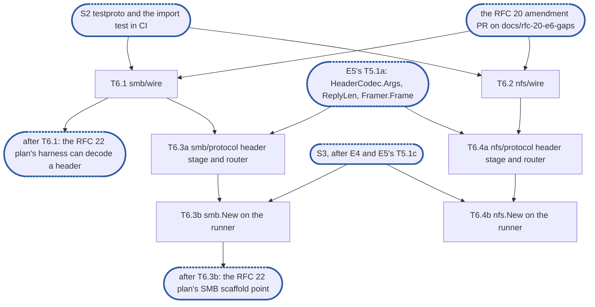

# Epic 6: adapters v2 protocol scaffolds

**Sources:** [RFC 20](../rfcs/rfc-20-adapters.md) §2.5's layout and `wire` purity, §3.4
(`New`), §3.6's `port`, §4.1's frame and decode-header rows, §4.7's `Protocol`, `Framer`,
`Stages`, `HeaderCodec`, `Header`, `Router`, `Conn.Established`, `Listener` and `NewServer` as
both protocols supply them, §4.8's NFS and SMB rows and its `New` example, §5.1, §5.2 and §5.4
for the headers, §6.4's handshake deadline, §10.1's `protocol` label, and §9's A8, A17 and A20;
[RFC 21](../rfcs/rfc-21-nfs.md) §2.1, §2.2, §11.1's refused credentials and §11.5's paragraph on
`core`'s own refusals; [RFC 22](../rfcs/rfc-22-smb.md) §16.5's paragraph on `core`'s own
refusals; [RFC 24](../rfcs/rfc-24-resources.md) §3.2's cap before the reservation and its record
in several fragments. Cited, not owned: RFC 20 §4.4 (identity, which the protocols' plans
build), §6.10's codec micro row (the operation codecs' gates), RFC 22 §3.1 and §3.3
(`NEGOTIATE` and credits), RFC 24 §3.1 (buffer classes); MS-SMB2 2.1, 2.2.1 and 2.2.2, and
RFC 5531 §9, §11 and Appendix A, for the bytes.
**Track:** C.
**Epic 6 estimate: 6 subtasks, 13.75 man-days.**
**Depends on:** **S2, `testproto` and the import test in CI**: E1's frozen surface of `core`,
`pkg/adapter/settings` and the two public `New` stubs; E2's import test with its `wire` rule,
`adaptertest.CheckLeaks` and the `unit/adapter-allocs` cell; E5's T5.7 and T5.2a, which gave
`NewErrorTable`, `NewOpTable` and `Map` their bodies and `ErrDecode`. **E5's T5.1a**, which
lands `HeaderCodec.Args` and `ReplyLen` and `Framer.Frame`, for T6.3a and T6.4a. **S3**, `core`
serves `testproto` end to end, for the two subtasks that wire the framer and `New` to the real
runner, T6.3b and T6.4b: E4's reader brings `Framer.BodyLen`'s `last` and `MaxRecord`, and E5's
T5.1a and T5.9 the `Stages.Errors`, `Stages.Protocol` and `OpTable.Protocol` that `NewConn`
and the tables set. **The RFC 20 amendment PR on `docs/rfc-20-e6-gaps`**, which settles §9's
G1 to G10.
**Blocks:** the RFC 22 plan: its epic 2, whose handler harness decodes T6.1's header and which
starts at RFC 20's S2 with T6.1; its SMB scaffold point, which is RFC 20's S3 with T6.3b; its
T1.2, which moves T6.3b's empty table to `smb/ops`; its T3.1, T3.4 and T3.6, which extend
T6.1's codec and T6.3a's header stage. E7, which builds each adapter through `New`. E8, whose
T8.1 checks that `unit/adapter-allocs` runs this epic's gates. RFC 23's plan, whose O7 names
`New`'s binding on `Port` here.

---

## 1. Goal

Epic 6 gives each protocol the least that plugs it into `core`, built the same way for both: a
pure `wire` package that frames a record and decodes and encodes its header; a `protocol`
package whose stages adapt those codecs to `core` and route every request to a table; and
`New`, internal and public, which builds the stages and every table and hands them to
`core.NewServer`. Every table is empty, so every operation is answered not supported through
`core`'s real pipeline, and RFC 21 and RFC 22 fill the tables.

**At the end of the epic:**

- `pkg/adapter/smb.New` and `pkg/adapter/nfs.New` return a `*core.Server`, behind
  `adapter.Adapter`, that binds `Port` at `Start` and answers over loopback: SMB, every command
  `STATUS_NOT_SUPPORTED`; NFS, each program, version and procedure as RFC 20 §4.8 and RFC 21
  §2.1 say, a credential RFC 21 §11.1 refuses `AUTH_BADCRED`, and a `COMPOUND` of a minor
  version not served `NFS4ERR_MINOR_VERS_MISMATCH`; a malformed header that can be addressed,
  its protocol's invalid-parameter or garbage-args answer; a broken frame, or a record past its
  cap, by closing the connection; each test ending with `adaptertest.CheckLeaks`;
- an NFS connection's first routed call ends its handshake deadline;
- each protocol's header stage decodes and encodes at 0 allocations, gated in
  `unit/adapter-allocs`, over `wire` packages with golden vectors from the specifications and
  from the reference captures in `test/pcap-corpus`, and a fuzz target each;
- one row declared in a test file is served end to end through each protocol's stages, as a
  command or a procedure of the protocols' plans will be;
- RFC 20 §7.1's import test, with its `wire` rule, and the new-package check pass on the six
  new packages.

**What an SMB command is then written against.** As RFC 20 §2.5 and §4.8 lay it out: its codec
in `smb/wire/<command>.go`, beside the header codec, with its golden vectors and fuzz target
there; its row and handler in `smb/ops/<command>.go`, the row joining the codec pair and the
handler with `core.Bind`; and one line in the table's row list. T6.3b's test-only row is that
shape, in one test file. Before the first command, the RFC 22 plan's epic 1 moves T6.3b's empty
table to `smb/ops` and adds the request state, its epic 2 adds the handler harness over T6.1's
header, and its epic 3 adds `NEGOTIATE`, the error table and the `Security`, `Flow`, `Replay`
and `HoldCodec` stages, which `NewConn` then sets. No command file frames a record, decodes a
header, routes or answers a refusal: this epic and `core` do. An NFS procedure is written the
same way against `nfs/wire` and T6.4b's tables.

### 1.1 In scope

`internal/adapter/smb/wire`, `internal/adapter/smb/protocol`, `internal/adapter/smb/smb.go`,
`internal/adapter/nfs/wire`, `internal/adapter/nfs/protocol` and `internal/adapter/nfs/nfs.go`,
each with its tests; the bodies of `pkg/adapter/smb.New` and `pkg/adapter/nfs.New`, each a call
into its implementation, and their tests moved from "not built" to a served adapter; each
`wire` package's golden vectors and fuzz target; each header stage's allocation gate,
registered in `unit/adapter-allocs`. The edits §9 proposes to the program's implementation
plan and to the RFC 22 plan are made by other pull requests, not this epic.

### 1.2 Out of scope

- `NEGOTIATE`, its pick of the highest dialect offered inside `Conn.Settings()`'s `Dialects`,
  and the dialect and level a connection then carries: the RFC 22 plan's T3.2 and its epic 1's
  request state (§9 proposes that the RFC 22 plan's T3.2 name the range). This epic answers
  `NEGOTIATE` not supported, as every command, and an SMB connection, which never
  authenticates, closes at its handshake deadline.
- SMB's `Security`, `Flow`, `Replay` and `HoldCodec`, the transform header, SMB1's
  multi-protocol negotiate and the first authenticated session's `Conn.Established`: the
  ledger's row "SMB transform header, signing, encryption, credits, message-ID window,
  multichannel session registry, `Caps`", owned by the RFC 22 plan (its T3.1 to T3.7, and its
  epic 5 for sessions). Until its credits, a reply grants one credit (D4).
- NFS's `RPCSEC_GSS` stage, duplicate-request cache and slots: the ledger's row "RPCSEC_GSS
  context table and window; NFSv4.1 slots and reply cache". Until the GSS stage, `RPCSEC_GSS` is
  refused as a flavour the server does not serve (D5). NFSv4.1's back channel on the fore
  connection, which receives RPC replies: the ledger's row "NFS callbacks".
- `core`'s datagram listener, and NLM and NSM over UDP: the ledger's rows "`core`'s datagram
  listener" and "MOUNT, NLM, NSM, `SM_NOTIFY`; NLM and NSM over UDP". NFS over TLS's
  `Conn.StartTLS`: the ledger's row "NFS-over-TLS"; until it, `nfs.New` loads the certificate
  files and refuses a mode it cannot serve (D6).
- Building each request's `vfs.Call` and its `Identity` from the credential or the session
  (RFC 20 §4.4, RFC 21 §11.1, RFC 22 §16.1): no row reads `Request.Call` before the protocols'
  first handler; §9 proposes a ledger row for it.
- Every row of every operation table, the handler sets, `ops/`, `callbacks.go`, `translate`,
  `gss` and `dcerpc`; each protocol's error-table rows past `core`'s refusals this epic meets,
  and its totality test: the ledger's rows "NFSv3 procedures; NFSv4.0, 4.1 and 4.2 operations;
  the `ops/` tables", the row for SMB's commands and `ioctl/`, and "each protocol's error-table
  rows and its totality test".
- Operation codecs, their golden vectors and their 0-allocation gates, and their round trips:
  the ledger's row "operation codecs, their golden vectors". The scripted client and a shared
  golden helper: the row "scripted client (§8.2)"; the loopback tests here write and read their
  few messages with a helper in the test file. The import test's 800-line allowlist: the row
  "import test: entry-method call sites (§4.10, §7.1) and the 800-line allowlist (§2.5)".
- `Reconfigure`'s refusal of a changed `Port` and the bodies of `Server`, `Start`, `Stop`,
  `Addrs`, `Conn.Settings`, `Conn.Established` and `Reconfigure`: E4. The node's rebuild of an
  adapter on a `port` change: E7.

### 1.3 Names used here

- **E1**, epic 1, delete v1 and fix the surface: `core`'s exported types, the settings shapes,
  the public `New` stubs.
- **E2**, epic 2, test foundations: `testproto`, the import test, the leak check, the
  `adapter-conformance` suite and the `unit/adapter-allocs` cell.
- **E3**, epic 3, budgets and buffers: the bodies of `pkg/resources`.
- **E4**, epic 4, connections and lifecycle: `Server`, accept, `Conn`'s reader and writer, drain,
  `Reconfigure`, `Addrs`, the handshake deadline. Track B.
- **E5**, epic 5, dispatch: the pipeline, the tables' checks, the compound runner, the series.
  Its T5.7 and T5.2a built the tables' bodies, its T5.1a adds `Stages.Errors`, its T5.9
  `Stages.Protocol` and `OpTable.Protocol`, and its T5.1c reaches S3.
- **E6**, this epic.
- **E7**, epic 7, integration with the node.
- **E8**, epic 8, end-to-end green: the allocation cell checked and the ledger handed over.
- **S1**, surface frozen: after E1, `core`'s exported surface changes only with an amendment of
  RFC 20 §4.7.
- **S2**, `testproto` and the import test in CI: after E2.
- **S3**, `core` serves `testproto` end to end: after E4's `Server`, `Start`, `Stop`, accept,
  reader, writer and `Addrs`, and E5's T5.1c.
- **Track C**: the line of work this epic is on; while it waits for S3 it also takes E5's T5.6,
  T5.7 and T5.9. Tracks A and B carry E3 and E5, and E4.
- **The deferral ledger**: the list of everything RFC 20 or develop's v1 provides that the
  branch does not serve yet, each row naming the owner that brings it back.
- **The RFC 21 plan, the RFC 22 plan**: the implementation plans of the NFS and SMB protocol
  RFCs. Their epics are named in words ("the RFC 22 plan's epic 2") and their subtasks with
  their prefix ("the RFC 22 plan's T3.2"), never by a bare id.
- **Stage test**: a test of one stage alone, at the interface `core` calls it through, with no
  socket (RFC 20 §7's stages layer).
- **Loopback test**: a test that builds an adapter with `New`, starts it on `127.0.0.1` at port
  0, drives it over TCP and ends with `CheckLeaks`.
- **Needs E4, Needs E5**: fields each subtask of §6 carries beside **Depends on**, since E4 has
  no subtask ids: what of either must have landed before the subtask can.
- **G1 to G10**: the RFC gaps of §9, each settled in the RFC section §9 names.

## 2. How the general rules apply

Each of the program's ten general rules for an epic
([`rfc-20-adapters-plan.md` §1.5](rfc-20-adapters-plan.md#15-general-rules-for-each-epic)),
cited by number and title, and how it applies here or why it does not.

| Rule | Subtasks | How |
| --- | --- | --- |
| rule 1, independent unit tests, under `-race` ([`CLAUDE.md`, Writing tests](../../../CLAUDE.md#writing-tests); [Verifying a change](../../../CLAUDE.md#verifying-a-change)) | all | `wire` is tested on golden vectors and a fuzz target, with no double. Each stage is tested alone at the interface `core` calls (`core.Framer`, `core.HeaderCodec`, `core.Router`, the stages' `ErrorTable`), with no socket. `New` is tested over loopback through `core`'s real pipeline, on `memory.New` and real budgets. A range is asserted on a connection accepted after the settings that set it. No `core` test imports `smb` or `nfs` |
| rule 2, fuzz tests where relevant | T6.1, T6.2 | one record-level target per `wire` package, which runs every decoder of a peer's bytes in turn: the Direct TCP header and the SMB2 headers of a chain; the record mark, the RPC call header, its credential and verifier, the `AUTH_SYS` body and the `COMPOUND` prefix. Seeded with the golden vectors and the reference captures. The property: accepted or refused, never a panic, never a length past the cap or the record accepted, and an accepted header's reply carries its IDs |
| rule 3, observability follows RFC 25 and RFC 20 §10 | T6.3b, T6.4b | protocol code records nothing; it names the labels `core` records under: `Stages.Protocol` `smb` and `nfs3`, `OpTable.Protocol` `smb`, `nfs3` and `nfs4` (RFC 20 §10.1). Each loopback test reads one series `core` records under the label it expects |
| rule 4, leaks and allocations | T6.3a, T6.4a, T6.3b, T6.4b | each protocol's header stage, the header codec `core` calls, decodes and encodes at 0 allocations, a chained SMB member past the first at one (D1), NFS's gate covering `Route`'s credential check too; each gate registered in `unit/adapter-allocs` by the subtask that writes it. Every loopback test ends with `CheckLeaks` |
| rule 5, v2 ignores v1 | all | nothing is lifted: RFC 20 Appendix B marks none of v1's framing, headers or routing keep. E1's TLS loading in `nfs.New` is v2's and stays |
| rule 6, nothing deferred is lost | T6.3b, T6.4a, T6.4b | the ledger rows §1.2 cites; the rows §9 proposes for each request's `Identity` and for the TLS row's wording |
| rule 7, code comment conventions ([`CLAUDE.md`, Code comments](../../../CLAUDE.md#code-comments)) | all | each decision of §4 leaves the marker it names at its code site. None of RFC 20's own notes that the rule lists is this epic's |
| rule 8, a test must be able to fail ([`CLAUDE.md`, Writing tests](../../../CLAUDE.md#writing-tests)) | all | each test in §6 names the change that fails it; a golden vector is written from the specification or cut from a reference capture, never produced by the codec under test |
| rule 9, a symbol is exported only if RFC 20's interface uses it | all | the public surface does not change: `smb.golden` and `nfs.golden` keep their one line. `core` gains `Framer.Frame` and `HeaderCodec.Args` and `ReplyLen` with E5's T5.1a, and `Framer.BodyLen`'s `last` and `MaxRecord` with E4's reader, as RFC 20 §4.7 is amended; this epic implements them and exports nothing in `core`. Inside `internal/adapter/<protocol>`, `wire` exports what `protocol` calls, `protocol` exports `Protocol`, `New` and, for NFS, `Tables` (RFC 20 §4.8), which `smb.go` and `nfs.go` call, and each `New` returns the `*core.Server` its public `New` hands back. A `wire` accessor nothing here calls is exported by the RFC 21 or RFC 22 plan's subtask that first reads it |
| rule 10, each subtask creates only what it declares | all | no `ops/`, `callbacks.go`, `gss/`, `translate/` or `dcerpc/`; no request encoder in `wire`, since nothing in this epic sends a request; the empty tables live in `smb.go` and `nfs.go`; each new package lands with a test that can fail, as `lint-repo`'s new-package check requires |

## 3. Requirements and invariants

`Source` cites RFC 20 unless it names another RFC or a protocol specification.

**Framing**

| # | Requirement | Kind | Source | Subtasks |
| --- | --- | --- | --- | --- |
| R1 | A record's length is read from its header and checked against the protocol's cap, 1 MiB and 4 KiB for an RPC record and 8 MiB and 4 KiB for an SMB message, before anything is reserved for it; a length past it is refused, and the connection closes | MUST | §4.1's frame row, §5.2; RFC 24 §3.2; RFC 21 §2.3; RFC 22 §3.3 | T6.1, T6.2, T6.3b, T6.4b |
| R2 | A broken NetBIOS header, MS-SMB2 2.1's Direct TCP header whose first byte is not zero, closes the connection | MUST | §5.2; MS-SMB2 2.1 | T6.1, T6.3b |
| R3 | An RPC record mark gives one fragment's length and whether it ends the record (`Framer.BodyLen`), and a record comes in at most 64 fragments (`Framer.MaxRecord`); the reader reserves the class holding the cap before a fragment that does not end its record, counts the fragments and closes past either, which is E4's | MUST | RFC 24 §3.2; §4.7 (`Framer`); RFC 21 §2.3 | T6.2, T6.4b |
| R4 | Every record sent carries its protocol's frame header, the Direct TCP header or a record mark with its last-fragment bit set, which `Framer.Frame` writes and the writer sends after `Wrap` | MUST | §4.7 (`Framer.Frame`), §6.2; MS-SMB2 2.1; RFC 5531 §11 | T6.1, T6.2, T6.3b, T6.4b |

**Codecs**

| # | Requirement | Kind | Source | Subtasks |
| --- | --- | --- | --- | --- |
| R5 | A codec does no I/O, calls no service, reads no clock and consults no setting; what it needs is passed in | MUST NOT | §5.1 | T6.1, T6.2 |
| R6 | `wire` holds the codecs and nothing else: no state, no I/O, no import beyond the standard library and `pkg/resources`; every golden vector and fuzz target is there | invariant | §2.5 | T6.1, T6.2 |
| R7 | Operation codes, status codes, flag bits and structure sizes are taken from the specification once, in one place per protocol, and every use names them | invariant | §5.1 | T6.1, T6.2 |
| R8 | A decoder checks every length, count and offset against the bytes remaining and the protocol's cap before it allocates or reads: an RPC credential's or verifier's body (at most 400 bytes), an `AUTH_SYS` machine name (at most 255 bytes) and group list (at most 16), a `COMPOUND`'s tag, an SMB2 `NextCommand` | MUST | §5.2, §9 A8; RFC 21 §11.1; RFC 5531's `opaque_auth`; MS-SMB2 2.2.1 | T6.1, T6.2 |
| R9 | A decoder refuses trailing bytes the protocol forbids and accepts those it allows: SMB's 8-byte alignment of a chained message, XDR's 4-byte padding of an opaque | invariant | §5.2 | T6.1, T6.2 |
| R10 | A header that does not decode comes back with its error when enough decoded to address a reply, and is answered from the `ErrDecode` row; with no header, nothing is answered and the connection closes, as R39 and R40 list for each protocol | MUST | §4.1's decode-header row, §4.7 (`HeaderCodec.Decode`); RFC 22 §16.5; RFC 21 §11.5 | T6.3a, T6.4a, T6.3b, T6.4b |
| R11 | `HeaderCodec.Encode` writes the reply's header for its status and, for a failure answered with a status alone, what that status needs: SMB's error response, `PROG_MISMATCH`'s and `RPC_MISMATCH`'s `mismatch_info`, an NFSv4 `COMPOUND`'s status, tag and empty results; a command's encoder writes the pairs RFC 22 §16.5 leaves to it | MUST | §4.7 (`HeaderCodec.Encode`, `Invocation.Encode`); RFC 22 §16.5; RFC 21 §11.5 | T6.3a, T6.4a |
| R12 | `Chain` points a reply at the one appended after it, padded to 8 (SMB2's `NextCommand`), and does nothing where nothing chains (NFS) | MUST | §4.7 (`HeaderCodec.Chain`) | T6.1, T6.3a, T6.4a |
| R13 | A decoded `Header` reports the code its table is keyed by, the version or dialect, the offset in the record of the next message chained after it (0 for the last, and for every NFS call), and whether it takes its handles from the member before it (never, for NFS) | MUST | §4.7 (`Header`, `HeaderCodec.Decode`) | T6.3a, T6.4a |
| R14 | For NFSv4, a `COMPOUND`'s `Version` is its minor version, read with its tag and the RPC header before any argument is decoded | invariant | §4.7 (`Version`, `Range`), §4.1's decode-header stage, §4.8 | T6.2, T6.4a |
| R34 | `HeaderCodec.Args` gives the argument bytes of a message as `Decode` and `Unwrap` left them | MUST | §4.7 (`HeaderCodec`, the pipeline sketch) | T6.3a, T6.4a |
| R35 | `HeaderCodec.ReplyLen` is the most `Encode` writes for a message, a status-alone body included, with `Chain`'s padding and the transform `Wrap` adds; the pipeline reserves the operation's bound and it | MUST | §4.7 (`HeaderCodec`, `Invocation.Bound`, the pipeline sketch) | T6.3a, T6.4a |
| R38 | A header refused for its own `NextCommand` reports, as `Next`, a step the walk refuses: the chain ends there, and the connection closes once the replies before it are sent | MUST | §4.7 (`HeaderCodec.Decode`); RFC 22 §16.5 | T6.3a, T6.3b |
| R39 | A message shorter than the 64-byte SMB2 header, a command code MS-SMB2 2.2.1 does not define, and a protocol ID the server does not read close the connection with no error response | MUST | RFC 22 §16.5; MS-SMB2 3.3.5.2.6 | T6.1, T6.3b |
| R40 | A record too short for an RPC call's transaction ID and message type closes the connection; a call whose later fields do not decode, a credential or verifier past the record or past 400 bytes among them, is answered `GARBAGE_ARGS` | MUST | RFC 21 §11.5, §11.1; RFC 5531 §8.2 | T6.2, T6.4a |
| R41 | A procedure of NFS version 4 other than `COMPOUND` carries no minor version and has `Version` 0 | invariant | §4.7 (`Version`) | T6.4a |

**Codec tests**

| # | Requirement | Kind | Source | Subtasks |
| --- | --- | --- | --- | --- |
| R15 | Each header has golden vectors: decoding them gives the fields, encoding the fields gives the bytes; they "come from the specifications' own examples where they have them, and from captures of the reference server (§8) for the rest", never only from the codec under test | test row | §5.4 | T6.1, T6.2 |
| R16 | Every decoder of a peer's bytes has a fuzz target seeded with its golden vectors and the captures; a decoder that panics, allocates past the cap, or accepts what it then cannot encode, fails | test row | §5.4 | T6.1, T6.2 |

**Routing and versions**

| # | Requirement | Kind | Source | Subtasks |
| --- | --- | --- | --- | --- |
| R17 | NFS: the router maps (program, version) to one table per pair; an unknown program, or one with no version served, is answered `PROG_UNAVAIL`, a known program's version not served `PROG_MISMATCH` naming the lowest and highest served, and a procedure its table lacks `PROC_UNAVAIL` | MUST | §4.8; RFC 21 §2.1 | T6.4a, T6.4b |
| R18 | The range served is read from the connection's settings snapshot (`Conn.Settings`), never from `New`'s copy, so a connection keeps the range it was accepted with; NFSv3's table, MOUNT, NLM and NSM are served only when `"3"` is in the range | MUST | §4.8, §9 A20; RFC 21 §2.1 | T6.4a, T6.4b |
| R19 | A `COMPOUND` whose minor version is not served is answered `NFS4ERR_MINOR_VERS_MISMATCH`, once, with its tag and no operation run: the router refuses it with `ErrVersion` and the version 4 table | MUST | §4.8; RFC 21 §2.1, §11.5 | T6.4a, T6.4b |
| R20 | The minor version is the client's choice per `COMPOUND`; none is remembered per client or per connection | MUST NOT | RFC 21 §2.1 | T6.4a |
| R21 | A credential whose body does not decode inside its opaque, an `AUTH_SYS` credential over RFC 5531's limits, and every flavour but `AUTH_NONE`, `AUTH_SYS` and `RPCSEC_GSS` are rejected `AUTH_BADCRED` at route and run nothing; none is treated as anonymous | MUST | RFC 21 §11.1; §4.1's route row | T6.2, T6.4a, T6.4b |
| R36 | A verifier other than an empty `AUTH_NONE` beside an `AUTH_NONE` or `AUTH_SYS` credential is rejected `AUTH_BADVERF` | MUST | RFC 21 §11.1; §4.1's route row | T6.4a |
| R37 | A message that is not a call, and answers no callback sent on the connection, is dropped unanswered through a `NoReply` row | MUST | §4.1's route row | T6.4a |
| R22 | NFS, MOUNT, NLM and NSM are served over TCP; NLM and NSM are served over UDP too while RFC 20 §11's question 3 stands, which the ledger's rows "`core`'s datagram listener" and "MOUNT, NLM, NSM, `SM_NOTIFY`; NLM and NSM over UDP" defer | MUST | RFC 21 §2.2 | T6.4b |
| R23 | An NFS connection's first routed call ends its handshake deadline (`Conn.Established`); an SMB connection's first authenticated session does, the RFC 22 plan's | MUST | §4.7 (`Conn.Established`), §6.4 | T6.4a, T6.4b |
| R24 | SMB has one table for every dialect | MUST | §4.8 | T6.3a, T6.3b |
| R25 | A version or dialect selects a table or a row: the table is chosen by `Route` from the decoded header, before any argument is decoded | invariant | §4.7 (`Router`), §4.8, §9 A17 | T6.3a, T6.4a |
| R26 | A refusal before `Route` has chosen a table is mapped by `Stages.Errors`; `Route` returns its table together with its error whenever it has chosen one | MUST | §4.1, §4.7 (`Router`) | T6.4a, T6.3b, T6.4b |

**Wiring**

| # | Requirement | Kind | Source | Subtasks |
| --- | --- | --- | --- | --- |
| R27 | `New` validates the settings, builds the protocol's stages and every table it has, whatever the settings say, opens nothing, and returns the contract with the `*core.Server` behind it internal; a setting it cannot apply fails at configured | MUST | §3.4, §4.7 (who builds what), §4.8 | T6.3b, T6.4b |
| R28 | Each public `New` is a call into its implementation; no package under `pkg/` but these two imports anything under `internal/adapter/` | MUST | §2.5, §3.4 | T6.3b, T6.4b |
| R29 | Nothing is looked up while serving: no registry, no service in a context value; a connection's range is its own snapshot's | invariant | §4.7 (who builds what), §4.8 | T6.4b |
| R30 | `New` configures each listener it would put on its well-known port, 445 or 2049, on `Port`, which `Start` binds; SMB's listener names `smb`, NFS's TCP listener `nfs`, `mount`, `nlm` and `nsm` | MUST | §3.6, §4.7 (`Listener`), §4.8 | T6.3b, T6.4b |
| R31 | Every connection's stages carry `Header`, `Router`, `Errors` and `Protocol`; each stage this epic does not build is nil and takes `core`'s default | MUST | §4.7 (`Stages`) | T6.3b, T6.4b |
| R32 | Each table maps the refusals of `core` that reach it: SMB `ErrNotSupported` to `STATUS_NOT_SUPPORTED`, and `ErrDecode` to `STATUS_INVALID_PARAMETER` in a row naming no command or dialect (RFC 22 §16.5); NFS `ErrNotSupported` for a procedure its program's table lacks to `PROC_UNAVAIL` (§4.8; RFC 21 §11.5's `NFS4ERR_NOTSUPP` is for an operation in a `COMPOUND`, its members' table), `ErrVersion` to `PROG_MISMATCH` for an RPC version and to `NFS4ERR_MINOR_VERS_MISMATCH` for a minor version, and `ErrDecode` to `GARBAGE_ARGS` in a row naming no operation or version (RFC 21 §11.5) | MUST | §4.8; RFC 22 §16.5; RFC 21 §11.5 | T6.4a, T6.3b, T6.4b |
| R33 | A request records under its protocol's label: a connection's stages `smb` or `nfs3`, a table `smb`, `nfs3` (NFSv3, MOUNT, NLM, NSM) or `nfs4` | MUST | §10.1 | T6.3b, T6.4b |

What other epics and plans own of these sections: the reader's reservation, its frame deadline,
a record's fragments read in turn and the handshake deadline itself (E4); one pipeline for every
protocol, which answers a header's error, routes, looks the operation up and maps the refusal
(E5; this epic writes no pipeline of its own); `Reconfigure`'s refusal of a changed `port` (E4);
every row of every table, a row built in its operation's own file with no `init()`, the handler
sets holding `Deps.VFS`, and a protocol's session registry handed to every connection at
`NewConn` (the RFC 21 and RFC 22 plans); the dialect `NEGOTIATE` fixes and the `Caps` it
computes (the RFC 22 plan's T3.2); the `Identity` each request carries (§1.2); round trips of a
codec that encodes what it decodes (the operation codecs; a server encodes no request header).
What already holds and is not numbered again: `New` refusing a missing `Deps.VFS` or
`Deps.Budgets`, and refusing invalid settings with the validator's error and a nil adapter
(E1's tests, which T6.3b and T6.4b keep passing). The files here stay well under §2.5's 500
lines.

What enforces the rows with no test of their own when this epic lands: R6 and the import half of
R5, E2's import test, whose `wire` rule refuses a `wire` package's file and network I/O and any
import but the standard library and `pkg/resources`, so no service and no setting; R28, the same
test's rules on `pkg/` and the constructors; the clock half of R5, R6's "no state" and R7,
review; R31's nil stages, construction, since this epic declares no other stage, and its
required fields, E5's `withDefaults`, which refuses stages without them before the connection
reads, so every loopback test fails.

## 4. Decisions this epic takes

- **D1, a header is a view of its record, so handing it to `core` allocates nothing.** `wire`
  may not import `core` (§2.5's purity, E2's import test), so the types that implement
  `core.Header` live in `protocol`, over `wire`'s accessors.
  - **SMB:** the header at offset 0 is a value holding one pointer to the record's first 64
    bytes, which an interface holds with no allocation; a message shorter than 64 bytes has no
    header and closes the connection (RFC 22 §16.5). A chained member past the first must
    report the absolute offset of the next (`Header.Next`), while SMB2's `NextCommand` counts
    from its own header, so it carries its offset too: one allocation per member past the
    first. The other way, writing the offset into the checked protocol ID, allocates nothing
    but changes bytes the RFC 22 plan's signature check covers, and is not taken. `decision:` at
    the view, `ponytail:` at the member's type, naming the ceiling (one allocation per chained
    member past the first) and the upgrade (a per-record array of offsets, if a profile shows
    chains).
  - **NFS:** an RPC record holds one message at offset 0, its credential and verifier of
    variable length, so the header is a value holding one pointer to the record's `Buf`, whose
    methods read the fields through `wire`'s accessors, which `wire`'s parse has bounded.
    `decision:` at the type.
  - Either view is valid while the record's `Buf` is retained (§9 has a finding for E5 on
    `Park`, which releases it). Prior art: `testproto`'s `header`, whose `decision:` says the
    same.
- **D2, NFS's `core.Status` carries an RPC reply state or a program's status.** RFC 20 §4.7's
  `Status` is "an NFS stat, an RPC accept or reject state"; one `uint32` must tell them apart for
  `HeaderCodec.Encode`. **Two high bits name the layer: 0 a program's status inside an accepted
  `SUCCESS`, so 0 stays success, as RFC 20 §4.7 says of every protocol; 1 an accept state
  (`PROG_UNAVAIL`, `PROG_MISMATCH`, `PROC_UNAVAIL`, `GARBAGE_ARGS`, `SYSTEM_ERR`); 2
  `RPC_MISMATCH`; 3 `AUTH_ERROR`, its `auth_stat` in the low bits.** No program's status reaches
  them: `nfsstat3`, `nfsstat4`, `mountstat3` and NLM's and NSM's codes all lie below 2^16.
  Encoding a program status past its first word is the RFC 21 plan's, with its first table.
  `decision:` at the constants. What changing it costs once the RFC 21 plan's rows name these
  constants: each row's status. No prior art sought: the encoding is of this surface's own
  type.
- **D3, golden vectors come from the specifications' layouts and the reference captures
  already in the repository.** MS-SMB2 and RFC 5531 give these headers no byte examples, so
  some vectors are written byte by byte from the field tables, each field commented with its
  section; the rest are cut, with `tshark`, from `test/pcap-corpus`: `smb-sd/reference.pcap`, a
  client against Samba (frame 4, a `NEGOTIATE` request; frame 6, its response), and
  `nfsv4-acl/reference.pcap`, a Linux client against the Linux kernel server (frame 4, an NFSv4
  `NULL` call under `AUTH_NONE`; frame 6, its reply; frame 8, a `COMPOUND` under `AUTH_SYS` of
  minor version 0). Each file names the capture and the frame. They live under each `wire`
  package's `testdata/golden/` as hex with comments, read by a helper in its tests. No marker:
  test data. Prior art: `pkg/block/journal/internal/format`'s `readGolden`.
- **D4, a scaffold reply grants one credit.** RFC 22 §3.3's grant (what the client asks, at
  least 1, up to the connection's target) needs the credit count that the RFC 22 plan's `Flow`
  (its T3.6) keeps. **`wire`'s reply encoder takes the grant as an argument; the header stage
  passes 1, which never takes a client past any target and keeps its balance above zero.**
  `ponytail:` at the call, naming the grant RFC 22 §3.3 states, which needs the connection's
  credit count, as the upgrade. No prior art sought.
- **D5, `RPCSEC_GSS` is refused as a flavour not served, until the GSS stage.** With no
  `Security` stage for it, the router meets flavour 6 as any flavour it does not serve, and
  answers it `AUTH_BADCRED`, as RFC 21 §11.1 answers the others. The RFC 21 plan's GSS stage
  takes it in `Unwrap`, before `Route`. `decision:` at the flavour check, withdrawn by that
  stage. Prior art: the Linux kernel's RPC server answers a flavour it has no handler for
  `AUTH_BADCRED` (from memory).
- **D6, `nfs.New` refuses a TLS mode it cannot serve.** RFC 20 §3.4 has `New` fail at
  configured on a setting the adapter cannot apply, and no connection can be upgraded until
  `Conn.StartTLS` (the ledger's row "NFS-over-TLS"). **`New` loads the certificate files, as
  E1's stub does, so an unloadable file is refused naming it, and then refuses `opportunistic`
  and `require` with an error wrapping `errors.ErrUnsupported`.** E1's test of the files keeps
  its meaning. `decision:` at the refusal, withdrawn by `StartTLS`. A `Reconfigure` from `off`
  to another mode is refused by the same rule, RFC 20 §3.6 having `Reconfigure` load the files
  before the swap: that is E4's `Reconfigure`, and §9 proposes naming it in epic 4's
  description and in the ledger's TLS row. No prior art sought: the rule is RFC 20 §3.4's.

## 5. Target tree

```text
internal/adapter/smb/
  wire/                         T6.1
    frame.go                    the Direct TCP header: its length, the cap, the writer (G1)
    header.go                   the SMB2 header (sync and async) and its accessors, the reply's
                                encoder, Chain, the ERROR response body
    const.go                    protocol IDs, flags and the statuses this epic's tables name
    wire_test.go  fuzz_test.go
    testdata/golden/            hand-written vectors and frames of the Samba capture (D3)
  protocol/
    stages.go                   T6.3a: header stage and member header (D1), router
    stages_test.go              T6.3a: stage tests, the header stage's gate
    protocol.go                 T6.3b: framer, Protocol, New, NewConn
  smb.go                        T6.3b: New; the empty table and its error table
  smb_test.go                   T6.3b: the loopback tests, the test-only ECHO row
pkg/adapter/smb/
  smb.go  smb_test.go           T6.3b: New, one call into internal/adapter/smb; E1's two tests
internal/adapter/nfs/
  wire/                         T6.2
    record.go                   the record mark: a fragment's length, last or not, the cap, the
                                writer (G1)
    rpc.go                      the call view and its parse, the XDR it needs by hand, the
                                COMPOUND prefix (G5), the reply encoders
    auth.go                     AUTH_SYS
    const.go                    programs, versions, flavours, the reply states (D2)
    wire_test.go  fuzz_test.go
    testdata/golden/            hand-written vectors and frames of the knfsd capture (D3)
  protocol/
    tables.go                   T6.4a: Tables
    served.go                   T6.4a: the served set, from settings.NFS
    stages.go                   T6.4a: header stage (D1), router (D5), the stages' error
                                table
    stages_test.go              T6.4a: stage tests, the gate
    protocol.go                 T6.4b: framer, Protocol, New, NewConn
  nfs.go                        T6.4b: New; the five empty tables and their error tables
  nfs_test.go                   T6.4b: the loopback tests, the test-only NULL row
pkg/adapter/nfs/
  nfs.go  nfs_test.go           T6.4b: New, one call into internal/adapter/nfs; E1's three tests
test/suites.yaml                T6.3a, T6.4a: each protocol package added to
                                unit/adapter-allocs' command
```

Exported symbols added, all under `internal/adapter/`:

- `smb/wire` (T6.1): `FrameHeaderLen`, `MaxRecord` (8 MiB and 4 KiB), `FrameLen(hdr []byte)
  (int, error)`, `AppendFrame(dst []byte, n int) []byte`; `HeaderLen`; `type Header [64]byte`
  with the accessors `protocol` reads (`Command`, `Flags`, `NextCommand`);
  `DecodeHeader(b []byte, off int) (*Header, error)`, its error saying whether the header can be
  addressed; `AppendReply(out []byte, req *Header, status uint32, credits uint16) []byte`;
  `AppendError(out []byte) []byte`; `Chain(out []byte, prev int) ([]byte, error)`; the
  constants of `const.go`. Consumers: T6.3a and T6.3b; the RFC 22 plan's epic 2 harness and
  its T3.1, T3.4 and T3.6.
- `smb/protocol` (T6.3b): `type Protocol`, `New(t *core.OpTable) *Protocol`, with `Framer` and
  `NewConn`, a concrete type as RFC 20 §2.5's patterns have an implementation return. `smb`
  (T6.3b): `New(d adapter.Deps, s settings.SMB) (*core.Server, error)`.
- `nfs/wire` (T6.2): `RecordMarkLen`, `MaxRecord` (1 MiB and 4 KiB), `MaxFragments` (64),
  `Fragment(hdr []byte) (n int, last bool, err error)`, `AppendRecordMark(dst []byte, n int)
  []byte`; `type Call []byte`, with an accessor per field, the credential and verifier as their
  flavour and a slice of the record, and a `COMPOUND`'s tag and minor version, and
  `ParseCall(b []byte) (Call, error)`, which bounds every length first; `type AuthSys` (fixed
  arrays, nothing allocated) and `DecodeAuthSys(body []byte) (AuthSys, error)`;
  `AppendAccepted`, `AppendDenied` and `AppendCompoundStatus`; the constants of `const.go`.
  Consumers: T6.4a and T6.4b; the RFC 21 plan's codecs.
- `nfs/protocol`: `Tables` (T6.4a); `type Protocol`, `New(t Tables) *Protocol` (T6.4b). `nfs`
  (T6.4b): `New(d adapter.Deps, s settings.NFS) (*core.Server, error)`.

Nothing else is exported, and `pkg/adapter` and `pkg/adapter/settings` do not change. `core`
changes only where RFC 20 §4.7 is amended, and each change has one owner: `Framer.Frame` and
`HeaderCodec.Args` and `ReplyLen` land with E5's T5.1a, and `Framer.BodyLen`'s `last` and
`MaxRecord` with E4's reader, which loops on them, each with `testproto`'s stages and
`core.golden`. T6.3a and T6.4a implement the header stage's two, T6.3b and T6.4b the
framer's.

## 6. Subtasks

### T6.1 `smb/wire`: the frame, the SMB2 header and the error body

**Subtask T6.1 estimate: 2.5 man-days.**

- **Track:** C. **Depends on:** S2, and the RFC 20 amendment PR on `docs/rfc-20-e6-gaps`.
- **Needs E4 or E5:** nothing.
- **Covers:** R1 (the length and the cap), R2, R4 (the bytes), R5, R6, R7, R8, R9, R12 (the
  padding and the pointer), R15, R16, R39 (the decoder).
- **Deliverables:** `internal/adapter/smb/wire/` as §5 lists it: `FrameLen` reads MS-SMB2 2.1's
  four bytes, refusing a first byte not zero and a length past `MaxRecord`, 8 MiB and 4 KiB
  (RFC 22 §3.3), and `AppendFrame` writes those four bytes for a record of a given length;
  `DecodeHeader` reads MS-SMB2 2.2.1's sync and async forms in place, refusing as not
  addressable a message shorter than the 64-byte header, a command code MS-SMB2 2.2.1 does not
  define, and a protocol ID other than `0xFE 'SMB'` (SMB1's and the transform's are added by
  the RFC 22 plan's T3.1 and T3.4), and returning the header with its error for a
  `StructureSize` other than 64 and for a `NextCommand` not a multiple of 8 or leaving no room
  for a header before the record's end (RFC 22 §16.5); `AppendReply` writes the response
  header: the server-to-client flag set, the request's command, message ID, credit charge,
  session and tree or async ID, its related and async flags, `NextCommand` and signature zero,
  the status and the credits it is handed (D4); `AppendError` writes MS-SMB2 2.2.2's body with
  no error data; `Chain` pads to 8 and sets the previous reply's `NextCommand`. Golden vectors
  (D3), read by a helper in `wire_test.go`; `FuzzRecord`.
- **Consumers:** T6.3a and T6.3b; the RFC 22 plan's epic 2, whose harness decodes this header,
  and its T3.1, T3.4 and T3.6, which extend the decoder and pass their grant.
- **Acceptance criteria:**
  - `FrameLen` returns the length of a header whose first byte is 0 and whose length is at most
    8 MiB and 4 KiB, and refuses one byte more, a non-zero first byte and fewer than 4 bytes,
    each with its own error; `AppendFrame`'s four bytes read back through `FrameLen`.
  - Each request vector decodes to its fields: a hand-written sync header, a hand-written async
    header, its async ID read where the sync form has its tree ID, two hand-written chained
    headers, the second at the first's `NextCommand`, and the Samba capture's `NEGOTIATE`
    request (frame 4).
  - A message of 63 bytes, a command code of `0x0013`, and the protocol IDs `0xFF 'SMB'`,
    `0xFD 'SMB'` and `0xFC 'SMB'` return no header; a `StructureSize` of 65, a `NextCommand` of
    68 and one past the record return the header with an error.
  - `AppendReply` over the capture's request header, with frame 6's status and credits, gives
    frame 6's header byte for byte, but for any field the server chooses that the test lists
    with its reason; the hand-written async reply too. `AppendError` gives MS-SMB2 2.2.2's 9
    bytes. Two replies joined with `Chain` put the second at a multiple of 8, the first's
    `NextCommand` pointing at it.
  - The refusals that claim a length (a frame of 2^24 - 1 bytes, a `NextCommand` near 2^32)
    each add less than 4 KiB to `runtime.MemStats.TotalAlloc`.
- **Tests:** in `wire_test.go` and `fuzz_test.go`, at `wire`'s API, which T6.3a and the RFC 22
  plan's harness call. No test double. The request vectors (catch a field read at the wrong
  offset or in the wrong byte order, such as a big-endian message ID, and a tree ID read from
  an async header; the capture catches a misreading the hand-written vectors and the decoder
  share, both written from one table by one hand). The refusals with no header (catch a
  decoder that reads SMB1 or an encrypted message as SMB2 and misreads every field after, one
  that answers an undefined command MS-SMB2 3.3.5.2.6 disconnects for, and one that addresses
  a reply to bytes too short to be a header). Those with a header (catch a malformed but
  addressable header refused as unaddressable, which closes a connection RFC 22 §16.5 keeps,
  and an unaligned or out-of-record `NextCommand` accepted, R9). The cap, at its byte and one
  past (catches a cap off by its header room). The reply vectors (catch a reply missing the
  server-to-client flag, which a client discards, an async reply written in the sync form, and
  the frame header's length off by its own 4 bytes, R4). `Chain` (catches padding to 4, or
  none). The claimed lengths (catch a buffer allocated before its length is checked, R8).
  `FuzzRecord`, over a frame header and the headers of a chain (a panic; a length past the cap
  or the record accepted; an accepted header whose reply, from `AppendReply`, does not carry
  its command, message ID and session).
- **Rules:** rule 2: `FuzzRecord`; rule 7: D1's `decision:` is T6.3a's; rule 9: only what
  `protocol` reads is exported.

### T6.3a `smb/protocol`: the header stage and the router

**Subtask T6.3a estimate: 1.25 man-days.**

- **Track:** C. **Depends on:** T6.1.
- **Needs E5:** `core.HeaderCodec` with `Args` and `ReplyLen`, as RFC 20 §4.7 now states it,
  which E5's T5.1a lands. **Needs E4:** nothing: the framer, whose `BodyLen` and `MaxRecord`
  E4's reader brings, is T6.3b's.
- **Covers:** R10 (the stage's half), R11 (SMB's error body), R12, R13, R24, R25, R34, R35, R38
  (the stage's half).
- **Deliverables:** `internal/adapter/smb/protocol/stages.go`, all unexported: the header
  stage, whose `Decode` returns D1's view at offset 0 and a member carrying its offset
  elsewhere, `nil` with the error for a header `wire` cannot address and the header with it for
  one it can, a header refused for its `NextCommand` reporting as `Next` an offset past the
  record's end, which the walk refuses (RFC 20 §4.7); whose `Encode` calls `wire.AppendReply`
  with one credit (D4) and, for a failure answered with a status alone, appends
  `wire.AppendError`'s body, every refusal of this epic being one (the pairs RFC 22 §16.5
  leaves to a command's encoder are added here by the RFC 22 plan, with each command); whose
  `Chain` calls `wire.Chain`; whose `Args` is a message's bytes past its 64-byte header to the
  next message or the record's end; and whose `ReplyLen` is the 64 bytes of the header, the 9
  of the error body and the 7 of `Chain`'s padding. The `core.Header` methods (`Op` the
  command, `Version` 0, since no dialect is negotiated here, `Next` the absolute offset or 0,
  `Related` the flag); the router, which returns the table it is built with and a `Request` at
  `NeedsNothing`, version 0, with the connection and no state, `decision:` at the router naming
  `NEGOTIATE`, which fixes a connection's dialect, and the session and tree a request reaches
  as what give it a dialect and a level. `TestHeaderStageAllocs`;
  `./internal/adapter/smb/protocol/` added to `unit/adapter-allocs`' command.
- **Consumers:** T6.3b's `NewConn`; the RFC 22 plan's epic 1, which adds its request state to
  this package, and its T3.4, which adds the transform header to the header stage.
- **Acceptance criteria:**
  - A single request decodes to a header whose `Op` is its command, `Next` 0 and `Related`
    false; in a chained record of three, `Decode` at each `Next` in turn reaches the second and
    third, the third's `Next` is 0, and a related member's `Related` is true.
  - A header `wire` cannot address returns no header; one it can, with an error, returns the
    header and the error; a header whose `NextCommand` is 68 does, and its `Next` lies past the
    record's end.
  - `Encode` of `STATUS_NOT_SUPPORTED` gives the reply header with one credit, then the 9-byte
    error body; of status 0, the header alone. Three replies encoded and chained lie at
    multiples of 8, each `NextCommand` pointing at the next.
  - `Args` of each member of the chain of three is its own arguments, none of the next
    member's header; `Encode` of any status, with `Chain`'s padding, writes no more than
    `ReplyLen`.
  - `Route` returns the table it was built with for every command, with a `Request` at
    `NeedsNothing` and version 0 whose `Conn` is the one the router was built with.
  - The header stage's `Decode` and `Encode` of a single message, and `Decode` of each refusal
    with a header, allocate nothing; `Decode` of a chained member past the first allocates
    once.
- **Tests:** stage tests in `stages_test.go`, in the package, through `core.HeaderCodec` and
  `core.Router`. No test double. The chain of three (catches `Next` returned as `NextCommand`,
  relative to its own header, which `core`'s walk would follow to the wrong offset). The two
  refusals (catch a stage that drops the header of an addressable refusal, closing the
  connection, or keeps one it cannot address). The `NextCommand` of 68 (catches a refused
  step reported as `off + 68`, which the walk would follow to a misaligned member, R38).
  `Encode` of both statuses (catches a refusal answered with no body, which a client cannot
  parse, and a success given an error body). `Args` (catches a command handed the next
  member's header as its arguments). `ReplyLen` against `Encode` (catches a reservation
  smaller than the status's reply, which the error body or the padding then overruns).
  `Route` (catches a request routed to no table, or at a level that would let a later row skip
  its `Needs`). `TestHeaderStageAllocs` (catches a header boxed by value, which allocates per
  request, a member allocated at offset 0, and an error built on a refusal's path).
- **Rules:** rule 4: the gate; rule 7: D1's `decision:` at the view and `ponytail:` at the
  member, D4's `ponytail:`; rule 9: nothing exported.

### T6.3b `smb.New`: the framer, the protocol, the table and the server

**Subtask T6.3b estimate: 2 man-days.**

- **Track:** C. **Depends on:** T6.3a.
- **Needs E5:** its T5.1c, S3, after its T5.1a (`Framer.Frame`, `Stages.Errors`) and T5.9
  (`Stages.Protocol`, `OpTable.Protocol`). **Needs E4:** `Server`, `Start` binding each listener
  on each of the settings' addresses at `Port`, `Stop`, accept, the reader with `Framer.BodyLen`'s
  `last` and `MaxRecord`, the writer calling `Frame`, and `Addrs`.
- **Covers:** R1, R2 and R4 (over loopback), R10 (over loopback), R24, R26, R27, R28, R30, R31,
  R32 (SMB's rows), R33, R38 (over loopback), R39 (over loopback).
- **Deliverables:** `protocol/protocol.go`: the framer, unexported, over `wire.FrameLen` and
  `wire.AppendFrame`, its `BodyLen` always ending the record and its `MaxRecord` 8 MiB and 4 KiB
  in one fragment; `Protocol`, `New(t *core.OpTable) *Protocol`, `Framer`, and `NewConn`, which
  returns the stages with `Header`, `Router`, `Errors` (the table's own) and `Protocol` `smb`,
  every other stage nil. `internal/adapter/smb/smb.go`: `New`, which validates the settings,
  refuses a missing `Deps.VFS` or `Deps.Budgets` by name (moved from the public stub), builds
  the error table (RFC 22 §16.5's rows for `ErrNotSupported` and `ErrDecode`, fault
  `STATUS_INTERNAL_ERROR`) and the empty table that does not hold, labelled `smb`, and returns
  `core.NewServer` with one TCP listener naming `smb` on `s.Port`, its `Protocol`
  `protocol.New(t)`. The empty table lives in `smb.go`, not in the `ops/` RFC 20 §2.5 lays out,
  because rule 10 forbids an empty package; the RFC 22 plan's T1.2 moves it there with its first
  rows, and a `decision:` at it says so. `pkg/adapter/smb.New`, a call into it that returns a
  nil adapter with an error. Tests in `internal/adapter/smb/smb_test.go`, with a helper that
  writes a request's header and reads a reply's from MS-SMB2 2.2.1's layout, independent of
  `wire`; E1's two tests in `pkg/adapter/smb/smb_test.go` moved to a served adapter.
- **Consumers:** E7, which builds the adapter; the RFC 22 plan's SMB scaffold point, its
  loopback rows from there on, and its T1.2.
- **Acceptance criteria:**
  - `New` with valid settings and `Deps.VFS` and `Deps.Budgets` returns an adapter in
    `StateConfigured` with no address bound; E1's refusals still hold, an invalid setting
    returning a nil adapter.
  - With `Port` 0, `Start` binds and `Addrs` reports `smb` over TCP at `127.0.0.1` on a port the
    system picked, neither 445 nor 12445.
  - Over loopback, a `NEGOTIATE` is answered `STATUS_NOT_SUPPORTED` on its own message ID, in a
    record whose Direct TCP header carries its length, with the error body, one credit and the
    server-to-client flag; a header whose `StructureSize` is 65 is answered
    `STATUS_INVALID_PARAMETER`, and a `NEGOTIATE` after it on the connection is answered.
  - A chained record of a `NEGOTIATE` and a member whose `NextCommand` is 68 is answered both,
    `STATUS_NOT_SUPPORTED` then `STATUS_INVALID_PARAMETER`, and the connection then closes.
  - A message of 63 bytes, a command code of `0x0013`, a protocol ID of `0xFC 'SMB'`, and a
    Direct TCP header past the cap each close the connection with nothing answered.
  - A table of one row declared in the test file, an `ECHO` (MS-SMB2 2.2.28 and 2.2.29) joined
    with `core.Bind` and served through `protocol.New` and `core.NewServer`, answers an `ECHO`
    `STATUS_SUCCESS` with its 4-byte body after the header and no error body.
  - Each answer counts under `protocol="smb"` in the series `core` records for it.
  - Every test ends with `CheckLeaks`.
- **Tests:** loopback tests in `internal/adapter/smb/smb_test.go`, over `memory.New` (kind 2)
  and real budgets, the registry and server real. The `NEGOTIATE` (catches a table or stage
  left unwired, a refusal answered the fault status, a reply under another message ID, and a
  record sent without its frame header or with the wrong length, R4). The malformed header,
  then `NEGOTIATE` (catches a header error that closes the connection). The refused
  `NextCommand` (catches a chain walked on past it, or a connection kept open after it, R38).
  The four closes (catch a framer that reads past its cap, and an undefined command, a short
  message or an unread protocol ID answered rather than closed, R39). The `ECHO` row (catches
  the success path broken between the header stage and `core`: a body written before the
  header, an error body after a success, a row lost in routing; and shows a command as one row
  file against this epic). The port (catches `New` binding a fixed port, or binding at `New`,
  which a rebuild on a `port` change would collide on). The label (catches a stage or table
  labelled other than `smb`, whose series split from the rest). `pkg/adapter/smb`'s two tests
  (catch a typed nil server handed back in the interface).
- **Rules:** rule 3: the label read back; rule 9: `smb.golden` unchanged; rule 10: the empty
  table in `smb.go`, and a test in each new package.

### T6.2 `nfs/wire`: the record mark, the RPC header and `AUTH_SYS`

**Subtask T6.2 estimate: 3 man-days.**

- **Track:** C. **Depends on:** S2, and the RFC 20 amendment PR on `docs/rfc-20-e6-gaps`.
- **Needs E4 or E5:** nothing.
- **Covers:** R1 (the length and the cap), R3 (the record mark's fields), R4 (the bytes), R5,
  R6, R7, R8, R9, R14, R15, R16, R21 (the decoders), R40 (the decoder).
- **Deliverables:** `internal/adapter/nfs/wire/` as §5 lists it: `Fragment` reads RFC 5531
  §11's record mark, its last-fragment bit and its length, refusing a length past `MaxRecord`,
  1 MiB and 4 KiB (RFC 21 §2.3), and `AppendRecordMark` writes one with the last-fragment bit
  set; `ParseCall` bounds RFC 5531 §9's call: the transaction ID, the message type, the RPC
  version, the program, version and procedure, the credential and the verifier, each body at
  most 400 bytes (RFC 5531 §8.2) and inside the record with its padding, and a `COMPOUND`'s tag
  and minor version for procedure 1 of program 100003 version 4 alone (RFC 20 §4.7); it refuses
  as not addressable a message too short for its transaction ID and type, and returns the call
  with its error for one whose later fields do not decode (RFC 21 §11.5); `Call`'s accessors
  read each field at the offset the parse bounded, with the few XDR readers they need written
  by hand, unexported, as RFC 20 §2.5 has the RPC header; `DecodeAuthSys` reads RFC 5531
  Appendix A's `authsys_parms` into fixed arrays, refusing a machine name over 255 bytes, more
  than 16 groups and a truncated body before reading past them; the reply encoders: an accepted
  reply with an empty `AUTH_NONE` verifier and its state, with `PROG_MISMATCH`'s
  `mismatch_info`; a denied one, `RPC_MISMATCH` with its `mismatch_info` of 2 and 2, or
  `AUTH_ERROR` with its `auth_stat`; and a `COMPOUND`'s status, tag and empty results. D2's
  constants. Golden vectors (D3); `FuzzRecord`.
- **Consumers:** T6.4a and T6.4b; the RFC 21 plan's codecs and its GSS stage.
- **Acceptance criteria:**
  - `Fragment` returns the length and the last-fragment bit, accepts a length of 1 MiB and 4 KiB
    and refuses one byte more, and refuses fewer than 4 bytes; `AppendRecordMark`'s mark reads
    back with the bit set.
  - The knfsd capture's `NULL` call (frame 4) and `COMPOUND` (frame 8) parse to the fields
    `tshark` reads in the same capture, the `COMPOUND`'s credential a slice of the record, its
    tag and its minor version 0; a hand-written `NULL` call to MOUNT v3 under `AUTH_SYS` parses
    too, with no minor version read.
  - A credential body of 401 bytes inside the record, a verifier and a tag each running past
    the record, and an opaque whose padding runs past it return the call with an error; a
    message of 7 bytes returns none.
  - `DecodeAuthSys` gives frame 8's credential's fields; 17 groups, a 256-byte machine name
    and a body cut inside its group list are each refused.
  - `AppendAccepted` of `SUCCESS` for frame 4's transaction ID gives frame 6's reply byte for
    byte; each hand-written reply vector is written byte for byte: `PROG_UNAVAIL`,
    `PROG_MISMATCH` 3 and 4, `PROC_UNAVAIL`, `GARBAGE_ARGS`, `SYSTEM_ERR`, `RPC_MISMATCH` 2 and
    2, `AUTH_ERROR` with `AUTH_BADCRED` and with `AUTH_BADVERF`, and
    `NFS4ERR_MINOR_VERS_MISMATCH` with its tag and no results.
  - The refusals that claim a length (a credential, a tag and a group list each claiming more
    than 1 MiB) each add less than 4 KiB to `runtime.MemStats.TotalAlloc`.
- **Tests:** in `wire_test.go` and `fuzz_test.go`, at `wire`'s API. No test double. The
  captured calls (catch a field read at the wrong offset, a flavour read as the credential's
  length, a body copied rather than sliced, and a misreading the hand-written vectors and the
  parser share). The cap, at its byte and one past (catches a cap off by its header room). The
  refusals with a call (catch a body over RFC 5531's 400 bytes accepted, a bound checked after
  the read or not at all, R8, and padding not counted, R9); the one with none (catches a
  message too short to address answered). `DecodeAuthSys`' refusals (catch RFC 5531's limits
  unchecked, which RFC 21 §11.1 must refuse). The replies (catch a `mismatch_info` left out, a
  denial written as an accepted reply, and a verifier left out, which shifts every field a
  client reads after it; the captured reply catches a misreading shared with the hand-written
  ones). The claimed lengths (catch a buffer allocated before its length is checked, R8).
  `FuzzRecord`, over a record mark, a call, its `AUTH_SYS` body and the prefix (a panic; a
  length past the cap or the record accepted; an accepted call whose `PROG_UNAVAIL` reply does
  not begin with its transaction ID).
- **Rules:** rule 2: `FuzzRecord`; rule 7: D2's `decision:`; rule 10: the XDR readers
  unexported.

### T6.4a `nfs/protocol`: the served set, the header stage and the router

**Subtask T6.4a estimate: 2.75 man-days.**

- **Track:** C. **Depends on:** T6.2.
- **Needs E5:** as T6.3a. **Needs E4:** nothing: the framer is T6.4b's.
- **Covers:** R10 (the stage's half), R11, R12, R13, R14, R17, R18 (the served set), R19, R20,
  R21, R23 (the call), R25, R26, R32 (the stages' rows), R34, R35, R36, R37, R40, R41.
- **Deliverables:** in `internal/adapter/nfs/protocol/`: `Tables`, with the fields `V3`, `V4`,
  `Mount`, `NLM` and `NSM` (RFC 20 §4.8); the served set, built from `settings.NFS`'s
  `Versions`: which (program, version) pairs and minor versions are served, and each program's
  lowest and highest version; unexported, in `stages.go`: the header stage, whose `Decode`
  returns D1's view, `nil` with the error for a message `wire` cannot address and the header
  with it for one it can, whose `Encode` writes the reply for D2's status, `PROG_MISMATCH` with
  the served set's numbers for the header's program, `RPC_MISMATCH` with 2 and 2, and a
  `COMPOUND`'s answer with the request's tag, whose `Chain` does nothing, whose `Args` is the
  call's bytes past its verifier, and whose `ReplyLen` is the RPC reply header with an empty
  `AUTH_NONE` verifier and a `mismatch_info`, and for a `COMPOUND` its status, tag and results
  count besides. The `core.Header` methods (`Op` the procedure; `Version` the version, the minor
  version for a `COMPOUND`, and 0 for any other procedure of NFS version 4; `Next` 0; `Related`
  false). The router: an RPC version other than 2 `RPC_MISMATCH`; a credential RFC 21 §11.1
  refuses `AUTH_BADCRED`, an `RPCSEC_GSS` one as D5 says; a verifier other than an empty
  `AUTH_NONE` `AUTH_BADVERF`; a message that is not a call dropped through a `NoReply` row; an
  unknown program, or one with no version served, an error `Stages.Errors` maps to
  `PROG_UNAVAIL`; a version not served `ErrVersion` and no table; for a `COMPOUND` alone, a
  minor version not served `ErrVersion` and the `V4` table; otherwise the pair's table and a
  `Request` at `NeedsNothing` with the version and the connection, calling `Conn.Established` on
  the connection's first routed call (on a nil `Conn` it calls nothing, as `testproto`'s
  `Session` does). The stages' error table: those refusals' rows and `ErrDecode`'s,
  `GARBAGE_ARGS` (RFC 21 §11.5), fault `SYSTEM_ERR` (RFC 21 §11.5). `TestHeaderStageAllocs`;
  `./internal/adapter/nfs/protocol/` added to `unit/adapter-allocs`' command.
- **Consumers:** T6.4b's `NewConn`; the RFC 21 plan, whose tables replace the empty ones and
  whose GSS stage takes `RPCSEC_GSS` before `Route`.
- **Acceptance criteria:**
  - For each range of `Versions` (3 to 4.2, 4.0 to 4.2, 3 to 3, 4.1 to 4.1), with tables the
    test builds: a call to each program and version is routed to its table when served; NFS v2,
    and NFS v3 under 4.0 to 4.2, are refused `ErrVersion` with no table, and `Encode` of the
    status `Stages.Errors` maps it to names the range's lowest and highest (3 and 4 under the
    default, 4 and 4 under 4.0 to 4.2); an unknown program, and MOUNT under 4.0 to 4.2, are
    refused `PROG_UNAVAIL` with no table.
  - Under 4.0 to 4.1, a `COMPOUND` of minor version 2 is refused `ErrVersion` with the `V4`
    table, and `Encode` of `NFS4ERR_MINOR_VERS_MISMATCH` writes it with the request's tag and no
    results; a `NULL` to NFS v4 under 4.1 to 4.1 is routed at version 0; two `COMPOUND`s on one
    connection, of minor versions 1 then 0, are each routed at their own.
  - A call of RPC version 3, a truncated `AUTH_SYS` body, 17 groups, a 256-byte machine name,
    `AUTH_DH`, flavour 99 and `RPCSEC_GSS` are each refused with no table, mapped to
    `RPC_MISMATCH` 2 and 2 or to `AUTH_BADCRED`; a verifier of `AUTH_SYS`, and an `AUTH_NONE`
    one with a body, map to `AUTH_BADVERF`; an RPC reply message maps to a `NoReply` row,
    answered nothing.
  - A credential body of 401 bytes and a verifier running past the record return the header
    with its error, which the stages' table maps to `GARBAGE_ARGS`; a message of 7 bytes
    returns none.
  - `Args` of frame 8's `COMPOUND` begins at its tag, past the `AUTH_SYS` credential and the
    verifier; `Encode` of every status above writes no more than `ReplyLen`.
  - The header stage's `Decode`, `Route` and `Encode` of an `AUTH_SYS` call allocate nothing.
- **Tests:** stage tests in `stages_test.go`, in the package, through `core.HeaderCodec`,
  `core.Router` and the stages' `ErrorTable.Map`, each refusal followed to the bytes `Encode`
  writes for its status. No test double: a settings value and the tables are inputs. The table
  of ranges (catches a range read once for every connection rather than from the one handed
  in, MOUNT served under 4.x only or answered `PROG_MISMATCH`, and `PROG_MISMATCH` naming the
  program's versions rather than the range's). The minor versions (catch the check made against
  the RPC version, a refusal without the `V4` table, which `Stages.Errors` would answer
  `PROG_MISMATCH`, an answer without its tag, a `NULL` read for a minor version it does not
  have, R41, and a minor version kept from one `COMPOUND` for the next, R20). The credentials
  and verifiers (catch a flavour admitted as anonymous, a limit left to the handler, a verifier
  never checked, R36, and a refusal raised where the pipeline's `ErrDecode` wrapping turns it
  into `GARBAGE_ARGS`). The reply message (catches a reply answered, which the client would
  read as an answer to a call it never sent, R37). The decode cases (catch a body over 400
  bytes admitted, an addressable refusal dropped, and one with no header answered, R40).
  `Args` (catches arguments taken from a fixed offset, which a credential of any length but the
  vector's shifts). `ReplyLen` against `Encode` (catches a `COMPOUND` reservation without room
  for its tag). `TestHeaderStageAllocs` (catches the view replaced by a decoded copy, and the
  credential's groups grown in a slice).
- **Rules:** rule 4: the gate; rule 6: `RPCSEC_GSS`'s refusal points at the ledger's row (D5);
  rule 7: D1's, D2's and D5's markers.

### T6.4b `nfs.New`: the framer, the protocol, the tables and the server

**Subtask T6.4b estimate: 2.25 man-days.**

- **Track:** C. **Depends on:** T6.4a.
- **Needs E5:** as T6.3b. **Needs E4:** as T6.3b, with `Conn.Settings`, `Conn.Established`
  and `Reconfigure`.
- **Covers:** R1, R3 and R4 (over loopback), R10 (over loopback), R17, R18, R19, R21, R22, R23,
  R26, R27, R28, R29, R30, R31, R32 (the tables' rows), R33.
- **Deliverables:** `protocol/protocol.go`: the framer, unexported, over `wire.Fragment` and
  `wire.AppendRecordMark`, its `BodyLen` passing the record mark's last-fragment bit, its
  `MaxRecord` 1 MiB and 4 KiB in 64 fragments (RFC 21 §2.3); `Protocol`, `New(t Tables)
  *Protocol`, `Framer`, and `NewConn`, which reads the connection's `settings.NFS` from
  `Conn.Settings()` into its served set and returns the stages with `Header`, `Router`,
  `Errors` (the stages' table) and `Protocol` `nfs3`, every other stage nil.
  `internal/adapter/nfs/nfs.go`: `New`, which validates, refuses a missing `Deps` field by name
  and loads the TLS files (moved from the public stub) and refuses a mode it cannot serve
  (D6), builds three error tables, each mapping `ErrNotSupported` to `PROC_UNAVAIL` and
  `ErrDecode` to `GARBAGE_ARGS`: NFSv3's, fault `NFS3ERR_SERVERFAULT`; the auxiliary programs',
  fault `SYSTEM_ERR`; and NFSv4's, fault `NFS4ERR_SERVERFAULT`, adding `ErrVersion` to
  `NFS4ERR_MINOR_VERS_MISMATCH` (RFC 21 §11.5); and the five empty tables RFC 20 §4.8's example
  names, `V4` labelled `nfs4` and the rest `nfs3`, in `nfs.go` for the reason T6.3b gives; and
  returns `core.NewServer` with one TCP listener naming `nfs`, `mount`, `nlm` and `nsm` on
  `s.Port`. `pkg/adapter/nfs.New`, a call into it that returns a nil adapter with an error.
  Tests in `internal/adapter/nfs/nfs_test.go`, with a helper that writes a call and reads a
  reply from RFC 5531's layout, independent of `wire`; E1's three tests in
  `pkg/adapter/nfs/nfs_test.go` moved to a served adapter.
- **Consumers:** E7; the RFC 21 plan's first loopback rows.
- **Acceptance criteria:**
  - `New` returns an adapter in `StateConfigured` with no address bound; E1's refusals and its
    loading of the TLS files still hold, a mode of `require` with files that load being refused
    with `errors.ErrUnsupported` (D6).
  - With `Port` 0, `Addrs` reports `nfs`, `mount`, `nlm` and `nsm` over TCP at one port the
    system picked, neither 2049 nor 12049.
  - Over loopback, under the default range, one call per path a refusal can take: a `NULL` to
    MOUNT v3, answered `PROC_UNAVAIL` from a table's row, in a record whose mark carries its
    length and its last-fragment bit; NFS v2, `PROG_MISMATCH` 3 and 4 from `Stages.Errors`; an
    `AUTH_SYS` credential with 17 groups, `AUTH_BADCRED`; a `COMPOUND` of minor version 3,
    `NFS4ERR_MINOR_VERS_MISMATCH` with its tag, from the `V4` table; a call whose verifier runs
    past the record, `GARBAGE_ARGS`, and a `NULL` after it on the connection answered.
  - A `NULL` sent in two fragments is answered; a record whose fragments pass 1 MiB and 4 KiB
    in total, and one of 65 fragments, each close the connection.
  - A table of one row declared in the test file, `NULL` on `V4`, served through
    `protocol.New` and `core.NewServer`, answers the knfsd capture's `NULL` call (frame 4) with
    the capture's reply (frame 6), byte for byte.
  - Of two connections accepted together, one that sends a `NULL` and one that sends nothing,
    the second is closed at the handshake deadline, and the first then still answers a second
    `NULL`.
  - After `Reconfigure` to 4.0 to 4.2, a connection accepted after it is refused MOUNT
    `PROG_UNAVAIL` and NFS v3 `PROG_MISMATCH` 4 and 4, while one accepted before keeps 3 and 4;
    an adapter built at 4.0 to 4.2 and reconfigured to 3 to 4.2 answers a new connection's
    MOUNT `NULL` `PROC_UNAVAIL`.
  - Two adapters from `New`, one at 3 to 4.2 and one at 4.0 to 4.2, each answer by their own
    range.
  - Each answer counts under the label of the table that answered it, or `nfs3` before `Route`.
  - Every test ends with `CheckLeaks`.
- **Tests:** loopback tests in `internal/adapter/nfs/nfs_test.go`, over `memory.New` (kind 2)
  and real budgets. The answers, one per path (catch a stage or table left unwired, a router
  refusal mapped by the wrong table, the minor version's answer without its tag, and a reply
  without its record mark, R4). The bad verifier, then `NULL` (catches a header error that
  closes the connection). The fragments (catch a framer that drops the last-fragment bit, so a
  fragmented call is read as two, and limits the reader cannot see, R3). The `NULL` row against
  the capture (catches the accepted path broken between the header stage and `core`, which no
  refusal exercises, and shows a procedure as one row file). The two connections (catch a
  router that never calls `Conn.Established`, which closes every NFS connection at the
  deadline, R23, synchronised on the silent one's close rather than on time). `Reconfigure`
  both ways (catch a range read from `New`'s copy or reread after accept, R18, and `New`
  building only the tables in range, R27). The two adapters (catch a served set kept in a
  package variable, R29). The port and the listener (catch `New` binding a fixed port, and a
  program left off the TCP listener, R22, R30). The labels (catch `V4` labelled `nfs3`, whose
  series merge with NFSv3's). `pkg/adapter/nfs`'s three tests (catch a typed nil server).
- **Rules:** rule 3: the labels read back; rule 6: the TLS row's wording (§9); rule 7: D6's
  `decision:`; rule 9: `nfs.golden` unchanged; rule 10: a test in each new package. The 2.25
  man-days are for its nine criteria over loopback, the fragment cases among them, which need
  E4's reader and settings live, and the framer.

## 7. Order of work



§6 lists the subtasks in order of work, so their numbers do not ascend: the RFC 22 plan cites
T6.1 to T6.4, and the RFC 23 plan and the epic 2 document cite T6.3 and T6.4, which keep their
numbers. T6.3 and T6.4 are split by letter, and work mapped to either covers both parts. SMB
goes first because the RFC 22 plan waits on it; no plan builds on NFS yet. Every subtask
follows RFC 20, 21 and 22 as the RFC 20 amendment PR on `docs/rfc-20-e6-gaps` leaves them,
which lands first.

| When | Subtasks | Man-days |
| --- | --- | --- |
| from S2, needing neither E4 nor E5 | T6.1, T6.2 | 5.5 |
| once E5's T5.1a has landed `HeaderCodec.Args` and `ReplyLen`, needing nothing of E4 | T6.3a, T6.4a | 4 |
| from S3, which needs E4's `Server`, `Start`, `Stop`, accept, reader (with `Framer.BodyLen`'s `last` and `MaxRecord`), writer and `Addrs`, and E5's T5.1c after its T5.1a and T5.9; T6.4b also needs E4's `Conn.Settings`, `Conn.Established` and `Reconfigure` | T6.3b, T6.4b | 4.25 |

T6.3a and T6.4a need only E5, its T5.1a; T6.3b and T6.4b need E4 and E5 through S3. **The
critical path** to the RFC 22 plan's SMB scaffold point is T6.1, T6.3a and T6.3b, 5.75
man-days, of which T6.3a waits for E5's T5.1a and T6.3b's 2 for S3. T6.2 and T6.4a, 5.75
man-days, fill those waits. The least certain subtasks are T6.2, T6.4a and T6.4b (§9).

## 8. Suggested pull requests

| PR | Subtasks | Man-days | After | Why together |
| --- | --- | --- | --- | --- |
| 1 | T6.1, T6.3a | 3.75 | the RFC 20 amendment PR; E5's T5.1a for T6.3a | SMB's bytes and header stage: what the RFC 22 plan's harness and stages build on |
| 2 | T6.2, T6.4a | 5.75 | the RFC 20 amendment PR; E5's T5.1a for T6.4a | the RPC layer: the call header, the credential, the router; open beside PR 1 |
| 3 | T6.3b | 2 | PR 1, S3 | SMB's framer and server end to end, the RFC 22 plan's SMB scaffold point |
| 4 | T6.4b | 2.25 | PR 2, S3 | NFS's framer and server end to end; open beside PR 3 |

A suggestion only: one pull request per subtask works as well.

## 9. Open points

- **RFC gaps, settled** as this document recommended them, by the RFC 20 amendment PR on
  `docs/rfc-20-e6-gaps`, which also amends RFC 21, RFC 22 and RFC 13 and lands before this
  epic's subtasks.
  - **G1, who writes a record's frame header:** RFC 20 §4.7's `Framer.Frame`, and §6.2.
  - **G2, a status-alone reply's body:** RFC 20 §4.7's `HeaderCodec.Encode` and
    `Invocation.Encode`; RFC 22 §16.5's "A status's body"; RFC 21 §11.5's "A reply carrying a
    status alone".
  - **G3, a record in several fragments:** RFC 20 §4.7's `Framer.BodyLen` and `MaxRecord`; the
    count, RFC 21 §2.3 and RFC 13 Appendix B.
  - **G4, the record caps:** RFC 21 §2.3, RFC 22 §3.3, RFC 13 Appendix B.
  - **G5, NFSv4's minor version:** RFC 20 §4.7's `Version`, `Header.Version` and its decision on
    `ReadOp`, §4.1's decode-header stage, §4.8.
  - **G6, the RPC header's refusals:** RFC 20 §4.1's decode-header stage and its `route` row,
    §4.8's table; RFC 21 §11.1's "Refused credentials" and "Where they are judged".
  - **G7, malformed headers:** RFC 20 §4.7's `HeaderCodec.Decode` and `Security.Unwrap`, §4.1's
    table, §5.5; RFC 22 §16.5's "Malformed headers", RFC 21 §11.5's "Malformed calls".
  - **G8, the fault status:** RFC 22 §16.5, RFC 21 §11.5.
  - **G9, a message's argument bytes:** RFC 20 §4.7's `HeaderCodec.Args`, and the pipeline
    sketch.
  - **G10, the reply header's room in the reservation:** RFC 20 §4.7's `HeaderCodec.ReplyLen`,
    `Invocation.Bound`, and the pipeline sketch.
  - **The RPC header's XDR:** hand-written, NFS's operation codecs generated: RFC 20 §2.5's
    layout, §4.9's table and §5.1.
- **Open for the architect:** does "a single file called open.go" mean `ops/open.go` with its
  codec in `wire/open.go`, RFC 20 §2.5's split (§1), or a change to §2.5? Either way it is
  reached at the RFC 22 plan's point where a session runs over loopback, after its epics 3 to
  5, not by this epic alone.
- **Findings for other documents, not edited here.**
  - E5's T5.11 and RFC 20 §4.7's `Park`: `Park` releases the record's `Buf` (E5's D12) before
    `HoldCodec.Final` gives the final reply's header, and `testproto`'s `decision:` on its
    header view says to withdraw the view if `core` ever releases a record before its request
    ends. RFC 20 §4.7 should say that `Final`'s header, or a copy of what it needs, is taken
    before `Park` releases the record.
  - The RFC 22 plan's T3.2: it names the dialects but not RFC 20 §4.8's range,
    `Conn.Settings()`'s `Dialects`, inside which `NEGOTIATE` picks; the program's description
    of T6.3 had the pick, which this document leaves to the RFC 22 plan's T3.2. An edit to that
    subtask should name it.
  - The epic 1 document's R55 and the program's §4.1 sketch restated `Framer` as it was; the
    amendment PR brings both to RFC 20 §4.7.
- **Edits this document proposes to the program's implementation plan**, for the coordinator's
  pull request, not made here:
  - epic 6's description, its row in §2 and its estimate line: 6 subtasks, 13.75 man-days,
    T6.3 and T6.4 split by letter, the `NEGOTIATE` item of T6.3 moved to the RFC 22 plan's
    subtask T3.2, and "MS-SMB2's examples" and "RFC 5531's encodings" replaced by the field
    tables and the reference captures (D3);
  - rule 4's header codecs at 0 allocations: a chained SMB member past the first at one (D1);
  - a new ledger row: "each request's `vfs.Call` and its `Identity`, built from NFS's
    credential and SMB's session (RFC 20 §4.4, RFC 21 §11.1, RFC 22 §16.1)", why "no row reads
    `Request.Call` before the protocols' first handler", owners the RFC 21 and RFC 22 plans,
    trigger their first handler;
  - the NFS-over-TLS row's "E6 has no TLS" reads that `New` loads the files since epic 1 and,
    until `StartTLS`, refuses a mode other than `off`, and that E4's `Reconfigure` refuses one
    the same way (D6);
  - the coverage table gains, for E6, RFC 21 §2.1, §2.2, §11.1's refused credentials and §11.5's
    `core` refusals, and RFC 22 §16.5's;
  - epic 4's description names `Framer.BodyLen`'s `last` and `MaxRecord`, which its reader
    loops on, `Framer.Frame`, which its writer calls, and D6's `Reconfigure` refusal; epic 5's
    names `HeaderCodec.Args` and `ReplyLen`, which T5.1a lands with `Frame`.
- **Against the epic's first description.** That description had four subtasks at 11.5
  man-days. The four ids stand for the same work. T6.3 and T6.4 are split by what needs a
  socket: their header stages and routers are tested alone once E5's T5.1a lands, and only the
  framer and `New` wait for S3. The total is 13.75: about 3.25 added, for NFS's
  `Conn.Established` and its test, the frame header's writers and the framers' `MaxRecord`
  (G1, G3), `Args` and `ReplyLen` (G9, G10), the undefined SMB command, the refused
  `NextCommand`'s close and the NFS verifier and reply message (R36 to R41), the claimed-length
  tests, the two test-only rows, the fragment cases over loopback and D6's refusal, and about 1
  saved, by gating each protocol once at its header stage, cutting vectors from the reference
  captures already in `test/pcap-corpus`, and fuzzing each `wire` package with one target.
- **Least certain.** T6.2, T6.4a and T6.4b, for the edge cases of the RPC header, a record in
  several fragments and the order of the router's refusals; T6.3b and T6.4b, whose loopback
  tests are written against E4's `Server`, reader, `Reconfigure` and handshake deadline.
