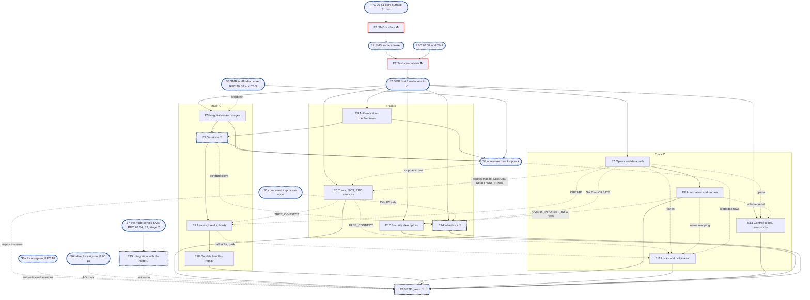

# RFC 22 - SMB adapter v2: implementation plan

**Scope:** [RFC 22, SMB](../rfcs/rfc-22-smb.md), the whole RFC (`status: draft`, not deferred):
what the SMB adapter serves on RFC 20's `core`, from `NEGOTIATE` to Witness, with its
translations, its tests and its benchmarks. It builds on [RFC 20's plan](rfc-20-adapters-plan.md):
that plan's epic 1 deletes v1 and fixes `core`'s surface, and its epic 6 builds the SMB scaffold
(`smb/wire`'s framer and header codec, `smb/protocol`'s router, `New`), which this plan extends and
does not plan again. This plan deletes nothing. Related RFCs, with how far each is in scope:

- [RFC 20](../rfcs/rfc-20-adapters.md), the adapter core: **constraints**, except every row of
  RFC 20's plan's deferral ledger (its §6.2) owned by the RFC 21/22 plans or naming RFC 22, for SMB:
  SMB's `Security` stage and `HoldCodec`; `gss` as SMB drives it; `translate`; the error-table rows
  and the totality test; handler tests on `vfstest.Record`; operation codecs with golden vectors and
  0-allocation gates; the import test's call sites and file sizes; the scripted client; the
  cross-protocol and end-to-end rows; the wire tests against Samba; the benchmarks; the
  `required-tests.json` pins. §6.4 maps each row to its epic.
- [RFC 18](../rfcs/rfc-18-identity.md), identity, and [RFC 19](../rfcs/rfc-19-authorization.md),
  authorization: **SMB's parts only**: NTLM and Kerberos session setup, SMB's SID and identity
  translation, and the share and ACL checks SMB calls. The shared pieces, the authenticator behind
  `SignIn` and the resolution behind `Spell` and `Find`, are **constraints**, and their missing
  owner is an open point (§6.2). `gss`, which NFS will share, is built here only as far as SMB's
  session setup drives it, because RFC 20's plan's ledger gives it to this plan until it has an RFC
  of its own; it is one epic, so it can move whole, and its owner is an open point too (§6.2).
- [RFC 14](../rfcs/rfc-14-open-state.md), open state: **SMB's wire side only**: lease and oplock
  breaks, durable and persistent reconnect, and replay, against the RFC 14 state the service holds.
  RFC 14 itself is constraints.
- [RFC 17](../rfcs/rfc-17-vfs.md), [RFC 24](../rfcs/rfc-24-resources.md),
  [RFC 13](../rfcs/rfc-13-configuration.md), [RFC 25](../rfcs/rfc-25-observability.md) and
  [RFC 29](../rfcs/rfc-29-test-harness.md): as RFC 20's plan treats them: constraints, or the rules
  every epic follows (§1.5 rules 3 to 5). `pkg/vfs`, `vfstest.Record` and `vfstest.Null` exist on
  `feat/storage-v2`.
- [RFC 21](../rfcs/rfc-21-nfs.md), NFS: **out**. [RFC 15](../rfcs/rfc-15-topology.md) and
  [RFC 27](../rfcs/rfc-27-namespace-migration.md): **out** beyond what RFC 20's plan covers.
- RFC 0, 1, 5, 6, 7, 8, 12 and 16: **constraints only**, reached through the service.

**Tracks:** A, B and C (§3.4).
**Programme:** stage 5, "adapters", of [#3119](https://github.com/cubbit/dittofs/issues/3119).
Stage 2 built the service the adapters call; stage 7 is the cutover, which wires the adapters into
`dfs` and turns the protocol suites back on. Roadmap epic:
[#3615](https://github.com/cubbit/dittofs/issues/3615). RFC 20's epics 1 and 2 run first. Who works
each track is the programme's, not this plan's.
**Naming:** v1 is today's SMB adapter, `internal/adapter/smb` and `pkg/adapter/smb` on
`feat/storage-v2`; v2 is RFC 22's, on RFC 20's `core`. v1 and v2 name adapter implementations, not
SMB protocol versions. RFC 20's plan deletes v1 in its epic 1, not migrated, and v2 reuses the paths,
so no name carries a version.
**Transition:** as RFC 20's plan says: v1 is deleted on `feat/storage-v2` with no migration of SMB
state (an adapter holds none durably, RFC 20 A2), and the cutover, programme stage 7, wires the
adapters into `dfs` and turns the protocol suites back on.
**Estimates** are human man-days on the shared scale of `rfc-to-epic-plan`, kept as they are
although the code is written by an agent; a scale for agent-written work was proposed in #3524.
**Defaults used from Step 0:** dashboards none (#9); output path the default (#10). Where v2 lives
is RFC 20's plan §4's layout, its differences flagged in §6.2. The target branch is
`feat/storage-v2`; the plan document itself lands on `develop` and is cherry-picked, as the other
planning documents are. External dependencies: RFC 20's plan's S1, S2 and S3, its epic 6's SMB half,
and its S4 (`internal/node`) for anything node-level (§3.2).

## 1. Introduction

### 1.1 What we are building

| | v1 (deleted by RFC 20's epic 1) | v2 |
| --- | --- | --- |
| Reaches files through | `pkg/controlplane/runtime`, which hands out the stores; locks taken and checked in handlers (RFC 20 Appendix B) | `vfs.Service` only, one mutating call per handler (RFC 20 §4.3) |
| Connection, signing, credits, replay | inline in one connection loop in `pkg/adapter/smb` | `core`'s pipeline; SMB's `Security`, `Flow`, `Replay` and `HoldCodec` stages in `smb/protocol` |
| Sign-in | `SESSION_SETUP` decodes Kerberos itself and runs NETLOGON pass-through to the domain controller | `gss`'s mechanisms (RFC 20 §4.4); every secret behind `SignIn` (RFC 18) |
| Held requests | per-handler pending code | `core`'s hold and park, with SMB's bounds by cause (RFC 22 §16.5) |
| Codecs | split between `smbenc`, `header` and handlers | `smb/wire`, pure, one file per command, golden vectors and fuzz targets |
| Durable and lease state | in the adapter's session tables | RFC 14's records at the file's primary; the adapter keeps only a connection's state |
| Dialects | 2.0.2 among them | 2.1, 3.0, 3.0.2, 3.1.1; SMB1 and 2.0.2 refused (RFC 22 §3.1) |
| Witness | not served | served for continuously available shares (RFC 22 §14) |
| Tests | handlers on real stores | handlers on `vfstest.Record`; stages on specification vectors; loopback through `core`; the composed node; smbtorture, WPTS, Windows; wire diffs against Samba |

**Dependency limits.** What SMB's packages may import is RFC 20 §2.3's list, which its §7.1 import
test enforces: `pkg/vfs`, `pkg/adapter`, `pkg/adapter/config`, `pkg/resources`, `pkg/metrics`,
`internal/tlsconfig`, `core`, and SMB's own packages. No SMB package imports `pkg/identity` or
`internal/identity`: sign-in and principal spellings reach it as `vfs.Service`'s `SignIn`, `Spell`
and `Find`. `smb/dcerpc` imports no SMB package (RFC 20 §3.1).

**What v2 serves at the end of the plan.** Everything RFC 22 specifies on one node, the first
release's profile (RFC 22 §18, "Where each check runs"). The rows RFC 22 marks **(cluster)** are
built where they are adapter code, and tested only once a second node exists.

### 1.2 How the plan is organised

Epic 1 fixes what several epics of SMB share before any is built: the request state handlers read,
the handler set and its tables, the callbacks value, and the settings RFC 22 adds to `config.SMB`.
Epic 2 builds what the tests stand on: the SMB handler harness on `vfstest.Record`, golden files cut
from Samba captures, and the import test's last two rules. Twelve middle epics follow on three
tracks: track A the connection, sessions and RFC 14's wire side; track B authentication, trees, the
RPC services, security descriptors and the wire tests; track C the data path, metadata and names,
locks and notification, and control codes. The integration with the node waits for S7. The last
epic burns the SMB suites down and runs the end-to-end, Windows and benchmark rows.

### 1.3 What epic 1 must deliver

- **`config.SMB`'s RFC 22 fields** (RFC 13 Appendix B), those RFC 20's epic 1 does not already
  add: `smb_pending_deadline` and `smb_pending_cap`, validated as RFC 13 says where the adapter can
  check it (the deadline above the 35 s break deadline), and marked live as RFC 13 marks them. How a
  live change reaches a serving adapter is an open point (plan gap 7).
- **`smb/protocol`'s request state** (RFC 20 §4.7's `Request.State`, §4.9's `Caps`): the session,
  the tree, `Caps`, the session's `FileId` table and the chain's current open, as handlers read
  them, with stub bodies. Every handler epic, on three tracks, reads it.
- **`smb/ops`' handler set and tables** (RFC 20 §4.7, §4.8, §2.5): `Handlers`, holding
  `Deps.Service`; the one operation table for every dialect, built from one row file per command;
  and the `ioctl/` table its `IOCTL` row dispatches to by control code, which five epics fill. Both
  empty. RFC 20's epic 6 keeps its empty table in `smb.go`; this subtask moves it here.
- **`smb/callbacks.go`'s per-client value** (RFC 20 §3.3, RFC 17 §3.2), implementing
  `vfs.Callbacks`, which epic 5 registers at `Connect` and epics 9 and 11 fill.
- **A test with every new package.** `lint-repo`'s `test/new-package-tests.sh` fails a new
  directory with no `_test.go`; each package epic 1 creates lands with a test that can fail
  (rule 10).

`smb/protocol` and `smb/wire` are created by RFC 20's epic 6 (T6.1, T6.3). If T6.3 has not landed
when epic 1 starts, epic 1 creates `smb/protocol` and T6.3 adds its router to it.

### 1.4 What epic 2 must deliver

RFC 22's suites paragraph (its §18) puts the translation tests, fuzz seeds and the rows that inject
a fault below the server in `unit`; the named smbtorture tests in `smbtorture`, the Kerberos
re-authentication ones in `smbtorture/kerberos`, the MS-FSA cases in `wpts`, the rows reaching one
file over SMB and NFS in `e2e/cross-protocol`, the Linux kernel client rows in `e2e`, the rows that
need Windows in `clients/windows`, and the hour-long profile-container run in `system`. Every one of
those suites is registered already. **Epic 2 registers no red suite**: `unit` keeps no
`known.yaml`, so its tests land green with the epic that makes them pass. Every other suite named
there stays off on `feat/storage-v2` under `tests.yml`'s V2 filter until the cutover. `e2e` keeps no
`known.yaml` either, so its SMB rows land green in epic 16, once epic 15 has turned it on.
`smbtorture`, `smbtorture/kerberos`, `wpts` and `system` keep one each, and epic 15 rewrites them for
v2 once `dfs` serves SMB, each v2 failure an entry `status: fail`, `fix: planned`,
`category: feature`, with a reason and `issue: "#…"` naming this plan's epic issue, which exist
before then (`epic-breakdown` Step 6.3, under #3615).

**The catalogue, by source.** Every row lands in the epic that creates what it imports, on
`vfstest.Record` where the adapter's half can fail alone, and again on the composed node or a real
client in epic 16:

- RFC 22 §18's rows and §16.6's table, each mapped in §7 to its epic; §18's acceptance rows for
  RFC 20 (§4.4: signing, re-authentication, expired session, ticket addresses; §4.6: credits under a
  hold, the pending ceiling, the multi-session host through a freeze, the share cap, delay causes,
  freeze, grace, full journal; §4.7: chains, the parked pipe `READ`, waiting locks, notify), as
  RFC 20's plan T8.2 asks.
- RFC 20 §7.4's and §7.5's SMB rows: drain under `tar` on SMB 3.1.1, slow client, reconnect after
  a restart, cancel, order, Kerberos and AD.
- RFC 18 §10's Tier 2 rows through SMB (no map to guest, re-authentication, binding, deny-only SIDs,
  anonymous lookup, disable takes effect) and RFC 19 §9's SMB rows (maximal access, generic rights,
  the owner fold, round trips, the SACL, access-based enumeration).
- RFC 14's plan's L52 cases that are SMB session steps, which that plan hands to stage 5.
- The protocol suites' own lists: smbtorture's `smb2.*` and `rpc.*` tests and WPTS's MS-SMB2 and
  MS-FSA cases, with `develop`'s `known.yaml` as v1's baseline for parity.
- v1's history and the isolated scenarios: the FSLogix profile-container scenario (#2959's
  checklist: sign-in storm, durable reconnect, sign-out compaction, files past 30 GB, a real Windows
  client).

**What the catalogue leaves out.** RFC 22's **(cluster)** steps, outside the first release's
conformance (RFC 22 §18); the namespace-move rows of §6.3, which need RFC 27's move (out of scope);
and the rows needing a Windows runner until one is provisioned (§6.2, point 8).

**Test components.** The SMB handler harness, golden files from captures and the import test's
call-site and file-size rules (epic 2). `gsstest`'s initiators come with `gss` (epic 4) and the
scripted client with sessions (epic 5), the epics that create the packages they import.

### 1.5 General rules for each epic

> **Instruction for whoever expands an epic into its detailed description and subtasks,
> human or AI:**
>
> - **Creating an epic from this plan: use the `epic-breakdown` skill.** Whenever the user
>   asks to create an epic from this plan, or to expand, detail or break one down, run the
>   `epic-breakdown` skill (`.claude/skills/epic-breakdown/SKILL.md`) on this plan and that
>   epic, rather than writing the epic document freehand. It extracts the RFC's MUST and
>   MUST NOT into numbered requirements, estimates each subtask in man-days and suggests
>   the pull requests. A human doing it by hand follows the same skill.
> - **Epic and subtask, nothing else.** The units of work are the epic and its subtasks,
>   with subtask ids `<epic>.<n>` (`subtask 4.3`, or `T4.3` for short). No other word names
>   them: not task, ticket, story, step or phase, in headings, tables, ids or prose.
> - **The epic stands alone.** Copy the numbered rules below into the epic document word
>   for word, under their own heading (the rules only, not this instruction, which speaks
>   of "this plan"). The epic document must not refer to this plan, link to it,
>   or say "see the plan". Everything a reader needs to do the epic is in the epic
>   document itself: the RFC sections it implements, the interfaces it builds on, the
>   rules, the subtasks, and a short legend of the names the rules borrow from this plan
>   (E1, E2, S1, the integration epic, …).
> - **The epic document records decisions, not progress, like this plan.** It has no
>   status fields, no checkboxes to tick and no sections to keep up to date as the work
>   goes on. It is revised through a pull request only when a decision changes.
> - **Subtasks are not pull requests.** A subtask is ideally up to 5 man-days. The owner
>   ships subtasks as they see fit, one pull request each or several together; the epic
>   document only suggests a grouping, each suggested pull request ideally up to 15
>   man-days. Cut and group by logic, readability, dependencies and a deliverable that can
>   be named, not to hit a number.
> - **Every subtask states how it meets each rule that applies to it.** A rule that does
>   not apply is named, with the reason.
> - **In the issue tracker, only when someone asks for issues,** following `epic-breakdown`
>   Step 6, their one description. Issues point at the documents and copy nothing. The
>   epic issues exist before E2's pull request lands, because each red test's
>   `known.yaml` entry names one; subtask issues come once their epic document has
>   merged. The release an epic ships in is set by the RFC's roadmap epic that its epic
>   issue sits under, never in a document and never on the epic issue on its own: the epic
>   issue and its subtask issues copy that roadmap epic's milestone, and an epic changes
>   release only by moving under the roadmap epic of the other release.

1. **Independent unit tests, under `-race`.** Each epic carries its own unit tests. It may use
   another epic's implementation once that has landed, `vfstest.Record` and `vfstest.Null`, the SMB
   handler harness and its golden files, `gsstest`'s initiators, and RFC 20's `testproto` and leak
   checks. A handler is tested on `vfstest.Record` (RFC 20 §7.2): its mutating call pinned with its
   arguments, read-only calls by name, and the reply for each scripted answer, each error included.
   A stage is tested without a socket, on specification vectors. A loopback row runs over real TCP
   through `core`. Test at the layer that consumes a value (`CLAUDE.md`, "Verifying a change"): a
   credit grant on the reply the client reads, a share flag on the `TREE_CONNECT` reply, a name on
   the listing that shows it.
2. **Fuzz tests where relevant.** Go native fuzzing on every decoder of bytes a peer sent: each
   command's request, the transform header, negotiate and create contexts (`DHnQ`, `DH2Q`, `DH2C`,
   `RqLs`, `AppInstanceId`), access and share masks, `LOCK` elements, security descriptors, the
   information classes and control-code inputs a client sends, NTLM, SPNEGO and Kerberos tokens, NDR,
   and the `Adapter`-bytes decoder fed truncated, corrupt, older and newer bytes (RFC 22 §16.6).
   Seeded with golden vectors and reference captures. The property: accepted as a valid neutral
   request or refused, never a panic, never an allocation past the protocol's cap (RFC 20 §5.2, A8),
   never a misread value.
3. **Observability follows RFC 25 and RFC 20 §10.** Every metric, span and log key lives in `core`;
   SMB code records none and supplies names through its tables, so a request's span is
   `adapter.smb.<COMMAND>` (RFC 22 §16.7). RFC 22 §16.7's rows are RFC 20 §10.1's `adapter_` series
   with `protocol="smb"`, recorded by `core` as their producers land. RFC 22 §19's `smb_` series are
   recorded only as RFC 20 §10 or RFC 22 §19 comes to say; until one does, no subtask adds a recorder
   to SMB code. No label, span attribute or log line carries a path, a name, a SID, a principal or a
   client address (RFC 25 §5.4).
4. **Leaks, allocations and profiles.** Every test that runs the pipeline ends with RFC 20's leak
   checks: no pool reserved, no goroutine left. RFC 20 §6.10's codec gates hold at 0 allocations for
   `READ`, `WRITE` and `QUERY_INFO` decode and encode, each registered in the per-change
   `unit/adapter-allocs` cell by the subtask that writes it; signing and encryption work in place. A
   change to the session registry or the `FileId` tables reports its mutex and block profiles
   (RFC 20 §6.9).
5. **Known failures shrink.** A test of `smbtorture`, `smbtorture/kerberos` or `wpts` that turns
   green leaves its suite's `known.yaml` in the same change: `dt` fails a run in which a listed test
   passes. Those suites stay off on `feat/storage-v2` until the cutover turns them on; `unit` and
   `e2e` keep no `known.yaml`, so a test there lands green with the subtask that makes it pass.
6. **v2 ignores v1.** v1 is today's `internal/adapter/smb` and `pkg/adapter/smb`, which RFC 20's
   first epic deletes. Nothing is copied from it but what RFC 20 Appendix B keeps: the Kerberos,
   SPNEGO and NTLM mechanism code, lifted from `develop`'s history into `gss`. Behaviour comes from
   RFC 22 and MS-SMB2, never from what v1 did, and RFC 20's import test fails any import of a path
   v1 used.
7. **Real dependencies for properties of those dependencies.** No fake stands in for what the real
   thing does: MS-SMB2's, MS-FSCC's and MS-DTYP's published examples and Samba captures for bytes,
   never vectors made by the codec under test (RFC 20 §5.4); real TCP over loopback for sockets; the
   composed node for a fault below the server; smbtorture, WPTS, the Linux kernel client and Windows
   for what a client does. `vfstest.Record` stands in only for the service's answer to a handler.
   RFC 22 §18's "What must not stand in" holds: a single node fails no cross-node row, a client that
   never lets a break time out fails no break row, and a failover test that flushes first fails no
   durability row.
8. **Translate, never decide.** A handler makes at most one mutating service call and branches on
   no file attribute, mode or ACL to decide whether an operation is allowed (RFC 20 §4.3, A5); a
   precondition its row carries is the pipeline's (A15). Every mapping of RFC 22 §16 is a pure
   function of the request and the record's `Adapter` bytes, total over its inputs, with a named
   refusal and never a default. SMB keeps nothing durable but those bytes (RFC 22 S9), and what only
   the service can decide is a missing service operation, raised against RFC 17, never a sequence in
   a handler.
9. **Code comment conventions** (`CLAUDE.md`, "Code comments"). A source comment describes the
   code's behaviour and references nothing outside it: no issue or pull request numbers, no CI,
   runner or OS names, no ids from planning documents (epics, subtasks, synchronisation points,
   decisions). A `ponytail:` marker records a knowingly simple implementation, naming its ceiling
   and the upgrade path. A `decision:` marker records deliberate behaviour, naming the rule, why it
   holds and the evidence that would overturn it. RFC 22's notes go at their code sites: its
   `decision:` notes, from old dialects refused (§3.1) to a drain's refusal answered by an interim
   (§16.5), and its `ponytail:` notes on one credit target and hold floor (§3.3), three RPC services
   (§5.2) and the break backoff (§6.3), each where the code that implements it is.
10. **A test must be able to fail.** Keep a test only if a plausible change would make it fail and
    nothing else would catch that change: not the compiler, not the diff, not a later epic's tests.
    A golden vector from a specification or a capture can fail where a round trip cannot (RFC 20
    §5.4); the import test's call-site and file-size rules prove they can by reporting their seeded
    violations. A review rule no test can check stays a review rule.
11. **A symbol is exported only if an interface uses it.** The public surface is RFC 20's:
    `pkg/adapter/smb.New` and `config.SMB`. Inside, a symbol is exported only for the package that
    calls it: `smb/protocol`'s request state for `smb/ops`, `smb/wire`'s codecs for `smb/ops` and the
    scripted client, RFC 20 §4.4's `gss` surface, RFC 19 §5.1's and RFC 20 §4.9's `translate`
    functions. What E1 exports is frozen at S1. A symbol `core` lacks is added to RFC 20 §4.7 first,
    by a pull request to the RFC.
12. **Each subtask creates only what it declares.** No empty package and no stub without a caller:
    no `ops/` row, `ioctl/` code, `dcerpc` interface, `translate` function or callbacks method
    before the subtask that fills it and calls it. A package, a stage or a test helper lands with
    its first consumer.
13. **Nothing deferred is lost.** A subtask that leaves out part of an RFC 22 obligation, or of a
    row of RFC 20's deferral ledger it took over, names it in its epic document with the owner that
    brings it back.

The skill's profiling rule is folded into rule 4; rules 8 and 13 are added, the first because
RFC 20 §2.1 makes translation the adapter's whole job, the second because RFC 22's epics take over
rows of RFC 20's deferral ledger.

## 2. Epics at a glance

| # | Epic | Content | Subtasks | Man-days | Track | Blocks |
| --- | --- | --- | --- | --- | --- | --- |
| E1 ⛔ | SMB surface | `config.SMB`'s RFC 22 fields; `smb/protocol`'s request state; `smb/ops`' handler set, table and `ioctl/` table; the callbacks value | 4 | 4 | team | all |
| E2 ⛔ | Test foundations | the SMB handler harness on `vfstest.Record`; golden files cut from Samba captures; the import test's call-site and file-size rules | 3 | 6 | team | E3 to E14 |
| E3 | Negotiation and the connection's stages | `NEGOTIATE`, `Caps`, signing, encryption, preauthentication, credits, the message-ID window, `HoldCodec`, the error table and its totality test, `ECHO`, `CANCEL` | 9 | 24 | A | E5 |
| E4 | Authentication mechanisms | `gss`: `Exchanges`, NTLM, Kerberos, SPNEGO, `Identity`, `gsstest` | 6 | 15.5 | B | E5 |
| E5 🔀 | Sessions | `SESSION_SETUP`, `LOGOFF`, the session registry, the client record, re-authentication, expiry, multichannel, `PreviousSessionId`, the scripted client | 8 | 20 | A | E9, E14 (partly) |
| E6 | Trees, IPC$ and the RPC services | `TREE_CONNECT`, share flags, keyless confinement, DCE/RPC, named pipes, srvsvc, wkssvc, lsarpc, Witness | 6 | 16 | B | E9, E11 (partly); E16 |
| E7 | Opens and the data path | `CREATE`, `CLOSE`, `READ`, `WRITE`, `FLUSH`, `FileId`s, path resolution, access translation, `Adapter` bytes | 8 | 21 | C | E8; E6, E9, E11 to E13 (partly) |
| E8 | File information, directories and names | information classes, `QUERY_INFO`, `SET_INFO`, `QUERY_DIRECTORY`, rename and link, the name mapping, streams, reparse points | 8 | 22 | C | E11 to E13 (partly), E16 |
| E9 | Leases, breaks and held requests | caching requests, break callbacks and acknowledgements, `Revoked`, holds by cause | 6 | 18 | A | E10; E11 (partly) |
| E10 | Durable and persistent handles, and replay | durability on `CREATE`, reconnect, replay, app instance takeover | 5 | 13 | A | E16 |
| E11 | Byte-range locks and change notification | `LOCK`, waiting locks, `CHANGE_NOTIFY` | 5 | 12.5 | C | E16 |
| E12 | Security descriptors and quotas | the descriptor codec, `translate`'s descriptor functions, principals by SID, security and quota classes | 5 | 12.5 | B | E16 |
| E13 | Control codes and Previous Versions | the `ioctl/` codes of Appendix F, server-side copy, snapshots | 5 | 11.5 | C | E16 |
| E14 🔀 | Wire tests against Samba | the differential runner, SMB scripts per area, the divergence list | 4 | 13 | B | E16 |
| E15 🔀 | Integration with the node | settings, Witness's listener, the durable-handles listing, the SMB suites turned on | none | planned after S7 | team | E16 (partly) |
| E16 🔀 | E2E green | in-process rows, suites burned down, e2e, Windows and system rows, cross-protocol rows, benchmarks, pins | 8 | 29 | team | none |
| | **Total** | | **90** | **238** | | |

**Plan estimate: 90 subtasks, 238 man-days, not counting epic 15.**

The estimate `N = round(3017 / 400) = 8` against twelve middle epics. RFC 22 maps some twenty
commands, about thirty information classes, twenty control codes and four RPC services, in areas
that share little state, one per group of chapters; `gss`, RFC 20 §4.4's, is an epic of its own so
that it can move to another owner whole (§6.2); and the wire tests, which RFC 20's plan's ledger
hands to this plan, are a seam of their own.

Legend: ⛔ blocks every epic after it; 🔀 waits for or opens a synchronisation point.

## 3. Synchronisation points, blockers and the split

### 3.1 Dependency graph



### 3.2 Synchronisation points

How they join RFC 20's plan: S1 follows its S1, S2 its S2 and T6.1, S3 is its S3 with T6.3, and S7
holds its S4 and its epic 7.

- **S1 SMB surface frozen** (after E1, which starts at RFC 20's S1, when `core`'s §4.7 surface and
  `Bind`'s body exist). The request state, the handler set and its tables, the callbacks value and
  `config.SMB`'s fields compile with stub bodies. Unblocks E2.
- **S2 SMB test foundations in CI** (after E2, which needs RFC 20's S2, the import test in CI, and
  its T6.1, `smb/wire`'s framer and header codec). The handler harness runs a row on
  `vfstest.Record`, golden files load from the capture corpus, and the import test reports its two
  new seeded violations. Unblocks every middle epic but those that wait on another epic.
- **🔀 S3 SMB scaffold on core** (outside: RFC 20's S3 with its T6.3). An SMB connection runs
  through `core`'s pipeline over loopback, every command answered not supported. Unblocks E3's
  loopback rows and, with E3, E4 and E5, S4.
- **🔀 S4 a session over loopback** (after E3, E4 and E5, and S3). The scripted client negotiates
  each dialect, sets up a session through `gsstest`'s initiators against a scripted `SignIn`, and
  signs and seals. Unblocks the loopback rows of E6 and E11; those of E9 and E10 follow E5 on
  track A.
- **🔀 S5 composed in-process node** (outside, owner open, §6.2). The real service, open state,
  engine and store, in memory, without `internal/node`, with SMB on a loopback port. Unblocks E14's
  DittoFS side and E16's in-process rows. If no owner is found by S4, a subtask in E2 builds the
  composed single-node harness.
- **🔀 S6a local sign-in** (outside: an RFC 18 plan, none yet, §6.2 point 1). NTLMv2 against a local
  NT hash and Kerberos against a keytab (RFC 18 §3.3, §3.5's local source), with `Spell` and `Find`
  from RFC 18 §11's slice 4. Until it lands, `SignIn`, `Spell` and `Find` answer `ErrAccess` on
  `feat/storage-v2`. Unblocks T16.1, T16.2, and the lsarpc and descriptor rows on the composed node.
- **🔀 S6b directory sign-in** (outside: the same plan). NETLOGON pass-through, the PAC, LDAP
  (RFC 18 §3.4, §3.5's pass-through source, §5), with the directory's `Spell` and `Find` from
  RFC 18 §11's slice 6. Unblocks T16.4's Kerberos and AD row and T16.5.
- **🔀 S7 the node serves SMB** (outside: RFC 20's S4, its epic 7, and programme stage 7's start
  path). `node.New` builds, starts and reconfigures the SMB adapter and `dfs` serves it. Unblocks
  E15.

### 3.3 Blockers

| Epic | Blocks | Why |
| --- | --- | --- |
| 🔀 RFC 20 S1 | E1 | `core`'s surface and `Bind` are what E1's types plug into |
| ⛔ E1 | E2, and through it every epic | the request state and handler set every handler epic writes against |
| 🔀 RFC 20 S2 and T6.1 | E2 | the import test E2 extends, and `smb/wire`'s header the harness decodes |
| ⛔ E2 | E3, E4, E6, E7, E12, E13 and E14, through S2 | the harness every handler test runs on, and the import test from the first SMB package |
| E3 | E5; S4 | a session needs a negotiated connection, its signing keys and credits |
| E4 | E5; S4 | T5.3 drives every mechanism and `Identity`, and T5.8 signs in through `gsstest`; E4 starts at S2, so it ends inside E3 |
| 🔀 E5 | E9; E14, partly; S4 | breaks go to sessions; the wire scripts drive the scripted client |
| E6 | E9 and E11, partly | their loopback rows need a tree (T6.1) |
| E7 | E8; E6, E9, E11, E12 and E13, partly | queries, locks, descriptors and control codes resolve E7's `FileId`s; leases and `SecD` ride on `CREATE`; T6.1's `MaximalAccess` needs T7.4's access translation, and pipes on `IPC$` are reached through E7's `CREATE`, `READ` and `WRITE` rows (T7.5) |
| E8 | E11, E12 and E13, partly | a notification spells names as a listing does (RFC 22 §8); the security and quota classes go through `QUERY_INFO` and `SET_INFO`'s rows; a snapshot's volume serial is T8.3's |
| E9 | E10; E11, partly | a durable handle needs a lease with handle caching or a batch oplock; locks and notify use the callbacks value and park as E9 leaves them |
| 🔀 S3 | E3, partly; S4 | E3's loopback rows and the first session need SMB on `core` |
| 🔀 S4 | E6 and E11, partly | their loopback rows need a session |
| 🔀 S5 | E14 and E16, partly | the DittoFS side of a wire test and every in-process row need the composed node |
| 🔀 S6a | E16, partly | an authenticated session on the real service needs the authenticator |
| 🔀 S6b | E16, partly | a domain user's session needs pass-through, the PAC and the directory |
| 🔀 S7 | E15 | no node to wire into, no `dfs` serving SMB |
| 🔀 E15 | E16, partly | the SMB suites run only once `dfs` serves SMB and the V2 filter lets them |
| E6, E8, E10, E11, E12, E13, 🔀 E14 | E16 | the suites, end-to-end rows and benchmarks run every area |

### 3.4 Splitting the work

- **Track A: E3, E5, E9, E10.** The connection and its security, then sessions, then RFC 14's wire
  side: leases, breaks, holds, durable handles and replay. It starts at S2 with `NEGOTIATE` and the
  stages on specification vectors, runs its first loopback rows at S3, and its session setup waits
  for E4, which track B starts at S2 and finishes inside E3. E9 needs E7's `CREATE` and E6's
  `TREE_CONNECT`, which tracks C and B finish well before. At 75 man-days this is the longest track
  and the workload's critical path.
- **Track B: E4, E6, E12, E14.** Authentication, then trees and the RPC services, then security
  descriptors, then the wire tests. E4 comes first because E5 needs it; in E6, `TREE_CONNECT` comes
  first because every file request needs a tree. E14's runner and scripts are built against Samba
  alone and its DittoFS side waits for S5. At 57 man-days the track ends about 18 man-days before
  track A; it then takes E16's in-process rows (T16.1, T16.2) as S5 and their epics allow.
- **Track C: E7, E8, E13, E11.** The data path, then file information and names, then control codes
  and Previous Versions, then locks and notification, all on the open E7 resolves. E13 goes before
  E11 because E11 waits partly on E9 (track A, about man-day 62) and E13 on nothing outside the
  track: E11 then starts about man-day 54 instead of 43. Within E8, `QUERY_INFO` and `SET_INFO`, the
  end of file included, come before directories, reparse points and streams. At 67 man-days.
- **The team.** E1 and E2 before the tracks; E15 at S7; E16 after the tracks.
- **The FSLogix workload.** One VHDX of 10 to 30 GB per user, held open through one handle all
  session, overwritten at random in 64 KiB pieces, and truncated at sign-out. It can first run at
  three points, each as early as the dependencies allow:
  1. **Its I/O shape, in process**, once E5's guest session, E6's T6.1, E7, and E8's T8.3 and T8.4
     have landed and S5 holds: the scripted client drives one handle, random 64 KiB overwrites
     across a 30 GB file, `FLUSH` and the sign-out truncate, over a guest session to a share with
     its guest flag set. A guest gets no lease and so no durable handle (RFC 22 §4.4); this proves
     the data path, not the handle.
  2. **With its lease and a durable or persistent handle**, once E9 and E10 have landed and S6a
     holds, so the session is authenticated and joins a client: the same run with an RWH lease, a
     persistent handle on a continuously available share, and a 10 s blip reconnected (T16.2).
  3. **With Windows, FSLogix and AD sign-in**, once S6b and S7 hold and E15 has turned the suites
     on: RFC 22 §18's profile-container row in `system`, at 30 GB per file (T16.5).

## 4. Directory layout proposed for epic 1

```text
pkg/adapter/
  config/                     RFC 20's E1; E1 here adds config.SMB's RFC 22 fields
  smb/                        RFC 20's E1 and E6: New
internal/adapter/
  gss/                        E4: Exchanges, the NTLM, Kerberos and SPNEGO mechanisms, Identity (RFC 20 §4.4)
    gsstest/                  E4: initiators, a test keytab, a test acceptor behind a fake SignIn
  translate/                  E7 (access masks), E8 (attributes, times, Fit), E12 (descriptors)
  adaptertest/
    golden/                   E2: golden files cut from reference captures
    smbclient/                E5: the scripted client (RFC 20 §8.2)
    imports_test.go           RFC 20's E2; E2 here: entry call sites, the 800-line allowlist
  smb/
    smb.go                    RFC 20's E6: New; builds the stages and the tables
    callbacks.go              E1 type; E9 (RecallGrant, Revoked), E11 (LockWaitOver, Notify)
    wire/                     RFC 20's E6: NetBIOS framer, header; then one file per command, in its epic
      transform.go            E3
      names.go                E8: RFC 22 Appendix B's mapping
    protocol/                 RFC 20's E6: Router; E1: State, Session, Tree, FileIds, Caps
      security.go             E3: signing, encryption, preauthentication
      credits.go              E3: Flow
      window.go               E3: Replay, the message-ID window
      hold.go                 E3: HoldCodec
      sessions.go             E5: the session registry
    ops/                      E1: Handlers and the table; one file per command, in its epic
      errors.go               E3: RFC 22 §16.5's table
      ioctl/                  E1 table; one file per control code: E3, E5, E6, E8, E13
    dcerpc/                   E6: NDR, PDUs, interfaces by opnum; imports no SMB package
      srvsvc/  wkssvc/  lsarpc/  witness/      E6
test/
  pcap-corpus/smb/            E2: Samba captures per command area
  wire/                       E14: differential runner, SMB scripts, divergence list
```

`adaptertest/smbclient/`, `dcerpc/witness/` with its own listener, and `test/wire/` are not in
RFC 20 §2.5 or RFC 20's plan §4; §6.2 lists them.

## 5. The epics in detail

### Epic 1 - SMB surface ⛔

**Epic 1 estimate: 4 subtasks, 4 man-days.**

What several epics on different tracks read or fill before any of them is built, with stub bodies.
At the end the branch builds, every new package has a test that can fail, and S1 holds.

RFC sections: RFC 20 §4.7's `Request.State`, §4.8 (one table for every dialect), §4.9's `Caps`,
§3.3's callbacks value, §2.5's `ops/` and `ioctl/`; RFC 13 Appendix B's `smb_pending_deadline` and
`smb_pending_cap`.

- T1.1 `config.SMB`'s RFC 22 fields that RFC 20's epic 1 does not add, with RFC 13's checks the
  adapter can make and their live marks.
- T1.2 `smb/protocol`'s request state: the session, the tree, `Caps`, the session's `FileId` table
  and the chain's current open, as handlers read them through `r.State`.
- T1.3 `smb/ops`: `Handlers` holding the service, the table for every dialect assembled from row
  files, and the `ioctl/` table the `IOCTL` row dispatches to; RFC 20's empty table moved here.
- T1.4 `smb/callbacks.go`: the per-client value implementing `vfs.Callbacks`, `RecallAny` nil as
  RFC 17 §3.2 has it for SMB.

### Epic 2 - Test foundations ⛔

**Epic 2 estimate: 3 subtasks, 6 man-days.**

What every SMB test stands on (§1.4). No red suite is registered: `unit` holds no known failures,
and the SMB protocol suites are off on the branch until the cutover.

RFC sections: RFC 20 §5.4 (golden vectors from specifications and captures), §7.1 (entry call
sites, file sizes), §7.2 (handlers on a recording service).

- T2.1 The SMB handler harness: golden request bytes through a row (`Decode`, `Resolve`, `Role`,
  `Call`, `Encode`) with a built request state, against `vfstest.Record`; the mutating call pinned,
  the reply bytes compared, an error mapped through a given table; its own test proving a second
  mutating call and a wrong byte each fail it.
- T2.2 Reference captures: a script recording Samba per command area into `test/pcap-corpus/smb`,
  against the AD domain controller and Samba member of `test/smbfuzz`'s fixture rather than a
  second fixture, and `adaptertest/golden`, which cuts captured messages into golden files.
- T2.3 The import test: entry methods (`Root`, `SecInfo`, `ListShares`) called only from RFC 20
  §4.10's entry files, and adapter files over 800 lines against an allowlist that may only shrink,
  each with a seeded violation it must report.

### Epic 3 - Negotiation and the connection's stages

**Epic 3 estimate: 9 subtasks, 24 man-days.**

Everything a connection does before and around a session: the dialect and its capabilities, the
algorithms, signing and encryption in `Security`, credits in `Flow`, the message-ID window in
`Replay`, held and cancelled requests in `HoldCodec`, and the error table every handler's answer
goes through. Stages are tested without a socket from S2; their loopback rows run at S3.

RFC sections: §3.1, §3.2, §3.3's credits and pending ceiling, §4.1's signing and encryption rules,
§16.5's table, chain paragraph, `core`'s refusals and the roles a drain serves; Appendix F's
`VALIDATE_NEGOTIATE_INFO`; Appendix G's `NEGOTIATE`, `ECHO` and `CANCEL`; RFC 20 §4.5, §4.7's
`Security`, `Flow`, `Replay` and `HoldCodec`, §5.5, §7.3.

- T3.1 `NEGOTIATE` codecs: request, response and negotiate contexts (preauthentication, encryption,
  signing, netname read and not checked; compression, RDMA and transport capabilities not offered);
  an SMB1 negotiate recognised; golden vectors and fuzz targets.
- T3.2 `NEGOTIATE`: the highest of 3.1.1, 3.0.2, 3.0 and 2.1; SMB1 answered with the multi-protocol
  response or closed; 2.0.2 alone `STATUS_NOT_SUPPORTED`; capabilities exactly as §3.1's table, "if
  asked" bits only when asked; `SIGNING_REQUIRED` always; 8 MiB sizes; `Caps`; the `ClientGuid` kept
  on the connection; a second `NEGOTIATE` closes it; the server GUID per plan gap 5.
- T3.3 Key derivation and signing: each dialect's keys (3.1.1's from the preauthentication hash),
  HMAC-SHA256, AES-CMAC and AES-GMAC; an unsigned request after setup and a bad signature each
  `STATUS_ACCESS_DENIED` on its message ID with the connection kept; keyless sessions exempt;
  MS-SMB2's test vectors.
- T3.4 Encryption: the transform header; AES-128 and AES-256, CCM and GCM, in place, with room for
  the transform header in reply buffers; a message that fails decryption closes the connection; a
  tree's encryption requirement checked in `Unwrap`; interims sealed; a chain signed per member and
  encrypted once, its members' offsets counted from the record's start.
- T3.5 Preauthentication integrity: SHA-512 per connection and per session over `NEGOTIATE` and
  `SESSION_SETUP`; `VALIDATE_NEGOTIATE_INFO` for 3.0 and 3.0.2, the first `ioctl/` row.
- T3.6 `Flow` and `Replay`: credits as RFC 22 §3.3 states them (a target of 512 counting what
  withheld interims still owe, grants for synchronous, interim and final responses, at least one,
  never zero, never revoked, one credit per 64 KiB), as a state machine with property tests; the
  message-ID window.
- T3.7 `HoldCodec`: the key, a synchronous `CANCEL`'s message ID and an asynchronous one's async ID
  both mapped to it; `Interim` granting or withholding to a balance of one, with `after`; `Final`;
  `Cancels`; `Pends` true only for a `CREATE` before the last member held on a lease or oplock
  break (RFC 22 §16.5's chain paragraph);
  `MaxPending` 511.
- T3.8 The error table: every row of RFC 22 §16.5 and `core`'s refusals, by typed kinds; `NoReply`
  rows for `ErrDraining` and `ErrMoved`; each command's drain role (`RoleRelease`, `RoleFlush`); a
  golden vector per row; the totality test over `vfs.Errors()` and `core.Errors()` (plan gap 6);
  the held rows' `Hold` is T9.5's.
- T3.9 `ECHO` and `CANCEL`; at S3, `NEGOTIATE` for each dialect, `ECHO` and chains of `ECHO`
  members over loopback through `core`; §18's §3.1 dialect and capability rows.

### Epic 4 - Authentication mechanisms

**Epic 4 estimate: 6 subtasks, 15.5 man-days.**

`gss` as SMB drives it (RFC 20 §4.4): the message side of NTLM, Kerberos and SPNEGO, the exchange
machine, and the `Identity` a context yields, with every secret behind `SignIn`. The Kerberos,
SPNEGO and NTLM mechanism code is lifted from `develop`'s history (RFC 20 Appendix B: replace with
`gss`, keeping the mechanism code). RFC 4121's per-message tokens are not here: RFC 20's plan's
ledger gives them to RFC 21's plan or `gss`'s own RFC (§6.2, point 2). Nothing in E4 imports an
SMB package, so the epic can move whole. Tested in process, with no KDC, no domain controller and
no network.

RFC sections: RFC 20 §4.4 (the package, its pieces table for SMB, its tests); RFC 18 §3.3's,
§3.5's and §3.6's wire halves (an AP-REQ passed to `SignIn` with the client's address, the NTLM
messages' bytes kept for the MIC, anonymous and guest set up as anonymous).

- T4.1 `Exchanges`: multi-leg state keyed by the protocol's handle, bounded by the handshake
  deadline and charged to the connection-state pool, cleaned up on close or deadline.
- T4.2 NTLM: `NEGOTIATE` and `CHALLENGE` answered in the adapter, `AUTHENTICATE` decoded into
  `NTLMAuthenticate` with the three messages' bytes as sent; NTLMv1 and LM refused; the session key
  from `SignIn`'s `Keys`.
- T4.3 Kerberos: the AP-REQ handed to `SignIn` with the connection's address, the AP-REP and subkey
  from `Keys`; `gsstest`'s initiator minting tickets from a test keytab, and a test acceptor behind a
  fake `SignIn`.
- T4.4 SPNEGO: the negotiation tokens, Kerberos offered first and NTLM as fallback, the
  mechanism-list MIC.
- T4.5 `Identity`: from a context, `Secret` or `Ticket` with the protection the protocol sets per
  request, expiry from the evidence; every `SignIn` error the logon failure, never a guest session;
  the anonymous and guest path with proof `None` and no key.
- T4.6 `gsstest`: initiators for each mechanism, and RFC 20 §4.4's mechanism tests (Kerberos
  without a KDC, NTLM against a fake `SignIn`, SPNEGO with fallback and the MIC), in process; the
  SMB handshake over loopback is T5.8's.

### Epic 5 - Sessions 🔀

**Epic 5 estimate: 8 subtasks, 20 man-days.**

A session on a connection and across channels, from sign-in to logoff, and the client record behind
it. Opens S4: the first session over loopback.

RFC sections: §4.1 (session setup, keyless sessions, re-authentication, expiry, the NTLM bytes),
§4.2, §4.3's `PreviousSessionId` and per-session disconnect, §4.4's client record, §16.1; §16.4's
client rows; Appendix G's `SESSION_SETUP` and `LOGOFF`; RFC 20 §3.2's cleanup per session, §4.7's
`Established`; RFC 14 §2.1's `Reach.Sessions` and its plan's L52 cases; RFC 18 §3.8.

- T5.1 `SESSION_SETUP` and `LOGOFF` codecs.
- T5.2 The session registry: sessions over channels, named by node, node epoch and session ID, IDs
  counted from 1 per process; each session's cleanup completed before a reconnect of it is served;
  `Disconnect` at a session's last channel.
- T5.3 `SESSION_SETUP`: SPNEGO through `Exchanges` keyed by session ID, `SignIn`, the session's keys
  derived, the final response signed, the identity of §16.1, `Established`; null and guest sessions
  anonymous, keyless and exempt from signing; a failed credential fails.
- T5.4 The client record: `Connect` at a `ClientGuid`'s first authenticated setup on the node, its
  `Gen`, and Appendix G's counted and skipped setups; `LOGOFF` as `Disconnect` with `Logoff`, and
  `Last` at the node's last session; null and guest sessions never join; RFC 14's L52 cases.
- T5.5 Re-authentication in place, its failure torn down as a `LOGOFF`; an expired session refused
  `STATUS_NETWORK_SESSION_EXPIRED` but for re-authentication, `LOGOFF` and the releases.
- T5.6 Multichannel: binding, channel signing keys, an unknown session
  `STATUS_USER_SESSION_DELETED`; `QUERY_NETWORK_INTERFACE_INFO` with this node's addresses, an
  `ioctl/` row.
- T5.7 `PreviousSessionId`: the previous session torn down only after `SignIn` bound the same
  principal, its volatile opens closed and its durable ones disconnected; ignored otherwise.
- T5.8 The scripted client (RFC 20 §8.2): sends what a test gives it, signs and seals through the
  stages' functions, signs in through `gsstest`, holds a fixed number of requests in flight; RFC 20
  §4.4's SMB handshake end to end over loopback; §18's §4.1, §4.3 and §4.4 session rows over
  loopback.

### Epic 6 - Trees, IPC$ and the RPC services

**Epic 6 estimate: 6 subtasks, 16 man-days.**

How a session reaches a share, and the RPC services that are not shares: `IPC$`'s named pipes and
DCE/RPC, and Witness. `TREE_CONNECT` comes first: every file request needs a tree.

RFC sections: §4.1's keyless confinement at `TREE_CONNECT`, §5.1, §5.2, §14, Appendix C; §3.3's
parked pipe `READ`; Appendix F's pipe codes; Appendix G's `TREE_CONNECT`, `TREE_DISCONNECT` and RPC
rows; RFC 20 §3.1's `IPC$` seams, §4.10's SMB entries; RFC 18 §4.4's and §4.6's spellings for
lsarpc.

- T6.1 `TREE_CONNECT` and `TREE_DISCONNECT`: `Root` with the share's name, from this file alone; the
  share's flags and Appendix C's; `MaximalAccess` from `Access` on the root, through T7.4's
  translation; null and guest
  confinement; a client that cannot encrypt refused at an encrypting share; `IPC$` marked as the
  pipe endpoint with no call; tree IDs never reissued while a held request names one (RFC 20 §2.2).
- T6.2 DCE/RPC: NDR codecs, bind and alter-context, request, response and fault PDUs, fragments;
  each interface a table keyed by opnum; an unknown opnum `DCERPC_FAULT_OP_RNG_ERROR`.
- T6.3 Named pipes on `IPC$`: the pipe endpoints E7's `CREATE`, `WRITE` and `READ` rows dispatch to
  (T7.5), and `PIPE_TRANSCEIVE`, `PIPE_WAIT` and `PIPE_PEEK`; a `READ` of an empty pipe parked with
  a small-class reply and answered short with `STATUS_SUCCESS`; §18's parked pipe and pending
  ceiling rows over loopback.
- T6.4 srvsvc and wkssvc: `NetShareEnumAll`, `NetShareGetInfo` at its five levels, `NetSrvGetInfo`,
  `NetWkstaGetInfo`; `ListShares` from these files alone; hidden shares omitted.
- T6.5 lsarpc: `OpenPolicy2`, `LookupSids2/3`, `LookupNames3/4` and `Close` through `Spell` and
  `Find`, names in RFC 18 §4.6's qualified spelling.
- T6.6 Witness over DCE/RPC (plan gap 3): `WitnessrGetInterfaceList`, `WitnessrRegister` and
  `RegisterEx`, `WitnessrAsyncNotify` with `RESOURCE_CHANGE`, `CLIENT_MOVE` before a drain and
  `IP_CHANGE`; registrations in memory.

### Epic 7 - Opens and the data path

**Epic 7 estimate: 8 subtasks, 21 man-days.**

An open from `CREATE` to `CLOSE` and the bytes through it: the one `Open` call with every create
option and context of Appendix D that is not a lease's or a durable handle's, the `FileId`'s two
halves, rights translation, and `READ`, `WRITE` and `FLUSH` with no payload copy.

RFC sections: §6.1, §9.4, §12.1's stream paths at `CREATE`, §16.3's rights and open by ID, §16.4's
open rows and `Adapter` bytes, §16.5's read-only narrowing paragraph; Appendix D's decoding;
Appendix G's `CREATE`, `CLOSE`, `READ`, `WRITE` and `FLUSH`; RFC 19 §2.4, §3.4; RFC 17 §3.4's
`FileId` codec; RFC 20 §5.3, §6.10's `READ` and `WRITE` gates.

- T7.1 `CREATE` and `CLOSE` codecs, with every create context of Appendix D decoded and the response
  contexts encoded.
- T7.2 `FileId`s: the persistent half from the open's `OpenID` and shard, through `pkg/vfs`'s codec;
  the volatile half in the session's table, never reissued while held (RFC 20 §2.2); a related
  member's current open.
- T7.3 Path resolution: a `CREATE`'s or rename target's components looked up from the tree's root,
  the last one opened (plan gap 6).
- T7.4 Access translation in `translate`: generic rights to `FILE_GENERIC_*`, `ShareAccess` to the
  deny mode, `MAXIMUM_ALLOWED` through `Access` with the directory and every right as `want`, an
  empty grant refused, backup intent's maximal request; masks total and round-tripping.
- T7.5 `CREATE`: one `Open` with disposition, access, deny mode, directory, name and the options of
  Appendix D; open by file ID and shared virtual disks refused; a stream's delete refused before the
  call; the reply's `MaximalAccess` and `QFid`; §18's generic-rights and delete-through-the-parent
  rows on `vfstest.Record`. E7 owns the dispatch from the `CREATE`, `READ` and `WRITE` rows to a
  pipe on `IPC$` or a file; E6 supplies the pipe endpoints (T6.3).
- T7.6 `READ` and `WRITE`: payloads as slices of pooled buffers, replies gathered; stability by
  flag, open, persistent open or continuously available share; a read below its `MinimumCount` held
  on `ErrUnavailable`; a write's buffer kept across re-drives; the 0-allocation gates.
- T7.7 `FLUSH` as `Commit`, `ErrLost` answered once per open; `CLOSE` with post-query attributes.
- T7.8 `Adapter` bytes: the versioned, empty SMB codec and its decoder.

### Epic 8 - File information, directories and names

**Epic 8 estimate: 8 subtasks, 22 man-days.**

What Windows reads and sets about a file and a volume, how a directory lists, and how a stored name
looks on Windows. `QUERY_INFO` and `SET_INFO` come first, the end of file included, since the
workload's sign-out truncates through its handle.

RFC sections: §9.1, §9.2, §9.3, §9.5, §12.1's listing and folding, §12.2, §12.3, §12.4, §13,
Appendix B, Appendix E (but the security and quota classes); §16.3's attributes, times, short names,
names and delete pending; Appendix G's `QUERY_INFO`, `SET_INFO` and `QUERY_DIRECTORY` rows;
Appendix F's reparse codes; RFC 20 §4.9's `Fit`, §6.10's `QUERY_INFO` gate.

- T8.1 The name mapping of §12.3 and Appendix B: its three cases on `posix` and `windows` shares,
  hidden names, unpaired surrogates, forbidden characters and device names refused on create and
  rename.
- T8.2 Information-class codecs (Appendix E), with the `QUERY_INFO` 0-allocation gate.
- T8.3 `QUERY_INFO`, file and file-system classes: §16.3's attribute bits and times, allocation from
  `Charged`, derived file IDs never the `FileID`, the volume serial, `NTFS` and Appendix E.2's
  flags, Appendix E.3's answers.
- T8.4 `SET_INFO`: times with -1 and -2 held at the open and `ChangeTime` never suspended, DOS
  attributes, end of file, allocation, disposition through the open, extended attributes compared
  without case; the refusals of Appendix E.3.
- T8.5 Rename and link (§13): the target from the share root, `ReplaceIfExists`, `Rename` with the
  open, stream renames refused after the `DELETE` check.
- T8.6 `QUERY_DIRECTORY`: `ReadDir` by cursor, `Fit` to the client's buffer, every directory class,
  MS-FSA's wildcards, the restart and single-entry flags, hidden names skipped.
- T8.7 Reparse points (§12.4): symlink and junction tags, targets translated both ways,
  `STATUS_STOPPED_ON_SYMLINK` with its error response, the reparse codes (plan gap 11), other tags
  refused.
- T8.8 Streams: `FileStreamInformation`, stream names folded by the share's upcase table; §18's §9
  and §12 rows on `vfstest.Record`.

### Epic 9 - Leases, breaks and held requests

**Epic 9 estimate: 6 subtasks, 18 man-days.**

Caching grants as SMB asks for them, the breaks the service starts and the adapter delivers, and the
holds that keep a request pending without a worker until its cause ends: the wire side of RFC 14's
grants.

RFC sections: §4.4's break routing and lease join, §6.2, §6.3, §16.4's grant rows, §16.5's hold
bounds by cause; Appendix D's `RqLs`; Appendix G's `OPLOCK_BREAK`; RFC 20 §3.3's lease break and
`Revoked`, §4.6's SMB bounds, §6.2's order; RFC 17 §3.2, §5.9's `WithHold`; RFC 14 §2.4, §5.3,
§11.3's `Grants.Openers`.

- T9.1 Lease and oplock codecs: break notifications and acknowledgements in both forms.
- T9.2 Caching requests on `CREATE`: lease key, parent, epoch and version, oplock levels as grant
  kinds; no directory lease; none for a guest or null session; the join test through
  `OpenRequest.Conn`; a key naming a grant on another file; the response's lease context.
- T9.3 Callbacks: `RecallGrant` on the session the service names, or one signed in as an opener;
  breaks sealed under their session; when an acknowledgement is required; the order of a break
  before its cause's reply (plan gap 4); `Revoked` by reason, a moved or removed share's trees
  ended and a continuously available share's connections closed.
- T9.4 `OPLOCK_BREAK` acknowledgements as `AckRecall`: checked against the open's principal, made
  as the session the break went to on its connection; `NoRecall` and `ErrInvalid` answered for a
  lease and for an oplock (plan gap 6).
- T9.5 Holds by cause, SMB's rows and their tests: each held row's `Hold` and status as RFC 22
  §16.5 bounds them (`smb_pending_deadline`, `smb_pending_cap`, a freeze's `Until` plus 35 s,
  grace's `Until` plus 35 s, a read below its `MinimumCount`, `DelayResources` at once, a moved
  share not held), each `Hold` a closure over the live settings (plan gap 7); the clone-wait row
  `core` passes as `WithHold`; a `WRITE` under a break as a flush; §18's delay-cause, freeze, grace
  and full-journal rows on `vfstest.Record` with a fake clock. `core`'s side is RFC 20's plan's
  T1.7, T5.5 and T5.7.
- T9.6 §18's lease and break rows over loopback: handle caching broken before a sharing violation,
  a timed-out break downgrading, credits under a hold, the multi-session host through a freeze, and
  a related `CREATE`, `QUERY_INFO` and `CLOSE` under a break.

### Epic 10 - Durable and persistent handles, and replay

**Epic 10 estimate: 5 subtasks, 13 man-days.**

An open that outlives its connection, how a client finds it again, and how a resent request is
answered without being applied twice.

RFC sections: §4.3's reconnect after a node is lost, §6.4, §6.5's create and channel-sequence
rules, §16.2, §16.4's durable rows; Appendix D's durable and app-instance contexts; RFC 14 §8.1;
RFC 20 §4.7's `Keep`, §6.4.

- T10.1 Durability on `CREATE`: v1 and v2 requests, granted only with a batch oplock or a lease with
  handle caching; v2's timeout, 60 s if zero and at most 300 s; persistent only on a continuously
  available share, and durable for a stream; the response contexts.
- T10.2 Reconnect: routed by the `FileId`'s persistent half, never the path; the client, create
  GUID, lease key, principal and share passed for RFC 14's match; the open attached to the
  reconnecting session; otherwise `STATUS_OBJECT_NAME_NOT_FOUND`; each channel kept by `Keep` while
  its session holds a durable open (plan gap 10).
- T10.3 Replay: a replayed `CREATE` by its create GUID, `ErrCreateInUse` as
  `STATUS_DUPLICATE_OBJECTID`; the request's `Channel` from its channel sequence and replay flag on
  3.x; no replay matched by message ID.
- T10.4 App instance takeover: the instance passed with the connection's `ClientGuid` and the
  caller's maximal access.
- T10.5 §18's §4.3, §6.4 and §6.5 rows over loopback: the matching rules, a reconnect after a
  rename, `PreviousSessionId`, a durable and a persistent open across a restart, a session after a
  restart, a replay on a second channel.

### Epic 11 - Byte-range locks and change notification

**Epic 11 estimate: 5 subtasks, 12.5 man-days.**

Requests that wait for something the client does not control: a lock someone else holds, a change
in a directory. Both park in `core` and end by a callback, a cancel or a close.

RFC sections: §6.5's lock sequences, §7, §8, §16.4's lock and watch rows; Appendix G's `LOCK`,
`CHANGE_NOTIFY` and `CANCEL` rows; RFC 20 §4.7's `Park`, §6.5; RFC 14 §2.10; RFC 17 §3.2's
`LockWaitOver` and `Notify`.

- T11.1 `LOCK` and `CHANGE_NOTIFY` codecs: every element's flags checked at decode, a mixed list
  refused; the notification entries.
- T11.2 `LOCK`: one `Lock` or `Unlock` with every range; `FAIL_IMMEDIATELY`, and a list of several
  without it refused; the open as a stacking lock owner; the lock sequence of a durable v2 or
  persistent open on 3.x; an unlock as a release.
- T11.3 Waiting locks: `Lock` first, then `Park` on `ErrBlocked`, with no deadline; `LockWaitOver`
  answers; a cancel, a close or a connection's end calls `CancelLock` before any other answer, and a
  lock granted first is success; a removed share answered with no `CancelLock`.
- T11.4 `CHANGE_NOTIFY`: one watch per open, its filter and recursion; changes buffered per open up
  to the request's buffer, then `STATUS_NOTIFY_ENUM_DIR`; parked with a small-class reply; names
  through §12.3's mapping; cleanup on close and on a removed share; a cancel unwatches.
- T11.5 §18's §7 and §8 rows on `vfstest.Record` and over loopback, the 10^3 cancel race included.

### Epic 12 - Security descriptors and quotas

**Epic 12 estimate: 5 subtasks, 12.5 man-days.**

A Windows security descriptor as the spelling of RFC 19's one ACL, through the translation both
adapters share, and the quota class by SID.

RFC sections: §11, §16.3's principals by SID; Appendix D's `SecD`; Appendix E's security and quota
classes; RFC 19 §2, §3.4, §3.5, §4.4, §5.1, §5.2; RFC 18 §4.4.

- T12.1 The security descriptor codec: self-relative form, SIDs, ACLs and every entry kind, the
  refused ones included.
- T12.2 `translate`'s `DescriptorFromACL` and `ACLFromDescriptor`: the owner and group fold, control
  bits, flags by name, order kept, §11's refusals, the null DACL, `Normalised` (RFC 19 §5.1); names
  through `Spell` and `Find` bound to the call; round-trip property tests.
- T12.3 Principals by SID: §16.3's well-known SIDs, a deleted principal as `S-1-0-0`.
- T12.4 Security `QUERY_INFO` and `SET_INFO`: the parts the security-information bits name, through
  the open; the owner and group refusals; the auto-inherit request; the SACL behind
  `ACCESS_SYSTEM_SECURITY`; `SecD` on `CREATE`.
- T12.5 The quota class by SID through `Quota`, and `FsControl`; §18's §11 rows on
  `vfstest.Record`.

### Epic 13 - Control codes and Previous Versions

**Epic 13 estimate: 5 subtasks, 11.5 man-days.**

The control codes that act on a file's data, each one service call, and the snapshot views
Explorer's Previous Versions tab lists.

RFC sections: §10, §15, Appendix F (but the codes other epics own); Appendix G's `IOCTL` rows;
RFC 17 §5.2, §5.9; RFC 12 §2.5, §2.10.

- T13.1 The control-code codecs, and Appendix F's refusals (ODX, resiliency, compression, trim,
  integrity, shared virtual disks).
- T13.2 Server-side copy: the resume key in this node's table, copychunk as one `Copy` within
  Appendix F's limits and possibly short, duplicate-extents as one `Clone`; overlapping and
  cross-namespace refusals; I/O held behind a running clone.
- T13.3 `SET_ZERO_DATA` as `Deallocate`, `QUERY_ALLOCATED_RANGES` as `Seek` clamped to the size,
  `SET_SPARSE` as `SetAttr`, object IDs as the derived 128-bit ID.
- T13.4 Previous Versions: snapshots visible at the handle's path through `Snapshots`, newest first;
  `@GMT` tokens in paths and the timewarp context; write access refused; each snapshot's own volume
  serial and IDs.
- T13.5 §18's §10 and §15 rows on `vfstest.Record`.

### Epic 14 - Wire tests against Samba 🔀

**Epic 14 estimate: 4 subtasks, 13 man-days.**

The differential runs of RFC 20 §8 for SMB: one script sent to Samba and to DittoFS, both
captured, normalised field by field and compared, every difference that survives a bug or a
recorded divergence citing an RFC 22 rule. The runner and the scripts are built against Samba alone,
the AD domain controller and Samba member of `test/smbfuzz`'s fixture, reused rather than a second
fixture; the DittoFS side waits for S5.

RFC sections: RFC 20 §8, Appendix C; RFC 22 §18's wire-test paragraph (the SMB divergence list).

- T14.1 The differential runner: scripts through the scripted client, capture, field decoding,
  normalisation by named field, the matcher, and a divergence list whose entry names one field of
  one script and fails once it no longer differs.
- T14.2 SMB scripts for negotiation and security setup (one with signing and sealing on), opens and
  caching grants, and locks.
- T14.3 SMB scripts for listings at buffer edges, information queries, every status the error table
  produces, and the commands answered not supported.
- T14.4 The divergence list from RFC 22's rules (SMB1 refused, no 8.3 names, no compression, …);
  no suite is registered while plan gap 12 is open.

### Epic 15 - Integration with the node 🔀

**Epic 15 estimate: planned after S7.**

Waits for the node to build, start and reconfigure the SMB adapter (RFC 20's epic 7, after its S4)
and for `dfs` to serve it (programme stage 7). Then: RFC 13's SMB settings reaching `config.SMB` at
`New` and, as RFC 20 comes to allow, while serving (plan gap 7); Witness's listener under the node
(plan gap 3); the durable-handles listing, the row RFC 20's ledger gives this plan, once an RFC
defines it (plan gap 13); `smbtorture`, `smbtorture/kerberos`, `wpts`, `clients/windows` and the SMB
rows of `e2e` and `e2e/cross-protocol` out of the V2 filter, their `known.yaml` rewritten for v2
with each entry naming this plan's epic issue; the user guide's SMB pages.

RFC sections: RFC 20 §3.4's node build, §3.6's live settings, §3.7; RFC 13 Appendix B's SMB
settings; RFC 14 §8.1's durable opens; RFC 22 §18's suites paragraph.

### Epic 16 - E2E green 🔀

**Epic 16 estimate: 8 subtasks, 29 man-days.**

The SMB suites burned down to the failures RFC 22 names, and every row no lower layer can show: on
the composed node at S5, through Windows and Linux clients once E15 has turned the suites on, and
the benchmarks and soak. T16.1 and T16.2 need S5 and their epics, and S6a for their authenticated
rows; the rest needs E15, and T16.4's Kerberos and AD row and T16.5 need S6b.

RFC sections: §2 (the profile-container row), §16.6's cross-protocol and end-to-end rows, §18's
suites; RFC 20 §6.10's end-to-end benchmark, §7.4, §7.5; RFC 18 §10's and RFC 19 §9's SMB rows.

- T16.1 In-process rows, holds and capacity: full journal and a share's journal limit, freeze,
  grace, delay causes, a remote outage on reads, share removal, credits under a hold, the
  multi-session host through a freeze, the share cap on a profile share.
- T16.2 In-process rows, durability: stability, a loss reaching `FLUSH`, a durable and a persistent
  open across a restart, a session after a restart, and the workload's I/O at 30 GB with its
  sign-out truncate read back cold, guest first and with a lease and a persistent handle once S6a
  holds.
- T16.3 `smbtorture`, `smbtorture/kerberos` and `wpts` burned down to the failures RFC 22 §18 names
  (`smb2.streams.io`, `.names`, `.rename`, `.rename2`, `.basefile-rename-with-open-stream`).
- T16.4 `e2e`: RFC 20 §7.5's SMB halves (drain under `tar`, slow client, reconnect after a restart,
  cancel, order, and its §4.4 row's Kerberos and NTLM pass-through for a domain user) and §18's
  Linux kernel client rows.
- T16.5 `clients/windows` and `system`: §18's rows that need Windows, and §2's profile-container run
  at 30 GB per file with AD sign-in.
- T16.6 `e2e/cross-protocol`: SMB's halves of RFC 20 §7.4, §16.6's lock and deny-mode rows and §18's
  rows reaching one file over SMB and NFS, once RFC 21's adapter serves (§6.2).
- T16.7 Benchmarks and soak: RFC 20 §6.10's end-to-end SMB runs (small operations by the scripted
  client, 1 MiB sequential on one and four channels, the p99 of a 4 KiB write under load), a run of
  40 sessions on one connection with 64 KiB random overwrites and cold sign-in reads, nightly
  tracking; a profile-container soak.
- T16.8 Pins: SMB's authorization gates in `test/required-tests.json`; `unit/adapter-allocs` runs
  every SMB gate; RFC 20's acceptance rows (§1.4) named.

## 6. Risks and open points

### 6.1 RFC gaps

Each is a finding for an RFC, raised on [#3615](https://github.com/cubbit/dittofs/issues/3615)
for a pull request to the RFC named; none is settled here. A gap the RFCs have since settled keeps
its number, with what settled it.

1. **How `core` learns what SMB holds, and for how long** (RFC 20 §4.6, §4.7; RFC 22 §16.5).
   Settled by #3906 (its decision D26), which #3961 brought to `develop`: RFC 20 §4.7's `ErrorRow`
   carries a `Hold` that gives the row's bound from the error and the hold's start, a row without
   one is answered at once with its status, and `HoldCodec.Pends` takes the error. The core side is
   RFC 20's plan's T1.7, T5.5 and T5.7; SMB's rows are T9.5's. Epics 3 and 9.
2. **Who records RFC 22 §19's `smb_` series** (RFC 20 §10, RFC 22 §19, RFC 25 §2.1). RFC 20 §10 has
   `core` record every metric and protocol code none; `smb_sessions`, `smb_channels`,
   `smb_async_pending{reason}`, `smb_reconnects_total`, `smb_bind_refused_total`,
   `smb_names_hidden_total` and `smb_witness_registrations` count what only SMB's packages see.
   Options: a recorder `core` hands a protocol, or the series recast as rows `core` derives. Epics 5,
   6, 8, 9 and 10.
3. **Witness's transport** (RFC 20 §3.1's decision, §2.3, §2.5; RFC 22 §5.2, §14). RFC 20 serves
   DCE/RPC over `IPC$` only, never on its own TCP port through an endpoint mapper; RFC 22 serves
   Witness over RPC on TCP through the endpoint mapper. Also unnamed: the listener (the mapper's
   port and the port it hands out), its place in the layout, and where the adapter learns every
   gateway node's floating addresses and a drain's target without importing topology. Epics 6
   and 15.
4. **A break before its cause's reply** (RFC 17 §3.2; RFC 20 §3.3, §4.7's `Send`, §6.2). `Send`
   takes `before`, the key of the request whose reply the break must precede, but `RecallGrant`
   names no causing request. On one node it needs none if `sent` means the break is queued on the
   session's writer before the causing call returns: the writer's queue keeps order (RFC 20 §6.2),
   so the break goes out before the reply with `before` 0. RFC 20 §3.3 says the callback returns
   once the message is queued; RFC 17 §3.2 says only "sent: whether it sent". Proposed resolution:
   a one-line RFC 17 §3.2 clarification that `sent` means queued on a live channel's writer before
   the call that started the recall returns. What stays open is a break on another channel of the
   session than the causing request's, or from another node (cluster); `Send`'s `before` has no SMB
   use on one node and can wait for the cluster. Epic 9.
5. **The server GUID** (RFC 22 §3.1). `NEGOTIATE` answers a `ServerGuid`, which clients compare
   across channels and reconnects; RFC 22 names no source: per node or per installation, stable
   across a restart or not. Epic 3.
6. **Answers that turn on more than the error, operation and version** (RFC 20 §4.5's table key;
   RFC 22 §6.2, §13, §16.5). `ErrNotFound` as `STATUS_OBJECT_PATH_NOT_FOUND` for an earlier
   component when `CREATE` resolves its path by `Lookup`; `NoRecall` and `ErrInvalid` answered
   differently for a lease's and an oplock's acknowledgement, which share one command code;
   `ErrInvalid` as `STATUS_OBJECT_NAME_INVALID` for a name and `STATUS_INVALID_PARAMETER` otherwise;
   `ErrShareViolation` as `STATUS_ACCESS_DENIED` only for a directory with an open child. The
   adapter can tell each case from the request it decoded, but an RFC 20 §4.5 row sees only the
   error, the operation and the version, and §4.5 sends an answer that turns on more to two kinds
   the service tells apart. The finding is §4.5's key. Epics 3, 7, 8 and 9.
7. **Live SMB settings** (RFC 13 Appendix B; RFC 20 §3.4, §3.6). RFC 13 marks
   `smb_pending_deadline` and `smb_pending_cap` live; RFC 20 hands `config.SMB` only to `New`, and
   `Reconfigure` takes `config.Adapter`. Epics 1, 9 and 15.
8. **A causeless `ErrDelay` before a chain's last member** (RFC 22 §16.5; RFC 17 §4.3). Settled:
   RFC 22 §16.5's chain paragraph pends only a `CREATE` held on a lease or oplock break
   (`HoldCodec.Pends(h, err)`), and RFC 17 §4.3 has every `Delay` name a cause, so none without
   one reaches the table. §16.5's sentence on an `ErrDelay` with no cause covers a case RFC 17
   rules out, a wording point for RFC 22. Epic 3.
9. **The end of grace** (RFC 22 §6.3, §16.5; RFC 17 §4.3). Settled by #3906 (D26): RFC 17 §4.3's
   `ErrGrace` is typed `*Grace{Until}`, so a grace row's `Hold` reads the end from the error. The
   type reaches `pkg/vfs` through RFC 20's plan's ledger row, RFC 17's plan's. Epic 9.
10. **Re-deciding a reconnect** (RFC 19 §10 question 7; RFC 22 §6.4). Whether a durable or
    persistent reconnect keeps the open's stored grant or is decided again against an ACL that has
    since narrowed is RFC 19's open question; RFC 22 §6.4's checks do not include it. Epic 10.
11. **`SET_REPARSE_POINT` on an existing file** (RFC 22 Appendix G; RFC 7; RFC 17 §3.1). Appendix G
    records it: no call turns an existing empty file into a symlink, which is how Windows makes one.
    Epic 8.
12. **The wire tests' suite** (RFC 22 §18's suites paragraph). It says no suite runs the wire tests
    yet, and this plan registers none: until the paragraph names one, E14's differential runs are
    run by hand and fail no pull request. Epic 14.
13. **The durable-handles listing has no RFC** (RFC 20's plan's ledger; RFC 14 §8.1; RFC 23).
    RFC 20's plan gives `/durable-handles` to this plan, but RFC 23 defines no endpoint or record
    for it. Either RFC 23 adds one over RFC 14's durable opens, or the row is dropped there by
    decision, as client eviction is. Epic 15.

### 6.2 Programme and ownership

Pending a decision on [#3119](https://github.com/cubbit/dittofs/issues/3119) unless another
thread is named.

1. **The authenticator behind `SignIn`** (S6a, S6b; RFC 18 §2.6, §3, §11; RFC 20's plan, risk 10).
   No plan builds RFC 18's identity server, and on `feat/storage-v2` `SignIn`, `Spell` and `Find`
   answer `ErrAccess` until it lands (`internal/vfs/shares.go`). It gates every authenticated
   session on the real service: the workload with its lease and handle, AD sign-in, lsarpc and
   descriptors over the composed node. It belongs to an RFC 18 plan: RFC 18 §2.6 puts the
   authenticator in the identity server, and §11's slice 5 builds it on slices 1 to 4; `Spell` and
   `Find` come from slices 4 and 6. S6a, the local half, is the smaller first ask of that plan.
   Neither this plan nor an interim builds it: its code is `internal/identity`, which no adapter
   package may import (RFC 20 §2.3), and an interim over `develop`'s code would bring back the
   five-domain NTLM retry slice 5 deletes.
2. **`gss`'s owner** (RFC 20 §4.4; RFC 20's plan's ledger and risk 5). The ledger gives `gss`'s
   mechanisms, `Exchanges`, `Identity` and `gsstest` to this plan (E4) until it has an RFC of its
   own, and RFC 4121's per-message tokens, which no SMB code calls, to RFC 21's plan or that RFC;
   the RPCSEC_GSS context table has its own row, RFC 21's plan's. E4 is an epic of its own, tested
   behind a fake `SignIn` and importing no SMB package, so it can move whole. Options: keep it here,
   its own RFC, or shared with RFC 21's plan.
3. **The composed in-process node** (S5; RFC 20 §7's in-process layer; RFC 18 §10's Tier 2; RFC 22
   §18's suites paragraph). Nothing on `feat/storage-v2` composes the real service, open state, the
   engine and the store in memory without `internal/node`, and no plan builds it; E14 and E16 need
   it, and RFC 22 §18's suites paragraph runs its fault rows in `unit` through it. Options: the
   node's owner or the harness; if neither takes it by S4, a subtask in E2 here builds it.
4. **The node and the cutover** (S7; RFC 20's plan, risk 3). E15 waits for RFC 20's S4 and epic 7
   and for stage 7; until then no real client reaches SMB through `dfs`.
5. **`translate` shared with RFC 21** (RFC 19 §5.1, RFC 20 §4.9). This plan creates `translate`
   with what SMB calls; RFC 19 §5.1's NFSv4 functions are RFC 21's, which has no plan. Whichever
   plan lands first fixes the package's shape.
6. **Cross-protocol rows** (RFC 20 §7.4; RFC 22 §16.6, §18). They need RFC 21's adapter; RFC 20's
   plan's ledger gives them to the two plans jointly. T16.6 runs SMB's halves when both serve.
7. **RFC 20's track C order** (RFC 20's plan, §3.4). This plan needs only its epic 6's SMB half;
   T6.1 and T6.3 before T6.2 and T6.4 bring S2 and S3 forward here, at no cost to NFS, which no plan
   builds on yet.
8. **A Windows runner** (RFC 22 §18's suites paragraph). `clients/windows` and the
   profile-container run need a Windows client with FSLogix joined to the test domain;
   `integration/ad-dc` has the domain controller, but no Windows runner serves `feat/storage-v2`.
   The rows that need one are parked until one does.
9. **Copy, clone and snapshots below the service.** `Copy` and `Clone` answer unbuilt until RFC 17's
   plan's piece 11, which waits for the engine; `Snapshots` answers an empty list until RFC 12's
   store view. E13's rows beyond `vfstest.Record` wait for them.
10. **Namespace moves** (RFC 27, out of scope). RFC 22 §18's move rows need a move between
    installations, parked until RFC 27 is built.
11. **Layout beyond RFC 20's** (RFC 20 §2.5; RFC 20's plan, §4). `adaptertest/smbclient/` for the
    scripted client, `dcerpc/witness/` with a listener of its own (plan gap 3) and `test/wire/` for
    the wire tests are proposed here; neither RFC 20 §2.5 nor RFC 20's plan places them.
12. **The burn-down's size.** T16.3's 8 man-days are an estimate: v2's failures in the SMB suites
    are known only once E15 turns them on. Revised after E15.

### 6.3 Risks

1. **Track A is the critical path.** E3, E5, E9 and E10 run in sequence, and the workload's handle
   needs all four plus S5 and S6a outside this plan; its run with Windows needs S6b and S7 too.
2. **S1 freezes RFC 20 §4.7 before SMB exercises it.** `testproto` proves the surface's mechanisms,
   not SMB's holds by cause or a break's order. Gap 1 is settled; plan gap 4's resolution is an
   RFC 17 clarification that leaves §4.7 as it is, and plan gap 6 is an RFC 20 §4.5 change,
   cheapest before RFC 20's S1.
3. **Points outside the plan with no owner.** S5, S6a and S6b have none yet; if they come late,
   E14's DittoFS side and E16's in-process rows wait, and track B, which ends first, has nothing to
   fill with but E16's rows.
4. **Lifted code.** The Kerberos, SPNEGO and NTLM mechanism code comes from `develop`'s history
   (RFC 20 Appendix B); it is re-tested against the specifications' vectors, since v1's tests ran
   on real stores.

### 6.4 RFC 20's ledger rows for SMB

| Row of RFC 20's plan's deferral ledger | Here |
| --- | --- |
| SMB 2.1 to 3.1.1 commands and `ioctl/` | E3, E5 to E13, one row per command of Appendix G |
| transform header, signing, encryption, credits, message-ID window, multichannel session registry, `Caps` | E3; the registry and binding in E5 |
| SMB callbacks: lease break, change notify, lock wait, revoked | E9 (lease break, revoked), E11 (notify, lock wait) |
| `IPC$`, `dcerpc`, srvsvc share listing, lsarpc lookups | E6 |
| `gss`: Kerberos, NTLM, SPNEGO, `Exchanges`, `Identity`, `gsstest` | E4 |
| `gss`: RFC 4121 per-message tokens | not here: RFC 21's plan, or `gss`'s own RFC (§6.2, point 2) |
| `translate` | E7 (access masks), E8 (attributes, times, `Fit`), E12 (descriptors) |
| the error-table rows and the totality test | E3 |
| handler tests on `vfstest.Record`, the one-call rule per handler | E2 (harness), every handler epic |
| operation codecs, golden vectors, 0-allocation gates | each command's epic; the gates in E7 and E8 |
| the import test's entry call sites and 800-line allowlist | E2 |
| the scripted client and a shared golden helper | E5 (client), E2 (helper) |
| cross-protocol rows (RFC 20 §7.4) | E16, jointly with RFC 21's plan |
| end-to-end rows (RFC 20 §7.5) | E16 |
| wire tests against Samba (RFC 20 §8) | E14 |
| the end-to-end benchmark, nightly tracking, a soak | E16 |
| the authenticator | not here: RFC 18 (§6.2, point 1) |
| the `/durable-handles` listing | E15, once an RFC defines it (plan gap 13) |
| `test/required-tests.json` pins for SMB's authorization gates | E16 |
| SMB's suites skipped by the V2 filter | E15 (turned on), E16 (green) |

## 7. RFC coverage

| RFC 22 section | Epic(s) |
| --- | --- |
| Start here, In short, §1, §1.1 (non-goals) | rule 8 in every epic |
| §2 (a profile container, end to end) | E16 (its §18 row) |
| §3.1 (dialects, capabilities), §3.2 (algorithms) | E3 |
| §3.3 (sizes, credits, held and parked requests, the pending ceiling) | E3 (credits, `HoldCodec`, ceiling); the floor and the pool are RFC 20's `core` |
| §4.1 (signing in) | E3 (signing and encryption rules), E5 (setup, keyless sessions, re-authentication, expiry), E6 (keyless confinement at `TREE_CONNECT`) |
| §4.2 (multichannel within one node) | E5 |
| §4.3 (reconnect after a node is lost) | E5 (`PreviousSessionId`, disconnect per session), E10 (reconnect) |
| §4.4 (the client record) | E5 (the record), E9 (break routing, lease join) |
| §5.1 (share flags), Appendix C | E6 |
| §5.2 (`IPC$` and the RPC services) | E6 |
| §6.1 (opening a file) | E7 |
| §6.2 (oplocks are leases), §6.3 (breaks) | E9 |
| §6.4 (durable and persistent handles) | E10 |
| §6.5 (replay) | E10 (create, channel sequence), E11 (lock sequences) |
| §6.6, §6.7 | pointers to §16.4 and §16.5 |
| §7 (byte-range locks), §8 (change notification) | E11 |
| §9.1, §9.2, §9.3, §9.5, Appendix E | E8 (security and quota classes: E12) |
| §9.4 (writes, flushes, stability) | E7 |
| §10 (control codes), Appendix F | E13 (`VALIDATE_NEGOTIATE_INFO`: E3; `QUERY_NETWORK_INTERFACE_INFO`: E5; pipe codes: E6; reparse codes: E8) |
| §11 (security descriptors) | E12 |
| §12.1 to §12.4 (names), Appendix B | E8 (stream paths at `CREATE`: E7) |
| §13 (rename and delete with open handles) | E8 |
| §14 (Witness) | E6 (the listener: E15) |
| §15 (Previous Versions) | E13 |
| §16.1 (identity) | E5 |
| §16.2 (request identity) | E10 |
| §16.3 (namespace) | E8 (attributes, times, short names, names, delete pending), E7 (rights, open by ID), E12 (principals by SID) |
| §16.4 (open state) | E5 (client rows), E7 (open rows, `Adapter` bytes), E9 (grant rows), E10 (durable rows), E11 (lock and watch rows) |
| §16.5 (errors) | E3 (the table, chains, `core`'s refusals, drain roles), E9 (holds by cause) |
| §16.6 (testing) | each epic's vectors, properties and fuzz targets; E16 (cross-protocol and end-to-end rows) |
| §16.7, §19 (monitoring, observability) | rule 3; §19's recorder: plan gap 2 |
| §17 (invariants) | S1, S11, S27's credits: E3; S2, S20: E5; S19: E6; S3, S10's stability, S22, S28's open: E7; S7, S8, S15's IDs and change time, S17, S30: E8; S5, S6, S12, S13, S23, S26, S27's holds: E9; S4, S14, S25's replay, S29: E10; S16, S21, S25's names: E11; S15's SACL, S28's handle: E12; S18, S24: E13; S9: rule 8 and E7 |
| §18 (conformance) | each epic's rows on `vfstest.Record` and over loopback; E14 (wire tests); E16 (in-process, suites, clients) |
| §20 (open questions) | not planned |
| Appendix A (prior art) | non-normative |
| Appendix D (create options and contexts) | E7 (decoding and options), E9 (`RqLs`), E10 (durable and app instance), E12 (`SecD`), E13 (`TWrp`) |
| Appendix G (commands and service calls) | each command's epic |

| Related RFC section | Epic(s) |
| --- | --- |
| RFC 20 §3.1's `IPC$` seams, §4.10's SMB entries | E6 |
| RFC 20 §3.3 (SMB callbacks) | E9, E11 |
| RFC 20 §4.4 (`gss`) | E4 |
| RFC 20 §4.5, §7.3 (the error table, totality) | E3 |
| RFC 20 §4.6, §4.7 (SMB's `Security`, `Flow`, `Replay`, `HoldCodec`; `Park`; `Keep`) | E3, E9, E10, E11 |
| RFC 20 §4.9 (`translate`, `Caps`) | E1, E3, E7, E8, E12 |
| RFC 20 §5 (codecs), §6.10 (SMB codec gates) | each command's epic; gates in E7, E8 |
| RFC 20 §6.10's end-to-end benchmark, §7.4, §7.5 | E16 |
| RFC 20 §7.1 (call sites, file sizes), §7.2 (handlers on `vfstest.Record`) | E2 |
| RFC 20 §8, Appendix C (wire tests) | E14 |
| RFC 20 §10 | rule 3 |
| RFC 18 §3.3, §3.5, §3.6 (wire halves) | E4 |
| RFC 18 §3.8 (re-authentication) | E5 |
| RFC 18 §4.4, §4.6 (SIDs, names) | E6, E12 |
| RFC 18 §10's SMB rows | E16 |
| RFC 19 §2.4, §3.4 (rights, maximal access) | E7 |
| RFC 19 §3.5, §4.4, §5.1, §5.2 (privilege, inheritance, the translation) | E12 |
| RFC 19 §9's SMB rows | E16 |
| RFC 14 §2.1 (`Reach.Sessions`), its plan's L52 | E5 |
| RFC 14 §2.4, §5.3, §11.3's `Grants.Openers` | E9 |
| RFC 14 §2.10 (lock waiters) | E11 |
| RFC 14 §8.1 (SMB durable and persistent opens) | E10 |
| RFC 17 §3.2 (callbacks), §5.9's `WithHold` | E9, E11, E13 |
| RFC 17 §3.4 (`FileId` codec) | E7 |
| RFC 13 Appendix B's SMB settings | E1, E9, E15 |
| RFC 24 §4.3 (the hold pool) | E9, through `core` |
| RFC 25 §2.1 (`smb_` prefix), §5.4, §6.1 | rule 3 |
| RFC 29's suites paragraph (R11), §4.10 | E2, E15, E16 |
