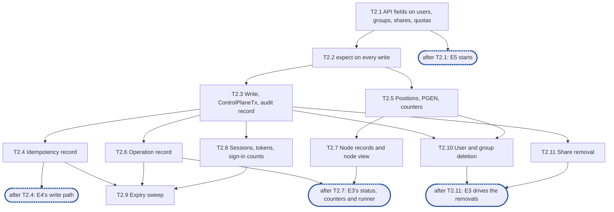

# Epic 2: control plane v2 — store records

**Sources:** [RFC 16](../rfcs/rfc-16-metadata-store.md) §2.3 (the records for RFC 23 and their
fields), §2.3.2 (a share's removal, the store's side), §3 (`ControlPlane` with `expect`, `Write`,
`WriteMeta` and `ControlPlaneTx`), §4.2 (their keys), §4.6 and §6.3 (format and codecs);
[RFC 23](../rfcs/rfc-23-control-plane.md) §2.4 (positions, node status), §3.1's last paragraph,
§4.4 (the entity tag), §4.5 (the idempotency record and its expiry), §4.6 (the operation record and
its retention), §5.3 (the sign-in counts' expiry), §6 (append-only, retention), and §10's CP5,
CP6, CP11 and CP12 on the store's side.
**Track:** C.
**Epic 2 estimate: 11 subtasks, 26 man-days.**
**Depends on:** S1 (E1 merged): v1 deleted, so nothing but v2 calls kvstore's view. The RFC 13
plan's epic 1, if it lands first, gives the settings view's delete and the secrets view (D4).
**Blocks:** E5, which starts on T2.1's user fields and builds on T2.8; E4's write path (T2.3, T2.4)
and its reads of operations, audit and node status; E3's node status, counters, runner and the
removals it drives (T2.5–T2.7, T2.10, T2.11); the RFC 13 plan's epics 2 and 4, partly, which write
the `Node` record and commit secrets with `tx.PutSecret`; the RFC 18 plan's epics 2 and 3, which
raise and read the principals generation.

---

## 1. Goal

The metadata store gains every record and field RFC 16 declares for RFC 23, the one transaction an
API write commits in, the expiry of what expires, and a user's, a group's and a share's removal
past the mark, each resumable from its record.

**At the end of the epic:**

- every write of kvstore's `ControlPlane` view takes `expect` and checks it inside its transaction;
- `ControlPlane.Write(ctx, meta, fn)` commits a request's writes with its audit record and its
  idempotency record, or none of them, and replays a recorded answer;
- the operation, idempotency, session, API-token, sign-in-failure, audit, node and node-status
  records exist with their keys, codecs, golden vectors and fuzz targets;
- settings, shares and principals carry their position, and the principals generation exists;
- one sweep deletes, in bounded batches, every record whose expiry has passed and every audit
  record past its retention;
- a user's, a group's and a share's removal runs past the mark in bounded batches, each resumed
  from its record after a restart;
- kvstore's conformance suite covers all of it on Badger, on disk under `t.TempDir()` and in
  memory.

### 1.1 In scope

The view's signatures with `expect`, `DeleteGrant`, `Write`, `WriteMeta` and `ControlPlaneTx`; the
fields RFC 16 adds to `User`, `Group`, `Share` and `Quota`; positions and the principals
generation; the management API's records and their keys; the node and node-status records and the
store's node view; the expiry sweep; the store's side of a user's, a group's and a share's removal.

### 1.2 Out of scope

- Driving the removals and the sweep: E3 runs their batches on its clock, resumes them at start and
  takes the share's binding through RFC 16 §2.3.2's step 3 (engine, filesystem, open state).
- What the API decides around a write: decoding, roles, `If-Match` to `expect`, the problem table,
  `audit_records_total` (D5), which audit records a refusal writes (E4, E5).
- Sign-in's counting rules, its settle and takeback against the `Nonce`, and the break-glass
  reset's clearing of every source's count in bounded batches (E5, their first consumer).
- The active-version refusal inside the node's registration (RFC 13 §5.5): the RFC 13 plan's
  epic 2 adds it to T2.7's call.
- `Alloc`'s allocation, `Minter` and the uid, gid and RID counters: the RFC 18 plan's epic 2
  (D2 declares the type).
- `User.Password` and `User.NTHash`, the rename of `User.Secret`: the RFC 18 plan's epic 2.
- The secrets view's bodies (`Secret`, `PutSecret`, `PruneSecret`) and the settings view's delete:
  the RFC 13 plan (D4); this epic puts their transaction forms on `ControlPlaneTx` if they land
  first.
- `AuditCursor` and `AdvanceCursor`: they wait with the event streams, a row of
  [the deferral ledger](rfc-23-control-plane-plan.md#61-deferral-ledger).
- RFC 16 §2.3.2's step 7, a namespace's drain: GC's, a row of
  [the deferral ledger](rfc-23-control-plane-plan.md#61-deferral-ledger), pending the user's answer
  (D9).
- The claim generation (`CGEN`): it comes with RFC 27's `Claim`, a row of
  [the deferral ledger](rfc-23-control-plane-plan.md#61-deferral-ledger); T2.5's counters read it
  as zero while it is absent.

### 1.3 Names used here

- **E1**, epic 1, delete v1 and declare the surface: deleted v1 and froze the node's surface and
  the shared wire types.
- **E2**, this epic.
- **E3**, epic 3, the node: `node.New`, reconcile, the node-status writer, the operation runner,
  and the driving of removals and of the sweep.
- **E4**, epic 4, the management API: the write path over `Write`, the routes and their reads.
- **E5**, epic 5, accounts and sign-in: sessions, tokens, throttling, roles, `dfs init`.
- **S0**, the RFC 13 plan's starting point: E1's deletion has merged.
- **S1**, E1 merged: v1 gone and the surface frozen.

## 2. How the general rules apply

The rules are those of
[RFC 23's plan, §1.5](rfc-23-control-plane-plan.md#15-general-rules-for-each-epic), cited by number
and title and not copied.

| Rule | Subtasks | How |
| --- | --- | --- |
| rule 1, independent unit tests ([`CLAUDE.md`, "Writing tests"](../../../CLAUDE.md#writing-tests)) | all | every behaviour is a case of kvstore's conformance suite (`kvstoretest`), run over Badger on disk under `t.TempDir()` and in memory; faults come from `kv/kvtest`'s `FaultKV` (kind 3), store time from `badgerkv.Options.Clock` (kind 1). No other double |
| rule 2, fuzz every decoder of untrusted bytes | T2.1, T2.3, T2.4, T2.6–T2.8 | one fuzz target per new or changed record codec, beside `FuzzLifecycleValues`: a value either decodes and re-encodes to bytes that decode to the same value, or fails with a named error |
| rule 3, observability follows RFC 25 | none | kvstore exports no series (D5): the API counts `audit_records_total` after `Write` returns, and the sweep returns its counts for the node to export |
| rule 4, profiling | none | no node or API test runs here; the leak check joins with E3's harness |
| rule 5, public interface and internals ([`CLAUDE.md`, "Verifying a change"](../../../CLAUDE.md#verifying-a-change)) | all | the suite reaches the store through the view only, never a key, as RFC 16 §6.1 says; layout is held by golden vectors (RFC 16 §6.3) |
| rule 6, known failures shrink | none | no test lands red and no suite here keeps a `known.yaml` |
| rule 7, v2 ignores v1 | none | v1 is gone at S1; nothing here reads it |
| rule 8, real dependencies for properties of those dependencies | T2.3, T2.4, T2.10, T2.11 | the all-or-nothing commit runs on Badger on disk with the commit faulted; a resumed removal restarts the store over the same Badger directory |
| rule 9, code comment conventions ([`CLAUDE.md`, "Code comments"](../../../CLAUDE.md#code-comments)) | T2.1, T2.9, T2.10, T2.11 | D1's `decision:` at the store format, D8's at the secrets a deleted user names, D6's and D9's `ponytail:` at the sweep and at the removal's steps 2 and 7 |
| rule 10, a test must be able to fail | all | each test names the requirement it breaks on; golden vectors fail on a changed byte, the fault tests on a half commit |
| rule 11, a symbol is exported only if RFC 23's interface uses it | all | the exported additions are RFC 16 §3's view methods, `Write`, `WriteMeta`, `ControlPlaneTx`, the records' fields and the errors they return, and the node view's calls E3 and the RFC 13 plan make |
| rule 12, each subtask creates only what it declares | all | each method lands with its conformance case; a read whose consumer is E3, E4 or E5 is named with that consumer in its Deliverables |

## 3. Requirements and invariants

Every obligation RFC 16 and RFC 23 place on this epic, numbered so that subtasks and tests can cite
them.

**Records and fields**

| # | Requirement | Kind | Source | Subtasks |
| --- | --- | --- | --- | --- |
| R1 | A `User` carries `Role` (none, viewer, operator, admin), `NotBefore` (store time, whole seconds) and `MustChange`, the management API's fields, which grant nothing on files | MUST | RFC 16 §2.3; RFC 23 §5.1, §5.3 | T2.1 |
| R2 | A `User`, a `Group` and a `Share` carry `Generation`, raised by every `PutUser`, `PutGroup` and `PutShare`; a share's is `S‖id‖info`'s, not its state's or its namespaces' | MUST | RFC 16 §2.3, §3 | T2.1, T2.2 |
| R3 | A grant, an export policy, a netgroup and a quota are versioned, and their version is what their write takes as `expect` | MUST | RFC 16 §3; RFC 23 §4.4; RFC 23 plan A4 | T2.1, T2.2 |
| R4 | An `Operation` holds `ID`, `Kind`, `Target`, `Account`, `State`, `Claim`, `Step`, `Params`, `Started`, `Updated`, `Error` and `Result`; `Progress` is not stored, and `Params` never holds a credential | MUST | RFC 16 §2.3; RFC 23 §4.6 | T2.6 |
| R5 | An `IdempotencyRecord` holds the `Account`, the `Key`, the `Digest` of method, path and body, the `Answer` first given and `Expires`, 24 h after the request | MUST | RFC 16 §2.3; RFC 23 §4.5 | T2.4 |
| R6 | A `Session` holds the hash of its current refresh token and an `APIToken` the hash of its token, never a token | MUST NOT | RFC 16 §2.3; RFC 23 §5.3, CP11 | T2.8 |
| R7 | A `SignInFailures` holds `Count`, `Last`, and, for a source, `Failed` and `Nonce`; a `SignInKey` names an account's count, a source's or the two together | MUST | RFC 16 §2.3 | T2.8 |
| R8 | An `AuditRecord` holds the commit's store `Time`, `Actor`, `Node`, `Source`, `Request`, `Target`, `Before` and `After`, `Change` and `Outcome` | MUST | RFC 16 §2.3; RFC 23 §6 | T2.3 |
| R9 | A `Node` holds its `Address`, `Roles`, `Binary`, `Domain`, `Epoch`, raised at every start on a single node, `Formats` and `Lapsed` | MUST | RFC 16 §2.3; RFC 23 §3.1 | T2.7 |
| R10 | A `NodeStatus` holds the settings generation, share list version, principals generation and claim generation the node reconciled through, its refused records with their generation and error, its restart-pending set, the version of each secret it holds and its conditions, and is written only by its node | MUST | RFC 16 §2.3, §4.2 (`N‖node‖st`); RFC 23 §2.4 | T2.7 |

**Keys, codecs and format**

| # | Requirement | Kind | Source | Subtasks |
| --- | --- | --- | --- | --- |
| R11 | Each record has the key RFC 16 §4.2 gives it: `OP‖opID`, `OPR‖kind‖target`, `IK‖account‖key`, `XP‖expiry‖tagged`, `SS‖session`, `SSH‖hash`, `SS‖session‖h‖hash`, `SF‖tagged`, `AT‖tokenID`, `ATH‖hash`, `ATA‖principal‖tokenID`, `AU‖time‖auditID`, `AUX‖tagged‖time‖auditID`, `N‖node`, `N‖node‖st`, `PGEN` | MUST | RFC 16 §4.2; RFC 23 §3.1 | T2.3–T2.8 |
| R12 | Each codec version has golden bytes for fixed values, and each new key row a golden key; a change that alters either without a version or format bump fails | test row | RFC 16 §6.3 | T2.1, T2.3–T2.8 |
| R13 | Decoding a newer version, a truncated value or a trailing byte fails with a named error, never a zero value | MUST | RFC 16 §6.3 | T2.1, T2.3–T2.8 |
| R14 | A new record kind is a format bump: format *n* names the codec versions a binary may write, so no value is written that an older reader of format *n* cannot decode | MUST | RFC 16 §4.6 | T2.1 |

**The write path**

| # | Requirement | Kind | Source | Subtasks |
| --- | --- | --- | --- | --- |
| R15 | Every `Put*`, `Set*` and `Delete*` of the view takes `expect`, reads the record with conflict tracking, refuses `ErrGenerationMismatch` when the stored generation or version differs, and raises it; zero expects the record absent, so the write is create-only | MUST | RFC 16 §3; RFC 23 §4.4, CP5 | T2.2 |
| R16 | A grant is deleted by `DeleteGrant`, which deletes the grant and its `GR` key and sets `S‖id‖gv` to the writing commit's version | MUST | RFC 16 §3 | T2.2 |
| R17 | Every control-plane write that names a share — `PutShare`, `SetShareState`, `SetGrant`, `DeleteGrant`, `PutExportPolicy`, a share-scoped `PutSetting` — reads `S‖id‖st` with tracking and refuses a share being removed or retired with `ErrStale` | MUST | RFC 16 §2.3.2 (step 1) | T2.2 |
| R18 | `Write` runs `fn` over a `ControlPlaneTx`, which carries the view's writes without their `ctx`, each checking its `expect`, and the tracked reads `Setting`, `User`, `Share` and `SignInFailures`; a deletion's transaction form is its mark | MUST | RFC 16 §3 | T2.3, T2.8 |
| R19 | `Write` writes `meta`'s `AuditRecord` and, when `meta` names a key, its `IdempotencyRecord`, after `fn` returns, so `fn` may complete the audit record's `After` and `Outcome` and the idempotency record's `Answer`; the change and both records commit together or none of them | MUST | RFC 16 §3; RFC 23 §4.3, §6, CP12 | T2.3, T2.4 |
| R20 | A transaction conflict retries the whole transaction, the key's read included, bounded by the call's deadline with randomised backoff, so `fn` holds no state between calls and what commits is the attempt that committed | MUST | RFC 16 §3 | T2.3 |
| R21 | An `expect` that does not match returns `ErrGenerationMismatch` through `fn`, commits nothing and is not retried | MUST | RFC 16 §3 | T2.3 |
| R22 | The view's methods stay, each one `Write` with no audit | MUST | RFC 16 §3 | T2.3 |
| R23 | Before `fn`, `Write` reads the key's record with conflict tracking: one with the same digest returns `ErrIdempotentReplay` carrying the recorded answer and `fn` does not run; one with another digest returns `ErrIdempotencyMismatch`; two requests that both miss the record conflict on its key | MUST | RFC 16 §3; RFC 23 §4.5, CP6 | T2.4 |
| R24 | An idempotency record is scoped to its account and key and kept 24 h, then deleted | MUST | RFC 23 §4.5; RFC 16 §4.2 (`IK`) | T2.4, T2.9 |
| R25 | An audit record is append-only: never rewritten, deleted only past `audit.retention`, in bounded batches | MUST | RFC 23 §6, CP12; RFC 16 §4.2 (`AU`) | T2.3, T2.9 |
| R26 | Audit records sit in store-time order, with one index row per record for each of its actor, its target and its taking node, so the reads RFC 23 §6 filters by are ranges | MUST | RFC 16 §4.2 (`AU`, `AUX`); RFC 23 §6 | T2.3 |

**Positions and counters**

| # | Requirement | Kind | Source | Subtasks |
| --- | --- | --- | --- | --- |
| R27 | Every record of a reconciled kind — a setting, a share, a principal — carries its position, the value its last change raised its kind's counter to (`CFGGEN`, `SL`, `PGEN`), written in that change's transaction; a grant, an export policy, a netgroup and a quota carry none | MUST | RFC 23 §2.4; RFC 16 §3; RFC 23 plan A4 | T2.5 |
| R28 | `PGEN` is raised in the transaction of every `User`, `Group` or `Membership` write and of every `PX‖` row written or deleted | MUST | RFC 16 §4.2 (`PGEN`) | T2.5 |

**Operations**

| # | Requirement | Kind | Source | Subtasks |
| --- | --- | --- | --- | --- |
| R29 | One operation runs per target and kind: the running index is written when an operation starts and deleted when it ends, so a second request for the same work finds it in one read and is refused | MUST | RFC 23 §4.6; RFC 16 §4.2 (`OPR`) | T2.6 |
| R30 | A finished operation is kept 7 days after it ends, then deleted | MUST | RFC 23 §4.6; RFC 16 §4.2 (`OP`) | T2.6, T2.9 |
| R31 | Every operation's state change, a deletion's end included, goes through `Write` with its audit | MUST | RFC 16 §3; RFC 23 §6 | T2.6 |

**Sessions, tokens and sign-in counts**

| # | Requirement | Kind | Source | Subtasks |
| --- | --- | --- | --- | --- |
| R32 | A session's refresh-token index holds its current hash and every hash it replaced until the session expires, each with a reverse row under the session, so the expiry sweep deletes a session's index rows by one range of its own, never a scan of the index | MUST | RFC 16 §4.2 (`SS`, `SSH`) | T2.8, T2.9 |
| R33 | An API token's record, its hash index and its per-account index are written together and deleted together by the expiry sweep | MUST | RFC 16 §4.2 (`AT`, `ATH`, `ATA`) | T2.8, T2.9 |
| R34 | A sign-in's counts are read tracked and raised in the attempt's own transaction, through `ControlPlaneTx`'s `SignInFailures` and `PutSignInFailures`, which writes the count's row and, where the count expires, its `XP` row | MUST | RFC 16 §3, §4.2 (`SF`) | T2.8 |
| R35 | A pair's count is deleted 24 h after its `Last`, a source's 15 min after its `Failed`, each with its `XP` row, which moves when that time moves; an account's count does not expire | MUST | RFC 23 §5.3; RFC 16 §2.3, §4.2 (`SF`) | T2.8, T2.9 |

**Expiry**

| # | Requirement | Kind | Source | Subtasks |
| --- | --- | --- | --- | --- |
| R36 | Every record that expires has one empty `XP‖expiry‖tagged` key, written and deleted with it, so the sweep is one ordered scan | MUST | RFC 16 §4.2 (`XP`) | T2.4, T2.6, T2.8, T2.9 |
| R37 | One sweep deletes every expiring record in bounded batches, each retention passed in by its caller | invariant | RFC 23 plan §4.3 | T2.9 |

**Nodes**

| # | Requirement | Kind | Source | Subtasks |
| --- | --- | --- | --- | --- |
| R38 | A node registers at each start, and its node-status record is written by that node through its own view, never through `ControlPlane` | MUST | RFC 23 §3.1, §2.4; RFC 16 §2.3, §3 | T2.7 |

**Deletions past the mark**

| # | Requirement | Kind | Source | Subtasks |
| --- | --- | --- | --- | --- |
| R39 | A user's or a group's deletion deletes its name and protocol-ID indexes and marks the record deleted in its first transaction; bounded batches a restart resumes from that mark drop its grants (through `GR`), memberships (`M`, `MR`) and quota records; the last transaction deletes the record, a user's with every version of the secret it names | MUST | RFC 16 §3 | T2.10 |
| R40 | A marked user is admitted nowhere; a membership of a marked group grants nothing, and a `User.Primary` naming one counts as zero | MUST | RFC 16 §3 | T2.10 |
| R41 | A share's removal runs its steps in order after the mark, each idempotent and recorded in `S‖id‖st`, and each shard's in its `SH‖shard‖rm` row, so a crash resumes it where its record says it stopped | MUST | RFC 16 §2.3.2 | T2.11 |
| R42 | `st` moves to the forget phase only in a batch that finds every shard's `rm` row at offloaded or later, and past step 4 only in the batch that finds the last shard done, each batch reading its shards and rows with tracking and recording its cursor in `st` | MUST | RFC 16 §2.3.2 | T2.11 |
| R43 | Step 4 drops every file of a shard in bounded batches through RFC 6 §6.2's batched removal, metadata transactions alone, each file's removal at one above the share's version floor; it is not a range drop | MUST | RFC 16 §2.3.2 (step 4) | T2.11 |
| R44 | Step 5 deletes the server-wide rows that name the share: its grants and their `GR` keys, its share-scoped settings, raising `CFGGEN` in the same transaction, any secret only those settings referenced, each client's `CL‖client‖sh‖shard` for its shards and any `MV` record | MUST | RFC 16 §2.3.2 (step 5) | T2.11 |
| R45 | Step 6 deletes every `S‖id‖*` record but `st`, then the shards' records with their rows; the root's shard record goes last, in one transaction with `st` and `nsg`, which raises `SL` | MUST | RFC 16 §2.3.2 (step 6) | T2.11 |
| R46 | A share's `ShareID` and journal tag are never reused | invariant | RFC 16 §2.3.2 (step 6) | T2.11 |

## 4. Decisions this epic takes

- **D1, this epic's record kinds join store format 1, pending the user's answer (§9).** RFC 16 §4.6
  makes a new record kind a format bump (R14), so that no value is written that an older reader of
  the format cannot decode. Format 1 has no reader outside `feat/storage-v2` yet: no release has
  created a store, installs are fresh (RFC 23's plan, "Transition policy"), and kvstore's
  `maxFormat` is still 1 although `MKP`, `JD` and `SEC` joined it the same way. So the new kinds
  join format 1, and the bump rule binds from the first release that creates a store. A
  `decision:` marker at `maxFormat` says so, and that the first such release freezes format 1 (the
  golden vectors of R12 then hold it). The alternative is format 2 with its gate, for a format
  nobody has written. Prior art: none needed.
- **D2, `ControlPlaneTx` and `WriteMeta` live in `pkg/metadata/entity`, and `entity.Alloc` is
  declared here, pending the user's answer on `Alloc` (§9).** The place is E1's D3: kvstore and the
  API both import `entity`, and the root `pkg/metadata` is still v1's `Service`, which the engine's
  import rule refuses in kvstore's closure. `PutUser(ctx, u, expect, a Alloc)` and `PutGroup` take
  `Alloc` from this epic on, so the RFC 18 plan's `Minter` changes no signature; until its uid, gid
  and RID counters land, an `Alloc` naming any ID is refused `ErrInvalid`, which is RFC 16's answer
  for an ID it cannot allocate. The alternative leaves `Alloc` to the RFC 18 plan, and every caller
  of the two writes is edited twice. Prior art: `pgx`'s `BeginFunc`, a transaction handed to a
  closure (from memory).
- **D3, every write is a function of a transaction, and the view's method wraps it.** Each write
  today opens its own `kv.Update`. This epic moves its body into an unexported function of a
  `kv.Txn` and its arguments; `ControlPlaneTx`'s method calls that function on `Write`'s
  transaction, and the view's method is one `Write` with no audit (R22). One body per write, so the
  checks of R15 and R17 cannot differ between the two forms. No marker. Prior art: the same shape
  as `database/sql`'s `Tx` beside `DB` (from memory).
- **D4, the RFC 13 plan's view changes and this epic's meet by "whoever lands second adds the
  transaction form".** The RFC 13 plan's epic 1 declares the settings view's delete and the secrets
  view at its S0, before S1, so it normally lands first, with `expect` on its own new writes as RFC
  16 §3 gives them. T2.2 then adds `expect` to every write that has none, `PutSetting` among them,
  and T2.3 puts `DeleteSetting`, `PutSecret` and `PruneSecret` on `ControlPlaneTx` as well. If this
  epic lands first, the RFC 13 plan adds its writes to `ControlPlaneTx` in the change that adds
  them to the view. Neither waits for the other. No marker. Prior art: none needed.
- **D5, kvstore exports no series.** RFC 23's plan's rule 3 gives the store `audit_records_total`.
  The store has no metrics today, and the count that matters is of committed records, which the
  caller knows when `Write` returns. So the API counts it (E4), and the sweep returns how many
  records of each kind it deleted, for the node to export as
  `api_idempotency_records_deleted_total` (E3). RFC 23's plan's rule 3 is amended in the same pull
  request. No marker. Prior art: none needed.
- **D6, expiry is written, not computed by the sweep.** Each expiring record's `XP` key carries its
  own expiry, computed when the record is written: 24 h for an idempotency record, 7 days after an
  operation ends, 15 min after a source's `Failed`, 24 h after a pair's `Last`, a session's and a
  token's `Expires`. The sweep then deletes every `XP` entry at or before the store time, without
  knowing any retention but the audit's, which has no `XP` row (`AU` is time-ordered). One
  `Sweep(ctx, auditRetention)` call is one bounded batch; E3 calls it on its clock. A `ponytail:`
  at `Sweep` names its ceiling, one pass per kind per interval, and its upgrade, per-kind
  schedules once a profile shows the sweep. Prior art: Redis'
  sorted-set expiry index (from memory).
- **D7, the node's records have their own view.** RFC 16 says `NodeStatus` is not `ControlPlane`'s:
  every node writes its own through the node view. So `Store.Nodes()` gives `Nodes`, with
  `RegisterNode`, `Node`, `PutNodeStatus`, `NodeStatuses` and `Counters`, what RFC 23 §2.1's
  `Records` names, minus `List`, which `ControlPlane`'s listings already serve. No marker. Prior
  art: none needed.
- **D8, a deleted user's secrets are deleted by the reference its record holds.** RFC 16 has the
  last batch delete every version of the secret the user names "through RFC 13 §7", whose `Delete`
  checks the kind and owner. Here the reference comes from the owner's own record, so the check
  holds by construction, and the last batch deletes `SEC‖ref‖*` in its own transaction without
  calling `pkg/secrets`, which kvstore must not import. A `decision:` marker says so, and that a
  reference read from anywhere but the owner's record goes through `pkg/secrets`. Prior art: none
  needed.
- **D9, the removal runs steps 1 to 6; step 2 has nothing to do and step 7 waits for GC, pending
  the user's answer on step 7 (§9).** No snapshot record exists until RFC 12 lands, so step 2 reads
  `S‖id‖snap‖` and finds nothing, and `detach` ends as `delete` does; a `ponytail:` at step 2 says
  so and names RFC 12. Step 7 runs RFC 9 §7.6's drain gate, which GC owns and which no code has
  yet; a drain mark nothing reads would be a record with no consumer. So step 6's last transaction
  writes no drain mark, a `ponytail:` says why, and a deferral-ledger row hands the drain to RFC
  9's plan: GC's drain finds a namespace no share names by reading the shares' `nsg` records, as
  RFC 9 §7.6 states it, so a namespace removed before GC lands is found then and nothing migrates.
- **D10, step 4 uses the release path a file already has.** `release.go` drops an unlinked file's
  refs in bounded batches through RFC 6 §6.2's removal; step 4 starts that release for each file
  of the shard, in batches of K files, and lets it run. No new ref-removal code. No marker.
- **D11, the records' codecs live in kvstore.** Every codec today is kvstore's (`codecs.go`,
  `filecodecs.go`, `opencodecs.go`); `entity` holds the fields. The new codecs join `codecs.go`'s
  pattern, with their golden vectors in `codecs_test.go`. RFC 23's plan's §4.1 is corrected to
  match. No marker.
- **D12, `User.Email` lands here with the other API fields, pending the user's answer (§9).** Both
  RFC 23's plan's epic 2 and the RFC 18 plan's epic 2 list it. T2.1 changes the user codec for
  `Role`, `NotBefore` and `MustChange`; adding `Email` in the same version costs nothing, and E4's
  user resource serves it. The RFC 18 plan's epic 2 then drops it from its list, an edit this
  document's pull request makes once the user agrees.

## 5. Target tree

```text
pkg/metadata/entity/
  control.go          T2.1  User: Role, NotBefore, MustChange, Email, Generation; Group, Share:
                            Generation; Quota: Version; APIRole; Position on Setting, Share, User,
                            Group (T2.5)
  api.go              T2.3  AuditRecord, IdempotencyRecord (T2.4), Operation, OpState, OpClaim
                            (T2.6), Session, APIToken, SignInFailures, SignInKey (T2.8)
  write.go            T2.3  WriteMeta, ControlPlaneTx; Alloc (T2.2, D2)
  node.go             T2.7  Node, NodeStatus, RefusedRecord, RecordRef, SecretVersion, Roles
pkg/metadata/errors/  T2.2  ErrGenerationMismatch; ErrIdempotentReplay, ErrIdempotencyMismatch
                            (T2.4); ErrOperationRunning (T2.6)
pkg/metadata/kv/keys/ T2.3  kinds OP, OPR, IK, XP, SS, SSH, SF, AT, ATH, ATA, AU, AUX, PGEN
pkg/metadata/kvstore/
  users.go shares.go settings.go quota.go shareremove.go   T2.2  expect on every write, tx forms
  write.go            T2.3  Write, the ControlPlaneTx over kv.Txn; idempotency (T2.4)
  audit.go            T2.3  AU, AUX rows, AuditRecords read
  positions.go        T2.5  PGEN, positions, Counters
  operations.go       T2.6  OP, OPR, PutOperation, Operation, Operations
  nodes.go            T2.7  Nodes view
  sessions.go         T2.8  SS, SSH, AT, ATH, ATA, SF
  sweep.go            T2.9  Sweep
  principaldelete.go  T2.10 a user's and a group's deletion past the mark
  shareremove.go      T2.11 a share's removal, steps 2 to 6
  codecs.go           T2.1, T2.3–T2.8  the new codecs
  codecs_test.go      T2.1, T2.3–T2.8  golden vectors, refusal cases
  codecs_fuzz_test.go T2.1, T2.3–T2.8  one fuzz target per codec
  store.go            T2.1  D1's decision marker at maxFormat
pkg/metadata/kvstore/kvstoretest/
  controlplane.go     T2.1–T2.11  the conformance cases below
```

## 6. Subtasks

### T2.1 The API's fields on users, groups, shares and quotas

**Subtask T2.1 estimate: 1.5 man-days.**

- **Track:** C. **Depends on:** nothing.
- **Covers:** R1, R2, R3, R12, R13, R14.
- **Deliverables:** in `entity`: `User.Role APIRole`, `User.NotBefore time.Time`,
  `User.MustChange bool`, `User.Email string` (D12), `User.Generation`, `Group.Generation`,
  `Share.Generation`, `Quota.Version`; `type APIRole uint8` with none, viewer, operator, admin. The
  user, group, share-info and quota codecs gain a version carrying them; the old version still
  decodes. D1's `decision:` marker at `maxFormat`. Consumed by T2.2, which raises the generations,
  and by E5, which starts on the user fields.
- **Acceptance criteria:**
  - A user written with every new field reads back with each; one written by the old codec reads
    with the new fields zero.
  - `NotBefore` round-trips at whole seconds.
- **Tests:** golden vectors for each new codec version, and the old version's kept (catches a
  changed byte, R12); a truncated value, a trailing byte and a newer version each refused by name
  (R13); a fuzz target per changed codec (rule 2). The conformance case writes and reads every new
  field through the view (catches a field the codec drops, R1–R3). No double.

### T2.2 `expect` on every write

**Subtask T2.2 estimate: 3 man-days.**

- **Track:** C. **Depends on:** T2.1.
- **Covers:** R2, R3, R15, R16, R17.
- **Deliverables:** `expect uint64` on `PutUser`, `PutGroup`, `DeleteUser`, `DeleteGroup`,
  `PutShare`, `DeleteShare`, `SetGrant`, `PutExportPolicy`, `SetQuota`, `PutNetgroup`,
  `DeleteNetgroup` and `PutSetting`, and `Alloc` on `PutUser` and `PutGroup` (D2); `RemoveGrant`
  renamed `DeleteGrant(ctx, share, p, expect)`; `merrs.ErrGenerationMismatch`. Every body moved into
  an unexported function of a `kv.Txn` (D3); every share-naming write reads `S‖id‖st` tracked
  (R17). Every caller on `feat/storage-v2` updated, the tests of `internal/vfs` and
  `pkg/block/engine` among them (38 files), each passing the generation it read or zero to create.
  Consumed by T2.3, which runs the same functions inside `Write`.
- **Acceptance criteria:**
  - A write with the stored generation commits and raises it; with another, `ErrGenerationMismatch`
    and nothing written; with zero on an existing record, `ErrGenerationMismatch`.
  - `DeleteGrant` removes the grant and its reverse key and moves `S‖id‖gv`.
  - A write naming a share being removed is `ErrStale`.
- **Tests:** at kvstore's conformance suite, over each write: a stale `expect` refused with nothing
  changed, a create-only write refused over an existing record, two writes from one read where the
  second is refused (catches a check outside the transaction, R15, CP5); `DeleteGrant` then a
  principal's access read through its groups (R16); each share-naming write against a removed share
  (R17). An `Alloc` naming an ID refused `ErrInvalid` (D2). No double.

### T2.3 `Write`, `ControlPlaneTx` and the audit record

**Subtask T2.3 estimate: 4 man-days.**

- **Track:** C. **Depends on:** T2.2.
- **Covers:** R8, R11, R12, R13, R18, R19, R20, R21, R22, R25, R26.
- **Deliverables:**
  ```go
  // in entity (D2)
  type WriteMeta struct {
  	Audit       *AuditRecord
  	Idempotency *IdempotencyRecord
  }
  type ControlPlaneTx interface {
  	Setting(scope SettingScope, key string) (Setting, bool, error)
  	User(p Principal) (User, bool, error)
  	Share(id ShareID) (Share, bool, error)
  	DeleteUser(p Principal, expect uint64) error // the mark
  	DeleteGroup(p Principal, expect uint64) error
  	DeleteShare(share ShareID, snapshots SnapshotDisposition, expect uint64) error
  	PutUser(u User, expect uint64, a Alloc) error
  	PutGroup(g Group, expect uint64, a Alloc) error
  	PutShare(s Share, expect uint64) error
  	SetShareState(share ShareID, from, to ShareState) error
  	SetGrant(g ShareGrant, expect uint64) error
  	DeleteGrant(share ShareID, p Principal, expect uint64) error
  	PutExportPolicy(p ExportPolicy, expect uint64) error
  	SetQuota(share ShareID, q Quota, expect uint64) error
  	PutNetgroup(n Netgroup, expect uint64) error
  	DeleteNetgroup(name string, expect uint64) error
  	PutSetting(s Setting, expect uint64) error
  	AddMember(m Membership) error
  	RemoveMember(m Membership) error
  	// and the RFC 13 plan's DeleteSetting, PutSecret and PruneSecret once they exist (D4)
  }

  // in kvstore
  func (c ControlPlane) Write(ctx context.Context, meta entity.WriteMeta, fn func(tx entity.ControlPlaneTx) error) error
  func (c ControlPlane) AuditRecords(ctx context.Context, f AuditFilter, after []byte) iter.Seq2[entity.AuditRecord, error]
  ```
  `entity.AuditRecord` with R8's fields; the `AU` and `AUX` kinds and their codec; the audit record
  written insert-only, its `Time` the transaction's store time. `AuditRecords` reads one time range,
  narrowed by actor or target through `AUX`, consumed by E4's audit route. The view's methods
  become one `Write` with no audit each (R22). Consumed by T2.4, which adds the idempotency record,
  by E4's write path and E5's sign-in.
- **Acceptance criteria:**
  - A `Write` whose `fn` writes and whose `meta` carries an audit record commits both, or, faulted,
    neither.
  - `fn` setting `meta.Audit.After` and `Outcome` is what the stored record holds.
  - A `Write` whose `fn` returns `ErrGenerationMismatch` commits nothing and runs `fn` once.
  - Writing an audit record whose key exists is refused, so none is rewritten.
- **Tests:**
  - all-or-nothing, on Badger on disk, the commit faulted through `FaultKV`: assert neither the
    change nor the audit record is there (catches a second transaction, R19, CP12; rule 8);
  - a conflict injected on the first attempt: `fn` runs twice, and the stored audit record carries
    what the second run set, not the first (catches state kept between attempts, R20);
  - a mismatch is not retried: `fn`'s call count is one (R21);
  - an audit read by actor, by target and by time range returns exactly the records written, in
    store-time order (R26); a second write of an existing audit key refused (R25);
  - a view method writes no audit record (R22);
  - golden vectors and refusal cases for the audit codec and the `AU`, `AUX` keys (R12, R13); its
    fuzz target (rule 2).

### T2.4 The idempotency record in `Write`

**Subtask T2.4 estimate: 1.5 man-days.**

- **Track:** C. **Depends on:** T2.3.
- **Covers:** R5, R11, R12, R13, R19, R23, R24, R36.
- **Deliverables:** `entity.IdempotencyRecord` with R5's fields; the `IK` kind and its `XP` row (tag
  0x01), expiring 24 h after the request (D6); `Write` reads the key's record tracked before `fn`;
  `merrs.ErrIdempotentReplay`, carrying the recorded answer, and `merrs.ErrIdempotencyMismatch`.
  Consumed by E4's write path, which hands `Write` the key and digest and answers a replay.
- **Acceptance criteria:**
  - A second `Write` with the same key and digest returns the first answer and does not run `fn`;
    with another digest, `ErrIdempotencyMismatch`.
  - A `Write` whose `fn` fails records no idempotency record.
- **Tests:** at kvstore's conformance suite: the replay, the mismatch, and a refused `fn` leaving
  the key free (R23, CP6); two concurrent `Write`s with one key on two goroutines, both missing the
  record, exactly one committing and the other replaying its answer (catches an untracked read,
  R23); the record and its `XP` row written together (R36); `fn` setting the answer after its
  writes, and the stored answer being that one (R19); golden vectors, refusal cases and a fuzz
  target for the codec (R12, R13, rule 2). No double.

### T2.5 Positions, the principals generation and the counters

**Subtask T2.5 estimate: 1.5 man-days.**

- **Track:** C. **Depends on:** T2.2.
- **Covers:** R11, R27, R28.
- **Deliverables:** `Position uint64` on `Setting`, `Share`, `User` and `Group`, each written with
  the value its write raised its counter to; the `PGEN` kind, raised by every user, group and
  membership write and every `PX‖` row change; `Nodes.Counters(ctx) (Counters, error)`, reading
  `CFGGEN`, `SL`, `PGEN` and, while it is absent, a claim generation of zero. Consumed by E3's
  reconcile and the RFC 18 plan's epics 2 and 3.
- **Acceptance criteria:**
  - After a share write, the share's position equals `SL`'s value; after a user write, `PGEN`'s.
  - A grant, an export-policy, a netgroup or a quota write moves no counter.
- **Tests:** at kvstore's conformance suite: each reconciled kind's write, its record's position
  read back against `Counters` (catches a position written outside the change's transaction, R27);
  every principal write and a `PX‖` change each raising `PGEN` once (catches a missed raise, R28);
  the four versioned kinds raising none (R27). No double.

### T2.6 The operation record

**Subtask T2.6 estimate: 2 man-days.**

- **Track:** C. **Depends on:** T2.3.
- **Covers:** R4, R11, R12, R13, R29, R30, R31, R36.
- **Deliverables:** `entity.Operation`, `OpState`, `OpClaim` with R4's fields; the `OP` and `OPR`
  kinds; `PutOperation(ctx, op, expect)` on the view and on `ControlPlaneTx`, which writes the
  running index at start, deletes it and writes the `XP` row (tag 0x02, 7 days after the end) at
  the end, and refuses a second operation of one kind on one target with
  `merrs.ErrOperationRunning`; `Operation(ctx, id)`, `Operations(ctx, after)` and
  `RunningOperation(ctx, kind, target)`. Consumed by E3's runner and E4's operation
  routes.
- **Acceptance criteria:**
  - Starting a second operation of one kind on one target is refused while the first runs, and
    accepted once it has ended.
  - An ended operation has an `XP` row 7 days after its end; a running one has none.
- **Tests:** at kvstore's conformance suite: the refusal and its end (R29); the `XP` row's presence
  by state (R30, R36); a state change through `Write` with its audit record committed in the same
  transaction (R31); golden vectors, refusal cases and a fuzz target (R12, R13, rule 2). No double.

### T2.7 The node records and the node view

**Subtask T2.7 estimate: 2 man-days.**

- **Track:** C. **Depends on:** T2.5.
- **Covers:** R9, R10, R11, R12, R13, R38.
- **Deliverables:** `entity.Node`, `NodeStatus`, `RefusedRecord`, `RecordRef`, `SecretVersion`,
  `Roles`; `Store.Nodes() Nodes` (D7):
  ```go
  func (n Nodes) RegisterNode(ctx context.Context, node entity.Node) (entity.Node, error) // raises Epoch
  func (n Nodes) Node(ctx context.Context, id entity.NodeID) (entity.Node, bool, error)
  func (n Nodes) PutNodeStatus(ctx context.Context, s entity.NodeStatus) error
  func (n Nodes) NodeStatuses(ctx context.Context, after entity.NodeID) iter.Seq2[entity.NodeStatus, error]
  func (n Nodes) Counters(ctx context.Context) (Counters, error) // T2.5
  ```
  Consumed by E3 (registration at start, the status writer), E4 (`applied`, the node resource) and
  the RFC 13 plan (its version gate writes the ranges, its `Prune` reads the secret versions).
- **Acceptance criteria:**
  - Registering a node twice raises its epoch once per call and keeps its other fields as given.
  - A node's status reads back whole, its slices in order.
- **Tests:** at kvstore's conformance suite: registration's epoch (R9); a status round trip with
  every field set, and a listing of two nodes (R10); `ControlPlane` offers no write of a status
  (R38: the compiler, since the view has no such method); golden vectors, refusal cases and fuzz
  targets for both codecs (R12, R13, rule 2). No double.

### T2.8 Sessions, API tokens and sign-in counts

**Subtask T2.8 estimate: 3 man-days.**

- **Track:** C. **Depends on:** T2.3.
- **Covers:** R6, R7, R11, R12, R13, R18, R32, R33, R34, R35, R36.
- **Deliverables:** `entity.Session`, `APIToken`, `SignInFailures`, `SignInKey`; the `SS`, `SSH`,
  `AT`, `ATH`, `ATA` and `SF` kinds; on the view and on `ControlPlaneTx`: `PutSession`,
  `SessionByRefresh(hash)`, `PutAPIToken`, `APITokenByHash(hash)`, `APITokens(ctx, account)`,
  `DeleteAPIToken`, `SignInFailures(key)` (tracked) and `PutSignInFailures(key, f)`,
  `DeleteSignInFailures(key)`. `PutSignInFailures` writes the source's `XP` row (tag 0x04) at
  `Failed` + 15 min and the pair's (tag 0x06) at `Last` + 24 h, moving it when the time moves, and
  none for an account's (D6). Sessions (tag 0x03) and tokens (tag 0x05) expire at their `Expires`.
  Consumed by E5's sign-in, refresh, sign-out and token routes.
- **Acceptance criteria:**
  - A refresh token's hash, rotated twice, finds its session by any of the three hashes until the
    session expires.
  - Moving a source's `Failed` moves its `XP` row; moving only its `Last` does not.
- **Tests:** at kvstore's conformance suite: the refresh index and its reverse rows (R32); a token
  found by hash and listed by account, the three rows written together (R33); a count read tracked
  and raised in one `Write`, and two concurrent raises of one count where one retries (catches an
  untracked read, R34); the `XP` row's place after each kind of move (R35, R36); golden vectors,
  refusal cases and fuzz targets for the three codecs (R12, R13, rule 2). R6 is held by the types:
  neither record has a field that could hold a token. No double.

### T2.9 The expiry sweep

**Subtask T2.9 estimate: 1.5 man-days.**

- **Track:** C. **Depends on:** T2.4, T2.6, T2.8.
- **Covers:** R24, R25, R30, R32, R33, R35, R36, R37.
- **Deliverables:**
  ```go
  // Sweep deletes, in one bounded batch, every record whose XP entry is at
  // or before the store time, with its index rows, and every audit record
  // older than auditRetention, with its AUX rows.
  func (c ControlPlane) Sweep(ctx context.Context, auditRetention time.Duration) (Swept, error)
  type Swept struct{ Idempotency, Operations, Sessions, Tokens, SignIns, Audit int; More bool }
  ```
  with D6's `ponytail:` marker. Consumed by E3, which calls it on its
  clock with `audit.retention` and exports the counts (D5).
- **Acceptance criteria:**
  - With the store's clock advanced past each kind's expiry, one `Sweep` loop leaves none of that
    kind and every index row of it gone; before it, nothing is deleted.
  - A batch never deletes more than K records; `More` says whether another is due.
- **Tests:** at kvstore's conformance suite, the store's clock injected through
  `badgerkv.Options.Clock` and advanced, never slept: each kind just before and just after its
  expiry (R24, R30, R35), a session's `SSH` rows gone with it (R32), a token's three rows (R33), an
  audit record at and past the retention (R25); K + 1 records needing two calls (R37). No double.

### T2.10 A user's and a group's deletion past the mark

**Subtask T2.10 estimate: 2.5 man-days.**

- **Track:** C. **Depends on:** T2.3, T2.5.
- **Covers:** R39, R40.
- **Deliverables:** the mark as `DeleteUser`'s and `DeleteGroup`'s first transaction (their
  `ControlPlaneTx` form, T2.3); `ContinueDelete(ctx, p entity.Principal) (done bool, err error)`,
  one bounded batch from the mark, the last batch deleting the record and, for a user, the `SEC`
  rows of the references it holds (D8, its `decision:` marker); the principals view treating a
  marked user as absent, a marked group's memberships as none, and a `Primary` naming one as zero.
  Consumed by E3, which drives the batches and resumes them at start.
- **Acceptance criteria:**
  - After the mark, the user is found by no name or protocol ID and is admitted nowhere; after
    the batches, no grant, membership, quota record or secret version of it remains.
  - A group's members lose its grants from the mark on.
- **Tests:** at kvstore's conformance suite: a user with grants, memberships, a quota and a
  secret, deleted in batches of 1, with the Badger store closed and reopened over the same
  directory between two batches, and the deletion resumed to the end (catches a cursor kept in
  memory, R39; rule 8); principal reads after the mark (R40). No double.

### T2.11 A share's removal past the mark

**Subtask T2.11 estimate: 3.5 man-days.**

- **Track:** C. **Depends on:** T2.3.
- **Covers:** R41, R42, R43, R44, R45, R46.
- **Deliverables:** in `shareremove.go`, the steps after `stepMarked`, each recorded in `S‖id‖st`:
  step 2 with nothing to do (D9's `ponytail:`); for step 3, the store's side, the writes of each
  shard's `rm` row (offloaded, forgotten) that E3's driving makes, and `st`'s move to the forget
  phase; step 4 through the release path (D10); steps 5 and 6; step 7 not run (D9's `ponytail:`,
  its ledger row). `ContinueRemoval(ctx, share entity.ShareID) (step uint8, done bool, err error)`
  runs one bounded batch of the step `st` names; `RecordShardRemoval(ctx, shard, step)` records a
  shard's step 3. Consumed by E3, which drives step 3 and the batches and resumes them at start.
- **Acceptance criteria:**
  - A share with files, grants, share-scoped settings and a client row, removed in batches of 1,
    leaves no row of it but what step 6 says, and its tag is not given to the next share.
  - `st` does not reach the forget phase while a shard's `rm` row is below offloaded.
- **Tests:** at kvstore's conformance suite: the removal run to the end with the Badger store
  closed and reopened over the same directory after each batch (catches a step that is not
  idempotent or a cursor not in `st`, R41; rule 8); `st` held at offloaded until the last shard's
  row moves (R42); every file's refs gone through the release path and its chunks' counts down
  (R43); grants, settings with `CFGGEN` raised, a referenced secret and a client row gone (R44);
  the share's keys gone in the order R45 gives, `SL` raised once by the last transaction (R45); the
  next share's tag differs (R46). No double.

## 7. Order of work



Checkpoints: after T2.1, E5 starts on the user fields; after T2.4, E4's write path commits through
`Write`; after T2.7, E3 reads the counters, writes its status and runs operations; after T2.8, E5's
sessions and throttling have their records; after T2.11, E3 drives every removal.

## 8. Suggested pull requests

| PR | Subtasks | Man-days | After | Why together |
| --- | --- | --- | --- | --- |
| 1 | T2.1, T2.2 | 4.5 | — | the fields and `expect` on every write, with every caller: the signatures the rest builds on |
| 2 | T2.3, T2.4 | 5.5 | PR 1 | `Write` with its audit and idempotency records: E4's write path |
| 3 | T2.5, T2.6, T2.7 | 5.5 | PR 2 | positions, operations and nodes: what E3's node reads and writes |
| 4 | T2.8, T2.9 | 4.5 | PR 3 | E5's records and the sweep that expires them |
| 5 | T2.10, T2.11 | 6 | PR 3 | the removals past the mark, both resumed from their records |

PR 4 and PR 5 can be open at once. A suggestion only: one pull request per subtask works as well.

## 9. Open points

Pending the user's answer, each written in place with the recommended option:

- **D1, the store format:** this epic's record kinds join format 1, which no release has written
  (recommended), or they bump the store to format 2 through the gate.
- **D2, `Alloc` now:** `PutUser` and `PutGroup` take `Alloc` from this epic, refusing an `Alloc`
  that names an ID until the RFC 18 plan's counters land (recommended, callers edited once), or
  the RFC 18 plan adds the parameter and edits every caller again.
- **D9, step 7:** a share's removal stops after step 6 and the namespace's drain is RFC 9's plan's,
  through a new deferral-ledger row (recommended), or this epic writes the drain mark that GC will
  later read.
- **D12, `User.Email`:** this epic adds it with the other API fields and the RFC 18 plan's epic 2
  drops it (recommended), or the RFC 18 plan's epic 2 keeps it and E4's user resource waits for
  it.

Other open points:

- T2.2's caller count (38 files on `feat/storage-v2`) and T2.11's use of the release path are the
  least certain estimates: the first depends on how many callers E1 deletes, the second on how
  much of a whole file's release the existing path already batches.
- T2.11's step 3 records the `rm` rows E3's driving reports; how E3 joins the share (engine,
  filesystem, open state) is E3's breakdown's to settle.
