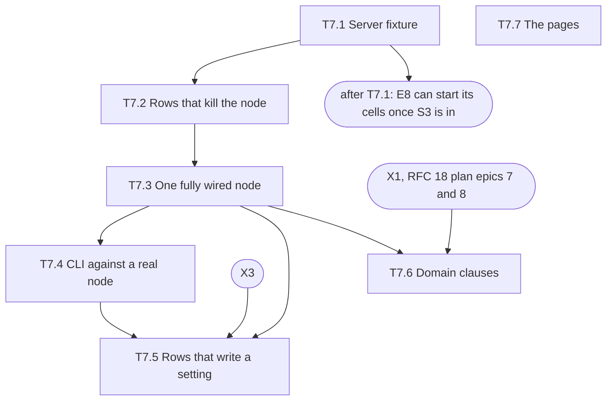

# Epic 7: control plane v2 — integration

**Sources:** [RFC 23](../rfcs/rfc-23-control-plane.md) §12 (Conformance), its single-node rows
that need no mount and need more than one middle epic together; §8.1, the rows E3 builds, run
here through the API; §3.3's bound fields; §10's CP7; Appendix B's rows for §2.1 and §2.3; RFC
23's plan §1.4 (the scenario assigned to epic 7), §1.5 rule 3, D13 and §5 epic 7.
**Track:** the team.
**Epic 7 estimate: 7 subtasks, 12 man-days.**
**Depends on:** E3 (`dfs start`, `nodetest`, the runner), E4 (the routes and the client), E5
(`install.Run`, signed-in callers), E6 (its suite's child-safe rows); outside RFC 23's plan, X3
and the RFC 18 plan's epic 8's T8.10 for T7.5, and X1 with the RFC 18 plan's epics 7 and 8 for
T7.6.
**Blocks:** E8, which starts its cells through this epic's server fixture (T7.1) once S3 is in.

---

## 1. Goal

The middle epics meet. Each middle epic tests its own layer; this epic runs only what needs more
than one of them at once: the server started the way an operator starts it, a crash across the
runner and the store, one sweep of every route on a fully wired node, the CLI against a real
node, the rows that wait for another plan's wiring, and the pages that still describe v1.

**At the end of the epic:**

- the harness's server fixture initialises an installation with `dfs init`, starts it with
  `dfs start`, configures its users, grants and shares, and stops it with a signal, so E8's cells
  can run once adapters serve (S3);
- an operation survives the node killed without `Stop` and reads back through the API (CP7);
- one sweep calls every route as every role on a fully wired node: each answers as §5.2 says, each
  mutating route writes one audit record, and no error goes unmapped;
- the CLI's child-safe rows pass against a real node from a separate `dfsctl` process;
- once X3 is in, the rows that write a setting pass, and once X1 and the RFC 18 plan's epics 7 and
  8 are in, the domain's idempotency clauses pass;
- no page names a deleted v1 path, and `CLAUDE.md` names the v2 owner of what v1's Runtime did.

### 1.1 In scope

The server fixture's rebuild; CP7 and the §12 rows that kill the node; the cross-epic sweep (route
list, roles, audit, error table) and the §12 and §8.1 clauses only a fully wired node shows; the
rule-3 condition read through `/api/v1/health`; the CLI's child-safe rows; the rows and success
paths other epics hand here until X3; the domain's idempotency clauses; the pages.

### 1.2 Out of scope

- What a middle epic already tests at the same layer, through the same harness:
  - `§2.2 order`'s order of starts and stops, `§2.5 health`'s endpoints across start, serving,
    drain and stop, and §8.1's node halves (the running set kept, the old component kept): E3
    (T3.2, T3.3, T3.5);
  - `§4.4 lost update`, `§4.5 idempotency`'s resource and account clauses: E4 (its write path
    over the harness);
  - `§5.2 roles`' role table, `§5.3 revocation` (the break-glass clause among them, with
    `reset-admin`), `§5.3 throttling` but its loopback and local-socket clauses, and `§5.4 first
    password`: E5 (T5.2, T5.5, T5.6, T5.10, and `dfs init`).
- `§3.5 grants`' admission half (alice refused, then admitted through `Finance`): E8, which mounts;
  this epic keeps the API half (R15).
- Every row that mounts a share, and `§2.2 order`'s adapter clause: E8. Running `§7 CLI` as a
  second OS user: E8 (D4).
- E3's T3.9 stop-bound exit test: E3's. If it cannot hold a stop step on a journal device under
  its child (its §9), it moves to this epic's fixture as a new subtask then.
- The multi-node rows, CP15 and the two-node half of `§5.3 revocation`; `§4.4 background field`;
  `§5.5 OpenID Connect`; `§2.2 order`'s syncer, remote-client and GC steps: rows of
  [the deferral ledger](rfc-23-control-plane-plan.md#61-deferral-ledger).
- An adapter failing to start (§8.1): RFC 20's plan's epic 7.

### 1.3 Names used here

- **E1**, epic 1: v1 deleted, the node's surface, the new `dfs`, the kept fixture `Server`.
- **E2**, epic 2, store records: `Write`, the records, the namespace record.
- **E3**, epic 3, the node: `node.New`, start and stop, reconcile, the runner, `nodetest`, `dfs start`.
- **E4**, epic 4, the management API: the routes, the write path, the problem table, the client.
- **E5**, epic 5, accounts and sign-in: `internal/install.Run`, tokens, roles, throttling.
- **E6**, epic 6, the CLI: `dfsctl` on the client, its shared table `clisuite`.
- **E7**, this epic, the integration epic.
- **E8**, epic 8, e2e green: the e2e helpers rebuilt and the mount rows, once S3 is in.
- **S1**, epic 1 merged: v1 gone and the node's surface frozen.
- **S2**, the node starts and reconciles (E3).
- **S3**, adapters serve through the node, outside RFC 23's plan. Not the S3 storage service.
- **X1**, the RFC 13 plan's bootstrap and secrets (`pkg/bootstrap`, `pkg/secrets`).
- **X3**, the RFC 13 plan's epic 5, which wires `Check`, `Diff` and `Get`.
- **A6**, RFC 23's plan's amendment making `audit.retention` and the API lifetimes admin-only.
- **plan D13**, RFC 23's plan's decision on which `dfs` commands stay and which pages move with them.
- **CP3, CP5, CP6, CP7, CP8, CP10, CP11, CP12, CP13, CP14**, RFC 23 §10's invariants of those numbers.

## 2. How the general rules apply

The rules are those of
[RFC 23's plan, §1.5](rfc-23-control-plane-plan.md#15-general-rules-for-each-epic), cited by number
and title and not copied.

| Rule | Subtasks | How |
| --- | --- | --- |
| rule 1, independent unit tests ([`CLAUDE.md`, "Writing tests"](../../../CLAUDE.md#writing-tests)) | T7.2–T7.6 | every in-process row builds the node through `nodetest` over the in-memory KV or Badger under `t.TempDir()`, signed in through E5's callers; T7.2's rows run a real `dfs start` child over Badger under `t.TempDir()` instead (D1); the doubles are `sim.TestClock` (kind 1), `kvtest.FaultKV` with a fault the test implements (kind 3), and, for T7.6, the RFC 18 plan's `pkg/identity/identitytest` directory and domain controller, held to their suites (kind 2) |
| rule 2, fuzz every decoder of untrusted bytes ([`CLAUDE.md`, "Writing tests"](../../../CLAUDE.md#writing-tests)) | none | this epic adds no decoder; E2 and E4 fuzz the bodies, the cursor and the codecs |
| rule 3, observability follows RFC 25 | T7.3 | no new series; `config_generation_behind` is read through `/api/v1/health`, and `api_unmapped_errors_total` stays 0 after the error table's run |
| rule 4, profiling | T7.2–T7.6 | every in-process row runs under `nodetest`'s `Watch()`, which registers `internal/prof`'s `prof.Watch`, at its top level; a child-process row checks the child exited |
| rule 5, public interface and internals ([`CLAUDE.md`, "Verifying a change"](../../../CLAUDE.md#verifying-a-change)) | all | each row asserts at the API, and runs only what no single middle epic can (§1.2) |
| rule 6, known failures shrink ([`CLAUDE.md`, "Writing tests"](../../../CLAUDE.md#writing-tests)) | none | no suite this epic adds to keeps a `known.yaml` |
| rule 7, v2 ignores v1 | T7.1, T7.7 | the fixture reuses only what E1 kept beside v1; the pages are rewritten against RFC 23, not ported |
| rule 8, real dependencies for properties of those dependencies ([`CLAUDE.md`, "Writing tests"](../../../CLAUDE.md#writing-tests)) | T7.2, T7.3 | a crash is a process killed with `SIGKILL` over Badger on disk (D1); the audit's all-or-nothing runs on Badger with its commit faulted |
| rule 9, code comment conventions ([`CLAUDE.md`, "Code comments"](../../../CLAUDE.md#code-comments)) | T7.1, T7.3 | E1's `decision:` markers on the kept `Server` and on `ErrNoServer` go with what they guarded; T7.1's store seeding until X3 and T7.3's error-table exceptions each carry a `decision:` |
| rule 10, a test must be able to fail ([`CLAUDE.md`, "Writing tests"](../../../CLAUDE.md#writing-tests)) | all | each row is broken once on purpose before it lands and fails on its assertion |
| rule 11, a symbol is exported only if RFC 23's interface uses it | T7.1 | the fixture's exports are the harness's own surface; nothing under `internal/node` gains one |
| rule 12, each subtask creates only what it declares | all | no new package |

## 3. Requirements and invariants

Every obligation RFC 23 and its plan place on this epic. A `§12` row is written as RFC 23 names
it, in the part this epic owns.

**The server fixture and crashes**

| # | Requirement | Kind | Source | Subtasks |
| --- | --- | --- | --- | --- |
| R1 | The harness's server fixture initialises its installation with `dfs init` and starts it with `dfs start`, for the cells E8 runs | MUST | RFC 23 plan §5 epic 7 | T7.1 |
| R2 | Long work is an operation whose progress is the owning component's durable cursor; it survives a crash and is readable through the API | invariant | RFC 23 §10 (CP7) | T7.2 |
| R3 | `§3.2 delete`: a share with 10⁵ files (seeded at 50 until the runner runs a step again at once while it reports work left, a row of [the deferral ledger](rfc-23-control-plane-plan.md#61-deferral-ledger)), the node killed during the "files" phase once `Done` > 0 and restarted, reports the same operation `running` with `Done` at least that value and rising, and ends `succeeded`; a second delete with a new key answers `409` `stale` | test row | RFC 23 §12 | T7.2 |
| R4 | `§2.1 API writes only records`, its crash half: a share create committed, the node killed before it reads the share list and restarted, serves the share | test row | RFC 23 §12 | T7.2 |

**One fully wired node**

| # | Requirement | Kind | Source | Subtasks |
| --- | --- | --- | --- | --- |
| R5 | `§2.1 API writes only records`, its fault half: a share create whose commit is faulted answers `503`, no storage binding exists, and none appears after the store recovers and a full reconcile runs | test row | RFC 23 §12, §10 (CP2) | T7.3 |
| R6 | `§2.2 order`, its API clause: an operation readable before stop reads through the API until stop step 3 | test row | RFC 23 §12 | T7.3 |
| R7 | `§2.5 health`, its API clause: `GET /api/v1/health` without a token answers `401` | test row | RFC 23 §12, §10 (CP13) | T7.3 |
| R8 | §8.1's store-unreachable row, through the API: the API answers `503` `unavailable` with `Retry-After` | MUST | RFC 23 §8.1 | T7.3 |
| R9 | §8.1's refused-record row, through the API: a share whose build the node refuses is committed, and its status read through the API shows the node refused it; it is never answered as applied | MUST | RFC 23 §8.1; Appendix B (§2.1, §2.3); RFC 23 plan §1.4 | T7.3 |
| R10 | The condition the node raises reaches an admin through `/api/v1/health`: `config_generation_behind` raised for a node behind and cleared when it catches up | MUST | RFC 23 §8, §11; RFC 23 plan §1.5 rule 3, §5 epic 7 | T7.3 |
| R11 | `§4.7 error table`: every error value in every closed set, provoked through the API or injected at its seam, answers a status and a code, and `api_unmapped_errors_total` stays 0 | test row | RFC 23 §12, §10 (CP8), §11 | T7.3 |
| R12 | `§5.2 roles`, its sweep: the route list read from the router matches §4.1's table; every route called as `viewer`, `operator` and `admin` answers §5.2's table; an operator's write of an admin's password secret or of the signing key through every secret-bearing route is refused and changes neither | test row | RFC 23 §12 | T7.3 |
| R13 | `§6 audit`: every mutating route, applied and refused, writes one audit record with the generations before and after and no secret value; a change whose commit is faulted leaves neither the change nor its record | test row | RFC 23 §12, §10 (CP11, CP12) | T7.3 |
| R14 | `§5.3 throttling`, its loopback and local-socket clauses through the node's real listeners: 5 failures for five accounts from `127.0.0.6`, from `::1`, and from `127.0.0.1` and `::ffff:127.0.0.1` together each make the sixth answer `429`; 5 failures for one account through the local socket leave the sixth checked, with no source or pair count | test row | RFC 23 §12 | T7.3 |
| R15 | `§3.5 grants`, its API half: a grant of `none` is stored and read back as a grant; a `DELETE` of a principal's grant removes only that grant; a grant naming a machine principal answers `400` `ErrInvalid` and writes nothing | test row | RFC 23 §12 | T7.3 |

**The CLI**

| # | Requirement | Kind | Source | Subtasks |
| --- | --- | --- | --- | --- |
| R16 | `§7 CLI`, single-node: the CLI's suite runs against the node from a `dfsctl` process with no path to the host's bootstrap or store | test row | RFC 23 §12, §10 (CP14) | T7.4 |

**After X3**

| # | Requirement | Kind | Source | Subtasks |
| --- | --- | --- | --- | --- |
| R17 | `§2.3 reconcile`: a live share setting changed while the store is unreachable to the node's reads but not its writes applies at the next read, not at the next generation move | test row | RFC 23 §12 | T7.5 |
| R18 | `§2.4 applied`, single-node: a node whose apply is frozen after a share setting changes is named behind in the resource's status, and after 5 s a health condition names it; a setting whose own generation is 2 while the settings generation stands at 100 reads not applied on a node frozen at 100; a node-scoped restart-class setting reads not applied until the node restarts, while a live one reads applied | test row | RFC 23 §12, §10 (CP3) | T7.5 |
| R19 | `§4.1 NTLM back on`: turning `identity.ntlm` off answers `202` with one `identity.nt-hash-delete`; a second turn-off while it runs starts none; turning it on, or deleting the installation's `identity.ntlm` record, while it runs and after it failed, answers `409` `operation_running` naming it; a turn-off after a failed deletion starts a new one; a deletion has no cancel; once one completes and the sweep runs 8 days later, its operation record is gone and turning it on is accepted | test row | RFC 23 §12; RFC 23 plan §5 epic 7 | T7.5 |
| R20 | `§5.2 roles`, A6's clause: an operator's write of `audit.retention`, `api.session_lifetime`, `api.token_max_lifetime`, `api.password_sign_in` or `identity.directory` is refused and commits nothing; an admin's `audit.retention` of 89 days is refused | test row | RFC 23 §12; RFC 23 plan §5 epic 7 | T7.5 |
| R21 | A bound field is refused `409` `bound_setting` while content exists, naming the field; the settings, adapter, remote-store and namespace writes E4 and E6 refuse until X3 succeed through the API and the CLI once `Check` is wired | MUST | RFC 23 §3.3, §3.4; RFC 23 plan §5 epic 4 | T7.5 |

**The domain**

| # | Requirement | Kind | Source | Subtasks |
| --- | --- | --- | --- | --- |
| R26 | Once a deletion has completed and NTLM is on again, an NTLM sign-in for a user whose password was not set since is refused, as no NT hash exists, and succeeds once the password is set | MUST | RFC 23 §4.1 | T7.6 |
| R22 | `§4.5 idempotency`, its domain clauses: an offline `join-domain` retried while it runs answers `409` `operation_running` and writes no new version of the machine password's `Secret`; neither join keeps an idempotency record; the offline join's password is found only sealed, and the online join's administrator credential in no store record, operation record, audit record, log line or metric | test row | RFC 23 §12, §10 (CP6, CP11) | T7.6 |

**The pages**

| # | Requirement | Kind | Source | Subtasks |
| --- | --- | --- | --- | --- |
| R23 | `docs/guide/configuration.md`, `README.md`'s quick start and `docs/internals/architecture.md` describe the bootstrap and the API | MUST | RFC 23 plan §5 epic 7 | T7.7 |
| R24 | `CLAUDE.md`'s architecture invariants name the v2 owner of each gate v1 held, the Runtime among them | MUST | RFC 23 plan §5 epic 7 | T7.7 |
| R25 | No other page under `docs/guide`, and no section of `CLAUDE.md`, describes v1's control plane, its API or its CLI; the pages plan D13 names (`install.md`, `troubleshooting.md`, `windows-ad-setup.md`) describe the v2 commands | MUST | RFC 23 plan §5 epic 7, D13 | T7.7 |

## 4. Decisions this epic takes

- **D1, a crash is a child process killed on an event.** R2 to R4 kill the node. The child is the
  test binary run again as E3's `TestStartChild`, which runs the real `dfs start` with the
  arguments `DFS_START_CHILD_ARGS` holds, over an installation `dfs init` made under
  `t.TempDir()`, Badger on disk. `DFS_START_CHILD_HOLD` sets `runStart`'s `kvKey{}` context hook,
  which wraps the KV in a `kvtest.FaultKV` before `node.New`; its fault holds the one operation
  and key the row cues on (the removal's next batch, the reconcile's read of the share list), the
  child prints `held`, and the parent sends `SIGKILL` when it reads that line. A restart is a
  fresh child over the same directory, not `nodetest` and not E3's `Restart`.
  An in-process abandon cannot stand in: Badger's directory lock
  refuses a second open in the same process, and `Close` flushes what a kill does not. The fault
  filters by key, so the API's reads of other keys pass; `node.Config` takes one KV, so the
  reconcile cannot have a fault of its own. No marker. Prior art: Go's own `os/exec` tests re-exec
  the test binary as the child (from memory).
- **D2, the fixture reuses E1's kept `Server`.** Its process helpers (`ownGroup`, `stopGroup`,
  `stopGrace`), its clients, mounts and KDC stay; what this epic adds is `dfs init` before the
  start, the bootstrap file, the new client, `Kill` and `Restart`. v1's ready wait and its
  password handling were deleted with v1 and are written again against the API (`/health/ready`,
  the password by environment variable to `dfs init`). Only the API's address is read from the
  child's log; each adapter's port is read from the node's adapter status through the API, never
  picked in advance. E1's `ErrNoServer` and its refusal in `run`'s `startFixture` go. No marker.
- **D3, until X3 the fixture seeds through the store.** E4 and E6 refuse settings, adapter,
  remote-store and namespace writes until X3 hands in the settings table (E4's D4). So until then
  the fixture, and T7.3's rows that create a share, write the namespace, its remote store and the
  adapters' settings through the metadata store before `dfs start`, and T7.5 moves them onto the
  API. A `decision:` marker at the seeding names X3 as its end.
- **D4, `§7 CLI` runs E6's child-safe rows.** A `dfsctl` child, its `HOME` and `XDG_*` directories
  empty, runs E6's `clisuite` rows marked child-safe against an in-process node. No path reaches
  the bootstrap or the store; E6's closure rule (`go list -deps ./cmd/dfsctl`) shows it links none
  of their code. Running as a second OS user needs root, which `e2e` has; E8 adds that form. No
  marker.
- **D5, a hold is a fault the test implements.** Where a row must observe the node mid-step (R6's
  stop at step 3, R18's frozen apply), the test hands `kvtest.FaultKV` a `sim.Fault` whose `At`
  blocks on a channel for one operation and key and is released after its read. R18 holds the
  binding's commit, as E3's T3.7 does. No marker.
- **D6, the pages are held by a test.** A case beside `cmd/gendocs`' command-reference tests walks
  `docs/**`, `CLAUDE.md` and `README.md`, but `docs/internals/rfcs` and `docs/internals/planning`,
  which are design history, and fails on a page naming a path E1 deleted. No marker.
- **D7, the X3 rows wait in one subtask.** Every row that writes a setting is unreachable before X3,
  so they land together in T7.5. No marker.
- **D8, the fixture's start is the runner's input.** `run`'s `startFixture` and `fixture`'s
  `interfaces` are package-level variables dt's tests swap, which `CLAUDE.md` bans. The runner
  takes its fixture start as a field set by its constructor, and the interface list is an
  argument of a pure function choosing `{server}` from it, `pickAddress`. Exactly one test, `fixture/server_test.go`, starts the real server; dt's
  lifecycle tests pass a start of their own through the field. No marker.

## 5. Target tree

```text
test/harness/fixture/
  fixture.go server.go                     T7.1  Server starts dfs init and dfs start; Kill, Restart
  server_test.go                           T7.1  the one real start, configure, Reset, Kill, Restart
  spec.go                                  T7.1  ErrNoServer gone
test/harness/run/
  fixture.go run.go                        T7.1  the fixture start is the runner's field (D8)
cmd/dfs/commands/crash_unix_test.go        T7.2  the child and the rows that kill it, //go:build unix
internal/node/integration_test.go          T7.3, T7.5, T7.6  the cross-epic rows, package node_test
cmd/dfsctl/integration_test.go             T7.4  E6's child-safe rows from a dfsctl child
cmd/gendocs/helpref_test.go                T7.7  D6's case
docs/guide/*.md, docs/internals/*.md       T7.7
README.md, CLAUDE.md                       T7.7
docs/guide/metadata-store-migration.md     T7.7  deleted
```

## 6. Subtasks

### T7.1 The server fixture on `dfs init` and `dfs start`

**Subtask T7.1 estimate: 2.5 man-days.**

- **Track:** the team. **Depends on:** E3 (`dfs start`), E5 (`dfs init`, sign-in), E4 (the
  client); X3 only for its configure through the API, until then D3.
- **Covers:** R1.
- **Deliverables:** `Server`'s start (D2): the bootstrap under the fixture's data directory naming
  `127.0.0.1:0`; `dfs init` with its password by environment variable; `dfs start` in its own
  process group, the API address read from its log, `/health/ready` waited on; a sign-in through
  the client; the users `User` and `User2` with their UIDs, the shares, and the grants
  [RFC 29 §4.2](../rfcs/rfc-29-test-harness.md) gives (none on `/export` unless the fixture mounts
  it over SMB, then `{user}`'s `read-write`; `{user}`'s `admin` on a shares file's shares; none for
  `{user2}`), created through the client (namespaces, remote stores and adapters seeded per
  D3); `Reset` recreating the share and its grants; stop by `SIGTERM`, the group killed after
  `stopGrace`; `Kill` and `Restart`. `ErrNoServer` and `run`'s refusal deleted; the start injected
  through the runner (D8). Consumed by E8.
- **Acceptance criteria:**
  - A DittoFS fixture starts, answers `ready`, holds its users, shares and grants, and stops with
    exit 0.
  - `dt`'s own fixture tests pass with the start passed through the runner's field.
- **Tests:** `fixture/server_test.go`, the one real start, under `t.TempDir()` and `127.0.0.1:0`:
  start, the users, shares and exactly RFC 29's grants read back through the client (catches a
  configure step or a grant skipped); `Reset`, the grants read back again (catches a reset that
  drops them); a second `dfs init` over the same data directory refused and nothing changed;
  `Kill`, `Restart`, the shares still there. `TestDittoFSFixtureRefused` deleted with what it
  guarded.

### T7.2 The rows that kill the node

**Subtask T7.2 estimate: 1.5 man-days.**

- **Track:** the team. **Depends on:** T7.1; E3 (the runner, share removal, `Restart`).
- **Covers:** R2, R3, R4.
- **Deliverables:** `cmd/dfs/commands/crash_unix_test.go`, beside E3's `dfs start` child test
  (D1): the child test; `§3.2 delete`, the share's files seeded through the metadata store's
  view, 50 of them until the runner runs a step again at once while it reports work left (10⁵
  waits on that; a row of the plan's deferral ledger),
  its delete started through the API, the child held at the removal's next batch once the
  operation's `Done` > 0, killed, restarted, and the operation polled to `succeeded`, skipped under
  `testing.Short()`; `§2.1`'s crash half, the child held at the reconcile's read of the share list
  after the create's `201`, killed, restarted, the share serving.
- **Acceptance criteria:**
  - Each killed row passes on a child killed with `SIGKILL` on its `held` line, never stopped.
- **Tests:** the rows (catch progress the API made up, R2, R3; a handler binding a share itself,
  R4). Each waits on the child's line and on the API's answer, polled, with one generous bound as
  its backstop.

### T7.3 One fully wired node

**Subtask T7.3 estimate: 2 man-days.**

- **Track:** the team. **Depends on:** E3, E4, E5 (signed-in callers of each role).
- **Covers:** R5, R6, R7, R8, R9, R10, R11, R12, R13, R14, R15.
- **Deliverables:** in `internal/node/integration_test.go`:
  - one sweep over the route list as `viewer`, `operator` and `admin`, each mutating route applied
    and refused once: §5.2's answers, one audit record each read back, the secret-bearing routes
    refused to an operator (R12, R13);
  - the error table over every closed set, each value provoked through a route or injected by
    `FaultKV` at its seam; the sets that only a component's own fault seam could reach, as
    `node.Config.Fault` is a row of the deferral ledger, listed at the test with a `decision:`
    marker; `api_unmapped_errors_total` read 0 (R11);
  - the share create with its commit faulted, then the store recovered (R5); an operation read
    through the API while the node stops, held at step 3 (R6); `/api/v1/health` without a token
    (R7); reads faulted, `503` with `Retry-After` (R8); a share whose namespace names no remote
    store seeded through the store, refused by the node's root duty and read back refused (R9);
    `config_generation_behind` raised and cleared through `/api/v1/health` (R10); the loopback and
    local-socket throttling clauses on the node's real listeners, on Linux (R14); the grants' API
    half (R15).
- **Acceptance criteria:**
  - Every route of the router is in the sweep, and every row passes over the in-memory KV and
    over Badger under `t.TempDir()`.
- **Tests:** the deliverables, each naming what it catches: a route missing its check, or a
  credential replaced through a secret write (R12); a change with no record (R13); an error with
  no row (R11); a handler calling the engine (R5); an API that stops before the drain it reports
  (R6); grace state leaked to an anonymous caller (R7); a hung call on a dead store (R8); a `201`
  with the failure only in a log (R9); a condition never raised or cleared (R10); a listener that
  loses the caller's address (R14); `none` stored as no grant, or a machine granted (R15).

### T7.4 The CLI against a real node

**Subtask T7.4 estimate: 0.5 man-days.**

- **Track:** the team. **Depends on:** E6 (its `clisuite`); E3.
- **Covers:** R16.
- **Deliverables:** `cmd/dfsctl/integration_test.go`: a `nodetest` node, a `dfsctl` child built
  from the module with `HOME` and `XDG_*` empty, running each of E6's child-safe rows through
  `clisuite` against the node's address (D4).
- **Acceptance criteria:**
  - Every child-safe row passes from the child.
- **Tests:** the rows (catch a command that reads the bootstrap or the store).

### T7.5 The rows that write a setting

**Subtask T7.5 estimate: 2 man-days.**

- **Track:** the team. **Depends on:** X3; T7.3, T7.4; the RFC 18 plan's epic 8's T8.10.
- **Covers:** R17, R18, R19, R20, R21; R13's applied and secret halves for the settings-backed writes.
- **Deliverables:** in `integration_test.go`: `§2.3 reconcile`, the `view` operation faulted while
  writes pass; `§2.4 applied` with D5's hold on the binding's commit; `§4.1 NTLM back on`, the
  deletion failed by a `User` record its codec refuses (the RFC 18 plan's epic 2's R36), written
  under the store's key through the raw KV, since a store error is retried and never fails it, the sweep run after the
  clock passes 8 days and the operation's record read gone; A6's refusals; a bound field's `409`
  while content exists; E4's settings, adapter, remote-store and namespace success paths through
  the API, and E6's refusal rows for them flipped to success; D3's seeding moved onto the API and
  its marker removed.
  R13's applied and secret halves for the writes the settings table still refuses (a setting at
  every scope, an adapter, a namespace's create, a store's create, a store credential's delete)
  and a store's first credential: each moved from the waiting writes of T7.3's `sweepApplied`
  into its applied writes, its audit record checked for no credential. The store create is sent
  with no `Idempotency-Key`, as it carries its credential.
- **Acceptance criteria:**
  - Each row passes with `Check` wired, and no fixture or row seeds through the store any more.
- **Tests:** the rows (catch a missed generation lost for good, R17; "applied" inferred from the
  writing node, R18; NTLM on while NT hashes remain, or the rule lost with the swept operation,
  R19; an operator shortening the audit, R20; a bound field changed under content, R21).

### T7.6 The domain's clauses

**Subtask T7.6 estimate: 1.5 man-days.**

- **Track:** the team. **Depends on:** X1; the RFC 18 plan's epics 7 and 8; T7.3.
- **Covers:** R22, R26.
- **Deliverables:** in `integration_test.go`: the two `join-domain` clauses, over `identitytest`'s
  directory and domain controller, the log captured and the metrics registry read; NTLM's
  consumer after a completed deletion, through the composed node's `SignIn` (R26).
  Also, through the API over the same directory, E6's success paths, which `nodetest` cannot
  reach: a grant by directory name runs `resolve-principal` and grants the ID it returned (E6's
  R16), and `resolve-principal` and `test-directory` end `succeeded`.
- **Acceptance criteria:**
  - Neither join leaves an idempotency record, and neither credential is found raw where CP11
    names.
- **Tests:** the clauses (catch a credential kept in a replay record, or written by a retry, R22);
  an NTLMv2 AUTHENTICATE for a user whose password predates the deletion refused, then accepted
  after `:set-password` (catches a rule that answers `409` but leaves a usable hash, R26).

### T7.7 The pages

**Subtask T7.7 estimate: 2 man-days.**

- **Track:** the team. **Depends on:** E3, E4, E5, E6.
- **Covers:** R23, R24, R25.
- **Deliverables:** `docs/guide/configuration.md` on the bootstrap file and the settings reached
  through the API; `README.md`'s quick start on `dfs init`, `dfs start` and `dfsctl login`;
  `docs/internals/architecture.md` and `docs/internals/implementing-stores.md` on the node, its
  API and the CLI; `CLAUDE.md`'s architecture invariants mapping the Runtime to the node, the
  filesystem service and the API, and marking the adapters' gates (`CheckShareAccess`,
  `shareEntryStatus`, `RootKeepsAdmin`, `ApplyIdentityMapping`) as pending their owner under RFC
  20's plan, with E1's one-line note removed; plan D13's pages and every other page `rg` finds
  edited, lightly where a page only names a command; `metadata-store-migration.md` deleted, as no
  migration exists; `snapshots.md` reduced to one line saying the resource waits with RFC 12; D6's
  case.
- **Acceptance criteria:**
  - D6's case and `cmd/gendocs`' command-reference tests pass, and `dt docs --check` exits 0.
- **Tests:** D6's case, run once with a page naming `pkg/controlplane` (catches a page still
  describing v1); the command-reference tests (catch a quick start that cannot run).

## 7. Order of work



T7.1 goes first: E8 waits on it and nothing else of this epic. The rows follow one path; the pages
(T7.7) depend on no subtask and can run beside them.

## 8. Suggested pull requests

| PR | Subtasks | Man-days | After | Why together |
| --- | --- | --- | --- | --- |
| 1 | T7.1, T7.2 | 4 | — | the fixture and the rows that kill a child; unblocks E8 |
| 2 | T7.3, T7.4 | 2.5 | PR 1 | everything a fully wired node and the CLI show before X3 |
| 3 | T7.5, T7.6 | 3.5 | PR 2, X3, X1, the RFC 18 plan's epics 7 and 8 | the rows that wait on another plan |
| 4 | T7.7 | 2 | — | the pages and the test that holds them |

PR 4 can be open beside any other. A suggestion only: one pull request per subtask works as well.

## 9. Open points

- A consumer-side row for the `krb` link (a PAC-bearing ticket binding the linked local user, refused once the directory account is recreated) needs a Kerberos sign-in this unit tier cannot make; it belongs to the RFC 18 plan's epic 8 or E8's `e2e/kerberos`.
- RFC 23's plan §5 epic 7 still says the cancelled state is written into the operation's record; RFC 23 §4.1 gives the deletion no cancel, so that clause goes when the plan is next revised.
- T7.3 as built differs from its text in these places.
  - R13's applied half reaches today only the routes that can succeed on this node. Since the
    node hands its API its settings table (#5472), a store's and a namespace's delete are applied
    here. Since it hands its API its sealer (#5456) and the per-key write role is built (#5478),
    the keytab's `PUT` and `DELETE` are applied here too, so T7.6 no longer carries them. A
    setting's write and delete at every scope, an adapter's write, a store's create, a namespace's
    create and a store credential's delete are still refused `unknown_key`, the node's table
    holding no section that reads their keys, and wait with T7.5; a store's first credential waits
    on the store's capability check; `:cancel`'s waits on the first
    cancellable operation kind (§6.1 of the plan). Each waits in `sweepApplied` as a write that
    must still answer its current refusal, so it fails the day the route succeeds. The directory's
    actions (`resolve-principal`, `test-directory`, `join-domain`, `rotate-machine-password`) start
    their operations on the composed node, so they are applied here.
  - R13's secret half is shown here only for what today's applied routes carry: the passwords of
    `:set-password` and `POST /auth/password`, an API token, the bearer of each call, and the
    online join's administrator password, none of them found in an audit record, and the keytab,
    found in no audit record, no answer and no log line. The routes that write a store's secret (a
    store's create and its credential) are waiting ones, so their secret half moves to T7.5 with
    their applied halves.
  - The store create takes no `Idempotency-Key` since #5472, as a call carrying a credential. RFC
    23 §4.5's rule covers it, but its list of such calls does not name it; the plan's §6.1
    deferral ledger holds that edit, owned by RFC 23.
  - R15 is held by the API's `TestGrants`, which needs no wiring; T7.3's error table keeps the
    machine grant, refused `400` `invalid` since the grant's write refuses a machine principal
    itself.
  - R8 proves the mapping only: a store read failing `vfserr.ErrUnavailable` answers `503`
    `unavailable` with `Retry-After`. The API sets no deadline on its store calls, so a hung store
    never answers; #5471 owns that, and the row for a hung store comes with its fix.
  - R14's `::ffff:127.0.0.1` clause cannot be driven from a client: on a listener of both families
    the platform hands the node an IPv4 peer as `127.0.0.1` whatever spelling was dialled, so the
    row sprays `127.0.0.1` and `entity.SourceKey`'s unit test owns the unmapping. Its `127.0.0.6`
    clause runs where the host routes that address to loopback (Linux; macOS with an `lo0` alias).
  - R6 holds, but the node's API stays open past §2.2's step 3: Stop closes its listeners after the
    engine. #5469 owns that.
- T7.6 as built differs from its text in these places.
  - Its rows run on RFC 18's machine node (`newMachine` in `machine_test.go`), which wires
    `identitytest`'s directory and domain controller through `NewWithDialers`; T7.3's `newWired`
    builds through `node.New`, which dials the network ones. R26's row needs no directory and runs
    on the signed-in node `newAuthNode` builds.
  - The grant by directory name is driven through the API by the test, `resolve-principal` and then
    the grant's `PUT` under the ID its result names; the CLI's grant by name (T6.4) runs the same
    two calls.
  - The keyless rule is shown falsifiable on the node by one online join sent with an
    `Idempotency-Key`, refused `400` and leaving no record.
- E3's T3.9 stop-bound exit test may move to this epic's fixture (§1.2); E3 decides when T3.9
  lands.
- The proposals to RFC 23's plan that this document leaves to a later pull request: §5 epic 7's
  expected content (the fixture's refusal removed, D6's case, the X3 subtask, the rows §1.2 leaves
  to E3, E4 and E5); §5 epic 8 gaining `§7 CLI`'s second-user form.
