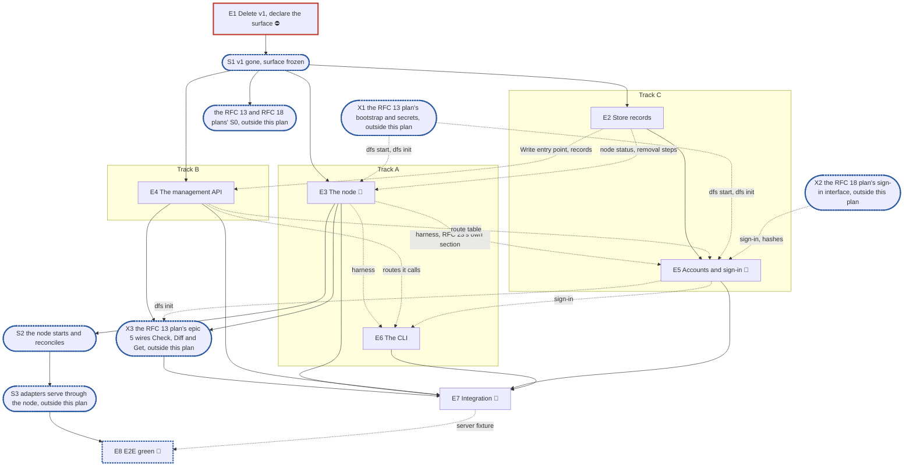

# RFC 23 — control plane v2: implementation plan

**Scope.** [RFC 23, the control plane](../rfcs/rfc-23-control-plane.md), single-node. The related RFCs
are in scope as follows:

- **Only the parts RFC 23 cannot work without:**
  - [RFC 13](../rfcs/rfc-13-configuration.md): Appendix B's rows for RFC 23's own section, which
    epic 3 validates. The bootstrap (§2.2), validation (§6), the settings library and sealed
    secrets (§7) are the RFC 13 configuration-lifecycle plan's, which this plan consumes (O11).
  - [RFC 8](../rfcs/rfc-8-engine.md) §2.1 and §2.6: the root's duties, which the journal-only
    engine plan hands this node (epic 3).
  - [RFC 16](../rfcs/rfc-16-metadata-store.md): the records RFC 23 adds and the fields it needs (§3,
    §4.2), and a share's removal steps (§2.3.2), which the store today stops after the mark.
  - [RFC 18 §8.1](../rfcs/rfc-18-identity.md#8.1%20The%20API%27s%20sign-in%20interface): the API's
    sign-in interface, which the RFC 18 plan builds and epic 5 consumes (O11).
  - [RFC 25](../rfcs/rfc-25-observability.md): the health registry and watchdog (§3, §8.1) and the
    `api_`, `node_` and `audit_` series (§2.1).
  - [RFC 28](../rfcs/rfc-28-journal-format.md) §2.1: the `node-id` layout, which epic 3's attach
    learns.
- **Constraints only:** RFCs 0, 9, 11, 12, 14, 15, 17, 20, 24, 26, 27 and 30.

**Not built by this plan.** The user decided to defer the following; §6 O2 lists each with what it
waits for:

- the cluster rows (RFC 23 §4.6's claim takeover, §8's **(cluster)** rules, §9's schema gate and
  CP15, the multi-node tier of §12);
- OpenID Connect sign-in (RFC 23 §5.5);
- the provisioning file (RFC 23 §3.6);
- the actions whose owning RFC has no implementation: `rehome`, `accept-copy`, `rebuild-index`,
  `rebuild-reverse-index`, `declare-lost`, `acknowledge-unreadable`, `drain`, `decommission`,
  `raise-format`, and the snapshot, backup and move resources;
- the event streams (RFC 23 §6, `GET /api/v1/events/{stream}`);
- the rest §6 O2 lists, each with its trigger.

**Tracks.** A, B and C, with no owner.

**Programme.** #3119, route B, on `feat/storage-v2`. This plan delivers its stage 5 (the node that
builds and drives the adapters; RFC 20's plan defers its epic 7 to this node), stage 6 (users, groups,
shares and grants written in the store through the API) and stage 7 (cutover). One divergence: by the
user's decision, v1 is deleted in epic 1 rather than at the end, and the server binary is rebuilt from
nothing as the pieces connect (§6 O1).

**Divergence from the planning skill.** The skill's E2, a red e2e suite and test foundations, has no
counterpart here, by the user's decision. No suite RFC 23 names keeps a `known.yaml`, so no test lands
red (§1.2), and the pieces the foundations would hold already exist or land with their first
consumer:

- the leak check is `internal/prof`, where RFC 20's plan's epic 2 moved it from `journaltest/prof`
  (#4000, merged into `feat/storage-v2`);
- the KV fault wrapper is `pkg/metadata/kv/kvtest`'s;
- the architecture tests guard epic 1's deletion, so they land in epic 1;
- the node harness lands in epic 3 with its first test.

The §1.5 instruction, copied verbatim, says epic issues exist before "E2's pull request": that is
the skill's red-suite epic, which this plan does not have, so the clause binds no epic here.

**Naming.** v1 is today's control plane: `pkg/controlplane`, `internal/controlplane`, the SQL
control-plane database, `pkg/apiclient`, and `cmd/dfs` and `cmd/dfsctl` as they stand. v2 is RFC 23's
node and management API. v1 and v2 never run in the same binary, so no user-visible name carries a
version.

**Transition policy.** Fresh installs only, as #3119 decided on 16 Oct. A start that finds v1's
database or configuration refuses and names it. No migration tool.

**Defaults used from the skill's inputs:**

- output path: `docs/internals/planning/rfc-23-control-plane-plan.md`;
- dashboards: none;
- the bootstrap file keeps its path, with a flag to name another (D6, the RFC 13 plan's).

**RFC amendments in this pull request.** The user agreed to seven, all on draft RFCs:

- **A1. An adapter's port becomes an adapter setting**, `adapters.<protocol>.port`, at installation
  scope with a node override, restart-class. The listen addresses stay the host's bootstrap facts,
  which the node hands the adapter in `settings.Adapter.Addrs`, as RFC 20 §3.6 and its plan's
  epic 1 (R37) already say. The defaults stay v1's unprivileged 12049 and 12445, the port
  mapper's port is its own setting, and a node's effective ports must differ. This touches RFC 13
  §2.2, §5's restart row, §6, §9 and Appendix B, RFC 20 §3.6 and `settings.Adapter`, whose `Port`
  #4000 already added on `feat/storage-v2`, and RFC 23 §2.3 and §3.4.
- **A2. A node's identity is generated by the initialisation step** and written as a checksummed
  `node-id` file in each journal directory, after the journal's `Init` and before the store records
  it; a bootstrap key may name it, a copy that differs from the key or from another copy, or does
  not parse, refuses the start rather than being rewritten, and a start with no copy and no key
  refuses. A start writes a missing copy only into a directory whose `format` names the journal the
  store records at `JD‖node‖device` for this node and device; a
  directory whose journal is not yet recorded, a replaced device's, gets its copy only from
  `dfs init` or a recovery import; an interrupted `dfs init` adopts only a copy beside its own
  installation's `format`. This touches RFC 13 §2.2 and §9, RFC 28 §2.1, RFC 8 §2.6's
  `Deps.Node`, and RFC 23 §2.1, §2.2 (the start's write) and §5.4.
- **A3. RFC 16's `ControlPlane` gains one transactional entry point.** It takes the audit and
  idempotency metadata and runs a function over a transaction that carries the view's writes; a
  sign-in counts each attempt in a `SignInFailures` record read and written the same way, before
  its password is checked. The view
  also gains a setting's delete and the `Secret` reads and writes the RFC 13 plan builds on, and
  the `Secret` record an owner beside its kind (the RFC 13 plan's D10), which RFC 13 §7's
  `Resolve` and `Seal` take. This touches RFC 16 §2.3, §3 and §4.2, RFC 13 §7, and RFC 23 §4.3
  and §4.5 cite it.
- **A4. Only reconciled records carry a position.** RFC 23 §2.4 narrows "every control-plane record"
  to a setting, a share and a principal, as RFC 16 §3 has it; a grant, an export policy, a netgroup
  and a quota are versioned instead, and §4.4's quota entity tag is its version. This closes RFC 23
  §13 item 1.
- **A5. The domain's actions are RFC 23's.** §4.1's action table gains `resolve-principal`,
  `test-directory`, `join-domain` and `rotate-machine-password`, each an operation the runner
  drives through identity, the rotation sealing its next `Secret` version before it sets the
  password at the domain controller, as RFC 18 §3.5 orders it, with RFC 23 §3.5's two waits on
  the versions every node reports; the closed `OpKind` set gains
  `identity.nt-hash-delete`, which setting `identity.ntlm` off starts, with RFC 23 §4.1's rule for
  turning NTLM back on kept on the installation record (`Installation.NTLMOff`, RFC 16 §2.3), which
  outlives the operations' 7-day sweep; and §3.5 says how a grant
  names a directory principal (resolve first, then grant by ID) and where the join's state is
  read. Leaving the domain has no action until RFC 18 defines it (§6.1). This touches RFC 23 §3.5,
  §4.1, §4.5 (neither join, online or offline, carries an `Idempotency-Key`), §4.6 and §12, RFC 16
  §2.3 and §4.2's `IN` row, and settles the RFC 18
  plan's O5 (#4058).
- **A6. The audit cannot be shortened by an operator.** `audit.retention`, `api.session_lifetime`,
  `api.token_max_lifetime` and `api.password_sign_in` are written by `admin` only, and
  `audit.retention` refuses a value under 90 days. This touches RFC 13 Appendix B, RFC 23 §5.2,
  §5.5 and §6, and RFC 23 §12's "§5.2 roles" row.
- **A7. Sign-in counts and checks one principal.** The API resolves the name once, through RFC 18
  §8.1's new `Lookup`, counts that principal and checks that principal's password; a source
  address is normalised; an account's count is reset by `:set-password` and deleted with the
  account; `POST /auth/password`'s current-password check is a counted attempt; a `429` raises no
  count and commits nothing; a caller on the API's local socket, a Unix socket the host's
  bootstrap names, has no source count and no pair, while a loopback address is a source like any
  other, since a proxy on the host delivers from one; a source's count is forgotten 15 min after its
  last failure and cleared by the break-glass reset, with a `decision:` for a shared source; a `429`
  has the code `throttled`. This touches RFC 23 §4.7, §5.3, §6, §7 and its "§5.3 throttling" row,
  RFC 13 §2.2 and Appendix B, RFC 18 §8.1, and RFC 16 §2.3, §3 and §4.2.

## 1. Introduction

### 1.1 What we are building

RFC 23's "Start here" and "In short" describe the result: one composition root, `node.New`; a
management API that writes records and never calls a component; and a CLI that is only a client of
that API. "Control plane" names that pair. No v2 package or object carries the name.

What replaces what:

| v1 | v2 | Fate |
| --- | --- | --- |
| `pkg/controlplane/runtime/**`, `pkg/controlplane/controlplane.go` | `internal/node` | deleted in epic 1 |
| `pkg/controlplane/api`, `internal/controlplane/api/**` | `internal/node/api` | deleted in epic 1 |
| `pkg/controlplane/models`, `pkg/controlplane/store` (GORM, SQLite/PostgreSQL) | records in `pkg/metadata/kvstore` | deleted in epic 1 |
| `pkg/controlplane/api/dto` | `pkg/node/apiv1` | deleted in epic 1 |
| `pkg/apiclient` | `pkg/apiclient`, rewritten on `pkg/node/apiv1` | bodies deleted in epic 1 |
| `cmd/dfs` (`start` composes v1) | `cmd/dfs`: `init`, `start`, `reset-admin` over `node.New`; `config`, `version` and `completion` kept | rewritten in epic 1; every other command's fate is D13's |
| `cmd/dfsctl` command bodies | the same tree, rebuilt | bodies deleted in epic 1 |
| `pkg/health`'s `share.go` and `cache.go` | `pkg/health`, with RFC 25's registry and watchdog beside the `Checker`, `Report` and `wrap.go` helpers the stores implement | those two deleted in epic 1 |
| `pkg/snapshot` (only v1 calls it) | none | deleted in epic 1 |
| `pkg/identity/**` (v1 resolver, cache, link store, LDAP provider) and `pkg/auth/sid/mapper.go` | RFC 18's `pkg/identity` and RID counter (RFC 18 plan) | deleted in epic 1, whole: the LDAP provider imports the root files; the RFC 18 plan lifts what it reuses from history. `internal/auth/netlogon` stays, without production importers, for the RFC 18 plan to move |
| `pkg/config`'s v1 sections | `pkg/bootstrap`, the host's bootstrap only (RFC 13 plan) | stripped in epic 1; renamed and finished by the RFC 13 plan |
| key `database.*`, the `controlplane.db` file | none | refused by the RFC 13 plan's loader; the database file by epic 3's start |
| keys `kerberos.*`, `ldap.*`, `identity.machine_sid`, `DITTOFS_KERBEROS_*`, `DITTOFS_LDAP_*` | `identity.*` settings and `Secret` records (RFC 18 plan) | refused by the RFC 13 plan's loader |
| keys `controlplane.jwt.*`, `DITTOFS_CONTROLPLANE_SECRET`, `admin.*`, `DITTOFS_ADMIN_INITIAL_PASSWORD` | the installation's signing-key `Secret`; the initialisation step's password reference | refused by the RFC 13 plan's loader |
| keys `controlplane.port`, `controlplane.tls`, `metrics.*`, `shutdown_timeout` | the bootstrap's API and metrics listen addresses and the API's TLS (RFC 13 §2.2); `adapters.<protocol>.drain_timeout` | refused by the RFC 13 plan's loader, naming each |
| keys `gc.*`, `snapshot.*`, `integrity.*`, `metadata.*`, `blockstore.*` (except the journal path) | settings records (RFC 13 Appendix B) | refused by the RFC 13 plan's loader, naming the setting that replaced each |

v1 is about 45,000 lines of non-test Go. The code that imports it outside the deleted trees is
`pkg/config`, the harness (`test/harness/fixture` and `test/harness/run` through it), `test/e2e`
(`helpers` and the tests that drive v1 through it) and `test/integration/ad-dc`, whose tests import
`pkg/identity`, `pkg/identity/ldap` or `pkg/apiclient` and build under `lint-go`'s `ad_dc` tag. Epic 1 fixes or
removes each, as its expected content says. `k8s/dittofs-operator` imports nothing of this module: it mirrors v1's wire shapes by
hand (§6 O4).

**Dependency limits.** The node composes the components the journal-only engine runs on, which
exist on `feat/storage-v2`: the metadata store, the journals, open state, the engine, identity and
`*vfs.Filesystem`, plus the in-memory remote store RFC 8 §2.1's refusal needs. The syncer, the remote
clients and GC wait for RFC 8's second part (§6.1). It specifies none of them. The adapters it starts are RFC 20's: RFC 20's epic 7 wires them into this
plan's node once S2 is reached, and this plan builds none of that wiring (D12). RFC 21's and RFC 22's handlers must be on the new filesystem service
before a share can be mounted, and that wait is S3.

### 1.2 How the plan is organised

- Epic 1 deletes v1, declares the v2 surface and lands the architecture tests.
- Five middle epics build v2 on three tracks:
  - Track A: the node, then the CLI;
  - Track B: the management API;
  - Track C: the store's records, then accounts and sign-in.
- The integration epic runs RFC 23 §12's single-node rows through the API, once every middle epic
  has landed.
- The E2E green epic waits for adapters that serve through the node.

RFC 23's suites paragraph puts every check in `unit`, `e2e` and `e2e/kerberos`. None of those keeps a
`known.yaml`, so no test lands red: each lands green with the epic that makes it pass. A middle epic
tests at its own layer. A §12 row that needs more than one middle epic runs in the integration
epic.

### 1.3 What epic 1 must deliver

**The clean slate.** v1 is deleted, as §1.1's table lists, with the tests that drive it. The cells
that start v1's server are already off (D9). The module, `dt` and every cell still on build and pass
without it.

**The frozen surface:**

- the node's exported surface (RFC 23 §2.1, "The node's surface");
- the wire types every later epic shares: the resource envelope, the page, the problem, the closed
  code and `OpKind` sets, the operation and the version body (RFC 23 §4.1, §4.2, §4.6, §4.7, §9);
  each resource's spec and status types land with the epic that serves it, epic 4 or epic 5;
- the new `cmd/dfs`, whose commands are wired to stub bodies.

The kvstore view's methods with `expect` and amendment A3's entry point are epic 2's, which
declares and fills them together; `pkg/apiclient`'s client is epic 4's, which lands it whole with
its core.

**The seams it exposes:**

- `node.Config`'s fields, which are the test harness's injection points: the KV, the clock, the
  metrics registry and the logger; RFC 23 §2.1's `Transport` and `Fault` wait in §6.1's ledger;
- the API's `Deps` (the store view, the sign-in interface of RFC 18 §8.1, the RFC 13 plan's settings
  table, the health registry, the clock, the logger and the registry) are not an epic 1 seam: they
  land with `internal/node/api` in epic 4 (epic 1's D7).

It declares no internal interface: each one in this list has a consumer in production and in the
tests of the epic that fills it in.

**The architecture tests**, each of which fails once against a planted violation, built like
`pkg/block/journal/imports_test.go`:

- only `cmd/dfs` and the harness import `internal/node` (RFC 23 CP16);
- the CLI's dependency closure names no store or server package (RFC 23 §7, CP14);
- nothing imports a deleted v1 path that never returns.

Two more land with `internal/node/api` in epic 3, since rule 12 keeps that package out of epic 1:
no package under `internal/node` but `node` itself imports a component's implementation (CP16), and
`internal/node/api` reaches `ControlPlane`'s writes only inside `Write`, so every change commits with
its audit record (RFC 23 CP12).

### 1.4 The test catalogue and its components

There is no test-foundations epic (see the header). This section only lists the catalogue.

**The catalogue.** RFC 23 §12's rows and invariants CP1 to CP16 (§10). Each lands green in the
epic named under that epic's **Done when:** line. The multi-node rows, CP15, and the "§4.4
background field" row, which starts a re-home, are deferred (§6 O2). Scenarios from other sources,
each landing in the epic named:

- a start on a host whose data directory holds v1's database is refused and names it (#3119, route
  B) — epic 3; a v1 key in the bootstrap is the RFC 13 plan's;
- a second `dfs init` on a finished installation is refused (RFC 16 §3.2), and one on an interrupted
  installation finishes it — epic 5;
- a share whose binding fails to attach is reported refused, and never answered `201` with a failure
  in the log (RFC 23 Appendix B, row §2.1, §2.3) — epic 7;
- the bootstrap administrator holds no uid (RFC 23 Appendix B, row §5.1, §5.4) — epic 5;
- disabling an account takes effect on the next call, not at token expiry (RFC 23 Appendix B, row
  §5.3) — epic 7.

**The known-failure mechanism.** None. The suites RFC 23 names keep no `known.yaml`, so this plan
registers no suite and no group, and changes no `lint-go` tag.

**The test components:**

- the in-process node harness, `internal/node/nodetest`: `node.New` over the in-memory KV that RFC
  16's KV suite holds, the API on `127.0.0.1:0`, and an injected clock. It lands in epic 3, and
  epic 5 adds a signed-in caller of each role;
- `pkg/metadata/kv/kvtest`'s fault wrapper, for commit faults and unreachable reads;
- the leak check, `internal/prof`, for goroutines, descriptors and heap.

### 1.5 General rules for each epic

> **Instruction for whoever expands an epic into its detailed description and subtasks,
> human or AI:**
>
> - **Creating an epic from this plan: use the `epic-breakdown` skill.** Whenever the user
>   asks to create an epic from this plan, or to expand, detail or break one down, run the
>   `epic-breakdown` skill (`.claude/skills/epic-breakdown/SKILL.md`) on this plan and that
>   epic, rather than writing the epic document freehand. It extracts the RFC's MUST and
>   MUST NOT into numbered requirements, estimates each subtask in man-days and suggests
>   the pull requests. A human doing it by hand follows the same skill.
> - **Epic and subtask, nothing else.** The units of work are the epic and its subtasks,
>   with subtask ids `<e>.<n>` (`subtask 4.3`, or `T4.3` for short), assigned by the epic
>   document. No other word names
>   them: not task, ticket, story, step or phase, in headings, tables, ids or prose.
> - **The epic stands alone for what to build.** Its requirements, subtasks and decisions
>   are in the epic document itself, which never refers to this plan for them or says "see
>   the plan": the RFC sections it implements, the interfaces it builds on, the
>   subtasks, and a short legend of the names it borrows from this plan (E1, E2, S1, the
>   integration epic, …). It cites the numbered rules below, without copying them, in a
>   table of how each applies: each row names its rule by number and bold title, which
>   says what the rule requires, and the table links this §1.5 with a full link (the
>   plan's path and the section's anchor) and the `CLAUDE.md` sections that hold a rule,
>   so the epic reads alone and its reader can still open each rule's text in one click.
> - **The epic document records decisions, not progress, like this plan.** It has no
>   status fields, no checkboxes to tick and no sections to keep up to date as the work
>   goes on. It is revised through a pull request only when a decision changes.
> - **Subtasks are not pull requests.** A subtask is ideally up to 5 man-days. The owner
>   ships subtasks as they see fit, one pull request each or several together; the epic
>   document only suggests a grouping, each suggested pull request ideally up to 15
>   man-days. Cut and group by logic, readability, dependencies and a deliverable that can
>   be named, not to hit a number.
> - **Every subtask states how it meets each rule that applies to it.** A rule that does
>   not apply is named, with the reason.
> - **In the issue tracker, only when someone asks for issues,** following `epic-breakdown`
>   Step 6, their one description. Issues point at the documents and copy nothing. The
>   epic issues exist before E2's pull request lands, because each red test's
>   `known.yaml` entry names one; subtask issues come once their epic document has
>   merged. The release an epic ships in is set by the RFC's roadmap epic that its epic
>   issue sits under, never in a document and never on the epic issue on its own: the epic
>   issue and its subtask issues copy that roadmap epic's milestone, and an epic changes
>   release only by moving under the roadmap epic of the other release.

1. **Independent unit tests.** Each epic carries its own unit tests. They build on the test
   components (the node harness `internal/node/nodetest`, `pkg/metadata/kv/kvtest`'s fault wrapper,
   the leak check `internal/prof`), on the implementation of an epic it depends on once that has landed, and only on
   the test doubles `CLAUDE.md`'s "Writing tests" allows: the in-memory KV that RFC 16's KV suite
   holds, and the in-memory `vfs.Service` that RFC 17 §8 holds. An API handler is tested with the
   calling account placed in its request context, which is an input rather than a double, until the
   integration epic runs the same check through sign-in. Epic 1 declares no internal interface for
   them to stand in for (rule 12).
2. **Fuzz every decoder of untrusted bytes** (`CLAUDE.md`, "Writing tests", the Fuzz paragraph,
   which states the property). For this RFC:
   - request bodies, including JSON merge patches;
   - the listing cursor;
   - the codecs of every record the store gains.

   Headers compared byte for byte, and the access token that `golang-jwt` parses, are not decoders
   of this component.
3. **Observability follows RFC 25.** Each epic owns the series of RFC 23 §11 for what it builds:
   - the store: none; the sweep returns its counts, which the node exports, and `Write`'s
     caller counts what commits (epic 2's D5);
   - the node: `node_reconciled_position`, `node_reconcile_errors_total`, `node_restart_pending`,
     `api_idempotency_records_deleted_total` from the sweep's counts,
     and the RFC 13 plan's `config_generation_lag_seconds{kind}`, set from the positions it
     reconciles;
   - the API: the `api_` series but the sweep's, `audit_records_total` once `Write` has committed,
     and one span per call (RFC 23 §11, "Spans");
   - accounts: `api_auth_failures_total`, `api_sign_ins_total`.

   Conditions go in RFC 25 §3.9's registry: `config_generation_behind`, raised by the node from the
   same positions. `adapter_refused` is the
   adapters' own, raised where RFC 20's plan's epic 7 wires them into the node.
   `namespace_unclaimed` is not raised while every namespace answers held (§4.3 above). No exception
   applies: RFC 23 restricts no dependency.
4. **Profiling.** Every node and API test runs under the leak check, and fails on a goroutine,
   descriptor or heap growth left behind. No allocations-per-operation assertion: RFC 23 names no
   hot path with an allocation budget.
5. **Public interface and internals** (`CLAUDE.md`, "Verifying a change"). Tests cover the internal
   package API and the behaviour it enables, under `-race`, at the layer that consumes a value. For
   example, `NotBefore` is proven by a refused call, not by the field being written. RFC 23 §12
   requires its rows to run through the API against the node `node.New` builds, so they run in the
   integration epic.
6. **Known failures shrink** (`CLAUDE.md`, "Writing tests", "By kind"). No suite RFC 23's checks run in
   keeps a `known.yaml`, so no test lands red. Should a later epic register a cell with one, a red test
   that turns green leaves its suite's `known.yaml` in the same change, since RFC 29 §4.7 fails a run
   whose known failure passes.
7. **v2 ignores v1.** v1 is deleted before any v2 code lands, and an architecture test fails on an
   import of a deleted path. Nothing of v1 is copied: what v2 needs from it is rewritten against RFC
   23. What stays was never v1's alone, and is kept in place:
   - `internal/tlsconfig`, for the API's listener;
   - `internal/cli`'s output, prompt and credentials helpers;
   - `cmd/dfsctl`'s root command and its context commands;
   - `pkg/config`'s loader, renamed to `pkg/bootstrap` by the RFC 13 plan;
   - `pkg/health`'s `Checker` and `Report`.
8. **Real dependencies for properties of those dependencies**, as `CLAUDE.md`'s "Writing tests"
   says. For this RFC:
   - "a write commits with its audit and idempotency records or not at all" runs on Badger under
     `t.TempDir()`, with the commit faulted;
   - "a deletion resumes after a restart" restarts a node over the same Badger directory;
   - TLS runs on a real listener;
   - mount refusals use a kernel client, at the e2e tier.
9. **Code comment conventions** (`CLAUDE.md`, "Code comments"). RFC 23's notes go at the code site
   that implements them:
   - the `decision:` notes of §2.1, §2.5, §3.2, §4.1, §4.4, §4.5 and §5.4;
   - the `ponytail:` notes of §2.1, §2.2, §2.4, §4.3, §4.5 and §5.2.
10. **A test must be able to fail** (`CLAUDE.md`, "Writing tests"), and nothing else would catch
    the change it guards: not the compiler, not the diff, not a later epic's tests. "Stub bodies are
    never called by production" stays a review rule.
11. **A symbol is exported only if RFC 23's interface uses it.** The exported surface is:
    - `internal/node`'s `New`, `Start`, `Stop` and `Config`;
    - `pkg/node/apiv1`'s wire types;
    - `pkg/apiclient`'s client;
    - kvstore's view methods.

    The node's surface and the shared wire types are frozen at S1; kvstore's view methods when
    epic 2 lands them, `pkg/apiclient`'s client when epic 4 lands it, and each resource's wire
    types with the epic that serves it. A deferred action or resource adds an `OpKind`, a code or a type
    additively, as RFC 23 §9 allows within a major version. The route table, the write path and the
    problem table stay unexported inside `internal/node/api`. The token code is the one exception:
    it lives in the sub-package `internal/node/api/auth`, whose exports only `internal/node/api`
    imports and which never imports `internal/node/api`, so its symbols are internal and none of
    them is frozen at S1. Epic 5 creates it.
12. **Each subtask creates only what it declares.** No empty package and no stub without a caller.
    A package, an option or a test helper lands with its first consumer.

## 2. Epics at a glance

| # | Epic | Content | Subtasks | Man-days | Track | Blocks |
| --- | --- | --- | --- | --- | --- | --- |
| E1 ⛔ | Delete v1, declare the surface | v1 deleted with the tests that drive it, harness fixed, landed first; the node's surface and the shared wire types; the new `cmd/dfs` skeleton; architecture tests | 6 | 12.25 | team | every epic; the RFC 13 plan (#4059) and the RFC 18 plan (#4058) |
| E2 | Store records | the view's signatures with `expect`; the records and fields RFC 16 declares for RFC 23; A3's entry point; a share's removal steps; expiry; the namespace record and its store index | 13 | 35.5 | C | E5; partly E3, E4; the RFC 13 plan's epics 2 and 4, partly, and its S3 (#4059, `Node`, `NodeStatus`); the RFC 18 plan's epics 2 and 3 (#4058, the principals generation) |
| E3 🔀 | The node | `dfs start` on the RFC 13 plan's bootstrap (X1), composition with RFC 8's root duties, start and stop, reconcile, node status, health, the operation runner, share and principal deletions driven, RFC 23's own settings section, the harness | 11 | 29.5 | A | E5 (partly), E6 (partly), E7; the RFC 13 plan's S3 (#4059, the `apply` slot); the RFC 18 plan's epics 2 and 7 (#4058, the runner) |
| E4 | The management API | server, route table, typed handlers (D14), write path, preconditions, idempotency, problems, reads, resources with a share's export policy, operations, audit read, the domain's actions (A5), each resource's wire types, the client | 11 | 34 | B | E5 (partly), E6 (partly), E7; the RFC 13 plan's S3 (#4059, the write path's `Check` slot) |
| E5 🔀 | Accounts and sign-in | on RFC 18 §8.1's interface (X1, X2): resumable `dfs init`, `dfs`'s `reset-admin`, tokens, sessions, roles, throttling, first password, signing key and its retention, their wire types | 10 | 25.5 | C | E6 (partly), E7; X3 (partly); the RFC 13 plan's S4 (#4059, `dfs init`) |
| E6 | The CLI | `login` and the rebuilt `dfsctl` on epic 4's client, generated reference | 6 | 12 | A | E7 |
| E7 🔀 | Integration | RFC 23 §12's single-node rows through the API, the harness's server fixture, the guides and `CLAUDE.md` | 7 | 11.5 | team | E8 (partly) |
| E8 🔀 | E2E green | the e2e helpers rebuilt on the new client, the e2e rows, the #3714 filter's entries removed | planned after S3 | planned after S3 | team | — |
| | **Total** | | **64** | **160.25** | | |

**Plan estimate: 64 subtasks, 160.25 man-days, not counting epic 8.**

The figure counts none of the work this plan consumes from the RFC 13 plan (#4059) and the RFC 18
plan (#4058), which estimate it once, in their own epics.

The skill's estimate for RFC 23's 1,963 lines, as amended, is 5 middle epics (`round(1963 / 400)`), and this plan
has 5.

**Legend.** ⛔ is a blocker; 🔀 waits on a synchronisation point: E3 and E5 in part (X1, X2), E7 (X3)
and E8 (S3). "team" is an epic that belongs to
no track. "Partly" means the dependent epic starts before the blocker lands and needs it for its
remaining pieces (§3.3).

## 3. Synchronisation points, blockers and the split

### 3.1 Dependency graph



### 3.2 Synchronisation points

- **S1, v1 gone and the surface frozen.** Epic 1 has merged:
  - v1's trees are deleted; the module, `dt` and every remaining cell build and pass without them;
  - the node's exported surface and the shared wire types are declared;
  - `dfs init`, `dfs start` and `dfs`'s `reset-admin` exist, with stub bodies;
  - the architecture tests run in `unit`.

  Unblocks epics 2, 3 and 4. The RFC 13 plan's S0 (#4059) and the part of the RFC 18 plan's
  (#4058) that waits on this plan come earlier, at epic 1's first pull request, which deletes v1;
  the RFC 18 plan also waits for the RFC 13 plan's S1.
- **S2, the node starts and reconciles.** `node.New` composes what §1.1's dependency limits name,
  the start and stop steps run in order, and reconcile applies share changes and reads the settings
  generation; setting changes reach the components once X3 is in. This is RFC
  20's plan's S4 ("`internal/node` exists"), so it unblocks RFC 20's epic 7, which builds the
  adapters through their factories inside this node.
- **🔀 X1, the RFC 13 plan's bootstrap and secrets.** Outside this plan: #4059's epic 2
  (`pkg/bootstrap`, the node identity) and epic 4 (`pkg/secrets`). Epic 3 builds its composition,
  start and stop and reconcile before it, on a `node.Config` its tests fill in; of epic 3, X1
  gates only the node identity at start (its T3.10), and `dfs start` reads the bootstrap from the
  RFC 13 plan's epic 1. Epic 5's `dfs init` and its signing key wait for it.
- **🔀 X2, the RFC 18 plan's sign-in interface.** Outside this plan: #4058's epic 2 (`APISignIn`,
  `NewHashes`), served by identity composed in `node.New` (#4058's epic 8's T8.1). Epic 5 builds
  tokens, sessions, roles and throttling before it, over epic 2's records; sign-in, the first
  password and `set-password` wait for it. This plan's epic 5 is the one place the API is wired onto
  it.
- **🔀 X3, the RFC 13 plan's wiring.** Outside this plan: #4059's epic 5 puts reconcile's `apply`
  on `settings.Diff` and `Get` and the write path on `Check`, in the slots epics 3 and 4 leave, and
  names RFC 23's own section in the node's table. It waits for epics 3 and 4; integration waits for
  it.
- **🔀 S3, adapters serve through the node.** This is outside this plan: RFC 20's epic 7, plus RFC
  21's and RFC 22's handlers on the new filesystem service. A share can then be mounted from a
  server `node.New` built. Unblocks epic 8.

### 3.3 Blockers

| Epic | Blocks | Why |
| --- | --- | --- |
| E1 ⛔ | every epic; the RFC 13 plan (#4059) and the RFC 18 plan (#4058) | Each epic builds on the frozen surface, and v1's trees would otherwise collide with v2's names (`cmd/dfs`, `pkg/apiclient`, `pkg/health`, `pkg/config`). Both other plans start at their S0, this epic's first pull request, the deletion: #4059 on the stripped `pkg/config`, #4058 on v1's identity deleted. The deletion builds alone, leaves first, with the new `dfs` replacing v1's in the same change. |
| E2 | E5; partly E3 and E4; the RFC 13 plan's epics 2 and 4, partly, and its S3 (#4059); the RFC 18 plan's epics 2 and 3 (#4058) | E5's accounts, tokens and sessions are E2's records. E4 builds its server, route table, problem table and reads before E2 lands, and its write path once A3's entry point is in. E3 builds its composition and start and stop before E2 lands, and its node status, the sweeper's start and the removal's driving once E2's records and steps are in. E2's sweeper takes each retention as an input, so it needs no setting. The RFC 13 plan's version gate writes a node's ranges into the `Node` record and its `Prune` reads `NodeStatus`, and its S3 waits for these records; the RFC 18 plan's epic 2 raises the principals generation and its epic 3 reads it. |
| E3 | E5 (partly), E6 (partly), E7; the RFC 13 plan's S3 (#4059); the RFC 18 plan's epics 2 and 7 (#4058) | Epic 5's signed-in callers extend the harness, and its sessions and tokens read RFC 23's own section; the CLI's tests run against the node the harness builds; integration runs every row on it. The RFC 13 plan's epic 5 fills the `apply` slot; the RFC 18 plan's epics 2 and 7 put their steps on the runner. |
| E4 | E5 (partly), E6 (partly), E7; the RFC 13 plan's S3 (#4059) | Epic 5's sign-in routes go in the route table; the CLI is built against `pkg/node/apiv1` from S1, and tested against the routes. The RFC 13 plan's epic 5 fills the write path's `Check` slot. |
| E5 | E6 (partly), E7; X3 (partly); the RFC 13 plan's S4 (#4059) | The CLI's `login` calls sign-in; every integration row runs as a signed-in caller; `dfs init` ends the RFC 13 plan's epic 2, which its epic 5 (X3) waits on (D6), and starts its epic 6. |
| E6 | E7 | Integration's "§7 CLI" row runs the CLI's whole suite. |
| E7 | E8 (partly) | E2E green runs the server through the harness's server fixture on `dfs init` and `dfs start`; it waits for that fixture and S3, not for the rest of integration (the guides, the CLI's suite, the throttling and audit rows), so the data-path cells D9 filters come back as soon as both are in. |

### 3.4 Splitting the work

- **Track A** takes epic 3 at S1. It starts with the composition and start and stop, on a
  `node.Config` its tests fill in, which need no new records and no bootstrap; it reads the bootstrap
  once X1 is in, and reaches the node status and the removal's driving once epic 2's records are
  in. Then it takes epic 6, the CLI, whose commands build on the client core epic 4 lands
  with its first tests, while epic 5 is still landing.
- **Track B** takes epic 4 at S1. Its first pieces are the server, the route table, the problem
  table and the reads, which wait on nothing. Its write path joins once epic 2's entry point lands.
  Track B is the only track with one epic, and the largest one: once its routes are in, it leads
  integration.
- **Track C** takes epic 2 at S1, then epic 5. Epic 5 starts with the wire types, its settings
  section, its rights in epic 4's role table and throttling, which need epic 2's sign-in counts and
  neither X1 nor X2; then the signing key and `dfs init` once X1 and X2 are in, and sign-in, its
  routes on epic 4's call adapter and its callers in epic 3's harness.
- **The team converges** at epic 1, whose deletion lands first as its own pull request, and at
  epic 7.

## 4. Implementation decisions

### 4.1 Directory layout

```text
cmd/dfs/commands/             init, start, reset-admin (+ config, version, completion)  E1 skeleton, E3, E5
internal/node/                composition root, one package, one file per concern:      E1 surface, E3
                              New, Start, Stop, compose, lifecycle, reconcile (the
                              loop and addShare, removeShare, apply, unexported, RFC
                              23 §2.1), remotes, node status, the operation runner
                              (D8), the deletions driven past the mark, RFC 23's own
                              settings section
internal/node/api/            the management API server, one package: server and        E3, E4, E5
                              listeners, health endpoints (RFC 23 §2.5), route table,
                              typed handlers (D14), write path, problems, decoding,
                              long polls, one file per resource
internal/node/api/auth/       sign-in, tokens, sessions, roles, throttling, the         E5
                              signing key; imported by internal/node/api only (rule 11)
internal/node/nodetest/       in-process node harness (KV, clock, 127.0.0.1:0)          E3, E5
pkg/node/apiv1/               wire types, standard library only, one file per resource  E1 shared, E4, E5
pkg/apiclient/                client on pkg/node/apiv1 (same path as v1's): its core,   E4, E6
                              one generic resource, the accessors in one file
cmd/dfsctl/commands/<noun>/   CLI: one sub-package per noun, bodies rebuilt             E6
pkg/health/                   + RFC 25's registry and watchdog, the parts used          E3
pkg/metadata/entity/          + RFC 16's records for RFC 23 (fields), its User fields,  E2
                              WriteMeta and ControlPlaneTx
pkg/metadata/kvstore/         + those records' codecs and fuzz targets, view methods,   E2
                              expect on every write, A3's entry point, the node view,
                              a user's, group's and share's removal past the mark
                              (shareremove.go; removal.go removes a file's data), sweep
```

Reconcile, the runner and the health endpoints stay files, not packages: RFC 23 §2.1 makes
reconcile's three calls unexported methods of `*Node`, D8 puts the runner in `internal/node`, and
§2.5 serves health on the API's address, so a package for any of them would export what the RFC
withholds or import `node` back.

### 4.2 Decisions

**D1. Layout: the API's server lives inside the node's tree, and its wire types under `pkg/node`**
(§4.1). This is the user's decision.
- **Why.** The node builds, starts and stops the API, and nothing else imports it. The wire types
  are the stdlib-only leaf the CLI imports (RFC 23 §7). The leaf rule is about imports, not paths, so
  the `pkg/node` prefix costs nothing.
- **Prior art (from memory).** Kubernetes splits `k8s.io/api` types from the apiserver; Vault splits
  its `api/` client package from `http/`.
- **Applied by** epic 1.

**D2. The router is `net/http.ServeMux`, with one route table.** A pattern cannot hold
`{id}:verb`, so `POST /…/{id}` is registered and the verb is split off with `strings.Cut`. One table
of method, pattern, role, operation kind and handler drives the mux, and RFC 23 §12's route-list
check reads the same table. chi leaves the server: it remains only in two e2e snapshot tests, which
epic 1 deletes with the rest of v1's e2e tests; their cells are already off (D9).
- **Prior art (from memory).** The Go 1.22 mux patterns; Kubernetes uses go-restful.
- **Applied by** epic 4.

**D3. Access tokens are HS256 JWTs signed with `golang-jwt/jwt`**, already a dependency, with a
`kid` header naming the signing key's version so RFC 23 §5.3's rotation verifies old tokens.
- **Prior art (from memory).** Vault uses opaque tokens; Kubernetes' service-account tokens are JWTs
  with a `kid`.
- **Applied by** epic 5.

**D4. The wire types are hand-written Go**, with no OpenAPI generator. The CLI is the only typed
client; an OpenAPI document is generated from the route table when a non-Go client needs one.
- **Prior art (from memory).** Vault's `api` and MinIO's `madmin-go` are hand-written leaf packages.
- **Applied by** epic 1.

**D5. Settings are reached by one generic resource, plus each resource's own spec.**
`dfsctl`'s `setting get|set|unset <scope> <key>` covers every RFC 13 key with no CLI change per setting,
and resource commands carry only their spec's fields.
- **Prior art (from memory).** `git config`, `kubectl set`.
- **Applied by** epics 4 and 6.

**D6. The bootstrap is the RFC 13 plan's** (its D7): the path `~/.config/dittofs/config.yaml`,
`--config` and `DITTOFS_CONFIG`, the refused v1 keys and the node identity's `node-id` files, in
`pkg/bootstrap`. This plan's epics read it through that package. The launchers are that plan's
too: `docker-compose.yml`, `docker/` and `dfsbench` stop working from this plan's epic 1, which
deletes the v1 server they start. `dfsbench` comes back first, so v2 is measured against v1 as early
as it can be: the RFC 13 plan's epic 2 ends by starting it through `dfs init` and `dfs start`, once
this plan's epic 5 has `dfs init` (that plan's S4, reached partway through its epic 2);
`docker-compose.yml` and `docker/` follow in that plan's epic 6. This is the user's decision.
- **Prior art (from memory).** etcd and PostgreSQL keep a host file of the same scope.
- **Applied by** epics 3 and 5, as consumers.

**D7. The CLI keeps today's noun-verb tree** and resolves names to IDs. `--wait` is opt-in, as RFC
23 §7 says. Output is `-o table|json|yaml`, and the reference is regenerated by `cmd/gendocs`.
- **Prior art (from memory).** `gh`, `vault`, `mc admin`.
- **Applied by** epic 6.

**D8. The operation runner lives in `internal/node`,** because the work it drives belongs to
components only the root holds (RFC 23 CP16). The API writes operation records and never drives
one.
- **Prior art (from memory).** TrueNAS's job manager runs beside its middleware's API.
- **Applied by** epic 3.

**D9. v1 is deleted in epic 1; the cells that start its server are already off.** On
`feat/storage-v2`, the plan job's filter (#3714, `tests.yml`'s `V2`) skips `e2e`, `pjdfstest`,
`pynfs`, `wpts`, `smbtorture`, `cthon04`, `nfstest`, `clients`, `fio-verify`, `bench-smoke`,
`system`, `unit/windows`, `integration/ad-dc` and `integration/kerberos`, so `test/suites.yaml`
keeps develop's entries and every RFC's suites paragraph still names a registered suite. The `operator` cell runs envtest in its own module
and starts no v1 server, so it stays on. `develop` serves v1 until the programme's cutover merge. This is the user's
decision.
- **Prior art.** None found.
- **Applied by** epic 1. Who turns each back on:
  - epic 8 rebuilds the setup that drives v1's `dfsctl` and configuration (`test/harness/env.sh`'s
    `stack_dev_user`, `test/posix/setup-posix.sh`, the SMB-conformance bootstrap, `test/scenarios`)
    on the new CLI, and removes the entries of every suite but the three below;
  - `integration/ad-dc` is the RFC 18 plan's epic 6 (#4058);
  - `integration/kerberos`, whose code the branch deleted, and `unit/windows`, skipped for its
    cost, go with the `V2` filter itself, deleted at cutover as RFC 20's plan's ledger has it.

**D10. Secrets are the RFC 13 plan's** (its D4 to D6): `pkg/secrets` seals each version as an
envelope under its role's key through `pkg/keyprovider`, fills RFC 16's `Secret.KeyID`, and keeps
`Secret.Version` the rotation counter. This plan's epics write and resolve secrets through it, and
by its D10: every `Seal` here passes the secret's kind and its owner, the record or setting key
whose field names it, and every `Resolve` the role, kind and owner it expects, never the record's
own, as RFC 13 §7's signatures take them (A3).
- **Prior art (from memory).** Vault's barrier seals with AES-GCM under a key-encryption key.
- **Applied by** epics 3 to 5, as consumers.

**D11. `New` builds the node-level services; reconcile builds every per-record instance**, as RFC 23
§2.1 and §2.3 say. This is the user's reading of them, recorded so the epics keep to it: a remote
client exists only while a storage binding needs it, a share is an engine binding, and an adapter
exists only while its record enables it (a namespace joins GC once GC is composed, §6.1); a node with no enabled adapter
serves only the API. The adapter and sidecar rows are RFC 20's plan's epic 7 (D12).
- **Prior art (from memory).** Kubernetes' kubelet builds its managers once and its pods by
  reconcile.
- **Applied by** epic 3.

**D12. The node's adapter rows are RFC 20's plan's epic 7, not this plan's.** RFC 20's plan gives
its epic 7, planned after this plan's S2, the work of putting adapters into the node:
- building each enabled adapter through its protocol's `New`;
- applying a settings generation by `Reconfigure`, or, for a changed `port`, by `New`, then the old
  adapter's `Stop` and the new one's `Start` (O7);
- building each `Serving` from `Adapter.Addrs()` and calling the sidecars' `Sync` in RFC 20 §3.5's
  order;
- reporting `Health` and `Connections()`;
- `core`'s conditions and alert rules.

`settings.Adapter`'s `Port`, and the rename of `pkg/adapter/config` to `pkg/adapter/settings`,
landed with RFC 20's epic 2 in #4000 (its D20), on `feat/storage-v2`. A settings generation reaches
these rows only once X3 has wired `Diff` and `Get` into `apply`. The adapters' section in the one settings table, and that table's `Check` wired into reconcile and the routes, are the RFC 13
plan's epic 5 (#4059).

This plan's node leaves that slot to it: reconcile calls the adapter rows that epic 7 writes. This
plan also takes over the rows of RFC 20's plan's deferral ledger that name RFC 23:
- the connection listing that replaces `/clients` and `/mounts` (RFC 23 §4.2, epic 4);
- netgroup CRUD (RFC 23 §3.5, epic 4);
- `dfsctl share mount` reading the adapter's `port` (epic 6).

Client eviction is O9.
- **Prior art.** None needed: this is a split between two plans.
- **Applied by** epics 3, 4 and 6.

**D13. `dfs` keeps three of v1's other commands, and every caller of the rest moves.** RFC 23 §2's
`run` serves in the foreground until a termination signal, so v1's daemon mode and the commands
built on its pid and log files go:
- `config`, `version` and `completion` stay as they are: of v1, `config` imports `pkg/config`,
  which epic 1 strips and the RFC 13 plan's epic 2 moves onto `pkg/bootstrap` with it, and, for
  `config show`, `internal/cli/output`, `internal/sysinfo` and `pkg/block`, which stay; the other
  two import nothing of this module;
- `start --foreground` becomes `start`, and `--pid-file` and `--log-file` go with daemon mode:
  the node logs where its logger writes, and a script takes the pid from its shell. Epic 1 drops
  the three flags from every caller and rewrites the tests that assert them; its T1.3 and T1.4
  find the callers by `rg -- '--foreground|--pid-file|--log-file'`, not by a list kept here;
- `init` keeps its name with a new meaning: v1's writes a config file, v2's initialises the
  installation (RFC 23 §5.4). Epic 1 rewrites each caller to the new meaning or drops it:
  `README.md`'s quick start, the root `CONTRIBUTING` (L59), `docs/internals/contributing.md`,
  `docs/internals/testing.md`, `docs/guide/getting-started.md`, `configuration.md` and
  `metadata-store-migration.md`, `scripts/install.sh`'s closing hint (L150),
  and the hints that name it in `pkg/config` and in the kept
  `config` command (`cmd/dfs/commands/config`'s `config.go` and `edit.go`); `CHANGELOG.md` is
  history and stays. The image runs `dfs init` as an explicit first step, never on its own at start
  (RFC 13 §2.2); the RFC 13 plan's epic 6 adds that step. Epic 3 points its `HEALTHCHECK` at `http://localhost:8080/health/ready`
  (RFC 23 §2.5); epic 4, which serves the API over TLS on a non-loopback address (RFC 23 §5.3),
  moves it to `https`, without verifying the certificate, since the probe reads one word and the
  certificate names the host, not `localhost`. The certificate and key are host bootstrap facts
  (RFC 13 §2.2): the image ships none; the operator mounts one, and the repository's launchers
  generate a self-signed one for their own installs (the RFC 13 plan's epic 6, §6.1);
- `stop`: a termination signal stops the node (RFC 23 §2, step 4). `test/scenarios`' `dfs-server stop`
  becomes a signal when epic 8 rebuilds that setup (D9);
- `status` and `logs`: `dfsctl`'s `node` and `/api/v1/health` report the node (epics 3 and 6), and the
  node logs where its logger writes;
- `migrate`: none, since the transition policy installs fresh;
- `netlogon`: the RFC 18 plan's, which replaces it with RFC 23's `test-directory` action and the
  secure channel's health in node status (its §1.1 table, #4058).

Epic 7 rewrites the `docs/guide` pages that document the removed ones (`install.md`,
`troubleshooting.md`, `windows-ad-setup.md`).
- **Prior art (from memory).** etcd runs in the foreground and leaves supervision to systemd or a
  container runtime.
- **Applied by** epics 1, 3, 7 and 8.

**D14. Handlers are typed functions behind a few generic adapters.** A resource's handler is a
function of the caller, the decoded request and the write's transaction, returning the answer or an
error; generic adapters for a read, a listing, a write and an operation do the decoding (unknown
fields refused), the caller and role check, `If-Match` and `Idempotency-Key`, the `Write` and the
answer through the problem table once, for every route. So no handler touches
`http.ResponseWriter`, and none can answer before its transaction commits (RFC 23 §4.3). The route
table names each route's adapter and function. This is the user's decision.
- **Prior art (from memory).** grpc-gateway and Connect generate typed handlers behind one
  transport; Huma wraps `net/http` handlers as typed input and output functions.
  §4.4's sketches keep the raw `func(w, r)` shape for brevity; the epic documents' typed shape
  governs.
- **Applied by** epic 4; epic 5's routes use the same adapters, with sign-in's own where it keeps no
  idempotency record.

### 4.3 Knowingly simple implementations

Each of these will carry a `ponytail:` marker at the code site:

- **Every namespace answers held.** Until RFC 27's `Claim` exists, the node treats a namespace a
  share names as held. It binds no share `Fenced`, raises no `namespace_unclaimed`, and keeps no
  claim generation.
  - *Ceiling:* a copied store image serves writes as if it were the original.
  - *Upgrade path:* call `Claim` at start step 5 and on a moved claim generation, which RFC 16 adds
    with it.
  - *Epic:* 3.
- **The runner keeps no claim.** At start, it resumes every operation whose record has not ended.
  - *Ceiling:* a second node; and an operation whose state write fails stays `running` until the
    next start resumes it.
  - *Upgrade path:* the claim and its lapse-takeover, with the cluster rows. A record with no claim
    reads as lapsed, so nothing migrates.
  - *Epic:* 3.
- **A rotation switches in one step on one node.** "Every node holds the new version" is this node,
  so the new signing key signs at once. The old one still verifies until the last token it signed
  has expired (RFC 23 §5.3): the rotation's last step prunes it once an access token's 15 min have
  passed since the switch. API tokens and refresh tokens are opaque and stored as hashes, so no
  signed token outlives that.
  - *Ceiling:* a second node.
  - *Upgrade path:* a wait step on the versions node status reports, with the cluster rows.
  - *Epic:* 5 (the signing key).
- **A parked long poll re-reads its record once a second** on the injected clock, with no
  notification hub.
  - *Ceiling:* RFC 23 §4.3's bound of parked polls, at one read each per second.
  - *Upgrade path:* signal parked polls from the node's per-second counter read.
  - *Epic:* 4.
- **One sweeper deletes every expiring record** in bounded batches over time-keyed prefixes: every
  `XP` tag RFC 16 §4.2 lists, and audit past retention. Each record's expiry is written with it, so it
  takes only `audit.retention` as an input (epic 2's D6).
  - *Ceiling:* one pass per kind per interval.
  - *Upgrade path:* per-kind schedules, when a profile shows the sweep.
  - *Epic:* 2.
- **A checked sign-in costs two fsync'd transactions,** the count before the check and its
  settlement after, and every attempt on one account contends on its one `SF` key, as every
  attempt from one source contends on the source's `SF` key: behind a proxy, every sign-in does.
  A `429` commits nothing (RFC 23 §5.3), so the throttle bounds the checked attempts, and with
  them the commits, to 5 per pair and 5 per source before their waits and one per wait after,
  a loopback address included; a caller on the local socket has no source or pair, and is bounded
  only by its account's count.
  - *Ceiling:* checked sign-ins per second through one source, at one commit each way, on the
    store that also carries file metadata.
  - *Upgrade path:* the counts in a node-local cache settled to the store in batches, once epic
    5's benchmark shows sign-in commits slowing concurrent metadata commits. That loosens RFC 23
    §5.3's installation-wide bound to one per node between batches, so it needs that section
    amended first.
  - *Epic:* 5.
- **Every MVP share names the in-memory remote store** (#4053), so RFC 8 §2.1's refusal passes
  while nothing offloads.
  - *Ceiling:* offload composed: a share bound to it loses what it released at restart.
  - *Upgrade path:* the registry refuses the in-memory kind outside tests when RFC 8's second part
    lands (§6.1).
  - *Epic:* 3.
- **A `node-id` copy is a name, not a credential.** A copied journal directory or a cloned host
  carries the identity with it, and two hosts then start as one node.
  - *Ceiling:* the second host to start on a copy; on one node, a restored or cloned VM.
  - *Upgrade path:* the node lease of the cluster rows, which refuses a second holder (§6.1).
  - *Epic:* 3.
- **The health registry holds only the conditions this plan raises,** and the watchdog covers only
  the loops the node starts.
  - *Ceiling:* RFC 25's full registry.
  - *Upgrade path:* RFC 25's own plan, which extends `pkg/health` without changing what is built
    here.
  - *Epic:* 3.

### 4.4 Code sketch

The sketch is illustrative: its signatures come from the RFC sections and code it cites, and the
epic documents decide the final names.

`cmd/dfs` reads the bootstrap, builds the node and drives it; `New` builds the node-level services
empty (epics 3 and 5):

```go
func start(ctx context.Context, path string) error {
	boot, err := bootstrap.Load(path) // X1, D6: --config or DITTOFS_CONFIG; v1 keys refused
	if err != nil {
		return err
	}
	if err := refuseV1Database(boot); err != nil { // §1.4: names the controlplane.db it found
		return err
	}
	if boot.Node, err = bootstrap.NodeID(boot); err != nil { // reads and compares only (RFC 13 §2.2)
		return err
	}
	// RFC 23 §2.1's Config carries the identity in Bootstrap.Node; the RFC 13 plan's sketch
	// passes it beside, as node.New(ctx, b, id): illustrative, and §2.1's shape is the one built.
	n, err := node.New(node.Config{Bootstrap: boot, KV: kv.Open(boot.Store), Clock: systemClock{} /* ... */})
	if err != nil {
		return err
	}
	if err := n.Start(ctx); err != nil {
		return err
	}
	<-ctx.Done()
	return n.Stop(context.Background())
}

// dfs init (epic 5), resumable: a rerun skips each step already done and refuses only a
// finished installation (§1.4). In this order (O12): kvstore.Init; each journal's Init, then its
// node-id through bootstrap.InitNodeID, by RFC 13 §2.2's node-identity row, an interrupted run's
// adoption included (A2); then RecordJournal under that ID; the administrator, its password
// stored through identity.NewHashes (X2).

func New(cfg Config) (*Node, error) {
	n := &Node{cfg: cfg, md: metadata.Open(cfg.KV /* ... */)}
	// D11: each service built empty from its own Deps; no store client, share or adapter yet
	// journal-only: no syncer, remote client or GC until RFC 8's second part (§6.1)
	n.engine, n.identity, n.fs = engine.New(/* ... */), identity.New(/* ... */), vfs.New(/* ... */)
	n.health = health.NewRegistry(cfg.Clock) // §4.3 above: only the conditions this plan raises
	n.runner = newRunner(n.md.ControlPlane(), cfg.Clock) // D8
	n.api = api.New(api.Deps{Store: n.md.ControlPlane(), SignIn: n.identity, Settings: n.table, Health: n.health /* ... */})
	return n, nil
}
```

Reconcile reads the counters once a second and calls the three per-record functions (epic 3); the
adapter rows are RFC 20's plan's epic 7 (D12):

```go
func (n *Node) reconcileLoop(ctx context.Context) {
	full, backoff, skip := true, 1, 0 // RFC 23 §2.3: a full pass at start, and after a failed read
	smbSkip, smbBackoff := 0, 1        // D12: the nothing-serving SMB retry, 1 s doubling to 30 s
	for range n.cfg.Clock.Tick(time.Second) {
		if skip > 0 { // after a failed read: 1 s, doubling to 30 s
			skip--
			continue
		}
		c, err := n.records.Counters(ctx)
		if err == nil && (full || c.ShareList != n.seen.ShareList) {
			for _, s := range n.missing(ctx) { n.addShare(ctx, s) }   // records.List, paged
			for _, id := range n.removed(ctx) { n.removeShare(ctx, id) }
		}
		if err == nil && (full || c.Settings != n.seen.Settings) { // only the settings generation re-applies sections
			err = n.apply(ctx) // fails only on a failed read; a refused section waits for the next generation
		} else if err == nil && n.smb == nil && n.smbRefused != nil { // D12: nothing serves SMB
			if smbSkip > 0 {
				smbSkip--
			} else if n.retrySMB(ctx) != nil { // its own backoff: never err, so no full pass, no read failure counted
				smbSkip, smbBackoff = smbBackoff, min(2*smbBackoff, 30)
			} else {
				smbBackoff = 1
			}
		}
		if err != nil { // node_reconcile_errors_total (rule 3)
			full, skip, backoff = true, backoff, min(2*backoff, 30)
			continue
		}
		n.seen, full, backoff = c, false, 1
		// RFC 23 §2.4: only when a value changed. NodeStatus holds slices, so the guard
		// compares its canonical bytes, which carry no per-tick timestamp (Conditions
		// included), and n.written moves only after a committed write, so a failed one
		// is retried on the next tick.
		if b := n.status().Canonical(); !bytes.Equal(b, n.written) {
			if n.writeStatus(ctx, b) == nil { // node_reconciled_position, config_generation_lag_seconds
				n.written = b
			}
		}
	}
}

// X3: the RFC 13 plan's epic 5 fills this slot; shown for where it sits.
func (n *Node) apply(ctx context.Context) error {
	next, err := n.table.Snapshot(ctx, n.records) // the RFC 13 plan's snapshot
	if err != nil {
		return err // a failed read: the loop backs off, then runs a full pass
	}
	n.restartPending(settings.Diff(n.applied, next)) // node_restart_pending
	st := identity.State{Generation: n.pgen, Settings: settings.Get[identity.Settings](next, n.nodeID)}
	if err := n.identity.Apply(st); err != nil { // before identity starts, the first one (RFC 18 §2.6)
		n.refused(identity.Section, err) // reported with the other refusals (epic 3's D10)
	}
	// ... *vfs.Filesystem and the engine, each with its own section
	n.smbRefused = n.applySMB(ctx, settings.Get[adaptersettings.SMB](next, n.nodeID)) // D12
	if n.smbRefused != nil {
		// RFC 23 §2.3, §2.4: reported refused; while an adapter serves, not retried until the
		// settings generation moves, so a lasting port conflict restarts nothing on later ticks.
		// With nothing serving (n.smb nil), the loop calls retrySMB on its own backoff, so a port
		// held for a moment at boot, by an old process still exiting, does not leave SMB down
		n.refused(adaptersettings.SectionSMB, n.smbRefused)
	}
	n.applied = next
	return nil
}

// D12: the loop's retry while nothing serves SMB. n.smbRefused, a Node field beside n.smb,
// holds the last refusal of SMB's section and is nil once it serves.
func (n *Node) retrySMB(ctx context.Context) error {
	n.smbRefused = n.applySMB(ctx, settings.Get[adaptersettings.SMB](n.applied, n.nodeID))
	if n.smbRefused != nil {
		n.refused(adaptersettings.SectionSMB, n.smbRefused)
	}
	return n.smbRefused
}

// D12: written by RFC 20's plan's epic 7; shown for where it sits.
func (n *Node) applySMB(ctx context.Context, s adaptersettings.SMB) error {
	s.Addrs = n.cfg.Bootstrap.ListenAddrs // A1: addresses are bootstrap facts, the port a setting
	if n.smb != nil && n.smbPort == s.Port {
		return n.smb.Reconfigure(ctx, s)
	}
	nu, err := smb.New(adapter.Deps{VFS: n.fs, Budgets: n.budgets, Metrics: n.cfg.Metrics, Tracer: n.tracer, Logger: n.cfg.Logger}, s)
	if err != nil {
		return err // the old one keeps serving
	}
	old := n.smb
	if old != nil {
		old.Stop(ctx) // drains under its DrainTimeout: RFC 23 §2.3's restart-class row
	}
	if err := nu.Start(ctx); err != nil { // a port conflict
		n.smb = nil
		if old == nil {
			return err // a first start: nothing served before, so nothing to fall back to
		}
		fb, ferr := n.startSMB(ctx, n.lastServedSMB) // RFC 23 §2.3: the last settings that served
		if ferr != nil {
			return errors.Join(err, ferr) // neither serves: SMB reports not ready (RFC 20 §3.1)
		}
		n.smb = fb
		return err
	}
	n.smb, n.smbPort, n.lastServedSMB = nu, s.Port, s
	return nil
}
```

An API write decodes, checks, and commits through A3's entry point; a setting's `PUT` (D5) and a
share's delete, which answers `202` with an operation (epic 4):

```go
func (h *handlers) putSetting(w http.ResponseWriter, r *http.Request) {
	// unknown fields refused, fuzzed (rule 2); expect from If-Match, or 0 for If-None-Match: *
	// (RFC 23 §4.4)
	value, expect, err := decodeWrite(r)
	if err != nil {
		h.problem(w, err)
		return
	}
	scope, key := scopeOf(r), r.PathValue("key")
	audit := auditOf(r, settingRef(scope, key)) // fn fills Before, After and Change
	err = h.store.Write(r.Context(), entity.WriteMeta{Audit: audit, Idempotency: idempotencyOf(r)},
		func(tx entity.ControlPlaneTx) error {
			// X3: the RFC 13 plan's epic 5 wires Check, with the caller's role for admin-only keys.
			// Until then the slot fails closed: it returns ErrInvalid for every key, so nothing commits.
			if err := h.table.Check(tx, callerOf(r).Role, scope, key, value); err != nil { // its reads tracked in tx
				return err
			}
			return tx.PutSetting(metadata.Setting{Scope: scope, Key: key, Value: value}, expect)
		})
	h.answer(w, r, err) // the problem table (RFC 23 §4.7); ErrIdempotentReplay writes the recorded answer
}

func (h *handlers) deleteShare(w http.ResponseWriter, r *http.Request) {
	// decode and precondition as above
	op := metadata.Operation{ID: newOperationID(), Kind: "share.delete", Target: ref, Account: callerOf(r)}
	// the recorded answer is the 202 this op gives, so a replay returns the same operation ID
	idem := idempotencyOf(r, operationAnswer(op))
	err := h.store.Write(r.Context(), entity.WriteMeta{Audit: auditOf(r, ref), Idempotency: idem},
		func(tx entity.ControlPlaneTx) error {
			if err := tx.DeleteShare(id, snapshots, expect); err != nil { // the mark
				return err
			}
			return tx.PutOperation(op, 0)
		})
	h.answerOperation(w, r, op, err) // 202, Location: /api/v1/operations/{id}
}
```

The runner drives an operation no component drives on its own, `resolve-principal` here, through
identity's step (A5, D8, epic 3):

```go
func (r *runner) drive(ctx context.Context, op entity.Operation, version uint64) {
	run := r.steps[op.Kind] // a step.Step (internal/node/step); resolve-principal: the RFC 18 plan's epic 7
	for {
		res, err := run(ctx, op) // its Params and last durable Step: resumes from there
		was, wasStep := op.State, op.Step
		op.Step, op.State = res.Next, stateOf(res, err) // ErrStepFailed or a problem fails; other errors retry
		if op.State == was && bytes.Equal(op.Step, wasStep) {
			r.backoff(ctx) // an unchanged turn commits nothing
			continue
		}
		op.Updated, op.Result = r.clock.Now(), res.Result
		meta := entity.WriteMeta{Audit: r.auditOf(op)} // every recorded turn carries its audit (RFC 16 §3)
		err = r.store.Write(ctx, meta, func(tx entity.ControlPlaneTx) error {
			if res.Done && res.End != nil {
				if err := res.End(tx); err != nil { // the step's own end writes, in the same transaction
					return err
				}
			}
			return tx.PutOperation(op, version)
		})
		if err != nil || op.State != entity.OpRunning {
			return // a failed write leaves the record running, resumed at the next start (§4.3 above)
		}
		version++
	}
}
```

Sign-in verifies through identity, signs a token with its key's version, and every call reads the
account again (epic 5):

```go
func (h *handlers) signIn(w http.ResponseWriter, r *http.Request) {
	req, src := decodeSignIn(r), sourceOf(r) // src normalised as RFC 23 §5.3 says; none on the local socket
	acct, err := h.signin.Lookup(r.Context(), req.Name) // A7: every spelling of one account, one principal; zero for none
	if err != nil {
		h.problem(w, err)
		return
	}
	var wait time.Duration
	var nonce uint64 // the source count's Nonce as this attempt read it (RFC 16 §2.3)
	// RFC 23 §5.3: count before verifying, reads tracked, so a burst cannot pass at one count
	if err := h.store.Write(r.Context(), entity.WriteMeta{}, func(tx entity.ControlPlaneTx) error {
		wait, nonce = h.reserveAttempt(tx, acct, src) // §5.3: reads the counts and, only when no wait applies, raises them: the source's and the pair's (a local-socket caller has neither, a name with no account no pair), and the account's unless acct is zero; each raise moves its Last, the wait's start; the source's Failed and XP row move here only when this creates its count, drawing its Nonce; a wait raises nothing, so the transaction commits nothing
		return nil
	}); err != nil {
		h.problem(w, err) // fail closed: an attempt not counted is not checked
		return
	}
	if wait > 0 {
		h.retryAfter(w, wait)
		return
	}
	// the principal counted is the principal checked; the zero one does the dummy work and fails
	err = h.signin.VerifyPassword(r.Context(), acct, req.Password) // APISignIn (X2)
	if errors.Is(err, identity.ErrUnavailable) {
		// the store could not answer: 503, nothing settled or audited, the source's raise taken back
		h.unraise(r.Context(), src, nonce)
		h.problem(w, err)
		return
	}
	if errors.Is(err, identity.ErrLogonFailure) {
		// the refusal's audit, and no idempotency record (RFC 16 §3, RFC 23 §4.5); it settles the
		// failure, moving the source's Failed and its XP row, the only write after creation that
		// moves them, and doing nothing on a source count missing or holding another Nonce (§5.3)
		if werr := h.store.Write(r.Context(), entity.WriteMeta{Audit: refusedAuditOf(r)},
			func(tx entity.ControlPlaneTx) error { return h.settleFailure(tx, src, nonce) }); werr != nil {
			h.log.Error("sign-in refusal not audited", "err", werr) // the attempt stays counted
		}
		h.problem(w, err)
		return
	}
	if err != nil {
		h.problem(w, err)
		return
	}
	sess := h.newSession(r.Context(), acct, src, nonce) // its Write resets the account's and the pair's counts, and takes back the source's raise, its Count only, when the source count holds nonce
	key := h.signingKey()                   // Resolve(ctx, storage role, kind key, the installation's signing_key owner, ref) (D10)
	tok := jwt.NewWithClaims(jwt.SigningMethodHS256, accessClaims(acct, sess))
	tok.Header["kid"] = key.Version // D3: rotation verifies older tokens by version
	h.writeTokens(w, tok, key, sess)
}

func (h *handlers) authenticate(r *http.Request) (metadata.User, error) {
	claims, err := h.verify(r) // jwt.Parse, the key chosen by kid, HS256 only
	if err != nil {
		return metadata.User{}, err
	}
	u, err := h.signin.Account(r.Context(), claims.Principal) // per call (RFC 23 §5.3)
	if errors.Is(err, identity.ErrUnavailable) {
		return metadata.User{}, err // 503, never 401: the store could not answer
	}
	if err != nil || claims.IssuedAt.Before(u.NotBefore) || h.revoked(r.Context(), claims.Session) {
		return metadata.User{}, errUnauthenticated
	}
	return u, nil
}
```

The change-password handler, `POST /auth/password`, runs the same three steps on the caller's
account and source: `reserveAttempt` before it checks the current password, `settleFailure` in the
refusal's write when that check fails, and, when it passes, the takeback of the source's raise and
the reset of the account's and the pair's counts in the transaction that writes the new password.

## 5. The epics in detail

### Epic 1 — Delete v1, declare the surface ⛔

**Epic 1 estimate: 6 subtasks, 12.25 man-days.**

This epic deletes v1 whole and puts the frozen surface, and the tests that guard the layering, in
its place. The deletion lands first, as its own pull request, each of its subtasks leaving the module
building; the surface follows.

**Owns:** RFC 23 Appendix B (the code it describes is removed); RFC 23 §2.1, "The node's surface", as
declarations; RFC 23 §4.1, §4.2, §4.6, §4.7 and §9's shared shapes and codes, as declarations;
RFC 23 CP14 and CP16, as architecture tests.

**Done when:**
- v1's trees in §1.1's table are gone;
- the module builds, `go vet` with every tag in `lint-go` passes, and `unit` is green;
- `lint-repo` is green: `internal/node` carries the architecture tests, and `pkg/node/apiv1` a test
  that every `OpKind` and problem code appears once in its closed set;
- `dt` builds and its registry test passes;
- the declarations compile with stub bodies;
- the architecture tests of §1.3 each fail once against a planted violation, then pass.

**Expected content:**
- Delete `pkg/controlplane/**`, `internal/controlplane/**`, `pkg/snapshot`, `pkg/identity/**`,
  `pkg/auth/sid/mapper.go` with `sid_test.go`'s mapper tests, v1's `cmd/dfs` but the commands D13
  keeps, and `pkg/health`'s `share.go` and `cache.go` (the stores call `wrap.go`'s helpers).
- Strip `pkg/config` of v1's server sections, leaving the loader the RFC 13 plan renames to
  `pkg/bootstrap` (D6).
- Make the harness build without v1:
  - drop `test/harness/fixture`'s v1 server start and its configure path through `pkg/apiclient`
    (`fixture.go`, `api.go`, `shares.go`), and the fixture tests that import `pkg/apiclient` or
    `pkg/controlplane/{models,runtime}` (`api_test.go`, `mount_unix_test.go`, `s3_test.go`), so `dt`
    compiles and `lint-repo`'s `go test ./test/harness/...` passes; epic 7 rebuilds the fixture on
    `dfs init`, `dfs start` and epic 4's client;
  - delete the two `test/integration/ad-dc` tests that import `pkg/identity/ldap` or
    `pkg/apiclient` (`ad_dc_ldap_test.go`, `netlogon_smbclient_test.go`), moving the constants
    `online_join_test.go` shares out of the first, so `lint-go`'s `ad_dc` vet compiles; the other
    three import only `internal/auth/netlogon` and stay; the RFC 18 plan's epics 6 and 7 rebuild
    the two;
  - delete `test/e2e`'s v1 driver: the `helpers` package, which imports `pkg/controlplane` and
    `pkg/apiclient`, the top-level `e2e` package, whose `main_test.go` and 51 other tests import it, and the `snapshot`
    package. `test/e2e/framework` stays: it imports nothing of this module (mounts, network
    namespaces, Kerberos). Their cells are already off (D9), and `lint-go`'s `go vet -tags=e2e`
    then compiles only what stays. Epic 8 rebuilds the helpers on epic 4's client and brings the
    tests back from history onto them.
- Delete `pkg/apiclient`'s and `cmd/dfsctl`'s v1 bodies, keeping what rule 7 lists. That includes
  the adapter and netgroup client methods that the RFC 20 epic 1 breakdown's D5
  (`rfc-20-adapters-epic1.md`) keeps for the e2e helpers: this epic overrides D5, since those
  methods go with the helpers they serve, and epics 6 and 8 rebuild the client and the helpers on
  the new API.
- Write `pkg/node/apiv1`'s shared types: the resource envelope, page, problem, operation,
  progress, version body, and the closed `OpKind` and code sets. Each resource's spec and status
  land with the epic that serves it.
- Declare the node's surface (RFC 23 §2.1) with stub bodies.
- Write the new `cmd/dfs` with `init`, `start` and `reset-admin` over the stubs, beside the
  commands D13 keeps; drop `--foreground`, `--pid-file` and `--log-file` from every caller D13
  lists, the fixture tests that assert them included; regenerate
  `docs/guide/cli.md`.
- Keep `cmd/gendocs`' `TestDocsCommandReferences` and `TestSourceStringCommandReferences` green,
  since they check every `dfs` and `dfsctl` invocation in `docs/**` (but `cli.md`) and in Go
  string literals against the live command trees: in the change that deletes a command or flag,
  rewrite each invocation of it to the new tree or remove it, v1's `dfs init` callers of D13
  included. Epic 7 then rewrites the pages' prose; this subtask changes only the invocations. Both rebuilt trees keep their `commands` packages,
  `cmd/dfs/commands` and `cmd/dfsctl/commands`, which `cmd/gendocs` imports.
- Add a one-line note to `CLAUDE.md`'s architecture invariants that they describe v1 until epic 7
  rewrites them.
- Write the architecture tests (§1.3).

### Epic 2 — Store records

**Epic 2 estimate: 13 subtasks, 35.5 man-days.**

The metadata store gains every record and field RFC 16 declares for RFC 23, the one transaction an
API write commits in, and a share's removal steps past the mark.

**Owns:**
- RFC 16 §2.3 and §4.2, the records for RFC 23 and their keys;
- RFC 16 §2.3.2, the removal's steps, store side;
- RFC 16 §3, `ControlPlane` with `expect` and A3;
- RFC 23 §3.1's last paragraph;
- RFC 23 §4.5's record and its expiry;
- RFC 23 §4.6's record and its retention;
- RFC 23 §6's append-only rule and retention.

**Done when:**
- RFC 23 CP5, CP6, CP11 and CP12 hold on the store side;
- kvstore's conformance suite covers each new record, the entry point's all-or-nothing commit, a
  `Write` whose `fn` reran on a conflict committing the audit record and answer of the attempt that
  committed, and a removal resumed from its record after a restart, on Badger and on the in-memory
  KV.

**Expected content:**
- The view's signatures, declared here with their bodies rather than in epic 1: `expect` on every
  write, `DeleteGrant`, `PutOperation` and `Write`, with `WriteMeta` and `ControlPlaneTx` in
  `pkg/metadata/entity`, which kvstore and the API both import (the root `pkg/metadata` is still v1's
  `Service`, which the engine's import rule refuses in kvstore's closure),
  and every caller updated.
- A3's entry point: the transaction type carrying the view's writes, and the audit and idempotency
  records written in it.
- `expect` on every write of the view, including the renames RFC 16 makes (`DeleteGrant`).
- `User.Role`, `NotBefore`, `MustChange` and `email` (RFC 23 §5.1, §5.3, §5.4, §3.5). These land first, since epic 5
  starts on them.
- `Position` on the reconciled kinds, and the principals-generation counter.
- The `Operation`, `IdempotencyRecord`, `Session`, `APIToken`, `SignInFailures` and `AuditRecord` records, with their
  codecs and fuzz targets; `SignInFailures` keyed by principal, by source and by the two together (RFC 16 §4.2). `AuditCursor` waits for the event streams (§6 O2).
- `Node` and `NodeStatus` records, the latter including the secret versions a node holds (RFC 23
  §2.4).
- A share's removal steps after the mark, in bounded batches, each resumable from the removal's
  record (RFC 16 §2.3.2), through step 6; step 7, the namespace's drain, is GC's (§6.1).
- A user's and a group's deletion past the mark, in bounded batches resumed from the mark, the
  last deleting the record and a user's secrets (RFC 16 §3).
- The namespace record (`NS‖ns‖info`) naming its remote store, with the reverse index
  `NSR‖store‖ns` a store's deletion reads, and the share create's refusal of a namespace naming no
  store (RFC 16 §2.3, §4.2; RFC 23 §3.3; RFC 8 §2.1); `Installation.SigningKey`, which epic 5
  writes.
- The sweeper (§4.3 above), over every `XP` tag RFC 16 §4.2 lists, each record's expiry written
  with it and only `audit.retention` passed in.

### Epic 3 — The node 🔀

**Epic 3 estimate: 11 subtasks, 29.5 man-days.**

`node.New` composes what §1.1's dependency limits name, and the node starts, reconciles, reports
and stops as RFC 23 §2 says, on one node. `dfs start` becomes a working server.

**Owns:**
- RFC 23 §2, §2.1 to §2.5 (single node), but §2.1's syncer, remote clients and GC, and their start
  and stop steps (§6.1);
- RFC 23 §3.2's delete, driven past the mark;
- RFC 23 §4.6, the runner (single node);
- RFC 23 §8.1, the rows not marked cluster, but the OpenID Connect row (deferred, O2) and the
  adapter that fails to start (RFC 20's plan's epic 7, D12);
- RFC 13 §2.2 as a consumer: the RFC 13 plan builds it, A2's `node-id` files included (D6);
- RFC 8 §2.1 and §2.6's root duties, which the RFC 8 plan hands this root
  (`rfc-8-journal-only-engine-plan.md`, its scope table's composition row and §6 point 14);
- RFC 25 §3 and §8.1, the parts §4.3 above names.

**Done when:**
- RFC 23 CP1, CP3, CP4 and CP13 hold at the node's layer, driven by records the harness writes
  through kvstore;
- RFC 8's "§2.1 remote required" row passes against the node `New` builds;
- a benchmark of a full reconcile at 10⁴ shares, cold and under steady share churn, applies a change
  within RFC 23 §2.3's bound (O6);
- the §1.4 scenario assigned to epic 3 passes.

**Expected content:**
- The bootstrap and the node identity read through the RFC 13 plan's `pkg/bootstrap` (D6), and a
  v1 database file in the data directory refused at start; `Start`'s step 1, once `New` has opened
  the store, calls that plan's `WriteMissingNodeIDs` with RFC 16's `JournalID`, its one caller, as
  RFC 23 §2.2's step 1 places it (A2). The journal's attach learns `node-id` and `node-id.tmp` (RFC 28
  §2.1), so it stops logging them as unrecognised files on every open.
- `node.New`: the node-level services of RFC 23 §2.1's table the journal-only engine uses (the
  metadata store, the journals, open state, the engine, identity and `*vfs.Filesystem`), each built
  empty from its own `Deps` (D11); the syncer, the remote clients and GC are not composed (§6.1).
- The engine's `CloneHold` adapter as `openstate.EngineHolds`, moved unchanged from
  `enginetest.Holds`, which then calls it. No remote registry and no adapter factory: nothing in
  the journal-only engine calls a remote client, and the adapters are RFC 20's plan's epic 7 (D12).
- RFC 8's root duties: `addShare` refuses a share whose namespace names no remote block store
  (RFC 8 §2.1), reported refused (RFC 23 §2.4); and the engine's `Stats` adapted into RFC 25's
  registry as conditions and series.
- `Start` and `Stop`, in RFC 23 §2.2's order, with the start-failure and stop-bound rules.
- Reconcile: the counters read once a second, the full reconcile, and `addShare`, `removeShare` and
  the `apply` slot (RFC 23 §2.3), with the namespace simplification of §4.3 above. The RFC 13 plan's
  epic 5 fills `apply` on `settings.Diff` and `Get` (X3).
- The sweep, run with RFC 23 §6's 90-day audit retention as a constant until RFC 23's own section
  lands (§6.1).
- `internal/vfs`'s own removal join deleted, in the change that drives a share's removal from the
  node.
- The node-status writer, writing at most once a second and only when a value changed, and the
  `node_` series (RFC 23 §2.4, §11).
- The health and readiness endpoints and the metrics listener, with RFC 25's registry and watchdog
  (RFC 23 §2.5); the `Dockerfile`'s `HEALTHCHECK` on `http://localhost:8080/health/ready`
  (D13).
- The operation runner on one node (D8, §4.3 above), with a slot per in-scope `OpKind` for its
  owner's step function, the domain's and `identity.nt-hash-delete` among them (A5).
- A user's and a group's deletion driven past the mark, their batches resumed at start (RFC 23
  §3.5, RFC 16 §3), which runs the restart clause of RFC 13 §9's "§7 user secrets".
- A share's removal driven past the mark: epic 2's steps, with the join of RFC 23 §2.3's removed-share
  row at step 3, resumed at start.
- `dfs start`: RFC 23 §2's `run`, and nothing else.
- The node harness, `internal/node/nodetest`.

### Epic 4 — The management API

**Epic 4 estimate: 11 subtasks, 34 man-days.**

The API server answers every in-scope resource and action, writes only records, and maps every
error to a status.

**Owns:**
- RFC 23 §3.2, §3.3 (without the deferred actions), §3.4 with A1, §3.5;
- RFC 23 §7, the client's transport and core;
- RFC 23 §4.1 to §4.4, §4.5's server side, §4.6's reading and cancel, §4.7;
- RFC 23 §6's write and reading;
- RFC 23 §9, version discovery, and its client rules in `pkg/apiclient`'s core;
- RFC 23 §11's `api_` series;
- RFC 13 §6 as a caller: the write path leaves the slot that the RFC 13 plan's epic 5 fills with
  `Check` (X3).

**Done when:**
- RFC 23 CP2, CP5, CP6 and CP8 hold at the handler layer, with the caller in the request context
  (rule 1);
- RFC 23 CP11 holds on the API side: no secret value in an answer, an audit record, an idempotency
  record, a log line or a metric, both `join-domain`s included, the online one's credential found
  nowhere;
- the error table's totality test passes.

**Expected content:**
- The server: TLS through `internal/tlsconfig`, the `Dockerfile`'s `HEALTHCHECK` moved to
  `https`, unverified (D13), and a start that refuses a non-loopback API address
  without the bootstrap's certificate and key (RFC 23 §5.3's Transport), tested on `127.0.0.1` and
  on a non-loopback address; the local socket at the path the bootstrap names, served without TLS
  and created readable and writable by the server's user only, with a test that its mode is
  `0600` and that a connection on it reaches the API as a local caller (RFC 23 §5.3); `dfsctl`'s
  context takes the socket's path in place of a URL (RFC 23 §7, epic 6); the call bound and the parked long polls (RFC 23 §4.3), and
  `/api/version` (RFC 23 §9), with a test at each bound RFC 23 §4.2 and §4.3 set (calls at once,
  parked polls, a page's default and maximum size). Until epic 5's authentication is in, every route but the
  unauthenticated health ones and `/api/version` answers `401`, so `dfs start` never serves an unauthenticated call.
- The route table and the mux (D2), with the operation kinds of RFC 23 §4.1 that are in scope.
  Cancel is one route row that answers `not_cancellable` for every kind in scope (RFC 23 §4.6).
- The problem table and its totality test (RFC 23 §4.7).
- The write path: unknown-field refusal, the slot for the RFC 13 plan's `Check` (X3), which a
  setting's delete goes through as its put does, with the caller's role, `If-Match` and
  `If-None-Match`, `Idempotency-Key`, and A3's transaction with its audit record.
- Reads: the envelope, cursor listings, indexed filters, and `applied` joined from node status
  (RFC 23 §2.4, §4.1, §4.2).
- Shares: create, refusing one whose namespace names no remote block store (RFC 23 §3.2), quiesce
  and resume, rename and re-path, delete as an operation, a rebind of a share
  with content refused (RFC 13 §5.1, "§5.1 share binding"), and `?wait=serving` (RFC 23 §3.2). A share in a new namespace serves at commit: its first claim waits
  with RFC 27's `Claim` (O2).
- Remote stores and namespaces: bound fields, and a change of endpoint or credential refused as the
  RFC 13 plan's D9 says, until the claim exists (O2).
- Adapters, with `port` as a setting (A1), and the generic settings resource (D5). Until X3 wires
  `Check`, the slot fails closed and both refuse every write, with a test that an `operator`'s write
  of an admin-only key and a write of an unknown key are refused and commit nothing.
- Users, groups, grants, netgroups and quotas (RFC 23 §3.5), a user's or group's delete answered as an
  operation.
- A share's export policy (RFC 23 §3.2): read, put and merge-patch, with its version as the
  `ETag`, through `PutExportPolicy` and its refusals (RFC 16 §3), its client rules naming netgroups
  by ID. It is how squash, the flavour floor (`MinProof`, `MinProtection`), read-only and the
  netgroup allowlist reach a share.
- The domain's routes (A5): a user's `krb` spelling (a Kerberos-name link), its write storing the
  directory user SID the link is made for, asked of the directory and refused when it cannot
  answer (RFC 18 §4.2, as the RFC 18 plan amends it, and RFC 16's `PX` row), and the actions
  `resolve-principal`, `test-directory`, `join-domain` (online and offline) and
  `rotate-machine-password` as operation kinds, with the join's state on the installation
  record's `Join` (RFC 16 §2.3, as the RFC 18 plan adds it), and `identity.nt-hash-delete`'s kind and runner slot. The settings route's rule for
  `identity.ntlm` (RFC 23 §4.1, RFC 18 §3.5, as the RFC 18 plan amends it): a write turning it on
  (a put of on, or the delete of the installation's record) is refused `409` `operation_running`
  while `Installation.NTLMOff` records a turn-off and no completed deletion, naming the deletion
  running or the last one failed while its record is kept; a write setting it off records the
  turn-off and starts a deletion unless one runs, and, while it is already off, starts one only
  when none has completed since the last turn-off and none runs; both read `NTLMOff` and the
  running index tracked in the write's transaction, and the deletion's last step records itself
  in `NTLMOff` in the transaction that ends it. Its writes commit only once X3 wires `Check`, so
  their `202` (its target the installation) and `409` are tested in epic 7, through RFC 23 §12's
  "§4.1 NTLM back on" row: a second turn-off while one runs starts none, and a completed deletion
  still lets NTLM on after the sweep has deleted its operation 8 days later. An offline join writes its
  password as a new version of the machine password's `Secret`, sealed by `pkg/secrets`' `Seal`
  and stored by the route's own `Write` through `PutSecret`, with the machine-password kind, the installation's `machine_password` owner (RFC 16 §2.3's
  `SecretOwner`, this plan's D10) and `secrets.Meta{HandedOver: true}` (RFC 18 §3.5, as the RFC 18 plan
  amends it), in its own `Write` audited as a `set` of the reference, committed before the
  operation and refused `409` `operation_running` while a join or a rotation runs, so a retry
  writes no version under a running join; neither join keeps an idempotency record (RFC 23 §3.5, §4.5). The online join's route picks
  the operation's ID and hands the administrator credential to identity's `HoldJoinCredential`
  under it before the `Write` that creates the operation, never to its `Params` (the RFC 18
  plan's D8). The runner's steps for them are identity's, built
  by the RFC 18 plan's epic 7, and its epic 2 for the NT hashes' deletion.
- Operations (read, `?wait=`), nodes, and the audit read; a node's connections wait for their
  producer (§6.1).
- The two architecture rules over `internal/node/api`, which epic 3 lands with the package,
  extended as this epic's imports and store calls land: the API's import allow-list, and its writes
  only through `Write`, from the write adapter, checked on the method sets of the store types the
  package uses.
- Each resource's spec and status types in `pkg/node/apiv1`, with the route that serves it; the
  token, session and sign-in types are epic 5's.
- After the shares' routes, `pkg/apiclient`, landed whole with the API tests that are its first consumer: one generic
  `Resource[Spec, Status]` (`List`, `Get`, `Create`, `Replace`, `Patch`, `Delete`), each resource's
  accessor added with its route, and its core: the transport over a URL or the local socket, problem decoding, the `ETag` echoed, one
  idempotency key per command reused across its retries, `?wait=`, and the version check at first
  contact (RFC 23 §7, §9). Epic 6 builds the commands on it.

### Epic 5 — Accounts and sign-in 🔀

**Epic 5 estimate: 10 subtasks, 25.5 man-days.**

The installation gets its first account. API accounts sign in, hold tokens, and are authorized per
call against their current record.

**Owns:**
- RFC 23 §5.1 to §5.4;
- RFC 23 §4.5's credential calls;
- RFC 23 §6's refusals and sign-ins;
- RFC 16 §3.2's `Init`, as `dfs init` calls it;
- the wire types of API tokens, sessions and sign-in in `pkg/node/apiv1`;
- RFC 18 §8.1 as a consumer: the RFC 18 plan builds it (O11); `TokenVerifier` (RFC 18 §8.2) waits
  for OpenID Connect.

**Done when:**
- RFC 23 CP9 and CP10 hold at the API's authentication layer;
- the clauses of RFC 23 §12's "§5.3 throttling" row hold at the API's authentication layer, which
  epic 7 then runs through the node: the address forms, the `429` that raises nothing, loopback
  counted as a source and the local socket with no source or pair count, the source's wait counted
  from its last counted attempt, a burst from one source included, the source's 15-minute window,
  which only a failure's settle or an attempt that creates the count moves, overlapping successes,
  a count never settled and a settle or takeback on a count swept or recreated included, and the resets by `:set-password` and by the break-glass reset included (the reset by the
  account's deletion is epic 2's); the "§5.2 roles" row's refusals of A6's settings run in epic 7,
  once X3 has wired `Check`;
- `dfs init`, killed after each of its steps, between two journals' `node-id` copies included, and
  run again, finishes with one identity, and `dfs start` then serves; run again beside a leftover
  journal directory of another installation holding a `node-id`, it refuses, naming that
  directory, since that journal's `Init` refuses a directory that is not empty, and adopts
  nothing from it;
- the §1.4 scenarios assigned to epic 5 pass.

**Expected content:**
- `dfs init`, resumable: a rerun skips each step already done, and refuses only a finished
  installation (§1.4):
  - the installation, through `kvstore.Init`;
  - each journal's `Init`, then the node identity written beside it through the RFC 13 plan's
    `InitNodeID` (A2), which applies RFC 13 §2.2's node-identity row, an interrupted run's adoption
    included, then the journal recorded under that identity;
  - the bootstrap administrator with its first password (RFC 23 §5.4). Given by reference to a
    file, the file is read whole, one trailing LF or CRLF dropped; an empty file, or one missing,
    refuses the step, naming the path, and never falls back to a generated password, with a test
    of each.
- `dfs`'s `reset-admin`, the break-glass reset, with a test for each clause of RFC 23 §5.4's Recovery
  bullet; a node that runs is refused by the lock Badger holds on its directory while it is open.
- Sign-in, access tokens (D3), refresh rotation with reuse revocation, and sign-out; a refresh and
  an API-token call refused once the account's `NotBefore` is past the session's or the token's
  `Created` (RFC 23 §5.3), which the password change of `dfs`'s `reset-admin` raises too (§5.4). Issue and
  creation times are the store's, by RFC 23 §5.3's whole-second rule, with a test that refreshes
  the session a password change answers right after the change, on the store's time rather than
  the harness's clock.
- API tokens for service accounts, with their maximum lifetime.
- The per-call account check and the role table of RFC 23 §5.2, including `404` for what the caller
  may not read and `last_admin`. The harness gains a signed-in caller of each role.
- Throttling (RFC 23 §5.3, A7), counting and checking the one principal `APISignIn.Lookup` gives,
  and counting `POST /auth/password`'s current-password check too; a `429` that reads the counts
  and commits nothing, answered with the code `throttled` (RFC 23 §4.7); a name with no account
  counted against its source only; a loopback address counted as any source, and a caller on the
  local socket with no source or pair count; a source's wait counted from its last counted
  attempt (`Last`), and its count forgotten 15 min after its last settled failure (`Failed`), which
  with its `XP` row only a failure's settle or an attempt that creates the count moves; a success's
  takeback touching only its count; a settle or takeback doing nothing on a count swept or
  recreated since its attempt (`Nonce`); and the count cleared by
  the break-glass reset in bounded batches. A benchmark of checked sign-ins, two commits each, from many sources beside
  concurrent metadata commits, which §6.1's sign-in row reads for its trigger; and a test that a
  `429` flood from one address commits nothing (§4.3 above).
- The first password's must-change and the password change; a changed password hash's old version
  pruned at once, since nothing needs it (the RFC 13 plan's §4.3 rule: its rotation's owner
  prunes).
- The signing key as an installation `Secret`, sealed and resolved with its kind and the
  installation's `signing_key` owner (RFC 16 §2.3's `SecretOwner`, this plan's D10), and its rotation steps for
  the runner, the last pruning the old key once an access token's lifetime has passed (§4.3 above). RFC 13 §7's and RFC
  16's `SEC` row's exception to "pruned once every node reports the new version" names the signing
  key; #4058 makes that edit to both lines.

### Epic 6 — The CLI

**Epic 6 estimate: 6 subtasks, 12 man-days.**

`dfsctl` is rebuilt as a client of the API and of nothing else.

**Owns:** RFC 23 §7 (without `login --oidc`), on epic 4's client core.

**Done when:**
- RFC 23 CP14 holds;
- `docs/guide/cli.md` is regenerated from the command tree and matches it.

**Expected content:**
- `login` and `logout` on the existing contexts and credentials file, a context's server being a
  URL or the API's local socket path (RFC 23 §5.3, §7).
- The share, export-policy, grant, user, group, netgroup and quota commands, resolving names to IDs
  and stopping on `412` with a diff.
- The store, namespace, adapter, setting (D5), node, operation, audit and token commands, and the
  domain's actions (A5), with a grant by name resolving through `resolve-principal`.
- `dfsctl share mount` reading the adapter's `port` from its record, in place of v1's
  `ListAdapterPorts` (D12).
- `--wait` and `operation wait`.
- The reference regenerated by `go run ./cmd/gendocs`.

### Epic 7 — Integration 🔀

**Epic 7 estimate: 7 subtasks, 11.5 man-days.**

The middle epics meet: RFC 23 §12's single-node rows run through the API, signed in, against the
node `node.New` builds.

**Owns:** RFC 23 §12, the single-node rows that need no mount; RFC 23 §8, the single-node bullets as
a whole.

**Done when:** RFC 23 CP7 holds (an operation survives the node killed without `Stop` and is read
through the API), and
these RFC 23 §12 rows pass, in their single-node part:

| Row | What it needs together |
| --- | --- |
| "§2.1 API writes only records" | API and node |
| "§2.2 order" | API and node; its adapter clause is epic 8's, and its syncer, remote-client and GC steps wait in §6.1 |
| "§2.3 reconcile" | API and node |
| "§2.4 applied" | API and node status |
| "§2.5 health" | API and node |
| "§3.2 delete" | API and the runner |
| "§3.5 grants" | API only: what a grant stores; its admission half is epic 8's |
| "§4.4 lost update" | API |
| "§4.5 idempotency" | API and accounts |
| "§4.7 error table" | every component's errors |
| "§5.2 roles" | API and accounts |
| "§5.3 revocation" | API and accounts |
| "§5.3 throttling" | API and accounts |
| "§5.4 first password" | `dfs init` and sign-in |
| "§6 audit" | API and accounts |
| "§7 CLI" | the CLI's whole suite |

The §1.4 scenarios assigned to epic 7 pass too.

**Expected content:**
- The rows above, through the harness with a signed-in caller.
- The harness's server fixture rebuilt on `dfs init` and `dfs start`, for the cells epic 8 runs.
- Once X3 has wired `Check` into epic 4's settings resource, `identity.ntlm`'s rule (RFC 23
  §4.1, RFC 18 §3.5, as the RFC 18 plan amends it): the write that sets it off answered `202`
  with `identity.nt-hash-delete`, its target the installation; a write turning it on refused
  `409` `operation_running`, naming the deletion, while it runs, after it failed, and after it
  ended cancelled, a state the test writes into the operation's record through the store, since
  RFC 23 §4.6 gives the kind no cancel; a write setting it off again while off, after that failed or cancelled
  deletion, answered `202` with a new one; and a write turning it on accepted once one has
  completed.
- `docs/guide/configuration.md`, `README.md`'s quick start and `docs/internals/architecture.md`
  rewritten for the bootstrap and the API, and every other `docs/guide` page and `CLAUDE.md`
  section that describes v1's control plane, its API or its CLI (the architecture invariants'
  Runtime among them, each v1 gate, `CheckShareAccess`, `ApplyIdentityMapping`, `shareEntryStatus`
  and `RootKeepsAdmin`, mapped to its v2 owner).
- Once X3 has wired `Check`, the "§5.2 roles" row's refusals of A6's settings: an operator's
  write of each admin-only key refused and nothing committed, and an admin's `audit.retention` of
  89 days refused.
- The conditions of rule 3 checked end to end through `/api/v1/health`.

### Epic 8 — E2E green 🔀

**Epic 8 estimate: planned after S3.**

This epic waits for adapters that serve through the node (S3) and for epic 7's server fixture,
not for the rest of epic 7. It then rebuilds the e2e helpers, removes the #3714 filter's entries and
runs RFC 23's e2e rows.

**Owns:** RFC 23 §12's e2e rows, and "§2.2 order"'s adapter clause.

**Done when:**
- RFC 23 §12's rows "§3.2 create admits nobody" and "§5.1 roles grant nothing" pass in `e2e` and
  `e2e/kerberos`, and "§2.2 order"'s clause that no adapter listened before the first reconcile
  completed passes;
- "§3.5 grants"' admission half passes in `e2e`: alice, a member of `Finance` granted read with her
  own grant `none`, refused a mount; her grant deleted, admitted through `Finance`;
- the #3714 filter's entries that D9 gives this epic are removed on `feat/storage-v2`.

**Expected content:**
- The e2e helpers rebuilt on epic 4's client, and the tests epic 1 deleted brought back from
  history onto them.
- The setup D9 names rebuilt on the new CLI, and the filter's entries D9 gives this epic removed,
  the cells running against the new server. RFC 20's plan's ledger lists the same removal at its
  cutover (`rfc-20-adapters-plan.md`, "cutover"); both wait for S3, and this epic does it.
- RFC 23 §12's mount rows in `e2e`, and their Kerberos flavours in `e2e/kerberos`.
- `test/suites.yaml`'s `paths:` for `e2e/kerberos` and `e2e/cross-protocol`, and
  `test/harness/plan/plan_test.go`'s list, re-pointed from the trees epic 1 deleted to the v2
  packages, so a change to them plans those cells again.

## 6. Risks and open points

- **O1. v1 is deleted before the programme's cutover.** #3119 places the deletion at stage 7. By the
  user's decision this plan moves it to epic 1, so `feat/storage-v2` serves no client until S3.
  #3119's stage list needs updating to match.
- **O2. The deferred scope.** Each item waits for something:
  - the cluster rows: RFC 15 leaving `deferred`. That covers RFC 23 §4.6's takeover, §8's
    **(cluster)** rules, §9's schema gate and CP15, the multi-node tier, and the two-node half of
    "§5.3 revocation";
  - OpenID Connect: RFC 18 §8.2's `VerifyToken`;
  - the provisioning file: RFC 13 §2.4's loader;
  - each deferred action and resource: the plan of the RFC that owns it, which adds its verb as one
    route-table row and, for an operation, one runner kind. That includes the "§4.4 background
    field" row, which starts a re-home;
  - the event streams and `AuditCursor`: RFC 25 §4's spool;
  - a remote store's credential rotation and changed endpoint (RFC 23 §3.3), refused until the
    capability check and the claim exist (the RFC 13 plan's D9);
  - a new namespace's first claim, an operation RFC 23 §3.2 and §4.6 name: RFC 27's `Claim` (§4.3
    above). Until then a share created in a new namespace serves once its binding does, with no
    claim operation;
  - the alert rules for rule 3's conditions (RFC 25 §7): the repository has no alert rules yet, so
    they wait for RFC 25's plan;
  - `decommission`: until it exists, a node identity abandoned on a reinstalled host keeps its
    `Node` record and its last status, so a prune that waits for "every node" never runs once the
    cluster rows land. On one node a prune waits only for this node (§4.3), so nothing stalls yet.
- **O3. Components the node composes but whose lifecycle is unspecified.** RFC 23 §13 item 4
  lists identity's directory connections, the pools and the event sink. Epic 3 composes
  what exists and records each gap in its own document.
- **O4. The Kubernetes operator.** It imports nothing of this module and mirrors v1's wire shapes
  by hand, so it builds after epic 1 but stops working against the new server. Moving it onto the
  new wire shapes is RFC 30's; its cell stays on meanwhile, since it runs envtest and starts no v1
  server (D9).
- **O5. Which counter a position is of** (RFC 23 §13 item 1) is settled by amendment A4: only the
  reconciled kinds carry one, as RFC 16 §3 has it.
- **O6. The cost of a full reconcile** (RFC 23 §13 item 5) is unmeasured. Epic 3 reconciles as the
  RFC says, and benchmarks it at 10⁴ shares, a cold pass and steady share churn, against
  RFC 23 §2.3's bound on applying a change. The sketch's reconcile re-applies settings only when
  the settings generation moves; it retries only a failed read, after a backoff, with a full pass,
  and a refused section waits for the next generation, except an adapter with nothing serving,
  retried on its own backoff, 1 s doubling to 30 s and reset when it serves. A store whose reads fail is a test on the
  injected clock, of the backoff and of the full pass after it, not a benchmark, since each
  recovery is one more cold pass.
- **O7. A1 reached into RFC 20's code and plans.** `pkg/adapter/settings.Adapter` has `Port`, which
  RFC 20's epic 2 added in #4000 (its D20) with the package's rename from `pkg/adapter/config`, on
  `feat/storage-v2`. Each protocol's `New` configures on it the listeners it would put on its
  default port, which `Start` binds (RFC 20 §3.6); `Reconfigure`'s refusal of a changed `port` is
  that epic's T4.6, binding on it its T6.3 and T6.4, and the node's rebuild on a change RFC 20's
  plan's epic 7. `rfc-20-adapters-epic1.md`'s R36, R43 and D6 and `rfc-20-adapters-plan.md`'s
  surface bullet name `port` as the one restart-class setting: on `feat/storage-v2` since #4000,
  and on develop since this plan, which amends them in its own words; a cherry-pick of this
  plan onto `feat/storage-v2` keeps #4000's text there. R37 of
  `rfc-20-adapters-epic1.md` stays true: addresses still come from the host. RFC 13 §6's rule that
  the adapters' and the port mapper's ports differ on each node, checked on every node a write
  reaches, is built by the RFC 13 plan's epic 5 (#4059), the first cross-component rule it builds
  (§6.1).

- **O8. An MCP server for the API.** It was asked about while this plan was written, and the user
  deferred it. An MCP server is one more client of the API, like the CLI, and needs nothing on the
  server side (RFC 23 §7). The cheapest form is an `mcp` subcommand of `dfsctl` reusing the client,
  contexts and tokens of epic 6, added once the API's surface has settled.
- **O9. Client eviction.** RFC 20's plan's ledger hands v1's `DELETE /api/v1/clients/{id}` to RFC
  23 "when RFC 23 decides". RFC 23 defines no eviction call: the connection listing is read-only
  (RFC 23 §4.2). Until an RFC adds one, an operator disables the account (RFC 23 §3.5).
- **O10. Estimates least certain.**
  - Epic 4 depends on how many of the domain's actions identity's runner steps make long (A5).
  - Epic 3 depends on how far today's identity fits RFC 23 §2.1's table.
  - Epic 2 depends on how much of RFC 16 §2.3.2's removal the engine's existing calls already
    cover.
- **O11. Two pieces are other plans'.** RFC 18 §8.1 (`APISignIn`, `NewHashes`, the two secret
  references on a user) is the RFC 18 plan's, and epic 5 consumes it. The configuration lifecycle
  is the RFC 13 plan's: `pkg/bootstrap` with the refused keys and the node identity, `pkg/settings`
  with its write check, classes and series, and `pkg/secrets`. Epics 1 to 5 keep only the strip of
  `pkg/config`, the node, the API's routes and `dfs init`, and consume the rest.
- **O12. `dfs init`'s order disagrees with the RFC 1 plan's epic 10.** That epic runs `journal.Init`
  before `kvstore.Init`, says nothing of `node-id`, and lets a rerun wipe and re-initialise a device
  whose `format` names an installation with no store. This plan runs `kvstore.Init` first, so no
  device ever names an installation without a store, the wipe has nothing to act on, and no
  `node-id` copy a rerun adopts can be wiped. Epic 5 follows this order; the RFC 1 plan's epic 10
  aligns with it when it is broken down, its journal side (`Init` and the start check) unchanged.

### 6.1 Deferral ledger

What this plan knowingly does not build. Each row indexes the section that defers it.

| Deferred | Why | Owner | Trigger |
| --- | --- | --- | --- |
| The cluster rows: RFC 23 §4.6's claim takeover, §8's **(cluster)** rules, §9's schema gate, CP15, §12's multi-node tier, the two-node half of "§5.3 revocation" (header, O2, §1.4) | single node only | RFC 15 | RFC 15 leaves `deferred` |
| The syncer, the remote clients and GC in the node's composition, a namespace added to GC, and the registry's refusal of the in-memory remote store outside tests (header's dependency limits, D11, epic 3, §4.3's `ponytail:`) | the journal-only engine composes none of them, and nothing offloads | the RFC 8 second part plan; GC: RFC 9 | RFC 8's second part lands; GC: GC is built |
| The runner's claim and its lapse-takeover (§4.3's `ponytail:`) | one node resumes every unended operation | RFC 15, with the cluster rows | a second node |
| A rotation's wait for every node to hold the new version (§4.3's `ponytail:`) | "every node" is this node | RFC 15, with the cluster rows | a second node |
| A second host refused on a copied `node-id` (§4.3's `ponytail:`) | a copy is a name, not a credential | RFC 15, with the cluster rows | the node lease exists |
| A faster sign-in path than two commits per checked attempt (§4.3's `ponytail:`) | a `429` commits nothing, so only checked attempts commit, bounded per source, loopback included, by the wait, and on the local socket by the account's count; the faster path RFC 23 §5.3 would have to allow first | unowned | epic 5's benchmark of checked sign-ins beside metadata commits shows them slowing those commits |
| OpenID Connect sign-in (RFC 23 §5.5) and `dfsctl login`'s `--oidc` (header, O2, §7) | needs RFC 18 §8.2's `VerifyToken` | unowned; the RFC 18 plan (#4058) defers it too | a plan takes RFC 18 §8.2 |
| The provisioning file (RFC 23 §3.6) and `reload-provisioning` (header, O2) | needs RFC 13 §2.4's loader | unowned; the RFC 13 plan (#4059) defers it too | a plan takes RFC 13 §2.4 |
| `rehome`, `accept-copy` and the move resource; the "§4.4 background field" row (header, O2, §1.4) | RFC 27 has no implementation | RFC 27's plan | that plan adds the verbs as route-table rows and runner kinds |
| A new namespace's first claim (RFC 23 §3.2, §4.6); every namespace answers held (O2, §4.3's `ponytail:`) | RFC 27's `Claim` does not exist | RFC 27's plan | `Claim` exists |
| `rebuild-index`, `rebuild-reverse-index` (header, O2) | RFC 9 has no implementation | RFC 9's plan | that plan adds the verbs |
| The snapshot resource (header, O2) | RFC 12 has no implementation | RFC 12's plan | that plan adds the resource |
| The backup resource and `declare-lost` (header, O2) | RFC 26 and RFC 13 §2.5 have no implementation | RFC 26's plan | that plan adds the resource |
| `acknowledge-unreadable` (header, O2) | RFC 28 §3.3 has no implementation | RFC 28's plan | that plan adds the verb |
| `drain` (header, O2) | RFC 30 §5.2 has no implementation | RFC 30's plan | that plan adds the verb |
| `decommission` (header, O2) | a single node has nothing to decommission | RFC 15 | a second node |
| `raise-format` (header, O2) | each format has one version | unowned; the RFC 13 plan (#4059) defers it too | a format gains a second version |
| The event streams and `AuditCursor` (RFC 23 §6) (header, O2, §7) | needs RFC 25 §4's spool | RFC 25's plan | the spool exists |
| A remote store's credential rotation and changed endpoint (RFC 23 §3.3), refused (O2, §7) | needs the capability check and the claim (the RFC 13 plan's D9) | RFC 4 and RFC 27 | both pieces exist |
| The alert rules for rule 3's conditions (RFC 25 §7) (O2, §7) | the repository has no alert rules | RFC 25's plan | that plan |
| The health registry beyond this plan's conditions, and the watchdog beyond the node's loops (§4.3's `ponytail:`) | only what this plan raises | RFC 25's plan | that plan |
| Leaving the domain, which no action names (A5) | RFC 18 states no rule for it | RFC 18, then the RFC 18 plan's epic 7 (#4058) | RFC 18 defines leaving the domain |
| The node's adapter rows (D12) | RFC 20's plan's epic 7 | RFC 20's plan, epic 7 | S2; a settings generation reaches them once X3 is in |
| The self-signed certificate and key the repository's launchers generate for their installs (D13) | epic 4 refuses a non-loopback API address without them (RFC 23 §5.3), and the image binds one; the image ships none; the operator mounts one | the RFC 13 plan's epic 6 (#4059) | that epic lands |
| RFC 13 §6's port rule, checked on every node a write reaches (O7) | a cross-component rule of the settings check, which is the RFC 13 plan's | the RFC 13 plan's epic 5 (#4059), its first cross-component rule | X3 |
| The Kubernetes operator on the new wire shapes (O4, D9) | it mirrors v1's wire shapes; its envtest cell stays on | RFC 30's plan | that plan |
| `GET /nodes/{id}/connections`, the node-local connection listing (RFC 23 §4.2, epic 4) | its producer, each adapter's `Connections()`, is wired into the node by RFC 20's plan's epic 7 | RFC 20's plan, epic 7 | its producer is wired into the node |
| An MCP server for the API, as an `mcp` subcommand of `dfsctl` (O8) | the user deferred it | unowned | the API's surface settles after epic 6 |
| Client eviction, v1's `DELETE /api/v1/clients/{id}` (O9) | RFC 23 defines no eviction call | unowned | an RFC adds one |
| Lifecycles of the identity resolver's directory connections, the pools and the event sink (O3, RFC 23 §13 item 4) | the owning RFCs have not stated them | RFC 18, RFC 24 and RFC 25 | each RFC states its lifecycle |
| Audit volume at scale, summarising a reload's records (RFC 23 §13 item 2, §7) | unmeasured, and no reload exists; with `audit.retention` admin-only and at least 90 days (A6), an operator cannot shrink it | RFC 25's plan, which delivers the audit to an outside collector | the audit's keys (`AU` and `AUX`, RFC 16 §4.2) pass 5% of the metadata store's size, failed sign-ins included, as Badger's `DB.EstimateSize` reads those two prefixes against the whole store's, since no gauge reports the audit's size; or the provisioning file lands |
| Server-sent changes, a watch (RFC 23 §13 item 3, §7) | open in the RFC | unowned | the operator moves onto the new wire shapes |
| Signalling parked long polls instead of a per-second re-read (§4.3's `ponytail:`) | one read per parked poll per second | unowned | parked polls near RFC 23 §4.3's bound show in a profile |
| Per-kind sweep schedules (§4.3's `ponytail:`) | one pass per kind per interval | unowned | a profile shows the sweep |
| A namespace's drain once its last share is removed, RFC 16 §2.3.2's step 7 (epic 2's D9) | it runs RFC 9 §7.6's gate, which GC owns, and the drain mark it writes has no reader until GC exists; after step 6 nothing names the namespace, so GC must find one removed before it lands by a one-time scan of the `NS‖` records against every share's `nsg` | RFC 9's plan | GC is built |
| An exported `node.Records` interface (RFC 23 §2.1) | the node holds kvstore's views directly, and epic 2's `Store.Nodes()` serves its reads and background calls; an interface with one implementation is a stub | unowned | a second implementation, such as a multi-node test's |
| `node.Config.Transport` (RFC 23 §2.1, epic 1's D2) | it is nil on one node, and nothing reads it | RFC 15, with the cluster rows | a second node |
| `node.Config.Fault`, the fault seam (RFC 23 §2.1, RFC 8 §2.1; epic 1's D2) | no component's `Deps` takes a fault seam; the store's faults come through the KV, which `kvtest` wraps | unowned | a component's `Deps` takes a fault seam |

## 7. RFC coverage

| RFC section | Epic(s) |
| --- | --- |
| RFC 23 Start here, In short | — (explanatory) |
| RFC 23 §1, §1.1 | — (scope) |
| RFC 23 §2, §2.1, §2.2, §2.3 | E1 (surface), E3; E7 (rows); E8 ("§2.2 order"'s adapter clause); §2.1's syncer, remote clients and GC §6.1 |
| RFC 23 §2.4 | E2 (records), E3 (writer), E4 (`applied`); E7 (row) |
| RFC 23 §2.5 | E3; E7 (row) |
| RFC 23 §3.1 | E1 (shared types), E2 (records), E4 and E5 (each resource's types) |
| RFC 23 §3.2 | E2 (removal steps), E3 (driving), E4 (routes); E7 (delete row); E8 (mount row) |
| RFC 23 §3.3 | E4 (with the RFC 13 plan's D9 refusal); rotation and deferred actions O2 |
| RFC 23 §3.4 | E4 (with A1); the node's adapter rows, RFC 20's plan's epic 7 (D12); O7 |
| RFC 23 §3.5 | E3 (user and group deletion driven), E4 (with A5), E6; E7 (row) |
| RFC 23 §3.6 | deferred, O2 |
| RFC 23 §4.1, §4.2, §4.3, §4.4, §4.7 | E1 (shared types), E4; E7 (rows) |
| RFC 23 §4.5 | E2 (record), E4 (server), E5 (credential calls); E7 (row) |
| RFC 23 §4.6 | E2 (record), E3 (runner), E4 (reading, cancel); takeover O2 |
| RFC 23 §5.1, §5.2, §5.3 | E5; E7 (rows); E8 (§5.1 mount row) |
| RFC 23 §5.4 | E5; E7 (row) |
| RFC 23 §5.5 | deferred, O2 |
| RFC 23 §6 | E2 (append-only, retention), E4 (write, read), E5 (refusals, sign-ins); E7 (row); event streams O2 |
| RFC 23 §7 | E1 (`dfs` commands, reference), E4 (the client's transport and core), E6; E7 (row); `login --oidc` O2 |
| RFC 23 §8, §8.1 | E3, E7; cluster rows O2 |
| RFC 23 §9 | E4 (discovery, and the client's rules in its core); schema gate O2 |
| RFC 23 §10 | per epic's **Done when:**; CP15 O2 |
| RFC 23 §11 | E2, E3, E4, E5 (series); alert rules O2 |
| RFC 23 §12 | E7 (single-node rows), E8 (e2e rows), E1 (architecture); multi-node O2 |
| RFC 23 §13 | O3, O5, O6; items 2 and 3 in §6.1's ledger |
| RFC 23 Appendix A | — (non-normative) |
| RFC 23 Appendix B | E1 |
| RFC 13 §2.2 | the RFC 13 plan; E3, E5 consume it (A1, A2) |
| RFC 13 §6 | the RFC 13 plan; its epic 5 wires `Check` into E4's write path (X3) |
| RFC 13 §7 | the RFC 13 plan; E5 (the signing key, a consumer) |
| RFC 16 §2.3, §3, §4.2 | E2 (signatures, A3, with `SignInFailures`) |
| RFC 16 §2.3.2 | E2 (steps), E3 (driving) |
| RFC 16 §3.2 | E5 (`Init`) |
| RFC 8 §2.1, §2.6 (the root's duties) | E3 (a share with no remote refused, `Stats` adapted); E4 (share create) |
| RFC 18 §8.1 | the RFC 18 plan (O11); E5 consumes it |
| RFC 25 §2.1, §3, §8.1 | E3 (registry, watchdog), each epic's series (rule 3) |
| RFC 25 §3.9 | E3 (conditions), E7 (checked) |
| RFC 28 §2.1 | the RFC 13 plan (the layout); E3 (the attach learns `node-id`) |
