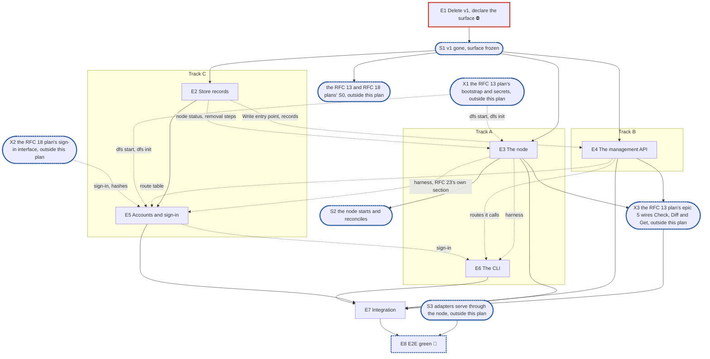

# RFC 23 — control plane v2: implementation plan

**Scope.** [RFC 23, the control plane](../rfcs/rfc-23-control-plane.md), single-node. The related RFCs
are in scope as follows:

- **Only the parts RFC 23 cannot work without:**
  - [RFC 13](../rfcs/rfc-13-configuration.md): the validators of the settings in scope (§6). The
    bootstrap (§2.2), the settings library and sealed secrets (§7) are the RFC 13
    configuration-lifecycle plan's, which this plan consumes (O11).
  - [RFC 16](../rfcs/rfc-16-metadata-store.md): the records RFC 23 adds and the fields it needs (§3,
    §4.2), and a share's removal steps (§2.3.2), which the store today stops after the mark.
  - [RFC 18 §8.1](../rfcs/rfc-18-identity.md#8.1%20The%20API%27s%20sign-in%20interface): the API's
    sign-in interface, which the RFC 18 plan builds and epic 5 consumes (O11).
  - [RFC 25](../rfcs/rfc-25-observability.md): the health registry and watchdog (§3, §8.1) and the
    `api_`, `node_` and `audit_` series (§2.1).
- **Constraints only:** RFCs 0, 8, 9, 11, 12, 14, 15, 17, 20, 24, 26, 27 and 30.

**Not built by this plan.** The user decided to defer the following; §6 O2 lists each with what it
waits for:

- the cluster rows (RFC 23 §4.6's claim takeover, §8's **(cluster)** rules, §9's schema gate and
  CP15, the multi-node tier of §12);
- OpenID Connect sign-in (RFC 23 §5.5);
- the provisioning file (RFC 23 §3.6);
- the actions whose owning RFC has no implementation: `rehome`, `accept-copy`, `rebuild-index`,
  `rebuild-reverse-index`, `declare-lost`, `acknowledge-unreadable`, `drain`, `decommission`,
  `raise-format`, and the snapshot, backup and move resources;
- the event streams (RFC 23 §6, `GET /api/v1/events/{stream}`);
- the rest §6 O2 lists, each with its trigger.

**Tracks.** A, B and C, with no owner.

**Programme.** #3119, route B, on `feat/storage-v2`. This plan delivers its stage 5 (the node that
builds and drives the adapters; RFC 20's plan defers its epic 7 to this node), stage 6 (users, groups,
shares and grants written in the store through the API) and stage 7 (cutover). One divergence: by the
user's decision, v1 is deleted in epic 1 rather than at the end, and the server binary is rebuilt from
nothing as the pieces connect (§6 O1).

**Divergence from the planning skill.** There is no test-foundations epic, by the user's decision. The
pieces it would hold already exist or land with their first consumer:

- the leak check is `pkg/block/journal/journaltest/prof`, which RFC 20's plan's epic 2 moves to
  `internal/prof` (#4000); each epic uses whichever path exists when it lands;
- the KV fault wrapper is `pkg/metadata/kv/kvtest`'s;
- the architecture tests guard epic 1's deletion, so they land in epic 1;
- the node harness lands in epic 3 with its first test.

The §1.5 instruction, copied verbatim, says epic issues exist before "E2's pull request": that is
the skill's red-suite epic, which this plan does not have, so the clause binds no epic here.

**Naming.** v1 is today's control plane: `pkg/controlplane`, `internal/controlplane`, the SQL
control-plane database, `pkg/apiclient`, and `cmd/dfs` and `cmd/dfsctl` as they stand. v2 is RFC 23's
node and management API. v1 and v2 never run in the same binary, so no user-visible name carries a
version.

**Transition policy.** Fresh installs only, as #3119 decided on 16 Oct. A start that finds v1's
database or configuration refuses and names it. No migration tool.

**Defaults used from the skill's inputs:**

- output path: `docs/internals/planning/rfc-23-control-plane-plan.md`;
- dashboards: none;
- the bootstrap file keeps its path, with a flag to name another (D6, the RFC 13 plan's).

**RFC amendments in this pull request.** The user agreed to five, all on draft RFCs:

- **A1. An adapter's port becomes an adapter setting**, `adapters.<protocol>.port`, at installation
  scope with a node override, restart-class. The listen addresses stay the host's bootstrap facts,
  which the node hands the adapter in `config.Adapter.Addrs`, as RFC 20 §3.6 and its plan's
  epic 1 (R37) already say. The defaults stay v1's unprivileged 12049 and 12445, and the port
  mapper's port is its own setting. This touches RFC 13 §2.2, RFC 13 §5's restart row, §9 and
  Appendix B, RFC 20 §3.6 and `config.Adapter`, and RFC 23 §2.3 and §3.4.
- **A2. A node's identity is generated by the initialisation step** and written as a checksummed
  `node-id` file in each journal directory, after the journal's `Init` and before the store records
  it; a bootstrap key may name it, a copy that differs from the key or from another copy, or does
  not parse, refuses the start rather than being rewritten, and a start with no copy and no key
  refuses. A start writes a missing copy only beside a journal the store records for this node; a
  directory whose journal is not yet recorded, a replaced device's, gets its copy only from
  `dfs init` or a recovery import. This touches RFC 13 §2.2 and §9, RFC 28 §2.1 and §4.2, RFC 8
  §2.6's `Deps.Node`, and RFC 23 §2.1 and §5.4.
- **A3. RFC 16's `ControlPlane` gains one transactional entry point.** It takes the audit and
  idempotency metadata and runs a function over a transaction that carries the view's writes; a
  sign-in counts each attempt in a `SignInFailures` record written the same way, before its password
  is checked. The view
  also gains a setting's delete and the `Secret` reads and writes the RFC 13 plan builds on, and
  the `Secret` record an owner beside its kind (the RFC 13 plan's D10). This
  touches RFC 16 §2.3, §3 and §4.2, and RFC 23 §4.3 cites it.
- **A4. Only reconciled records carry a position.** RFC 23 §2.4 narrows "every control-plane record"
  to a setting, a share and a principal, as RFC 16 §3 has it; a grant, an export policy, a netgroup
  and a quota are versioned instead, and §4.4's quota entity tag is its version. This closes RFC 23
  §13 item 1.
- **A5. The domain's actions are RFC 23's.** §4.1's action table gains `resolve-principal`,
  `test-directory`, `join-domain` and `rotate-machine-password`, each an operation the runner
  drives through identity, the rotation sealing its next `Secret` version before it sets the
  password at the domain controller, as RFC 18 §3.5 orders it; the closed `OpKind` set gains
  `identity.nt-hash-delete`, which setting `identity.ntlm` off starts; and §3.5 says how a grant
  names a directory principal (resolve first, then grant by ID) and where the join's state is
  read. Leaving the domain has no action until RFC 18 defines it (§6.1). This touches RFC 23 §3.5,
  §4.1, §4.5 (an offline join carries no `Idempotency-Key`), §4.6 and §12, and settles the RFC 18
  plan's O5 (#4058).

## 1. Introduction

### 1.1 What we are building

RFC 23's "Start here" and "In short" describe the result: one composition root, `node.New`; a
management API that writes records and never calls a component; and a CLI that is only a client of
that API. "Control plane" names that pair. No v2 package or object carries the name.

What replaces what:

| v1 | v2 | Fate |
| --- | --- | --- |
| `pkg/controlplane/runtime/**`, `pkg/controlplane/controlplane.go` | `internal/node` | deleted in epic 1 |
| `pkg/controlplane/api`, `internal/controlplane/api/**` | `internal/node/api` | deleted in epic 1 |
| `pkg/controlplane/models`, `pkg/controlplane/store` (GORM, SQLite/PostgreSQL) | records in `pkg/metadata/kvstore` | deleted in epic 1 |
| `pkg/controlplane/api/dto` | `pkg/node/apiv1` | deleted in epic 1 |
| `pkg/apiclient` | `pkg/apiclient`, rewritten on `pkg/node/apiv1` | bodies deleted in epic 1 |
| `cmd/dfs` (`start` composes v1) | `cmd/dfs`: `init`, `start`, `reset-admin` over `node.New` | rewritten from nothing in epic 1 |
| `cmd/dfsctl` command bodies | the same tree, rebuilt | bodies deleted in epic 1 |
| `pkg/health`'s `share.go` and `cache.go` | `pkg/health`, with RFC 25's registry and watchdog beside the `Checker`, `Report` and `wrap.go` helpers the stores implement | those two deleted in epic 1 |
| `pkg/snapshot` (only v1 calls it) | none | deleted in epic 1 |
| `pkg/identity/**` (v1 resolver, cache, link store, LDAP provider) and `pkg/auth/sid/mapper.go` | RFC 18's `pkg/identity` and RID counter (RFC 18 plan) | deleted in epic 1, whole: the LDAP provider imports the root files; the RFC 18 plan lifts what it reuses from history. `internal/auth/netlogon` stays, without importers, for the RFC 18 plan to move |
| `pkg/config`'s v1 sections | `pkg/bootstrap`, the host's bootstrap only (RFC 13 plan) | stripped in epic 1; renamed and finished by the RFC 13 plan |
| key `database.*`, the `controlplane.db` file | none | refused by the RFC 13 plan's loader; the database file by epic 3's start |
| keys `kerberos.*`, `ldap.*`, `identity.machine_sid`, `DITTOFS_KERBEROS_*`, `DITTOFS_LDAP_*` | `identity.*` settings and `Secret` records (RFC 18 plan) | refused by the RFC 13 plan's loader |
| keys `controlplane.jwt.*`, `DITTOFS_CONTROLPLANE_SECRET`, `admin.*`, `DITTOFS_ADMIN_INITIAL_PASSWORD` | the installation's signing-key `Secret`; the initialisation step's password reference | refused by the RFC 13 plan's loader |
| keys `controlplane.port`, `controlplane.tls`, `metrics.*`, `shutdown_timeout` | the bootstrap's API and metrics listen addresses and the API's TLS (RFC 13 §2.2); `adapters.<protocol>.drain_timeout` | refused by the RFC 13 plan's loader, naming each |
| keys `gc.*`, `snapshot.*`, `integrity.*`, `metadata.*`, `blockstore.*` (except the journal path) | settings records (RFC 13 Appendix B) | refused by the RFC 13 plan's loader, naming the setting that replaced each |

v1 is about 45,000 lines of non-test Go. The code that imports it outside the deleted trees is
`pkg/config`, the harness (`test/harness/fixture` and `test/harness/run` through it), `test/e2e`
(`helpers` and the tests that drive v1 through it) and `test/integration/ad-dc`, whose tests import
`pkg/identity` and `pkg/identity/ldap` and build under `lint-go`'s `ad_dc` tag. Epic 1 fixes or
removes each, as its expected content says. `k8s/dittofs-operator` imports nothing of this module: it mirrors v1's wire shapes by
hand (§6 O4).

**Dependency limits.** The node composes components that exist on `feat/storage-v2`: the metadata
store, the remote stores, the syncer, open state, the engine, GC, identity and `*vfs.Filesystem`. It
specifies none of them. The adapters it starts are RFC 20's: RFC 20's epic 7 wires them into this
plan's node once S2 is reached, and this plan builds none of that wiring (D12). RFC 21's and RFC 22's handlers must be on the new filesystem service
before a share can be mounted, and that wait is S3.

### 1.2 How the plan is organised

- Epic 1 deletes v1, declares the v2 surface and lands the architecture tests.
- Five middle epics build v2 on three tracks:
  - Track A: the node, then the CLI;
  - Track B: the management API;
  - Track C: the store's records, then accounts and sign-in.
- The integration epic runs RFC 23 §12's single-node rows through the API, once every middle epic
  has landed.
- The E2E green epic waits for adapters that serve through the node.

RFC 23's suites paragraph puts every check in `unit`, `e2e` and `e2e/kerberos`. None of those keeps a
`known.yaml`, so no test lands red: each lands green with the epic that makes it pass. A middle epic
tests at its own layer. A §12 row that needs more than one middle epic runs in the integration
epic.

### 1.3 What epic 1 must deliver

**The clean slate.** v1 is deleted, as §1.1's table lists, with the tests that drive it. The cells
that start v1's server are already off (D9). The module, `dt` and every cell still on build and pass
without it.

**The frozen surface:**

- the node's exported surface (RFC 23 §2.1, "The node's surface");
- the wire types package and the CLI's client entry points (RFC 23 §4.1, §4.6 and §4.7's codes, §7);
- the kvstore view's methods with `expect`, as RFC 16 §3 declares them, and amendment A3's entry
  point;
- the new `cmd/dfs`, whose commands are wired to stub bodies.

**The seams it exposes:**

- `node.Config`'s fields, which are the test harness's injection points: the KV, the clock, the
  fault seam, the metrics registry and the logger;
- the API's `Deps`: the store view, the sign-in interface of RFC 18 §8.1, the RFC 13 plan's settings
  table (RFC 23 §4.3's validators), the health registry, the clock, the logger and the registry.

It declares no internal interface: each one in this list has a consumer in production and in the
tests of the epic that fills it in.

**The architecture tests**, each of which fails once against a planted violation, built like
`pkg/block/journal/imports_test.go`:

- only `cmd/dfs` and the harness import `internal/node` (RFC 23 CP16);
- no package under `internal/node` but `node` itself imports a component's implementation (CP16);
- the CLI's dependency closure names no store or server package (RFC 23 §7, CP14);
- nothing imports a deleted v1 path.

### 1.4 The test catalogue and its components

There is no test-foundations epic (see the header). This section only lists the catalogue.

**The catalogue.** RFC 23 §12's rows and invariants CP1 to CP16 (§10). Each lands green in the
epic named under that epic's **Done when:** line. The multi-node rows, CP15, and the "§4.4
background field" row, which starts a re-home, are deferred (§6 O2). Scenarios from other sources,
each landing in the epic named:

- a start on a host whose data directory holds v1's database is refused and names it (#3119, route
  B) — epic 3; a v1 key in the bootstrap is the RFC 13 plan's;
- a second `dfs init` on a finished installation is refused (RFC 16 §3.2), and one on an interrupted
  installation finishes it — epic 5;
- a share whose binding fails to attach is reported refused, and never answered `201` with a failure
  in the log (RFC 23 Appendix B, row §2.1, §2.3) — epic 7;
- the bootstrap administrator holds no uid (RFC 23 Appendix B, row §5.1, §5.4) — epic 5;
- disabling an account takes effect on the next call, not at token expiry (RFC 23 Appendix B, row
  §5.3) — epic 7.

**The known-failure mechanism.** None. The suites RFC 23 names keep no `known.yaml`, so this plan
registers no suite and no group, and changes no `lint-go` tag.

**The test components:**

- the in-process node harness, `internal/node/nodetest`: `node.New` over the in-memory KV that RFC
  16's KV suite holds, the API on `127.0.0.1:0`, and an injected clock. It lands in epic 3, and
  epic 5 adds a signed-in caller of each role;
- `pkg/metadata/kv/kvtest`'s fault wrapper, for commit faults and unreachable reads;
- the leak check (`journaltest/prof`, `internal/prof` once #4000 lands), for goroutines,
  descriptors and heap.

### 1.5 General rules for each epic

> **Instruction for whoever expands an epic into its detailed description and subtasks,
> human or AI:**
>
> - **Creating an epic from this plan: use the `epic-breakdown` skill.** Whenever the user
>   asks to create an epic from this plan, or to expand, detail or break one down, run the
>   `epic-breakdown` skill (`.claude/skills/epic-breakdown/SKILL.md`) on this plan and that
>   epic, rather than writing the epic document freehand. It extracts the RFC's MUST and
>   MUST NOT into numbered requirements, estimates each subtask in man-days and suggests
>   the pull requests. A human doing it by hand follows the same skill.
> - **Epic and subtask, nothing else.** The units of work are the epic and its subtasks,
>   with subtask ids `<e>.<n>` (`subtask 4.3`, or `T4.3` for short), assigned by the epic
>   document. No other word names
>   them: not task, ticket, story, step or phase, in headings, tables, ids or prose.
> - **The epic stands alone for what to build.** Its requirements, subtasks and decisions
>   are in the epic document itself, which never refers to this plan for them or says "see
>   the plan": the RFC sections it implements, the interfaces it builds on, the
>   subtasks, and a short legend of the names it borrows from this plan (E1, E2, S1, the
>   integration epic, …). It cites the numbered rules below, without copying them, in a
>   table of how each applies: each row names its rule by number and bold title, which
>   says what the rule requires, and the table links this §1.5 with a full link (the
>   plan's path and the section's anchor) and the `CLAUDE.md` sections that hold a rule,
>   so the epic reads alone and its reader can still open each rule's text in one click.
> - **The epic document records decisions, not progress, like this plan.** It has no
>   status fields, no checkboxes to tick and no sections to keep up to date as the work
>   goes on. It is revised through a pull request only when a decision changes.
> - **Subtasks are not pull requests.** A subtask is ideally up to 5 man-days. The owner
>   ships subtasks as they see fit, one pull request each or several together; the epic
>   document only suggests a grouping, each suggested pull request ideally up to 15
>   man-days. Cut and group by logic, readability, dependencies and a deliverable that can
>   be named, not to hit a number.
> - **Every subtask states how it meets each rule that applies to it.** A rule that does
>   not apply is named, with the reason.
> - **In the issue tracker, only when someone asks for issues,** following `epic-breakdown`
>   Step 6, their one description. Issues point at the documents and copy nothing. The
>   epic issues exist before E2's pull request lands, because each red test's
>   `known.yaml` entry names one; subtask issues come once their epic document has
>   merged. The release an epic ships in is set by the RFC's roadmap epic that its epic
>   issue sits under, never in a document and never on the epic issue on its own: the epic
>   issue and its subtask issues copy that roadmap epic's milestone, and an epic changes
>   release only by moving under the roadmap epic of the other release.

1. **Independent unit tests.** Each epic carries its own unit tests. They build on the test
   components (the node harness `internal/node/nodetest`, `pkg/metadata/kv/kvtest`'s fault wrapper,
   the leak check, `journaltest/prof` or `internal/prof` after #4000), on the implementation of an epic it depends on once that has landed, and only on
   the test doubles `CLAUDE.md`'s "Writing tests" allows: the in-memory KV that RFC 16's KV suite
   holds, and the in-memory `vfs.Service` that RFC 17 §8 holds. An API handler is tested with the
   calling account placed in its request context, which is an input rather than a double, until the
   integration epic runs the same check through sign-in. Epic 1 declares no internal interface for
   them to stand in for (rule 12).
2. **Fuzz every decoder of untrusted bytes** (`CLAUDE.md`, "Writing tests", the Fuzz paragraph,
   which states the property). For this RFC:
   - request bodies, including JSON merge patches;
   - the listing cursor;
   - the codecs of every record the store gains.

   Headers compared byte for byte, and the access token that `golang-jwt` parses, are not decoders
   of this component.
3. **Observability follows RFC 25.** Each epic owns the series of RFC 23 §11 for what it builds:
   - the store: `audit_records_total`;
   - the node: `node_reconciled_position`, `node_reconcile_errors_total`, `node_restart_pending`,
     and the RFC 13 plan's `config_generation_lag_seconds{kind}`, set from the positions it
     reconciles;
   - the API: the `api_` series and one span per call (RFC 23 §11, "Spans");
   - accounts: `api_auth_failures_total`, `api_sign_ins_total`.

   Conditions go in RFC 25 §3.9's registry: `config_generation_behind`, raised by the node from the
   same positions. `adapter_refused` is the
   adapters' own, raised where RFC 20's plan's epic 7 wires them into the node.
   `namespace_unclaimed` is not raised while every namespace answers held (§4.3 above). No exception
   applies: RFC 23 restricts no dependency.
4. **Profiling.** Every node and API test runs under the leak check, and fails on a goroutine,
   descriptor or heap growth left behind. No allocations-per-operation assertion: RFC 23 names no
   hot path with an allocation budget.
5. **Public interface and internals** (`CLAUDE.md`, "Verifying a change"). Tests cover the internal
   package API and the behaviour it enables, under `-race`, at the layer that consumes a value. For
   example, `NotBefore` is proven by a refused call, not by the field being written. RFC 23 §12
   requires its rows to run through the API against the node `node.New` builds, so they run in the
   integration epic.
6. **Known failures shrink** (`CLAUDE.md`, "Writing tests", "By kind"). No suite RFC 23's checks run in
   keeps a `known.yaml`, so no test lands red. Should a later epic register a cell with one, a red test
   that turns green leaves its suite's `known.yaml` in the same change, since RFC 29 §4.7 fails a run
   whose known failure passes.
7. **v2 ignores v1.** v1 is deleted before any v2 code lands, and an architecture test fails on an
   import of a deleted path. Nothing of v1 is copied: what v2 needs from it is rewritten against RFC
   23. What stays was never v1's alone, and is kept in place:
   - `internal/tlsconfig`, for the API's listener;
   - `internal/cli`'s output, prompt and credentials helpers;
   - `cmd/dfsctl`'s root command and its context commands;
   - `pkg/config`'s loader, renamed to `pkg/bootstrap` by the RFC 13 plan;
   - `pkg/health`'s `Checker` and `Report`.
8. **Real dependencies for properties of those dependencies**, as `CLAUDE.md`'s "Writing tests"
   says. For this RFC:
   - "a write commits with its audit and idempotency records or not at all" runs on Badger under
     `t.TempDir()`, with the commit faulted;
   - "a deletion resumes after a restart" restarts a node over the same Badger directory;
   - TLS runs on a real listener;
   - mount refusals use a kernel client, at the e2e tier.
9. **Code comment conventions** (`CLAUDE.md`, "Code comments"). RFC 23's notes go at the code site
   that implements them:
   - the `decision:` notes of §2.1, §2.5, §3.2, §4.1, §4.4, §4.5 and §5.4;
   - the `ponytail:` notes of §2.1, §2.2, §2.4, §4.3, §4.5 and §5.2.
10. **A test must be able to fail** (`CLAUDE.md`, "Writing tests"), and nothing else would catch
    the change it guards: not the compiler, not the diff, not a later epic's tests. "Stub bodies are
    never called by production" stays a review rule.
11. **A symbol is exported only if RFC 23's interface uses it.** The exported surface is:
    - `internal/node`'s `New`, `Start`, `Stop` and `Config`;
    - `pkg/node/apiv1`'s wire types;
    - `pkg/apiclient`'s client;
    - kvstore's view methods.

    All of it is frozen at S1. A deferred action or resource adds an `OpKind`, a code or a type
    additively, as RFC 23 §9 allows within a major version. The route table, the write path, the
    problem table and the token code stay unexported inside `internal/node/api`.
12. **Each subtask creates only what it declares.** No empty package and no stub without a caller.
    A package, an option or a test helper lands with its first consumer.

## 2. Epics at a glance

| # | Epic | Content | Subtasks | Man-days | Track | Blocks |
| --- | --- | --- | --- | --- | --- | --- |
| E1 ⛔ | Delete v1, declare the surface | v1 deleted with the tests that drive it, harness fixed; the node's, wire types', client's and kvstore's surfaces; the new `cmd/dfs` skeleton; architecture tests | 11 | 15.5 | team | every epic; the RFC 13 plan (#4059) and the RFC 18 plan (#4058) |
| E2 | Store records | the records and fields RFC 16 declares for RFC 23; A3's entry point; a share's removal steps; expiry | 8 | 20.5 | C | E5; partly E3, E4 |
| E3 🔀 | The node | `dfs start` on the RFC 13 plan's bootstrap (X1), composition with RFC 8's root duties, start and stop, reconcile, node status, health, the operation runner, share and principal deletions driven, RFC 23's own settings section, the harness | 10 | 24 | A | E5 (partly), E6 (partly), E7 |
| E4 | The management API | server, route table, write path, preconditions, idempotency, problems, reads, resources with a share's export policy, operations, audit read, the domain's actions (A5) | 13 | 30 | B | E5 (partly), E6 (partly), E7 |
| E5 🔀 | Accounts and sign-in | on RFC 18 §8.1's interface (X1, X2): resumable `dfs init`, `dfs reset-admin`, tokens, sessions, roles, throttling, first password, signing key and its retention | 8 | 18 | C | E6 (partly), E7 |
| E6 | The CLI | the client on the wire types, the rebuilt `dfsctl`, generated reference | 6 | 13 | A | E7 |
| E7 | Integration | RFC 23 §12's single-node rows through the API, the harness's server fixture, the guides and `CLAUDE.md` | 5 | 13.5 | team | E8 |
| E8 🔀 | E2E green | the e2e helpers rebuilt on the new client, the e2e rows, the #3714 filter's entries removed | planned after S3 | planned after S3 | team | — |
| | **Total** | | **61** | **134.5** | | |

**Plan estimate: 61 subtasks, 134.5 man-days, not counting epic 8.**

The figure counts none of the work this plan consumes from the RFC 13 plan (#4059) and the RFC 18
plan (#4058), which estimate it once, in their own epics.

The skill's estimate for RFC 23's 1,841 lines is 5 middle epics (`round(1841 / 400)`), and this plan
has 5.

**Legend.** ⛔ is a blocker; 🔀 waits on a synchronisation point, in part for E3 and E5 (X1, X2, X3). "team" is an epic that belongs to
no track. "Partly" means the dependent epic starts before the blocker lands and needs it for its
remaining pieces (§3.3).

## 3. Synchronisation points, blockers and the split

### 3.1 Dependency graph



### 3.2 Synchronisation points

- **S1, v1 gone and the surface frozen.** Epic 1 has merged:
  - v1's trees are deleted; the module, `dt` and every remaining cell build and pass without them;
  - the node's, wire types', client's and kvstore's exported surfaces are declared;
  - `dfs init`, `dfs start` and `dfs reset-admin` exist, with stub bodies;
  - the architecture tests run in `unit`.

  Unblocks epics 2, 3 and 4, and is the S0 of the RFC 13 plan (#4059) and the RFC 18 plan (#4058).
- **S2, the node starts and reconciles.** `node.New` composes every component that exists, the
  start and stop steps run in order, and reconcile applies share changes and reads the settings
  generation; setting changes reach the components once X3 is in. This is RFC
  20's plan's S4 ("`internal/node` exists"), so it unblocks RFC 20's epic 7, which builds the
  adapters through their factories inside this node.
- **🔀 X1, the RFC 13 plan's bootstrap and secrets.** Outside this plan: #4059's epic 2
  (`pkg/bootstrap`, the node identity) and epic 4 (`pkg/secrets`). Epic 3 builds its composition,
  start and stop and reconcile before it, on a `node.Config` its tests fill in; `dfs start` reads
  the bootstrap once it lands. Epic 5's `dfs init` and its signing key wait for it.
- **🔀 X2, the RFC 18 plan's sign-in interface.** Outside this plan: #4058's epic 2 (`APISignIn`,
  `NewHashes`). Epic 5 builds tokens, sessions, roles and throttling before it, over epic 2's
  records; sign-in, the first password and `set-password` wait for it. This plan's epic 5 is the
  one place the API is wired onto it.
- **🔀 X3, the RFC 13 plan's wiring.** Outside this plan: #4059's epic 5 puts reconcile's `apply`
  on `settings.Diff` and `Get` and the write path on `Check`, in the slots epics 3 and 4 leave, and
  names RFC 23's own section in the node's table. It waits for epics 3 and 4; integration waits for
  it.
- **🔀 S3, adapters serve through the node.** This is outside this plan: RFC 20's epic 7, plus RFC
  21's and RFC 22's handlers on the new filesystem service. A share can then be mounted from a
  server `node.New` built. Unblocks epic 8.

### 3.3 Blockers

| Epic | Blocks | Why |
| --- | --- | --- |
| E1 ⛔ | every epic; the RFC 13 plan (#4059) and the RFC 18 plan (#4058) | Each epic builds on the frozen surface, and v1's trees would otherwise collide with v2's names (`cmd/dfs`, `pkg/apiclient`, `pkg/health`, `pkg/config`). Both other plans start at their S0, this epic's merge: #4059 on the stripped `pkg/config`, #4058 on v1's identity deleted. Only the deletion half unblocks them, but it cannot land alone, since the module must build with v2's names in place of v1's. |
| E2 | E5; partly E3 and E4 | E5's accounts, tokens and sessions are E2's records. E4 builds its server, route table, problem table and reads before E2 lands, and its write path once A3's entry point is in. E3 builds its composition and start and stop before E2 lands, and its node status, the sweeper's start and the removal's driving once E2's records and steps are in. E2's sweeper takes each retention as an input, so it needs no setting. |
| E3 | E5 (partly), E6 (partly), E7 | Epic 5's signed-in callers extend the harness, and its sessions and tokens read RFC 23's own section; the CLI's tests run against the node the harness builds; integration runs every row on it. |
| E4 | E5 (partly), E6 (partly), E7 | Epic 5's sign-in routes go in the route table; the CLI is built against `pkg/node/apiv1` from S1, and tested against the routes. |
| E5 | E6 (partly), E7 | The CLI's `login` calls sign-in; every integration row runs as a signed-in caller. |
| E6 | E7 | Integration's "§7 CLI" row runs the CLI's whole suite. |
| E7 | E8 | E2E green runs the server that integration finishes. |

### 3.4 Splitting the work

- **Track A** takes epic 3 at S1. It starts with the composition and start and stop, on a
  `node.Config` its tests fill in, which need no new records and no bootstrap; it reads the bootstrap
  once X1 is in, and reaches the node status and the removal's driving once epic 2's records are
  in. Then it takes epic 6, the CLI, whose client can start against
  `pkg/node/apiv1` while epics 4 and 5 are still landing.
- **Track B** takes epic 4 at S1. Its first pieces are the server, the route table, the problem
  table and the reads, which wait on nothing. Its write path joins once epic 2's entry point lands.
  Track B is the only track with one epic, and the largest one: once its routes are in, it leads
  integration.
- **Track C** takes epic 2 at S1, then epic 5. Epic 5 starts with tokens, sessions and the role
  table, which need only the user fields epic 2 lands first, puts its routes in epic 4's table and
  its callers in epic 3's harness once those land, and takes sign-in and `dfs init` once X1 and X2
  are in.
- **The team converges** at epic 1 (one pull request, since the deletion and the new surface must
  land together) and at epic 7.

## 4. Implementation decisions

### 4.1 Directory layout

```text
cmd/dfs/                      new server binary: init, start, reset-admin           E1 skeleton, E3, E5
internal/node/                composition root: New, Start, Stop, reconcile,         E1 surface, E3
                              node status, operation runner
internal/node/api/            the management API server: route table, write path,    E4, E5
                              problems, preconditions, idempotency, auth, audit read
internal/node/nodetest/       in-process node harness (KV, clock, 127.0.0.1:0)       E3, E5
pkg/node/apiv1/               wire types, standard library only                      E1
pkg/apiclient/                client on pkg/node/apiv1 (same path as v1's)           E1 surface, E6
cmd/dfsctl/                   CLI: the noun-verb tree, bodies rebuilt                E6
pkg/health/                   + RFC 25's registry and watchdog, the parts used       E3
pkg/metadata/entity/          + RFC 16's records for RFC 23, and its User fields     E2
pkg/metadata/kvstore/         + those records, expect on every write, A3's entry     E1 surface, E2
                              point, a share's removal steps
```

### 4.2 Decisions

**D1. Layout: the API's server lives inside the node's tree, and its wire types under `pkg/node`**
(§4.1). This is the user's decision.
- **Why.** The node builds, starts and stops the API, and nothing else imports it. The wire types
  are the stdlib-only leaf the CLI imports (RFC 23 §7). The leaf rule is about imports, not paths, so
  the `pkg/node` prefix costs nothing.
- **Prior art (from memory).** Kubernetes splits `k8s.io/api` types from the apiserver; Vault splits
  its `api/` client package from `http/`.
- **Applied by** epic 1.

**D2. The router is `net/http.ServeMux`, with one route table.** A pattern cannot hold
`{id}:verb`, so `POST /…/{id}` is registered and the verb is split off with `strings.Cut`. One table
of method, pattern, role, operation kind and handler drives the mux, and RFC 23 §12's route-list
check reads the same table. chi leaves the server: it remains only in two e2e snapshot tests, which
epic 1 deletes with the rest of v1's e2e tests; their cells are already off (D9).
- **Prior art (from memory).** The Go 1.22 mux patterns; Kubernetes uses go-restful.
- **Applied by** epic 4.

**D3. Access tokens are HS256 JWTs signed with `golang-jwt/jwt`**, already a dependency, with a
`kid` header naming the signing key's version so RFC 23 §5.3's rotation verifies old tokens.
- **Prior art (from memory).** Vault uses opaque tokens; Kubernetes' service-account tokens are JWTs
  with a `kid`.
- **Applied by** epic 5.

**D4. The wire types are hand-written Go**, with no OpenAPI generator. The CLI is the only typed
client; an OpenAPI document is generated from the route table when a non-Go client needs one.
- **Prior art (from memory).** Vault's `api` and MinIO's `madmin-go` are hand-written leaf packages.
- **Applied by** epic 1.

**D5. Settings are reached by one generic resource, plus each resource's own spec.**
`dfsctl setting get|set|unset <scope> <key>` covers every RFC 13 key with no CLI change per setting,
and resource commands carry only their spec's fields.
- **Prior art (from memory).** `git config`, `kubectl set`.
- **Applied by** epics 4 and 6.

**D6. The bootstrap is the RFC 13 plan's** (its D7): the path `~/.config/dittofs/config.yaml`,
`--config` and `DITTOFS_CONFIG`, the refused v1 keys and the node identity's `node-id` files, in
`pkg/bootstrap`. This plan's epics read it through that package. The launchers are that plan's
too: `docker-compose.yml`, `docker/` and `dfsbench` stop working from this plan's epic 1, which
deletes the v1 server they start, until the RFC 13 plan's epic 6 starts each through `dfs init`.
This is the user's decision.
- **Prior art (from memory).** etcd and PostgreSQL keep a host file of the same scope.
- **Applied by** epics 3 and 5, as consumers.

**D7. The CLI keeps today's noun-verb tree** and resolves names to IDs. `--wait` is opt-in, as RFC
23 §7 says. Output is `-o table|json|yaml`, and the reference is regenerated by `cmd/gendocs`.
- **Prior art (from memory).** `gh`, `vault`, `mc admin`.
- **Applied by** epic 6.

**D8. The operation runner lives in `internal/node`,** because the work it drives belongs to
components only the root holds (RFC 23 CP16). The API writes operation records and never drives
one.
- **Prior art (from memory).** TrueNAS's job manager runs beside its middleware's API.
- **Applied by** epic 3.

**D9. v1 is deleted in epic 1; the cells that start its server are already off.** On
`feat/storage-v2`, the plan job's filter (#3714, `tests.yml`'s `V2`) skips `e2e`, `pjdfstest`,
`pynfs`, `wpts`, `smbtorture`, `cthon04`, `nfstest`, `clients`, `fio-verify`, `bench-smoke`,
`system`, `unit/windows`, `integration/ad-dc` and `integration/kerberos`, so `test/suites.yaml`
keeps develop's entries and every RFC's suites paragraph still names a registered suite. The `operator` cell runs envtest in its own module
and starts no v1 server. `develop` serves v1 until the programme's cutover merge. This is the user's
decision.
- **Prior art.** None found.
- **Applied by** epic 1. Who turns each back on:
  - epic 8 rebuilds the setup that drives v1's `dfsctl` and configuration (`test/harness/env.sh`'s
    `stack_dev_user`, `test/posix/setup-posix.sh`, the SMB-conformance bootstrap, `test/scenarios`)
    on the new CLI, and removes the entries of every suite but the three below;
  - `integration/ad-dc` is the RFC 18 plan's epic 6 (#4058);
  - `integration/kerberos`, whose code the branch deleted, and `unit/windows`, skipped for its
    cost, go with the `V2` filter itself, deleted at cutover as RFC 20's plan's ledger has it.

**D10. Secrets are the RFC 13 plan's** (its D4 to D6): `pkg/secrets` seals each version as an
envelope under its role's key through `pkg/keyprovider`, fills RFC 16's `Secret.KeyID`, and keeps
`Secret.Version` the rotation counter. This plan's epics write and resolve secrets through it, and
by its D10: every `Seal` here passes the secret's kind and its owner, the record or setting key
whose field names it, and every `Resolve` the kind and role it expects, never the record's own.
- **Prior art (from memory).** Vault's barrier seals with AES-GCM under a key-encryption key.
- **Applied by** epics 3 to 5, as consumers.

**D11. `New` builds the node-level services; reconcile builds every per-record instance**, as RFC 23
§2.1 and §2.3 say. This is the user's reading of them, recorded so the epics keep to it: a remote
client exists only while a storage binding needs it, a share is an engine binding, a namespace is
added to GC, and an adapter exists only while its record enables it; a node with no enabled adapter
serves only the API. The adapter and sidecar rows are RFC 20's plan's epic 7 (D12).
- **Prior art (from memory).** Kubernetes' kubelet builds its managers once and its pods by
  reconcile.
- **Applied by** epic 3.

**D12. The node's adapter rows are RFC 20's plan's epic 7, not this plan's.** RFC 20's plan gives
its epic 7, planned after this plan's S2, the work of putting adapters into the node:
- building each enabled adapter through its protocol's `New`;
- applying a settings generation by `Reconfigure`, or, for a changed `port`, by `New`, then the old
  adapter's `Stop` and the new one's `Start` (O7);
- building each `Serving` from `Adapter.Addrs()` and calling the sidecars' `Sync` in RFC 20 §3.5's
  order;
- reporting `Health` and `Connections()`;
- `core`'s conditions and alert rules.

`config.Adapter`'s `Port`, and the rename of `pkg/adapter/config` to `pkg/adapter/settings`, are
RFC 20's epic 2's once #4000 merges (its D20). The adapters' section in the one settings table, and that table's `Check` wired into reconcile and the routes, are the RFC 13
plan's epic 5 (#4059).

This plan's node leaves that slot to it: reconcile calls the adapter rows that epic 7 writes. This
plan also takes over the rows of RFC 20's plan's deferral ledger that name RFC 23:
- the connection listing that replaces `/clients` and `/mounts` (RFC 23 §4.2, epic 4);
- netgroup CRUD (RFC 23 §3.5, epic 4);
- `dfsctl share mount` reading the adapter's `port` (epic 6).

Client eviction is O9.
- **Prior art.** None needed: this is a split between two plans.
- **Applied by** epics 3, 4 and 6.

### 4.3 Knowingly simple implementations

Each of these will carry a `ponytail:` marker at the code site:

- **Every namespace answers held.** Until RFC 27's `Claim` exists, the node treats a namespace a
  share names as held. It binds no share `Fenced`, raises no `namespace_unclaimed`, and keeps no
  claim generation.
  - *Ceiling:* a copied store image serves writes as if it were the original.
  - *Upgrade path:* call `Claim` at start step 5 and on a moved claim generation, which RFC 16 adds
    with it.
  - *Epic:* 3.
- **The runner keeps no claim.** At start, it resumes every operation whose record has not ended.
  - *Ceiling:* a second node.
  - *Upgrade path:* the claim and its lapse-takeover, with the cluster rows. A record with no claim
    reads as lapsed, so nothing migrates.
  - *Epic:* 3.
- **A rotation switches in one step on one node.** "Every node holds the new version" is this node,
  so the new signing key signs at once. The old one still verifies until the last token it signed
  has expired (RFC 23 §5.3): the rotation's last step prunes it once an access token's 15 min have
  passed since the switch. API tokens and refresh tokens are opaque and stored as hashes, so no
  signed token outlives that.
  - *Ceiling:* a second node.
  - *Upgrade path:* a wait step on the versions node status reports, with the cluster rows.
  - *Epic:* 5 (the signing key).
- **A parked long poll re-reads its record once a second** on the injected clock, with no
  notification hub.
  - *Ceiling:* RFC 23 §4.3's bound of parked polls, at one read each per second.
  - *Upgrade path:* signal parked polls from the node's per-second counter read.
  - *Epic:* 4.
- **One sweeper deletes every expiring record** in bounded batches over time-keyed prefixes: RFC
  16's `XP` tags (idempotency, ended operations, sessions, a source's and a pair's sign-in
  failures, API tokens), and audit past retention. It takes each retention as an input.
  - *Ceiling:* one pass per kind per interval.
  - *Upgrade path:* per-kind schedules, when a profile shows the sweep.
  - *Epic:* 2.
- **A sign-in costs two fsync'd transactions,** the count before the check and its settlement after,
  and every attempt on one account contends on its one `SF` key.
  - *Ceiling:* sign-ins per second on one account, at one commit each way.
  - *Upgrade path:* none planned; the throttle exists to bound that rate. Measure it in epic 5's
    benchmark first.
  - *Epic:* 5.
- **The health registry holds only the conditions this plan raises,** and the watchdog covers only
  the loops the node starts.
  - *Ceiling:* RFC 25's full registry.
  - *Upgrade path:* RFC 25's own plan, which extends `pkg/health` without changing what is built
    here.
  - *Epic:* 3.

### 4.4 Code sketch

The sketch is illustrative: its signatures come from the RFC sections and code it cites, and the
epic documents decide the final names.

`cmd/dfs` reads the bootstrap, builds the node and drives it; `New` builds the node-level services
empty (epics 3 and 5):

```go
func start(ctx context.Context, path string) error {
	boot, err := bootstrap.Load(path) // X1, D6: --config or DITTOFS_CONFIG; v1 keys refused
	if err != nil {
		return err
	}
	if err := refuseV1Database(boot); err != nil { // §1.4: names the controlplane.db it found
		return err
	}
	n, err := node.New(node.Config{Bootstrap: boot, KV: kv.Open(boot.Store), Clock: systemClock{} /* ... */})
	if err != nil {
		return err
	}
	if err := n.Start(ctx); err != nil {
		return err
	}
	<-ctx.Done()
	return n.Stop(context.Background())
}

// dfs init (epic 5), resumable: a rerun skips each step already done and refuses only a
// finished installation (§1.4). In this order: kvstore.Init; each journal's Init, then its
// node-id through bootstrap.InitNodeID (temporary file, fsync, rename; A2), which adopts a copy
// already in any journal directory before it generates one, then RecordJournal under that ID;
// the administrator, its password stored through identity.NewHashes (X2).

func New(cfg Config) (*Node, error) {
	n := &Node{cfg: cfg, md: metadata.Open(cfg.KV /* ... */)}
	// D11: each service built empty from its own Deps; no store client, share or adapter yet
	n.engine, n.gc, n.identity, n.fs = engine.New(/* ... */), gc.New(/* ... */), identity.New(/* ... */), vfs.New(/* ... */)
	n.health = health.NewRegistry(cfg.Clock) // §4.3 above: only the conditions this plan raises
	n.runner = newRunner(n.md.ControlPlane(), cfg.Clock) // D8
	n.api = api.New(api.Deps{Store: n.md.ControlPlane(), SignIn: n.identity, Settings: n.table, Health: n.health /* ... */})
	return n, nil
}
```

Reconcile reads the counters once a second and calls the three per-record functions (epic 3); the
adapter rows are RFC 20's plan's epic 7 (D12):

```go
func (n *Node) reconcileLoop(ctx context.Context) {
	full := true // RFC 23 §2.3: at start, and after a failed read
	for range n.cfg.Clock.Tick(time.Second) {
		c, err := n.records.Counters(ctx)
		if err != nil {
			full = true // node_reconcile_errors_total (rule 3)
			continue
		}
		if full || c.ShareList != n.seen.ShareList {
			for _, s := range n.missing(ctx) { n.addShare(ctx, s) }   // records.List, paged
			for _, id := range n.removed(ctx) { n.removeShare(ctx, id) }
		}
		if full || c != n.seen {
			n.apply(ctx, c)
		}
		n.seen, full = c, false
		if st := n.status(); st != n.written { // RFC 23 §2.4: only when a value changed
			n.writeStatus(ctx, st) // node_reconciled_position, config_generation_lag_seconds
		}
	}
}

// X3: the RFC 13 plan's epic 5 fills this slot; shown for where it sits.
func (n *Node) apply(ctx context.Context, c Counters) error {
	next := n.table.Snapshot(ctx, n.records)            // the RFC 13 plan's snapshot
	n.restartPending(settings.Diff(n.applied, next))    // node_restart_pending
	n.identity.Apply(settings.Get[identity.Settings](next, n.nodeID))
	// ... *vfs.Filesystem, the engine and GC, each with its own section
	n.applySMB(ctx, settings.Get[adaptersettings.SMB](next, n.nodeID)) // D12
	n.applied = next
	return nil
}

// D12: written by RFC 20's plan's epic 7; shown for where it sits.
func (n *Node) applySMB(ctx context.Context, s adaptersettings.SMB) error {
	s.Addrs = n.cfg.Bootstrap.ListenAddrs // A1: addresses are bootstrap facts, the port a setting
	if old := n.smb; old != nil && n.smbPort == s.Port {
		return old.Reconfigure(ctx, s)
	}
	nu, err := smb.New(adapter.Deps{VFS: n.fs, Budgets: n.budgets, Metrics: n.cfg.Metrics, Tracer: n.tracer, Logger: n.cfg.Logger}, s)
	if err != nil {
		return err // reported refused; the old one keeps serving
	}
	// then the old one's Stop and nu's Start, in RFC 23 §2.3's restart-class row
	n.smb, n.smbPort = nu, s.Port
	return nil
}
```

An API write decodes, checks, and commits through A3's entry point; a setting's `PUT` (D5) and a
share's delete, which answers `202` with an operation (epic 4):

```go
func (h *handlers) putSetting(w http.ResponseWriter, r *http.Request) {
	// unknown fields refused, fuzzed (rule 2); expect from If-Match, or 0 for If-None-Match: *
	// (RFC 23 §4.4)
	value, expect, err := decodeWrite(r)
	if err != nil {
		h.problem(w, err)
		return
	}
	scope, key := scopeOf(r), r.PathValue("key")
	audit := auditOf(r, settingRef(scope, key)) // fn fills Before, After and Change
	err = h.store.Write(r.Context(), metadata.WriteMeta{Audit: audit, Idempotency: idempotencyOf(r)},
		func(tx metadata.ControlPlaneTx) error {
			// X3: the RFC 13 plan's epic 5 wires Check, with the caller's role for admin-only keys
			if err := h.table.Check(tx, callerOf(r).Role, scope, key, value); err != nil { // its reads tracked in tx
				return err
			}
			return tx.PutSetting(metadata.Setting{Scope: scope, Key: key, Value: value}, expect)
		})
	h.answer(w, r, err) // the problem table (RFC 23 §4.7); ErrIdempotentReplay writes the recorded answer
}

func (h *handlers) deleteShare(w http.ResponseWriter, r *http.Request) {
	// decode and precondition as above
	op := metadata.Operation{ID: newOperationID(), Kind: "share.delete", Target: ref, Account: callerOf(r)}
	err := h.store.Write(r.Context(), metadata.WriteMeta{Audit: auditOf(r, ref), Idempotency: idempotencyOf(r)},
		func(tx metadata.ControlPlaneTx) error {
			if err := tx.DeleteShare(id, snapshots, expect); err != nil { // the mark
				return err
			}
			return tx.PutOperation(op, 0)
		})
	h.answerOperation(w, r, op, err) // 202, Location: /api/v1/operations/{id}
}
```

The runner drives an operation no component drives on its own, `resolve-principal` here, through
identity's step (A5, D8, epic 3):

```go
func (r *runner) drive(ctx context.Context, op metadata.Operation, version uint64) {
	step := r.steps[op.Kind] // resolve-principal: identity's, the RFC 18 plan's epic 7
	for {
		next, done, err := step(ctx, op.Step) // resumes from the last durable step
		was := op.State
		op.Step, op.Updated, op.State = next, r.clock.Now(), stateOf(done, err)
		meta := metadata.WriteMeta{}
		if op.State != was {
			meta.Audit = r.auditOf(op) // every state change carries its audit (RFC 16 §3)
		}
		err = r.store.Write(ctx, meta, func(tx metadata.ControlPlaneTx) error {
			return tx.PutOperation(op, version)
		})
		if err != nil || op.State != metadata.OpRunning {
			return // a failed write is resumed at the next start (§4.3 above)
		}
		version++
	}
}
```

Sign-in verifies through identity, signs a token with its key's version, and every call reads the
account again (epic 5):

```go
func (h *handlers) signIn(w http.ResponseWriter, r *http.Request) {
	req, src := decodeSignIn(r), sourceOf(r)
	acct := h.resolve(r.Context(), req.Name) // the principal, or none: an unknown name counts by source only
	var wait time.Duration
	// RFC 23 §5.3: count before verifying, reads tracked, so a burst cannot pass at one count
	if err := h.store.Write(r.Context(), metadata.WriteMeta{}, func(tx metadata.ControlPlaneTx) error {
		wait = h.reserveAttempt(tx, acct, src) // reads the three SignInFailures and raises them
		return nil
	}); err != nil {
		h.problem(w, err) // fail closed: an attempt not counted is not checked
		return
	}
	if wait > 0 {
		h.retryAfter(w, wait)
		return
	}
	p, err := h.signin.VerifyPassword(r.Context(), req.Name, req.Password) // APISignIn (X2)
	if err != nil {
		// the refusal's audit, and no idempotency record (RFC 16 §3, RFC 23 §4.5)
		if werr := h.store.Write(r.Context(), metadata.WriteMeta{Audit: refusedAuditOf(r)},
			func(tx metadata.ControlPlaneTx) error { return nil }); werr != nil {
			h.log.Error("sign-in refusal not audited", "err", werr) // the attempt stays counted
		}
		h.problem(w, err)
		return
	}
	sess := h.newSession(r.Context(), p) // its Write resets the account's count and takes back the source's raise
	key := h.signingKey()                // the installation Secret: Resolve(ctx, storage role, kind key, ref), the kind this caller expects (D10)
	tok := jwt.NewWithClaims(jwt.SigningMethodHS256, accessClaims(p, sess))
	tok.Header["kid"] = key.Version // D3: rotation verifies older tokens by version
	h.writeTokens(w, tok, key, sess)
}

func (h *handlers) authenticate(r *http.Request) (metadata.User, error) {
	claims, err := h.verify(r) // jwt.Parse, the key chosen by kid, HS256 only
	if err != nil {
		return metadata.User{}, err
	}
	u, err := h.signin.Account(r.Context(), claims.Principal) // per call (RFC 23 §5.3)
	if err != nil || claims.IssuedAt.Before(u.NotBefore) || h.revoked(r.Context(), claims.Session) {
		return metadata.User{}, errUnauthenticated
	}
	return u, nil
}
```

## 5. The epics in detail

### Epic 1 — Delete v1, declare the surface ⛔

**Epic 1 estimate: 11 subtasks, 15.5 man-days.**

This epic deletes v1 whole and puts the frozen surface, and the tests that guard the layering, in
its place. It lands as one pull request, so the module never builds half of either.

**Owns:** RFC 23 Appendix B (the code it describes is removed); RFC 23 §2.1, "The node's surface", as
declarations; RFC 23 §4.1, §4.6 and §4.7's shapes and codes, as declarations; RFC 16 §3's
`ControlPlane` signatures with A3; RFC 23 CP14 and CP16, as architecture tests.

**Done when:**
- v1's trees in §1.1's table are gone;
- the module builds, `go vet` with every tag in `lint-go` passes, and `unit` is green;
- `lint-repo` is green: `internal/node` carries the architecture tests, and `pkg/node/apiv1` a test
  that every `OpKind` and problem code appears once in its closed set;
- `dt` builds and its registry test passes;
- the declarations compile with stub bodies;
- the architecture tests of §1.3 each fail once against a planted violation, then pass.

**Expected content:**
- Delete `pkg/controlplane/**`, `internal/controlplane/**`, `pkg/snapshot`, `pkg/identity/**`,
  `pkg/auth/sid/mapper.go`, v1's `cmd/dfs`, and `pkg/health`'s `share.go` and `cache.go` (the stores
  call `wrap.go`'s helpers).
- Strip `pkg/config` of v1's server sections, leaving the loader the RFC 13 plan renames to
  `pkg/bootstrap` (D6).
- Make the harness build without v1:
  - drop `test/harness/fixture`'s v1 server start, so `dt` compiles;
  - delete `test/integration/ad-dc`'s tests, which import `pkg/identity` and `pkg/identity/ldap`;
    the RFC 18 plan's epic 6 and 7 rebuild them;
  - delete `test/e2e`'s v1 driver: the `helpers` package, which imports `pkg/controlplane` and
    `pkg/apiclient`, the top-level `e2e` package, whose `main_test.go` and 51 other tests import it, and the `snapshot`
    package. `test/e2e/framework` stays: it imports nothing of this module (mounts, network
    namespaces, Kerberos). Their cells are already off (D9), and `lint-go`'s `go vet -tags=e2e`
    then compiles only what stays. Epic 8 rebuilds the helpers on epic 6's client and brings the
    tests back from history onto them.
- Delete `pkg/apiclient`'s and `cmd/dfsctl`'s v1 bodies, keeping what rule 7 lists. That includes
  the adapter and netgroup client methods that the RFC 20 epic 1 breakdown's D5
  (`rfc-20-adapters-epic1.md`) keeps for the e2e helpers: this epic overrides D5, since those
  methods go with the helpers they serve, and epics 6 and 8 rebuild the client and the helpers on
  the new API.
- Write `pkg/node/apiv1`: the resource envelope, page, problem, operation, progress, the closed
  `OpKind` and code sets, and the spec and status types of every in-scope resource (RFC 23 §3.1,
  without the deferred ones).
- Declare the node's surface (RFC 23 §2.1) with stub bodies.
- Declare the kvstore view's methods with `expect` (RFC 16 §3) and A3's entry point.
- Write the new `cmd/dfs` with `init`, `start` and `reset-admin` over the stubs. Both rebuilt trees
  keep their `commands` packages, `cmd/dfs/commands` and `cmd/dfsctl/commands`, which
  `cmd/gendocs` imports.
- Add a one-line note to `CLAUDE.md`'s architecture invariants that they describe v1 until epic 7
  rewrites them.
- Write the architecture tests (§1.3).

### Epic 2 — Store records

**Epic 2 estimate: 8 subtasks, 20.5 man-days.**

The metadata store gains every record and field RFC 16 declares for RFC 23, the one transaction an
API write commits in, and a share's removal steps past the mark.

**Owns:**
- RFC 16 §2.3 and §4.2, the records for RFC 23 and their keys;
- RFC 16 §2.3.2, the removal's steps, store side;
- RFC 16 §3, `ControlPlane` with `expect` and A3;
- RFC 23 §3.1's last paragraph;
- RFC 23 §4.5's record and its expiry;
- RFC 23 §4.6's record and its retention;
- RFC 23 §6's append-only rule and retention.

**Done when:**
- RFC 23 CP5, CP6, CP11 and CP12 hold on the store side;
- kvstore's conformance suite covers each new record, the entry point's all-or-nothing commit, and a
  removal resumed from its record after a restart, on Badger and on the in-memory KV.

**Expected content:**
- A3's entry point: the transaction type carrying the view's writes, and the audit and idempotency
  records written in it.
- `expect` on every write of the view, including the renames RFC 16 makes (`DeleteGrant`).
- `User.Role`, `NotBefore`, `MustChange` and `email` (RFC 23 §5.1, §5.3, §5.4, §3.5). These land first, since epic 5
  starts on them.
- `Position` on the reconciled kinds, and the principals-generation counter.
- The `Operation`, `IdempotencyRecord`, `Session`, `APIToken`, `SignInFailures` and `AuditRecord` records, with their
  codecs and fuzz targets; `SignInFailures` keyed by principal, by source and by the two together (RFC 16 §4.2). `AuditCursor` waits for the event streams (§6 O2).
- `Node` and `NodeStatus` records, the latter including the secret versions a node holds (RFC 23
  §2.4).
- A share's removal steps after the mark, in bounded batches, each resumable from the removal's
  record (RFC 16 §2.3.2).
- The sweeper (§4.3 above), over every `XP` tag RFC 16 §4.2 lists, with each retention passed in
  by its caller.

### Epic 3 — The node

**Epic 3 estimate: 10 subtasks, 24 man-days.**

`node.New` composes every component that exists, and the node starts, reconciles, reports and
stops as RFC 23 §2 says, on one node. `dfs start` becomes a working server.

**Owns:**
- RFC 23 §2, §2.1 to §2.5 (single node);
- RFC 23 §3.2's delete, driven past the mark;
- RFC 23 §4.6, the runner (single node);
- RFC 23 §8.1, the rows not marked cluster, but the OpenID Connect row (deferred, O2) and the
  adapter that fails to start (RFC 20's plan's epic 7, D12);
- RFC 13 §2.2 as a consumer: the RFC 13 plan builds it, A2's `node-id` files included (D6);
- RFC 8 §2.1 and §2.6's root duties, which the RFC 8 plan hands this root
  (`rfc-8-journal-only-engine-plan.md`, its scope table's composition row and §6 point 14);
- RFC 25 §3 and §8.1, the parts §4.3 above names.

**Done when:**
- RFC 23 CP1, CP3, CP4 and CP13 hold at the node's layer, driven by records the harness writes
  through kvstore;
- the §1.4 scenario assigned to epic 3 passes.

**Expected content:**
- The bootstrap and the node identity read through the RFC 13 plan's `pkg/bootstrap` (D6), and a
  v1 database file in the data directory refused at start.
- `node.New`: every node-level service of RFC 23 §2.1's table that exists on `feat/storage-v2`, each
  built empty from its own `Deps` (D11).
- The remote registry and the adapter factories that reconcile acquires instances through (D11).
  The registry builds the in-memory remote store for a binding that names it: the MVP's shares
  name it as their remote while nothing offloads (#4053), since the next bullet refuses a share
  with none.
- RFC 8's root duties: `addShare` refuses a share whose namespace names no remote block store
  (RFC 8 §2.1), reported refused (RFC 23 §2.4); and the engine's `Stats` adapted into RFC 25's
  registry as conditions and series.
- `Start` and `Stop`, in RFC 23 §2.2's order, with the start-failure and stop-bound rules.
- Reconcile: the counters read once a second, the full reconcile, and `addShare`, `removeShare` and
  the `apply` slot (RFC 23 §2.3), with the namespace simplification of §4.3 above. The RFC 13 plan's
  epic 5 fills `apply` on `settings.Diff` and `Get` (X3).
- RFC 23's own section, `api.session_lifetime`, `api.token_max_lifetime` and `audit.retention` (RFC
  13 Appendix B), as a typed struct with defaults and `Validate` (the RFC 13 plan's D2): the node
  starts epic 2's sweeper with its retentions, and epic 5's sessions and tokens read its lifetimes.
  The table row naming it is the RFC 13 plan's epic 5's. The §5.5 rows wait with OpenID Connect
  (O2).
- The node-status writer, writing at most once a second and only when a value changed, and the
  `node_` series (RFC 23 §2.4, §11).
- The health and readiness endpoints and the metrics listener, with RFC 25's registry and watchdog
  (RFC 23 §2.5).
- The operation runner on one node (D8, §4.3 above), with a slot per in-scope `OpKind` for its
  owner's step function, the domain's and `identity.nt-hash-delete` among them (A5).
- A user's and a group's deletion driven past the mark, their batches resumed at start (RFC 23
  §3.5, RFC 16 §3), which runs the restart clause of RFC 13 §9's "§7 user secrets".
- A share's removal driven past the mark: epic 2's steps, with the join of RFC 23 §2.3's removed-share
  row at step 3, resumed at start.
- `dfs start`: RFC 23 §2's `run`, and nothing else.
- The node harness, `internal/node/nodetest`.

### Epic 4 — The management API

**Epic 4 estimate: 13 subtasks, 30 man-days.**

The API server answers every in-scope resource and action, writes only records, and maps every
error to a status.

**Owns:**
- RFC 23 §3.2, §3.3 (without the deferred actions), §3.4 with A1, §3.5;
- RFC 23 §4.1 to §4.4, §4.5's server side, §4.6's reading and cancel, §4.7;
- RFC 23 §6's write and reading;
- RFC 23 §9, version discovery;
- RFC 23 §11's `api_` series;
- RFC 13 §6 as a caller: the write path leaves the slot that the RFC 13 plan's epic 5 fills with
  `Check` (X3).

**Done when:**
- RFC 23 CP2, CP5, CP6 and CP8 hold at the handler layer, with the caller in the request context
  (rule 1);
- RFC 23 CP11 holds on the API side: no secret value in an answer, an audit record, an idempotency
  record, a log line or a metric, an offline `join-domain` included;
- the error table's totality test passes.

**Expected content:**
- The server: TLS through `internal/tlsconfig`, the call bound and the parked long polls (RFC 23
  §4.3), and `/api/version` (RFC 23 §9). Until epic 5's authentication is in, every route but the
  unauthenticated health ones answers `401`, so `dfs start` never serves an unauthenticated call.
- The route table and the mux (D2), with the operation kinds of RFC 23 §4.1 that are in scope.
  Cancel is one route row that answers `not_cancellable` for every kind in scope (RFC 23 §4.6).
- The problem table and its totality test (RFC 23 §4.7).
- The write path: unknown-field refusal, the slot for the RFC 13 plan's `Check` (X3), which a
  setting's delete goes through as its put does, with the caller's role, `If-Match` and
  `If-None-Match`, `Idempotency-Key`, and A3's transaction with its audit record.
- Reads: the envelope, cursor listings, indexed filters, and `applied` joined from node status
  (RFC 23 §2.4, §4.1, §4.2).
- Shares: create, refusing one whose namespace names no remote block store (RFC 23 §3.2), quiesce
  and resume, rename and re-path, delete as an operation, a rebind of a share
  with content refused (RFC 13 §5.1, "§5.1 share binding"), and `?wait=serving` (RFC 23 §3.2). A share in a new namespace serves at commit: its first claim waits
  with RFC 27's `Claim` (O2).
- Remote stores and namespaces: bound fields, and a change of endpoint or credential refused as the
  RFC 13 plan's D9 says, until the claim exists (O2).
- Adapters, with `port` as a setting (A1), and the generic settings resource (D5), both validated
  once X3 wires `Check`.
- Users, groups, grants, netgroups and quotas (RFC 23 §3.5), a user's or group's delete answered as an
  operation.
- A share's export policy (RFC 23 §3.2): read, put and merge-patch, with its version as the
  `ETag`, through `PutExportPolicy` and its refusals (RFC 16 §3), its client rules naming netgroups
  by ID. It is how squash, the flavour floor (`MinProof`, `MinProtection`), read-only and the
  netgroup allowlist reach a share.
- The domain's routes (A5): a user's `krb` spelling (a Kerberos-name link), and the actions
  `resolve-principal`, `test-directory`, `join-domain` (online and offline) and
  `rotate-machine-password` as operation kinds, and `identity.nt-hash-delete`, started in the
  write that sets `identity.ntlm` off, with the join's state on the installation's
  status. An offline join writes its password as a new version of the machine password's `Secret`
  through `pkg/secrets`' `Seal`, with the kind and owner its first version recorded (D10), in its own `Write` audited as a `set` of the reference, committed before
  the operation, and keeps no idempotency record (RFC 23 §3.5, §4.5). The runner's steps for them
  are identity's, built by the RFC 18 plan's epic 7, and epic 2 for the NT hashes' deletion.
- Operations (read, `?wait=`), nodes and their connections, and the audit read.

### Epic 5 — Accounts and sign-in

**Epic 5 estimate: 8 subtasks, 18 man-days.**

The installation gets its first account. API accounts sign in, hold tokens, and are authorized per
call against their current record.

**Owns:**
- RFC 23 §5.1 to §5.4;
- RFC 23 §4.5's credential calls;
- RFC 23 §6's refusals and sign-ins;
- RFC 16 §3.2's `Init`, as `dfs init` calls it;
- RFC 18 §8.1 as a consumer: the RFC 18 plan builds it (O11); `TokenVerifier` (RFC 18 §8.2) waits
  for OpenID Connect.

**Done when:**
- RFC 23 CP9 and CP10 hold at the API's authentication layer;
- a concurrent burst of wrong guesses against one account from one source passes no more than 5
  before the waits start, and one from many sources no more than 100 before the account's own wait
  (RFC 23 §5.3);
- `dfs init`, killed after each of its steps, between two journals' `node-id` copies included, and
  run again, finishes with one identity, and `dfs start` then serves;
- the §1.4 scenarios assigned to epic 5 pass.

**Expected content:**
- `dfs init`, resumable: a rerun skips each step already done, and refuses only a finished
  installation (§1.4):
  - the installation, through `kvstore.Init`;
  - each journal's `Init`, then the node identity written beside it through the RFC 13 plan's
    `pkg/bootstrap` (A2), then the journal recorded under that identity; a rerun reads a copy
    already written in any journal directory and adopts it before generating one, so a crash
    between two directories' copies leaves one identity;
  - the bootstrap administrator with its first password (RFC 23 §5.4).
- `dfs reset-admin`, the break-glass reset (RFC 23 §5.4), which also clears the account's
  `SignInFailures`, so an attacker spread over enough sources to reach the account-wide count cannot
  keep `admin` locked out past it.
- Sign-in, access tokens (D3), refresh rotation with reuse revocation, and sign-out; a refresh and
  an API-token call refused once the account's `NotBefore` is past the session's or the token's
  `Created` (RFC 23 §5.3), which `dfs reset-admin`'s password change raises too (§5.4).
- API tokens for service accounts, with their maximum lifetime.
- The per-call account check and the role table of RFC 23 §5.2, including `404` for what the caller
  may not read and `last_admin`. The harness gains a signed-in caller of each role.
- Throttling (RFC 23 §5.3): each attempt counted in one `Write` before the password is checked,
  the wait decided on the counts as read, by principal and source together, by source, and by
  principal from 100 failures, an unknown name by source only; a benchmark of a refused sign-in's
  two commits (§4.3 above).
- The first password's must-change and the password change; a changed password hash's old version
  pruned at once, since nothing needs it (the RFC 13 plan's §4.3 rule: its rotation's owner
  prunes).
- The signing key as an installation `Secret`, sealed with its kind and owner and resolved with the
  kind it expects (D10), and its rotation steps for the runner, the last
  pruning the old key once an access token's lifetime has passed (§4.3 above). RFC 13 §7's and RFC
  16's `SEC` row's exception to "pruned once every node reports the new version" names the signing
  key; #4058 makes that edit to both lines.

### Epic 6 — The CLI

**Epic 6 estimate: 6 subtasks, 13 man-days.**

`dfsctl` is rebuilt as a client of the API and of nothing else.

**Owns:** RFC 23 §7 (without `login --oidc`); RFC 23 §9's client rules.

**Done when:**
- RFC 23 CP14 holds;
- `docs/guide/cli.md` is regenerated from the command tree and matches it.

**Expected content:**
- `pkg/apiclient` on `pkg/node/apiv1`: problem decoding, the `ETag` echoed, one idempotency key per
  command reused across its retries, `?wait=`, and the version check at first contact.
- `login` and `logout` on the existing contexts and credentials file.
- The share, export-policy, grant, user, group, netgroup and quota commands, resolving names to IDs
  and stopping on `412` with a diff.
- The store, namespace, adapter, setting (D5), node, operation, audit and token commands, and the
  domain's actions (A5), with a grant by name resolving through `resolve-principal`.
- `dfsctl share mount` reading the adapter's `port` from its record, in place of v1's
  `ListAdapterPorts` (D12).
- `--wait` and `operation wait`.
- The reference regenerated by `go run ./cmd/gendocs`.

### Epic 7 — Integration

**Epic 7 estimate: 5 subtasks, 13.5 man-days.**

The middle epics meet: RFC 23 §12's single-node rows run through the API, signed in, against the
node `node.New` builds.

**Owns:** RFC 23 §12, the single-node rows that need no mount; RFC 23 §8, the single-node bullets as
a whole.

**Done when:** RFC 23 CP7 holds (an operation survives the node killed without `Stop` and is read
through the API), and
these RFC 23 §12 rows pass, in their single-node part:

| Row | What it needs together |
| --- | --- |
| "§2.1 API writes only records" | API and node |
| "§2.2 order" | API and node; its adapter clause is epic 8's |
| "§2.3 reconcile" | API and node |
| "§2.4 applied" | API and node status |
| "§2.5 health" | API and node |
| "§3.2 delete" | API and the runner |
| "§3.5 grants" | API and admission |
| "§4.4 lost update" | API |
| "§4.5 idempotency" | API and accounts |
| "§4.7 error table" | every component's errors |
| "§5.2 roles" | API and accounts |
| "§5.3 revocation" | API and accounts |
| "§5.3 throttling" | API and accounts |
| "§5.4 first password" | `dfs init` and sign-in |
| "§6 audit" | API and accounts |
| "§7 CLI" | the CLI's whole suite |

The §1.4 scenarios assigned to epic 7 pass too.

**Expected content:**
- The rows above, through the harness with a signed-in caller.
- The harness's server fixture rebuilt on `dfs init` and `dfs start`, for the cells epic 8 runs.
- `docs/guide/configuration.md`, `README.md`'s quick start and `docs/internals/architecture.md`
  rewritten for the bootstrap and the API, and every other `docs/guide` page and `CLAUDE.md`
  section that describes v1's control plane, its API or its CLI (the architecture invariants'
  Runtime among them, each v1 gate, `CheckShareAccess`, `ApplyIdentityMapping`, `shareEntryStatus`
  and `RootKeepsAdmin`, mapped to its v2 owner).
- The conditions of rule 3 checked end to end through `/api/v1/health`.

### Epic 8 — E2E green 🔀

**Epic 8 estimate: planned after S3.**

This epic waits for adapters that serve through the node (S3). It then rebuilds the e2e helpers,
removes the #3714 filter's entries and runs RFC 23's e2e rows.

**Owns:** RFC 23 §12's e2e rows, and "§2.2 order"'s adapter clause.

**Done when:**
- RFC 23 §12's rows "§3.2 create admits nobody" and "§5.1 roles grant nothing" pass in `e2e` and
  `e2e/kerberos`, and "§2.2 order"'s clause that no adapter listened before the first reconcile
  completed passes;
- the #3714 filter's entries that D9 gives this epic are removed on `feat/storage-v2`.

**Expected content:**
- The e2e helpers rebuilt on epic 6's client, and the tests epic 1 deleted brought back from
  history onto them.
- The setup D9 names rebuilt on the new CLI, and the filter's entries D9 gives this epic removed,
  the cells running against the new server.
- RFC 23 §12's mount rows in `e2e`, and their Kerberos flavours in `e2e/kerberos`.

## 6. Risks and open points

- **O1. v1 is deleted before the programme's cutover.** #3119 places the deletion at stage 7. By the
  user's decision this plan moves it to epic 1, so `feat/storage-v2` serves no client until S3.
  #3119's stage list needs updating to match.
- **O2. The deferred scope.** Each item waits for something:
  - the cluster rows: RFC 15 leaving `deferred`. That covers RFC 23 §4.6's takeover, §8's
    **(cluster)** rules, §9's schema gate and CP15, the multi-node tier, and the two-node half of
    "§5.3 revocation";
  - OpenID Connect: RFC 18 §8.2's `VerifyToken`;
  - the provisioning file: RFC 13 §2.4's loader;
  - each deferred action and resource: the plan of the RFC that owns it, which adds its verb as one
    route-table row and, for an operation, one runner kind. That includes the "§4.4 background
    field" row, which starts a re-home;
  - the event streams and `AuditCursor`: RFC 25 §4's spool;
  - a remote store's credential rotation and changed endpoint (RFC 23 §3.3), refused until the
    capability check and the claim exist (the RFC 13 plan's D9);
  - a new namespace's first claim, an operation RFC 23 §3.2 and §4.6 name: RFC 27's `Claim` (§4.3
    above). Until then a share created in a new namespace serves once its binding does, with no
    claim operation;
  - the alert rules for rule 3's conditions (RFC 25 §7): the repository has no alert rules yet, so
    they wait for RFC 25's plan;
  - `decommission`: until it exists, a node identity abandoned on a reinstalled host keeps its
    `Node` record and its last status, so a prune that waits for "every node" never runs once the
    cluster rows land. On one node a prune waits only for this node (§4.3), so nothing stalls yet.
- **O3. Components the node composes but whose lifecycle is unspecified.** RFC 23 §13 item 4
  lists identity's directory connections, the pools and the event sink; GC adds its v1 shape. Epic 3 composes
  what exists and records each gap in its own document.
- **O4. The Kubernetes operator.** It imports nothing of this module and mirrors v1's wire shapes
  by hand, so it builds after epic 1 but stops working against the new server. Moving it onto the
  new wire shapes is RFC 30's, and its cell is off until then (D9).
- **O5. Which counter a position is of** (RFC 23 §13 item 1) is settled by amendment A4: only the
  reconciled kinds carry one, as RFC 16 §3 has it.
- **O6. The cost of a full reconcile** (RFC 23 §13 item 5) is unmeasured. Epic 3 reconciles as the
  RFC says, and measures it at 10⁴ shares in a benchmark.
- **O7. A1 reaches into RFC 20's code and plans.** `pkg/adapter/config.Adapter` gains `Port`, and
  each protocol's `New` configures on it the listeners it puts on its default port today, which
  `Start` binds (RFC 20 §3.6, §4.8). The field is frozen surface, so it lands in RFC 20's epic 2 once #4000 merges (its D20,
  which also renames the package to `pkg/adapter/settings`); `Reconfigure`'s refusal of a changed
  `port` is its T4.6, binding on it its T6.3 and T6.4, and the node's rebuild on a change RFC 20's
  plan's epic 7. RFC 20's plans said every adapter setting is live, and an epic document outranks
  the RFC, so they change with A1, in #4000:
  - `rfc-20-adapters-epic1.md`'s R36, R43 and D6 now name `port` as the one restart-class setting
    (#4000's 936c6f4f6), as does `rfc-20-adapters-plan.md`'s surface bullet for `pkg/adapter/settings`;
  - `rfc-20-adapters-plan.md`'s T1.9 still lists "every adapter setting live" among its amendments,
    and is the RFC 20 plan's to correct.

  R37 of `rfc-20-adapters-epic1.md` stays true: addresses still come from the host.
- **O8. An MCP server for the API.** It was asked about while this plan was written, and the user
  deferred it. An MCP server is one more client of the API, like the CLI, and needs nothing on the
  server side (RFC 23 §7). The cheapest form is a `dfsctl mcp` subcommand reusing the client,
  contexts and tokens of epic 6, added once the API's surface has settled.
- **O9. Client eviction.** RFC 20's plan's ledger hands v1's `DELETE /api/v1/clients/{id}` to RFC
  23 "when RFC 23 decides". RFC 23 defines no eviction call: the connection listing is read-only
  (RFC 23 §4.2). Until an RFC adds one, an operator disables the account (RFC 23 §3.5).
- **O10. Estimates least certain.**
  - Epic 4 depends on how many of the domain's actions identity's runner steps make long (A5).
  - Epic 3 depends on how far today's GC and identity fit RFC 23 §2.1's table.
  - Epic 2 depends on how much of RFC 16 §2.3.2's removal the engine's existing calls already
    cover.
- **O11. Two pieces are other plans'.** RFC 18 §8.1 (`APISignIn`, `NewHashes`, the two secret
  references on a user) is the RFC 18 plan's, and epic 5 consumes it. The configuration lifecycle
  is the RFC 13 plan's: `pkg/bootstrap` with the refused keys and the node identity, `pkg/settings`
  with its write check, classes and series, and `pkg/secrets`. Epics 1 to 5 keep only the strip of
  `pkg/config`, the node, the API's routes and `dfs init`, and consume the rest.

### 6.1 Deferral ledger

What this plan knowingly does not build. Each row indexes the section that defers it.

| Deferred | Why | Owner | Trigger | Issue |
| --- | --- | --- | --- | --- |
| The cluster rows: RFC 23 §4.6's claim takeover, §8's **(cluster)** rules, §9's schema gate, CP15, §12's multi-node tier, the two-node half of "§5.3 revocation" (header, O2, §1.4) | single node only | RFC 15 | RFC 15 leaves `deferred` | — |
| The runner's claim and its lapse-takeover (§4.3's `ponytail:`) | one node resumes every unended operation | RFC 15, with the cluster rows | a second node | — |
| A rotation's wait for every node to hold the new version (§4.3's `ponytail:`) | "every node" is this node | RFC 15, with the cluster rows | a second node | — |
| A faster sign-in path than two commits per attempt (§4.3's `ponytail:`) | the throttle bounds the rate anyway | unowned | epic 5's benchmark shows the commits | — |
| OpenID Connect sign-in (RFC 23 §5.5) and `dfsctl login --oidc` (header, O2, §7) | needs RFC 18 §8.2's `VerifyToken` | unowned; the RFC 18 plan (#4058) defers it too | a plan takes RFC 18 §8.2 | — |
| The provisioning file (RFC 23 §3.6) and `reload-provisioning` (header, O2) | needs RFC 13 §2.4's loader | unowned; the RFC 13 plan (#4059) defers it too | a plan takes RFC 13 §2.4 | — |
| `rehome`, `accept-copy` and the move resource; the "§4.4 background field" row (header, O2, §1.4) | RFC 27 has no implementation | RFC 27's plan | that plan adds the verbs as route-table rows and runner kinds | — |
| A new namespace's first claim (RFC 23 §3.2, §4.6); every namespace answers held (O2, §4.3's `ponytail:`) | RFC 27's `Claim` does not exist | RFC 27's plan | `Claim` exists | — |
| `rebuild-index`, `rebuild-reverse-index` (header, O2) | RFC 9 has no implementation | RFC 9's plan | that plan adds the verbs | — |
| The snapshot resource (header, O2) | RFC 12 has no implementation | RFC 12's plan | that plan adds the resource | — |
| The backup resource and `declare-lost` (header, O2) | RFC 26 and RFC 13 §2.5 have no implementation | RFC 26's plan | that plan adds the resource | — |
| `acknowledge-unreadable` (header, O2) | RFC 28 §3.3 has no implementation | RFC 28's plan | that plan adds the verb | — |
| `drain` (header, O2) | RFC 30 §5.2 has no implementation | RFC 30's plan | that plan adds the verb | — |
| `decommission` (header, O2) | a single node has nothing to decommission | RFC 15 | a second node | — |
| `raise-format` (header, O2) | each format has one version | unowned; the RFC 13 plan (#4059) defers it too | a format gains a second version | — |
| The event streams and `AuditCursor` (RFC 23 §6) (header, O2, §7) | needs RFC 25 §4's spool | RFC 25's plan | the spool exists | — |
| A remote store's credential rotation and changed endpoint (RFC 23 §3.3), refused (O2, §7) | needs the capability check and the claim (the RFC 13 plan's D9) | RFC 4 and RFC 27 for the pieces; this plan for the operation | both pieces exist | — |
| The alert rules for rule 3's conditions (RFC 25 §7) (O2, §7) | the repository has no alert rules | RFC 25's plan | that plan | — |
| The health registry beyond this plan's conditions, and the watchdog beyond the node's loops (§4.3's `ponytail:`) | only what this plan raises | RFC 25's plan | that plan | — |
| Leaving the domain, RFC 23's former `leave-domain` (A5) | RFC 18 states no rule for it | unowned | RFC 18 defines leaving the domain | — |
| The node's adapter rows (D12) | RFC 20's plan's epic 7 | RFC 20's plan, epic 7 | S2 | — |
| The Kubernetes operator on the new wire shapes (O4, D9) | its cell is off until then | RFC 30's plan | that plan | — |
| An MCP server for the API, as `dfsctl mcp` (O8) | the user deferred it | unowned | the API's surface settles after epic 6 | — |
| Client eviction, v1's `DELETE /api/v1/clients/{id}` (O9) | RFC 23 defines no eviction call | unowned | an RFC adds one | — |
| Lifecycles of the identity resolver's directory connections, the pools and the event sink (O3, RFC 23 §13 item 4) | the owning RFCs have not stated them | RFC 18, RFC 24 and RFC 25 | each RFC states its lifecycle | — |
| Audit volume at scale, summarising a reload's records (RFC 23 §13 item 2, §7) | unmeasured, and no reload exists | unowned | the audit records' share of the store, failed sign-ins included, shows in a profile, or the provisioning file lands | — |
| Server-sent changes, a watch (RFC 23 §13 item 3, §7) | open in the RFC | unowned | the operator moves onto the new wire shapes | — |
| Signalling parked long polls instead of a per-second re-read (§4.3's `ponytail:`) | one read per parked poll per second | unowned | parked polls near RFC 23 §4.3's bound show in a profile | — |
| Per-kind sweep schedules (§4.3's `ponytail:`) | one pass per kind per interval | unowned | a profile shows the sweep | — |

## 7. RFC coverage

| RFC section | Epic(s) |
| --- | --- |
| RFC 23 Start here, In short | — (explanatory) |
| RFC 23 §1, §1.1 | — (scope) |
| RFC 23 §2, §2.1, §2.2, §2.3 | E1 (surface), E3; E7 (rows); E8 ("§2.2 order"'s adapter clause) |
| RFC 23 §2.4 | E2 (records), E3 (writer), E4 (`applied`); E7 (row) |
| RFC 23 §2.5 | E3; E7 (row) |
| RFC 23 §3.1 | E1 (types), E2 (records) |
| RFC 23 §3.2 | E2 (removal steps), E3 (driving), E4 (routes); E7 (delete row); E8 (mount row) |
| RFC 23 §3.3 | E4 (with the RFC 13 plan's D9 refusal); rotation and deferred actions O2 |
| RFC 23 §3.4 | E4 (with A1); the node's adapter rows, RFC 20's plan's epic 7 (D12); O7 |
| RFC 23 §3.5 | E3 (user and group deletion driven), E4 (with A5), E6; E7 (row) |
| RFC 23 §3.6 | deferred, O2 |
| RFC 23 §4.1, §4.2, §4.3, §4.4, §4.7 | E1 (types), E4; E7 (rows) |
| RFC 23 §4.5 | E2 (record), E4 (server), E5 (credential calls); E7 (row) |
| RFC 23 §4.6 | E2 (record), E3 (runner), E4 (reading, cancel); takeover O2 |
| RFC 23 §5.1, §5.2, §5.3 | E5; E7 (rows); E8 (§5.1 mount row) |
| RFC 23 §5.4 | E5; E7 (row) |
| RFC 23 §5.5 | deferred, O2 |
| RFC 23 §6 | E2 (append-only, retention), E4 (write, read), E5 (refusals, sign-ins); E7 (row); event streams O2 |
| RFC 23 §7 | E6; E7 (row); `login --oidc` O2 |
| RFC 23 §8, §8.1 | E3, E7; cluster rows O2 |
| RFC 23 §9 | E4 (discovery), E6 (client rules); schema gate O2 |
| RFC 23 §10 | per epic's **Done when:**; CP15 O2 |
| RFC 23 §11 | E2, E3, E4, E5 (series); alert rules O2 |
| RFC 23 §12 | E7 (single-node rows), E8 (e2e rows), E1 (architecture); multi-node O2 |
| RFC 23 §13 | O3, O5, O6; items 2 and 3 not planned |
| RFC 23 Appendix A | — (non-normative) |
| RFC 23 Appendix B | E1 |
| RFC 13 §2.2 | the RFC 13 plan; E3, E5 consume it (A1, A2) |
| RFC 13 §6 | the RFC 13 plan; its epic 5 wires `Check` into E4's write path (X3) |
| RFC 13 §7 | the RFC 13 plan; E5 (the signing key, a consumer) |
| RFC 16 §2.3, §3, §4.2 | E1 (signatures, A3), E2 (with `SignInFailures`) |
| RFC 16 §2.3.2 | E2 (steps), E3 (driving) |
| RFC 16 §3.2 | E5 (`Init`) |
| RFC 8 §2.1, §2.6 (the root's duties) | E3 (a share with no remote refused, `Stats` adapted); E4 (share create) |
| RFC 18 §8.1 | the RFC 18 plan (O11); E5 consumes it |
| RFC 25 §2.1, §3, §8.1 | E3 (registry, watchdog), each epic's series (rule 3) |
| RFC 25 §3.9 | E3 (conditions), E7 (checked) |
