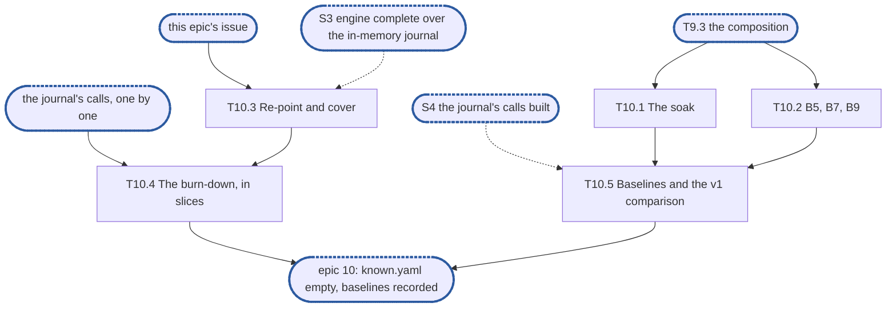

# Epic 10: engine v2 end to end green, the burn-down, the soak and the benchmarks

**Sources:** [RFC 8](../rfcs/rfc-8-engine.md) §15.1 to §15.3 (the conformance rows this part
of the engine passes, and the sentence that bars a sink that always succeeds), §15.4 (B5, B7
and B9 and the decision on their targets), §5.1 and §5.2 (the counts B5 and B7 assert), §7.1
(**Lost** and the join), §10.2 and §10.3 (the capacity rows); [RFC 29](../rfcs/rfc-29-test-harness.md)
§4.3 (tiers), §4.7 (known failures and the unexpected pass), §4.10 (benchmarks and long runs);
[RFC 17](../rfcs/rfc-17-vfs.md) §8 (the integration tier runs in `unit`); the
[RFC index](../rfcs/rfc-index.md)'s "Test tiers" (what must not stand in for a check).
**Track:** the team.
**Epic 10 estimate: 5 subtasks, 18 man-days.**
**Depends on:** S3, through which epics 3 to 8 give the engine every content method and epic 9
composes it with the filesystem service: T9.3's composition, which T10.1 and T10.2 run over,
and the rows epics 3 to 9 registered red in `test/engine/known.yaml`. S4, outside this part:
the journal's calls, which no row can turn green without. T10.3 waits for neither S3 nor S4:
it needs only this epic's issue (D4). T10.4 goes in slices, each after the journal call it
names (T10.4), and the green runs of T10.1 and T10.2 and the baselines wait for S4;
everything else does not.
**Blocks:** nothing in this part. The engine's second part builds on a suite whose known
failures are empty, and on the soak and the benchmarks as its baseline.

---

## 1. Goal

Epic 10 closes the engine's first part: every conformance row it can pass is green over the
real journal, a crash-and-restart soak shows that no acknowledged synced write is lost
silently, and the three benchmarks RFC 8 §15.4 allows without offload have a recorded
baseline. §3 numbers each obligation the RFCs place on the epic and names the subtask that
meets it; this document gives the split, the order, the estimates and the tests, and cites
the RFCs rather than restating them.

At the end of the epic:

- `test/engine/known.yaml` holds no entry for a row of this part, and `engine-conformance`
  runs green on every pull request;
- the tests of `internal/vfs/integration` whose entries went run in `unit`, as RFC 17 §8 has
  the integration tier run;
- a seeded soak composes the filesystem service over the engine, crashes and restarts it in a
  loop under fault schedules, and asserts that every acknowledged synced write reads back or
  reads **Lost**, never zeros and never the superseded chunk; it runs on every push to
  `feat/storage-v2` with a short list of seeds (the `merge` tier) and in the `nightly` tier
  with the long list (D7);
- B5, B7 and B9 (adapted) run over the same composition in the `manual` tier, with their
  figures recorded as the baselines that replace RFC 8 §15.4's proposed targets, and B5's and
  B9's figures set beside v1's on the same box (R27).

### 1.1 In scope

§3's requirements, through §6's subtasks: the soak and its two suites, the three benchmarks
and their suite, the re-pointing of the known failures that outlive the middle epics, the
burn-down itself, the engine fixes the real journal shows, and the baselines with the v1
comparison.

### 1.2 Out of scope

- Writing the rows. Epics 2 to 9 write them, each over E2's fixture, red until the journal
  has the call. This epic writes a row only when the coverage check of T10.3 finds a row
  of §3 with no test.
- Turning a row green by changing the journal. That is the journal team's, in the change that
  adds the call; this epic removes the entries that no such change removed, and fixes the
  engine where the real journal shows it wrong.
- The offload pipeline's soak (RFC 8 §6.3): it injects faults at every offload step and
  partitions to the store, so it needs offload. The soak of T10.1 is this part's own.
- B1 to B4, B6 and B8 of RFC 8 §15.4: they need offload and eviction, the engine's second
  part.
- B9's two runs that need a snapshot cut (RFC 12): the run with a cut every 10 s.
- A v1 comparison of the soak, of B7, or of anything but B5's and B9's latency and throughput
  (R27); v1 has no soak and no counterpart of B7's `chmod` storm to compare with.
- A real remote service, and RFC 8 §15.4's "each real service daily": there is no remote
  store in this part.
- Every case of a row that needs offload, the remote tier, a cluster or snapshots: each row's
  test names what it leaves and who owns it (§3, R5).
- The engine-cost benchmark (a 4 KiB `Write` and `Read` against the journal handle): RFC 8
  §15.4 defers it until a profile shows engine time on the request path, and T10.5's
  baselines are the profile that would show it.
- A root composing the engine for a served share, and `node.New`: stage 4.

### 1.3 Names used here

- **E1**, epic 1, interfaces: `pkg/block/engine`'s exported surface and the `Content`
  contract agreed with the filesystem service, frozen at S1.
- **E2**, epic 2, red e2e suite and test foundations: `engine-conformance` with its
  `known.yaml`, the fixture over the real journal, `kvstore` and the real open-state table,
  the fault-injecting `kv.KV`, the in-memory journal and the profiler wiring.
- **Epics 3 to 8**: write, read and overlay (3); commit, group commit and losses (4);
  removals (5); start, bindings and recovery (6); capacity, self-fence and health (7); clone
  and copy, journal-held (8).
- **Epic 9**, the integration epic: the filesystem service over the engine, with the
  composition T10.1 and T10.2 run over (T9.3).
- **S1**, interfaces frozen and `Content` agreed with the filesystem service. **S2**, red
  suite in CI. **S3**, engine complete over the in-memory journal: epics 3 to 8 done, every
  row whose journal call exists green. **S4**, the journal's calls built: the journal team's
  core complete, with `Open` recovering segments, `Repack`, `Forget` and `Strand`.
- **The composition**: `vfs.New` over the fixture's engine, store and open-state table
  (T9.3).
- **Group A, B and C**: RFC 8 §15.1 (lost or wrong content), §15.2 (wedging) and §15.3
  (composition).
- **B5, B7, B9**: RFC 8 §15.4's benchmarks.
- **G**: RFC 8 §5.2's bound on a group commit's batch, whose log₂ B7's count uses.

## 2. General rules for each epic

1. **Independent unit tests.** Each epic carries its own unit tests. It may use another
   epic's pure in-memory implementation, the implementation of an epic it depends on once
   that has landed, and E2's test components: above all the in-memory journal, which stands in
   for the journal wherever the logic under test is the engine's (the resolution table, the
   group commit's split, the refusal mapping). E1 declares no internal interface for it to
   stand in for (rule 12). Every double is one of [RFC 29 §4.11](../rfcs/rfc-29-test-harness.md#4.11%20Test%20doubles)'s three
   kinds.
2. **Fuzz tests: none.** The engine parses no bytes of its own: it reads the journal's
   answers and the store's records through typed calls. RFC 8 §15 checks its pure parts,
   read resolution and the group commit's split, by its tables, not by fuzz, and says so in a
   `ponytail:` marker, so no fuzz target is built for them.
3. **Observability follows RFC 25, through what exists.** `Deps` carries a `*slog.Logger`
   narrowed with `With("component", "engine")` and a `Tracer`, a function type the engine
   declares over standard-library types only. RFC 25's metrics registry, watchdog and
   health source exist on neither branch, so the engine exposes its counters and
   conditions as `Stats` fields, and the root that composes it adapts them. Counters are
   named for RFC 8 §14's metrics, under the `engine_` prefix (RFC 25 §2.1), never
   `enginev2_`, with no share label on a per-operation series. Spans are RFC 8 §14's
   proposals, `engine.sync` and `engine.existence_commit`, and a removal batch opens a root
   span. Each epic names the counters, conditions and spans it owns; the units, labels and
   logging rules are RFC 25's, applied as written.
4. **Profiling.** Tests and benchmarks run under E2's profiling harness and fail on
   goroutine, descriptor or memory leaks and on anomalous resource growth. No
   allocations-per-op assertion: RFC 8 §15.4 defers its engine-cost benchmark until a
   profile shows engine time on the request path.
5. **Public interface and internals.** Tests cover both the internal package API and the
   public behaviour the epic enables, including concurrency under `-race`. Test at the
   layer that **consumes** a value (see `CLAUDE.md`, "Verifying a change"): a field the engine
   passes to the journal or the store is asserted where they read it, over the real journal
   and `kvstore`, not where the engine builds it.
6. **Known failures shrink.** An e2e test that turns green leaves the suite's `known.yaml`
   (`test/engine/known.yaml`) in the same change: `dt` fails the run if a listed test
   passes, so the change that turns it green removes it, a journal pull request included. A
   test over the real journal that starts red sits in that suite behind its build tag, never
   in `unit`, which keeps no known list.
7. **v2 ignores v1.** No import of, copy from, or behavioural dependence on v1, enforced by
   the engine's one import test, a walk over every package of `pkg/block/engine` with
   one allowlist, which also refuses `pkg/vfs`: no package imports `pkg/block/syncer`,
   `pkg/block/carver`, `pkg/block/remote` or the v1 metadata service `pkg/metadata`; v1's
   engine and journal are gone on `feat/storage-v2` since #3645. The walk checks every package on its own, so its
   allowlist names each package an exception applies to, test packages included. v1 is not
   touched: it is deleted at the cutover. The comparison with v1 (R27) is not a dependence:
   the v1 run is a benchmark in v1's own tree on `develop`, built and run apart from v2, and
   only the two result files meet, in `benchstat`.
8. **Real dependencies for properties of those dependencies.** No fake stands in for a
   check about what the real thing does: the real journal on a real directory, with its crash
   seam, for durability, recovery and loss; the real `kvstore` for what a transaction
   commits and conflicts on. The in-memory journal is for the engine's pure logic only. It is
   held to the real journal by the journal's own conformance suite, on the in-memory
   journal's rows that the [journal plan's epic 3](rfc-1-journal-plan.md) names. Until S4,
   the journal's calls built, an engine conformance row may also run over the in-memory
   journal, beside its run over the real one, which stays the run that counts and stays in
   `known.yaml` until it turns green. The run over the in-memory journal is green and never
   enters `known.yaml`. This is a temporary exception to RFC 29 §4.11, since the journal's
   suite does not yet hold the in-memory journal, and it ends at S4: from then no engine
   conformance row runs over the in-memory journal. A control the in-memory journal adds for
   such a run (a failed sync window, a segment model, a repack hold) gets a test against the
   real journal in the change that lands the journal call it models.
9. **Code comment conventions** (`CLAUDE.md`, "Code comments"). A source comment describes
   the code's behaviour and references nothing outside it: no issue or pull request
   numbers, no CI, runner or OS names, no epic, subtask, plan or decision ids. A
   `ponytail:` marker records a knowingly simple implementation, naming its ceiling and the
   upgrade path. A `decision:` marker records deliberate behaviour, naming the rule, why it
   holds and the evidence that would overturn it. Where the RFC carries such a note, its
   marker goes at the code site that implements it: RFC 8's copy-on-write share table, the
   per-file state bound, the loss-sequence floor, the version-limit headroom and its burst,
   the lazy existence of appends, and the stable-overwrite cost.
10. **A test must be able to fail.** Keep a test only if a plausible change would make it
    fail and nothing else would catch that change: not the compiler, not the diff, not a
    later epic's tests. A review rule that no test can check, such as "stubs never panic",
    stays a review rule.
11. **A symbol is exported only if the RFC's interface uses it.** Everything exported is
    frozen at S1. Helpers the engine's own files need stay unexported or move to an
    `internal/` package of `engine`.
12. **Each subtask creates only what it declares.** No empty package and no stub without a
    caller. A package, an option or a test helper lands with its first consumer.

### 2.1 How the rules apply

| Rule | Subtasks | How |
| --- | --- | --- |
| 1 Unit tests | all | T10.3 and T10.4 change no engine logic that has no unit test: an engine fix T10.4 makes lands with a unit test over E2's in-memory journal, beside the conformance row that found it. T10.1's oracle (the model of what a restart may serve) has its own unit test over hand-made histories. The benchmarks, and the soak that counts, run only over the real journal (rule 8); the soak also has a variant over the in-memory journal until S4 |
| 2 Fuzz | none | no parser. The soak is a seeded simulation of operations, crashes and faults, not a fuzz target: it decodes no bytes of its own, and a failing seed is its regression case |
| 3 Observability | T10.1, T10.2 | no new counter, condition or span name. The soak reads conditions and the verifier through `Stats` and the service; B5, B7 and B9 count transactions with `kv.Counting`, the pass-through record RFC 29 §4.11 allows, and read nothing else of the engine |
| 4 Profiling | all | the fixture already runs `prof.Watch` over each test, so a goroutine or descriptor left by a restart fails it; the soak adds no second watch (two overlap and both fail). The heap check does not run under `-race`, so the soak measures live heap itself with `prof.LiveHeap` in a build without it (D9) |
| 5 Public and internal | all | every assertion is read where the value is consumed: what a client of `vfs.Service` is answered, and what `kvstore` committed. No test reads the engine's internals. `engine-conformance` runs under `-race`; the soak and the benchmarks do not, since the race detector hides the heap check and changes latency, and D10 gives the reason |
| 6 Known failures | T10.3, T10.4, T10.1 | this epic is the rule's end point: T10.3 re-points the entries the middle epics leave, T10.4 removes the last, and the soak's own suite starts with a known file of its own, emptied by the change that turns its tests green |
| 7 v2 ignores v1 | T10.1, T10.2 | the soak and the benchmarks import `internal/vfs`, so they live in `internal/vfs/integration`, outside `pkg/block/engine`, and the import walk and its allowlist do not change |
| 8 Real dependencies | all | durability, recovery and loss over the real journal on a real directory with its crash seam; transaction counts and store faults over the real `kvstore` on the in-memory `kv.KV`. The in-memory journal appears in this epic's tests only in the soak's early variant (T10.1), under D11 until S4, which T10.4 drops with the other runs over it; the oracle's unit test uses no journal |
| 9 Comments | T10.1, T10.2 | a `decision:` marker at the oracle's site: **Lost** is accepted only for a synced record the schedule faulted (D2). A `ponytail:` marker on the soak's fixed seed list (D5). No epic, subtask or requirement ids in any comment |
| 10 Tests can fail | all | each test below names the change it catches |
| 11 Exports | T10.1, T10.2 | no new exported name in `pkg/block/engine`. `enginetest` and `kvstoretest` change only what a test helper needs: `testing.TB` in place of `*testing.T` on the fixture's constructors (T10.2), a setter for a store fault schedule (T10.1) and an option that counts the store's transactions (T10.2). The journal seam is already exported (`Fixture.Seam`) |
| 12 Creates only what it declares | all | a suite lands with its first test: `engine-soak` and `engine-soak-long` with T10.1, `engine-bench` with T10.2; T10.5 adds the v1 benchmark, its result file and the measured values, with a regenerated table |

## 3. Requirements and invariants

Every obligation that RFC 8, RFC 29 and RFC 17 place on this epic, numbered so that subtasks
and tests can cite them. Each row names the obligation and cites where the RFC states it: the
RFC's text is the requirement, so read it there. Numbers are stable: a row added later takes
the next free number in its group's table, and a withdrawn one keeps its row.

**The burn-down**

| # | Requirement | Kind | Source | Subtasks |
| --- | --- | --- | --- | --- |
| R1 | Every Group A row this part can pass runs over the real journal and passes, at least these (D1): incarnation at start (the engine's half), recovery through `Since`, journal gone, attach above the floor, attach after a device loss, clone resumed at a full limit, the version limit, journal authority, the verifier, verifier inputs, verifier after a loss, sync before existence, stable write and lazy existence, overwrite waits for existence, stalled store, failed window, the join, existence above `asOf`, deallocate, clone keeps writes outside its extent, overlapping clone, failure leaves the destination, removals of a cloning destination, source registration rebuilt, clone never waits, and clone refusals | test row | RFC 8 §15.1 | T10.3, T10.4 |
| R2 | Every Group B row this part can pass runs over the real journal and passes, at least these (D1): no cross-share slowdown (the write half), one clock, shared journal, unbind and drop, the version limit under sustained load, the burst at a stall's start, group commit, removal wedge, scoped repack, `journal_full` at the maximum and on a full device, `journal_sync_failed`, self-fence threshold, self-fence on an erroring store | test row | RFC 8 §15.2 | T10.3, T10.4 |
| R3 | The three Group C rows run and pass: declared interfaces, no assertions, settings | test row | RFC 8 §15.3 | T10.3, T10.4 |
| R4 | The capacity rows of this part pass over the real journal: a carved run fails `ErrUnavailable`; a refusal on a full journal answers `ErrDelay` while the refusal's scope holds unreclaimed bytes and `ErrNoSpace` only when its sealed segments hold none; two refusals racing for the only unreclaimed segments never answer `ErrNoSpace`; an unsynced overwrite at the limit is served after the scope's sync; a refusal while a failed window is unresolved answers `ErrDelay` | test row | RFC 8 §7.5, §10.2, §10.3, as the first part words them | T10.3, T10.4 |
| R5 | A row this part can pass only in part passes the half it can, and its test names in its doc comment the half it leaves and the part that owns it | test row | RFC 8 §15.1, §15.2 | T10.3, T10.4 |
| R6 | A sink that always succeeds never stands in for Group A or for the pipeline's checks: the rows run over the real journal and `kvstore`. (A single-file rig standing in for §8.3 is a second-part row.) | MUST NOT | RFC 8 §15.3 | T10.4, T10.1, T10.2 |
| R7 | A known failure that passes fails the run, so an entry leaves `test/engine/known.yaml` in the change that turns its test green, a journal change included | invariant | RFC 29 §4.7 | T10.3, T10.4 |
| R8 | A planned entry names its issue | invariant | RFC 29 §4.7 | T10.3 |
| R9 | When the epic is done, `test/engine/known.yaml` holds no entry for a row of this part | invariant | RFC 8 §15.1 to §15.3; RFC 29 §4.7 | T10.4 |
| R10 | The integration tier's tests run in-process in `unit` | invariant | RFC 17 §8 (Suites) | T10.4 |

**The soak**

| # | Requirement | Kind | Source | Subtasks |
| --- | --- | --- | --- | --- |
| R11 | Under crashes, restarts and fault schedules, every acknowledged synced write reads back its bytes or reads **Lost** | invariant | RFC 8 §5.1, §7.1 | T10.1 |
| R12 | A range whose synced record the journal lost fails as **Lost**, never as zeros and never as the superseded chunk; the loss is reported through the loss generation and the loss sequence | test row | RFC 8 §15.1 (the join) | T10.1 |
| R13 | A committed size is backed by synced records: after a host crash that drops unsynced records, no read of committed existence fails as **Lost** | test row | RFC 8 §15.1 (sync before existence) | T10.1 |
| R14 | The write verifier differs after every restart of the process | test row | RFC 8 §15.1 (verifier) | T10.1 |
| R15 | After a crash before the group commit, a restart re-applies the pending existence before the file is served: `size` and `mtime` are the written ones | test row | RFC 8 §15.1 (stable write, lazy existence) | T10.1 |
| R16 | The soak and the benchmarks run the engine as production composes it, with the filesystem service in front, and never only through a harness that builds it differently | invariant | RFC 8 §15 (introduction); RFC index "Test tiers" | T10.1, T10.2 |

**The benchmarks**

| # | Requirement | Kind | Source | Subtasks |
| --- | --- | --- | --- | --- |
| R17 | B5, appending: 64 writers with `fsync` every 1 MiB cause no existence commit on any `fsync`'s path, only the marks wait's transaction, at most 1 per journal per burst of concurrent `fsync`s and never one per file; existence commits are at most 1 per journal per existence interval | bound | RFC 8 §15.4 (B5) | T10.2 |
| R18 | B5, overwriting: 64 writers overwriting committed content cause at most 1 transaction per journal per burst of concurrent `fsync`s, never one per file | bound | RFC 8 §15.4 (B5) | T10.2 |
| R19 | B7: B5 with 10³ `chmod`/s on random files of the same journal keeps `fsync` p99 within 2× of B5's | bound (reported) | RFC 8 §15.4 (B7) | T10.2 |
| R20 | B7: transactions per stability point are at most 1 + conflicting files × log₂ G | bound | RFC 8 §15.4 (B7) | T10.2 |
| R21 | B9, adapted: 64 writers rewriting committed content in place with every write stable keep p99 write latency within 2× of the same run with unstable writes and one flush per second, and transactions at most 1 per journal per burst of concurrent writes; a miss is reported as the evidence for the write-intent upgrade of RFC 8 §5.1 | bound (reported) | RFC 8 §15.4 (B9) | T10.2 |
| R22 | B9, with one unrelated append on the same stream held in flight for 100 ms at a time: the stable writes' p99 is reported, and is within twice the run without it (a proposal) | bound (reported) | RFC 8 §15.4 (B9) | T10.2 |
| R23 | B5's and B7's count targets follow from RFC 8 §5.1 and §5.2 and are asserted (B9's are reported, D6); the figures (2×, and the others the table lists) are release bars proposed, and the first baseline run replaces each with its measured value plus headroom. A target the design cannot meet on that run is a design finding, not a number to relax | decision | RFC 8 §15.4 | T10.2, T10.5 |
| R24 | Performance is tracked, not gated: the benchmarks run in the `manual` tier and write their results as standard Go benchmark output, so runs compare over time with `benchstat` | invariant | RFC 29 §4.3, §4.10; RFC 17 §8 (Tiers) | T10.2, T10.5 |
| R25 | The soak runs on every push to `feat/storage-v2`, as a bounded list of seeds in the `merge` tier, and in the `nightly` tier with the long list; each fits its tier's budget. (`nightly` runs only on a schedule, which runs only on `develop`, so the branch needs the `merge` run.) | invariant | RFC 29 §4.3 | T10.1, T10.5 |
| R26 | Every benchmark result is recorded in absolute numbers with the commit, the box (CPU, memory, device and its raw figures), the operating system and filesystem with its mount options, and each row's concurrency; results from another box are compared only with themselves | invariant | RFC index, "Test tiers" (Recording results) | T10.2, T10.5 |
| R27 | B5's and B9's p99 latency and throughput are reported against v1's same workload on the same box, with `-count=10` and read by `benchstat`, so the baselines show whether v2 is better than the engine it replaces: 64 writers with an `fsync` every 1 MiB, and 64 stable overwriters against unstable writes with a flush every second. The two runs share no code, only their result files meet (rule 7) | invariant | none in the RFCs: this epic's, from review; rule 7 of §2 | T10.5 |

R9, R10 and R26 are checked by their subtask's acceptance criteria, not by a test that can fail: an
entry for a test that passes is caught by the harness (R7), one for a test still red is not.

**Key words of RFC 8 §15 and what they map to.** The cross-check of §15 finds three hits. `REQUIRED` in the "remote required" row of Group A: the root's
check that every share names a remote block store, which no root composes in this part, so
the second part's. `MUST NOT`, twice, in the sentence after Group C's table: R6 for the sink,
and the second part's for the single-file rig that stood in for §8.3. The bold lead sentence
of §15.4's decision block is R23.

## 4. Decisions this epic takes

- **D1, the burn-down ends at an empty file, not at a row count.** The catalogue of rows the
  first part passes (26 of Group A, 14 of Group B, 3 of Group C and 5 of its own) was counted
  when the rows were chosen, and the epics that wrote them since added rows of their own, such
  as the unsuitable journal at start. A count would let a row without a test pass unseen. So
  T10.3 lists every row of R1 to R4 against the suite's tests and writes the missing ones,
  and T10.4 ends when the known file is empty (R9).
- **D2, the oracle has three cases and accepts Lost in one.** R11 says "reads back or reads
  **Lost**". Read as written, a build that answers **Lost** for every restarted range passes.
  RFC 8 §5.1 gives three outcomes. (a) A write answered stable and intact reads its own bytes.
  (b) An unsynced write dropped with a failed sync window was never answered as stable and
  reads as the file did before the write: not **Lost**, and not wrong even though they are
  older bytes. (c) A synced record that a loss event drops before its existence commit (an
  append or a hole fill), or an overwrite record dropped as corrupt, reads **Lost**, never
  zeros and never the superseded chunk. In (b) and (c) the loss is reported through the loss
  generation and the loss sequence, and older content served as newer, with no report, is a
  failure. The oracle therefore accepts **Lost** only in (c), for a range whose synced
  journal record a fault schedule made unreadable, fails any other **Lost**, and checks the
  report in (b) and (c). It leaves the decision marker at the oracle: the rule, why it holds
  (RFC 8 §15.1's "sync before existence" says a committed size is never lost to a host
  crash), and that a journal which loses a synced, unfaulted record would overturn it.
- **D3, what is asserted of an unacknowledged write.** A write not yet acknowledged synced
  may survive a crash or not. The oracle asserts nothing about whether it did, only that every
  byte read is a byte some write put there, or zero where no write ever covered it. A torn
  tail is therefore allowed, and a byte from nowhere is not. Nor does it ever accept **Lost**
  for such a write (D2's case b): RFC 8 §5.1 has an unsynced write that a failed window or a
  crash dropped read "as the file did before the write", since it was never answered as
  stable, so a **Lost** there is an engine bug, not a fault the schedule caused.
- **D4, the entries that outlive the middle epics move to this epic's issue as soon as it
  exists, not at S3.** The harness refuses a planned entry without an issue (R8). An entry
  that names a middle epic's issue loses its owner when that epic closes, and some have
  already: on `feat/storage-v2` 33 of the 85 entries name an issue that is closed (#3587,
  #3588, #3589 and #3700); the other 52 name #3590, #3591 and #4052, still open. T10.3 moves them in
  one change once this epic has its issue (§9 point 4), and runs again at S3 for any entry
  whose middle epic closed since, so the file always names an open owner. Nothing in it waits
  for the journal.
- **D5, the soak is a fixed list of seeds.** Each seed builds its fault schedules with
  `sim.NewSchedule(seed, clock, rules...)`, which gives the same actions over the same
  calls; the soak runs a short fixed list on every push to `feat/storage-v2` (a few seeds, the
  `merge` tier) and a long one in the nightly run (D7), and a flag replays one seed. The lists
  are a `ponytail:` marker: a fixed list finds only what those seeds reach; upgrade to a
  time-boxed run of fresh seeds, logging each, when the nightly budget allows or the fixed
  list stops finding anything for a month. The seed reaches the journal through
  `Fixture.Seam.SetFault`, given the schedule `sim.NewSchedule(seed, clock, rules...)` builds (it
  returns an error too), not through the seam's `Schedule` helper, which fixes seed 1 and has no clock; and it reaches the crash through
  `Fixture.Crash(kit.Reordered(seed))` or one of the other crash variants (`Torn`, `TornIn`,
  `TornEnd`, `Keeping`), which choose what a power loss does to unsynced writes and are not
  a failure schedule. The store's faults today are a count (`FailUpdatesAfter`) or a key
  (`FailUpdatesSetting`), and `Fixture.Crash` clears those two, so T10.1 adds a setter that
  takes a `sim.Fault`; `Crash` does not touch it, so the schedule survives a crash and the
  soak sets it once per seed.
- **D6, the benchmarks are `testing.B`, reported with `b.ReportMetric`, compared with
  `benchstat`.** One iteration is one run of the scenario's workload, so
  `-benchtime=1x -count=10` gives `benchstat` its samples. Each benchmark reports its p99 and
  its transactions per burst as metrics (as `kvstoretest/bench.go` does with `p99-µs` and
  `writes/op`). B5 and B7 fail with `b.Fatalf` when a count target is broken, since those
  counts follow from RFC 8 §5.1 and §5.2 (R23). B9 never fails: RFC 8 says a miss of its
  targets, counts included, is the evidence for the write-intent upgrade, so B9 reports. The
  latency ratios (R19, R21, R22) are reported against the baseline and fail nothing (R24),
  so no test breaks them; they are the release bars of R23. The harness's `metrics:` field
  takes only `fio-json` and `dfsbench-json`, so the suite sets none: `dt` grades pass or fail,
  and the benchmark lines are the numbers. The fixture's constructors take `*testing.T`
  today, so T10.2 widens them to `testing.TB`.
- **D7, where each runs.** The nightly tier never runs on `feat/storage-v2`: `tests.yml` maps
  the `schedule` event to `nightly`, and a schedule runs the workflow of the default branch,
  `develop`, while a push to `feat/storage-v2` runs the `merge` tier (RFC 29 §4.3: `merge` is
  every push to `develop`, `main` and `feat/storage-v2`). A soak that only the nightly tier
  ran would sit unrun until the cutover. So the soak registers twice: `engine-soak`,
  `tier: merge`, a bounded list of seeds that runs on every push to the branch, fits the
  merge budget and fails the push; and `engine-soak-long`, `tier: nightly`, the long list,
  which starts to run once the branch is on `develop` (the nightly tier holds the merge
  entries too, so there it runs both). The benchmarks register as `engine-bench`,
  `tier: manual` (RFC 29 §4.3 puts benchmarks there), run on the dedicated host. A suite for
  each, rather than one, because the tiers differ. RFC 17 §8 also has each benchmark run for one iteration
  per change as a smoke test, and `benchstat` against a stored baseline after every merge;
  RFC 29 §4.10 is to get that step (decided, change pending, §9 point 2). `engine-bench` does neither until S4:
  before it no benchmark can complete over the real journal. The per-change smoke is then a
  `tier: pr` entry with `-benchtime=1x` and `blocking: { pr: false }`, as `bench-smoke` has.
- **D8, B9 is adapted twice.** It runs through `vfs.Service` over the composition, not
  through SMB: the write path from the service down is the same, and no adapter exists in
  this part. And its snapshot-cut run is left to RFC 12 (§1.2). The held-append run stays: the
  journal's seam has `Seam.HoldFirst(t, kit.OpWrite, name)`, which stops the first matching
  call at storage while every later one passes, until `Release`. A hold waits on no clock, so
  the run releases it from a real timer after 100 ms, which suits a benchmark that measures
  real time, and arms a new `HoldFirst` for each cycle.
- **D9, the baselines.** T10.5 records, after a warm-up, the soak's goroutines, descriptors
  and live heap (`prof.Descriptors`, `prof.LiveHeap`) at the end of the first and the last
  iteration of a seed, and takes the growth tolerated from the measured value plus headroom,
  as constants in `soak_test.go` whose comment says where they were measured, from a build
  without `-race` (the heap check does not run under it). A guess in advance would be a
  number nobody measured.

- **D10, the tags during this epic.** `compose` lives in files behind `engine_conformance`, and
  the tag leaves the package only in T10.4, after S4. Until then `engine-soak` and
  `engine-bench` build with both tags (`engine_conformance,engine_soak` and
  `engine_conformance,engine_bench`) and select their own tests by name (`-run ^TestSoak`,
  `-run ^$ -bench .`), so they run none of the conformance rows a second time. Neither runs
  under `-race`: the race detector skips `prof.Watch`'s heap check, which D9 needs, and changes
  the latency B5, B7 and B9 measure; `engine-conformance` keeps `-race` and covers the races.
- **D11, the soak may also run over the in-memory journal until S4.** Rule 8 (copied from the
  plan after #4138) lets an engine conformance row run over the in-memory journal until S4.
  The soak is not a conformance row, so this decision extends that exception from the rows to
  the soak, on the same terms: a variant of the soak, green and never in `soak-known.yaml`,
  runs beside the real-journal run, which alone counts, and T10.4 drops it at S4. It needs the
  reviewer's confirmation (§9 point 10), since #4138's text names only the rows.

## 5. Target tree

```text
test/engine/known.yaml                     T10.3, T10.4  entries re-pointed, then removed
test/engine/soak-known.yaml                T10.1           the soak's known failures, emptied at S4
test/suites.yaml                           T10.1, T10.2    engine-soak (merge), engine-soak-long (nightly),
                                                           engine-bench (manual), the tags in lint-go's
                                                           go vet -tags= line
docs/internals/testing.md                  T10.1, T10.2    regenerated by test/harness/bin/dt docs
pkg/block/engine/conformance/              T10.3, T10.4  rows the coverage check finds missing; engine fixes' tests
pkg/block/engine/                          T10.4          engine fixes the real journal shows, with unit tests
pkg/block/engine/enginetest/               T10.1, T10.2    a store fault setter (T10.1); testing.TB constructors and a
                                                           counting option (T10.2)
pkg/metadata/kvstore/kvstoretest/          T10.2           NewFS takes testing.TB
internal/vfs/integration/
  soakmodel_test.go                        T10.1           the oracle and its unit test (untagged)
  soak_test.go                             T10.1           the seeded loop, behind engine_soak
  bench_b5_test.go                         T10.2           B5, behind engine_bench
  bench_b7_test.go                         T10.2           B7
  bench_b9_test.go                         T10.2           B9, three runs
  baseline.txt                             T10.5           the baseline run's benchmark lines, the input of benchstat
  baseline-v1.txt                          T10.5           v1's run of the same two workloads, the other input
```

The v1 benchmark itself sits in v1's tree on `develop` (T10.5), outside this tree.

## 6. Subtasks

### T10.1 The soak

**Subtask T10.1 estimate: 4.75 man-days.**

- **Track:** the team. **Depends on:** T9.3's composition; S4 for the journal's restart, but
  the soak lands before it: its run over the real journal red, in its own known file, and its
  run over the in-memory journal green.
- **Covers:** R6, R11 to R16, R25.
- **Deliverables:** `soakmodel_test.go`, the oracle (D2, D3): per file, the ranges written
  with their versions, which were acknowledged synced, and which a schedule faulted;
  `soak_test.go`, behind `engine_soak`: for each seed, a loop of a random mix of writes,
  stable writes, truncates and deallocates through `vfs.Service`, then `Fixture.Crash` (with
  a crash variant the seed picks) or `Fixture.Restart`, then a read of every range against
  the oracle. The seed's fault schedule is built by `sim.NewSchedule` and set on the journal
  through `Fixture.Seam.SetFault` and on the store through a new `enginetest` setter that
  takes a `sim.Fault` (D5). A second run of the same loop and oracle over the in-memory
  journal (D11, until S4): `FakeJournal.Reopen` stands for the restart,
  `Lose` and `FailSync` for the schedule's faults. It exercises the oracle, the restart's
  re-application of existence (R15), the verifier change (R14) and the propagation of
  **Lost** (R12, D2) months before S4; durability of synced records (R11) and of a committed
  size (R13) stay the real journal's run, as rule 8 says. It is green from the start, so it is
  never in the known file, and T10.4 drops it at S4. Two entries in `test/suites.yaml`
  (`format: go-json`, both tags, `-run ^TestSoak`, no `-race`, D10): `engine-soak`,
  `tier: merge`, the short list of seeds, with `known: test/engine/soak-known.yaml`; and
  `engine-soak-long`, `tier: nightly`, the long list (D7). The tag is added to lint-go's
  `go vet -tags=` line, and `test/harness/bin/dt docs` run.
- **Acceptance criteria:**
  - each seed prints itself on failure, and a flag replays it;
  - `engine-soak` runs on a push to `feat/storage-v2` within the `merge` tier's budget, its
    seed count taken from `dt plan --tier merge --estimate` (D7);
  - after each restart the verifier differs from the one before (R14), a file with pending
    existence is served at the written size and mtime (R15), and no committed size reads
    **Lost** unless the schedule faulted it (R13, D2);
  - a range whose synced record the schedule faulted reads **Lost**, never zeros or the
    superseded chunk, and a range lost with a failed window reads as the file did before the
    write; both are reported through the loss generation and the loss sequence, and older
    content served as newer without a report fails (R12, D2);
  - the fixture's watch covers the loop (rule 4).
- **Tests:** the oracle's unit test over hand-made histories, which fails when an unfaulted
  **Lost** is accepted (catches a soak that passes a build answering **Lost** everywhere),
  when a **Lost** is accepted for an unsynced write a crash dropped (catches case b read as
  Lost) and when a byte from no write is accepted (catches the D3 rule loosened). Mutants, run by hand
  once the soak is green: the journal's sync removed, which the soak must fail (catches a
  soak that never reaches the sync window), and the verifier held constant across a restart,
  which it must fail (R14). The soak itself over the real journal, red until S4.
- **Rules:** 6, 7, 8 and 9 as §2.1.

### T10.2 B5, B7 and B9

**Subtask T10.2 estimate: 4.25 man-days.**

- **Track:** the team. **Depends on:** T9.3's composition; S4 for the journal's `Sync` and
  group commit paths.
- **Covers:** R6, R16 to R24, R26.
- **Deliverables:** first, the helpers they stand on: `enginetest.New`, `NewWithSmallBatches`,
  `kvstoretest.NewFS` and the integration package's `compose` take `testing.TB` instead of
  `*testing.T`, and an `enginetest` option wraps the fixture's store in `kv.Counting` and
  gives the fixture an accessor for its `TakeUpdates`. Then `bench_b5_test.go`,
  `bench_b7_test.go` and `bench_b9_test.go`, behind `engine_bench`, each a `testing.B` (D6);
  each aligns its writers with a barrier so that a burst of concurrent `fsync`s is the calls
  made between two barriers, and counts `Update`s across the burst. B9 has three runs: stable
  writes, the same with unstable writes and one flush per second, and stable writes with one
  unrelated append held in flight for 100 ms by `Seam.HoldFirst` on the stream's write,
  released from a timer (D8). The `engine-bench` entry in `test/suites.yaml` (`tier: manual`,
  no `metrics:`, both tags, no `-race`, D10, the tag in the `go vet -tags=` line); `dt docs`.
  Each result line carries the commit, box, system and concurrency of R26.
- **Acceptance criteria:**
  - B5's appending run commits no existence on an `fsync`'s path, its transactions per burst
    are at most one per journal, and its existence commits are at most one per journal per
    existence interval (R17); the overwriting run's transactions are at most one per journal,
    not one per file (R18); all four fail with `b.Fatalf`;
  - B7's transactions per stability point are at most 1 + conflicting files × log₂ G (R20),
    failing with `b.Fatalf`; its p99 and B9's are reported as metrics and compared with the
    baseline with `benchstat` once T10.5 has one (R19, R21, R22, R24);
  - B9 never fails; a miss of its targets, counts included, is reported as the write-intent
    evidence (R21).
- **Tests:** mutants, run by hand once the benchmarks are green: an engine that commits
  existence per file inside `Commit` (catches the per-file design RFC 8 §5.1 rules out),
  which B5's count must fail; a group commit that retries every file when one conflicts, not
  only the conflicting ones (catches a retry that ignores RFC 8 §5.2's split), which B7's
  bound must fail. The helpers' change is checked by the packages' own tests still passing
  under `*testing.T`.
- **Rules:** 3, 4 and 8 as §2.1.

### T10.3 Re-point and cover

**Subtask T10.3 estimate: 1.5 man-days.**

- **Track:** the team. **Depends on:** this epic's issue (§9 point 4) for the re-pointing,
  which waits for neither S3 nor S4 (D4); S3 for the coverage table, since the rows it lists
  are written by epics 3 to 9 and are all there only then. Two changes: the re-pointing now,
  then at S3 a second one for any entry whose middle epic closed since, with the table.
- **Covers:** R1 to R5, R7, R8.
- **Deliverables:** one change to `test/engine/known.yaml` that moves every entry naming a
  closed issue to this epic's issue (D4), keeping each entry's `message` and replacing its `reason`'s
  first clause with the journal call it waits for; and, at S3, a table, in the change's description,
  of every row of R1 to R4 against the test that checks it, and of every test the suite holds
  against the row it checks. A row with no test gets one,
  written over E2's fixture and listed red with this epic's issue. A row the first part
  passes only in part names, in its test's doc comment, the half it leaves and its owner (R5).
- **Acceptance criteria:**
  - no entry of the file names a closed issue, or an issue of an epic that has closed (33 do
    today, D4);
  - at S3, every row of R1 to R4 is covered by a named test, and the table says which;
  - no entry's `reason` states a journal call that exists.
- **Tests:** none of its own; the file is graded by `dt`. The check that catches a wrong
  edit is the suite itself: an entry whose message no longer matches the failure turns the
  run red (RFC 29 §4.7), and an entry for a test that passes fails it as an unexpected pass.
- **Rules:** 6, this subtask is its first half. The others in §2.1.

### T10.4 The burn-down

**Subtask T10.4 estimate: 5 man-days.**

- **Track:** the team. **Depends on:** T10.3, and for each slice the journal call it names
  (below); the last slice is S4. This subtask is at the ceiling, so it goes in slices by
  journal call, in the order of the plan's §6 point 7, one pull request each, each after the
  journal change that lands its call. The move of the integration package's tests to `unit`
  stays inside the last slice: each test that needs the move runs over the real journal, so
  it can leave the tag only when its entry is gone.
- **Slices.** Today 79 of the 85 entries fail at `retry shortly: commit`, because the
  journal's `Stats` is still a zero value (#4094), and #4094 does not touch
  `test/engine/known.yaml` (it changes `test/journal/known.yaml`), so someone must re-point
  those 79 messages to the next failure. That is the first slice and it comes long before S4.
  An entry goes with the slice of the last call its `reason` names.

  | Slice | Journal call it waits for | Man-days |
  | --- | --- | --- |
  | a | `Stats` (#4094): re-point the 79 messages | 0.75 |
  | b | `Sync` and failed windows | 1.25 |
  | c | `Since`, `Settle` and `Open` recovering segments | 1.25 |
  | d | `Draw` and `SetVersionLimit`, for the version limit's raise | 0.75 |
  | e | `Repack` and `UnreclaimedEndedBytes`, for R4's capacity rows; the move to `unit`; the end of the runs over the in-memory journal | 1.0 |

- **Covers:** R1 to R7, R9, R10.
- **Deliverables:** for each entry left in `test/engine/known.yaml`, the change that turns its
  test green and removes the entry. A journal change removes its own (R7); this subtask does
  the rest. Where the real journal shows the engine wrong, the engine fix with a unit test
  over E2's in-memory journal and the conformance row that found it. Where a row cannot pass
  in this part for want of a journal state (the read-only journal), the row is adapted (R5)
  and its dropped half named in the test's doc comment. The tests of
  `internal/vfs/integration` lose `engine_conformance` once their entries are gone (R10),
  `engine-conformance`'s `cmd` stops listing the package, and `engine-soak` and
  `engine-bench` drop the tag from theirs (D10). At S4 the last slice also drops every run
  over the in-memory journal that rule 8 allowed until then: the start-order test's case (`TestTheFilesystemStartsAfterTheEngine`
  with `WithFakeJournal`) and T9.4's rows, both epic 9's, and the soak's variant (T10.1). The
  runs over the real journal stay and cover the same checks.
- **Acceptance criteria:**
  - `test/engine/known.yaml` holds no entry for a row of this part (R9); a forgotten entry
    for a test that passes fails the run as an unexpected pass (R7);
  - `engine-conformance` passes under `-race` with that file empty;
  - `git grep -n -E 'engine_conformance' -- internal/vfs/integration` prints nothing, and
    `unit` runs the package and stays green (R10);
  - no conformance row and no soak runs over the in-memory journal (R6, rule 8).
- **Tests:** the rows themselves, run as CI runs them, `test/harness/bin/dt run
  engine-conformance`. For each engine fix, a unit test that fails when the fix is reverted,
  and the row that exposed it, read where the value is consumed.
- **Rules:** 6, 8 and 9: a `decision:` marker where the real journal forces a behaviour the
  RFC leaves open.

### T10.5 The nightly run and the baselines

**Subtask T10.5 estimate: 2.5 man-days.**

- **Track:** the team. **Depends on:** T10.1, T10.2; S4 for measured figures; for where
  `baseline.txt` is stored, RFC 29 §4.10's `benchstat` step (§9 point 7); and v1 still
  existing on `develop`, so the v1 run happens before the cutover deletes it (§9 point 8).
- **Covers:** R23 to R27.
- **Deliverables:** the soak's seed counts and iteration counts set so `engine-soak` fits the
  `merge` budget and `engine-soak-long` its share of the nightly one, from
  `dt plan --tier merge --estimate` and `dt plan --tier nightly --estimate`; `baseline.txt`,
  the benchmark lines of B5, B7 and B9 from a run of ten on the named reference box, its
  header carrying R26's fields; the v1 side of R27 (the part that adds the day): a benchmark
  on `develop`, in v1's tree beside `pkg/block/journal/wave7_group_commit_bench_test.go`
  (parallel writers each doing `WriteAt` then `Commit`, the closest v1 has to B5) and
  `pkg/block/engine/write_bench_test.go` (writes with no `fsync`), which have neither
  workload as it stands, so it is written for the two shapes: 64 writers with an `fsync` every
  1 MiB, and 64 stable overwriters against unstable writes with a flush every second. It
  carries the same benchmark names and metric units as B5's and B9's, so `benchstat` pairs
  them, and its output is `baseline-v1.txt`, from `-count=10` on the same box and the same
  week as `baseline.txt`, with the v1 commit in its header. It shares no code with v2 (rule 7); the soak's resource constants (D9), each the measured value plus
  headroom; and the replacement of RFC 8 §15.4's proposed figures by the measured ones,
  through the RFC pull request §9 point 2 names.
- **Acceptance criteria:**
  - `engine-soak` runs within the `merge` budget and `engine-soak-long` within the nightly
    one (R25);
  - `benchstat baseline-v1.txt baseline.txt` reads, giving fsync p99, write p99 and MB/s of
    B5 and B9 against v1's, and a figure where v2 is worse is filed as a design finding
    (R27, R23);
  - `baseline.txt` states the box, the commit and the headroom of every figure, and
    `benchstat` reads it against a new run;
  - a figure the design cannot meet is filed as a design finding, not widened (R23).
- **Tests:** a mutant, run by hand: the soak's composition kept alive across restarts, which
  the growth bound of D9 must fail (catches a bound so loose it hides a leak);
  `dt docs --check` passes.
- **Rules:** 4 as §2.1.

## 7. Order of work



T10.1 and T10.2 are the highest-risk work and can start first, once T9.3's composition
exists: the soak lands with its real-journal run red in its own known file and its in-memory
run green, the benchmarks sit in the `manual` tier where no run gates on them. T10.3 starts
with the epic's issue, long before the journal is done, and finishes at S3. T10.4 goes in
slices as the journal's calls land; it and T10.5 finish only after S4, which nothing in this
part can bring forward.

## 8. Suggested pull requests

| PR | Subtasks | Man-days | After | Why together |
| --- | --- | --- | --- | --- |
| 1 | T10.1 | 4.75 | T9.3 | the soak, its oracle, its two suites and its early run over the in-memory journal; the real-journal run lands red in its own known file |
| 2 | T10.2 | 4.25 | T9.3 | the three benchmarks, the helper changes they stand on and their manual suite, independent of PR 1 |
| 3 | T10.3 | 1.5 | the epic's issue; S3 for its second change | the re-pointing of the entries that name a closed issue, then the coverage table, so every entry has an open owner |
| 4a to 4e | T10.4 | 0.75, 1.25, 1.25, 0.75, 1 | PR 3; each after its journal call (slices table of T10.4) | the burn-down; the journal's own changes remove their entries first, each slice the rest |
| 5 | T10.5 | 2.5 | PR 1, PR 2; S4 | the baselines, the v1 comparison and the soak's budgets, which need the soak and the benchmarks green |

A suggestion only: one pull request per subtask works as well. PRs 1, 2 and 3 are independent
of one another and can be open at once.

## 9. Open points

1. **`journaltest/prof` does not exist.** Earlier engine documents name the profiling
   harness E2 wires to the fixture `journaltest/prof`; the profiler on `feat/storage-v2` is
   `internal/prof` (`prof.Watch`, `prof.LiveHeap`, `prof.Descriptors`), and the fixture
   imports it. This document uses the real path. The text that names the old one is a
   documentation fix, not an RFC change. *Pending: no PR yet.*
2. **RFC 8 §15's last paragraph says no suite runs the benchmarks, and RFC 29 §4.10 is to get
   a step RFC 17 §8 already expects.** "No suite runs yet §15.4's benchmarks or the rows that
   need a second node or a shard move." This epic adds `engine-bench` and the soak. RFC 8 §15
   needs to say which benchmarks run, where, and that the rest still do not; §15.4's proposed
   figures change to the measured ones when T10.5 has them (R23). The engine benchmarks (B5,
   B7 and B9) run in the `manual` tier as `testing.B` output read by `benchstat`, and the
   soak in `merge` (short list) and `nightly` (long list), as RFC 29 §4.3 has the tiers.
   RFC 17 §8's tier table expects, after
   every merge, a `benchstat` run against a stored baseline; RFC 29 §4.10 has no such step
   today, and will get it (decided, change pending). RFC 17 §8 stays as it is.
   *Pending: no PR yet.*
3. **The row counts of E2's catalogue are stale.** 26, 14, 3 and 5 are the rows chosen when
   the suite was planned; it now holds rows the epics added since. D1 follows the suite, and
   the catalogue's text should say "at least". *Pending: no PR yet.*
4. **No issue exists for this epic, and the label `rfc-8-epic-10` does not.** The harness
   needs the issue before T10.3 (R8, D4). It is made after this document merges, with the
   subtask issues, through the issue process.
5. **How the benchmark lines reach a file `benchstat` reads.** The suite is `format: go-json`,
   which carries the lines as `output` events. T10.2 settles the step that extracts them to
   a file in the run's output directory, and checks that `dt` grades a failed `b.Fatalf` in a
   benchmark as a failure.
6. **B9's held-append run: what the hold shows.** `HoldFirst` stops the first write on the
   stream's segment and lets the rest pass; that the other writers' stable writes then wait
   on the journal's proof of sync (RFC 1 §3.1) is the behaviour the run measures. If the
   hold does not reach the stream's write the way the run needs, T10.2 moves the run to the
   second part with a note on the benchmark.
7. **Where RFC 29 §4.10's `benchstat` step stores its baseline.** It decides where
   `baseline.txt` lives and how a run reaches it, so T10.5's `baseline.txt` waits on it. T10.5
   writes the file and its header (R26) and places it where the step says; until the step
   exists, it keeps the file beside the benchmarks. T10.1 to T10.4 do not wait for it.
8. **The v1 comparison needs v1 on `develop`, and the benchmark does not exist yet.** R27's
   v1 side is a benchmark written in v1's tree, a change to `develop`, and its run must
   happen before the cutover deletes v1. Neither `wave7_group_commit_bench_test.go` nor
   `write_bench_test.go` has the two workloads as they stand (T10.5), so the benchmark is new
   work in v1's tree, and it needs an owner and a pull request to `develop`. No RFC states
   R27: it is this epic's, from review, and RFC 8 §15.4's text on the baseline run does not
   mention v1. *Pending: no PR yet.*
9. **The estimate is above the plan's, 12.5 man-days over 4 subtasks, by 5.5 man-days over 5.**
   The plan gives only the total, so the difference per subtask cannot be derived. What this
   document adds to the plan's four: the plan's burn-down is two subtasks, the re-pointing
   (1.5) and the burn-down (5), whose size follows the journal's pace (§6 point 7 of the
   plan); the soak (4.75) carries the oracle and its test, the loop, the store fault setter,
   two suites and the early run over the in-memory journal; the benchmarks (4.25) carry the
   helpers' widening to `testing.TB` and the counting option; and the baselines (2.5) carry
   the v1 comparison. The plan's figure stays the first one until the plan is revised.
10. **Does #4138's in-memory exception cover the soak?** D11 extends it from engine
    conformance rows to the soak's variant (T10.1). The plan's and epic 9's rule 8 name only
    rows, and rule 8 here stays word for word as in the plan. If the reviewer does not agree,
    T10.1 drops the variant and the work it costs, and this document changes nowhere else.
    *Pending: reviewer's confirmation.*
