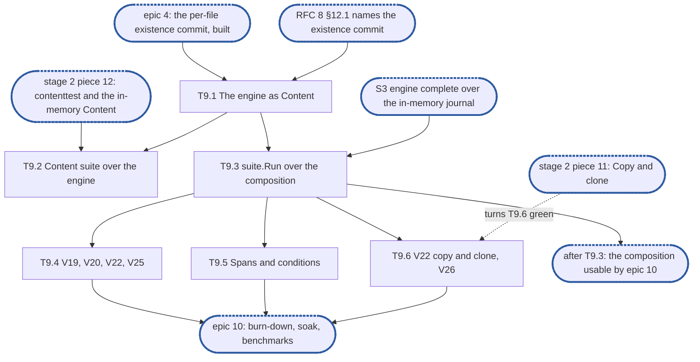

# Epic 9: engine v2 integration, the filesystem service over the engine

**Sources:** [RFC 17](../rfcs/rfc-17-vfs.md) §8 (the integration tier, the engine's side, and
the `Content` conformance suite as [#3939](https://github.com/cubbit/dittofs/pull/3939) words
it), §2.3 (`Deps.Engine`), §2.5 (start and stop order), §5.5 (an owner or group change commits
pending existence first), §5.7 (`GetAttr` over `Overlay`), §6's V19, V20, V22, V25 and V26,
and §7 (the service's span parents the engine's); [RFC 8](../rfcs/rfc-8-engine.md) §12.1 (the
filesystem service as the content methods' one caller, `WriteOpts` and `Overlay`), §5.1 (lazy
existence and its exceptions), §11.1 and §14 (conditions and spans, read through the
composition); [RFC 29](../rfcs/rfc-29-test-harness.md) §4.11 (test doubles), for every test
row. RFC 17 §5.9's range refusal and V26's text are as
[#3979](https://github.com/cubbit/dittofs/pull/3979) words them.
**Track:** A.
**Epic 9 estimate: 6 subtasks, 13.25 man-days.**
**Depends on:** S3, through which epics 3 to 8 give the engine every content method: epic
4's per-file existence commit (T4.3), which T9.1 exposes; epic 6's `Close` and `Unbind` (T6.8,
T6.9), which a restart of the composition calls; epic 7's conditions in `Stats` (T7.3), which
T9.5 reads; epic 8's `Clone` and `Copy` with their joins (T8.4, T8.5), which T9.6 calls. E2's
fixture (`enginetest.New`), its fault-injecting `kv.KV` and its in-memory journal. Outside
this part, all of stage 2 of #3119 (the filesystem service, rif's team): piece 8, Data, landed
on `feat/storage-v2` (#3729), which the data cases call; piece 12, the test doubles, which
writes `internal/vfs/contenttest` and the in-memory `Content` T9.2 runs beside the engine;
piece 11, Copy and clone, which turns T9.6's rows green. An RFC change naming the existence
commit on the engine's surface (§9, point 1) before T9.1 exports it.
**Blocks:** epic 10: T10.1 burns down the rows this epic registers red, and T10.2's soak and
T10.3's benchmarks run over T9.3's composition.

---

## 1. Goal

Epic 9 puts the engine under `*vfs.Filesystem` at RFC 17 §8's integration tier, and composes
the two and nothing else: no root, no `node.New`, no configuration key, no API or CLI. §3
numbers each obligation the RFCs place on the epic and names the subtask that meets it; this
document gives the split, the order, the estimates and the tests, and cites the RFCs rather
than restating them.

At the end of the epic:

- `*engine.Engine` is the filesystem's `Content` with no adapter between them: the filesystem
  names the engine's `WriteOpts` and `Overlay`, and the engine commits a file's pending
  existence on the filesystem's request;
- the `Content` conformance suite the in-memory `Content` passes runs over the engine too,
  per change over the in-memory journal and in `engine-conformance` over the real one;
- `suite.Run` runs over `vfs.New` composed with the engine on a temporary journal, `kvstore`,
  the real open-state table and `sim.TestClock`, with faults injected below them, restarts and
  crashes included;
- RFC 17's V19, V20, V22, V25 and V26 run over that composition, adapted where they need
  offload or a cluster, red until the journal's calls exist;
- the engine's spans hang under the caller's, and its conditions read back through `Stats`,
  with the filesystem in front.

### 1.1 In scope

§3's requirements, through §6's subtasks; the engine method that commits one file's pending
existence (D1); the move of the engine's unit composition into `enginetest` (D3); the
fixture's hook that composes the filesystem (D4) and its span record (D5); the test package
`internal/vfs/integration` and its registration in `engine-conformance`.

### 1.2 Out of scope

- The behaviour the rows check on the service's side: the stable write, the verifier, quota,
  the setuid clear, Copy and clone's admission, held calls. Each is a piece of stage 2 of
  #3119 (pieces 6 to 11), tested in its unit tier over the in-memory `Content`; this epic runs
  the same rows over the real engine.
- The `Content` conformance suite itself and the in-memory `Content` that passes it: piece 12
  of stage 2, in `internal/vfs/contenttest`.
- RFC 17 §8's model of lock, write, open and unlink interleaved, its fuzz targets, and
  `Callbacks` under a fault wrapper: the filesystem service's, run over T9.3's composition once
  they exist.
- A remote tier under the engine, and every case of the five rows that needs offload: RFC 8's
  second part.
- Every **(cluster)** case: a shard handed away and back, a shard-epoch raise, a shard or
  cross-shard copy, the request ID in the ctx (RFC 15).
- An `Incomplete` source (V26, and RFC 17 §6's §5.9 row): RFC 12's snapshot view.
- The engine's span attributes and its other spans (`engine.removal_batch` and a clone's root
  span): epics 4, 5 and 8.
- That the adapters never reach the engine: RFC 17 §8's architecture check (V32), built with
  the filesystem's skeleton.
- The root composing the engine for a served share, and `node.New`: stage 4.

### 1.3 Names used here

- **E1**, epic 1, interfaces: `pkg/block/engine`'s exported surface and the `Content`
  contract agreed with the filesystem service, frozen at S1.
- **E2**, epic 2, red e2e suite and test foundations: `engine-conformance` with its
  `known.yaml`, the fixture over the real journal, `kvstore` and the real open-state table,
  the fault-injecting `kv.KV`, the in-memory journal and the profiler wiring.
- **Epics 3 to 8**: write, read and overlay (3); commit, group commit and losses (4);
  removals (5); start, bindings and recovery (6); capacity, self-fence and health (7); clone
  and copy, journal-held (8). Their subtasks are cited as `T<epic>.<n>`.
- **Epic 10**, E2E green: the burn-down of `known.yaml`, the soak and the benchmarks.
- **S1**, interfaces frozen and `Content` agreed with the filesystem service. **S2**, red
  suite in CI. **S3**, engine complete over the in-memory journal: epics 3 to 8 done, every
  row whose journal call exists green. **S4**, the journal's calls built.
- **The integration epic**: this one.
- **Stage 2 and its pieces**: the programme's units (#3119), not this document's: the
  filesystem service, built in the numbered pieces of
  [`rfc-17-vfs-plan.md`](rfc-17-vfs-plan.md) §3.
- **The composition**: `vfs.New` over the fixture's engine, store and open-state table (D4).
- **V19 … V42**: RFC 17 §6's invariant rows.

## 2. General rules for each epic

1. **Independent unit tests.** Each epic carries its own unit tests. It may use another
   epic's pure in-memory implementation, the implementation of an epic it depends on once
   that has landed, and E2's test components: above all the in-memory journal, which stands in
   for the journal wherever the logic under test is the engine's (the resolution table, the
   group commit's split, the refusal mapping). E1 declares no internal interface for it to
   stand in for (rule 12). Every double is one of [RFC 29 §4.11](../rfcs/rfc-29-test-harness.md#4.11%20Test%20doubles)'s three
   kinds.
2. **Fuzz tests: none.** The engine parses no bytes of its own: it reads the journal's
   answers and the store's records through typed calls. RFC 8 §15 checks its pure parts,
   read resolution and the group commit's split, by its tables, not by fuzz, and says so in a
   `ponytail:` marker, so no fuzz target is built for them.
3. **Observability follows RFC 25, through what exists.** `Deps` carries a `*slog.Logger`
   narrowed with `With("component", "engine")` and a `Tracer`, a function type the engine
   declares over standard-library types only. RFC 25's metrics registry, watchdog and
   health source exist on neither branch, so the engine exposes its counters and
   conditions as `Stats` fields, and the root that composes it adapts them. Counters are
   named for RFC 8 §14's metrics, under the `engine_` prefix (RFC 25 §2.1), never
   `enginev2_`, with no share label on a per-operation series. Spans are RFC 8 §14's
   proposals, `engine.sync` and `engine.existence_commit`, and a removal batch opens a root
   span. Each epic names the counters, conditions and spans it owns; the units, labels and
   logging rules are RFC 25's, applied as written.
4. **Profiling.** Tests and benchmarks run under E2's profiling harness and fail on
   goroutine, descriptor or memory leaks and on anomalous resource growth. No
   allocations-per-op assertion: RFC 8 §15.4 defers its engine-cost benchmark until a
   profile shows engine time on the request path.
5. **Public interface and internals.** Tests cover both the internal package API and the
   public behaviour the epic enables, including concurrency under `-race`. Test at the
   layer that **consumes** a value (see `CLAUDE.md`, "Verifying a change"): a field the engine
   passes to the journal or the store is asserted where they read it, over the real journal
   and `kvstore`, not where the engine builds it.
6. **Known failures shrink.** An e2e test that turns green leaves the suite's `known.yaml`
   (`test/engine/known.yaml`) in the same change: `dt` fails the run if a listed test
   passes, so the change that turns it green removes it, a journal pull request included. A
   test over the real journal that starts red sits in that suite behind its build tag, never
   in `unit`, which keeps no known list.
7. **v2 ignores v1.** No import of, copy from, or behavioural dependence on v1, enforced by
   the engine's one import test, a walk over every package of `pkg/block/engine` with
   one allowlist, which also refuses `pkg/vfs`: no package imports `pkg/block/syncer`,
   `pkg/block/carver`, `pkg/block/remote` or the v1 metadata service `pkg/metadata`; v1's
   engine and journal are gone on `feat/storage-v2` since #3645. The walk checks every package on its own, so its
   allowlist names each package an exception applies to, test packages included. v1 is not
   touched: it is deleted at the cutover.
8. **Real dependencies for properties of those dependencies.** No fake stands in for a
   check about what the real thing does: the real journal on a real directory, with its crash
   seam, for durability, recovery and loss; the real `kvstore` for what a transaction
   commits and conflicts on. The in-memory journal is for the engine's pure logic only, and no
   engine conformance row runs over it. It is held to the real journal by the journal's own
   conformance suite, on the in-memory journal's rows that the
   [journal plan's epic 3](rfc-1-journal-plan.md) names.
9. **Code comment conventions** (`CLAUDE.md`, "Code comments"). A source comment describes
   the code's behaviour and references nothing outside it: no issue or pull request
   numbers, no CI, runner or OS names, no epic, subtask, plan or decision ids. A
   `ponytail:` marker records a knowingly simple implementation, naming its ceiling and the
   upgrade path. A `decision:` marker records deliberate behaviour, naming the rule, why it
   holds and the evidence that would overturn it. Where the RFC carries such a note, its
   marker goes at the code site that implements it: RFC 8's copy-on-write share table, the
   per-file state bound, the loss-sequence floor, the version-limit headroom and its burst,
   the lazy existence of appends, and the stable-overwrite cost.
10. **A test must be able to fail.** Keep a test only if a plausible change would make it
    fail and nothing else would catch that change: not the compiler, not the diff, not a
    later epic's tests. A review rule that no test can check, such as "stubs never panic",
    stays a review rule.
11. **A symbol is exported only if the RFC's interface uses it.** Everything exported is
    frozen at S1. Helpers the engine's own files need stay unexported or move to an
    `internal/` package of `engine`.
12. **Each subtask creates only what it declares.** No empty package and no stub without a
    caller. A package, an option or a test helper lands with its first consumer.

### 2.1 How the rules apply

| Rule | Subtasks | How |
| --- | --- | --- |
| 1 Unit tests | all | T9.1 tests over the engine's unit composition: E2's in-memory journal and the real `kvstore` on an in-memory `kv.KV`. T9.2 runs the `Content` suite over that composition and over E2's fixture. T9.3 to T9.6 run over the composition, on the fixture. Every double is one of RFC 29 §4.11's kinds: `sim.TestClock` (an input), the in-memory journal and the in-memory `kv.KV` (verified in-memory implementations, each held to its suite), the fault-injecting `kv.KV` and the journal's crash seam (fault injection). The fixture's span record (D5) keeps what the engine delivered, an output. No stub and no recording fake |
| 2 Fuzz | none | no parser. The integration tier's fuzz targets are the filesystem service's (§1.2) |
| 3 Observability | T9.5 | no new counter, condition or span name. T9.5 reads RFC 8 §14's `engine.sync` and `engine.existence_commit` and an RFC 8 §11.1 condition through the composition. The composition's `Deps.Logger` is the fixture's, narrowed with `With("component", "engine")` as rule 3 asks |
| 4 Profiling | all | the fixture's `prof.Watch` covers every test of the package, the filesystem's goroutines included, so a waiter or loop left running after the composition stops fails the test |
| 5 Public and internal | all | every assertion is read where the value is consumed: what a client of `vfs.Service` is answered, and what `kvstore` committed. No test reads the engine's internals. `suite.Run` and the rows run under `-race` |
| 6 Known failures | T9.2, T9.3, T9.4, T9.6 | every test over the fixture is red at the journal's `Init`, so it enters `test/engine/known.yaml` naming this epic's issue, and leaves in the change that turns it green (D6). T9.1's tests and T9.2's half over the in-memory journal are green in `unit` from the start |
| 7 v2 ignores v1 | T9.2, T9.3 | the tests that import `internal/vfs` live in `internal/vfs/integration`, outside `pkg/block/engine`, so the import walk and its allowlist do not change. D3's move adds no import `enginetest` lacks |
| 8 Real dependencies | T9.3 to T9.6 | crash survival (V19), failed windows and losses (V25) and repack (V20) over the real journal and its crash seam; transaction counts from the in-memory `kv.KV`'s own `Counts`; commits and conflicts from the real `kvstore`. The in-memory journal runs only under T9.1 and T9.2's first half, which check the engine against the `Content` contract, not an engine conformance row |
| 9 Comments | T9.1, T9.3 | T9.1 drops `internal/vfs/filesystem.go`'s `ponytail:` naming the declared `WriteOpts` and `Overlay` and the missing existence commit, since both shortcuts are replaced; D4's marker at the fixture's hook. No new `ponytail:` |
| 10 Tests can fail | all | each test below names the change it catches |
| 11 Exports | T9.1 | the engine gains one method, D1's, and only once RFC 8 §12.1 names it (§9, point 1). `enginetest` gains the unit composition (D3) and the fixture's hook and span record (D4, D5), test components of an exported test package |
| 12 Creates only what it declares | all | `internal/vfs/integration` lands with its first test (T9.2 or T9.3, whichever lands first), the fixture's hook with T9.3, its span record with T9.5 |

## 3. Requirements and invariants

Every obligation that RFC 17, RFC 8 and the RFCs they cite place on this epic, numbered so
that subtasks and tests can cite them. Each row names the obligation and cites where the RFC
states it: the RFC's text is the requirement, so read it there. Numbers are stable: a row
added later takes the next free number in its group's table, and a withdrawn one keeps its
row.

**The composition**

| # | Requirement | Kind | Source | Subtasks |
| --- | --- | --- | --- | --- |
| R1 | `*Engine` is the filesystem's `Content` unchanged: the engine declares `WriteOpts` and `Overlay`, and the filesystem names the engine's | invariant | RFC 8 §12.1, RFC 17 §2.3 | T9.1 |
| R2 | A file's pending existence is committed before an owner or group change, joining the group commit; the engine commits it when the filesystem asks | MUST | RFC 8 §5.1 "Existence is otherwise committed lazily", RFC 17 §5.5 | T9.1, T9.3 |
| R3 | The engine passes the same `Content` conformance suite the in-memory `Content` passes: verified bytes back, a version above the last drawn, nothing returned before its stage | MUST | RFC 17 §8 "`Content` conformance" | T9.2 |
| R4 | The integration tier is `suite.Run` over `vfs.New` with the real engine on a temporary journal, the in-memory store, real open state and a fake clock, and no node | test row | RFC 17 §8 | T9.3 |
| R5 | The tier injects faults below the real components: a key-value store under the metadata store, and a small journal under the engine | test row | RFC 17 §8 | T9.3, T9.4 |
| R6 | The pieces start in build order and stop in reverse: open state and the engine before the filesystem, the filesystem before the engine; no piece closes anything it was handed | invariant | RFC 17 §2.5 | T9.3 |
| R7 | A call on a share the engine has not bound reaches the caller as `ErrDelay` (`DelayFrozen`) | MUST | RFC 8 §12.1 | T9.3 |
| R8 | `Overlay` is the one read path for a pending file's size: inside a pending truncate's window `GetAttr` answers the truncated size, never the larger size of the writes pending before it | invariant | RFC 8 §12.1 "`Overlay` replays the pending operations", RFC 17 §5.7 | T9.3 |

**Observability through the composition**

| # | Requirement | Kind | Source | Subtasks |
| --- | --- | --- | --- | --- |
| R9 | A content call's context reaches the engine, so the span of a stage the call waits on, `engine.sync`, is a child of the caller's; a stable overwrite records `engine.existence_commit` | invariant | RFC 8 §14, RFC 17 §7 | T9.5 |
| R10 | A condition the engine raises while serving the filesystem reads back through `Stats` with its subject, and clears when its cause does | invariant | RFC 8 §11.1, §12.1 | T9.5 |

**RFC 17's rows over the engine**

| # | Requirement | Kind | Source | Subtasks |
| --- | --- | --- | --- | --- |
| R11 | V19, whole: a write on a persistent open, asked unstable, survives a crash after its reply; a stable append's reply waits for no metadata transaction; a stable overwrite stalled with the store answers `ErrDelay` at the deadline, never success | test row | RFC 17 §6 V19, §5.1 step 7 | T9.4 |
| R12 | V20, adapted: a write refused at the journal's limit while superseded records remain answers `ErrDelay` (`DelayCapacity`) and succeeds on retry once repack frees them; with nothing to free, `ErrNoSpace` at once; past a hard quota, `ErrQuota` at once. The cases with dirty bytes freed by offload, an unreachable store and puts refused are the second part's | test row | RFC 17 §6 V20 | T9.4 |
| R13 | V22, its write, truncate and deallocate cases: an unprivileged caller's change into a setuid or setgid file clears the bits in a committed change before the bytes are staged; the append-only and no-byte cases | test row | RFC 17 §6 V22 | T9.4 |
| R14 | V22, its copy and clone cases | test row | RFC 17 §6 V22 | T9.6 |
| R15 | V25, adapted: a `Commit` waiting on a failed sync window answers another verifier; a stable write whose `Commit` does so answers `ErrDelay` (`DelayCommit`), and its `Write`'s verifier when the two agree; the verifier changes after an unstable write is dropped as lost in one process and epoch; an SMB flush through each of two opens of such a file fails once with `ErrLost`, then succeeds. A shard handed away and back and a shard-epoch raise are the cluster's | test row | RFC 17 §6 V25, §5.8 | T9.4 |
| R16 | V26, adapted: overlap, a range past the source's size, a clone over `clone_max_len` and a namespace crossing are each refused, changing nothing; a `COPY` whose deadline passes partway answers a short count, the destination holds those bytes and the chunk the deadline met completes past it; a clone of a source with a Lost run reads Lost there. An `Incomplete` source is RFC 12's; a shard crossing and a copy across shards are the cluster's | test row | RFC 17 §6 V26, §5.9 | T9.6 |

## 4. Decisions this epic takes

Only what the RFCs leave to the code.

- **D1, the existence commit on the engine's surface.** `internal/vfs.Content` declares
  `CommitExistence(ctx, s, f) error`, which the filesystem calls before an owner or group
  change (R2), and RFC 8 §12.1 names no such method, so `*Engine` does not satisfy `Content`
  today. The engine gains it, committing the file's pending existence through epic 4's
  per-file existence commit (T4.3), which joins the group commit, and calling each committed
  write's `Done`, as every existence commit does. Rule 11 holds the export until RFC 8 §12.1
  and RFC 17 §3.5's `SetAttr` row name it (§9, point 1). The alternative, the filesystem
  calling `Commit` over the whole file, syncs and waits only for overwrites (RFC 8 §5.1), so
  an append staged before the change would still charge the new owner.
- **D2, one test package outside the engine, in two halves.** The tests that import
  `internal/vfs` live in `internal/vfs/integration`, test files only, which neither the
  engine's import walk nor RFC 17 §8's architecture check refuses (it refuses an engine
  import only in `admit`, `pseudofs` and `lockorder`). Its tests over the in-memory journal
  build untagged and run in `unit`; its tests over E2's fixture carry `engine_conformance`,
  and `engine-conformance`'s `cmd` gains `./internal/vfs/integration/...`.
- **D3, the unit composition moves to `enginetest`.** Epic 3's unit composition (the engine
  over the in-memory journal and the real `kvstore`, `pkg/block/engine/unit_test.go`) is
  unexported, so nothing outside the engine's package can build it. T9.2 moves it to
  `enginetest` as an exported constructor that the engine's own tests and
  `internal/vfs/integration` both call, rather than writing a second one. It is the only
  composition over which the `Content` suite runs green before the journal's `Init` exists.
- **D4, the fixture composes the filesystem.** The filesystem is the open-state table's `Sink`
  and admission `Order`, and is built over that table and the engine, so the fixture cannot
  compose it after the fact. T9.3 gives `enginetest.New` an option carrying a compose hook,
  run at every process start (`New`, `Restart`, `Crash`): the fixture builds the table and the
  engine, the hook builds the filesystem over them, the fixture starts the table with the
  filesystem as its `Sink` and `Order`, then the engine, then the filesystem; a stop runs the
  reverse (R6). Without the option the fixture keeps its own `Sink`, which epic 8's tests
  read. A `decision:` marker at the option: the hook builds no node and no adapter, as RFC 17
  §8's integration tier has none; withdraw it when stage 4's `node.New` composes the same
  pieces and the tier moves onto it.
- **D5, spans are an output the fixture keeps.** The fixture's `Tracer` keeps every span it is
  handed: its name, its attributes and the span its context carried, which RFC 29 §4.11 counts
  as an output rather than a double. `internal/vfs.Deps` carries no tracer on this base, so the
  filesystem opens no `vfs.<Op>` span yet; the test opens its own span in the context it hands
  the service, standing in for it, and R9's parent is that span. `engine.existence_commit` is
  opened by the group commit's loop for a batch of many callers' files, not under any one
  caller, so T9.5 asserts it is recorded for the call's file, not its parent (§9, point 4).
- **D6, red rows and who removes them.** Each test over the fixture enters `known.yaml` with
  `fix: planned`, a reason naming the journal calls it waits for, and this epic's issue. The
  change that turns one green removes its entry, a journal pull request included (rule 6).
  T9.6's tests are also red until stage 2's piece 11 builds the filesystem's `Copy` and
  `Clone`; piece 11's change removes their entries once they pass over the real journal, or
  re-points them to epic 10's issue if the journal still lacks a call.
- **D7, the adapted rows.** A case of V20, V25 or V26 that needs offload, the remote tier, a
  cluster or RFC 12 is not written, and the row's test names the dropped case in its doc
  comment and which part owns it, so the second part adds it to the same test. V25's
  shard-epoch raise is dropped with the shard handover: a single node raises no shard epoch
  (§9, point 7).

## 5. Target tree

```text
pkg/block/engine/
  commit.go           T9.1  CommitExistence, over T4.3's per-file existence commit (D1)
  unit_test.go        T9.2  calls enginetest's unit composition (D3)
  enginetest/
    unit.go           T9.2  the unit composition, moved from unit_test.go (D3)
    fixture.go        T9.3  the compose option and its hook (D4)
                      T9.5  the span record (D5)
internal/vfs/
  filesystem.go       T9.1  WriteOpts and Overlay aliased from the engine; the ponytail: dropped;
                            var _ Content = (*engine.Engine)(nil)
  integration/        D2: test files only
    content_test.go          T9.2  the Content suite over the unit composition (untagged)
    content_journal_test.go  T9.2  the Content suite over the fixture (engine_conformance)
    compose_test.go          T9.3  the composition over the fixture (engine_conformance)
    suite_test.go            T9.3  suite.Run, R6 to R8, the owner change (engine_conformance)
    rows_test.go             T9.4  V19, V20, V22, V25 (engine_conformance)
    trace_test.go            T9.5  spans and conditions (engine_conformance)
    copy_test.go             T9.6  V22's copy and clone cases, V26 (engine_conformance)
test/suites.yaml      T9.2 or T9.3: engine-conformance's cmd gains ./internal/vfs/integration/...
test/engine/known.yaml T9.2 to T9.6: each test over the fixture, red (D6)
```

## 6. Subtasks

Each subtask's acceptance: the requirements it covers hold, the named rows pass (or are
registered red, where the journal or stage 2 holds them), and each listed test fails on the
regression it names (after "catches").

### T9.1 The engine as the filesystem's Content

**Subtask T9.1 estimate: 1.25 man-days.**

- **Track:** A. **Depends on:** E1; epic 4's T4.3, built; the RFC change of §9, point 1.
- **Covers:** R1, R2 (the engine's half).
- **Deliverables:** in `internal/vfs/filesystem.go`, `type WriteOpts = engine.WriteOpts` and
  `type Overlay = engine.Overlay` in place of the declarations, the `ponytail:` above
  `Content` dropped, and `var _ Content = (*engine.Engine)(nil)`; in the engine,
  `func (e *Engine) CommitExistence(ctx context.Context, s ShareID, f FileID) error` (D1),
  answering an unbound share as every content method does; the RFC 8 §12.1 table and
  signature block and RFC 17 §3.5's `SetAttr` row, in an RFC pull request on `develop` that
  lands first.
- **Acceptance criteria:** `internal/vfs` builds with the assertion; the engine's existence
  commit runs on request and calls each committed write's `Done` once.
- **Tests:** over the unit composition, a write staged with `enginetest.Reservations`, then
  `CommitExistence`: the store's committed File holds the write's size and charge, and the
  reservations outstanding are zero (catches a method that only syncs, leaving the existence
  to the group commit's age); called again with nothing pending, it commits nothing, counted by
  the in-memory `kv.KV`'s `Counts`, and no `Done` runs twice (catches a second `Done`); on a
  share with no binding, `ErrDelay` with `DelayFrozen`. The alias needs no test: the assertion
  fails the build if the engine's types and `Content`'s drift.

### T9.2 The Content suite over the engine

**Subtask T9.2 estimate: 2.5 man-days.**

- **Track:** A. **Depends on:** T9.1; stage 2's piece 12, which writes
  `internal/vfs/contenttest.Run` and the in-memory `Content`.
- **Covers:** R3.
- **Deliverables:** the unit composition moved to `enginetest` (D3), the engine's own tests
  switched to it; `internal/vfs/integration/content_test.go`, `contenttest.Run` over the
  engine on that composition, and `content_journal_test.go`, the same over E2's fixture,
  behind `engine_conformance` (D2), in `known.yaml` until the journal's `Init`, `Open`,
  `WriteAt`, `ReadAt` and `Sync` exist (D6); `engine-conformance`'s `cmd` gains the package if
  T9.3 has not added it; every case the suite fails over the engine fixed on whichever side
  RFC 8 §12.1 and RFC 17 §3.5 say is wrong, with the RFC changed where both answers are
  allowed.
- **Acceptance criteria:** the suite passes over the engine on the unit composition in `unit`;
  its run over the fixture is registered red; nothing moves out of `internal/vfs`, since the
  suite and the in-memory `Content` are piece 12's.
- **Tests:** the suite's own cases, each of which already fails an in-memory `Content` that
  breaks it; run over the engine they catch an engine that answers differently, such as a
  `Draw` at or below a version staged before it, an `Overlay` that misses a write staged an
  instant before, a `Commit` answered before its writes' sync, or a removed extent read as
  anything but zeros or end of file. A case the engine passes only on the in-memory journal
  is a finding for the journal's conformance suite, which holds the in-memory journal to the
  real one.

### T9.3 suite.Run over the composition

**Subtask T9.3 estimate: 3.5 man-days.**

- **Track:** A. **Depends on:** T9.1; S3, for `Close` and `Unbind` (T6.8, T6.9), which a
  restart calls; stage 2's piece 8, landed.
- **Covers:** R2 (through the filesystem), R4–R8.
- **Deliverables:** the fixture's compose option (D4, its marker); `compose_test.go`, the
  composition: `vfs.New` with `Meta` the fixture's store, `Open` its table, `Engine` its
  engine, the fixture's logger, rebuilt at every restart and crash; a share limit small
  enough for T9.4's capacity row, set through `enginetest.ShareOf`; `suite_test.go`,
  `suite.Run` over the composition and this epic's own cases, behind `engine_conformance`
  and in `known.yaml` (D6); `engine-conformance`'s `cmd` gains the package if T9.2 has not.
- **Acceptance criteria:** `suite.Run` runs every case it holds over the composition with the
  fault-injecting `kv.KV` and the journal's crash seam below it; a restart and a crash
  rebuild the three pieces in RFC 17 §2.5's order.
- **Tests:** `suite.Run` under `-race`, whose cases catch what each states; a write
  acknowledged and committed through the service, then `Crash` and a new composition: the
  bytes read back through the new service (catches a composition whose restart starts the
  filesystem before the engine has re-applied existence, serving the file short); after the
  filesystem's `Stop`, a direct engine `Read` of the same file still answers and the open-state
  table still serves, and only the fixture's stop closes them (catches a filesystem closing
  what it was handed, R6); a write through the service to the fixture's second share, which no
  `Bind` has bound, answers `ErrDelay` with `DelayFrozen`, unchanged by the service (catches a
  service mapping the engine's delay to `ErrStale` or `ErrUnavailable`, R7); with the File
  record at 1 MiB, writes pending to 2 MiB, then a truncate to 512 KiB: `GetAttr` answers
  512 KiB at the truncate's version before its phase 1, and the same after (catches a service
  taking the larger of the record and `Overlay` when `SizeSet`, R8); alice stages a write into
  her file, then a chown to bob: the write is charged to alice and bob's usage rises by the
  file's charge once, read from the store's quota record (catches a chown that skips the
  engine's existence commit, leaving the write to charge bob at its own commit, R2); a store
  failing one file's existence commit through the fault-injecting `kv.KV`: that file's
  stable overwrite through the service is never answered success while the fault holds,
  while another file's stable overwrite commits (catches a fault that wedges every file, or
  a failed commit answered as stable, R5).

### T9.4 RFC 17's V19, V20, V22 and V25 over the engine

**Subtask T9.4 estimate: 3.5 man-days.**

- **Track:** A. **Depends on:** T9.3; epic 7's refusal table and scoped repack (T7.1a,
  T7.1b), for V20.
- **Covers:** R5 (the small journal), R11, R12, R13, R15.
- **Deliverables:** `rows_test.go`, one test per row named for it, behind `engine_conformance`
  and in `known.yaml` (D6), each adapted row's doc comment naming the cases it leaves and
  their owner (D7).
- **Rows:** RFC 17 §6 V19, V20 (adapted), V22's write, truncate and deallocate cases, V25
  (adapted).
- **Tests:** V19: an SMB durable open's write asked unstable, then `Crash` after the reply:
  the bytes read back after the restart (catches a persistent open's write left unstable); a
  stable append: the in-memory `kv.KV`'s `Counts` show no transaction between the write and
  its reply (catches an append waiting for its existence commit); a stable overwrite with the
  fixture's store stalled: `ErrDelay` at the call's deadline, never success (catches an
  overwrite answered at the sync alone). V20: overwrites of one range until the small share
  is refused: `ErrDelay` with `DelayCapacity`, and the retry succeeds once the refusal's
  repack has freed the superseded records (catches `ErrNoSpace` for a refusal space can
  answer); a share filled with distinct content kept: `ErrNoSpace` at once, with no wait for
  the deadline (catches a delay where nothing can be freed); a user past a hard quota:
  `ErrQuota` at once. V22: bob writes alice's setuid file and `GetAttr` before any commit
  shows the bit clear; again with alice unprivileged; with a truncate and a deallocate; an
  unprivileged append to a setuid, append-only file succeeds and clears the bit, a write below
  its size is `ErrPerm` and clears nothing; a write of no byte leaves the bit and `mtime`
  (catches a clear committed after the engine staged the bytes, which a crash between them
  leaves set). V25: `FailNextWindow`, then a `Commit` through the service: a verifier other
  than the writes'; a stable write over it answers `ErrDelay` with `DelayCommit`, and its own
  verifier when no window failed (catches a `Commit` answering the sampled verifier); an
  unstable write dropped as lost: the next verifier differs in the same process (catches a
  verifier keyed on the process alone); an SMB flush through each of two opens of the file
  fails once with `ErrLost`, then succeeds (catches a loss sequence kept per file, not per
  open).

### T9.5 Spans and conditions through the composition

**Subtask T9.5 estimate: 1.25 man-days.**

- **Track:** A. **Depends on:** T9.3; epic 7's T7.3, for the conditions in `Stats`.
- **Covers:** R9, R10.
- **Deliverables:** the fixture's span record (D5); `trace_test.go`, behind
  `engine_conformance` and in `known.yaml`.
- **Tests:** a stable write through the service, its context carrying the test's span: the
  record holds `engine.sync` whose parent is that span (catches a service or engine that
  detaches the context, such as a commit run on a background context, which leaves the span a
  root); a stable overwrite: the record holds `engine.existence_commit` for a batch including
  the file (catches an overwrite whose existence commit opens no span); a store failing one
  file's commit through the fault-injecting `kv.KV`, written and committed through the
  service: `Stats` names `existence_commit_failing` for that file's share and file, and once
  the store recovers and the next commit lands, `Stats` no longer does (catches a condition
  the engine logs but never records, or never clears).

### T9.6 V22's copy and clone cases, and V26, over the engine

**Subtask T9.6 estimate: 1.25 man-days.**

- **Track:** A. **Depends on:** T9.3; epic 8's T8.4 and T8.5, `Clone` and `Copy` built.
  Green with stage 2's piece 11 (D6).
- **Covers:** R14, R16.
- **Deliverables:** `copy_test.go`, behind `engine_conformance` and in `known.yaml` (D6), its
  doc comment naming the cases left (D7).
- **Rows:** RFC 17 §6 V22's copy and clone cases; V26 (adapted).
- **Tests:** V22: bob copies, then clones, into alice's setuid file: `GetAttr` before any
  commit shows the bit clear (catches a clear the copy path skips). V26: a table of refusals,
  each leaving the destination unchanged and readable: a same-file clone whose extents
  overlap and a copy whose extents do (`ErrInvalid`), a copy whose range ends one byte past
  the source's size (`ErrInvalid`), a clone one byte over `clone_max_len` (`ErrInvalid`), a
  clone into a share of another namespace (`ErrCross`, `CrossNamespace`) (catches a refusal
  made after the journal step); a 200 MiB `COPY` whose deadline passes during its second
  chunk: a short count of 64 MiB, the destination holding exactly those bytes at the answer,
  and the second chunk complete once the copy continues from the count (catches a count of
  chunks started, or a chunk abandoned mid-way); a clone of a source with a run lost to a
  failed window: the destination reads `ErrLost` there and the source's bytes elsewhere
  (catches a Lost run copied as zeros).

## 7. Order of work



T9.1 needs only epic 4, which has landed, and the RFC change, so it can start before S3.
T9.2 waits on piece 12 and T9.3 on S3, and neither on the other. T9.3 is the riskiest: the
fixture's start and stop order with the filesystem as the table's `Sink`, rebuilt at every
crash. Checkpoint after T9.3: the composition exists, and epic 10's soak and benchmarks can
be written over it. T9.4, T9.5 and T9.6 are independent of each other.

## 8. Suggested pull requests

| PR | Subtasks | Man-days | After | Why together |
| --- | --- | --- | --- | --- |
| 1 | T9.1 | 1.25 | epic 4; the RFC change | the engine becomes the filesystem's `Content` |
| 2 | T9.2 | 2.5 | PR 1; stage 2's piece 12 | the `Content` suite over the engine, and the unit composition it needs |
| 3 | T9.3, T9.4, T9.5 | 8.25 | PR 1; S3; epic 7's T7.3 | the composition, and every row and check over it that needs only S3 |
| 4 | T9.6 | 1.25 | PR 3; epic 8's T8.4, T8.5 | the copy and clone rows, which stage 2's piece 11 turns green |

A suggestion only: one pull request per subtask works as well. PR 2 and PR 3 can be open at
once.

## 9. Open points

1. **RFC gap: the existence commit is not on the engine's surface.** RFC 8 §5.1 and RFC 17
   §5.5 have an owner or group change commit the file's pending existence first, and
   `internal/vfs` calls `Content.CommitExistence` for it, yet RFC 8 §12.1's table and
   signature block, and RFC 17 §3.5's `SetAttr` row (`Draw`; `Truncate` for a size), name no
   such method. D1 adds it; RFC 8 §12.1 and RFC 17 §3.5 gain it first, in an RFC pull request
   on `develop` (rule 11).
2. **Who owns Copy's checks at the service.** As [#3979](https://github.com/cubbit/dittofs/pull/3979)
   words RFC 17 §5.9, a copy or clone whose range ends past the source's size is refused
   `ErrInvalid` at the service's admission (step 2), and RFC 21 turns a `COPY` count of 0 into
   the source's size less its offset before calling the service. The refusal is stage 2's
   piece 11, which builds §5.9; the count of 0 is the NFS adapter's (RFC 21), so neither is this
   epic's. T9.6 tests the refusal over the real engine as V26's case, and adds it only once
   #3979 merges. Epic 8 also refuses, in the engine, a source extent past its end at `asOf`
   (its D2), and #3979 has a source truncated once a copy has begun end it with a short count;
   epic 8's D2 and D12 should say the engine's refusal is a clone's backstop only. #3979's
   other change, a continuing copy that waits for the running chunk, is what epic 8's D6 and
   D12 already build, and T9.6's short-count case checks it.
3. **The testing rule governs every row.** `CLAUDE.md`'s "Writing tests" (#3931 and #3932,
   open on `develop`) and RFC 29 §4.11 (#3939, merged on `feat/storage-v2`, brought to
   `develop` by #3961) allow no stub and no recording fake; §2.1 maps each double here to its
   kind. This changes T9.2 from moving a fake `Content` to an importable package: the suite
   and the in-memory `Content` are stage 2's piece 12 (`internal/vfs/contenttest`), written
   first and held to it, and T9.2 runs the same suite over the engine; nothing moves. This
   document cites RFC 17 §8 and RFC 29 §4.11 as #3939 words them, so it merges on `develop`
   after #3961.
4. **RFC gap: a batched stage's span.** RFC 8 §14 opens a child of the caller's span for each
   stage a call waits on, but one existence commit serves a batch of callers, and the engine
   opens `engine.existence_commit` from the group commit's loop. RFC 8 §14 should say whether
   it is a root span linked to the callers', as it says for a read joining a fetch. T9.5
   asserts only that it is recorded (D5).
5. **Span attributes.** On `feat/storage-v2` the engine opens `engine.sync` with no attribute,
   while RFC 8 §14 asks for the share and file by ID, the bytes and the outcome. They are
   epic 4's to add; T9.5 does not assert them.
6. **The filesystem opens no span.** RFC 17 §2.3's `Deps.Tracer` and §7's `vfs.<Op>` span do
   not exist in `internal/vfs` on this base; T9.5's test span stands in for it (D5). Once the
   filesystem opens its own, T9.5 asserts `engine.sync`'s parent is that span instead.
7. **V25's adaptation goes one case further.** Besides a shard handed away and back, D7 drops
   "not across a shard-epoch raise that moves nothing", since a single node raises no shard
   epoch (RFC 8 §4.1 keys the verifier on the node epoch, RFC 11 §7). Both return with the
   cluster.
8. **What the engine still answers `errUnbuilt` for**, on `feat/storage-v2`: `Copy` (until
   T8.5); `Clone` past its admission, which undoes its registrations unless a test's
   stand-in lets it run (until T8.4); `Close`, `Unbind` and `Drop` (epic 6's T6.8, T6.9).
   And `CommitExistence` is not declared at all (point 1). `errUnbuilt`'s own `decision:`
   says every call is built before the filesystem runs over it, which S3 and T9.1 meet.
9. **This epic's issue.** Every `known.yaml` entry it adds names an issue, and the harness
   refuses a planned entry without one, so the epic issue exists before T9.2's or T9.3's pull
   request.
10. **Journal blocker: nothing over the real journal turns green in this epic.** The
    journal's `Init` answers `ErrNotImplemented` on `feat/storage-v2`, and every test over the
    fixture fails there; only T9.1 and T9.2's half over the in-memory journal are green. Epic
    10 removes the rest as the journal's calls land.
11. **The estimate is above the first figure, 11.5 man-days, by 1.75.** D1's method and its RFC
    change, D3's move and D4's compose hook are work the first figure did not see, and the
    copy and clone rows became their own subtask, T9.6, since stage 2's piece 11 gates them.
